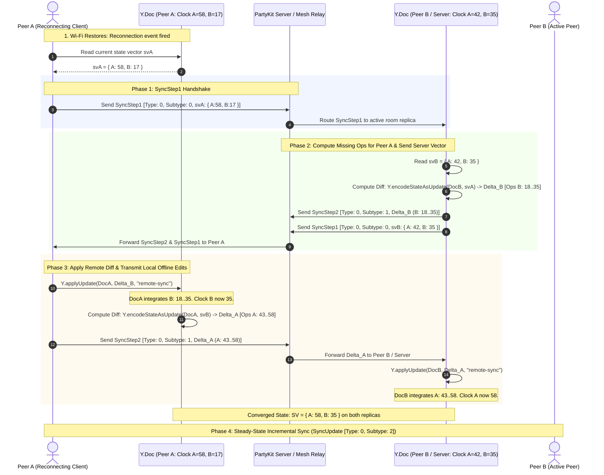

# CRDT Real-Time Sync Protocol

WorkSphere uses **Yjs** (a CRDT library) over **PartyKit** WebSockets for multiplayer document sync, with a separate SSE channel for venue updates and an IndexedDB-backed offline delta queue for resilience.

---

## Table of Contents

- [Overview](#overview)
- [Yjs Document Structures](#yjs-document-structures)
- [Yjs Delta Format & Wire Encoding](#yjs-delta-format--wire-encoding)
- [State Vector Resolution & Peer Reconnection](#state-vector-resolution--peer-reconnection)
- [Deletion Tombstones & Garbage Collection Lifecycle](#deletion-tombstones--garbage-collection-lifecycle)
- [PartyKit WebSocket Synchronization](#partykit-websocket-synchronization)
- [Offline Delta Queue Merging](#offline-delta-queue-merging)
- [Presence & Awareness Protocols](#presence--awareness-protocols)
- [SSE Channel (Venue Updates)](#sse-channel-venue-updates)
- [Transport Layer Summary](#transport-layer-summary)

---

## Overview

| Concern                 | Mechanism                   | Location                                                       |
| ----------------------- | --------------------------- | -------------------------------------------------------------- |
| Shared document state   | Yjs CRDT over `y-partykit`  | `party/server.ts`, `useRealTime.tsx`, `useCanvasWhiteboard.ts` |
| Cursor / presence       | Yjs Awareness protocol      | `useCanvasWhiteboard.ts`                                       |
| Seat occupancy          | JSON messages over PartyKit | `useSeatAvailability.ts`, `party/server.ts`                    |
| Venue ratings / reviews | Server-Sent Events (SSE)    | `useRealTime.tsx`                                              |
| Offline action queue    | IndexedDB + Web Worker      | `offlineStore.ts`, `sync.worker.ts`                            |

---

## Yjs Document Structures

### Folder / Collection Document (`folder-{id}` room)

Initialized in `useMultiplayerSession` (`src/hooks/useRealTime.tsx`):

```ts
const doc = new Y.Doc();
const provider = new YProvider("127.0.0.1:1999", roomId, doc, {
  params: token ? { token } : {},
});
```

The folder document is a general shared doc. Clients observe it for `type: "refresh"` signals broadcast over the same room to trigger a data refetch.

### Canvas Whiteboard Document (`canvas-{id}` room)

Initialized in `useCanvasWhiteboard` (`src/hooks/useCanvasWhiteboard.ts`):

```ts
const doc = new Y.Doc();
// Shared array of shape maps
const shapes = doc.getArray<Y.Map<unknown>>("shapes");
```

Each shape is a `Y.Map` with these keys:

| Key       | Type                                                | Description             |
| --------- | --------------------------------------------------- | ----------------------- |
| `id`      | `string`                                            | Unique shape identifier |
| `type`    | `"pen" \| "eraser" \| "rect" \| "circle" \| "line"` | Drawing tool            |
| `points`  | `number[]`                                          | Coordinate array        |
| `color`   | `string`                                            | Hex color               |
| `width`   | `number`                                            | Stroke width            |
| `opacity` | `number`                                            | 0–1 opacity             |
| `userId`  | `string`                                            | Author's user ID        |

Adding a shape:

```ts
const map = new Y.Map<unknown>();
map.set("id", data.id);
map.set("points", data.points.slice()); // copy to avoid shared reference
shapes.push([map]);
```

Updating a shape mutates the existing `Y.Map` in-place — Yjs records this as a delta, not a full replacement.

### UndoManager

```ts
const um = new Y.UndoManager(shapes, { captureTimeout: 500 });
```

- Groups operations within 500 ms into a single undo step.
- `um.undoStack` / `um.redoStack` sizes drive the `canUndo` / `canRedo` UI flags.
- `undo()` / `redo()` apply inverse deltas locally; Yjs propagates the reversal to peers automatically.

---

## Yjs Delta Format & Wire Encoding

Yjs encodes document modifications as **binary incremental deltas** (not full snapshots). The `y-partykit` provider and peer mesh brokers serialize updates using compact variable-length integer encoding via `lib0`.

### What a Delta Contains

A Yjs binary update payload encodes:

- **Client ID**: Monotonically allocated 53-bit unsigned integer per active replica (`Y.Doc` instance).
- **Clock**: Monotonically increasing logical Lamport sequence counter per client.
- **Content Blocks**: Typed operations (inserts, formats, embed payloads, deletion descriptors) across shared data types (`Y.Array`, `Y.Map`, `Y.Text`).
- **Dependencies (Left/Right IDs)**: Relative causal coordinates anchoring new operations within the CRDT linked-list structure without absolute index drift.

### Wire Protocol Message Framing (`lib0` & `y-protocols`)

WorkSphere's WebSocket and WebRTC DataChannel transports format messages using standard `y-protocols` framing:

```
+-------------------------------------------------------------------------------+
|                       CRDT BINARY MESSAGE WIRE LAYOUT                         |
+-------------------------------------------------------------------------------+
| Message Type (VarUint) | Sync Subtype (VarUint) |       Payload Bytes         |
| 0 = MESSAGE_SYNC       | 0 = SYNC_STEP_1        | State Vector (VarUint8Array)|
|                        | 1 = SYNC_STEP_2        | Document Diff (Update Binary)|
|                        | 2 = SYNC_UPDATE        | Incremental Update Binary   |
| 1 = MESSAGE_AWARENESS  | --                     | Ephemeral Awareness State   |
| 2 = MESSAGE_AUTH       | --                     | Authentication Token Payload|
+-------------------------------------------------------------------------------+
```

### Code Snippets: Update Message Encoding & Decoding

The following TypeScript implementation demonstrates the exact encoding and decoding pipelines used by WorkSphere's real-time communication tier:

```ts
import * as Y from "yjs";
import * as encoding from "lib0/encoding";
import * as decoding from "lib0/decoding";
import * as syncProtocol from "y-protocols/sync";

// Primary Message Framing Constants
export const MESSAGE_SYNC = 0;
export const MESSAGE_AWARENESS = 1;
export const MESSAGE_AUTH = 2;

/**
 * 1. Step 1 Handshake: Encode a SyncStep1 message carrying local State Vector.
 * Invoked immediately upon WebSocket connection or peer reconnection.
 */
export function encodeSyncStep1(doc: Y.Doc): Uint8Array {
  const encoder = encoding.createEncoder();
  encoding.writeVarUint(encoder, MESSAGE_SYNC);
  syncProtocol.writeSyncStep1(encoder, doc);
  return encoding.toUint8Array(encoder);
}

/**
 * 2. Step 2 Response: Decode incoming remote State Vector and encode
 * SyncStep2 carrying only the operations the remote peer is missing.
 */
export function handleSyncStep1AndEncodeReply(
  doc: Y.Doc,
  decoder: decoding.Decoder,
): Uint8Array {
  const replyEncoder = encoding.createEncoder();
  encoding.writeVarUint(replyEncoder, MESSAGE_SYNC);
  // syncProtocol.readSyncStep1 automatically reads remote SV and writes SyncStep2
  syncProtocol.readSyncStep1(decoder, replyEncoder, doc);
  return encoding.toUint8Array(replyEncoder);
}

/**
 * 3. Step 2 Application: Apply incoming missing delta to local document.
 */
export function handleSyncStep2(
  doc: Y.Doc,
  decoder: decoding.Decoder,
  origin: string,
): void {
  syncProtocol.readSyncStep2(decoder, doc, origin);
}

/**
 * 4. Steady-State Broadcast: Encode an incremental update triggered by local edit.
 */
export function encodeIncrementalUpdate(update: Uint8Array): Uint8Array {
  const encoder = encoding.createEncoder();
  encoding.writeVarUint(encoder, MESSAGE_SYNC);
  syncProtocol.writeUpdate(encoder, update);
  return encoding.toUint8Array(encoder);
}

/**
 * 5. Incoming Network Dispatcher: Routes raw binary ArrayBuffer messages.
 */
export function processIncomingBinaryMessage(
  message: Uint8Array,
  doc: Y.Doc,
  socket: WebSocket,
  origin: string = "network",
): void {
  const decoder = decoding.createDecoder(message);
  const messageType = decoding.readVarUint(decoder);

  switch (messageType) {
    case MESSAGE_SYNC: {
      const syncType = decoding.readVarUint(decoder);
      switch (syncType) {
        case syncProtocol.messageYjsSyncStep1: {
          const reply = handleSyncStep1AndEncodeReply(doc, decoder);
          if (reply.byteLength > 1) {
            socket.send(reply);
          }
          break;
        }
        case syncProtocol.messageYjsSyncStep2:
        case syncProtocol.messageYjsUpdate: {
          handleSyncStep2(doc, decoder, origin);
          break;
        }
      }
      break;
    }
  }
}
```

---

## State Vector Resolution & Peer Reconnection

A **state vector** represents a compact summary of all operations applied to a given `Y.Doc`. It maps each unique `clientId` to its highest contiguous Lamport clock counter:

$$\mathbf{SV} = \{ \text{client}_1: \text{clock}_1, \; \text{client}_2: \text{clock}_2, \; \dots, \; \text{client}_n: \text{clock}_n \}$$

When a client has been offline or disconnected due to local network fluctuations (such as roaming access points in a cafe), it accumulates local edits without receiving remote updates. The reconnection protocol guarantees bidirectional convergence without exchanging redundant history.

### Architectural Sequence: Peer Reconnection State Vector Exchange



### State Vector Diff Calculation Mechanics

When Peer B receives `svA = { A: 58, B: 17 }` while its own state is `svB = { A: 42, B: 35 }`:

1. **Evaluation for Peer A**:
   - Peer B checks `client B`: Peer B has clock `35`, Peer A only knows up to `17`.
   - Peer B slices all operations for `client B` with clocks in the range $(17, 35]$.
   - Operations for `client A` are skipped because Peer A's known clock (`58`) exceeds Peer B's clock (`42`).
   - The resulting encoded binary `Delta_B` contains **only** ops `B: 18..35`.
2. **Evaluation for Peer B**:
   - Peer A applies `Delta_B`, bringing its known clock for `client B` to `35`.
   - Peer A receives `svB = { A: 42, B: 35 }` and slices its operations for `client A` in the range $(42, 58]$.
   - The resulting `Delta_A` contains **only** ops `A: 43..58`.
3. **Bandwidth Optimization**: Historical operations (e.g., `A: 1..42` and `B: 1..17`) are never re-transmitted, minimizing payload sizes even after prolonged offline disconnects.

---

## Deletion Tombstones & Garbage Collection Lifecycle

In Conflict-Free Replicated Data Types (CRDTs), deletions cannot simply overwrite or physically delete memory addresses. Concurrent peers may insert items anchored relative to a deleted item's ID. To maintain deterministic causal convergence, Yjs employs **tombstones**.

### Tombstone Architecture

When an item (such as a whiteboard shape, a collection item, or a character in a note) is deleted:

1. `Item.deleted` is set to `true`.
2. `Item.content` is freed (`content = null`), stripping character strings, shape coordinates, or JSON properties to reclaim memory.
3. The item's structural metadata header is retained:
   - `id: { client: 42, clock: 104 }`
   - `length: 1`
   - `left: ID`, `right: ID`, `origin: ID`, `originRight: ID`

```
Active Item:     [ ID: (A, 104) | Content: "Workspace" | Left: (A, 103) | Right: (B, 12) ]
                      |
                      | User Deletes Text / Shape
                      v
Tombstone Item:  [ ID: (A, 104) | Content: NULL        | Left: (A, 103) | Right: (B, 12) ] (deleted = true)
```

### Tombstone Coalescing & Memory Compaction

To prevent unbounded structural overhead in high-churn environments, Yjs executes **structurally adjacent tombstone coalescing**:

- When adjacent items belonging to the same client are deleted (e.g., deleting a sentence of 20 characters), Yjs merges them into a single continuous tombstone block:
  $$\text{Tombstone}_{(A, 104..123)} \quad (\text{length} = 20)$$
- This reduces 20 distinct linked-list nodes into a single lightweight node, cutting pointer memory overhead by over 90%.

### Garbage Collection (GC) Threshold & Epoch Retention Rules

While content is nulled immediately, completely purging the structural tombstone header requires meeting strict epoch retention rules:

```
+-----------------------------------------------------------------------------------+
|                        TOMBSTONE CLEANUP LIFECYCLE                                |
+-----------------------------------------------------------------------------------+
| 1. Invalidation Phase:                                                           |
|    - Item marked deleted = true, content nulled                                  |
|    - Adjacent tombstones from same client coalesced                              |
|                                                                                   |
| 2. Threshold Trigger:                                                            |
|    - Evaluated when Tombstone Ratio >= 40% (Deleted Items / Total Items)          |
|    - OR uncompacted transaction update count > 1,000                              |
|                                                                                   |
| 3. Epoch Retention Horizon (Minimum Known Vector - MKV):                         |
|    - Clock threshold C_safe = MIN(all active peer clocks for target client)       |
|    - If C_tombstone <= C_safe across all active replicas:                        |
|        -> Tombstone can be safely purged from history graph                       |
|                                                                                   |
| 4. Offline Peer Eviction Policy:                                                 |
|    - Maximum offline epoch window: 7 Days (or 30 Days for enterprise archives)    |
|    - Peers disconnected beyond the epoch are evicted from the active vector set  |
|    - Evicted peer reconnecting receives SNAPSHOT_RESET instead of state vector diff|
+-----------------------------------------------------------------------------------+
```

#### 1. Garbage Collection Threshold Matrix

| Policy Dimension              | Threshold Metric                                                    | Action Taken                                                                                       |
| :---------------------------- | :------------------------------------------------------------------ | :------------------------------------------------------------------------------------------------- |
| **Tombstone Ratio Trigger**   | $\frac{\text{Deleted Items}}{\text{Total Items}} \ge 0.40$ ($40\%$) | Schedules background document compaction.                                                          |
| **Transaction Count Trigger** | $> 1,000$ uncompacted transactions                                  | Flushes cumulative updates into a single compressed update block via `Y.encodeStateAsUpdate(doc)`. |
| **Payload Size Trigger**      | Document binary $> 5\text{ MB}$                                     | Strips redundant historical operations and emits compacted snapshot.                               |

#### 2. Minimum Known Vector (MKV) Safe Horizon

A tombstone node at coordinate $(C_{\text{client}}, \text{clock})$ can **only** be permanently purged if every participating replica has confirmed receiving operations beyond that clock:

$$\text{Safe To Purge} \iff \forall \, p \in \text{ActivePeers}, \quad \mathbf{SV}_p[\text{client}] > \text{clock}$$

If any active peer has not confirmed reception of that clock, the tombstone header **must** be preserved to ensure proper relative positioning if that peer concurrently inserts adjacent characters.

#### 3. Offline Epoch Retention & Eviction Rules

1. **Active Session Horizon (7-Day Epoch Window)**:
   - When a peer disconnects, its last acknowledged state vector is held in PartyKit memory for up to **7 days**.
   - If the peer reconnects within 7 days, standard two-way `SyncStep1`/`SyncStep2` diff resolution executes seamlessly.
2. **Epoch Expiry & Forced Snapshot Reset (`SNAPSHOT_RESET`)**:
   - If a peer remains disconnected past the 7-day threshold, its client ID is evicted from the minimum vector calculation to prevent blocking GC for active peers.
   - Tombstones older than the active peers' clocks are purged.
   - If the expired peer subsequently reconnects, the server rejects incremental diff resolution and responds with a complete document snapshot (`SNAPSHOT_RESET`), replacing the peer's local state.

#### 4. `gc: true` vs. `gc: false` Configuration Matrix

WorkSphere configures Yjs garbage collection based on room domain requirements:

| Room Pattern                    | `gc` Setting | Persistence Mode               | Rationale                                                                                                                                                                                                                                                                    |
| :------------------------------ | :----------- | :----------------------------- | :--------------------------------------------------------------------------------------------------------------------------------------------------------------------------------------------------------------------------------------------------------------------------- |
| **`canvas-{id}`** (Whiteboard)  | `gc: true`   | Ephemeral / Redis              | High velocity drawing and stroke erasing. Tombstones must be reclaimed aggressively to prevent GPU/DOM memory bloat.                                                                                                                                                         |
| **`folder-{id}`** (Collections) | `gc: true`   | Ephemeral / DB                 | Frequent item add/remove operations. Tombstones are merged and collected continuously.                                                                                                                                                                                       |
| **`folder-notes-{id}`** (Notes) | `gc: false`  | Snapshot (`persist: snapshot`) | `gc: false` is required during active note editing so that full character undo/redo history (`Y.UndoManager`) and offline text edits can diff against the exact ancestral graph without missing causal anchors. Background snapshots compact the document every 1.5 seconds. |

---

## PartyKit WebSocket Synchronization

### Connection lifecycle

```
Client connects
  └─> onConnect(conn, ctx)
        ├─ Verify Clerk JWT from ?token query param
        ├─ Fetch role from /api/partykit/auth
        ├─ conn.setState({ role: "EDITOR" | "VIEWER" })
        ├─ Send seat_snapshot if room has active check-ins
        └─ onConnectYjs(conn, room, { gc: true, readOnly: isViewer })

Client disconnects
  └─> onClose(conn)
        └─ handleSeatCheckout(conn)  — clears occupancy count
```

### Message routing in `onMessage`

```
Incoming message
  ├─ type: "typing"        → broadcast to room (all roles)
  ├─ type: "seat_checkin"  → handleSeatCheckin (all roles)
  ├─ type: "seat_checkout" → handleSeatCheckout (all roles)
  ├─ role === "VIEWER"     → DROP (no further broadcast)
  ├─ type: "presence"      → broadcast excluding sender (handled in onConnect listener)
  ├─ type: "cursor"        → broadcast excluding sender
  └─ other JSON / binary   → broadcast to room (EDITOR only)
```

### Room naming convention

| Pattern             | Purpose                                         |
| ------------------- | ----------------------------------------------- |
| `folder-{folderId}` | Yjs document + presence for a shared collection |
| `canvas-{canvasId}` | Yjs document for whiteboard shapes              |
| `seat-availability` | Seat check-in presence (no Yjs)                 |

### Seat availability messages

Client → server:

```ts
{ type: "seat_checkin", venueId: string, capacity?: number }
{ type: "seat_checkout" }
```

Server → all clients:

```ts
// After any check-in or checkout
{ type: "seat_update", venueId: string, count: number, capacity: number, status: "green" | "yellow" | "red" }

// Sent once to a newly connected client if the room has active check-ins
{ type: "seat_snapshot", venues: Array<{ venueId, count, capacity, status }> }
```

Status thresholds (mirrored in `useSeatAvailability.ts`):

| Status   | Condition                      |
| -------- | ------------------------------ |
| `green`  | `count / capacity < 0.6`       |
| `yellow` | `0.6 ≤ count / capacity < 1.0` |
| `red`    | `count / capacity ≥ 1.0`       |

Default capacity when not provided by client: **8** (defined in both `party/server.ts` and `useSeatAvailability.ts`).

---

## Offline Delta Queue Merging

When a user is offline, actions are queued in **IndexedDB** and replayed when connectivity is restored.

### Seat check-in offline path (`useSeatAvailability.ts`)

```
navigator.onLine === false
  └─> queueOfflineCheckIn(venueId)   — writes to IndexedDB

window "online" event fires
  └─> getQueuedCheckIns()
        └─> for each item:
              POST /api/sync { checkIns: [item] }
              ├─ success → dequeueOfflineCheckIn(item.id)
              │            socket.send({ type: "seat_checkin", ... })
              └─ failure → incrementCheckInRetryCount(item.id)
```

### Favorites offline path (`sync.worker.ts`)

The sync Web Worker runs in the background and processes a favorites outbox queue:

```
WAKE_UP message received
  └─> processOutbox()
        └─> navigator.locks.request("sync-favorites-queue")  — prevents multi-tab races
              └─> for each queued action:
                    ├─ Check circuit breaker state
                    ├─ Apply exponential backoff if retryCount > 0
                    │    delay = min(60s, 1s × 2^attempt) + jitter(0–1s)
                    ├─ POST /api/favorites { venueId, action }
                    ├─ success → dequeueOfflineAction, recordSuccess()
                    └─ failure → recordFailure(), incrementRetryCount()
                                 if attempts ≥ MAX_SYNC_RETRIES → permanent failure, dequeue
```

### Circuit breaker states

```
CLOSED ──(3 failures)──> OPEN ──(30s timeout)──> HALF_OPEN ──(success)──> CLOSED
                                                              └─(failure)──> OPEN
```

| State       | Behavior                                                    |
| ----------- | ----------------------------------------------------------- |
| `CLOSED`    | Normal — all requests pass through                          |
| `OPEN`      | Blocked — no requests sent until timeout expires            |
| `HALF_OPEN` | One probe request allowed; success closes, failure re-opens |

### Yjs offline behavior

Yjs itself buffers unsynced operations in the `Y.Doc` in memory. When the `YProvider` reconnects, it performs the state vector handshake and sends any locally accumulated deltas. No additional application-level queuing is needed for document edits — only for non-Yjs actions (favorites, seat check-ins) that go through REST APIs.

---

## Presence & Awareness Protocols

### Yjs Awareness (canvas whiteboard)

`y-partykit` includes a built-in **Awareness** protocol that propagates ephemeral per-client state (cursors, user info) separately from the document CRDT.

Local state is set in `useCanvasWhiteboard.ts`:

```ts
awareness.setLocalState({
  x: 0, // cursor X
  y: 0, // cursor Y
  name: userName,
  color: userColor,
});
```

Cursor updates on mouse move:

```ts
// updateCursor called on canvas mousemove
aw.setLocalState({ ...currentState, x, y });
```

Receiving remote cursors:

```ts
awareness.on("change", () => {
  const states = Array.from(awareness.getStates().entries());
  const cursors = states
    .filter(([clientId]) => clientId !== awareness.clientID)
    .map(([clientId, state]) => ({
      userId: `user-${clientId}`,
      x: state.x,
      y: state.y,
      name: state.name,
      color: state.color,
    }));
  setRemoteCursors(cursors);
});
```

Awareness state is **not** part of the CRDT document — it is ephemeral and lost on disconnect. It does not go through the offline queue.

### JSON presence (folder rooms)

For folder rooms, lightweight presence uses plain JSON over the same PartyKit socket:

```ts
// In onConnect message listener (party/server.ts)
if (data.type === "presence" || data.type === "cursor") {
  this.room.broadcast(event.data, [conn.id]); // exclude sender
}
```

Clients send and receive `{ type: "presence", ... }` or `{ type: "cursor", ... }` objects. The schema is application-defined — the server only routes them.

### Typing indicators

```ts
{ type: "typing", userId: string, isTyping: boolean }
```

Broadcast to all connections including VIEWERs. Not persisted.

### Seat presence

Seat check-ins are a form of presence tied to a physical venue rather than a document. They are stored in the server's in-memory `Map<connectionId, SeatCheckin>` and cleared on `onClose`. See [Seat availability messages](#seat-availability-messages) above.

---

## SSE Channel (Venue Updates)

For venue ratings and availability updates that don't require bidirectional sync, WorkSphere uses **Server-Sent Events** (`useRealTimeUpdates` in `src/hooks/useRealTime.tsx`).

### Event format

```ts
interface VenueUpdate {
  type: "rating" | "availability" | "new_review";
  venueId: string;
  data: Record<string, unknown>;
  timestamp: number;
}
```

### Connection management

- Endpoint: `GET /api/venues/updates?venueId=...&venueId=...`
- Reconnect: exponential backoff starting at 1 s, doubling up to 30 s.
- Pauses automatically when `navigator.onLine === false`.
- Resumes on `window "online"` event or tab visibility change.
- Keeps last 50 updates in state (`prev.slice(-49)`).

SSE is one-way (server → client) and does not use Yjs or CRDT merging. It is appropriate for broadcast-only data where the client never writes back through the same channel.

---

## Transport Layer Summary

```
┌─────────────────────────────────────────────────────────────────┐
│                        CLIENT                                   │
│                                                                 │
│  useCanvasWhiteboard ──┐                                        │
│  useMultiplayerSession ┼──> YProvider (y-partykit)             │
│                        │      binary Yjs deltas (ArrayBuffer)  │
│                        │                                        │
│  useSeatAvailability ──┼──> usePartySocket (partysocket/react) │
│  folder presence       │      JSON messages                    │
│                        │                                        │
│  useRealTimeUpdates ───┼──> EventSource (SSE)                  │
│                        │      JSON events (read-only)          │
│                        │                                        │
│  sync.worker.ts ───────┴──> fetch() REST calls                 │
│  useSeatAvailability          (offline queue replay)           │
└─────────────────────────────────────────────────────────────────┘
                         │
              WebSocket (:1999) + HTTP (:3000)
                         │
┌─────────────────────────────────────────────────────────────────┐
│                    PARTYKIT SERVER                              │
│                                                                 │
│  WorkspaceServer.onConnect                                      │
│    ├─ Clerk JWT verification                                    │
│    ├─ Role assignment (EDITOR / VIEWER)                         │
│    ├─ onConnectYjs → y-partykit handles Yjs binary traffic      │
│    └─ JSON listener → presence / seat routing                  │
│                                                                 │
│  WorkspaceServer.onMessage                                      │
│    ├─ typing / presence / cursor → broadcast                   │
│    ├─ seat_checkin / seat_checkout → in-memory Map update       │
│    └─ VIEWER gate → drop non-presence JSON                     │
│                                                                 │
│  WorkspaceServer.onClose                                        │
│    └─ seat checkout → broadcast seat_update                    │
└─────────────────────────────────────────────────────────────────┘
```

### Related files

```
party/server.ts                          PartyKit server (Yjs + seat presence)
partykit.json                            PartyKit config
src/hooks/useRealTime.tsx                useMultiplayerSession (YProvider + socket)
src/hooks/useCanvasWhiteboard.ts         Yjs shapes doc + awareness
src/hooks/useSeatAvailability.ts         Seat check-in client + offline queue
src/workers/sync.worker.ts              Favorites offline sync worker
src/lib/offlineStore.ts                  IndexedDB queue helpers
src/app/api/partykit/auth/route.ts       Role lookup for PartyKit auth
src/app/api/venues/updates/route.ts      SSE endpoint for venue updates
```

---

## Collaborative Collection Notes (#3360)

Collection notes used to be the `Folder.description` string, saved with a
whole-value `PUT /api/folders/:id`. Two people editing at once meant the later
save silently erased the other's changes (last-write-wins). Notes are now a
Yjs `Y.Text` that merges concurrent edits.

### Data flow

```
textarea ──applyYTextDiff──▶ Y.Text "collection-notes"
                                │  y-partykit (binary Yjs sync)
                                ▼
              PartyKit room  folder-notes-{folderId}   (persist: snapshot)
                                │
           debounced plain-text snapshot (editors only)
                                ▼
              Folder.description  →  list page, PDF export, public page
```

- **Minimal operations.** Each keystroke becomes character-level inserts and
  deletes via `applyYTextDiff` (common prefix/suffix), never a full replace.
  Edits to different paragraphs therefore never touch the same characters.
- **Deterministic merge, no locking.** Yjs orders concurrent inserts by
  `(clientID, clock)`, so every replica converges to the same text in any
  delivery order. Offline edits merge on reconnect.
- **Snapshot, not source of truth.** Editors write `Y.Text.toString()` back
  to `Folder.description` 1.5 s after their last local edit (capped to the
  field's 500-character limit). All replicas converge, so these writes can't
  lose edits. The CRDT is authoritative.

### Seeding existing notes

The first editor to open an empty shared note seeds it from the legacy
`Folder.description`. The seed update is built with a Yjs `clientID` derived
from an FNV-1a hash of the text (`createSeedUpdate`). Two clients seeding the
same text at the same moment produce **byte-identical** updates that Yjs
de-duplicates, so the note is never doubled. Seeding never happens over a
non-empty note.

### Access control (`party/server.ts`)

| Who                                         | `folder-notes-{id}` room                     |
| ------------------------------------------- | -------------------------------------------- |
| No Clerk token                              | Rejected (`4003`)                            |
| Signed in, not a member/owner of the folder | Rejected (`4003`)                            |
| `VIEWER` / `MEMBER`                         | Read-only (`y-partykit` drops their updates) |
| `OWNER` / `EDITOR`                          | Read/write                                   |

The role lookup to `/api/partykit/auth` now sends
`Authorization: Bearer $PARTYKIT_AUTH_SECRET`. The route has always required
this header, but the server never sent it, so every lookup failed and **all
users were treated as viewers in every folder room**. The route also returns
`member: true|false`, so outsiders (who also get role `VIEWER`) can be told
apart from real viewers. Clients pass a fresh Clerk token on every
(re)connect through the provider's async `params`.

Notes rooms use `persist: { mode: "snapshot" }` (with `gc: false`, as
y-partykit requires) so notes survive the room being evicted from memory.

### Files

| File                                                   | Role                                                                         |
| ------------------------------------------------------ | ---------------------------------------------------------------------------- |
| `src/lib/crdt/collectionNotes.ts`                      | Room naming, deterministic seeding, length limit                             |
| `src/components/collections/CollectionNotesEditor.tsx` | Textarea ↔ `Y.Text`, caret preservation via relative positions, snapshotting |
| `party/server.ts`                                      | Members-only notes rooms, authenticated role lookup, persistence             |
| `src/app/api/partykit/auth/route.ts`                   | Adds the `member` flag                                                       |

### Tests

- `src/__tests__/lib/collectionNotes.test.ts`:
  - **Acceptance:** two concurrent edits to different paragraphs merge with no data loss; the old last-write-wins save is shown losing one of them.
  - Order-independent convergence across three users.
  - Same-paragraph edits and insert-vs-delete conflicts; offline edits.
  - Idempotent concurrent seeding.
- `party/__tests__/folderNotesAccess.test.ts`: the access table above, the shared-secret header, and persistence options.
- `src/__tests__/components/CollectionNotesEditor.test.tsx`: seeding, a live merge of local typing with a remote edit, the debounced snapshot, read-only viewers, and offline state.
