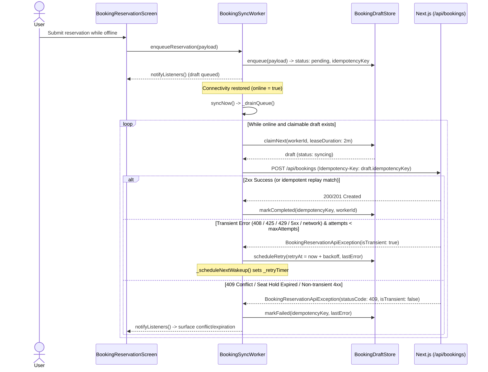

# Flutter Offline Booking Draft Queue & Conflict Reconciliation

This document describes how the Flutter client (`apps/flutter/lib/features/bookings/`) persists offline booking drafts, drains them on reconnect against the Next.js backend (`POST /api/bookings`), and reconciles idempotency keys, transient failures, seat-hold expirations, and `409 Conflict` responses.

## Architecture & Key Components

| Component | File | Responsibility |
| --- | --- | --- |
| `BookingDraft` / `BookingDraftStatus` | `apps/flutter/lib/features/bookings/domain/booking_draft.dart` | Models draft state (`pending`, `syncing`, `completed`, `failed`), `idempotencyKey`, `attemptCount`, `nextAttemptAt`, and `lastError`. |
| `BookingDraftStore` | `apps/flutter/lib/features/bookings/data/booking_draft_store.dart` | Persists drafts locally and provides lease-based `claimNext`, `markCompleted`, `scheduleRetry`, and `markFailed` transitions. |
| `BookingSyncWorker` | `apps/flutter/lib/features/bookings/data/booking_sync_worker.dart` | Listens to `connectivityChanges`, drains the queue via `syncNow()`, applies exponential retry backoff (`retryBaseDelay`, `maxAttempts = 5`), and schedules wakeups. |
| `HttpBookingReservationApi` | `apps/flutter/lib/features/bookings/data/booking_reservation_api.dart` | Sends `POST /api/bookings` with the `Idempotency-Key` header and classifies HTTP errors as transient or terminal. |

## Idempotency Keys & Lease Claiming

1. **Idempotency Key**: Each enqueued draft is assigned a stable `idempotencyKey` stored in `BookingDraft`. On every replay attempt, `HttpBookingReservationApi.createReservation` sends:
   - `POST /api/bookings`
   - `Idempotency-Key: <idempotencyKey>`
   - JSON-encoded reservation `payload`
2. **Lease-Based Worker Claiming**: `BookingSyncWorker._drainQueue()` calls `_store.claimNext(workerId: _workerId, now: DateTime.now(), leaseDuration: leaseDuration)` (default `leaseDuration` is 2 minutes). This transitions the draft to `syncing` and prevents duplicate concurrent submissions from multiple workers or overlapping reconnect events.
3. **Single-Flight Queue Drain**: `syncNow()` deduplicates concurrent drain calls through `_activeSync`.

## Error Classification, Seat-Hold Expirations & 409 Conflicts

`HttpBookingReservationApi` classifies non-`2xx` HTTP responses into `BookingReservationApiException(statusCode, isTransient)`:

- **Transient (`isTransient == true`)**: HTTP `408`, `425`, `429`, `>= 500`, or non-HTTP transport/network exceptions.
  - While `attemptCount + 1 < maxAttempts` (default `maxAttempts = 5`), `BookingSyncWorker` calls `_store.scheduleRetry(...)` with exponential backoff starting from `retryBaseDelay` (default `1s`), keeping the draft eligible for future reconnect/timer wakeups.
  - Once `maxAttempts` is reached, the draft is transitioned to `failed` via `_store.markFailed(...)`.
- **Terminal (`isTransient == false`)**: Client errors such as `400`, `404`, `409 Conflict` (e.g., overlapping reservation or expired seat hold), or `422`.
  - `BookingSyncWorker` does **not** retry terminal errors; it immediately calls `_store.markFailed(...)` with `"Reservation request failed (HTTP <statusCode>)."` stored in `lastError` so the UI (`BookingReservationScreen`) can surface the conflict/expiration and prompt the user to re-select seats or times.

## Offline-to-Online Sync Sequence

