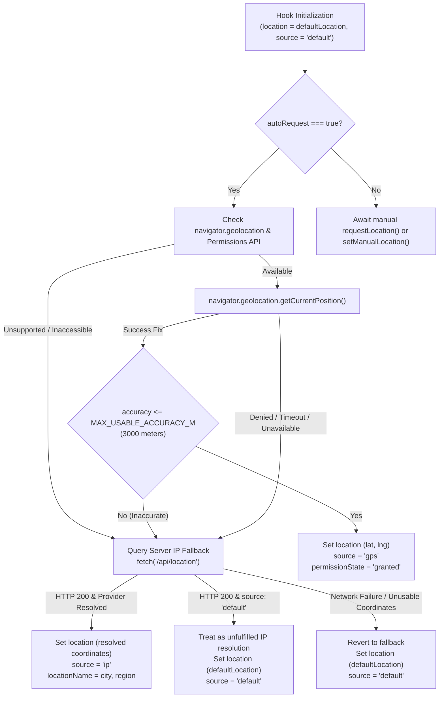

# Leaflet Map Coordinates Accuracy & Geolocation Architecture Manual

## 1. Overview

WorkSphere integrates **Leaflet maps** to render and discover workspaces, calculate travel distances, and display nearby venues dynamically. The foundation of this functionality is browser-based geolocation coupled with a multi-tiered fallback architecture.

This document serves as the technical guide for:

1. Understanding the HTML5 Geolocation API and hook configuration options.
2. The complete location resolution lifecycle (GPS -> IP -> Configured Fallback).
3. The server-side multi-provider IP geolocation endpoint (`/api/location`).
4. Manual coordinate override and OpenStreetMap Nominatim geocoding.
5. Best practices for configuring fallback coordinates without editing unrelated components.
6. Browser troubleshooting across iOS Safari and Android Chrome.
7. Verification and regression testing.

---

## 2. Browser Geolocation API

WorkSphere retrieves live client coordinates using the standard W3C HTML5 Geolocation API via `navigator.geolocation`.

### Security Requirements (Secure Contexts)

The Geolocation API is restricted by modern browsers to **Secure Contexts** (`HTTPS`) or local development origins (`http://localhost` and `http://127.0.0.1`). When accessed over unencrypted HTTP on non-local networks, `navigator.geolocation` is `undefined` or requests fail immediately.

### Permissions API Integration

Where supported, the client queries `navigator.permissions.query({ name: "geolocation" })` to inspect the permission status:

- `"prompt"`: The user has not yet decided, or permission will be requested on invocation.
- `"granted"`: Location access is active and approved.
- `"denied"`: Location access was explicitly blocked by the user or browser security policy.

---

## 3. Geolocation Methods

WorkSphere cleanly separates one-time position acquisition from continuous device tracking across dedicated modules:

| Method                     | Primary Purpose in WorkSphere                                                                                                                                       | Implementation Location                                                                                                                              |
| :------------------------- | :------------------------------------------------------------------------------------------------------------------------------------------------------------------ | :--------------------------------------------------------------------------------------------------------------------------------------------------- |
| **`getCurrentPosition()`** | **One-time location acquisition:** Obtains a single coordinate snapshot upon component mount or explicit user refresh (e.g. initial map centering).                 | `src/hooks/useUserLocation.ts`, `src/hooks/useCommuteEstimator.ts`, `src/components/venues/DistanceFilterSlider.tsx`                                 |
| **`watchPosition()`**      | **Continuous position streaming:** Subscribes to ongoing device movement updates with adaptive throttling, heading/bearing tracking, or geofence arrival detection. | `src/hooks/useThrottledGeolocation.ts`, `src/hooks/useGeoProximityCheckIn.ts`, `src/hooks/useArrivalDetection.ts`, `src/hooks/useMapRealtimeSync.ts` |

> [!NOTE]
> `useUserLocation` specifically utilizes `getCurrentPosition()`. It does **not** maintain an open `watchPosition()` stream. Continuous tracking is managed separately by specialized hooks such as `useThrottledGeolocation` to optimize mobile battery life and eliminate unnecessary map re-renders.

---

## 4. Hook Options and Defaults (`UseUserLocationOptions`)

The primary location hook is **`useUserLocation()`** ([`src/hooks/useUserLocation.ts`](../src/hooks/useUserLocation.ts)). It accepts a configuration object typed as `UseUserLocationOptions`:

```typescript
export interface UseUserLocationOptions {
  enableHighAccuracy?: boolean;
  timeout?: number;
  maximumAge?: number;
  defaultLocation?: UserLocation;
  autoRequest?: boolean;
}
```

### Verified Parameter Defaults

| Option               | Type           | Actual Default              | Operational Purpose & Guidance                                                                                                                       |
| :------------------- | :------------- | :-------------------------- | :--------------------------------------------------------------------------------------------------------------------------------------------------- |
| `enableHighAccuracy` | `boolean`      | `false`                     | When `false`, allows cellular/Wi-Fi positioning for faster, battery-efficient resolution. Set to `true` when precision GPS fixes are required.       |
| `timeout`            | `number`       | `6000` ms                   | Maximum time in milliseconds allowed for the browser to obtain a position before triggering the error callback and proceeding to IP fallback.        |
| `maximumAge`         | `number`       | `60000` ms (1 min)          | Maximum age in milliseconds of an acceptable cached position fix. Bypasses slow hardware sensor wakeups when a fresh fix is not needed.              |
| `defaultLocation`    | `UserLocation` | `DEFAULT_FALLBACK_LOCATION` | Configurable fallback coordinates (`{ latitude: 37.7749, longitude: -122.4194 }` - San Francisco, CA) used if both browser GPS and IP fallback fail. |
| `autoRequest`        | `boolean`      | `true`                      | Automatically invokes `requestLocation()` on component mount. Set to `false` for deferred or user-initiated requests.                                |

### TypeScript Usage Example

```typescript
import { useUserLocation } from "@/hooks/useUserLocation";

export function VenueDiscoveryMap() {
  const {
    location,
    locationName,
    source,
    permissionState,
    isDenied,
    isLoading,
    error,
    requestLocation,
    setManualLocation,
    resolvePostalOrCity,
  } = useUserLocation({
    enableHighAccuracy: false,
    timeout: 6000,
    maximumAge: 60000,
    defaultLocation: {
      latitude: 40.7128,
      longitude: -74.006,
    },
    autoRequest: true,
  });

  // Render map centered on `location`
}
```

---

## 5. Location Resolution Lifecycle

When `useUserLocation` mounts with `autoRequest: true`, it executes a resilient, multi-stage fallback pipeline:



### Resolution Stages Explained

1. **Initialization:** The hook state starts with `defaultLocation` and `isLoading = true`.
2. **Browser Acquisition:** If `navigator.geolocation` is present, `getCurrentPosition()` is triggered with the configured `enableHighAccuracy`, `timeout`, and `maximumAge`.
3. **Accuracy Verification:** Low-quality cell-tower fixes worse than `MAX_USABLE_ACCURACY_M` ($3,000\text{ meters}$) are rejected as unusable for local workspace discovery and seamlessly trigger IP fallback.
4. **IP Fallback:** If GPS is denied, timed out, unsupported, or inaccurate, the client queries `GET /api/location`.
   - **External IP Provider Success:** If the server resolves geographic coordinates via an external IP provider (`source !== "default"`), the hook sets the resolved coordinates, assigns `source: "ip"`, and sets `locationName` to the formatted city/region.
   - **Server Static Fallback (`source: "default"`):** If external IP providers fail or are rate-limited, the server returns its static San Francisco default with `source: "default"`. The hook treats this as an unfulfilled IP resolution: it applies the hook's configured `defaultLocation`, sets `source: "default"`, and sets `locationName` to `"San Francisco, CA"` only if the hook is using the standard San Francisco default (otherwise `null`).
5. **Final Network Fallback:** If the network request fails, or returns non-finite coordinates, the hook reverts to the configured `defaultLocation` with `source: "default"`.

### Location Source States (`LocationSource`)

| Source      | Description                                                                        | Precision Level                                                                                         |
| :---------- | :--------------------------------------------------------------------------------- | :------------------------------------------------------------------------------------------------------ |
| `"gps"`     | Directly acquired from browser GPS or Wi-Fi positioning hardware.                  | High; device-derived, accuracy depends on the device and positioning environment.                       |
| `"ip"`      | Resolved via server-side network IP lookup through `/api/location`.                | Approximate; city/regional level, suitable for initial fallback rather than precise device positioning. |
| `"manual"`  | Explicitly set by the user via direct coordinates or postal/city geocoding.        | User-defined point.                                                                                     |
| `"default"` | Preconfigured static fallback coordinates when no position fix can be established. | Fixed static point.                                                                                     |

---

## 6. IP-Based Fallback (`/api/location`)

When browser geolocation is unavailable or denied, WorkSphere calls the server-side geolocation endpoint:

```typescript
const response = await fetch("/api/location");
```

### Route Implementation ([`src/app/api/location/route.ts`](../src/app/api/location/route.ts))

The `/api/location` endpoint provides multi-provider IP geolocation with built-in resilience:

1. **Edge Network Headers:** When deployed to Vercel, reads edge geolocation headers (`x-vercel-ip-latitude`, `x-vercel-ip-longitude`, `x-vercel-ip-city`, `x-vercel-ip-country-region`) to avoid external HTTP roundtrips.
2. **Multi-Provider Fallback Cascade:** For standard server environments, queries external providers in sequence with a $3\text{-second}$ timeout:
   - **Provider 1:** `https://ipwho.is/<ip>` (fast, HTTPS, free).
   - **Provider 2:** `https://ip-api.com/json/<ip>` (HTTPS fallback).
   - **Provider 3:** `https://ipapi.co/<ip>/json/` (tertiary fallback).
3. **Loopback & Private Network Detection:** Requests originating from private or loopback ranges (`127.0.0.1`, `localhost`, `10.0.0.0/8`, `192.168.0.0/16`, `172.16.0.0/12`) omit the client IP so external providers geolocate the public egress gateway.
4. **Caching & Rate Limiting:**
   - **In-Memory LRU Cache:** Uses `locationCache` ([`src/lib/locationCache.ts`](../src/lib/locationCache.ts)) with a $10\text{-minute}$ TTL for up to $1,000$ distinct IPs.
   - **Rate Limiting:** Protects against abuse with a sliding-window limit of $10\text{ requests per minute per IP}$.

### Response Contract

```json
{
  "lat": 37.7749,
  "lng": -122.4194,
  "city": "San Francisco",
  "region": "California",
  "country": "US",
  "timezone": "America/Los_Angeles",
  "source": "ipwho.is"
}
```

The hook handles both `{ lat, lng }` and `{ latitude, longitude }` coordinate keys:

```typescript
const resolvedLat = data.latitude ?? data.lat;
const resolvedLng = data.longitude ?? data.lng;
```

---

## 7. Fallback Coordinates Configuration

### The Supported Approach

To configure custom fallback coordinates for a specific component or route, pass `defaultLocation` directly to `useUserLocation()`:

```typescript
// Custom deployment default (e.g., London HQ)
const { location } = useUserLocation({
  defaultLocation: {
    latitude: 51.5074,
    longitude: -0.1278,
  },
});
```

### Global Project Constant

If an application-wide fallback is required, reference or inspect the exported constant in `src/hooks/useUserLocation.ts`:

```typescript
export const DEFAULT_FALLBACK_LOCATION: UserLocation = {
  latitude: 37.7749,
  longitude: -122.4194,
};
```

> [!WARNING]
> Do **not** customize fallbacks by modifying state initialization or hardcoding coordinates inside individual page components (such as `src/app/ai/page.tsx` or `EnhancedChatbot.tsx`). Always configure fallbacks via the `defaultLocation` hook option.

---

## 8. Manual Location Selection

`useUserLocation` provides two dedicated methods for user-driven location overrides:

### 1. `setManualLocation(lat: number, lng: number, name?: string)`

Directly sets the active coordinates and an optional display label:

```typescript
setManualLocation(51.5074, -0.1278, "London, UK");
```

- **Validation:** Requires finite numbers; ignores `(0, 0)` null-island coordinates.
- **State Effect:** Updates `location`, assigns `source: "manual"`, and clears existing errors. The `locationName` state is updated only when `name` is explicitly provided as a string; when omitted or undefined, `locationName` retains its previous value without being cleared or overwritten.

### 2. `resolvePostalOrCity(query: string): Promise<GeocodedLocation | null>`

Asynchronously geocodes a city name or postal code using OpenStreetMap Nominatim (`geocodePostalOrCity`):

```typescript
const result = await resolvePostalOrCity("Seattle");

if (result) {
  // Hook location state has already been updated to Seattle coordinates
  console.log(
    `Resolved to: ${result.displayName} (${result.lat}, ${result.lng})`,
  );
}
```

- **Query Handling:** Trims whitespace and URL-encodes the query string.
- **State Effect:** On success, sets `location: { latitude: res.lat, longitude: res.lng }`, `locationName: res.displayName`, and `source: "manual"`.

### Fallback Banner Component ([`GeolocationFallbackBanner.tsx`](../src/components/venues/GeolocationFallbackBanner.tsx))

When location access is prompt-pending or denied, `GeolocationFallbackBanner` provides an inline search UI integrated into `src/app/ai/page.tsx`:

1. Displays an accessible warning banner with a postal/city input.
2. Form submission executes `geocodePostalOrCity()`.
3. Triggers `onLocationSelected(geocoded)` which calls `setManualLocation()` and smoothly re-centers the Leaflet map view via `setMapView`.

---

## 9. Browser Troubleshooting

### Safari on iOS / iPadOS

#### Step 1: System-Level Permission

1. Open **Settings** -> **Privacy & Security** -> **Location Services**.
2. Verify **Location Services** is switched **ON**.
3. Select **Safari Websites** and choose **While Using the App**.

#### Step 2: Safari Website Settings

1. In Safari, navigate to the application.
2. Tap the **Page Settings (AA)** icon in the address bar.
3. Tap **Website Settings** -> **Location** -> Select **Allow**.

#### Step 3: Progressive Web App (PWA) on Home Screen

1. PWAs installed to the iOS Home Screen execute in an isolated WebClip container with distinct permissions.
2. Open the installed PWA and trigger the location prompt.
3. If permission fails to register, remove the PWA icon, clear Safari history/website data, and re-add to Home Screen.

---

### Android Chrome

#### Step 1: Device-Level GPS

1. Swipe down the notification shade and verify **Location** / **GPS** is enabled.

#### Step 2: Chrome Application Permissions

1. Long-press the **Chrome** icon and tap **App info** (or **Settings** -> **Apps** -> **Chrome**).
2. Tap **Permissions** -> **Location**.
3. Select **Allow only while using the app** and enable **Use precise location**.

#### Step 3: Site-Level Settings

1. In Chrome, tap the **Tune / Lock** icon to the left of the URL bar.
2. Tap **Permissions** -> **Location** -> Select **Allow**.

---

## 10. Testing and Debugging

### Running Geolocation Hook Unit Tests

```bash
npm test src/__tests__/hooks/useUserLocation.test.ts
```

### Running Server-Side Location API Tests

```bash
npm test src/__tests__/api/location.test.ts
```

### Mocking `navigator.geolocation` in Jest

```typescript
const mockGetCurrentPosition = jest.fn((success, error) => {
  success({
    coords: {
      latitude: 37.7749,
      longitude: -122.4194,
      accuracy: 15,
    },
  });
});

Object.defineProperty(navigator, "geolocation", {
  value: { getCurrentPosition: mockGetCurrentPosition },
  writable: true,
  configurable: true,
});
```

---

## 11. Related Implementation Files

- [`src/hooks/useUserLocation.ts`](../src/hooks/useUserLocation.ts) - Primary client location hook, Nominatim geocoder, and IP fallback dispatcher.
- [`src/app/api/location/route.ts`](../src/app/api/location/route.ts) - Multi-provider server IP-geolocation endpoint.
- [`src/lib/locationCache.ts`](../src/lib/locationCache.ts) - In-memory LRU cache with TTL for resolved IP coordinates.
- [`src/components/venues/GeolocationFallbackBanner.tsx`](../src/components/venues/GeolocationFallbackBanner.tsx) - UI banner for manual postal/city search when location access is denied.
- [`src/app/ai/page.tsx`](../src/app/ai/page.tsx) - Production integration of `useUserLocation` and Leaflet map synchronization.
- [`src/hooks/useThrottledGeolocation.ts`](../src/hooks/useThrottledGeolocation.ts) - Continuous tracking using `watchPosition()` with velocity-based throttling.
- [`src/hooks/useGeoProximityCheckIn.ts`](../src/hooks/useGeoProximityCheckIn.ts) - Geofence proximity verification using `watchPosition()`.
