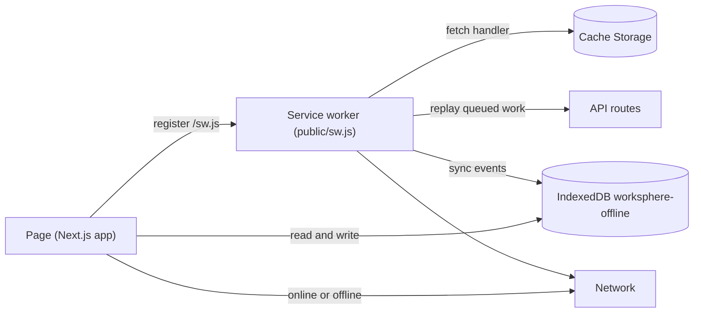
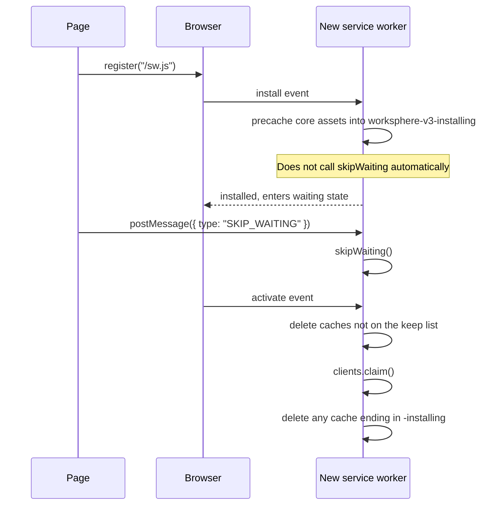
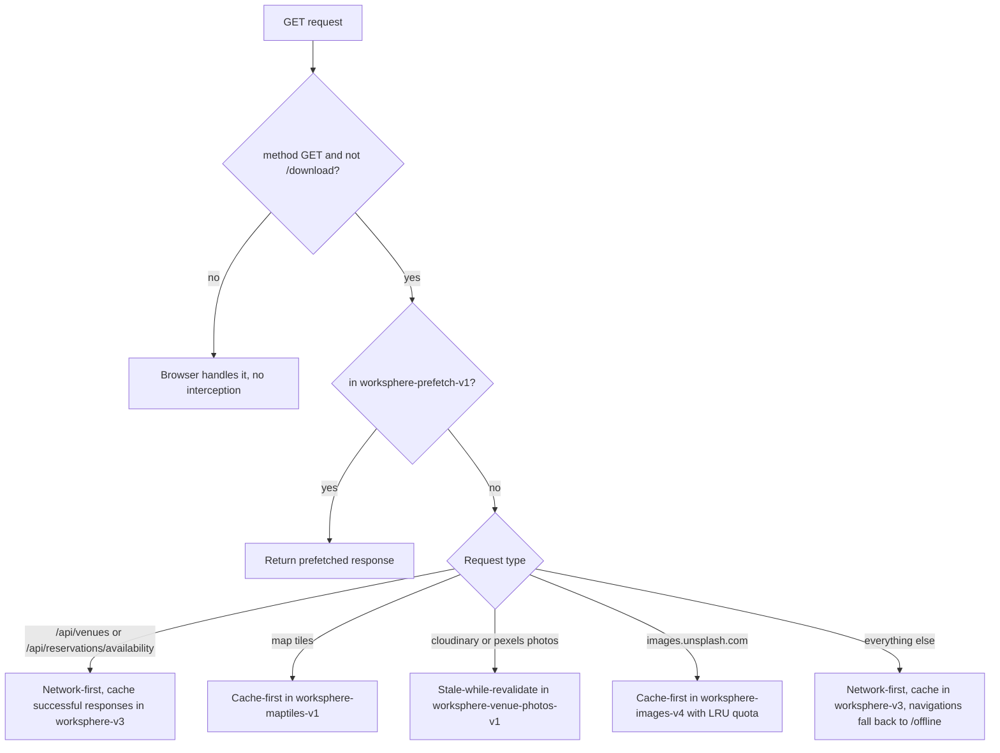
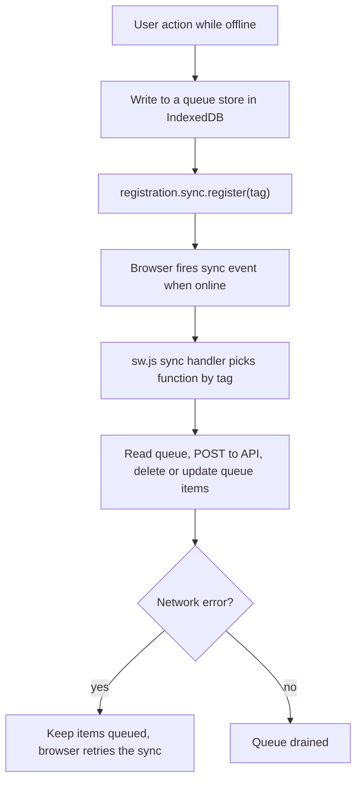

# PWA Runbook: Service Worker Lifecycle and IndexedDB Synchronization

This runbook explains how WorkSphere's offline layer works end to end: how the service worker is installed and updated, which caches it keeps, how requests are routed (network-first vs cache-first), how the IndexedDB database is created and upgraded, how background sync replays queued work, and how to debug stale state in DevTools.

It describes the code as it exists in the repository. When this document and the code disagree, the code wins. Please update this file in the same PR as any change to the files below.

## Source of truth

| Area | File |
| --- | --- |
| Service worker (registered at `/sw.js`) | `public/sw.js` |
| Service worker registration and sync tag registration | `src/hooks/usePWA.tsx` |
| IndexedDB connection and schema | `src/lib/offline/db.ts` |
| Offline sync queue helpers | `src/lib/offline/` |
| Image cache LRU helpers | `src/lib/swCacheLru.ts` |

Related guides: [PWA_SERVICE_WORKER_GUIDE.md](./PWA_SERVICE_WORKER_GUIDE.md), [PWA_TROUBLESHOOTING.md](./PWA_TROUBLESHOOTING.md), [OFFLINE_INDEXEDDB_SYNC.md](./OFFLINE_INDEXEDDB_SYNC.md).

## 1. Architecture at a glance



Three storage areas are involved:

1. **Cache Storage** holds HTTP responses (pages, API JSON, map tiles, images).
2. **IndexedDB** (`worksphere-offline`) holds app data and the queues of actions made while offline.
3. **The service worker registration itself**, which has its own install, waiting and active states.

## 2. Service worker lifecycle

`usePWA.tsx` registers the worker with `navigator.serviceWorker.register("/sw.js")`.



| Phase | What the code does |
| --- | --- |
| install | Opens a temporary cache named `worksphere-v3-installing` and calls `addAll` for `/`, `/offline`, `/icons/icon.svg`, `/manifest.json`. Errors are logged, they do not abort the install. |
| waiting | The worker deliberately does **not** call `skipWaiting()` on its own. This avoids infinite loaders when a new version takes over mid session. The page must send a `SKIP_WAITING` message. |
| activate | Deletes every cache whose name is not one of `worksphere-v3`, `worksphere-images-v4`, `worksphere-maptiles-v1`, `worksphere-video-tours-v1`, `worksphere-prefetch-v1` (or ending in `-installing`), then calls `clients.claim()`, then removes leftover `-installing` caches. |

To ship a change that must invalidate old cached responses, bump the relevant cache name constant at the top of `public/sw.js`. The activate step then removes the old cache on every client.

## 3. Cache tiers

All names are constants at the top of `public/sw.js`.

| Cache name | Used for | Strategy |
| --- | --- | --- |
| `worksphere-v3` | Pages, static assets, `/api/venues`, `/api/reservations/availability` | Network-first, falls back to cache |
| `worksphere-images-v4` | `images.unsplash.com` assets | Cache-first with LRU eviction, capped at 20 MB (`MAX_IMAGE_CACHE_BYTES`) so iOS Safari does not kill the PWA |
| `worksphere-maptiles-v1` | `tile.openstreetmap.org` and `basemaps.cartocdn.com` tiles | Cache-first |
| `worksphere-venue-photos-v1` | `res.cloudinary.com` and `images.pexels.com` photos | Stale-while-revalidate |
| `worksphere-video-tours-v1` | Video tour assets | Managed by the video helpers in `sw.js` |
| `worksphere-prefetch-v1` | Routes and tiles prefetched by the page | Checked first for every GET |

Note on naming: the map tile cache is called `worksphere-maptiles-v1` in the code. If you see `worksphere-offline-map-tiles-v1` in older notes or tickets, that is not the name the service worker uses today.

## 4. Request routing: network-first vs cache-first

Every `GET` goes through the fetch handler. Non-GET requests and URLs containing `/download` are ignored by the worker and go straight to the network.



Details worth knowing:

- **API routes (network-first).** On failure the worker returns the cached response if one exists. If not, it answers `200` with `{ "venues": [], "offline": true, "cached": true }` for `/api/venues`, or `{ "seats": [], "offline": true, "cached": true }` for reservation availability. UI code should check the `offline` flag.
- **Map tiles (cache-first).** A cached tile is returned without hitting the network. Status `0` (opaque) responses are cached too. Offline misses return `503`.
- **Venue photos (stale-while-revalidate).** The cached photo is returned immediately and the network fetch refreshes the cache in the background through `event.waitUntil`.
- **Unsplash images (cache-first with quota).** Size comes from `content-length`, or a 400 KB estimate for opaque responses. On `QuotaExceededError` the worker evicts and retries once.
- **Everything else (network-first).** Successful responses are copied into `worksphere-v3`. When the network fails and nothing is cached, page navigations get the `/offline` page, other requests get `503`.

## 5. IndexedDB: `worksphere-offline`

The connection and schema live in `src/lib/offline/db.ts`.

- Database name: `worksphere-offline`
- Version constant: `DB_VERSION` (currently `8`)
- Open timeout: 3 seconds. If `indexedDB.open` does not answer, the promise rejects with a `SecurityError`, which is what Safari Private Browsing causes. A one time alert tells the user to leave Private Browsing.

### Object stores

These are the stores created in `onupgradeneeded` at the time of writing. `db.ts` is the source of truth if more are added later.

| Store | Key | Indexes |
| --- | --- | --- |
| `venues` | `id` | `type`, `savedAt` |
| `favorites` | `id` | `savedAt` |
| `searches` | `query` | `timestamp` |
| `pending_sync_queue` | `id` | `domain`, `status`, `timestamp` |
| `pendingActions` | `id` (auto increment) | none |
| `receiptExports` | `bookingId` | `status`, `createdAt` |
| `pendingFavorites` | `id` | none |
| `preference_rankings` | `id` | none |
| `recentlyViewedVenues` | `id` | `viewedAt` |
| `pendingReviews` | `id` | `venueId`, `status`, `createdAt` |
| `pending_notes_queue` | `id` (auto increment) | `by-folder` |
| `notes_cache` | `folderId` | none |
| `favorite_tags` | `id` | none |
| `crdt_tombstones` | `id` | `deletedAt`, `isMerged` |

### Schema upgrade protocol

Upgrades are additive and idempotent. Every store creation is guarded:

```ts
if (!database.objectStoreNames.contains("example")) {
  database.createObjectStore("example", { keyPath: "id" });
}
```

Behavior to rely on:

1. **Bump `DB_VERSION`** whenever you add a store or index. The browser then runs `onupgradeneeded` once per client.
2. **`onblocked`.** If another tab still holds an older connection, the upgrade is blocked. The client closes its own cached connection and logs a warning. Closing other tabs lets the upgrade finish.
3. **`onversionchange`.** When a newer version is requested elsewhere, the connection closes itself and the cached instance is cleared, so the next call reopens at the new version.
4. **Upgrade transaction errors.** `onabort` and `onerror` on the upgrade transaction are logged, and the open request rejects.
5. The page also closes the database on `beforeunload`.

### Keep the service worker version in sync

The service worker opens the same database through its own `openIndexedDB()` helper in `public/sw.js`, and it passes a hard coded version number. That number must match `DB_VERSION` in `db.ts`. At the time of writing, `public/sw.js` opens version `7` while `db.ts` uses `8`. Per the IndexedDB spec, opening a database with a lower version than the one already on disk fails with a `VersionError`, so a worker pinned to an older number cannot open a database the page has already upgraded. Treat "bump `DB_VERSION`" and "bump the version in `public/sw.js` and mirror any new stores in its `onupgradeneeded`" as one change.

## 6. Background sync

The page queues work in IndexedDB while offline, then asks the browser to wake the service worker when connectivity returns.



### One time sync tags

| Tag | Handler in `public/sw.js` |
| --- | --- |
| `sync-crdt` | `syncCrdt()` |
| `sync-favorites` | `syncFavorites()` (older queue fallback) |
| `sync-ratings` | `syncRatings()` (older queue fallback) |
| `sync-reviews` | `syncPendingReviews()` |
| `sync-conversations` | `syncConversations()` |
| `receipt-export-sync` | `syncReceiptExports()` |
| `availability-sync` | `syncAvailability()` |

### Periodic sync tags

| Tag | Handler |
| --- | --- |
| `workspace-availability` | `syncAvailability()` |
| `refresh-favorite-venues` | `syncFavoriteVenuesOccupancy()` |

`usePWA.tsx` registers `availability-sync` and the periodic tags when the browser supports them. Periodic sync is only available in some Chromium based browsers, so every feature must also work without it.

### Failure handling

`isNetworkError(error)` in `sw.js` separates connectivity failures (a `TypeError` thrown by `fetch`) from server errors (a `Response` with 4xx or 5xx). Network errors must not use up retry quotas or delete queued items, the payload stays in the queue and the browser retries. Keep that rule when adding a new sync handler.

### Adding a new queue

1. Add the store and indexes in `db.ts` and bump `DB_VERSION`.
2. Mirror the store in the service worker's `onupgradeneeded` and bump its version to match.
3. Write the sync function in `public/sw.js`, using `isNetworkError` for failures.
4. Add the tag to the `sync` event handler.
5. Register the tag from the page code after writing to the queue.
6. Update the tables in this runbook.

## 7. Troubleshooting stale workers and caches

Open DevTools (F12) in Chrome or Edge, then the **Application** tab.

### See what is installed

- **Service workers** panel: shows the active worker, a waiting worker if an update is pending, and its source file.
- **Cache storage** panel: lists every cache. Anything not in the keep list from section 2 should disappear after an activate.
- **IndexedDB** panel: expand `worksphere-offline` to inspect stores and queued rows.

### Clear a stale service worker

1. Application, **Service workers**.
2. Tick **Update on reload** while developing, so each reload installs the newest `sw.js`.
3. Click **Skip waiting** if a new worker is stuck in the waiting state.
4. Click **Unregister** to remove the worker entirely, then reload.

### Clear stale caches

1. Application, **Cache storage**.
2. Right click a cache, **Delete**. Or delete all of them.
3. For a full reset, Application, **Storage**, then **Clear site data** (tick Cache storage, IndexedDB and Service workers).

You can also do it from the console:

```js
// list and delete all caches
caches.keys().then((names) => Promise.all(names.map((n) => caches.delete(n))));

// unregister all service workers
navigator.serviceWorker.getRegistrations().then((rs) => rs.forEach((r) => r.unregister()));

// delete the offline database (this removes queued offline actions too)
indexedDB.deleteDatabase("worksphere-offline");
```

Deleting the database also discards anything that was queued offline and not yet synced. Only do that on a development profile.

### Symptoms and fixes

| Symptom | Likely cause | What to do |
| --- | --- | --- |
| Old UI after a deploy | New worker is waiting | Send `SKIP_WAITING` from the page, or Skip waiting in DevTools, then reload |
| Console: `IndexedDB open timed out (likely Safari Private Browsing)` | Browser blocks IndexedDB, or the open request is stuck behind another connection | Leave Private Browsing, close other tabs, reload |
| Console: `Database upgrade blocked by open connection` | Another tab holds an older connection | Close the other tabs, the upgrade then completes |
| Console: `Database version change detected, closing connection` | A newer version was requested elsewhere | Expected during an upgrade, the next call reopens the database |
| Worker fails to open IndexedDB with a `VersionError` | Version number in `public/sw.js` is lower than the one on disk | Align it with `DB_VERSION` (section 5) |
| `/offline` page not shown when offline | `/offline` was never cached by a successful fetch | Visit `/offline` once while online, then retest |
| Map tiles missing offline | Tiles for that area were never viewed or prefetched | Browse the area online first |
| Queued actions never sync | Browser did not fire `sync`, or `sync` is unsupported | Check `registration.sync` exists, reconnect, or trigger the handler from the page |

### Testing offline behavior

1. Load the page online so the worker installs and caches.
2. DevTools, Network tab, set throttling to **Offline**.
3. Reload and navigate. Confirm cached pages load and `/offline` appears for uncached routes.
4. Perform an action that queues (for example a favorite), confirm a row in the matching IndexedDB store.
5. Set throttling back to **No throttling** and confirm the queue drains. In Application, Service workers, the **Sync** field can fire a sync tag manually.

## 8. Things to verify when changing this area

These came up while writing this runbook and are worth checking before relying on the behavior.

1. **Precache copy.** `install` writes the precache entries into `worksphere-v3-installing`, and `activate` deletes any cache ending in `-installing`. In the code reviewed, nothing copies those entries into `worksphere-v3`, so `/offline` becomes available offline only after it has been fetched once through the normal network-first path.
2. **Venue photo cache and activate.** `worksphere-venue-photos-v1` is used by the fetch handler but is not in the activate keep list, so the activate step would delete it. Confirm in Cache storage after an activate and add it to the keep list if it is meant to persist.
3. **Worker vs client DB version.** See section 5. The two numbers should always match.
