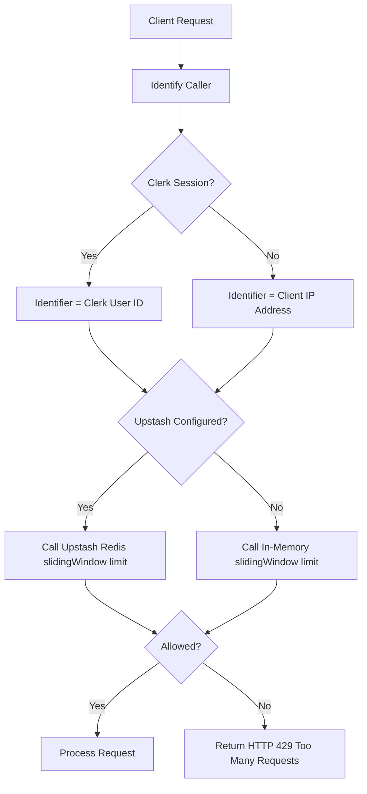

# API Rate Limiting & Security Guide

This guide explains how rate limiting is implemented in WorkSphere to protect application endpoints from abuse, denial-of-service (DoS) attacks, brute-force requests, and third-party API budget exhaustion.

It covers:

- Setting up Upstash Redis for distributed rate limiting
- Understanding the rate limiter's request flow and in-memory fallback
- Route-specific rate limits (e.g., chat and authentication APIs)
- Handling rate limit exceptions (HTTP 429, retry headers)
- Modifying limits and adding protection to new routes
- [In-Memory Memory Footprint Benchmarks & Eviction Policies](./RATE_LIMITER_MEMORY_AND_EVICTION_BENCHMARKS.md)

---

## 1. Upstash Redis Setup

WorkSphere uses **Upstash Redis** as its primary distributed cache store for rate limiting because it provides a serverless REST-based client. This avoids persistent TCP socket connections, making it compatible with serverless runtimes.

### Creating an Upstash Redis Database

1. Sign up or log in to the **[Upstash Console](https://console.upstash.com/)**.
2. Click **Create Database**.
3. Choose a database name (e.g., `worksphere-redis`) and select your preferred cloud provider and region.
4. Click **Create** to provision the database.

### Obtaining REST Credentials

Once the database is created, scroll down to the **REST API** section in your database dashboard.
Copy the following two credential strings:

- **UPSTASH_REDIS_REST_URL**: The HTTPS REST endpoint URL.
- **UPSTASH_REDIS_REST_TOKEN**: The authentication token.

### Required Environment Variables

Add these credentials to your `.env.local` file (or your hosting provider's secret management dashboard in production):

```env
# Upstash Redis Configuration
UPSTASH_REDIS_REST_URL="https://your-database-endpoint.upstash.io"
UPSTASH_REDIS_REST_TOKEN="your_upstash_rest_token_here"
```

### Connecting the Application

The rate-limiting utility is implemented in [`src/lib/rateLimit.ts`](../src/lib/rateLimit.ts). The client connection is established dynamically when environment variables are present:

1. **Lazy Initialization**: It imports `@upstash/ratelimit` and `@upstash/redis` dynamically at runtime. This prevents build-time compilation errors when Redis credentials are not configured.
2. **Algorithm**: It uses the **Sliding Window** rate-limiting algorithm (`Ratelimit.slidingWindow(limitPerMinute, "1 m")`) to block bursts of requests smoothly over a rolling 1-minute window.
3. **In-Memory Fallback**: If `UPSTASH_REDIS_REST_URL` or `UPSTASH_REDIS_REST_TOKEN` is missing, the system automatically falls back to a clean in-memory map store (`memRateLimit`), maintaining basic protection in local development or offline sandboxes.

---

## 2. API Rate Limiting

### Request Flow & Enforcement Logic

When a request hits a protected API endpoint, the system follows this workflow:



1. **Caller Identification**: The route handler retrieves the caller's unique identifier.
   - For authenticated users, it uses their Clerk `userId`.
   - For anonymous users, it extracts their public IP address via the `x-forwarded-for` or `x-real-ip` request headers.
2. **Key Prefixing**: To isolate rate-limiting counts across different routes, the caller identifier is prefixed with the target route's scope (e.g., `forgot-password:<ip>` or `chat:<userId>`).
3. **Evaluation**: The helper `rateLimit(identifier, limit)` evaluates the request count against the threshold. If it exceeds the limit, an HTTP 429 response is returned immediately, skipping execution of database queries, LLM API calls, or email dispatch.

### Supported Route Limits

Below is the complete list of rate-limited routes implemented in the codebase:

| Endpoint                         | Method |  Default Limit   | Purpose                                                                 |
| :------------------------------- | :----: | :--------------: | :---------------------------------------------------------------------- |
| `POST /api/chat`                 | `POST` | **20 req / min** | Protects the Groq LLM API from query abuse and token credit exhaustion. |
| `POST /api/auth/forgot-password` | `POST` | **3 req / min**  | Prevents email spam, account enumeration, and dictionary attacks.       |
| `POST /api/auth/resend-otp`      | `POST` | **3 req / min**  | Limits outbound OTP codes to protect SMS/email carrier budgets.         |
| `POST /api/auth/reset-password`  | `POST` | **5 req / min**  | Prevents brute-forcing user credentials during password recovery.       |
| `POST /api/auth/verify-otp`      | `POST` | **5 req / min**  | Prevents credential-stuffing and guess attacks against OTP codes.       |

> [!IMPORTANT]
> **Venue Search Route Limits**
> Currently, the main venue search endpoint `GET /api/venues` is **not** rate-limited in the codebase. If public abuse becomes a concern, developers should wrap this endpoint in the rate-limiting middleware. See [Securing the Venue Search Route](#securing-the-venue-search-route) below for details.

---

## 3. Fallback & Response Handling

### Behavior When Limits Are Exceeded

When a client exceeds the request limit, the API halts request execution and responds with:

- **HTTP Status**: `429 Too Many Requests`
- **Response Headers**:
  - `Retry-After`: The number of seconds the client must wait before their quota resets.
  - `X-RateLimit-Limit`: The total request threshold for the 1-minute window.
  - `X-RateLimit-Remaining`: The remaining request allowance (always `0` when blocked).
- **JSON Payload**: Contains a descriptive error and the retry wait time in seconds.

#### Example Chat Route Response (`POST /api/chat`):

```json
{
  "error": "Rate limit exceeded. Please wait before sending more messages.",
  "retryAfter": 12
}
```

#### Example Auth Route Response (`POST /api/auth/forgot-password`):

```json
{
  "error": "Too many password reset requests. Please wait before trying again.",
  "retryAfter": 45
}
```

---

## 5. Token Bucket Fallback & Degraded-Mode Telemetry (`src/lib/ratelimit/tokenBucketFallback.ts`)

When external Redis or Edge rate-limiting infrastructure experiences transient network outages, connection resets, or gateway timeouts, WorkSphere enters a **degraded fallback mode** rather than failing open (which would permit unbounded traffic) or failing closed (which would take down legitimate user requests).

This degraded state is managed by the in-memory client-side/edge token bucket fallback limiter implemented in `src/lib/ratelimit/tokenBucketFallback.ts`.

### 5.1 Fallback Triggers and Recovery

#### Degradation Trigger (`isRecoverableRedisError`)
Fallback activation occurs when calls to Redis encounter transient network or service unavailability errors:
- **HTTP Status Codes:** `503 Service Unavailable`
- **Network Error Codes:** `ETIMEDOUT`, `ECONNREFUSED`, `ECONNRESET`, `EAI_AGAIN`
- **Error Messages:** Messages containing `"503"`, `"timeout"`, `"timed out"`, `"econnrefused"`, `"network"`, or `"service unavailable"`

When `isRecoverableRedisError(err)` returns `true`, the middleware initializes or retrieves an in-memory token bucket instance via `getOrCreateFallbackLimiter(tierName, capacity, refillRatePerSecond, burstAllowance)` and evaluates token consumption locally.

#### Recovery Triggers
The system automatically returns from degraded fallback mode to distributed Redis enforcement on the very next request where:
1. Redis connectivity succeeds within `REDIS_TIMEOUT_MS` (1500ms).
2. The primary rate-limiting Promise resolves normally without throwing a recoverable error or timing out.

Because fallback limiters are transient and keyed in-memory, no manual administrative reset is necessary once Redis recovers.

### 5.2 Exported Telemetry Fields & Types

`src/lib/ratelimit/tokenBucketFallback.ts` exports the following core configuration, state, and telemetry interfaces:

#### `TokenBucketFallbackConfig`
Configures an individual in-memory token bucket instance:

| Field Name | Type | Meaning & Behavior |
| :--- | :--- | :--- |
| `capacity` | `number` | The base maximum token capacity that the bucket can hold. Must be a positive finite number ($> 0$). |
| `refillRatePerSecond` | `number` | The steady-state replenishment velocity in tokens per second. Must be a positive finite number ($> 0$). |
| `burstAllowance` | `number` | Optional extra token allowance above the base capacity (default: `0`). When $> 0$, `effectiveCapacity = capacity + burstAllowance`. |
| `maxIdleMs` | `number` | Maximum duration in milliseconds before an unaccessed bucket is pruned from memory (default: `60,000` ms = 1 minute). |
| `maxBuckets` | `number` | Hard upper bound on active bucket entries in memory to prevent memory exhaustion and DoS (default: `10,000` entries). |

#### `FallbackRateLimitResult`
The result structure returned by `limiter.consume(identifier, cost)` during degraded mode:

| Field Name | Type | Meaning & Behavior |
| :--- | :--- | :--- |
| `allowed` | `boolean` | `true` if the bucket contained sufficient tokens to satisfy the request cost; `false` if rejected. |
| `limit` | `number` | The maximum effective burst capacity of the bucket (`capacity + burstAllowance`). |
| `remaining` | `number` | The integer floor of remaining tokens in the bucket after deduction (or current balance if rejected). |
| `retryAfterSeconds` | `number` | Number of seconds the client must wait before enough tokens replenish to allow the request. `0` when `allowed: true`. |
| `resetSeconds` | `number` | Number of seconds until the bucket reaches full effective capacity. |

#### Internal State Counters (`BucketEntry` & `TokenBucketLimiter`)

| Field / Property | Type | Event Causing State Change |
| :--- | :--- | :--- |
| `tokens` | `number` | Decrements atomically when a request is allowed (`tokens -= safeCost`). Increases over time based on elapsed monotonic seconds multiplied by `refillRatePerSecond`, capped at `effectiveCapacity`. Rejected requests never decrement tokens. |
| `lastRefillMs` | `number` | Updated to `performance.now()` whenever tokens are replenished during request evaluation. |
| `lastAccessMs` | `number` | Updated to `performance.now()` on every call to `consume()`, regardless of whether the request is allowed or blocked. |
| `size` (getter) | `number` | Current count of active bucket identifiers in memory (`buckets.size`). Increments when a new client identifier is observed; decrements when expired entries are pruned or oldest keys dropped. |

### 5.3 Snapshot Payload Structure

When telemetry collectors or health probes query the state of fallback limiters, the snapshot payload captures the following structural representation:

```json
{
  "tier": "tier:mutations",
  "status": "degraded",
  "effectiveCapacity": 60,
  "refillRatePerSecond": 1.0,
  "burstAllowance": 10,
  "activeBuckets": 142,
  "maxBuckets": 10000,
  "maxIdleMs": 60000,
  "lastPruneTimestampMs": 1795687250123.45,
  "recentEvictions": 0
}
```

#### Snapshot Field Descriptions
- `tier`: Identifier of the rate tier running in degraded mode (e.g., `sensitive:auth`, `tier:search`, `tier:mutations`).
- `status`: State indicator; reports `"degraded"` while requests are serviced via in-memory token buckets.
- `effectiveCapacity`: Total burst limit (`capacity + burstAllowance`).
- `refillRatePerSecond`: Number of tokens added per second.
- `burstAllowance`: Configured burst overhead above base capacity.
- `activeBuckets`: Current count of unique client IP/user buckets tracked in memory (`limiter.size`).
- `maxBuckets`: Hard capacity limit for tracked clients.
- `maxIdleMs`: Inactivity threshold for bucket eviction.
- `lastPruneTimestampMs`: Monotonic timestamp of the most recent sweep for expired buckets.
- `recentEvictions`: Number of expired buckets reclaimed during the last prune pass.

### 5.4 Consumption in Admin Vitals & Monitoring

Admin system health endpoints (`/api/admin/system/diagnostics` and `/api/admin/vitals`) aggregate degraded-mode telemetry to alert operators of underlying Redis connectivity issues:
1. **Health Degraded Flag**: When fallback limiters are actively instantiated and tracking entries (`limiter.size > 0`), the admin vitals subsystem flags Redis health as `"degraded"` rather than `"healthy"`.
2. **Rate Limit Headers in Fallback**: Even in degraded mode, the gateway middleware attaches standard RFC rate-limiting headers derived from `FallbackRateLimitResult` (`RateLimit-Limit`, `RateLimit-Remaining`, `RateLimit-Reset`, `Retry-After`), ensuring downstream clients can back off smoothly.
3. **Memory Boundary Protection**: If total tracked clients exceed `maxBuckets` (10,000), `pruneExpired()` is invoked automatically. If memory remains saturated, the oldest accessed bucket (`this.buckets.keys().next().value`) is evicted, ensuring zero memory leaks in Edge or Node processes.

### 5.5 Current Implemented vs. Unsupported Capabilities

| Feature | Status | Notes |
| :--- | :---: | :--- |
| **In-Memory Token Bucket** | **Implemented** | Millisecond-accurate monotonic refills via `performance.now()`. |
| **Burst Allowances** | **Implemented** | Configurable `burstAllowance` above base capacity. |
| **Automatic Outage Detection** | **Implemented** | Detects HTTP 503, connection timeouts, and network failure codes. |
| **Bounded Memory / Eviction** | **Implemented** | Prunes idle buckets after `maxIdleMs` and caps total buckets at `maxBuckets`. |
| **Cross-Instance Fallback Sync** | **Not Supported** | Fallback buckets are local to the running process/edge worker. Aggregate limits across multiple serverless instances can exceed single-instance quotas during outages. |
| **Persistent Token Eviction Logs** | **Not Supported** | Evicted buckets are dropped immediately from memory without writing tombstone records to disk. |


### Modifying Rate-Limit Values

To adjust the rate limits for an existing route, open the corresponding route file and update the limit parameter passed to `rateLimit(identifier, limit)`.

For instance, to increase the chat rate limit from `20` to `30` in `src/app/api/chat/route.ts`:

```diff
- if (!(await rateLimit(identifier, 20))) {
+ if (!(await rateLimit(identifier, 30))) {
```

Make sure to update the matching limit parameter in the accompanying metadata function call so that the `Retry-After` calculation stays synchronized:

```diff
- const info = getRateLimitInfo(identifier); // Defaults to 10 if not specified
+ const info = getRateLimitInfo(identifier, 30);
```

### Securing the Venue Search Route

To introduce rate limiting to the `GET /api/venues` route, modify `src/app/api/venues/route.ts` as follows:

```typescript
import { rateLimit, getRateLimitInfo } from "@/lib/rateLimit";

export async function GET(req: NextRequest) {
  // 1. Identify the caller
  const forwarded = req.headers.get("x-forwarded-for");
  const ip = forwarded?.split(",")[0].trim() || "anonymous";
  const identifier = `venue-search:${ip}`;

  // 2. Enforce a rate limit of 60 requests per minute
  const allowed = await rateLimit(identifier, 60);

  if (!allowed) {
    const info = getRateLimitInfo(identifier, 60);
    const retryAfter = info?.resetTime
      ? Math.ceil((info.resetTime - Date.now()) / 1000)
      : 60;

    return NextResponse.json(
      {
        error: "Too many venue search requests. Please try again later.",
        retryAfter,
      },
      {
        status: 429,
        headers: {
          "Retry-After": String(retryAfter),
          "X-RateLimit-Limit": "60",
          "X-RateLimit-Remaining": "0",
        },
      },
    );
  }

  // 3. Continue with search validation and Prisma query logic...
}
```
