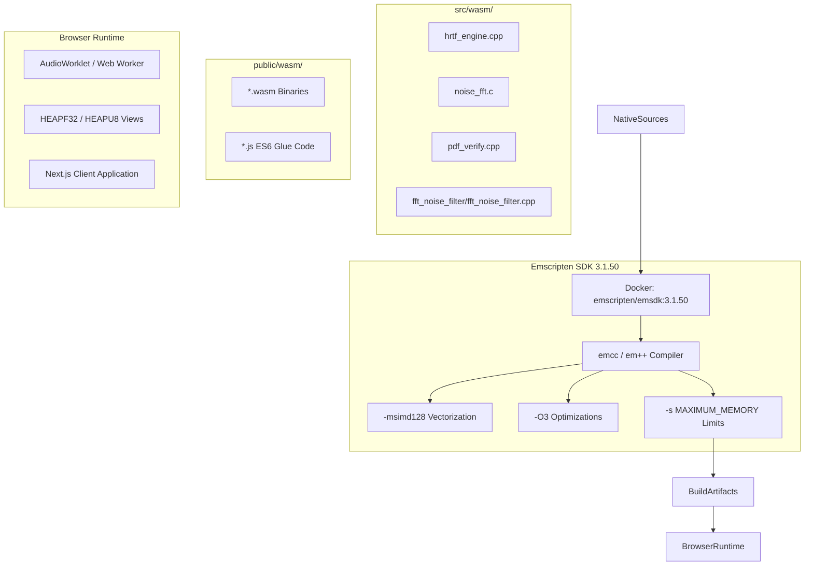

# WebAssembly (WASM) Module Integration & Compilation Playbook

## 1. Overview

WebAssembly (WASM) enables WorkSphere to execute computationally intensive native algorithms inside modern web browsers with near-native performance. High-throughput tasks—such as binaural 3D Head-Related Transfer Function (HRTF) audio spatialization, real-time FFT noise filtering, cryptographic PDF verification, and acoustic floorplan raycasting—are implemented in C and C++ within `src/wasm/` and compiled to optimized `.wasm` binaries.

This playbook provides contributors and maintainers with comprehensive, reproducible build procedures, Emscripten (`emcc`) compilation flags, Docker containerized toolchain workflows, linear memory limits, and runtime integration guidelines.

---

## 2. WebAssembly Architecture in WorkSphere



The WorkSphere WASM subsystem consists of five primary layers:

1. **Source Code (`src/wasm/`)**: Pure C and C++ implementations free of OS-level system dependencies.
2. **Compiler Toolchain (Emscripten `emcc` / `em++`)**: Transforms native code into WebAssembly bytecodes with 128-bit SIMD vector instructions.
3. **Artifact Output (`public/wasm/` or `public/`)**: Modular `.wasm` binaries and corresponding ES6 JavaScript loaders served statically.
4. **JavaScript/TypeScript Loader Tier (`src/lib/wasm-loader/`)**: Typed wrappers managing memory allocation, pointer marshalling, and Web Worker thread handoffs.
5. **Browser Runtime**: Web Audio API AudioWorklets and Web Workers consuming WASM instances via shared or isolated linear memories.

---

## 3. Emscripten Compiler Flags Specification

Compiling high-performance native modules requires specific flags for execution speed, binary compactness, modern JavaScript module integration, and runtime safety.

### 3.1 Optimization & Hardware Vectorization Flags

| Flag         | Purpose                       | Rationale in WorkSphere                                                                                                                                                       |
| :----------- | :---------------------------- | :---------------------------------------------------------------------------------------------------------------------------------------------------------------------------- |
| `-O3`        | Aggressive optimization       | Enables aggressive loop unrolling, function inlining, instruction scheduling, and dead-code elimination. Yields 2.5x–4x faster DSP computation over `-O0`.                    |
| `-msimd128`  | WebAssembly 128-bit SIMD      | Utilizes hardware SIMD registers (Intel SSE/AVX, ARM NEON). Processes 4 single-precision 32-bit floats per instruction cycle, vital for HRTF convolution and FFT butterflies. |
| `-s WASM=1`  | Emit WebAssembly              | Instructs compiler to generate `.wasm` binary instead of asm.js legacy fallback.                                                                                              |
| `--no-entry` | Suppress `main()` requirement | Specifies that the module is a reusable library exposing callable API functions, rather than a standalone executable.                                                         |

### 3.2 ES6 Module Export & JavaScript Glue Flags

WorkSphere utilizes Next.js and modern ES6 bundlers. Standard Emscripten output targets UMD/CommonJS by default; the following flags enforce modular ES6 integration:

| Flag                        | Value / Example          | Rationale                                                                                                                   |
| :-------------------------- | :----------------------- | :-------------------------------------------------------------------------------------------------------------------------- |
| `-s EXPORT_ES6=1`           | `1`                      | Emits modern ECMAScript 6 `export default` syntax, allowing direct dynamic imports (`import()`) in Next.js.                 |
| `-s MODULARIZE=1`           | `1`                      | Encapsulates runtime in an exported factory function (`createModule()`) instead of polluting the global `window` namespace. |
| `-s EXPORT_NAME`            | `createHrtfEngineModule` | Configures the named export function returned by the ES6 loader.                                                            |
| `-s ENVIRONMENT`            | `'web,worker'`           | Strips Node.js and Electron environment checks (`require('fs')`, `process.versions`), eliminating bundler warnings.         |
| `-s FILESYSTEM=0`           | `0`                      | Strips Emscripten's virtual filesystem (FS) layer to minimize glue code size (~45KB savings).                               |
| `-s NO_DYNAMIC_EXECUTION=1` | `1`                      | Disables `eval()` and `new Function()`, ensuring strict compliance with WorkSphere Content Security Policies (CSP).         |

### 3.3 Function & Runtime Method Export Flags

Native C/C++ functions and Emscripten runtime helpers must be explicitly exported to prevent the Link-Time Optimizer (LTO) from stripping them:

```bash
# Exported C functions (prefixed with an underscore in Emscripten C symbol tables)
-s EXPORTED_FUNCTIONS='["_malloc", "_free", "_process_hrtf_block", "_set_room_parameters", "_malloc_scratch_buffer", "_free_scratch_buffer"]'

# Runtime helper methods exposed on the JavaScript module instance
-s EXPORTED_RUNTIME_METHODS='["cwrap", "ccall", "setValue", "getValue", "HEAPF32", "HEAPU8"]'
```

- `cwrap` / `ccall`: Marshals JavaScript numbers and typed arrays into C function calls.
- `HEAPF32`: Provides direct `Float32Array` view into WASM linear memory for zero-copy audio buffer processing.
- `HEAPU8`: Provides direct `Uint8Array` view into WASM linear memory for binary payload transfers.

---

## 4. Linear Memory Architecture & Growth Limits

WebAssembly operates within a sandbox of linear memory organized into discrete 64 KB pages ($65,536$ bytes). Improper memory configuration can cause Out-Of-Memory (OOM) browser crashes, memory fragmentation, or typed array detachment.

```
+-------------------------------------------------------------------------------+
|                        WebAssembly Linear Memory Sandbox                      |
+-------------------------------------------------------------------------------+
|  Static Data / Stack  |        Dynamic Heap Space        |    Unused Ceiling  |
|      (Stack Size)     |  INITIAL_MEMORY -> Growth Range   |   MAXIMUM_MEMORY   |
+-------------------------------------------------------------------------------+
0 KB                   1 MB                               16 MB               64 MB
```

### 4.1 Memory Allocation Parameters

```bash
# Initial memory allocation upon module instantiation (must be multiple of 65536)
-s INITIAL_MEMORY=16777216     # 16 MB initial allocation

# Enable dynamic memory growth via memory.grow WebAssembly instruction
-s ALLOW_MEMORY_GROWTH=1

# Hard ceiling for linear memory growth (CRITICAL GUARDRAIL)
-s MAXIMUM_MEMORY=67108864     # 64 MB maximum ceiling

# Dedicated stack size
-s STACK_SIZE=1048576          # 1 MB stack
```

### 4.2 Why `-s MAXIMUM_MEMORY` is Mandatory

1. **Tab Crash Prevention (OOM Guard)**: Without `-s MAXIMUM_MEMORY`, a memory leak in native C pointer math can grow unbounded up to the 32-bit browser limit (4 GB), crashing the browser tab and degrading device responsiveness.
2. **Address Space Reservation in Web Workers**: When utilizing `SharedArrayBuffer` or threading in Web Workers, the WebAssembly engine requires a fixed upper memory boundary to allocate virtual memory address space safely.
3. **Memory Budgeting Across Modules**: WorkSphere runs multiple WASM instances concurrently (HRTF spatializer, FFT noise filter, BLE proximity). Capping each module guarantees the total WASM memory footprint does not exceed 128 MB on mobile devices.

### 4.3 Handling Buffer Detachment on Memory Growth

> [!WARNING]
> When `-s ALLOW_MEMORY_GROWTH=1` triggers `memory.grow`, the browser reallocates the underlying `ArrayBuffer`. Any existing JavaScript typed array views (`HEAPF32`, `HEAPU8`, `Float32Array(Module.HEAPF32.buffer)`) become **detached** (`byteLength === 0`).
>
> **WorkSphere Pattern**: Never store persistent long-lived typed array views across calls that allocate native memory. Always re-index typed arrays from `Module.HEAPF32` after calling `_malloc` or operations that may trigger growth.

---

## 5. Reproducible Docker Compilation Container Setup

Contributors are **not** required to install Emscripten or Python toolchains locally. All WASM modules are built reproducibly using the official Emscripten SDK Docker container (`emscripten/emsdk:3.1.50`).

### 5.1 Standalone Docker Command (Zero Local Setup)

To compile any native module directly from your local terminal using Docker volume mounting:

#### Linux / macOS:

```bash
docker run --rm \
  -v "$(pwd):/src" \
  -u "$(id -u):$(id -g)" \
  emscripten/emsdk:3.1.50 \
  emcc src/wasm/noise_fft.c \
    -O3 \
    -msimd128 \
    -s WASM=1 \
    -s EXPORT_ES6=1 \
    -s MODULARIZE=1 \
    -s EXPORT_NAME='createNoiseFftModule' \
    -s INITIAL_MEMORY=6553600 \
    -s ALLOW_MEMORY_GROWTH=1 \
    -s MAXIMUM_MEMORY=33554432 \
    -s EXPORTED_FUNCTIONS='["_wasm_malloc","_wasm_free","_compute_rms","_rms_to_db","_compute_fft_magnitude"]' \
    -s EXPORTED_RUNTIME_METHODS='["cwrap","getValue","setValue","HEAPF32"]' \
    -s ENVIRONMENT='web,worker' \
    -s FILESYSTEM=0 \
    --no-entry \
    -o public/wasm/noise_fft.js
```

#### Windows (PowerShell):

```powershell
docker run --rm `
  -v "${PWD}:/src" `
  emscripten/emsdk:3.1.50 `
  emcc src/wasm/noise_fft.c `
    -O3 `
    -msimd128 `
    -s WASM=1 `
    -s EXPORT_ES6=1 `
    -s MODULARIZE=1 `
    -s EXPORT_NAME='createNoiseFftModule' `
    -s INITIAL_MEMORY=6553600 `
    -s ALLOW_MEMORY_GROWTH=1 `
    -s MAXIMUM_MEMORY=33554432 `
    -s EXPORTED_FUNCTIONS='["_wasm_malloc","_wasm_free","_compute_rms","_rms_to_db","_compute_fft_magnitude"]' `
    -s EXPORTED_RUNTIME_METHODS='["cwrap","getValue","setValue","HEAPF32"]' `
    -s ENVIRONMENT='web,worker' `
    -s FILESYSTEM=0 `
    --no-entry `
    -o public/wasm/noise_fft.js
```

### 5.2 Multi-Stage Dockerfile Compilation (`src/wasm/Dockerfile`)

WorkSphere maintains a production multi-stage `Dockerfile` in `src/wasm/Dockerfile` for automated CI/CD builds:

```dockerfile
# Stage 1: Build environment using official Emscripten SDK
FROM emscripten/emsdk:3.1.50 AS wasm-builder

WORKDIR /build
COPY src/wasm/hrtf_engine.cpp ./hrtf_engine.cpp
RUN mkdir -p /build/output

RUN emcc hrtf_engine.cpp \
    -O3 \
    -msimd128 \
    -s WASM=1 \
    -s EXPORT_ES6=1 \
    -s MODULARIZE=1 \
    -s EXPORT_NAME='createHrtfEngineModule' \
    -s INITIAL_MEMORY=6553600 \
    -s ALLOW_MEMORY_GROWTH=1 \
    -s MAXIMUM_MEMORY=67108864 \
    -s EXPORTED_FUNCTIONS='["_malloc_scratch_buffer","_free_scratch_buffer","_process_hrtf_block","_set_hrtf_simd_enabled","_set_room_parameters","_get_room_parameters","_malloc","_free"]' \
    -s EXPORTED_RUNTIME_METHODS='["cwrap","setValue","getValue","HEAPF32"]' \
    -s ENVIRONMENT='web,worker' \
    -s FILESYSTEM=0 \
    --no-entry \
    -o /build/output/hrtf_engine.js

# Stage 2: Minimal runtime image exporting compiled artifacts to public/wasm/
FROM alpine:3.19 AS artifact-exporter
WORKDIR /dist
COPY --from=wasm-builder /build/output/hrtf_engine.wasm ./public/wasm/hrtf_engine.wasm
COPY --from=wasm-builder /build/output/hrtf_engine.js ./public/wasm/hrtf_engine.js
CMD ["ls", "-la", "./public/wasm/"]
```

#### Executing the Multi-Stage Build & Extracting Binaries:

```bash
# 1. Build Docker image
docker build -f src/wasm/Dockerfile -t worksphere-wasm-build .

# 2. Extract compiled artifacts to local repository
docker run --rm -v "${PWD}/public/wasm:/dist/public/wasm" worksphere-wasm-build
```

---

## 6. Native Module Compilation Recipes

Below are standard, tested compilation recipes for each native module residing in `src/wasm/`.

### 6.1 HRTF Spatial Acoustic Engine (`src/wasm/hrtf_engine.cpp`)

Calculates real-time 3D binaural spatial acoustic cues with dynamic head-tracking orientation:

```bash
em++ src/wasm/hrtf_engine.cpp \
  -O3 \
  -msimd128 \
  -s WASM=1 \
  -s EXPORT_ES6=1 \
  -s MODULARIZE=1 \
  -s EXPORT_NAME='createHrtfEngineModule' \
  -s INITIAL_MEMORY=6553600 \
  -s ALLOW_MEMORY_GROWTH=1 \
  -s MAXIMUM_MEMORY=67108864 \
  -s EXPORTED_FUNCTIONS='["_malloc_scratch_buffer","_free_scratch_buffer","_process_hrtf_block","_set_hrtf_simd_enabled","_set_room_parameters","_get_room_parameters","_malloc","_free"]' \
  -s EXPORTED_RUNTIME_METHODS='["cwrap","setValue","getValue","HEAPF32"]' \
  -s ENVIRONMENT='web,worker' \
  -s FILESYSTEM=0 \
  --no-entry \
  -o public/wasm/hrtf_engine.js
```

### 6.2 FFT Noise Filter Engine (`src/wasm/fft_noise_filter/fft_noise_filter.cpp`)

Processes spectral noise floor reduction and decibel calculations:

```bash
em++ src/wasm/fft_noise_filter/fft_noise_filter.cpp \
  -O3 \
  -msimd128 \
  -s WASM=1 \
  -s EXPORT_ES6=1 \
  -s MODULARIZE=1 \
  -s EXPORT_NAME='createFftNoiseFilterModule' \
  -s INITIAL_MEMORY=1048576 \
  -s ALLOW_MEMORY_GROWTH=1 \
  -s MAXIMUM_MEMORY=16777216 \
  -s EXPORTED_FUNCTIONS='["_fftnfProcessFrame","_fftnfReset","_fftnfSetSensitivity","_fftnfGetNoiseProfile","_fftnfGetSpectrum","_fftnfComputeMagnitude","_fftnfRmsToDb","_fftnfIsSIMDSupported","_fftnfSetSIMDEnabled","_fftnfMalloc","_fftnfFree","_fftnfResetHeap"]' \
  -s EXPORTED_RUNTIME_METHODS='["cwrap","ccall","HEAPF32"]' \
  -s ENVIRONMENT='web,worker' \
  -s FILESYSTEM=0 \
  -s MALLOC=emmalloc \
  --no-entry \
  -o public/fft-noise-filter.js
```

### 6.3 PDF Attestation & Hash Verification (`src/wasm/pdf_verify.cpp`)

Executes cryptographic SHA-256 and byte-level structure inspection for uploaded documents:

```bash
em++ src/wasm/pdf_verify.cpp \
  -O3 \
  -s WASM=1 \
  -s EXPORT_ES6=1 \
  -s MODULARIZE=1 \
  -s EXPORT_NAME='createPdfVerifyModule' \
  -s INITIAL_MEMORY=4194304 \
  -s ALLOW_MEMORY_GROWTH=1 \
  -s MAXIMUM_MEMORY=33554432 \
  -s EXPORTED_FUNCTIONS='["_pdf_verify_signature","_pdf_compute_hash","_malloc","_free"]' \
  -s EXPORTED_RUNTIME_METHODS='["cwrap","getValue","setValue","HEAPU8"]' \
  -s ENVIRONMENT='web,worker' \
  -s FILESYSTEM=0 \
  --no-entry \
  -o public/wasm/pdf_verify.js
```

---

## 7. Package.json Script Integration & CI Automation

WorkSphere manages WASM build tasks through standard `package.json` scripts.

### 7.1 NPM Scripts Configuration

Add the following commands to `package.json`:

```json
{
  "scripts": {
    "build:wasm:docker": "docker run --rm -v \"$PWD:/src\" emscripten/emsdk:3.1.50 bash scripts/build-all-wasm.sh",
    "build:wasm:hrtf": "docker run --rm -v \"$PWD:/src\" emscripten/emsdk:3.1.50 bash scripts/build-hrtf.sh",
    "build:wasm:noise": "docker run --rm -v \"$PWD:/src\" emscripten/emsdk:3.1.50 bash scripts/build-noise.sh",
    "verify:wasm": "node scripts/verify-wasm-binaries.mjs"
  }
}
```

### 7.2 Unified Build Script (`scripts/build-all-wasm.sh`)

```bash
#!/usr/bin/env bash
set -euo pipefail

echo "==> Building WorkSphere WASM Modules with Emscripten $(emcc --version | head -n 1)"
mkdir -p public/wasm

# Build HRTF Engine
echo "Compiling hrtf_engine.cpp..."
em++ src/wasm/hrtf_engine.cpp \
  -O3 -msimd128 -s WASM=1 -s EXPORT_ES6=1 -s MODULARIZE=1 \
  -s EXPORT_NAME='createHrtfEngineModule' \
  -s INITIAL_MEMORY=6553600 -s ALLOW_MEMORY_GROWTH=1 -s MAXIMUM_MEMORY=67108864 \
  -s EXPORTED_FUNCTIONS='["_malloc_scratch_buffer","_free_scratch_buffer","_process_hrtf_block","_set_hrtf_simd_enabled","_set_room_parameters","_get_room_parameters","_malloc","_free"]' \
  -s EXPORTED_RUNTIME_METHODS='["cwrap","setValue","getValue","HEAPF32"]' \
  -s ENVIRONMENT='web,worker' -s FILESYSTEM=0 --no-entry \
  -o public/wasm/hrtf_engine.js

# Build Noise FFT Engine
echo "Compiling noise_fft.c..."
emcc src/wasm/noise_fft.c \
  -O3 -msimd128 -s WASM=1 -s EXPORT_ES6=1 -s MODULARIZE=1 \
  -s EXPORT_NAME='createNoiseFftModule' \
  -s INITIAL_MEMORY=6553600 -s ALLOW_MEMORY_GROWTH=1 -s MAXIMUM_MEMORY=33554432 \
  -s EXPORTED_FUNCTIONS='["_wasm_malloc","_wasm_free","_compute_rms","_rms_to_db","_compute_fft_magnitude"]' \
  -s EXPORTED_RUNTIME_METHODS='["cwrap","getValue","setValue","HEAPF32"]' \
  -s ENVIRONMENT='web,worker' -s FILESYSTEM=0 --no-entry \
  -o public/wasm/noise_fft.js

echo "==> All WASM binaries compiled successfully."
ls -lh public/wasm/
```

---

## 8. Runtime Verification & Health Checks

After compiling `.wasm` binaries, run these verification steps prior to committing artifacts:

### 8.1 Automated Header & Feature Inspection

Verify that the output `.wasm` file is a valid WebAssembly binary containing SIMD instructions:

```bash
# Verify WebAssembly magic number (\0asm) and version 1
head -c 4 public/wasm/hrtf_engine.wasm | hexdump -C
# Expected: 00 61 73 6d (.\0asm)

# Check binary file size (should be under 500 KB for optimized release builds)
ls -lh public/wasm/*.wasm
```

### 8.2 Node.js Binary Validation Script (`scripts/verify-wasm.mjs`)

```javascript
import fs from "fs";
import path from "path";

async function verifyModule(fileName) {
  const filePath = path.resolve("public/wasm", fileName);
  if (!fs.existsSync(filePath)) {
    throw new Error(`Artifact missing: ${filePath}`);
  }
  const buffer = fs.readFileSync(filePath);
  const wasmModule = await WebAssembly.compile(buffer);
  const imports = WebAssembly.Module.imports(wasmModule);
  const exports = WebAssembly.Module.exports(wasmModule);

  console.log(`[PASS] ${fileName} verified successfully:`);
  console.log(`       - Binary Size: ${(buffer.length / 1024).toFixed(2)} KB`);
  console.log(`       - Export Count: ${exports.length}`);
}

await verifyModule("hrtf_engine.wasm");
await verifyModule("noise_fft.wasm");
```

---

## 9. Contributor Troubleshooting & FAQ

### Q1: `Module.HEAPF32.buffer` returns zero bytes or detached buffer

**Root Cause**: Memory grew dynamically, detaching the old `ArrayBuffer`.
**Solution**: Never cache `Module.HEAPF32.buffer` or create persistent views. Re-evaluate `Module.HEAPF32` immediately before read/write operations.

### Q2: Linker fails with `undefined symbol: _malloc`

**Root Cause**: Emscripten treeshakes unused standard library calls when `-s EXPORTED_FUNCTIONS` does not include `"_malloc"`.
**Solution**: Always include `"_malloc"` and `"_free"` in the `-s EXPORTED_FUNCTIONS` JSON array.

### Q3: `CompileError: WebAssembly.compile(): SIMD support is not enabled`

**Root Cause**: Target browser or environment does not support WebAssembly SIMD (`-msimd128`).
**Solution**: Ensure fallback detection is implemented in `src/lib/wasm-loader/`. All modern Chromium (v91+), Firefox (v89+), and Safari (v16.4+) browsers natively support WASM SIMD.

---

## 10. Summary Checklist for WASM PRs

When contributing or updating native C/C++ modules in WorkSphere:

- [ ] Native source is clean C or C++ with no OS-level filesystem or socket dependencies.
- [ ] Compiler optimization flags include `-O3` and `-msimd128`.
- [ ] ES6 flags are configured: `-s EXPORT_ES6=1`, `-s MODULARIZE=1`, `-s EXPORT_NAME='...'`.
- [ ] Memory growth is constrained with `-s ALLOW_MEMORY_GROWTH=1` and `-s MAXIMUM_MEMORY=<limit>`.
- [ ] Output artifacts are verified with Docker: `docker run --rm -v "${PWD}:/src" emscripten/emsdk:3.1.50 ...`.
- [ ] Compiled binaries (`.wasm` and `.js`) reside in `public/wasm/`.
- [ ] TypeScript loader in `src/lib/wasm-loader/` wraps the module with safe typed bindings.
