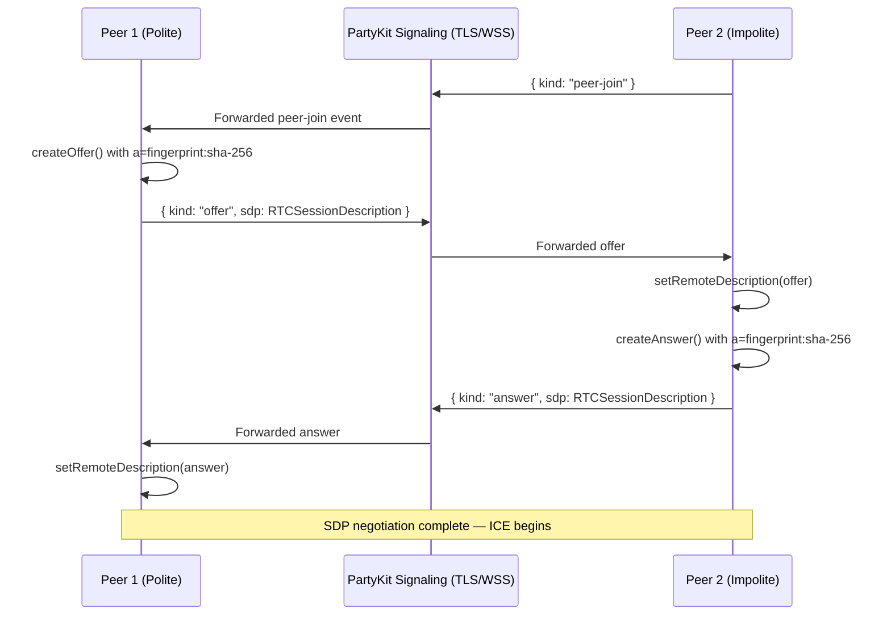
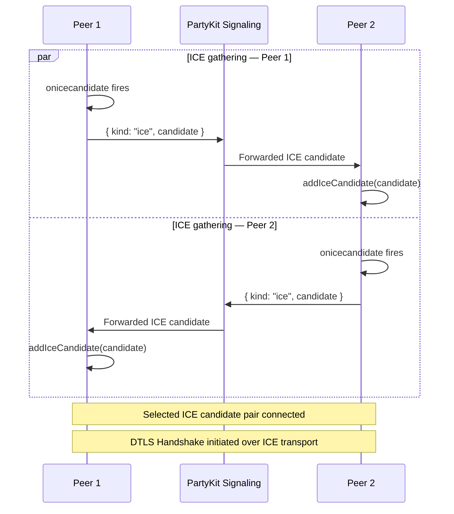
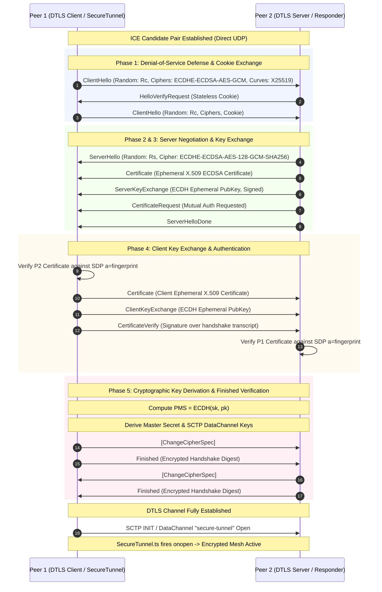
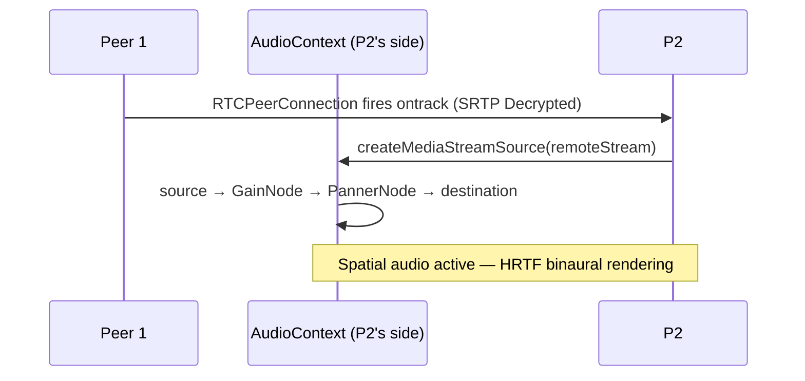
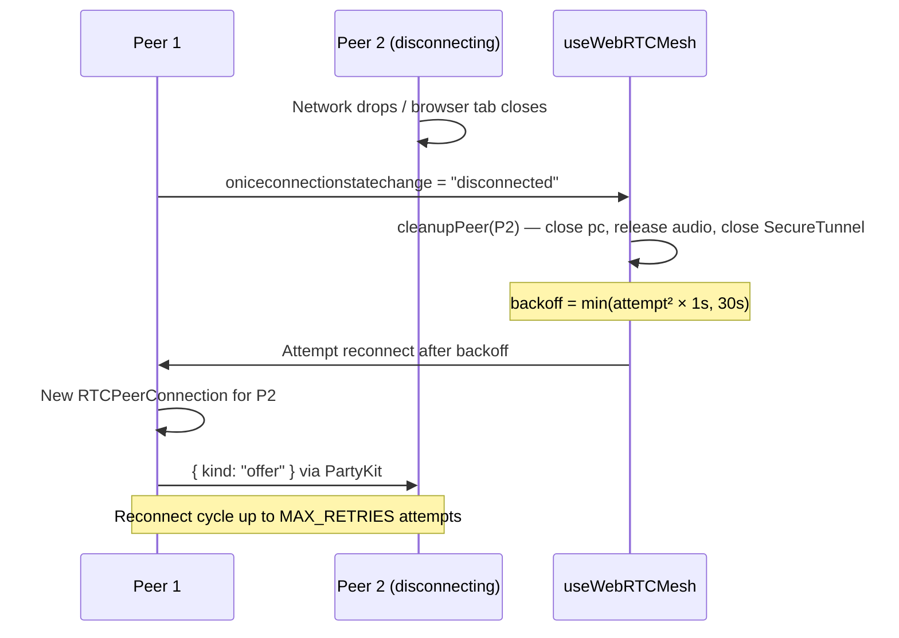

# WebRTC Mesh Connection Lifecycle

> **Sources:** `src/hooks/useWebRTCMesh.ts` & `src/core/network/SecureTunnel.ts`  
> **Signaling:** `party/server.ts` — PartyKit handles authenticated SDP/ICE relay over TLS WebSockets  
> **See also:** [`WEBRTC_MESH.md`](./WEBRTC_MESH.md) — topology, ICE server config, troubleshooting  
> **Security Spec:** [`WEBRTC_MESH_CRDT_SYNC_SPECIFICATION.md`](./WEBRTC_MESH_CRDT_SYNC_SPECIFICATION.md) — Byzantine peer validation & CRDT signing

---

## 1. Offer/Answer Exchange (SDP Negotiation)

When Peer 2 joins a room already occupied by Peer 1, a Perfect Negotiation handshake begins. WorkSphere uses the **polite/impolite peer** model to resolve simultaneous-offer collisions:

- **Polite peer (established participant):** Yields if both peers generate an offer at the same time — rolls back its own SDP and accepts the remote offer.
- **Impolite peer (new joiner):** Ignores conflicting offers and prioritizes its own state.



---

## 2. ICE Candidate Trickling

ICE candidates are gathered and exchanged in parallel during SDP negotiation. Both peers gather candidates from STUN/TURN servers and send them as they are discovered.



---

## 3. Cryptographic DTLS Handshake & Authenticated SecureTunnel (`SecureTunnel.ts`)

`SecureTunnel.ts` establishes encrypted, authenticated peer-to-peer tunnels across untrusted local networks (e.g., public cafe Wi-Fi). It wraps WebRTC `RTCDataChannel` instances to create a virtual network interface, routing internal workspace payloads without exposing traffic to the cafe router or malicious neighbors.

WebRTC mandates **Datagram Transport Layer Security (DTLS 1.2 / 1.3)** over UDP (RFC 8827 / RFC 8831). The DTLS handshake executes as soon as ICE establishes a viable candidate pair.

### 3.1 Handshake Phases

The cryptographic handshake transitions through five distinct phases:

1. **`ClientHello` & Stateless Cookie Verification (`HelloVerifyRequest`)**
   - Peer 1 (DTLS Client) sends `ClientHello` containing supported cipher suites (`TLS_ECDHE_ECDSA_WITH_AES_128_GCM_SHA256`, `TLS_ECDHE_ECDSA_WITH_CHACHA20_POLY1305_SHA256`), client random nonce $R_c$, and elliptic curve extensions (`x25519`, `secp256r1`).
   - To prevent UDP spoofing and denial-of-service amplification, Peer 2 (DTLS Server) responds with `HelloVerifyRequest` containing a stateless cryptographic cookie:
     $$\text{Cookie} = \text{HMAC}_{K_{\text{secret}}}(\text{IP}_{\text{client}} \parallel \text{Port}_{\text{client}} \parallel R_c)$$
   - Peer 1 re-transmits `ClientHello` with the validated cookie, proving source address ownership.

2. **`ServerHello` & Cipher Negotiation**
   - Peer 2 responds with `ServerHello`, confirming the negotiated cipher suite (`TLS_ECDHE_ECDSA_WITH_AES_128_GCM_SHA256`), DTLS version, and server random nonce $R_s$.

3. **Certificate Exchange & Fingerprint Verification**
   - **`Certificate`**: Each peer generates an ephemeral, self-signed X.509 certificate with an ECDSA key pair upon `RTCPeerConnection` instantiation.
   - **`ServerKeyExchange`**: Peer 2 transmits its ephemeral ECDH public key parameters signed with its private key.
   - **Certificate Fingerprint Cross-Verification**: The receiving peer computes the SHA-256 digest of the received certificate and validates it against the `a=fingerprint:sha-256 ...` attribute delivered over the authenticated PartyKit TLS signaling channel:
     $$\text{Digest} = \text{SHA-256}(\text{DER}(\text{Cert}_{\text{peer}})) \stackrel{?}{=} \text{SDP}_{\text{fingerprint}}$$
     If the fingerprints do not match, the connection is instantly aborted, thwarting Man-In-The-Middle (MITM) attacks.

4. **Key Derivation (ECDHE + HKDF / PRF)**
   - Peer 1 generates its ephemeral ECDH key pair and sends `ClientKeyExchange`.
   - Both peers compute the Diffie-Hellman Pre-Master Secret ($PMS$):
     $$PMS = \text{ECDH}(sk_{\text{local}}, pk_{\text{remote}})$$
   - Both peers derive the 48-byte Master Secret ($MS$) using the TLS Pseudorandom Function (PRF):
     $$MS = \text{PRF}(PMS, \text{"master secret"}, R_c \parallel R_s)$$
   - Key material is expanded into client/server write encryption keys, MAC keys, and IVs. For WebRTC DataChannels, key material is exported via RFC 5764 (DTLS-SRTP / RFC 8831) to initialize the SCTP encapsulation engine.

5. **`Finished` Verification**
   - Both peers exchange `ChangeCipherSpec` indicating all subsequent records are encrypted.
   - Both peers transmit an encrypted `Finished` message containing an HMAC verification of all preceding handshake messages:
     $$\text{VerifyData} = \text{PRF}(MS, \text{"client finished"} \mid \text{"server finished"}, \text{Hash}(\text{HandshakeMessages}))$$
   - Verification guarantees that no intermediary modified or downgraded handshake parameters.

---

### 3.2 Mermaid Diagram: Complete DTLS Handshake Protocol



---

### 3.3 Session Resumption & Pre-Shared Key (PSK) Mechanisms

On mobile cafe connections, temporary radio drops, DHCP renewals, or AP roaming frequently disrupt local peer associations. `SecureTunnel.ts` supports accelerated reconnection through session resumption and out-of-band Pre-Shared Keys:

#### 1. DTLS Session Resumption (RFC 5077 / RFC 5246)

- **Session ID Caching**: During the initial full handshake, Peer 2 issues a 32-byte `SessionID`. If an ICE connection drops and recovers within the 10-minute cache window, Peer 1 transmits the cached `SessionID` in its `ClientHello`.
- **Abbreviated 1-RTT Handshake**: Peer 2 validates the cached session and directly resumes the master secret, skipping the heavy `Certificate` exchange, `ServerKeyExchange`, and asymmetric verification calculations:
  ```
  ClientHello (SessionID)  -------->
                           <--------  ServerHello (SessionID)
                                      [ChangeCipherSpec]
                           <--------  Finished
  [ChangeCipherSpec]       -------->
  Finished                 -------->
  ```
- **Session Tickets (RFC 5077)**: For distributed signaling clusters where server state is stateless, encrypted `NewSessionTicket` payloads store the encapsulated master secret and cipher state client-side, enabling seamless reconnects without sticky sessions.

#### 2. Pre-Shared Key (PSK) Mutual Authentication (RFC 4279)

- **Room Secret Derivation**: In addition to public WebRTC certificates, WorkSphere derives a room-specific Pre-Shared Key using PBKDF2/HKDF over the room's access token and the user's Passkey authentication credential:
  $$PSK = \text{HKDF-Expand}(\text{Secret}_{\text{workspace}}, \text{Salt}_{\text{roomId}}, \text{"worksphere-dtls-psk"}, 32)$$
- **Tunnel Identity Verification**: Before opening high-privilege virtual network interfaces, `SecureTunnel.ts` executes an application-layer zero-knowledge exchange over the newly opened data channel. Peers prove possession of the $PSK$ via challenge-response HMAC without exposing the raw secret.
- **Rogue Peer Exclusion**: Even if an unauthorized cafe neighbor connects to the same public IP/subnet, lacking the workspace $PSK$ prevents tunnel decrypt authorization, causing the connection to terminate immediately.

---

### 3.4 Threat Model & MITM Protection Guarantees

Public cafe networks present a hostile local environment characterized by unencrypted Wi-Fi access points, shared layer-2 broadcast domains, and untrusted local routers.

```
+-----------------------------------------------------------------------------------+
|                        CAFE LOCAL NETWORK THREAT MODEL                            |
+-----------------------------------------------------------------------------------+
| Attacker Capabilities on Cafe Wi-Fi:                                              |
| 1. ARP Cache Poisoning: Spoofs gateway MAC address to route all packets via MITM  |
| 2. Rogue Access Points (Evil Twin): Broadcasts identical SSID with malicious AP   |
| 3. Packet Sniffing (Promiscuous Mode): Captures unencrypted local Wi-Fi frames    |
| 4. DNS Hijacking: Returns attacker IPs for local resolution requests              |
+-----------------------------------------------------------------------------------+
```

#### Security Guarantees Provided by `SecureTunnel.ts`

| Attack Vector                       | Vulnerability in Standard Wi-Fi                                                  | WorkSphere SecureTunnel DTLS Guarantee                                                                                                                                                                                                                          |
| :---------------------------------- | :------------------------------------------------------------------------------- | :-------------------------------------------------------------------------------------------------------------------------------------------------------------------------------------------------------------------------------------------------------------- |
| **Eavesdropping / Packet Sniffing** | Promiscuous packet capture exposes plain HTTP, DNS, and unencrypted UDP traffic. | **AEAD Encryption**: All DataChannel payloads are encrypted with AES-128-GCM / ChaCha20-Poly1305. The cafe router only sees opaque UDP datagrams.                                                                                                               |
| **Man-In-The-Middle (MITM)**        | Attacker intercepting UDP frames can impersonate peers or alter contents.        | **Out-of-Band Fingerprint Binding**: Certificate digests are verified against the SDP `a=fingerprint` passed through the TLS-encrypted PartyKit WebSocket signaling channel. An attacker intercepting UDP cannot forge the authenticated signaling fingerprint. |
| **Replay Attacks**                  | Recorded traffic replayed to forge workspace actions or duplicate messages.      | **Anti-Replay Sliding Window**: DTLS enforces 64-bit sequence numbers with a 64-packet verification sliding window. Duplicate or old packets are discarded.                                                                                                     |
| **Compromise of Long-Term Keys**    | Future compromise of signaling credentials could decrypt past sessions.          | **Perfect Forward Secrecy (PFS)**: Ephemeral ECDHE keys ($PMS$) are discarded immediately after session key derivation. Past captured sessions cannot be decrypted.                                                                                             |
| **Data Tampering & Bit-Flipping**   | Attacker modifying in-flight payload bits.                                       | **Cryptographic MAC Integrity**: GCM authentication tags (128-bit) guarantee byte-level tamper evidence; invalid tags cause immediate packet drops.                                                                                                             |

---

## 4. Audio Track Attachment & WebAudio Spatial Pipeline

Once the DTLS handshake completes and the peer connection state transitions to `"connected"`, the remote audio track arrives via the `ontrack` event and is piped into the WebAudio spatial graph.



---

## 5. Peer Disconnect & Reconnect Backoff

`useWebRTCMesh` monitors `oniceconnectionstatechange` on every `RTCPeerConnection`. When a peer's connection state transitions to `"disconnected"` or `"failed"`, a cleanup + exponential backoff reconnect cycle begins.



### Backoff parameters

| Attempt | Delay |
| ------- | ----- |
| 1       | 1 s   |
| 2       | 4 s   |
| 3       | 9 s   |
| max     | 30 s  |

---

## 6. Signal Message Types & Security Wire Protocol

All signaling messages travel over TLS WebSockets (`wss://`) managed by PartyKit (`party/server.ts`).

| Message kind | Direction                | Payload                          | Security Purpose                                                          |
| ------------ | ------------------------ | -------------------------------- | ------------------------------------------------------------------------- |
| `peer-join`  | Server → peers           | `{ peerId, roomId }`             | Announces new participant; prompts offer generation                       |
| `offer`      | Peer → Peer (via server) | `{ sdp: RTCSessionDescription }` | Transmits SDP offer with `a=fingerprint:sha-256` for DTLS cert pinning    |
| `answer`     | Peer → Peer (via server) | `{ sdp: RTCSessionDescription }` | Transmits SDP answer with `a=fingerprint:sha-256` for mutual cert pinning |
| `ice`        | Peer → Peer (via server) | `{ candidate: RTCIceCandidate }` | Trickles ICE network candidates securely through signaling channel        |
| `peer-leave` | Server → peers           | `{ peerId }`                     | Prompts immediate peer teardown, DataChannel closure, and key destruction |
