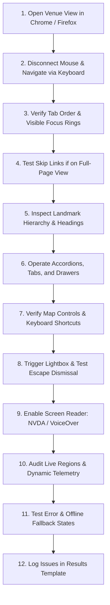

# Keyboard Navigation and Screen Reader Audit Checklist for Venue Detail Views

**Target Scope:** `src/app/venues/[id]/page.tsx`, `src/components/chat/VenueDetailDialog.tsx`, `src/components/venues/VenueDetailModal.tsx`, `src/components/chat/InteractiveMap.tsx`
**Tracking Issues:** #8621, #8608, #8620
**Applicability:** Full-page venue profiles, modal venue details, interactive maps, dynamic telemetry widgets, and amenities

---

## 1. Purpose and Scope

### 1.1 Purpose
WorkSphere provides flexible workspace discovery, ambient noise monitoring, real-time desk availability, and environmental telemetry across distributed coworking facilities, cafes, and libraries. Venue detail views represent a central conversion point where users review noise forecasts, verify Wi-Fi performance, inspect seating layouts, examine amenities, and initiate desk check-ins or reservations.

The purpose of this audit checklist is to establish a rigorous, repeatable inspection protocol for developers and quality assurance (QA) engineers. It evaluates keyboard operability, focus management, screen reader semantics, and dynamic announcements against the **Web Content Accessibility Guidelines (WCAG) 2.1 Level AA** standards.

> [!IMPORTANT]
> **Audit Status Disclosure:**
> This checklist defines a formal evaluation and verification procedure. It does **not** assert that WorkSphere venue detail views currently achieve 100% WCAG 2.1 Level AA conformance across all branches and user configurations. Specific existing capabilities and verified gaps are documented throughout this specification.

### 1.2 WCAG 2.1 Principles (POUR Framework)
This audit is grounded in the four foundational principles of accessibility:
1. **Perceivable:** Information and user interface components must be presentable to users in ways they can perceive. Text alternatives must accompany non-text content (amenity icons, noise graphs, weather canvases), color must not be the sole conveyor of information, and structure must be programmatically exposed.
2. **Operable:** User interface components and navigation must be operable via keyboard interfaces without requiring mouse pointers, without inducing keyboard traps, and with visible, predictable focus indicators.
3. **Understandable:** Information and operation of the user interface must be understandable. Screen readers must receive predictable labels, modal states must be announced clearly, and form validation or translation errors must be identified in text.
4. **Robust:** Content must be robust enough that it can be interpreted reliably by a wide variety of user agents, including assistive technologies (AT) such as NVDA, JAWS, and VoiceOver.

### 1.3 Scope of Venue Detail Views
The venue detail surface in WorkSphere exists in two primary architectural modes:
- **Dedicated Full-Page Route (`src/app/venues/[id]/page.tsx`):**
  A Next.js server-rendered route embedding the `TopNav` navigation bar, breadcrumb hierarchy, hero image cover with view transitions, `VenueWifiCard`, `VenueAccordion` (amenities & opening hours), `AmenityStatusIncidentTracker`, `FavoriteDesksDrawer`, ambient noise charts (`AmbientNoiseTrendGraph`, `HourlyNoiseHeatGraph`, `NoiseForecastChart`), seating availability forecasts (`SeatingForecastChart`, `OccupancyTrendChart`), WebGL 3D volumetric weather (`WeatherCloudRenderer`), `CollaborativeNotes`, and `SiteFooter`.
- **Interactive Modal Dialog (`src/components/chat/VenueDetailDialog.tsx` & `src/components/venues/VenueDetailModal.tsx`):**
  A client-side interactive modal rendered over chat workspaces or map search views. Contains tabbed panels (`overview`, `reviews`, `menu`, `developer`), image lightbox overlays (`VenueMediaLightbox`), dynamic air quality telemetry streams (SSE), amenity crowdsourced voting (`VenueAmenityVoting`), and developer API cURL generators (`VenueDeveloperTab`).
- **Interactive Map Integration (`src/components/chat/InteractiveMap.tsx`):**
  Leaflet-powered interactive maps displaying venue pins, zoom controls, high-contrast toggles, and popups.

#### Out of Scope
- Backend billing and payment settlement workflows (`/api/bookings/confirm`, micro-billing session validation).
- Administrative batch partition managers (`BulkVenuePartitionManager.tsx`).
- Zero-knowledge proof cryptographic generation internals (`snarkjs` prover routines).

---

## 2. Accessibility Audit Checklist

### A. Page Structure and Landmarks

| Check ID | Verification Item | Codebase Status & Observations | WCAG Criterion | Severity |
|---|---|---|---|---|
| **A-01** | **Unique Page Title:** Full-page view generates `<title>{venue.name} \| WorkSphere</title>`. Fallback to "Venue Not Found \| WorkSphere". | **Verified Implemented:** `src/app/venues/[id]/page.tsx#L75-L80` dynamically constructs metadata title and OpenGraph tags from Prisma query. | 2.4.2 Page Titled (Level A) | Blocker |
| **A-02** | **Main Landmark Presence:** The primary content of the venue page must be enclosed within a single `<main>` element. | **Verified Implemented:** `src/app/venues/[id]/page.tsx#L179` wraps the central card in `<main className="flex-grow ...">`. | 1.3.1 Info and Relationships (Level A) | Blocker |
| **A-03** | **Heading Hierarchy ($H1 \to H4$):** There must be exactly one `<h1>` containing the venue name, with subsequent sub-sections structured hierarchically without skipping levels. | **Partial Implementation:** `<h1>` is present for venue name (`page.tsx#L210`). Sub-sections jump directly to `<h3>` for Location, Expected Noise Levels, Seating, and Weather without an intermediary `<h2>`. | 1.3.1 Info and Relationships (Level A) | Medium |
| **A-04** | **Navigation Landmarks:** Global navigation and breadcrumbs must be enclosed in `<nav>` elements with distinct accessible names. | **Verified Implemented:** `Breadcrumb` (`src/components/ui/Breadcrumb.tsx`) renders `<nav aria-label="Breadcrumb">`. `TopNav` renders global nav. | 1.3.1 Info and Relationships (Level A) | High |
| **A-05** | **Modal Dialog Semantics:** The modal view must declare `role="dialog"`, `aria-modal="true"`, and an accessible name via `aria-label` or `aria-labelledby`. | **Verified Implemented:** `VenueDetailDialog.tsx#L836-L838` declares `role="dialog"`, `aria-modal="true"`, and `aria-label={`${venue.name} details`}`. | 4.1.2 Name, Role, Value (Level A) | Blocker |
| **A-06** | **Footer Landmark:** Site footer must use the semantic `<footer>` element. | **Verified Implemented:** Rendered via `<SiteFooter />` (`page.tsx#L376`). | 1.3.1 Info and Relationships (Level A) | Low |

---

### B. Keyboard Navigation and Focus Management

| Check ID | Verification Item | Codebase Status & Observations | WCAG Criterion | Severity |
|---|---|---|---|---|
| **B-01** | **Full Keyboard Reachability:** Every interactive element (buttons, tabs, links, accordion triggers, vote icons) can be reached using `Tab` and `Shift+Tab`. | **Audit Check:** Verify all interactive buttons in `VenueHeaderSection.tsx`, `VenueActionButtons.tsx`, and `VenueAmenityVoting.tsx` are native `<button>` or `<Link>` elements. | 2.1.1 Keyboard (Level A) | Blocker |
| **B-02** | **No Keyboard Traps:** Focus must move freely through interactive controls and must never become trapped permanently in any widget. | **Verified Implemented:** `VenueDetailDialog.tsx#L745-L779` provides bounded focus wrapping across all focusable elements without getting stuck. | 2.1.2 No Keyboard Trap (Level A) | Blocker |
| **B-03** | **Visible Focus Indicators:** Focused elements must display a distinct visual ring with at least 3:1 contrast against the background. | **Audit Check:** Ensure Tailwind `focus-visible:ring-2 focus-visible:ring-blue-500 focus-visible:outline-none` classes are applied across all interactive controls. | 2.4.7 Focus Visible (Level AA) | High |
| **B-04** | **Dialog Focus Trapping:** When `VenueDetailDialog` is open, pressing `Tab` from the last element wraps to the first, and `Shift+Tab` from the first wraps to the last. | **Verified Implemented:** Implemented in `VenueDetailDialog.tsx#L762-L778` using active element checks and boundary index wrapping. | 2.4.3 Focus Order (Level A) | Blocker |
| **B-05** | **Focus Restoration on Dialog Dismissal:** When closing `VenueDetailDialog` or `VenueMediaLightbox`, focus must return to the element that triggered it. | **Verified Implemented:** `VenueDetailDialog.tsx#L725, L786-L790` saves `triggerElementRef.current = document.activeElement` and calls `.focus()` in the cleanup hook. | 2.4.3 Focus Order (Level A) | Blocker |
| **B-06** | **Escape Key Dismissal:** Pressing `Escape` must immediately dismiss active popups, dropdowns, lightboxes, or dialogs in reverse stacking order. | **Verified Implemented:** Lightbox dismisses first (`VenueMediaLightbox`), then dialog (`VenueDetailDialog.tsx#L738-L743`). | 2.1.1 Keyboard (Level A) | High |
| **B-07** | **Tab List Keyboard Control:** In `VenueHeaderSection` tab bar (`overview`, `reviews`, `menu`, `developer`), tabs should support Arrow Left/Right navigation. | **Gap / Audit Observation:** Tabs use `role="tab"` and `aria-selected` (`VenueHeaderSection.tsx#L254-L260`), but arrow key navigation is currently unhandled (relies on standard `Tab` order). | 2.1.1 Keyboard (Level A) | Medium |

---

### C. Skip Links

| Check ID | Verification Item | Codebase Status & Observations | WCAG Criterion | Severity |
|---|---|---|---|---|
| **C-01** | **Skip-to-Main-Content Link:** A skip link must be the first focusable element on the full-page venue route (`/venues/[id]`). | **Identified Gap:** `src/app/venues/[id]/page.tsx` and `TopNav.tsx` currently do not render an explicit `<a href="#main-content" className="sr-only focus:not-sr-only ...">Skip to content</a>`. | 2.4.1 Bypass Blocks (Level A) | High |
| **C-02** | **Visible on Focus:** When focused via keyboard, the skip link must become visually prominent at the top of the viewport. | **Audit Recommendation:** Position absolute with high z-index and high contrast (`bg-blue-600 text-white p-3`). | 2.4.7 Focus Visible (Level AA) | High |
| **C-03** | **Target Element Operability:** Activating the skip link must move keyboard focus directly to `<main id="main-content" tabIndex={-1}>`. | **Audit Recommendation:** Add `id="main-content"` and `tabIndex={-1}` to `<main>` in `src/app/venues/[id]/page.tsx`. | 2.4.1 Bypass Blocks (Level A) | High |

---

### D. Venue Information and Amenities

| Check ID | Verification Item | Codebase Status & Observations | WCAG Criterion | Severity |
|---|---|---|---|---|
| **D-01** | **Hero & Gallery Image Alt Text:** The primary venue cover image must provide descriptive alternative text. | **Verified Implemented:** `src/app/venues/[id]/page.tsx#L185` sets `alt={venue.name}`. In OpenGraph metadata, `alt: venue.name` is provided. | 1.1.1 Non-text Content (Level A) | High |
| **D-02** | **Decorative Icons Ignored:** Status and decorative icons (`MapPin`, `Wifi`, `Zap`, `Coffee`) must be hidden from screen readers using `aria-hidden="true"`. | **Audit Check:** Review Lucide icon instances. For example, `ReviewSentimentBadge.tsx#L40` uses `aria-hidden="true"`. Ensure all decorative icons in `page.tsx` apply `aria-hidden="true"`. | 1.1.1 Non-text Content (Level A) | Medium |
| **D-03** | **Amenity Voting Accessible Names:** Upvote and downvote buttons for amenities (Wi-Fi, outlets, silent rooms, bicycle racks) must have explicit accessible names and pressed states. | **Verified Implemented:** `VenueAmenityVoting.tsx#L140-L240` applies `aria-label="Upvote wifi"` and `aria-pressed={metrics.wifi?.userVote === true}`. | 4.1.2 Name, Role, Value (Level A) | Blocker |
| **D-04** | **Accordion State & Panel Association:** Amenity and opening hour dropdowns must announce expanded/collapsed state and control the panel ID. | **Verified Implemented:** `VenueAccordion.tsx#L25-L42` implements `aria-expanded={isAmenitiesOpen}`, `aria-controls="venue-amenities-panel"`, and `aria-labelledby="venue-amenities-trigger"`. | 4.1.2 Name, Role, Value (Level A) | High |
| **D-05** | **No Reliance on Color Alone:** Vibe percentages, noise levels (quiet, moderate, loud), and Wi-Fi statuses must include text labels alongside green/amber/red color coding. | **Verified Implemented:** `src/app/venues/[id]/page.tsx#L215-L222` couples the blue vibe badge with text labels `Vibe` and `{Math.round(venue.rating * 10)}%`. | 1.4.1 Use of Color (Level A) | Blocker |

---

### E. Interactive Maps

| Check ID | Verification Item | Codebase Status & Observations | WCAG Criterion | Severity |
|---|---|---|---|---|
| **E-01** | **Accessible Region Label:** The map container must declare a region role and accessible name. | **Audit Check:** Verify `MapContainer` in `src/components/chat/InteractiveMap.tsx` exposes `role="region"` and `aria-label="Interactive Venue Location Map"`. | 4.1.2 Name, Role, Value (Level A) | High |
| **E-02** | **Keyboard Zoom & Reset Controls:** Zoom in, zoom out, high-contrast, and view reset buttons must be reachable and operable via keyboard. | **Verified Implemented:** `InteractiveMap.tsx#L375-L430` provides explicit `<button>` elements with `aria-label="Zoom in"`, `aria-label="Zoom out"`, and `aria-label="Reset map view"`. | 2.1.1 Keyboard (Level A) | Blocker |
| **E-03** | **Global Map Keydown Shortcuts:** Single-key shortcuts (`+`/`-` for zoom, `h` for high-contrast, `r` for reset) must be bypassed when typing in form inputs. | **Verified Implemented:** `InteractiveMap.tsx#L221-L231` explicitly checks `target.tagName` against `input`, `textarea`, `select`, and `isContentEditable` before handling shortcuts. | 2.1.4 Character Key Shortcuts (Level A) | High |
| **E-04** | **Accessible Pin Markers:** Map markers must provide text labels containing venue name, rating, and coordinates. | **Verified Implemented:** `InteractiveMap.tsx#L443-L452` formats marker accessibility text: `Venue: ${venueName}, Category: ${category}, Rating: ${score}`. | 1.1.1 Non-text Content (Level A) | High |
| **E-05** | **Accessible Non-Map Location Fallback:** Users unable to interact with the visual map canvas must have text access to the venue's full address and directions. | **Verified Implemented:** Full address text is displayed in `page.tsx#L246` with a `CopyToClipboardButton` (`ariaLabel="Copy venue address"`). | 1.1.1 Non-text Content (Level A) | Blocker |

---

### F. Dynamic Venue Updates and Live Regions

| Check ID | Verification Item | Codebase Status & Observations | WCAG Criterion | Severity |
|---|---|---|---|---|
| **F-01** | **Loading State Announcements:** When venue data, reviews, or AI summaries are loading, assistive technology must announce the pending operation without stealing focus. | **Verified Implemented:** `VenueSummary.tsx#L85` uses `aria-busy="true"` and `aria-label="Loading AI summary"`. `VenueReviewsSection.tsx#L50` uses `aria-label="Loading reviews" aria-live="polite"`. | 4.1.3 Status Messages (Level AA) | Medium |
| **F-02** | **Polite vs Assertive Announcements:** Routine telemetry updates (air quality, noise forecasts) must use `aria-live="polite"`. Critical emergency alerts must use `aria-live="assertive"`. | **Verified Implemented:** Routine updates in `SeatOccupancyHeatmap.tsx#L210` use `aria-live="polite"` with `aria-atomic="true"`. Emergency beacon alerts (`BeaconCalibrationDialog.tsx#L94`) use `aria-live="assertive"`. | 4.1.3 Status Messages (Level AA) | High |
| **F-03** | **Air Quality Telemetry SSE Updates:** Real-time CO2, PM2.5, and TVOC readings streamed via Server-Sent Events must avoid excessive speech chatter. | **Audit Check:** Verify `VenueHeaderSection.tsx#L160` updates `aria-label={`Indoor air quality index ${score.overall}, ${score.label}`}` without firing assertive live interrupts on every tick. | 4.1.3 Status Messages (Level AA) | High |
| **F-04** | **Review Translation State:** Asynchronous review or description translations must announce busy state and completion/error. | **Verified Implemented:** `VenueReviewsSection.tsx#L180` sets `aria-busy={isCurrentlyTranslating}` and exposes `descTranslationError` in text. | 4.1.3 Status Messages (Level AA) | Medium |
| **F-05** | **Copy to Clipboard Confirmation:** Activating "Copy Address" or "Copy cURL" must announce "Copied!" to screen readers. | **Verified Implemented:** `VenueDeveloperTab` (`VenueDetailModal.tsx#L130`) switches button label to `aria-label={isCopied ? "Copied cURL command" : "Copy cURL command"}`. | 4.1.3 Status Messages (Level AA) | Medium |

---

### G. Forms and Interactive Controls

| Check ID | Verification Item | Codebase Status & Observations | WCAG Criterion | Severity |
|---|---|---|---|---|
| **G-01** | **Form Input Accessible Names:** All inputs (search bars, review textareas, menu file uploaders) must have associated `<label>` elements or `aria-label`. | **Audit Check:** Verify `MenuUpload` file input in `VenueMediaLightbox.tsx#L85` and `VenueReviewForm.tsx` provide accessible labels. | 4.1.2 Name, Role, Value (Level A) | Blocker |
| **G-02** | **Language Selector Dropdown:** Description translation dropdown must declare its purpose and selected language. | **Verified Implemented:** `VenueHeaderSection.tsx#L280` provides `<select aria-label="Select venue description language">`. | 4.1.2 Name, Role, Value (Level A) | High |
| **G-03** | **Flag / Report Menu:** The menu trigger for reporting inaccurate venue data must expose popup semantics. | **Verified Implemented:** `VenueHeaderSection.tsx#L310` sets `aria-label="Report inaccurate venue data"`, `aria-haspopup="true"`, and `aria-expanded={showFlagMenu}`. | 4.1.2 Name, Role, Value (Level A) | High |
| **G-04** | **Minimum Touch & Click Target Size:** Interactive buttons and touch targets must measure at least $44 \times 44\text{ px}$ (or $48 \times 48\text{ px}$ for mobile controls). | **Verified Implemented:** Map controls (`InteractiveMap.tsx#L377, L399, L419`) use `min-h-11 min-w-11` ($44\text{ px}$). Action buttons in `page.tsx` use `py-4`. | 2.5.5 Target Size (Level AAA) / 2.5.8 (Level AA) | Medium |

---

## 3. Standard Keyboard Mapping Matrix

The following matrix documents the standard keyboard behaviors expected across venue detail views, mapping native browser keystrokes and custom composite widget interactions to WAI-ARIA Authoring Practices.

| Key / Key Combination | Expected Behavior | Applicable Component(s) | Verification Method | WAI-ARIA / WCAG Reference |
|---|---|---|---|---|
| **Tab** | Moves focus forward sequentially to the next interactive control. Within modals, wraps to the first focusable control upon reaching the end. | All interactive components (`page.tsx`, `VenueDetailDialog.tsx`) | Manual keyboard traversal | WCAG 2.1.1, WCAG 2.4.3 |
| **Shift + Tab** | Moves focus backward sequentially. Within modals, wraps to the last focusable control upon reaching the beginning. | All interactive components (`page.tsx`, `VenueDetailDialog.tsx`) | Manual keyboard traversal | WCAG 2.1.1, WCAG 2.4.3 |
| **Enter** | Activates links (`<a>`), triggers default button actions, submits modal reviews, or opens image preview. | Links, buttons, copy buttons, breadcrumbs | Press `Enter` on focused control | WAI-ARIA Button & Link Pattern |
| **Space** | Toggles buttons (`aria-pressed`), expands/collapses accordions, or toggles amenity voting buttons. | Amenity voting buttons, bookmark toggles, accordions | Press `Space` on focused control | WAI-ARIA Button Pattern |
| **Escape** | Closes the uppermost active overlay in reverse hierarchical order (Fullscreen Lightbox $\to$ Preview Image $\to$ Venue Modal $\to$ Flag Dropdown). | `VenueDetailDialog.tsx`, `VenueMediaLightbox.tsx`, `VenueWifiConnectModal.tsx` | Press `Escape` while overlay is open | WAI-ARIA Dialog (Modal) Pattern |
| **Arrow Right / Left** | 1. Navigates next/previous photo in fullscreen photo lightbox.<br>2. Should navigate between tabs in `VenueHeaderSection` tablist. | `VenueMediaLightbox.tsx` (implemented); `VenueHeaderSection.tsx` (recommended) | Press `ArrowRight` / `ArrowLeft` | WAI-ARIA Carousel & Tabs Patterns |
| **`+` / `=`** | Increments map zoom level by 1 step (when not focused inside a text input). | `InteractiveMap.tsx` | Press `+` while viewing map | Custom shortcut (WCAG 2.1.4) |
| **`-` / `_`** | Decrements map zoom level by 1 step (when not focused inside a text input). | `InteractiveMap.tsx` | Press `-` while viewing map | Custom shortcut (WCAG 2.1.4) |
| **`r` / `R`** | Resets map view to center coordinates and initial zoom (when not focused in input). | `InteractiveMap.tsx` | Press `R` while viewing map | Custom shortcut (WCAG 2.1.4) |
| **`h` / `H`** | Toggles high-contrast map tile layers (when not focused in input). | `InteractiveMap.tsx` | Press `H` while viewing map | Custom shortcut (WCAG 2.1.4) |

---

## 4. Screen Reader Audit Procedures

Testing with assistive technologies requires evaluating the spoken accessibility tree across major screen reader and browser pairings. Screen reader phrasing naturally varies by engine version and verbosity settings; testing must verify that the **semantic intent, role, state, and label** are communicated unambiguously.

### 4.1 NVDA (NonVisual Desktop Access) on Windows
- **Recommended Browsers:** Google Chrome, Mozilla Firefox.
- **Audit Procedure:**
  1. **Landmark Navigation (`D` key):** Press `D` to cycle through landmarks. Ensure NVDA announces "banner" (`TopNav`), "navigation" (`Breadcrumb`), "main", and "contentinfo" (`SiteFooter`).
  2. **Heading Navigation (`H` / `1`-`6` keys):** Press `H` to cycle headings. Verify `H1` announces the venue name. Verify noise and seating sections are announced as headings.
  3. **Modal Appearance:** Trigger `VenueDetailModal`. NVDA must announce "dialog, [Venue Name] details", followed by the initially focused control. Verify NVDA virtual cursor cannot read background page content outside the modal.
  4. **Live Region Updates:** Trigger review submission or copy address. Verify NVDA speaks "Copied!" or status messages without the user moving focus.
- **Failure Conditions:**
  - NVDA announces unlabelled controls as "button" with no accessible name.
  - Focus escapes the modal backdrop into the background chat or explore grid.
  - Image is announced as filename (e.g., "unsplash-dash-123.jpg") instead of venue name.

### 4.2 JAWS (Job Access With Speech) on Windows
- **Recommended Browsers:** Google Chrome, Microsoft Edge.
- **Audit Procedure:**
  1. **Forms Mode (`Insert + F7` / `Tab`):** Traverse amenity voting controls. JAWS should announce: "Upvote wifi button, not pressed", and upon activation: "pressed".
  2. **Dialog Trapping:** Open `VenueDetailDialog`. Verify JAWS enters PC Cursor / Virtual PC Mode correctly and bounds focus inside the dialog frame.
  3. **Map Verification:** Navigate to `InteractiveMap`. JAWS should announce zoom and reset buttons with their titles and keyboard shortcut badges.
  4. **Accordion Inspection:** Navigate to `VenueAccordion`. JAWS should announce "Amenities, button, collapsed" and upon pressing `Space`: "expanded".
- **Failure Conditions:**
  - JAWS fails to announce expanded/collapsed state on accordion triggers.
  - Background links receive focus while modal is displayed.
  - Dynamic SSE air quality readings interrupt user navigation continuously.

### 4.3 Apple VoiceOver on macOS and iOS
- **Recommended Browsers:** Safari (macOS), Safari on iOS/iPadOS.
- **Audit Procedure:**
  1. **Rotor Navigation (`VO + U` on macOS):** Open Rotor, select "Landmarks" and "Headings". Verify clean hierarchy without duplicate unlabelled regions.
  2. **Touch Exploration (iOS):** On iOS Safari, swipe right through venue details. Verify logical reading order: Hero Image $\to$ Category $\to$ Title $\to$ Vibe $\to$ Location $\to$ Copy Button $\to$ Wi-Fi $\to$ Accordions $\to$ Charts $\to$ Action Links.
  3. **Lightbox Swipe Gestures:** In `VenueMediaLightbox`, swipe left/right with two fingers (or activate next/previous buttons). VoiceOver must announce the updated image index (e.g., "Photo 2 of 5").
  4. **Escape Key Dismissal:** Press `Escape` (or iOS two-finger scrub gesture `Z`). VoiceOver must return focus cleanly to the trigger button.
- **Failure Conditions:**
  - VoiceOver focus lands in an empty invisible container upon opening a dialog.
  - VoiceOver reads CSS background gradients or decorative icons as "unlabelled image".
  - Lightbox photo navigation does not update the active accessible description.

---

## 5. Automated Accessibility Testing Guidance

Automated accessibility testing with `@testing-library/react` and `jest-axe` provides fast regression prevention for structural markup, ARIA syntax, and color contrast.

### 5.1 Test Suite Implementation Example
The following Jest test example demonstrates how to audit venue detail components using WorkSphere's existing testing infrastructure:

```tsx
import React from 'react';
import { render, screen, fireEvent, waitFor } from '@testing-library/react';
import { axe, toHaveNoViolations } from 'jest-axe';
import { VenueSummary } from '@/components/venue/VenueSummary';
import { VenueAccordion } from '@/components/venue/VenueAccordion';
import { VenueWifiCard } from '@/components/venue/VenueWifiCard';

expect.extend(toHaveNoViolations);

describe('Venue Details Accessibility Suite (Issue #8621)', () => {
  const mockVenue = {
    id: 'venue-test-101',
    name: 'Silicon Hub Coworking',
    address: '100 Innovation Way, San Francisco, CA',
    category: 'coworking_space',
    rating: 4.8,
    wifiQuality: 'Fast (120 Mbps)',
    hasOutlets: true,
    openingHours: 'Mon-Fri 08:00 - 20:00',
  };

  it('renders VenueWifiCard with no detectable a11y violations', async () => {
    const { container } = render(<VenueWifiCard venue={mockVenue as any} />);
    const results = await axe(container);
    expect(results).toHaveNoViolations();
  });

  it('renders VenueAccordion and toggles panels with valid ARIA attributes', async () => {
    const amenities = ['High-Speed Wi-Fi', 'Dedicated Quiet Zone', 'Ergonomic Chairs'];
    const { container } = render(
      <VenueAccordion amenities={amenities} openingHours={mockVenue.openingHours} />
    );

    // Initial automated axe inspection
    expect(await axe(container)).toHaveNoViolations();

    // Verify trigger accessibility
    const amenitiesTrigger = screen.getByRole('button', { name: /amenities/i });
    expect(amenitiesTrigger).toHaveAttribute('aria-expanded', 'false');
    expect(amenitiesTrigger).toHaveAttribute('aria-controls', 'venue-amenities-panel');

    // Expand accordion panel
    fireEvent.click(amenitiesTrigger);
    expect(amenitiesTrigger).toHaveAttribute('aria-expanded', 'true');
    expect(screen.getByText('Dedicated Quiet Zone')).toBeVisible();

    // Re-verify no violations while expanded
    expect(await axe(container)).toHaveNoViolations();
  });

  it('exposes aria-busy on VenueSummary while generating AI summary', async () => {
    const { container } = render(<VenueSummary venueId={mockVenue.id} />);
    const summaryRegion = screen.getByLabelText(/ai venue summary/i);
    expect(summaryRegion).toHaveAttribute('aria-busy', 'true');
  });
});
```

### 5.2 Limitations of Automated Testing
Automated testing tools (such as `axe-core`, `Lighthouse`, and `jest-axe`) provide essential guardrails but detect only an estimated **30% to 50%** of potential accessibility barriers:
- **What Automated Tests Catch:** Missing `alt` attributes, invalid ARIA attribute names, duplicate DOM IDs, missing form labels, and mathematical color contrast failures on static backgrounds.
- **What Automated Tests Cannot Verify:**
  - Whether alternative text is genuinely meaningful or descriptive.
  - Whether keyboard tab order matches the logical reading sequence.
  - Whether focus trapping in modals is completely leak-proof across real browsers.
  - Whether screen readers announce live regions cleanly without speech truncation.
  - Whether custom keyboard shortcuts cause conflicts with assistive technology keys.
- **Audit Mandate:** Automated test passes must always be supplemented with the manual keyboard and screen reader audit steps detailed in Section 6.

---

## 6. Manual Testing Procedure

Follow this 12-step verification procedure when testing venue detail views before merging pull requests:



### 6.1 Step-by-Step Procedure
1. **Initialize Environment:** Open the target venue view (`/venues/[id]` or open `VenueDetailModal` from `/dashboard`). Ensure zoom is set to 100%.
2. **Keyboard-Only Traversal:** Disconnect or avoid touching the mouse or trackpad. Press `Tab` repeatedly to traverse all controls from top to bottom.
3. **Verify Focus Visibility:** Confirm that every focused element displays a high-contrast focus ring (min 2px). Ensure focus never disappears into hidden or off-screen elements.
4. **Test Skip Link:** On `/venues/[id]`, press `Tab` on initial page load. Verify skip link appears and activating it drops focus directly into `<main>`.
5. **Inspect Heading Hierarchy:** Using browser developer tools or the headings rotor in a screen reader, verify that `<h1>` exists and lower headings follow logical sequence.
6. **Operate Interactive Components:**
   - Press `Enter` or `Space` to expand/collapse `VenueAccordion`.
   - Toggle amenity upvote/downvote buttons in `VenueAmenityVoting`.
   - Open and copy address via `CopyToClipboardButton`.
7. **Test Interactive Map:** In `InteractiveMap`, verify that zoom buttons can be focused and activated via `Space`/`Enter`. Press `+`, `-`, and `r` to test shortcuts.
8. **Test Lightbox & Modals:** Open photo gallery. Verify focus moves inside the modal. Press `Escape` and verify focus returns to the original button.
9. **Screen Reader Verification:** Launch NVDA (Windows) or VoiceOver (macOS). Navigate through all text and controls. Verify names, states, and roles match visual intent.
10. **Test Dynamic Announcements:** Trigger an action with asynchronous feedback (e.g., save venue, translate review). Confirm announcement via live region.
11. **Test Edge / Error States:** Test invalid venue IDs, network offline simulation, and missing photos to confirm fallback text and error announcements.
12. **Record Audit Findings:** Document all failures using the template below.

### 6.2 Audit Results Template

| Audit ID | Component / Element | Expected Behavior | Actual Behavior | Result (PASS / FAIL) | Severity | Reproduction Steps | Remediation Recommendation |
|---|---|---|---|---|---|---|---|
| AUDIT-01 | `/venues/[id]` Root | Skip-to-content link appears on first `Tab` | No skip link exists in DOM | **FAIL** | High | Load `/venues/[id]`, press `Tab` | Add skip link pointing to `<main id="main-content">` |
| AUDIT-02 | `VenueAccordion` | Expands and announces state | Toggles properly; announces "expanded/collapsed" | **PASS** | - | Press `Space` on Amenities trigger | N/A |
| AUDIT-03 | `InteractiveMap` | Zoom buttons operable via keyboard | Buttons focusable; `min-h-11 min-w-11` targets | **PASS** | - | Tab to map zoom controls | N/A |
| AUDIT-04 | `VenueHeaderSection` | Tab bar supports arrow keys | Only standard `Tab` order supported | **FAIL** | Medium | Focus tab, press `ArrowRight` | Add WAI-ARIA arrow key tablist handler |

---

## 7. WCAG 2.1 Level AA Success Criteria Mapping

The following table maps every check in this audit checklist directly to the official W3C WCAG 2.1 Success Criteria:

| WCAG Criterion | Criterion Name | Level | Applicable Checklist Items | Verification Method |
|---|---|---|---|---|
| **1.1.1** | Non-text Content | A | A-01, D-01, D-02, E-04, E-05 | Screen reader audit, code inspection of `alt` and `aria-hidden` |
| **1.3.1** | Info and Relationships | A | A-02, A-03, A-04, A-06, D-04 | DOM tree inspection, landmark inspection, heading rotor |
| **1.3.2** | Meaningful Sequence | A | B-04, B-05, E-05 | Sequential keyboard traversal, DOM order review |
| **1.4.1** | Use of Color | A | D-05 | Grayscale visual filter audit, text alternative inspection |
| **1.4.3** | Contrast (Minimum) | AA | B-03, D-05 | Automated axe check, Color Contrast Analyzer (4.5:1 text, 3:1 UI) |
| **1.4.11** | Non-text Contrast | AA | B-03, D-05, E-02 | Visual focus ring inspection, graphical icon contrast (3:1) |
| **2.1.1** | Keyboard | A | B-01, B-06, B-07, E-02 | Manual keyboard navigation (no mouse pointer attached) |
| **2.1.2** | No Keyboard Trap | A | B-02, B-04 | Modal dialog traversal, bounds testing |
| **2.1.4** | Character Key Shortcuts | A | E-03 | Verification that shortcuts are disabled during text input |
| **2.4.1** | Bypass Blocks | A | C-01, C-02, C-03 | Skip link verification on page load |
| **2.4.2** | Page Titled | A | A-01 | Browser tab title and `generateMetadata` inspection |
| **2.4.3** | Focus Order | A | B-04, B-05 | Modal mount and unmount focus tracking assertions |
| **2.4.6** | Headings and Labels | AA | A-03, D-03, G-01 | Screen reader rotor inspection, accessible name calculation |
| **2.4.7** | Focus Visible | AA | B-03, C-02 | Manual keyboard navigation visual inspection |
| **2.5.5** | Target Size | AAA (Rec.) | G-04 | Computed CSS box model inspection ($\ge 44 \times 44\text{ px}$) |
| **2.5.8** | Target Size (Minimum) | AA | G-04 | Computed CSS box model inspection ($\ge 24 \times 24\text{ px}$) |
| **3.2.1** | On Focus | A | B-01, B-04 | Confirming focus does not trigger unexpected form submission |
| **3.2.2** | On Input | A | G-02 | Confirming language selector does not redirect unexpectedly |
| **3.3.1** | Error Identification | A | F-04, G-01 | Triggering invalid uploads and checking error messages |
| **4.1.2** | Name, Role, Value | A | A-05, D-03, D-04, G-01, G-03 | Inspecting accessibility tree attributes (`role`, `aria-*`) |
| **4.1.3** | Status Messages | AA | F-01, F-02, F-03, F-04, F-05 | Screen reader testing of dynamic `aria-live` announcements |

---

## 8. Audit Completion Criteria

A venue detail view pull request or release branch is considered **Accessibility Audit Complete** only when all of the following exit conditions are satisfied:

1. **Zero Blocker / Critical Defects:**
   - No keyboard traps in any modal, lightbox, dropdown, or canvas component.
   - All interactive controls are fully reachable and activatable via `Tab`, `Shift+Tab`, `Enter`, and `Space`.
   - Modals enforce proper focus trapping and restore focus to trigger elements upon dismissal.
2. **Visible Focus Compliance:**
   - Every interactive element exhibits a clearly identifiable focus indicator meeting the 3:1 non-text contrast requirement.
3. **Semantic Hierarchy & Landmarks:**
   - Page contains `<main>`, unique page `<title>`, and logical heading structure without orphaned controls.
4. **Accessible Alternative Access:**
   - Non-interactive map fallbacks exist (address text, directions link).
   - Informative images provide meaningful alt text; decorative icons declare `aria-hidden="true"`.
5. **Screen Reader Verification:**
   - The view has been audited on at least one primary screen reader configuration (NVDA on Windows or VoiceOver on macOS/iOS).
   - Dynamic announcements utilize appropriate `aria-live` polite/assertive levels without causing auditory clutter.
6. **Automated Testing Baseline:**
   - Automated `jest-axe` test suites run and report zero violations on static and expanded states.
7. **Disclosed Gaps Documented:**
   - Any unresolvable accessibility limitation (e.g., third-party WebGL canvas weather accessibility) is explicitly documented with planned remediation tracking.

---

## 9. References

- [W3C Web Content Accessibility Guidelines (WCAG) 2.1](https://www.w3.org/TR/WCAG21/)
- [W3C WAI-ARIA Authoring Practices Guide (APG)](https://www.w3.org/WAI/ARIA/apg/)
- [W3C WAI-ARIA APG: Dialog (Modal) Pattern](https://www.w3.org/WAI/ARIA/apg/patterns/dialog-modal/)
- [W3C WAI-ARIA APG: Accordion Pattern](https://www.w3.org/WAI/ARIA/apg/patterns/accordion/)
- [W3C WAI-ARIA APG: Tabs Pattern](https://www.w3.org/WAI/ARIA/apg/patterns/tabs/)
- [NV Access: NVDA User Guide](https://www.nvaccess.org/files/nvda/documentation/userGuide.html)
- [Freedom Scientific: JAWS Documentation](https://support.freedomscientific.com/)
- [Apple: VoiceOver User Guide for Mac](https://support.apple.com/guide/voiceover/)
- [Testing Library: DOM Testing Library Documentation](https://testing-library.com/docs/)
- [jest-axe GitHub Repository & Specification](https://github.com/nickcolley/jest-axe)
