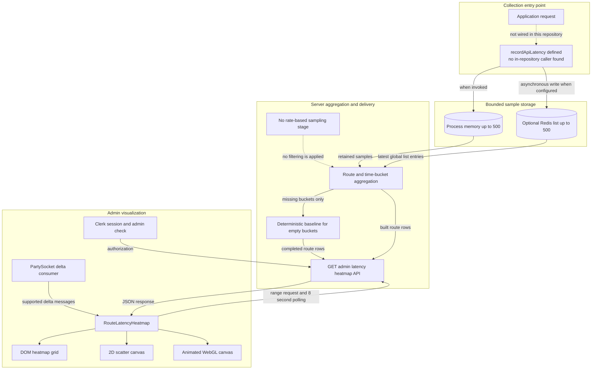

# Route Latency Heatmap Architecture

## 1. Overview

The route latency heatmap is an administrator-facing view of latency metrics
grouped by monitored route and time bucket. It is part of WorkSphere's admin
observability UI and combines a range-based JSON endpoint, a route matrix, a
scatter-style 2D canvas, and a separate animated WebGL visualization.

The current implementation has important data limitations: the repository
defines `recordApiLatency`, but no in-repository call site was found. Empty
route/time buckets are populated with deterministic synthetic baseline values.
The UI's "sampled reqs" label therefore does not establish that the displayed
counts or percentiles are production request measurements.

## 2. Architecture and data flow

The diagram distinguishes the implemented path from collection that is not
wired in this repository. The PartySocket client accepts latency delta messages,
but no in-repository publisher for those messages was found.

<!-- mermaid-checked: no \n, no em-dash/en-dash, no {} in labels, subgraphs are id["label"], arrows are -->|"label"|, all subgraphs closed by end, ids unique -->



### Data flow details

1. `recordApiLatency(route, durationMs, region)` is the collection function. If
   called, it timestamps the sample, changes non-finite or negative durations
   to zero, stores the sample in a process-local buffer, and asynchronously
   writes to Redis when configured. No caller was found in the repository, so
   ordinary request execution is not currently shown to feed this collector.
2. `getRouteLatencyHeatmapData` reads the local buffer and, when available, the
   Redis global sample list. It filters samples to the requested time range,
   groups them by exact route string and time bucket, and constructs rows for a
   fixed monitored-route list.
3. If a monitored route has no samples in a bucket, the collector constructs
   deterministic baseline values from that route's configured baseline and
   variance. These values are synthetic, not observed requests.
4. The admin API returns the collector result as JSON. The UI requests it on
   initial render and range changes, then refreshes on an 8-second timer when
   auto-refresh is enabled. Its PartySocket handler can also apply
   `LATENCY_DELTA` or `telemetry_update` messages; a publisher is not present
   in this repository.
5. The UI renders the route matrix as DOM, the optional scatter view on a
   standard 2D canvas, and the animated hyperlanes on a separate WebGL canvas.

## 3. Sampling windows and latency bucketing

### Sampling and retention

There is no client-side or server-side probabilistic sampling rate in the
inspected heatmap path. `recordApiLatency` stores each invocation it receives;
the Redis pipeline is asynchronous but does not sample observations. The
collector applies a time-range filter, which is not the same as a sampling
strategy.

The recorder retains up to 500 samples in process memory. When Upstash Redis is
configured, it also trims a global list to 500 entries and each per-route list
to 100 entries. The heatmap collector reads the global Redis list, not the
per-route lists, and combines parsed Redis entries with the current process's
memory buffer. Since a recorder invocation writes to both stores, the same
observation can be counted twice when both copies are returned. Redis read
failures fall back to the local buffer. No time-based expiration is applied by
this collector.

### Time windows and route grouping

The API accepts `range=1h`, `range=24h`, or `range=7d`; unsupported values
silently select `1h`.

| Range | Number of buckets |           Bucket width |
| ----- | ----------------: | ---------------------: |
| `1h`  |                12 |              5 minutes |
| `24h` |                24 |             60 minutes |
| `7d`  |                14 | 720 minutes (12 hours) |

Buckets are assigned by sample timestamp relative to the collector's current
time. Samples older than the selected span or timestamped in the future are
excluded. The route key is matched exactly against the fixed monitored-route
list. Each route also has a static category used by the UI filter, but
aggregation is by route and time bucket, not by service/category. Although the
recorder stores a region string, this heatmap does not aggregate by region.

### Percentiles and missing observations

The collector sorts each bucket's durations and selects
`sorted[min(n - 1, floor((p / 100) * n))]`. It does not interpolate between
values. For example, with the illustrative sorted values `[10, 20, 30, 40]`,
this rule selects 30 for p50 and 40 for p95. Applying the same rule to p99
would select 40, but the heatmap API does not calculate or return p99.

For a bucket with one real observation, p50 and p95 both equal that observation;
there is no minimum sample-count threshold. When a bucket has no observations,
the collector calculates synthetic `avgMs`, `p50Ms`, `p95Ms`, `minMs`,
`maxMs`, and a positive `count` from deterministic route/bucket formulas. Such
a bucket is not empty in the response.

For a route row, `overallP95Ms` is calculated over the collector's
`allDurationsForRoute` array. That array includes all real durations and, for
each synthesized bucket, the synthetic average and p95 values. The reported
`totalRequests` sums cell counts, including synthetic counts. `summary.systemP95Ms`
is the p95 of the route-level `overallP95Ms` values, not a p95 over every
request. `summary.systemAvgMs` averages route-level averages without weighting
them by request count.

The UI's CSV formatter includes a p99 column even though the API row type has no
p99 field. For the API's rows, it derives p99 from sorted cell `maxMs` values
(falling back to cell `p95Ms` when `maxMs` is absent) using the same index
selection rule. If no such values exist, it estimates p99 as `round(p95 * 1.25)`.
This is a bucket-summary estimate, not a request-level p99. For these API rows,
CSV p50 is derived from the bucket-level p50 values, while CSV p95 uses the
route's `overallP95Ms` (or falls back to bucket p95 values if that field is
absent). Neither is recomputed from raw request observations.

Sample size, bounded retention, missing call sites, and possible duplicate
Redis/memory entries can bias the calculated values. Synthetic baseline cells
make it especially important not to treat every displayed count as measured
traffic.

## 4. Color scale and visual interpretation

### Route matrix

The route matrix has `p95`, `p50`, `avg`, and `count` modes. In latency modes,
the selected cell value controls the color:

| Value               | Fill color                  | Interpretation   |
| ------------------- | --------------------------- | ---------------- |
| Below 80 ms         | Emerald `rgb(16, 185, 129)` | Optimal          |
| 80 to below 150 ms  | Cyan `rgb(6, 182, 212)`     | Normal           |
| 150 to below 300 ms | Amber `rgb(245, 158, 11)`   | Slow path        |
| 300 ms or more      | Rose `rgb(244, 63, 94)`     | Critical latency |

Fill alpha increases within each range, with caps in the highest range. The
count mode uses cyan with opacity clamped between 0.2 and 1.0 based on
`count / 80`. Zero-count cells use a dark neutral fill. Severity badges are
based on p95 latency and count, so they are not a separate raw measurement.

### Scatter canvas

The 2D canvas normalizes each cell's p95 as `min(1, p95Ms / 500)` and maps that
normalized value to emerald through 0.3, cyan above 0.3 through 0.5, amber above
0.5 through 0.75, and rose above 0.75. The normalized value controls the glow
radius as well as color.

This view is explicitly simulated: x/y positions are derived from a hash of the
route string and the cell index. They are not geolocation coordinates or
geographic telemetry. The visible "Geographic Distribution" wording does not
make the plotted positions geographical.

## 5. Canvas rendering architecture

The primary route-by-time heatmap is a DOM-rendered grid. It rerenders with
React state changes as data, filters, selected metric, or view mode changes.

The optional scatter view is implemented by
[`RouteLatencyHeatmapCanvas.tsx`](../../src/components/admin/RouteLatencyHeatmapCanvas.tsx).
It uses a normal HTML canvas and a 2D context. When `points`, `width`, or
`height` changes, an effect clears the canvas, draws a dark background and
10-by-8 grid, then draws each point with a radial gradient and center dot. Its
default backing dimensions are 800 by 500 pixels; the heatmap passes those
dimensions explicitly. It does not use a continuous animation loop.

`RouteLatencyHeatmap.tsx` also renders a separate WebGL hyperlane canvas. It
allocates a WebGL program and vertex buffer, uploads a bounded set of active
route uniforms, and draws an animated network visualization. Drawing is
scheduled with `requestAnimationFrame`, throttled to at most approximately 60
draws per second, and paused while the document is hidden. A `ResizeObserver`
updates its drawing-buffer dimensions and viewport when its CSS bounds change.
Pointer and wheel handlers provide pan and zoom interactions.

Neither renderer uses `OffscreenCanvas` or application-managed double-buffering.
The 2D scatter canvas draws directly to its visible canvas; the WebGL renderer
draws directly to its visible WebGL canvas.

## 6. High-DPI and Retina / 4K scaling

The two canvases have different scaling behavior:

- The 2D scatter canvas sets its backing width and height from the `width` and
  `height` props (800 by 500 in the heatmap). CSS constrains it to the
  available space, but the component does not read `window.devicePixelRatio`,
  scale the backing store, or transform drawing coordinates for high-DPI
  displays. When CSS scales the canvas down, the browser scales that fixed
  backing image.
- The WebGL canvas measures its CSS bounds and multiplies them by
  `min(window.devicePixelRatio || 1, 1.5)`. It rounds the backing dimensions,
  updates `gl.viewport`, and sends the backing dimensions to the shader as its
  resolution. Its device-pixel ratio is capped at 1.5 to bound pixel area; a
  higher-density display may therefore not receive full native-DPR sharpness.

The WebGL resize is checked by its render loop and also initiated by a
`ResizeObserver`. The 2D canvas has no resize observer; it redraws when its
React inputs change, not merely because its CSS box changes. If crisp
high-DPI 2D rendering or responsive backing-store dimensions are required,
adding explicit DPR-aware sizing and redraw-on-resize would be a future
improvement, not current behavior.

## 7. Memory management and disposal

The 2D canvas has no animation frame, observer, or event listener to dispose.
Its drawing effect obtains the context and redraws in place. The component does
not explicitly clear the canvas or release the context on unmount; the canvas
element becomes eligible for normal browser reclamation when React removes it.

The WebGL effect cancels its pending animation frame, removes its visibility
listener, disconnects its `ResizeObserver`, and deletes the vertex buffer and
program during cleanup. Shader objects are deleted after the link attempt. If
initialization throws after allocating other resources, the catch path deletes
an allocated program but does not run the effect cleanup for partially created
resources such as a buffer, observer, or listener. The code does not explicitly
lose the WebGL context and has no `webglcontextlost` recovery handler.

No offscreen canvas, framebuffer, texture, or second drawing buffer is created
by these renderers. As a general browser consideration, backing-store pixel
area grows with the square of the device-pixel ratio; the WebGL cap limits this
growth, while the 2D canvas currently has fixed backing dimensions.

## 8. API telemetry payload

The endpoint is `GET /api/admin/system/latency-heatmap`. It accepts an optional
`range` query parameter and has no request body. The route is force-dynamic and
successful HTTP 200 responses use `Content-Type: application/json` and include
`Cache-Control: private, no-store, max-age=0`.

### Authentication and authorization

The path is not on the middleware public-route allowlist. An unauthenticated
request is redirected by Clerk middleware to sign-in (HTTP 307) before reaching
the route handler. The handler then calls `getAdminUser`; an authenticated user
must have a verified email matching `ADMIN_EMAILS` or `ADMIN_EMAIL`, or a
supported Clerk role (`admin`, `super_admin`, or `superadmin`). Otherwise the
route returns HTTP 403.

### Query parameter

| Name    | Type                 | Behavior                                                                                 |
| ------- | -------------------- | ---------------------------------------------------------------------------------------- |
| `range` | `1h`, `24h`, or `7d` | Selects the time window and bucket width. Missing or unsupported values default to `1h`. |

### Success response

The response conforms to `RouteLatencyHeatmapData`:

| Field                   | Type                    | Description                                                                                 |
| ----------------------- | ----------------------- | ------------------------------------------------------------------------------------------- |
| `generatedAt`           | string                  | ISO timestamp for response generation.                                                      |
| `range`                 | `"1h" \| "24h" \| "7d"` | Effective range after defaulting.                                                           |
| `bucketIntervalMinutes` | number                  | Width of each time bucket in minutes.                                                       |
| `timeBuckets`           | array                   | Entries with `index: number`, `label: string`, and `timestamp: number` (Unix milliseconds). |
| `routes`                | array                   | One `RouteHeatmapRow` per configured monitored route (16 routes in the current list).       |
| `summary`               | object                  | Aggregate endpoint counts, route-level p95/average values, and summed request counts.       |

`RouteHeatmapRow` fields:

| Field           | Type                                                                            | Description                                                                                      |
| --------------- | ------------------------------------------------------------------------------- | ------------------------------------------------------------------------------------------------ |
| `route`         | string                                                                          | Exact monitored route key.                                                                       |
| `displayName`   | string                                                                          | Display label for the route.                                                                     |
| `category`      | string: `api`, `auth`, `admin`, `db`, `ai`, `telemetry`, `wallet`, or `service` | Static UI filter category.                                                                       |
| `totalRequests` | number                                                                          | Sum of all cell counts, including generated baseline counts.                                     |
| `overallAvgMs`  | number                                                                          | Average of the route's aggregated duration values, including synthetic bucket values where used. |
| `overallP95Ms`  | number                                                                          | Route-level p95 calculated from the aggregated duration values.                                  |
| `isSlowPath`    | boolean                                                                         | True when `overallP95Ms` is at least 150 ms.                                                     |
| `severity`      | string: `optimal`, `normal`, `amber`, or `red`                                  | Route severity; route rows map `idle` to `optimal`.                                              |
| `cells`         | `RouteHeatmapCell[]`                                                            | One cell for each time bucket.                                                                   |

`RouteHeatmapCell` fields:

| Field         | Type                                                   | Description                                                  |
| ------------- | ------------------------------------------------------ | ------------------------------------------------------------ |
| `bucketIndex` | number                                                 | Zero-based index into `timeBuckets`.                         |
| `timeLabel`   | string                                                 | Display label for the bucket.                                |
| `timestamp`   | number                                                 | Bucket timestamp in Unix milliseconds.                       |
| `route`       | string                                                 | Exact monitored route key.                                   |
| `count`       | number                                                 | Number of retained observations or generated baseline count. |
| `avgMs`       | number                                                 | Average duration in milliseconds.                            |
| `p50Ms`       | number                                                 | Bucket p50 in milliseconds.                                  |
| `p95Ms`       | number                                                 | Bucket p95 in milliseconds.                                  |
| `minMs`       | number                                                 | Minimum duration in milliseconds.                            |
| `maxMs`       | number                                                 | Maximum duration in milliseconds.                            |
| `status`      | string: `optimal`, `normal`, `amber`, `red`, or `idle` | Cell severity based on p95 and count.                        |

The `summary` object has six numeric fields: `totalEndpoints`,
`slowEndpointsCount`, `criticalEndpointsCount`, `systemP95Ms`, `systemAvgMs`,
and `totalRequests`. There is no p99 field, raw-sample list, sampling-rate
field, or error-rate field in this response.

The following is an abbreviated illustrative response: it includes one time
bucket and one route row for readability, while the implementation returns all
12 buckets and 16 configured route rows for `1h`. Values are not production
measurements, and empty buckets may instead contain generated baseline values:

```json
{
  "generatedAt": "2025-01-15T12:00:00.000Z",
  "range": "1h",
  "bucketIntervalMinutes": 5,
  "timeBuckets": [
    {
      "index": 11,
      "label": "12:00 PM",
      "timestamp": 1736942400000
    }
  ],
  "routes": [
    {
      "route": "/api/vitals",
      "displayName": "Web Vitals Aggregator",
      "category": "telemetry",
      "totalRequests": 720,
      "overallAvgMs": 34,
      "overallP95Ms": 52,
      "isSlowPath": false,
      "severity": "optimal",
      "cells": [
        {
          "bucketIndex": 11,
          "timeLabel": "12:00 PM",
          "timestamp": 1736942400000,
          "route": "/api/vitals",
          "count": 4,
          "avgMs": 34,
          "p50Ms": 30,
          "p95Ms": 40,
          "minMs": 10,
          "maxMs": 40,
          "status": "optimal"
        }
      ]
    }
  ],
  "summary": {
    "totalEndpoints": 16,
    "slowEndpointsCount": 6,
    "criticalEndpointsCount": 2,
    "systemP95Ms": 430,
    "systemAvgMs": 120,
    "totalRequests": 6300
  }
}
```

### Error behavior

| Status | Response                                               | Condition                                                                     |
| ------ | ------------------------------------------------------ | ----------------------------------------------------------------------------- |
| 307    | Clerk sign-in redirect                                 | No authenticated Clerk session; handled by middleware before the route.       |
| 403    | `{"error":"Admin access required"}`                    | Route-level admin check fails.                                                |
| 500    | `{"error":"Failed to generate route latency heatmap"}` | Authorization lookup or aggregation throws; the server logs the caught error. |

The route does not add its success cache header to its 403 or 500 response
objects.

## 9. Performance considerations

### Existing behavior

- Memory and Redis sample lists are bounded, although the collector can combine
  up to 500 entries from each source and may count duplicates.
- The main grid size scales with the fixed monitored route count and selected
  bucket count.
- REST polling is periodic at 8 seconds when auto-refresh is enabled.
- The WebGL loop throttles drawing to about 60 frames per second and pauses
  when the document is hidden.
- WebGL backing pixel dimensions use a device-pixel-ratio cap of 1.5.

### Considerations and possible improvements

- The absence of a recorder call site means adding verified request
  instrumentation is necessary before interpreting values as live traffic.
- Deduplicating Redis and process-memory samples would avoid double-counting
  samples written to both stores.
- A documented sampling policy, retention window, and minimum sample-count
  display could make latency statistics easier to interpret under high load or
  low traffic.
- The 2D canvas could use DPR-aware sizing and redraw on resize if sharper
  rendering is required on high-density screens.
- Rendering cost should be revisited if the monitored route or time-bucket
  count grows substantially; the current UI uses a DOM grid and a bounded
  WebGL route uniform list.

These are recommendations, not implemented optimizations.

## 10. Troubleshooting and limitations

- **Unexpectedly populated buckets:** Empty buckets are filled with synthetic
  deterministic baselines. Check the collector source and verify a recording
  call site before interpreting counts as observed traffic.
- **No live changes:** The client polls the API, but the repository contains no
  caller for `recordApiLatency` and no publisher for the PartySocket delta
  messages. Verify the deployment's external instrumentation or publisher
  separately.
- **Missing routes:** Aggregation outputs only the configured monitored routes
  and matches samples by exact route string. Unconfigured or differently
  formatted route strings do not create rows.
- **Unexpected percentile values:** Small samples produce percentiles with no
  minimum-count guard. Synthetic cells and possible Redis/memory duplicates
  also affect route-level values.
- **HTTP 307:** Clerk middleware did not find an authenticated session and
  redirected to sign-in.
- **HTTP 403:** Authentication passed, but the admin email or role check did
  not authorize the user.
- **HTTP 500:** Inspect server logs for the
  `[Admin Latency Heatmap API]` error entry.
- **Scatter points do not match geography:** The coordinates are deterministic
  route hashes, not geo-IP data.
- **Blurry scatter rendering:** The 2D canvas uses a fixed backing size and
  does not scale for device-pixel ratio. The WebGL canvas is DPR-aware but
  capped at 1.5.
- **WebGL panel unavailable:** The hyperlane renderer reports an error when
  WebGL cannot be initialized; it does not implement context-loss recovery.

## 11. Related files

- [Route latency heatmap component](../../src/components/admin/RouteLatencyHeatmap.tsx)
- [2D scatter canvas component](../../src/components/admin/RouteLatencyHeatmapCanvas.tsx)
- [Latency heatmap API route](../../src/app/api/admin/system/latency-heatmap/route.ts)
- [Performance telemetry collector](../../src/lib/telemetry/collectors/performanceCollector.ts)
- [Telemetry response types](../../src/lib/telemetry/types.ts)
- [Administrator authorization helper](../../src/lib/admin.ts)
- [Admin vitals API specification](../api/ADMIN_VITALS_SPEC.md)
