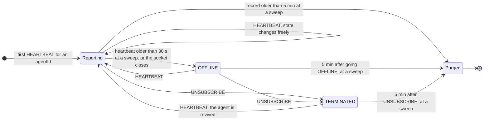
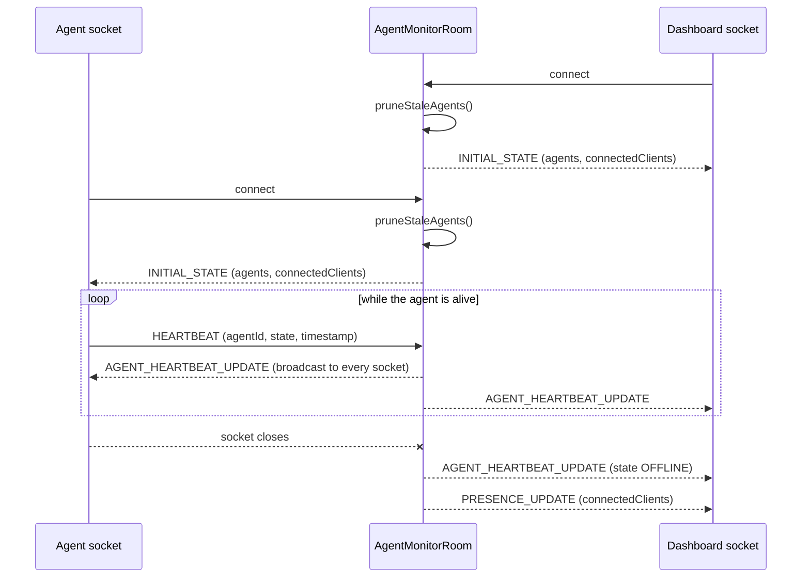

# AgentMonitorRoom: connection lifecycle, heartbeats and presence

This guide describes how `AgentMonitorRoom` tracks agent presence over WebSockets: which states an agent can be in, how heartbeats keep it alive, when the room marks it offline or forgets it, and what to check when presence looks wrong.

- **Source:** [`party/agentMonitor.room.ts`](../../party/agentMonitor.room.ts)
- **Tests:** [`party/__tests__/agentMonitor.test.ts`](../../party/__tests__/agentMonitor.test.ts)
- **Export:** `party/index.ts` re-exports the class as `agentMonitor`.

Everything below describes the code as it is today. Where the code does less than you might expect (no background timer, no authentication, no ping/pong frames), the guide says so explicitly. See [Current limitations](#8-current-limitations) for the full list.

> **Status in the repository.** `partykit.json` declares a single party (`party/server.ts`), and nothing under `src/` connects to `AgentMonitorRoom` yet. Section 7 shows how the room would be registered and what it needs before it is exposed to real traffic.

## Contents

1. [Overview](#1-overview)
2. [Agent states](#2-agent-states)
3. [State diagram and transitions](#3-state-diagram-and-transitions)
4. [Connection lifecycle](#4-connection-lifecycle)
5. [Heartbeat timing and sweeps](#5-heartbeat-timing-and-sweeps)
6. [Message reference](#6-message-reference)
7. [Rooms, multi-tenancy and authentication](#7-rooms-multi-tenancy-and-authentication)
8. [Current limitations](#8-current-limitations)
9. [Troubleshooting](#9-troubleshooting)
10. [Testing](#10-testing)

---

## 1. Overview

`AgentMonitorRoom` is a [PartyKit](https://docs.partykit.io/) server (`implements Party.Server`). One instance exists per room. It keeps two in-memory maps:

| Map                    | Key                     | Value                                                                      | Purpose                                                    |
| ---------------------- | ----------------------- | -------------------------------------------------------------------------- | ---------------------------------------------------------- |
| `agentStates`          | `agentId`               | the last `AgentHeartbeatPayload` received (or the room's own update to it) | The presence snapshot sent to new clients                  |
| `connectionToAgentMap` | WebSocket connection id | `agentId`                                                                  | Lets the room mark an agent offline when its socket closes |

Two things to keep in mind:

- **There is only one kind of socket.** The room does not distinguish agents from dashboards. Any connection can send `HEARTBEAT` messages, and every connection receives every broadcast. An "agent" is simply a socket that sends heartbeats; a "dashboard" is a socket that only listens.
- **The state is not persisted.** Both maps live in the room instance's memory. If the room instance is recreated, the snapshot starts empty and fills again as agents send their next heartbeat.

---

## 2. Agent states

`AgentState` is defined in `agentMonitor.room.ts`:

| State        | Set by                     | Meaning                                                       |
| ------------ | -------------------------- | ------------------------------------------------------------- |
| `IDLE`       | the agent, in a heartbeat  | Running, nothing to do                                        |
| `PLANNING`   | the agent, in a heartbeat  | Working out what to do                                        |
| `EXECUTING`  | the agent, in a heartbeat  | Carrying out a task                                           |
| `REPORTING`  | the agent, in a heartbeat  | Delivering results                                            |
| `ERROR`      | the agent, in a heartbeat  | The agent reports a failure but is still sending heartbeats   |
| `OFFLINE`    | the room                   | No heartbeat within the timeout, or the agent's socket closed |
| `TERMINATED` | the room, on `UNSUBSCRIBE` | The agent said it is shutting down on purpose                 |

The room does not validate the `state` value in a heartbeat and does not enforce an order between the five agent-reported states. An agent can go from `IDLE` straight to `REPORTING`, or send a state that is not in the list. Only `OFFLINE` and `TERMINATED` are controlled by the room.

### Vocabulary used in this guide

Other documents and dashboards sometimes talk about "active" and "stale" agents. These are not states in the code:

| Term       | What it means here                                                                                                                      |
| ---------- | --------------------------------------------------------------------------------------------------------------------------------------- |
| **Active** | Any agent whose state is not `OFFLINE` and not `TERMINATED` (`IDLE`, `PLANNING`, `EXECUTING`, `REPORTING`, `ERROR`)                     |
| **Stale**  | An active agent whose last heartbeat timestamp is older than the heartbeat timeout (30 s by default). The next sweep turns it `OFFLINE` |
| **Purged** | Not a state: the record is deleted from `agentStates` and clients are told with `AGENT_PURGED`                                          |

---

## 3. State diagram and transitions

`Reporting` below stands for the five agent-reported states (`IDLE`, `PLANNING`, `EXECUTING`, `REPORTING`, `ERROR`).



| From                                                      | To                       | Trigger                                              | Broadcast                                        |
| --------------------------------------------------------- | ------------------------ | ---------------------------------------------------- | ------------------------------------------------ |
| (none)                                                    | any agent-reported state | `HEARTBEAT` with an `agentId`                        | `AGENT_HEARTBEAT_UPDATE`                         |
| any agent-reported state                                  | any agent-reported state | `HEARTBEAT`                                          | `AGENT_HEARTBEAT_UPDATE`                         |
| `IDLE` / `PLANNING` / `EXECUTING` / `REPORTING` / `ERROR` | `OFFLINE`                | A sweep finds `now - timestamp > heartbeatTimeoutMs` | `AGENT_HEARTBEAT_UPDATE`                         |
| `IDLE` / `PLANNING` / `EXECUTING` / `REPORTING` / `ERROR` | `OFFLINE`                | The socket last associated with the agent closes     | `AGENT_HEARTBEAT_UPDATE`, then `PRESENCE_UPDATE` |
| any state                                                 | `TERMINATED`             | `UNSUBSCRIBE` for a known agent                      | `AGENT_HEARTBEAT_UPDATE`                         |
| `OFFLINE` or `TERMINATED`                                 | any agent-reported state | `HEARTBEAT` (there is no guard against it)           | `AGENT_HEARTBEAT_UPDATE`                         |
| any state                                                 | removed                  | A sweep finds `now - timestamp > purgeTimeoutMs`     | `AGENT_PURGED`                                   |

---

## 4. Connection lifecycle



### `onConnect`

1. Runs a sweep (`pruneStaleAgents()`), so the new client does not receive records that are already out of date. If the sweep changes anything, those updates are **broadcast to everyone**, not only to the new client.
2. Sends the new connection (and only that connection) an `INITIAL_STATE` message with every record in `agentStates` and the current number of connections.

No `PRESENCE_UPDATE` is sent when someone connects. Presence counts are only broadcast when a socket closes. A dashboard that wants a live count has to take `connectedClients` from `INITIAL_STATE` and from later `PRESENCE_UPDATE` messages.

### `onMessage`

Messages must be text frames containing JSON. Binary frames are ignored without a reply. Text frames are parsed and handled by `type`: see [Message reference](#6-message-reference). A `HEARTBEAT` also records which agent a connection belongs to (`connectionToAgentMap`), which is what `onClose` uses later.

### `onClose`

1. If the closing connection was associated with an agent and that agent is not already `OFFLINE` or `TERMINATED`, the agent becomes `OFFLINE` with `timestamp = Date.now()`, and an `AGENT_HEARTBEAT_UPDATE` is broadcast.
2. The connection is removed from `connectionToAgentMap`.
3. A `PRESENCE_UPDATE` with the current connection count is broadcast. This always happens, even for sockets that never sent a heartbeat.

---

## 5. Heartbeat timing and sweeps

### Defaults

| Constant                             | Default           | Meaning                                                           |
| ------------------------------------ | ----------------- | ----------------------------------------------------------------- |
| `DEFAULT_AGENT_HEARTBEAT_TIMEOUT_MS` | `30_000` (30 s)   | An active agent with no heartbeat for this long becomes `OFFLINE` |
| `DEFAULT_AGENT_PURGE_TTL_MS`         | `300_000` (5 min) | A record this old is deleted                                      |

The constructor accepts `{ heartbeatTimeoutMs, purgeTimeoutMs }` as a second argument. The tests use it with shorter values. Nothing else in the repository passes it, so the defaults apply.

### The sweep: `pruneStaleAgents(now = Date.now())`

For every record, with `age = now - record.timestamp`:

1. If `age > purgeTimeoutMs`: delete the record and broadcast `AGENT_PURGED`. This check comes first, so a record can be purged without ever being marked `OFFLINE`.
2. Otherwise, if `age > heartbeatTimeoutMs` and the state is not `OFFLINE` or `TERMINATED`: set the state to `OFFLINE`, **set `timestamp = now`**, and broadcast `AGENT_HEARTBEAT_UPDATE`.

It returns `{ expired, purged }`, two lists of agent ids.

Resetting the timestamp in step 2 means the purge clock restarts when the agent goes `OFFLINE`. The same applies to `TERMINATED` (timestamp set when `UNSUBSCRIBE` arrives) and to `onClose`. An offline agent therefore stays in the snapshot for up to five more minutes.

### When sweeps run

**There is no timer.** A sweep only runs in two places:

- when a client connects (`onConnect`), and
- when a client sends `PRUNE_STALE`.

If nobody connects and nobody sends `PRUNE_STALE`, a dead agent keeps its last state (for example `EXECUTING`) even long after the timeout. The timeout is evaluated lazily, the next time something asks.

### Which clock is used

`age` is computed from the `timestamp` field **that the agent sent in its heartbeat**, compared with the room's `Date.now()`. The room does not stamp heartbeats on arrival. This has two consequences:

- An agent whose clock is behind by more than the timeout is marked `OFFLINE` at the next sweep even though it is sending heartbeats on time.
- An agent whose clock is ahead never looks stale. A timestamp far in the future keeps the record alive until the room's clock catches up.

### Worked example with the defaults

| Time  | Event                                                       | Result                                                                                                             |
| ----- | ----------------------------------------------------------- | ------------------------------------------------------------------------------------------------------------------ |
| 0 s   | Agent sends `HEARTBEAT`, state `EXECUTING`, `timestamp = 0` | Record stored as `EXECUTING`                                                                                       |
| 45 s  | A dashboard connects, which runs a sweep                    | Age 45 s is over 30 s: the record becomes `OFFLINE` with `timestamp = 45 s`. `AGENT_HEARTBEAT_UPDATE` is broadcast |
| 200 s | Another sweep                                               | 155 s since going offline, under 300 s: nothing changes                                                            |
| 346 s | Another sweep                                               | 301 s since going offline, over 300 s: record deleted, `AGENT_PURGED` broadcast                                    |

If nothing had triggered a sweep between 45 s and 400 s, the first sweep at 400 s would find an age of 400 s and purge the record directly. Clients would receive `AGENT_PURGED` without ever seeing `OFFLINE`.

---

## 6. Message reference

All messages are JSON text frames. The TypeScript types (`ClientConnectionMessage`, `AgentHeartbeatPayload`) are exported from `agentMonitor.room.ts`.

There are **no ping or pong messages**. The `HEARTBEAT` message is the liveness signal, and it is the only thing the room counts.

### Client to room

#### `HEARTBEAT`

```json
{
  "type": "HEARTBEAT",
  "payload": {
    "agentId": "agent-7",
    "agentName": "Venue scout",
    "state": "EXECUTING",
    "timestamp": 1767225600000,
    "metadata": { "task": "rank-venues", "progress": 0.4 }
  }
}
```

| Field       | Required                 | Notes                                                                                                                        |
| ----------- | ------------------------ | ---------------------------------------------------------------------------------------------------------------------------- |
| `agentId`   | yes                      | Identifies the record. A message without it is ignored silently                                                              |
| `state`     | yes by type, not checked | One of the agent-reported states                                                                                             |
| `timestamp` | yes by type, not checked | Milliseconds since the epoch. Used for sweeps, see [Which clock is used](#which-clock-is-used)                               |
| `agentName` | no                       | Display name                                                                                                                 |
| `metadata`  | no                       | Free-form object stored and re-broadcast as is. This is the only place for telemetry; there is no separate telemetry message |

The payload replaces the stored record entirely. The room does not merge fields, so a heartbeat without `metadata` clears the earlier metadata.

A connection is tied to **one** `agentId`: the one from its most recent heartbeat. If a socket reports several agents, only the last one is marked `OFFLINE` when the socket closes.

#### `UNSUBSCRIBE`

```json
{ "type": "UNSUBSCRIBE", "agentId": "agent-7" }
```

The target agent is the first one found of: `agentId` on the message, `payload.agentId`, or the agent associated with the sending connection. If the agent exists, it becomes `TERMINATED` and `AGENT_HEARTBEAT_UPDATE` is broadcast. The sender's connection is then removed from `connectionToAgentMap`. There is no reply to the sender. An unknown agent id is ignored.

#### `PRUNE_STALE`

```json
{ "type": "PRUNE_STALE" }
```

Runs a sweep. Any resulting `AGENT_HEARTBEAT_UPDATE` and `AGENT_PURGED` messages are broadcast to everyone, and the sender also receives a `PRUNE_RESULT`.

#### `SUBSCRIBE`

`SUBSCRIBE` appears in the `ClientConnectionMessage` type but has no handler. Sending it does nothing. Dashboards receive all broadcasts simply by being connected.

Messages with an unknown `type`, and binary frames, are ignored with no reply.

### Room to client

#### `INITIAL_STATE` (to the connecting client only)

```json
{
  "type": "INITIAL_STATE",
  "payload": {
    "agents": [
      { "agentId": "agent-7", "state": "EXECUTING", "timestamp": 1767225600000 }
    ],
    "connectedClients": 3
  }
}
```

#### `AGENT_HEARTBEAT_UPDATE` (broadcast)

```json
{
  "type": "AGENT_HEARTBEAT_UPDATE",
  "payload": {
    "agentId": "agent-7",
    "state": "OFFLINE",
    "timestamp": 1767225660000
  }
}
```

Sent for a heartbeat, an `UNSUBSCRIBE`, a sweep timeout, and a socket close. Treat it as "set this agent's record to this payload", adding the agent if you have not seen its id before.

#### `AGENT_PURGED` (broadcast)

```json
{ "type": "AGENT_PURGED", "payload": { "agentId": "agent-7" } }
```

Remove the agent from your view.

#### `PRUNE_RESULT` (to the sender of `PRUNE_STALE` only)

```json
{ "type": "PRUNE_RESULT", "payload": { "expired": ["agent-7"], "purged": [] } }
```

#### `PRESENCE_UPDATE` (broadcast)

```json
{ "type": "PRESENCE_UPDATE", "payload": { "connectedClients": 2 } }
```

Sent only when a socket closes.

#### `ERROR` (to the sender only)

```json
{ "type": "ERROR", "message": "Invalid message payload format" }
```

Sent when a text frame is not valid JSON, or when handling the message throws. A valid message that the room simply does not act on (unknown type, heartbeat with no `agentId`) gets no reply.

---

## 7. Rooms, multi-tenancy and authentication

### Room isolation

`AgentMonitorRoom` contains no tenant logic. Isolation comes from PartyKit: each room id is a separate instance with its own `agentStates`, and a message sent in one room is never delivered to another. To keep two workspaces apart, give each its own room id, for example `workspace-<id>`, and never put two tenants in the same room.

### Registering the room

`partykit.json` currently only has the main party:

```json
{
  "name": "worksphere-multiplayer",
  "main": "party/server.ts",
  "compatibilityDate": "2024-03-20"
}
```

`AgentMonitorRoom` is not served until it is registered as a named party. PartyKit's `parties` option maps a party name to a file:

```json
{
  "name": "worksphere-multiplayer",
  "main": "party/server.ts",
  "parties": {
    "agentmonitor": "party/agentMonitor.room.ts"
  },
  "compatibilityDate": "2024-03-20"
}
```

Clients then connect with the party name and a room id (see the [PartySocket documentation](https://docs.partykit.io/reference/partysocket-api/)):

```ts
import PartySocket from "partysocket";

const socket = new PartySocket({
  host: process.env.NEXT_PUBLIC_PARTYKIT_HOST!,
  party: "agentmonitor",
  room: `workspace-${workspaceId}`,
});
```

This registration is shown as an example of how PartyKit routing works. It is not part of the repository's configuration today.

### Authentication

**`AgentMonitorRoom` does not validate any token.** `onConnect` does not read its `ctx` argument, and no message handler checks who the sender is. As written, any client that can reach the room can:

- read every agent record in the room,
- send heartbeats for any `agentId`, including ones that belong to other agents, and
- send `UNSUBSCRIBE` or `PRUNE_STALE`.

The other PartyKit server in the repository, `WorkspaceServer` in [`party/server.ts`](../../party/server.ts), shows the pattern the project uses. In its `onConnect` it reads a `token` query parameter, verifies it with `verifyToken` from `@clerk/backend` using `CLERK_SECRET_KEY`, and closes the connection with code `4001` if verification throws. An authenticated version of this room would follow the same shape, for example:

```ts
// Sketch only: this is not implemented in AgentMonitorRoom.
import { verifyToken } from "@clerk/backend";

async onConnect(conn: Party.Connection, ctx: Party.ConnectionContext) {
  const token = new URL(ctx.request.url).searchParams.get("token");
  try {
    if (!token) throw new Error("missing token");
    await verifyToken(token, { secretKey: process.env.CLERK_SECRET_KEY });
  } catch {
    conn.close(4001, "Unauthorized");
    return;
  }
  // ...existing prune and INITIAL_STATE logic
}
```

A real implementation would also need to decide who may use the room (for example checking the token's user against the workspace in the room id) and which connections may send heartbeats, as opposed to only read. Do not expose this room to untrusted clients before that is decided.

---

## 8. Current limitations

| Limitation                                            | Effect                                                                  |
| ----------------------------------------------------- | ----------------------------------------------------------------------- |
| Sweeps run only on connect and on `PRUNE_STALE`       | A silent agent is not marked `OFFLINE` until one of those happens       |
| Heartbeat age uses the agent's own `timestamp`        | Clock skew causes false `OFFLINE` marks, or hides dead agents           |
| No authentication or authorization                    | Any reachable client can read and spoof state                           |
| In-memory state only                                  | A recreated room starts empty                                           |
| No replay or sequence numbers                         | A client that was disconnected can only recover through `INITIAL_STATE` |
| `HEARTBEAT` is not validated beyond `agentId`         | Unknown states and bad timestamps are stored as sent                    |
| A heartbeat revives `OFFLINE` and `TERMINATED` agents | A late heartbeat after `UNSUBSCRIBE` brings the agent back              |
| One agent per connection is tracked                   | Only the last-reported agent goes `OFFLINE` when the socket closes      |
| `SUBSCRIBE` has no handler                            | It is accepted by the type and ignored at runtime                       |

---

## 9. Troubleshooting

### Symptom table

| Symptom                                                   | Likely cause                                                         | What to do                                                                            |
| --------------------------------------------------------- | -------------------------------------------------------------------- | ------------------------------------------------------------------------------------- |
| A dead agent still shows `EXECUTING` for minutes          | No sweep has run since it went silent                                | Have a dashboard send `PRUNE_STALE` every 10 to 15 s, or connect a client             |
| A healthy agent flips to `OFFLINE` right after connecting | Its `timestamp` is behind the room's clock by more than 30 s         | Fix the agent's clock, or send a server-trusted time. Check `Date.now()` on the agent |
| A healthy agent never goes `OFFLINE`                      | Its `timestamp` is far in the future                                 | Check the agent's clock and units (milliseconds, not seconds)                         |
| An agent shows `OFFLINE` for a moment after it reconnects | The old socket closed after the new one had already sent a heartbeat | Wait for the next heartbeat. It corrects itself. See [Reconnections](#reconnections)  |
| Agent disappears with no `OFFLINE` first                  | The sweep found it older than the purge TTL                          | Treat `AGENT_PURGED` as removal. This is expected when sweeps are infrequent          |
| `ERROR` reply: "Invalid message payload format"           | The frame was not valid JSON                                         | Send `JSON.stringify(...)` text frames                                                |
| Heartbeats seem to have no effect                         | `payload.agentId` is missing or the frame is binary                  | Check the message shape. These cases are ignored with no reply                        |
| Metadata disappears after a heartbeat                     | The payload replaces the record                                      | Send the full `metadata` object in every heartbeat                                    |
| `TERMINATED` agent came back                              | A heartbeat arrived after `UNSUBSCRIBE`                              | Stop the agent's heartbeat loop before sending `UNSUBSCRIBE`                          |
| Dashboard presence count is stale                         | `PRESENCE_UPDATE` is only sent on close                              | Use `INITIAL_STATE.connectedClients` plus later updates                               |

### Network partitions

A partition between an agent and the room looks like a silent agent:

1. **Clean close or detected drop.** If the connection closes and the room is told, `onClose` marks the agent `OFFLINE` immediately and broadcasts it.
2. **Half-open connection.** If the socket dies without a close event reaching the room, nothing happens until a sweep finds the heartbeat older than the timeout. This is where the lack of a timer matters: dashboards should poll with `PRUNE_STALE`.
3. **Partition on the dashboard side.** The dashboard stops receiving broadcasts and does not know it. It should treat its own socket closing as "state unknown", not as "all agents offline".

Recommended agent behaviour:

- Send a heartbeat at least three times per timeout window (every 10 s with the 30 s default), so one lost frame does not make the agent look dead.
- Send the current time in `timestamp` and keep the agent's clock synchronized.
- Reconnect with backoff, and send a heartbeat as soon as the socket opens.

### Reconnections

When an agent reconnects it gets a new connection id:

- Its first heartbeat re-associates the new connection and moves the record out of `OFFLINE` (or `TERMINATED`) back to the reported state, with a broadcast.
- **Possible flicker:** the room keeps the old connection id mapped to the same `agentId`. If the old socket's close event arrives after the new connection's first heartbeat, `onClose` marks the live agent `OFFLINE`. The agent's next heartbeat restores it. Sending a heartbeat shortly after the reconnect, as recommended above, keeps this short.
- If the agent was away longer than the purge TTL, its record was purged. Its first heartbeat after that creates the record again, and dashboards see an `AGENT_HEARTBEAT_UPDATE` for an id they no longer have.

When a dashboard reconnects, it receives a fresh `INITIAL_STATE`. Missed broadcasts are not replayed, so replace the dashboard's whole view with the snapshot instead of merging it into the old one. Afterwards, apply `AGENT_HEARTBEAT_UPDATE` (add or replace) and `AGENT_PURGED` (remove) as they arrive.

---

## 10. Testing

```bash
npx jest party/__tests__/agentMonitor.test.ts
```

The suite uses a mocked `Party.Room` and connection, and shortened timeouts (10 s heartbeat, 50 s purge). It covers:

- the initial snapshot on connect,
- heartbeat broadcasts,
- `UNSUBSCRIBE` to `TERMINATED`,
- `onClose` to `OFFLINE`,
- sweep timeout to `OFFLINE`,
- sweep purge,
- the `PRUNE_STALE` reply, and
- the `ERROR` reply for invalid JSON.

Behaviour described in this guide that the suite does not cover: lazy sweeps (no timer), heartbeat age coming from the agent's `timestamp`, revival by a late heartbeat, the reconnect flicker, one connection tracking only its last agent, and the messages that are ignored without a reply. These were checked against the implementation while writing this guide.
