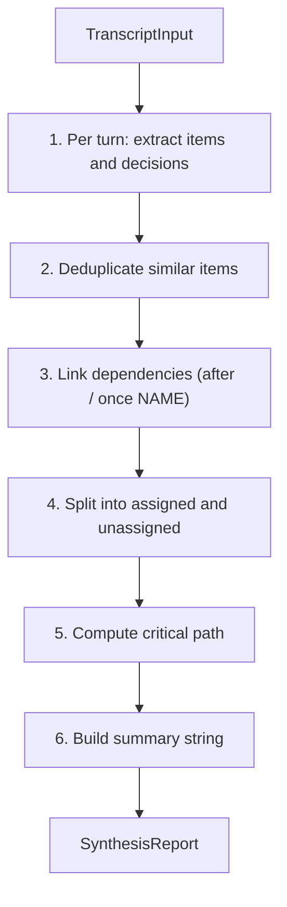
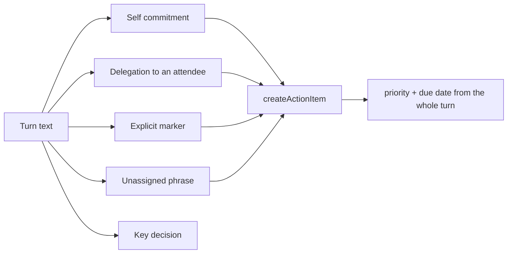

# ActionItemSynthesizer: transcript pipeline, extraction rules and output schema

`ActionItemSynthesizer` turns a multi-speaker meeting transcript into structured action items, key decisions, task dependencies and a critical path. This guide documents the input it expects, the rules it applies, the JSON it returns and how it behaves when input is unusual.

- **Source:** [`src/core/agents/ActionItemSynthesizer.ts`](../../src/core/agents/ActionItemSynthesizer.ts)
- **Tests:** [`src/__tests__/agents/ActionItemSynthesizer.test.ts`](../../src/__tests__/agents/ActionItemSynthesizer.test.ts)
- **Export:** `src/core/index.ts` re-exports the module.
- **Fixtures:** [`sample-input.json`](fixtures/action-item-synthesizer/sample-input.json) and [`sample-output.json`](fixtures/action-item-synthesizer/sample-output.json)

**The extractor is rule-based, not an LLM.** It is a deterministic, synchronous class that applies regular expressions and keyword rules to each turn of text. It makes no API calls, so the code contains no prompts, no token budgets and no JSON parsing of model output. [Section 7](#7-failure-modes-and-graceful-degradation) explains what that means for "token limits" and "malformed responses", and [section 8](#8-using-an-llm-extractor-with-this-schema) shows how to use the output schema if you put a model in front of or behind the class.

## Contents

1. [Pipeline overview](#1-pipeline-overview)
2. [Input format](#2-input-format)
3. [Extraction rules](#3-extraction-rules)
4. [Output schema](#4-output-schema)
5. [Deduplication, dependencies and critical path](#5-deduplication-dependencies-and-critical-path)
6. [Sample input and output](#6-sample-input-and-output)
7. [Failure modes and graceful degradation](#7-failure-modes-and-graceful-degradation)
8. [Using an LLM extractor with this schema](#8-using-an-llm-extractor-with-this-schema)
9. [Current limitations](#9-current-limitations)
10. [Troubleshooting](#10-troubleshooting)
11. [Testing](#11-testing)

---

## 1. Pipeline overview

`synthesize(input)` runs six steps in order and returns a `SynthesisReport`:



Inside step 1, every turn is scanned by four item patterns and one decision pattern. Each turn is handled on its own, with no memory of earlier turns:



---

## 2. Input format

```ts
interface TranscriptInput {
  meetingId: string;
  title: string;
  referenceDate: string | number; // ISO string or epoch milliseconds
  attendees: string[];
  turns: TranscriptTurn[];
}

interface TranscriptTurn {
  speaker: string;
  timestamp: number;
  text: string;
}
```

| Field               | Used for                                                                                                     |
| ------------------- | ------------------------------------------------------------------------------------------------------------ |
| `meetingId`         | Copied to the report.                                                                                        |
| `title`             | Copied to the report and inserted into the summary text.                                                     |
| `referenceDate`     | The "today" that relative deadlines are measured from. See below.                                            |
| `attendees`         | Names that delegation and explicit-marker rules look for. Must be the names people actually say in the text. |
| `turns[].speaker`   | The assignee of self-commitments and the assigner of every item from that turn. Used as given.               |
| `turns[].text`      | The only text that is scanned.                                                                               |
| `turns[].timestamp` | **Not read.** It is part of the type only; see below.                                                        |

### Transcript formatting requirements

- **One object per speaker turn, in spoken order.** Turns are processed in array order; the class never sorts by `timestamp`.
- **Speaker labels should already be real names.** The class does no speaker diarization (it never sees audio and cannot tell who is talking). It relies on your speech-to-text or meeting tool for that. A label such as `Speaker 1` becomes an assignee called `Speaker 1`.
- **Self-commitments are assigned to `turn.speaker` exactly as written**, even when that name is not in `attendees`. Delegations are assigned to the matching entry in `attendees`, using its spelling.
- **Use plain apostrophes (`'`).** The self-commitment rule recognizes `I'll` with a straight apostrophe only; `I’ll` with a curly apostrophe produces no item. Normalize text before calling.
- **Keep one thought per sentence.** Extraction captures text up to the next `.`, `!` or `?`, so punctuation inside a task (such as `v2.1` or `e.g.`) cuts the task short.

### Timestamp resolution

There is no timestamp resolution inside the class. `TranscriptTurn.timestamp` is declared but never read, and no unit is enforced (the tests use small integers). Deadlines come only from **words in the text**, resolved against `referenceDate`:

- `referenceDate` can be an ISO string or epoch milliseconds. Both go through `new Date(...)`.
- Use a full ISO timestamp with a zone, such as `2026-11-17T10:00:00Z`, so the reference moment is unambiguous. JavaScript reads a date-only string as UTC midnight and a date-time without a zone as local time.
- Relative offsets are added in whole days. Results are returned as UTC calendar dates in `YYYY-MM-DD` form.

---

## 3. Extraction rules

All patterns are case-insensitive. Each pattern captures the rest of the sentence after its trigger (up to `.`, `!` or `?`) as the task text. Because the capture runs to the end of the sentence, two triggers in one sentence yield one item.

### Items

| Pattern           | Trigger phrases                                                                                                                                                        | Assignee                                                              | Base confidence |
| ----------------- | ---------------------------------------------------------------------------------------------------------------------------------------------------------------------- | --------------------------------------------------------------------- | --------------- |
| Self commitment   | `I will`, `I'll`, `I am going to`, `I'm going to`, `I can handle`, `let me handle`                                                                                     | `turn.speaker`                                                        | 0.95            |
| Direct delegation | `NAME, can you`, `NAME: could you`, `NAME, you need to`, `NAME, handle`, `NAME, take care of` (optional `please` before the verb phrase, optional `@` before the name) | The attendee named in the text                                        | 0.85            |
| Explicit marker   | `action item`, `TODO` or `task`, followed by `:` or a space                                                                                                            | First attendee whose name appears in the task text, else `UNASSIGNED` | 0.90 (fixed)    |
| Unassigned phrase | `someone needs to`, `someone should`, `we need to`, `somebody must`                                                                                                    | `UNASSIGNED`                                                          | 0.65 (fixed)    |

Details:

- The **assigner** is always `turn.speaker`.
- Delegation skips the speaker's own name. Names are matched against every attendee in the list.
- `Bob, please review the doc` does **not** match, because `please` must be followed by one of the listed verb phrases. Write `Bob, can you review the doc`, `Bob, please handle the review` or similar.
- The `can NAME ...` form (`Can Bob review...`) needs two whitespace characters after the name, so it effectively never matches ordinary text.
- The explicit-marker rule matches the word `task` anywhere, so a sentence like `That task was hard to finish` creates an `UNASSIGNED` item. Attendee detection in this rule is a plain substring search, so a short attendee name (such as `Al`) matches inside longer words (`finalize`).

### Confidence modifiers

Applied to self commitments and delegations only. The check looks at the matched phrase, which is the trigger plus the rest of that sentence, not at words before the trigger:

| Words found in the matched phrase    | Effect                           |
| ------------------------------------ | -------------------------------- |
| `definitely`, `guarantee`, `promise` | base + 0.05, capped at 1.0       |
| `maybe`, `might`, `if possible`      | base - 0.35, with a floor of 0.4 |

So `I'll look into the cache issue if possible` scores 0.60, while `Maybe I'll look into it` is not lowered (`maybe` sits before the trigger).

### Key decisions

| Trigger                                                                                   | Captured text            |
| ----------------------------------------------------------------------------------------- | ------------------------ |
| `we decided to`, `decision:` or `decision` plus space, `agreed that`, `the conclusion is` | The rest of the sentence |

Decisions are plain strings in `keyDecisions`, in transcript order. They are not deduplicated and do not record who said them.

### Priority

Keywords are searched, as substrings, in the **whole lower-cased turn text**. The first matching level in this order wins:

| Priority   | Keywords                                         |
| ---------- | ------------------------------------------------ |
| `CRITICAL` | `urgent`, `asap`, `critical`, `p0`, `blocker`    |
| `HIGH`     | `high priority`, `p1`, `important`               |
| `LOW`      | `nice to have`, `low priority`, `p3`, `whenever` |
| `MEDIUM`   | none of the above (default)                      |

Because the search is over the whole turn, **every item from one turn gets the same priority**. Matching is by substring with no word boundaries, so `p0` also matches inside a word such as `temp0rary`.

### Due dates

The first rule that matches the **whole turn text** wins, in this order:

| Order | Text found                           | Resolved to              |
| ----- | ------------------------------------ | ------------------------ |
| 1     | `tomorrow` (including `by tomorrow`) | `referenceDate` + 1 day  |
| 2     | `by eod`, `end of day`, `today`      | `referenceDate`          |
| 3     | `next week`                          | `referenceDate` + 7 days |
| 4     | `in N days` (digits)                 | `referenceDate` + N days |
| 5     | An ISO date `YYYY-MM-DD`             | That date, unchanged     |

Consequences:

- An explicit ISO date loses to any relative phrase in the same turn.
- Weekday names (`by Friday`), month names, `next month` and `end of week` are **not** resolved, so `dueDate` is omitted.
- Like priority, the due date applies to every item created from the same turn.

### Task text cleanup

The task text is capitalized and these phrases are removed: `by tomorrow`, `by EOD`, `by Friday`, `next week`, `ASAP`, `as soon as possible`. Other time words stay in the task: `tomorrow`, `today` and `in 3 days` remain visible. `by Friday` is removed from the task even though no date is derived from it (it is still in `contextQuote`).

---

## 4. Output schema

### `ActionItem`

| Field             | Type                                            | Notes                                                                                                                      |
| ----------------- | ----------------------------------------------- | -------------------------------------------------------------------------------------------------------------------------- |
| `id`              | `string`                                        | `act-<Date.now() in base 36>-<counter>`. The counter increases for every item created and is never reset on that instance. |
| `task`            | `string`                                        | The cleaned task text. This is the item's title.                                                                           |
| `assignee`        | `string`                                        | Speaker or attendee name, or `UNASSIGNED`.                                                                                 |
| `assigner`        | `string`                                        | The speaker of the turn.                                                                                                   |
| `dueDate`         | `string`, optional                              | `YYYY-MM-DD`. Omitted (key absent in JSON) when no rule matched.                                                           |
| `priority`        | `CRITICAL`, `HIGH`, `MEDIUM` or `LOW`           | See [Priority](#priority).                                                                                                 |
| `status`          | `PENDING`, `ACCEPTED`, `BLOCKED` or `COMPLETED` | Always `PENDING` when produced. The other values are for downstream tracking.                                              |
| `confidenceScore` | `number`                                        | 0.4 to 1.0 in practice (0.4 floor for lowered scores).                                                                     |
| `contextQuote`    | `string`                                        | The **entire text of the source turn**, not just the matching sentence.                                                    |
| `dependencies`    | `string[]`                                      | IDs of items that must finish first. Empty when there are none.                                                            |

### `SynthesisReport`

| Field             | Type           | Notes                                                                                                   |
| ----------------- | -------------- | ------------------------------------------------------------------------------------------------------- |
| `meetingId`       | `string`       | From the input.                                                                                         |
| `title`           | `string`       | From the input.                                                                                         |
| `summary`         | `string`       | `Synthesized N action item(s) (A assigned, U unassigned) and D key decision(s) for meeting: "<title>".` |
| `totalItems`      | `number`       | Assigned plus unassigned.                                                                               |
| `assignedItems`   | `ActionItem[]` | Items whose assignee is not `UNASSIGNED`.                                                               |
| `unassignedItems` | `ActionItem[]` | Items whose assignee is `UNASSIGNED`. These are the ambiguities to resolve in follow-up.                |
| `keyDecisions`    | `string[]`     | Decision sentences.                                                                                     |
| `criticalPath`    | `string[]`     | Item IDs of the longest dependency chain. See section 5.                                                |

### Field names in the project discussion vs the code

| Name used in discussions | Field in the code |
| ------------------------ | ----------------- |
| title                    | `task`            |
| assignee                 | `assignee`        |
| priority                 | `priority`        |
| due date                 | `dueDate`         |
| context quote            | `contextQuote`    |

### JSON Schema

The TypeScript types as JSON Schema (draft 2020-12), usable to validate the report or the output of an LLM-based extractor (see [section 8](#8-using-an-llm-extractor-with-this-schema)):

```json
{
  "$schema": "https://json-schema.org/draft/2020-12/schema",
  "$defs": {
    "ActionItem": {
      "type": "object",
      "required": [
        "id",
        "task",
        "assignee",
        "assigner",
        "priority",
        "status",
        "confidenceScore",
        "contextQuote",
        "dependencies"
      ],
      "additionalProperties": false,
      "properties": {
        "id": { "type": "string" },
        "task": { "type": "string", "minLength": 1 },
        "assignee": { "type": "string" },
        "assigner": { "type": "string" },
        "dueDate": { "type": "string", "pattern": "^\\d{4}-\\d{2}-\\d{2}$" },
        "priority": { "enum": ["CRITICAL", "HIGH", "MEDIUM", "LOW"] },
        "status": { "enum": ["PENDING", "ACCEPTED", "BLOCKED", "COMPLETED"] },
        "confidenceScore": { "type": "number", "minimum": 0, "maximum": 1 },
        "contextQuote": { "type": "string" },
        "dependencies": { "type": "array", "items": { "type": "string" } }
      }
    }
  },
  "type": "object",
  "required": [
    "meetingId",
    "title",
    "summary",
    "totalItems",
    "assignedItems",
    "unassignedItems",
    "keyDecisions",
    "criticalPath"
  ],
  "additionalProperties": false,
  "properties": {
    "meetingId": { "type": "string" },
    "title": { "type": "string" },
    "summary": { "type": "string" },
    "totalItems": { "type": "integer", "minimum": 0 },
    "assignedItems": {
      "type": "array",
      "items": { "$ref": "#/$defs/ActionItem" }
    },
    "unassignedItems": {
      "type": "array",
      "items": { "$ref": "#/$defs/ActionItem" }
    },
    "keyDecisions": { "type": "array", "items": { "type": "string" } },
    "criticalPath": { "type": "array", "items": { "type": "string" } }
  }
}
```

---

## 5. Deduplication, dependencies and critical path

### Deduplication

Two items are merged when they have the same assignee (case-insensitive) and their task text has a **Jaccard similarity above 0.65**. Similarity is computed on the set of words longer than 2 characters, split on whitespace. Punctuation stays attached to a word, so `migration,` and `migration` count as different words.

The **first** item is kept. From a later duplicate it takes only a higher `confidenceScore` and a `dueDate` if it had none. Its priority, assigner, `contextQuote` and dependencies are not updated. Unassigned items are compared with each other in the same way.

### Dependencies

An item depends on another when the **source turn text** contains `after NAME` or `once NAME`, where `NAME` is the assignee of the other item. The rules:

- Matching is by person, not by task: `after Alice` makes the item depend on **every** item assigned to Alice.
- The text used is the whole turn, so all items from that turn share the same dependencies.
- Only phrases of the form `after NAME` / `once NAME` are recognized. `after the migration` creates no link.
- Dependencies are resolved after deduplication, so they always point at items that appear in the report.

### Critical path

`criticalPath` is the longest chain of dependent items, counted in **number of items**. It is not weighted by effort or due date.

- The search starts from every item with no dependencies and follows items that depend on the current one.
- Ties go to the first chain found.
- With no dependencies at all, the result is a single item (the first one), not an empty list.
- A dependency cycle (`Alice` after `Bob` and `Bob` after `Alice`) leaves no starting item inside the cycle. If every item is in a cycle, the path is empty.
- A meeting with no items returns `[]`.

---

## 6. Sample input and output

Both samples are also stored as files in [`fixtures/action-item-synthesizer/`](fixtures/action-item-synthesizer/). The output below was produced by running the class on the input with `Date.now` fixed to `0`, which makes the IDs `act-0-1`, `act-0-2` and so on. In a real run the middle part of each ID differs.

The input exercises each rule once: a self commitment with a relative date, a dependency (`once Alice`), a delegation with a priority word, an explicit marker with `next week`, two unassigned phrases, a low-confidence commitment, a decision, and a repeated commitment that is merged by deduplication.

### Input

```json
{
  "meetingId": "meet-launch-sync-01",
  "title": "Launch Readiness Sync",
  "referenceDate": "2026-11-17T10:00:00Z",
  "attendees": ["Alice", "Bob", "Charlie", "Dana"],
  "turns": [
    {
      "speaker": "Alice",
      "timestamp": 1000,
      "text": "Thanks everyone. We decided to move the launch to 2026-12-01. I will deploy the staging database migration by tomorrow."
    },
    {
      "speaker": "Bob",
      "timestamp": 18000,
      "text": "I will build the API client once Alice finishes the migration. High priority."
    },
    {
      "speaker": "Alice",
      "timestamp": 34000,
      "text": "Charlie, can you write the end-to-end tests in 3 days? This is important."
    },
    {
      "speaker": "Charlie",
      "timestamp": 51000,
      "text": "Action item: update the runbook next week."
    },
    {
      "speaker": "Dana",
      "timestamp": 66000,
      "text": "Someone should rotate the API keys. We need to confirm the retention policy."
    },
    {
      "speaker": "Dana",
      "timestamp": 80000,
      "text": "I'll look into the cache issue if possible."
    },
    {
      "speaker": "Alice",
      "timestamp": 95000,
      "text": "Reminder: I will deploy the staging database migration today."
    }
  ]
}
```

### Output

```json
{
  "meetingId": "meet-launch-sync-01",
  "title": "Launch Readiness Sync",
  "summary": "Synthesized 7 action item(s) (4 assigned, 3 unassigned) and 1 key decision(s) for meeting: \"Launch Readiness Sync\".",
  "totalItems": 7,
  "assignedItems": [
    {
      "id": "act-0-1",
      "task": "Deploy the staging database migration",
      "assignee": "Alice",
      "assigner": "Alice",
      "dueDate": "2026-11-18",
      "priority": "MEDIUM",
      "status": "PENDING",
      "confidenceScore": 0.95,
      "contextQuote": "Thanks everyone. We decided to move the launch to 2026-12-01. I will deploy the staging database migration by tomorrow.",
      "dependencies": []
    },
    {
      "id": "act-0-2",
      "task": "Build the API client once Alice finishes the migration",
      "assignee": "Bob",
      "assigner": "Bob",
      "priority": "HIGH",
      "status": "PENDING",
      "confidenceScore": 0.95,
      "contextQuote": "I will build the API client once Alice finishes the migration. High priority.",
      "dependencies": ["act-0-1"]
    },
    {
      "id": "act-0-3",
      "task": "Write the end-to-end tests in 3 days",
      "assignee": "Charlie",
      "assigner": "Alice",
      "dueDate": "2026-11-20",
      "priority": "HIGH",
      "status": "PENDING",
      "confidenceScore": 0.85,
      "contextQuote": "Charlie, can you write the end-to-end tests in 3 days? This is important.",
      "dependencies": []
    },
    {
      "id": "act-0-7",
      "task": "Look into the cache issue if possible",
      "assignee": "Dana",
      "assigner": "Dana",
      "priority": "MEDIUM",
      "status": "PENDING",
      "confidenceScore": 0.6,
      "contextQuote": "I'll look into the cache issue if possible.",
      "dependencies": []
    }
  ],
  "unassignedItems": [
    {
      "id": "act-0-4",
      "task": "Update the runbook",
      "assignee": "UNASSIGNED",
      "assigner": "Charlie",
      "dueDate": "2026-11-24",
      "priority": "MEDIUM",
      "status": "PENDING",
      "confidenceScore": 0.9,
      "contextQuote": "Action item: update the runbook next week.",
      "dependencies": []
    },
    {
      "id": "act-0-5",
      "task": "Rotate the API keys",
      "assignee": "UNASSIGNED",
      "assigner": "Dana",
      "priority": "MEDIUM",
      "status": "PENDING",
      "confidenceScore": 0.65,
      "contextQuote": "Someone should rotate the API keys. We need to confirm the retention policy.",
      "dependencies": []
    },
    {
      "id": "act-0-6",
      "task": "Confirm the retention policy",
      "assignee": "UNASSIGNED",
      "assigner": "Dana",
      "priority": "MEDIUM",
      "status": "PENDING",
      "confidenceScore": 0.65,
      "contextQuote": "Someone should rotate the API keys. We need to confirm the retention policy.",
      "dependencies": []
    }
  ],
  "keyDecisions": ["move the launch to 2026-12-01"],
  "criticalPath": ["act-0-1", "act-0-2"]
}
```

How to read the result:

- The reminder in the last turn (`I will deploy the staging database migration today`) is merged into the first item. The item keeps its original due date, `2026-11-18`, and its `id` (`act-0-1`). The IDs skip `act-0-8`, which was created for the reminder and then discarded.
- `act-0-2` (Bob) lists `act-0-1` in `dependencies` because Bob's turn says `once Alice`. `criticalPath` is therefore `["act-0-1", "act-0-2"]`.
- `act-0-3` is delegated by Alice to Charlie. It is `HIGH` because that turn contains `important`, and its due date comes from `in 3 days`.
- `act-0-7` has a confidence of 0.6 because the phrase contains `if possible`.
- The runbook item is `UNASSIGNED` because no attendee name appears in its text; its due date comes from `next week`.

---

## 7. Failure modes and graceful degradation

### Token limits and malformed model responses

These do not apply to the class itself. It never calls a model, so there is no token budget to exceed and no model response to parse. Its cost grows with the number of turns, and for each turn with the number of attendees (one delegation pattern is built per attendee). There is no truncation, chunking or retry logic in the code.

### What happens with unusual input

The class has no `try`/`catch` and no input validation. This table lists observed behavior:

| Input                                                                                       | Behavior                                                                            |
| ------------------------------------------------------------------------------------------- | ----------------------------------------------------------------------------------- |
| `turns` is an empty array                                                                   | Returns a valid empty report (`totalItems: 0`, empty lists, `criticalPath: []`).    |
| A turn has no matching phrases                                                              | No items; the turn is skipped silently.                                             |
| A turn's `text` is missing                                                                  | No items from that turn.                                                            |
| `turns` or `attendees` is missing                                                           | Throws `TypeError` (value is not iterable).                                         |
| A turn's `speaker` is missing and `attendees` is not empty                                  | Throws `TypeError` (reading `toLowerCase` of `undefined`).                          |
| `referenceDate` is invalid and the text has `tomorrow`, `today`, `next week` or `in N days` | Throws `RangeError: Invalid time value`.                                            |
| `referenceDate` is invalid and no relative phrase appears                                   | Works. Items are returned, and ISO dates written in the text still resolve.         |
| An attendee name contains regex characters such as `C++`                                    | Throws `SyntaxError` (the name is placed in a regular expression without escaping). |
| A due date phrase is not recognized (`by Friday`)                                           | The item is returned without `dueDate`.                                             |
| Ambiguous ownership (`someone should ...`)                                                  | The item goes to `unassignedItems` with confidence 0.65.                            |

Recommended handling in the calling code:

```ts
import {
  ActionItemSynthesizer,
  type SynthesisReport,
  type TranscriptInput,
} from "@/core/agents/ActionItemSynthesizer";

function synthesizeSafely(input: TranscriptInput): SynthesisReport | null {
  try {
    return new ActionItemSynthesizer().synthesize(input);
  } catch (error) {
    console.error("Action item synthesis failed", error); // report, retry later, or fall back to manual notes
    return null;
  }
}
```

Validate or clean the input first: make sure `turns` and `attendees` are arrays, every turn has a string `speaker` and `text`, `referenceDate` is a valid date, and attendee names contain no regex special characters.

---

## 8. Using an LLM extractor with this schema

The class has no prompt templates and no model integration. If you add a model, the schema in [section 4](#4-output-schema) is the contract the rest of the system expects. Suggestions that follow from how the class behaves:

- **Validate every model response against the JSON Schema** before using it. Treat a response that fails validation (or is not JSON) as a failed extraction and fall back to the rule-based class, which cannot return malformed output.
- **Keep model output within the same enums and formats**: `priority` in the four listed values, `status` set to `PENDING`, `dueDate` in `YYYY-MM-DD`, `confidenceScore` between 0 and 1, `assignee` either an attendee name or `UNASSIGNED`.
- **Quote the evidence.** Ask the model for the supporting sentence in `contextQuote`. The rule-based class stores the whole turn instead.
- **Resolve dates outside the model.** Give the model the reference date and ask for a date only when the speaker stated one; the rules in section 3 show the phrases that are supported.
- **Mind token limits.** For long transcripts, split on turn boundaries and merge results, because merging and deduplication across separate calls is not provided by this class.

These are suggestions for an integration and are not implemented in this repository.

---

## 9. Current limitations

These describe the code today. Each was confirmed by running the class.

1. **No LLM, prompt templates or diarization.** The class only scans text it is given.
2. **`timestamp` is ignored.** Turn order is array order.
3. **Priority and due date are per turn, not per sentence.** One `urgent` or `tomorrow` affects every item from that turn.
4. **`contextQuote` is the whole turn**, not the sentence that created the item.
5. **Limited date vocabulary.** Weekdays, month names, `next month` and `end of week` are not resolved. `by Friday` is stripped from the task text without producing a date.
6. **Substring matching causes false positives.** `p0` matches inside words such as `temp0rary`. The word `task` in ordinary speech creates an item. Short attendee names match inside longer words in the explicit-marker rule.
7. **Self-commitment has no word boundary.** `Ali will send the report` is read as `i will send ...` and assigned to the **speaker**, not to Ali. Likewise `Hi will you ...` creates an item.
8. **Only a few phrasings are recognized.** `I definitely will ...` does not match (the self-commitment trigger needs `I will` as written). `Bob, please review ...` and `Can Bob review ...` do not match. Curly apostrophes (`I’ll`) do not match.
9. **One item per sentence per pattern.** The captured task runs to the end of the sentence, so a second trigger in the same sentence is swallowed.
10. **Attendee names are inserted into a regular expression unescaped**, so names such as `C++` throw a `SyntaxError`.
11. **Dependencies are by person**, and only through `after NAME` / `once NAME`.
12. **The critical path counts items, not time**, returns one item when nothing depends on anything, and is empty when every item is in a cycle.
13. **Merging keeps the first item**, so a later duplicate's priority is lost.
14. **IDs are not stable.** They contain the current time and a counter that never resets on the instance.
15. **No input validation and no error handling** (see [section 7](#7-failure-modes-and-graceful-degradation)).

---

## 10. Troubleshooting

| Symptom                                                  | Likely cause                                                                              | What to check                                                                      |
| -------------------------------------------------------- | ----------------------------------------------------------------------------------------- | ---------------------------------------------------------------------------------- |
| A commitment is missing from the output                  | The phrasing is not one of the trigger phrases, or the apostrophe is curly.               | Compare the sentence with the trigger table; normalize `’` to `'`.                 |
| Delegation is not detected                               | `NAME, please <verb>` or `Can NAME <verb>` form, or the name is missing from `attendees`. | Use `NAME, can you ...` or `NAME, please handle ...`; check the attendee spelling. |
| An item is assigned to the speaker, not the named person | The sentence matched the self-commitment rule (for example `Ali will ...`).               | Rephrase as `Ali, can you ...`, or review the item by hand.                        |
| `dueDate` is missing                                     | The phrase is not supported (`Friday`, `end of month`) or `referenceDate` was invalid.    | See the due-date table in section 3.                                               |
| `dueDate` is `tomorrow` but an ISO date was spoken       | Relative phrases take precedence over ISO dates.                                          | Remove the relative phrase or resolve dates yourself.                              |
| Many items are `CRITICAL`                                | One urgent word in a turn applies to all items in it, and keywords match inside words.    | Split long turns, check for `p0` or `asap` substrings.                             |
| Same task appears twice                                  | Similarity was 0.65 or lower, or assignees differ (for example `UNASSIGNED` vs a name).   | Compare the two task strings; punctuation attached to words lowers similarity.     |
| `criticalPath` has one item                              | No `after NAME` / `once NAME` phrases were found.                                         | See the dependency rules.                                                          |
| `criticalPath` is empty with items present               | Every item is in a dependency cycle.                                                      | Look for two items that reference each other's assignees.                          |
| `RangeError: Invalid time value`                         | `referenceDate` is not a valid date and a relative date phrase was found.                 | Validate `referenceDate`.                                                          |
| `SyntaxError: Invalid regular expression`                | An attendee name contains regex characters (`C++`, `Sam (PM)`).                           | Use plain names without special characters.                                        |

---

## 11. Testing

Run the existing tests:

```bash
npx jest src/__tests__/agents/ActionItemSynthesizer.test.ts
```

They cover self-commitment extraction with relative dates, delegation, unassigned and urgent items, key decisions, deduplication, and dependency resolution with the critical path.

This guide and its fixtures are documentation and do not change runtime behavior. Before opening a PR for edits to them, run the checks in [CONTRIBUTING.md](../../CONTRIBUTING.md#7-pr-pre-flight-checklist) that apply to your change, and `npx prettier --check docs/ai/ACTION_ITEM_SYNTHESIZER.md "docs/ai/fixtures/action-item-synthesizer/*.json"`.
