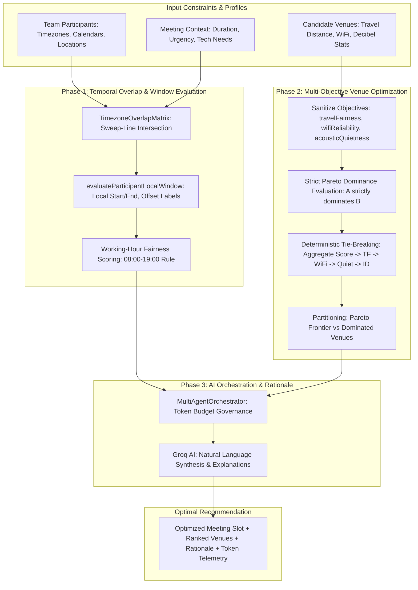

# MeetingOptimizer Architecture & Multi-Objective Scheduling Guide

## 1. Executive Summary & Problem Space

Modern hybrid workforces and distributed teams in WorkSphere routinely coordinate face-to-face working sessions, collaborative sprints, and client reviews across multiple participants. Scheduling these sessions presents a complex, multi-dimensional optimization problem:

1. **Timezone Disparity & Working-Hour Asymmetry**: Team members may be located in different time zones (e.g., UTC+05:30 in Mumbai, UTC-04:00 in New York, UTC+01:00 in London). Scheduling meetings during one participant's standard daytime hours often forces another into late-night (after 19:00) or early-morning (before 08:00) windows.
2. **Travel Distance & Commute Inequity**: When selecting a physical meeting venue, choosing a location close to one participant can impose an unfair 90-minute commute on another. Venues must balance travel times equitably.
3. **Acoustic & Infrastructure Constraints**: Different meeting types demand different physical environments. A high-stakes architectural brainstorm requires reliable high-speed Wi-Fi (100+ Mbps) and quiet acoustic zones (low decibels, private pods), while casual coworking sessions tolerate moderate background chatter.

To solve this, WorkSphere provides **`MeetingOptimizer`** ([`src/core/ai/MeetingOptimizer.ts`](../../src/core/ai/MeetingOptimizer.ts)), a hybrid algorithmic and AI-driven engine. `MeetingOptimizer` evaluates time zone overlap matrices, enforces working-hour fairness constraints, computes Pareto-optimal venue frontiers across competing objectives (travel fairness, Wi-Fi reliability, acoustic quietness), and leverages Groq-hosted LLMs with token-governed orchestration to generate human-readable meeting recommendations.

---

## 2. End-to-End Pipeline Architecture



---

## 3. Timezone Overlap & Working-Hour Fairness

### 3.1 IANA Timezone Projection & Local Time Evaluation

`MeetingOptimizer` uses the standard ECMAScript Internationalization API (`Intl.DateTimeFormat`) to project UTC epoch millisecond timestamps into exact local wall-clock minutes without third-party library bloat.

For any participant $p$ and candidate meeting slot $s = [t_{\text{start}}, t_{\text{end}}]$:

- `formatUtcOffsetLabel(unixMs, timeZone)` produces the ISO-compliant UTC offset label (e.g., `UTC+05:30` for Indian Standard Time, `UTC-04:00` for Eastern Daylight Time).
- `evaluateParticipantLocalWindow(participant, startMs, endMs)` calculates local `minutesOfDay` for start and end times:

$$\text{minutesOfDay} = \text{hour} \times 60 + \text{minute}$$

### 3.2 Core Working-Hour Bounds & Penalties

WorkSphere defines standard humane working hours as **08:00 to 19:00** local time:

- **Earliest Start Threshold**: $08:00 = 480\text{ minutes of day}$.
- **Latest End Threshold**: $19:00 = 1140\text{ minutes of day}$.

A participant window is flagged as `isOutOfHours = true` if:

1. Local start time is before 08:00: $\text{minutesOfDay}_{\text{start}} < 480 \implies \text{flag: } \texttt{before\_08\_00}$
2. Local end time exceeds 19:00: $\text{minutesOfDay}_{\text{end}} > 1140 \lor \text{isNextDay} \implies \text{flag: } \texttt{after\_19\_00}$

#### Working-Hour Fairness Scoring Equation:

The aggregate schedule fairness score penalizes slots proportionally to the number of participants burdened with out-of-hours attendance:

$$\text{outOfHoursCount} = \sum_{p \in P} \mathbb{I}(\text{isOutOfHours}_p)$$

$$\operatorname{score}(s) = \max\left(0, \, 100 - (\text{outOfHoursCount} \times 25)\right)$$

$$\operatorname{isFairForAllParticipants}(s) = (\text{outOfHoursCount} == 0)$$

A slot where all participants meet between 08:00 and 19:00 receives a perfect score of $100$. Each burdened participant deducts $25$ points.

### 3.3 Calendar Recovery-Buffer & Local Fatigue Scoring

To protect participants against back-to-back meeting exhaustion, candidate slots are scored against each participant's existing calendar intervals $[b_{\text{start}}, b_{\text{end}}]$.

#### 1. Gap Equation:

The gap $g(s, b)$ in minutes between a candidate slot $s$ and an existing busy block $b$ is:

$$ g(s, b) = \begin{cases}
\dfrac{s_{\text{start}} - b_{\text{end}}}{60{,}000} & \text{if } b_{\text{end}} \le s_{\text{start}} \\[6pt]
\dfrac{b_{\text{start}} - s_{\text{end}}}{60{,}000} & \text{if } b_{\text{start}} \ge s_{\text{end}} \\[6pt]
0 & \text{if } s \text{ overlaps } b
\end{cases}$$

Let $g_i = \min_b g(s, b)$ be the smallest non-negative gap between slot $s$ and any of participant $i$'s busy intervals.

#### 2. Local Fatigue Multipliers:
The fatigue multiplier $f_i$ scales the recovery penalty based on the participant's local hour at slot midpoint:

| Local Time Window | Fatigue Factor ($f_i$) | Rationale |
| :--- | :---: | :--- |
| **00:00 – 06:59** | $1.75$ | Severe biological sleep disruption |
| **07:00 – 08:59** | $1.35$ | Morning preparation & commute period |
| **09:00 – 17:59** | $1.00$ | Standard core business hours (baseline) |
| **18:00 – 20:59** | $1.25$ | Evening personal/family boundary |
| **21:00 – 23:59** | $1.75$ | Late evening winding-down / pre-sleep period |

#### 3. Individual & Composite Penalties:
Given a required recovery buffer $B$ (default $15\text{ minutes}$):

$$p_i = \begin{cases}
\dfrac{B - \max(0, g_i)}{B} \cdot f_i & \text{if } 0 \le g_i < B \\[6pt]
0 & \text{if } g_i \ge B
\end{cases}$$

The total slot ranking score balances participant attendance against recovery fatigue:

$$\operatorname{rankScore}(s) = \operatorname{participantCount}(s) \times 1{,}000{,}000 - \left(\sum_{i \in P} p_i\right) \times 1{,}000$$

The $1{,}000{,}000$ multiplier strictly prioritizes maximum attendance first; the recovery buffer penalty breaks ties among slots with equal attendance.

---

## 4. Multi-Objective Pareto Frontier Venue Optimization

When selecting a physical venue for in-person or hybrid collaboration, candidates are evaluated across three distinct, competing objective functions:

1. **Travel Fairness ($\text{TF} \in [0, 100]$)**: Measures the equity of travel times and geodesic distances among all attendees. A venue equidistant from all participants receives a high score ($\approx 95$), whereas a venue requiring one participant to travel 90 minutes and another 5 minutes receives a low score ($\approx 40$).
2. **Wi-Fi Reliability ($\text{WR} \in [0, 100]$)**: Synthesizes download/upload bandwidth, jitter, latency, and gigabit verification metrics. Essential for screensharing, streaming, and remote dial-in participants.
3. **Acoustic Quietness ($\text{AQ} \in [0, 100]$)**: Derived from IoT decibel meters, acoustic historical logs, and quiet booth availability. Higher scores denote lower ambient decibels and distraction-free private spaces.

### 4.1 Strict Pareto Dominance Definition

In multi-objective optimization, no single scalar can encapsulate the trade-off between travel time and quietness without imposing arbitrary subjective weights. Therefore, `MeetingOptimizer` computes the **Pareto frontier**.

Candidate venue $A$ **strictly dominates** candidate venue $B$ (written $A \succ B$) if and only if:
1. $A$ is at least as good as $B$ across all three objectives:
   $$A_{\text{TF}} \ge B_{\text{TF}} \quad \land \quad A_{\text{WR}} \ge B_{\text{WR}} \quad \land \quad A_{\text{AQ}} \ge B_{\text{AQ}}$$
2. $A$ is strictly better than $B$ in at least one objective:
   $$A_{\text{TF}} > B_{\text{TF}} \quad \lor \quad A_{\text{WR}} > B_{\text{WR}} \quad \lor \quad A_{\text{AQ}} > B_{\text{AQ}}$$

In TypeScript ([`src/core/ai/MeetingOptimizer.ts`](../../src/core/ai/MeetingOptimizer.ts)):
```typescript
public isStrictlyDominated(a: CandidateVenue, b: CandidateVenue): boolean {
  const aTF = this.sanitizeObjective(a.travelFairness);
  const aWifi = this.sanitizeObjective(a.wifiReliability);
  const aQuiet = this.sanitizeObjective(a.acousticQuietness);

  const bTF = this.sanitizeObjective(b.travelFairness);
  const bWifi = this.sanitizeObjective(b.wifiReliability);
  const bQuiet = this.sanitizeObjective(b.acousticQuietness);

  const atLeastAsGood = aTF >= bTF && aWifi >= bWifi && aQuiet >= bQuiet;
  const strictlyBetterInOne = aTF > bTF || aWifi > bWifi || aQuiet > bQuiet;

  return atLeastAsGood && strictlyBetterInOne;
}
```

If any candidate $A$ strictly dominates candidate $B$, then $B$ is relegated to `dominatedVenues`. All non-dominated candidates are preserved in `paretoFrontier`.

### 4.2 Multi-Tiered Deterministic Tie-Breaking Precedence

Candidates on the Pareto frontier represent incomparable trade-offs (e.g., Venue X has superior travel fairness but inferior quietness compared to Venue Y). To produce a stable, repeatable ordering for UI display and automated booking, `MeetingOptimizer` enforces a strict deterministic tie-breaking hierarchy:

```
+---------------------------------------------------------------------------------------+
| Tier 1: Aggregate Objective Score DESC                                                 |
| Total = sanitize(travelFairness) + sanitize(wifiReliability) + sanitize(quietness)    |
+------------------------------------------+--------------------------------------------+
                                           | (If Total Scores Equal)
                                           v
+---------------------------------------------------------------------------------------+
| Tier 2: Dimension Priority Fallback DESC                                              |
| 1. travelFairness DESC (Highest priority: minimizes physical attendee fatigue)      |
| 2. wifiReliability DESC (Secondary: guarantees collaboration connectivity)            |
| 3. acousticQuietness DESC (Tertiary: preserves focus and low noise)                    |
+------------------------------------------+--------------------------------------------+
                                           | (If All 3 Objectives Identical)
                                           v
+---------------------------------------------------------------------------------------+
| Tier 3: Stable Identifier / Name ASC                                                  |
| String(a.id ?? a.name).localeCompare(String(b.id ?? b.name))                          |
+---------------------------------------------------------------------------------------+
```

```typescript
private compareVenuesDeterministically(a: CandidateVenue, b: CandidateVenue): number {
  const aTotal = aTF + aWifi + aQuiet;
  const bTotal = bTF + bWifi + bQuiet;

  if (bTotal !== aTotal) return bTotal - aTotal; // Tier 1: Total
  if (bTF !== aTF) return bTF - aTF;             // Tier 2a: Travel Fairness
  if (bWifi !== aWifi) return bWifi - aWifi;     // Tier 2b: WiFi Reliability
  if (bQuiet !== aQuiet) return bQuiet - aQuiet; // Tier 2c: Acoustic Quietness

  // Tier 3: Strict Antisymmetric Lexicographical Tie-Breaker
  const idA = String(a.id ?? a.name ?? "");
  const idB = String(b.id ?? b.name ?? "");
  return idA.localeCompare(idB);
}
```

### 4.3 Safe Objective Value Sanitization

Inputs from external microservices or crowdsourced reviews may contain `undefined`, `null`, `NaN`, non-numeric strings, or infinite values. The engine sanitizes all inputs using `sanitizeObjective`:

```typescript
public sanitizeObjective(val: any): number {
  const num = Number(val);
  return Number.isFinite(num) ? num : 0;
}
```

Coercing invalid and missing scores to $0$ ensures that unverified venues never crash calculations and are naturally dominated by verified venues with positive scores.

---

## 5. Multi-Agent Orchestrator & Token Governance

Once algorithmic filtering narrows down the top candidate slots and Pareto-ranked venues, `MeetingOptimizer` invokes `MultiAgentOrchestrator` to generate contextual, natural-language rationales for team members.

### 5.1 Token Budget Governance

To prevent high-dimensional scheduling contexts from exceeding LLM context windows or incurring runaway token costs, the orchestrator applies active token governance:
1. **Candidate Pruning**: Only the top 5 Pareto-ranked candidates are formatted for prompt synthesis.
2. **Auxiliary Tool Pruning**: If the initial prompt consumes $> 75\%$ of the allotted model context budget, optional auxiliary tools (such as historical review scrapers or long-form venue descriptions) are stripped from the tool declarations.
3. **Telemetry Capture**: Every completion records prompt tokens, completion tokens, latency (ms), and cost estimates in `TokenTelemetryRecord`.

---

## 6. Practical Usage Examples

### 6.1 Evaluating Local Working-Hour Windows

```typescript
import { MeetingOptimizer } from "@/core/ai/MeetingOptimizer";

const optimizer = new MeetingOptimizer();

const summary = optimizer.buildRecommendationSummary(
  {
    startUnixMs: Date.UTC(2026, 5, 15, 10, 0, 0),
    endUnixMs: Date.UTC(2026, 5, 15, 11, 0, 0),
  },
  [
    { id: "u-mumbai", name: "Soham", timeZone: "Asia/Kolkata" },
    { id: "u-nyc", name: "Alex", timeZone: "America/New_York" },
  ]
);

console.log(summary.score); // 75 (1 out-of-hours participant)
console.log(summary.isFairForAllParticipants); // false
console.log(summary.summaryText);
// Soham (u-mumbai): 15:30–16:30 (UTC+05:30, Asia/Kolkata) [In Hours]
// Alex (u-nyc): 06:00–07:00 (UTC-04:00, America/New_York) [OUT OF HOURS: before_08_00]
```

### 6.2 Computing Pareto-Ranked Venues

```typescript
const candidates = [
  { id: "v1", name: "Central Hub", travelFairness: 90, wifiReliability: 95, acousticQuietness: 70 },
  { id: "v2", name: "Quiet Library", travelFairness: 70, wifiReliability: 85, acousticQuietness: 95 },
  { id: "v3", name: "Subpar Cafe", travelFairness: 60, wifiReliability: 70, acousticQuietness: 60 }, // Dominated by v1 & v2
];

const ranking = optimizer.rankVenuesPareto(candidates);

console.log(ranking.paretoFrontier.map(v => v.name));
// ["Central Hub", "Quiet Library"]
console.log(ranking.dominatedVenues.map(v => v.name));
// ["Subpar Cafe"]
```
$$
