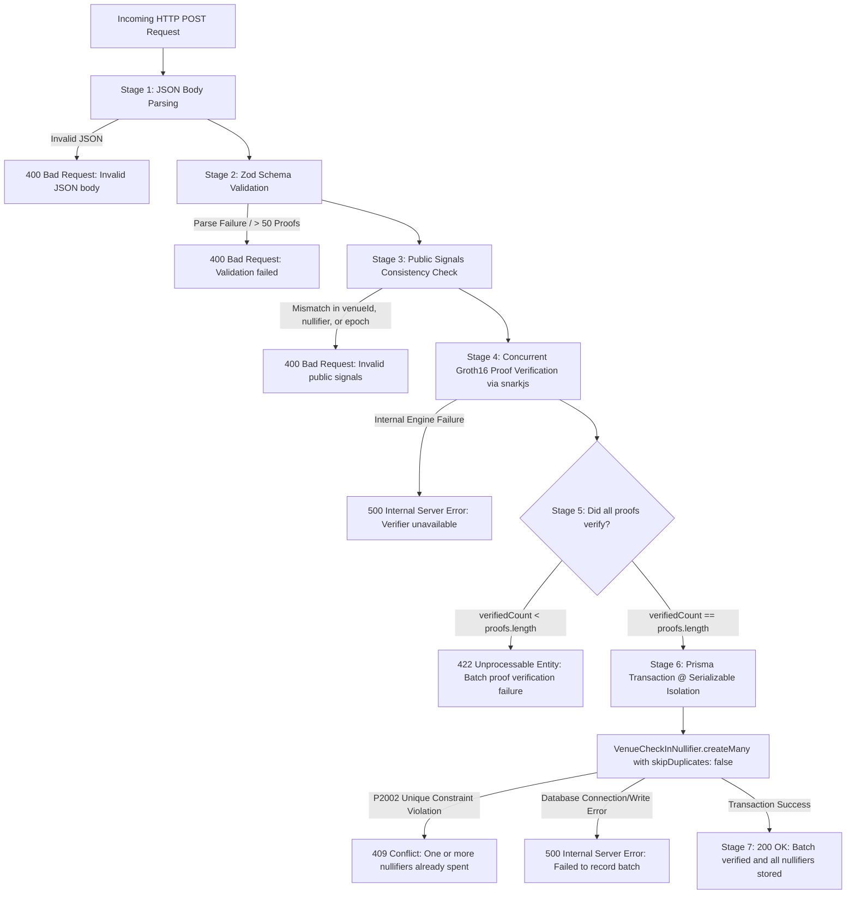
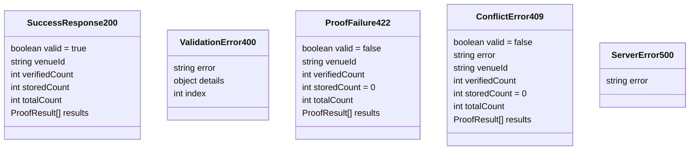

# Batch ZKP Nullifier Verification API Specification

**Endpoint:** `POST /api/venues/batch-zkp-verify`
**Runtime:** Node.js (`export const runtime = "nodejs"`)
**Tracking Issues:** #8622, #5034, #8621, #8620
**Source Implementation:** [src/app/api/venues/batch-zkp-verify/route.ts](../../src/app/api/venues/batch-zkp-verify/route.ts)
**Cryptographic Verifier:** [src/lib/crypto/zkNullifierVerifier.ts](../../src/lib/crypto/zkNullifierVerifier.ts)
**Database Model:** `VenueCheckInNullifier` in [prisma/schema.prisma](../../prisma/schema.prisma)

---

## 1. Overview and Purpose

The `POST /api/venues/batch-zkp-verify` endpoint enables atomic, batch verification and persistence of Zero-Knowledge Proofs (ZKPs) for anonymous venue check-ins. It allows clients to submit up to 50 Groth16 cryptographic proofs in a single HTTP request.

### 1.1 Core Responsibilities
- **Structural and Public Signal Binding Validation:** Ensures that each proof payload strictly conforms to SnarkJS Groth16 structure and that the ordered `publicSignals` array binds the Merkle root, nullifier hash, target `venueId`, and integer epoch.
- **Concurrent Cryptographic Proof Verification:** Evaluates all submitted Groth16 proofs in parallel using `snarkjs.groth16.verify` over the BN254 (`alt_bn128`) elliptic curve.
- **Per-Proof Result Reporting with Array Indices:** Emits an ordered `results` array containing each proof's 0-based array index, validity flag, nullifier persistence state, and specific error messages.
- **All-or-Nothing Serializable Nullifier Persistence:** If and only if **all** proofs in the batch pass cryptographic verification, their nullifiers are recorded into the PostgreSQL database (`VenueCheckInNullifier`) within an atomic transaction at `Serializable` isolation level.
- **Replay Protection via Unique Constraint:** Replay prevention is enforced by the database compound unique constraint `@@unique([nullifierHash, epoch])`. Submitting a nullifier that was already claimed in the specified epoch aborts the transaction and returns HTTP `409 Conflict`.

### 1.2 Execution Characteristics
- **Batch Processing Model:** Synchronous execution. The HTTP response returns once cryptographic verification and database insertion complete.
- **Batch Size Boundaries:** Minimum 1 proof, maximum 50 proofs per request (`z.array(proofSchema).min(1).max(50)`).
- **Authentication:** Public endpoint (`security: []`). Proof ownership and access rights are proven cryptographically via the zero-knowledge witness rather than session cookies or bearer tokens.
- **Content-Type:** Strict `application/json`.

> [!NOTE]
> **Implementation Clarification: Request Parameter Mapping**
> Issue #8622 references request properties `nullifiers`, `proof`, and `chunkSize`. Inspection of the route handler ([src/app/api/venues/batch-zkp-verify/route.ts](../../src/app/api/venues/batch-zkp-verify/route.ts)) demonstrates that the endpoint accepts a structured batch payload consisting of `venueId: string` and an array of up to 50 proof objects: `proofs: Array<{ nullifierHash, proof, publicSignals }>`. The endpoint executes batch cryptographic verification concurrently across all proofs in the batch; client-defined chunk sizes are not accepted as top-level parameters.

---

## 2. Request Parameters and Schema

### 2.1 Request Body Parameters

The endpoint expects a single JSON object with the following top-level and nested structure:

| Parameter | Type | Required | Default | Constraints | Description |
|---|---|---|---|---|---|
| `venueId` | `string` | **Yes** | None | Non-empty trimmed string (`min(1)`) | Target venue identifier. Must match the 3rd public signal (`publicSignals[2]`) in every submitted proof. |
| `proofs` | `array` | **Yes** | None | Minimum 1, maximum 50 items (`min(1).max(50)`) | Ordered list of zero-knowledge check-in proof objects to verify and record. |
| `proofs[].nullifierHash` | `string` | **Yes** | None | Non-empty trimmed string (`min(1)`) | Deterministic nullifier hash generated by the check-in circuit witness. Must match `publicSignals[1]`. |
| `proofs[].proof` | `object` | **Yes** | None | Valid SnarkJS Groth16 proof format | Groth16 elliptic curve proof points ($A \in G_1$, $B \in G_2$, $C \in G_1$). |
| `proofs[].proof.pi_a` | `string[]` | **Yes** | None | Array of $\ge 2$ stringified coordinate values | Point $A$ on curve $G_1$ in affine coordinates $[X, Y, 1]$. |
| `proofs[].proof.pi_b` | `string[][]` | **Yes** | None | $2 \times 2$ array of stringified coordinates ($\ge 2$ sub-arrays of $\ge 2$ strings) | Point $B$ on curve $G_2$ over the quadratic extension field $\mathbb{F}_{p^2}$. |
| `proofs[].proof.pi_c` | `string[]` | **Yes** | None | Array of $\ge 2$ stringified coordinate values | Point $C$ on curve $G_1$ in affine coordinates $[X, Y, 1]$. |
| `proofs[].proof.protocol`| `string` | No | None | Optional string (typically `"groth16"`) | Proving protocol identifier emitted by SnarkJS. |
| `proofs[].proof.curve` | `string` | No | None | Optional string (typically `"bn128"` or `"bn254"`) | Elliptic curve parameter name. |
| `proofs[].publicSignals` | `[string, string, string, string]` | **Yes** | None | Exactly 4 non-empty trimmed strings | Ordered public inputs committed by the arithmetic circuit. |

### 2.2 Ordered Public Signal Constraints

The circuit verification contract strictly mandates a 4-tuple of public signals in exact index order:

```text
publicSignals[0] -> merkleRoot (Root of the membership Merkle tree; must not be empty)
publicSignals[1] -> signalNullifierHash (Must strictly equal proofs[index].nullifierHash)
publicSignals[2] -> signalVenueId (Must strictly equal request.venueId)
publicSignals[3] -> epochSignal (Positive safe integer string; e.g. "2026")
```

If any element fails these bindings:
- `merkleRoot === ""`
- `signalNullifierHash !== item.nullifierHash`
- `signalVenueId !== venueId`
- `!Number.isSafeInteger(Number(epochSignal)) || Number(epochSignal) <= 0`

The endpoint halts immediately prior to cryptographic verification and returns **HTTP 400 Bad Request**.

### 2.3 Scalar Field Modulus Constraints and Overflow Behavior

WorkSphere's ZKP circuits execute over the **BN254** (also known as `alt_bn128` or `bn128`) pairing-friendly elliptic curve. The scalar field order $r$ is:

$$r = 2188824287183927522246405745257275088548364400416034343698204186575808495617$$

In hexadecimal representation:
$$r = \text{0x30644e72e131a029b85045b68181585d2833e84879b9709143e1f593f0000001}$$

In the underlying cryptographic engine (`src/lib/crypto/zkNullifierVerifier.ts`), scalar field membership is strictly bounded by:
$$0 \le v < r \quad (\text{implemented as } \texttt{val < 0n \|\| val >= BN254\_MODULUS})$$

#### Actual Verification and Error Mapping:
1. **Pre-verification Signal Validation (HTTP 400):**
   At the HTTP route layer (`src/app/api/venues/batch-zkp-verify/route.ts`), input strings are validated by Zod (`z.string().trim().min(1)`) and public signal consistency checks (`signalVenueId === venueId`, `signalNullifierHash === item.nullifierHash`, and `Number.isSafeInteger(Number(epoch)) && epoch > 0`). If an epoch fails integer conversion, HTTP 400 is returned immediately.
2. **Cryptographic Engine Modulus Overflow (HTTP 422 vs 500):**
   If a client supplies proof coordinates or public signals that exceed the scalar field modulus $r$, the values pass top-level string validation but fail during `snarkjs.groth16.verify` curve point evaluation. Under SnarkJS:
   - Modulus overflow or corrupted point strings throw or evaluate to `false`, causing the proof's `proofValid` flag to resolve as `false`.
   - Because `verifiedCount < proofs.length`, the route returns **HTTP 422 Unprocessable Entity** with individual failure details (`"Invalid zero-knowledge proof."`), rather than an HTTP 400 status.
   - If SnarkJS throws an unhandled engine fault during curve point decompression, the catch block emits **HTTP 500 Internal Server Error** (`"ZK proof verifier is unavailable."`).
   - Consequently, the requested issue mapping of "HTTP 400 for scalar field modulus overflow" applies only to malformed signal structures caught during initial input parsing; cryptographic scalar overflow evaluated during SnarkJS verification results in HTTP 422.

---

## 3. Complete Request JSON Schema

The following JSON Schema (Draft 2020-12) formally defines the valid request structure:

```json
{
  "$schema": "https://json-schema.org/draft/2020-12/schema",
  "$id": "https://work-sphere.vercel.app/schemas/batch-zkp-verify-request.json",
  "title": "BatchZkpVerifyRequest",
  "description": "Request payload for batch Groth16 zero-knowledge proof verification and nullifier recording.",
  "type": "object",
  "required": ["venueId", "proofs"],
  "additionalProperties": false,
  "properties": {
    "venueId": {
      "type": "string",
      "minLength": 1,
      "description": "Identifier of the venue where anonymous check-in proofs are being submitted."
    },
    "proofs": {
      "type": "array",
      "minItems": 1,
      "maxItems": 50,
      "description": "List of 1 to 50 Groth16 proof items to verify.",
      "items": {
        "$ref": "#/$defs/ProofItem"
      }
    }
  },
  "$defs": {
    "ProofItem": {
      "type": "object",
      "required": ["nullifierHash", "proof", "publicSignals"],
      "additionalProperties": false,
      "properties": {
        "nullifierHash": {
          "type": "string",
          "minLength": 1,
          "description": "Unique nullifier hash string matching publicSignals[1]."
        },
        "proof": {
          "$ref": "#/$defs/Groth16Proof"
        },
        "publicSignals": {
          "type": "array",
          "minItems": 4,
          "maxItems": 4,
          "items": {
            "type": "string",
            "minLength": 1
          },
          "prefixItems": [
            { "type": "string", "description": "merkleRoot" },
            { "type": "string", "description": "signalNullifierHash" },
            { "type": "string", "description": "signalVenueId" },
            { "type": "string", "description": "epochSignal" }
          ],
          "description": "Tuple of exactly 4 strings: [merkleRoot, nullifierHash, venueId, epoch]."
        }
      }
    },
    "Groth16Proof": {
      "type": "object",
      "required": ["pi_a", "pi_b", "pi_c"],
      "additionalProperties": true,
      "properties": {
        "pi_a": {
          "type": "array",
          "minItems": 2,
          "items": { "type": "string" },
          "description": "Point A affine coordinates in G1."
        },
        "pi_b": {
          "type": "array",
          "minItems": 2,
          "items": {
            "type": "array",
            "minItems": 2,
            "items": { "type": "string" }
          },
          "description": "Point B affine coordinates in G2."
        },
        "pi_c": {
          "type": "array",
          "minItems": 2,
          "items": { "type": "string" },
          "description": "Point C affine coordinates in G1."
        },
        "protocol": {
          "type": "string",
          "description": "Proving system protocol name (e.g., 'groth16')."
        },
        "curve": {
          "type": "string",
          "description": "Elliptic curve identifier (e.g., 'bn128')."
        }
      }
    }
  }
}
```

---

## 4. Batch Verification and Processing Lifecycle

The request execution lifecycle consists of seven sequential stages:



### 4.1 Verification Lifecycle Stages

1. **Request Body Parsing:** Verifies that the HTTP payload is valid JSON. Returns `400 Bad Request` if unparseable.
2. **Schema Validation (`bodySchema`):** Evaluates `venueId` (non-empty string) and `proofs` (array with $1 \le N \le 50$ items). Rejecting with `400 Bad Request` if the batch contains $0$ or $> 50$ items.
3. **Signal Binding Check:** Iterates through `proofs`, confirming that:
   - `merkleRoot` is non-empty.
   - `signalNullifierHash === item.nullifierHash`.
   - `signalVenueId === request.venueId`.
   - `epochSignal` parses as a positive integer ($> 0$).
4. **Concurrent Cryptographic Proof Verification:**
   Dispatches all proofs in parallel to `verifyZkNullifierProofs()`:
   ```typescript
   verifications = await verifyZkNullifierProofs(
     proofs.map(({ proof, publicSignals }) => ({ proof, publicSignals }))
   );
   ```
   Uses SnarkJS `groth16.verify` against the cached verification key (`public/zkp/verification_key.json`).
5. **Batch Acceptance Gate:**
   Computes `verifiedCount`. If even a single proof fails (`verifiedCount !== proofs.length`), the entire batch is rejected with **HTTP 422 Unprocessable Entity**. No database operations occur.
6. **Atomic Persistence Transaction:**
   Executes `prisma.$transaction()` with `isolationLevel: "Serializable"`. Inserts all nullifiers into `VenueCheckInNullifier` with `skipDuplicates: false`.
7. **Response Construction:** Emits the final result object with `valid: true`, `storedCount: N`, and individual result items marked `nullifierStored: true`.

---

## 5. Nullifier Management and Replay Protection

### 5.1 Storage Model
Nullifiers are recorded in PostgreSQL via Prisma:

```prisma
model VenueCheckInNullifier {
  id            String   @id @default(cuid())
  nullifierHash String
  epoch         Int
  venueId       String
  claimedAt     DateTime @default(now())

  @@unique([nullifierHash, epoch])
  @@index([epoch])
  @@index([venueId])
}
```

### 5.2 Replay Protection Semantics
- **Epoch-Scoped Uniqueness:** Nullifier collision is bounded to an integer `epoch` via `@@unique([nullifierHash, epoch])`. A visitor can spend their nullifier once per epoch (e.g., daily epoch timestamp or venue session block).
- **Intra-Batch Collision:** If a client submits duplicate nullifiers within the same request array, `prisma.venueCheckInNullifier.createMany({ skipDuplicates: false })` detects the primary/unique key collision and throws a Prisma `P2002` error.
- **Inter-Batch Collision:** If a nullifier was previously committed in a prior request for that epoch, `createMany` throws `P2002`.
- **Serializable Concurrency Protection:** The transaction explicitly enforces `isolationLevel: "Serializable"`. If two concurrent HTTP requests attempt to claim the identical `(nullifierHash, epoch)` simultaneously, database lock serialization prevents double-spending; the second transaction encounters a constraint conflict and rolls back completely.
- **All-or-Nothing Rollback:** Because insertion takes place inside a transaction, if proof index 49 of 50 conflicts with an existing nullifier, nullifiers 0 through 48 are rolled back. No partial records remain.

---

## 6. HTTP Status Codes and Error Semantics

| HTTP Status | Trigger Condition | Codebase Error Message | Partial Results Returned? |
|---|---|---|---|
| **200 OK** | All $N$ proofs are cryptographically valid and all $N$ nullifiers were successfully recorded in the database. | N/A (`valid: true`) | No (all $N$ succeeded). |
| **400 Bad Request** | 1. Invalid JSON body syntax.<br>2. Zod validation failure ($0$ proofs, $> 50$ proofs, missing fields).<br>3. Public signal binding mismatch (`venueId`, `nullifierHash`, or non-positive `epoch`). | `"Invalid JSON body."`<br>`"Validation failed."`<br>`"Invalid public signals."` | No. Pre-verification rejection. |
| **409 Conflict** | One or more nullifiers in the batch were already recorded in the database for the given epoch (Prisma `P2002` error). | `"One or more nullifiers have already been spent."` | Yes. Returns full `results` array with all items marked `nullifierStored: false`. |
| **422 Unprocessable Entity** | One or more proofs failed cryptographic Groth16 verification (`verifiedCount < totalCount`). | `"Batch was not recorded because another proof failed."` / `"Invalid zero-knowledge proof."` | Yes. Reports each proof's specific `proofValid` status. Stored count is `0`. |
| **500 Internal Server Error** | 1. `snarkjs` verifier engine threw an unexpected error or verification key missing.<br>2. Non-constraint database transaction failure. | `"ZK proof verifier is unavailable."`<br>`"Failed to record batch nullifiers; no nullifiers were recorded."` | No / Yes (depending on whether failure occurred during verification or database write). |

---

## 7. JSON Schemas for Every Response Envelope

The endpoint returns one of five distinct response envelopes.



### 7.1 Unified Response Envelope Schema (`$defs` and `oneOf`)

The endpoint returns one of five distinct response envelopes across HTTP status codes `200`, `400`, `409`, `422`, and `500`. Note that HTTP 500 has two possible payloads depending on whether the error occurs during cryptographic verification or database transaction execution:

```json
{
  "$schema": "https://json-schema.org/draft/2020-12/schema",
  "$id": "https://work-sphere.vercel.app/schemas/batch-zkp-verify-response.json",
  "title": "BatchZkpVerifyResponse",
  "oneOf": [
    { "$ref": "#/$defs/SuccessResponse200" },
    { "$ref": "#/$defs/BadRequestError400" },
    { "$ref": "#/$defs/ProofVerificationFailure422" },
    { "$ref": "#/$defs/NullifierReplayConflict409" },
    { "$ref": "#/$defs/VerifierUnavailableError500" },
    { "$ref": "#/$defs/DatabaseTransactionError500" }
  ],
  "$defs": {
    "ProofResult": {
      "type": "object",
      "required": ["index", "venueId", "nullifierHash", "proofValid", "nullifierStored"],
      "additionalProperties": false,
      "properties": {
        "index": { "type": "integer", "minimum": 0 },
        "venueId": { "type": "string" },
        "nullifierHash": { "type": "string" },
        "proofValid": { "type": "boolean" },
        "nullifierStored": { "type": "boolean" },
        "error": { "type": "string" }
      }
    },
    "SuccessResponse200": {
      "type": "object",
      "required": ["valid", "venueId", "verifiedCount", "storedCount", "totalCount", "results"],
      "additionalProperties": false,
      "properties": {
        "valid": { "type": "boolean", "const": true },
        "venueId": { "type": "string" },
        "verifiedCount": { "type": "integer" },
        "storedCount": { "type": "integer" },
        "totalCount": { "type": "integer" },
        "results": {
          "type": "array",
          "items": { "$ref": "#/$defs/ProofResult" }
        }
      }
    },
    "BadRequestError400": {
      "type": "object",
      "required": ["error"],
      "additionalProperties": false,
      "properties": {
        "error": { "type": "string" },
        "index": { "type": "integer" },
        "details": {
          "oneOf": [
            { "type": "string" },
            { "type": "object", "additionalProperties": true }
          ]
        }
      }
    },
    "ProofVerificationFailure422": {
      "type": "object",
      "required": ["valid", "venueId", "verifiedCount", "storedCount", "totalCount", "results"],
      "additionalProperties": false,
      "properties": {
        "valid": { "type": "boolean", "const": false },
        "venueId": { "type": "string" },
        "verifiedCount": { "type": "integer" },
        "storedCount": { "type": "integer", "const": 0 },
        "totalCount": { "type": "integer" },
        "results": {
          "type": "array",
          "items": { "$ref": "#/$defs/ProofResult" }
        }
      }
    },
    "NullifierReplayConflict409": {
      "type": "object",
      "required": ["valid", "error", "venueId", "verifiedCount", "storedCount", "totalCount", "results"],
      "additionalProperties": false,
      "properties": {
        "valid": { "type": "boolean", "const": false },
        "error": { "type": "string", "const": "One or more nullifiers have already been spent." },
        "venueId": { "type": "string" },
        "verifiedCount": { "type": "integer" },
        "storedCount": { "type": "integer", "const": 0 },
        "totalCount": { "type": "integer" },
        "results": {
          "type": "array",
          "items": { "$ref": "#/$defs/ProofResult" }
        }
      }
    },
    "VerifierUnavailableError500": {
      "type": "object",
      "required": ["error"],
      "additionalProperties": false,
      "properties": {
        "error": { "type": "string", "const": "ZK proof verifier is unavailable." }
      }
    },
    "DatabaseTransactionError500": {
      "type": "object",
      "required": ["valid", "error", "venueId", "verifiedCount", "storedCount", "totalCount", "results"],
      "additionalProperties": false,
      "properties": {
        "valid": { "type": "boolean", "const": false },
        "error": { "type": "string", "const": "Failed to record batch nullifiers; no nullifiers were recorded." },
        "venueId": { "type": "string" },
        "verifiedCount": { "type": "integer" },
        "storedCount": { "type": "integer", "const": 0 },
        "totalCount": { "type": "integer" },
        "results": {
          "type": "array",
          "items": { "$ref": "#/$defs/ProofResult" }
        }
      }
    }
  }
}
```

---

## 8. Curl Examples and Representative Responses

> [!WARNING]
> **Authenticity of Proof Example Material:**
> The elliptic curve coordinates in the Curl examples below are **illustrative placeholders** structured to match the standard SnarkJS Groth16 JSON format (`pi_a`, `pi_b`, `pi_c`). They are **not** cryptographically verified proofs for the given public signals and will evaluate to `false` under real SnarkJS pairing checks.
> To generate cryptographically authentic proofs for end-to-end testing, use the WorkSphere SnarkJS test utilities or extract live witness fixtures from `src/__tests__/lib/zkpBatchVerificationIsolation.test.ts`.

### 8.1 Successful Batch Verification (HTTP 200)

#### Request
```bash
curl -X POST "http://localhost:3000/api/venues/batch-zkp-verify" \
  -H "Content-Type: application/json" \
  -d '{
    "venueId": "venue-sf-hub",
    "proofs": [
      {
        "nullifierHash": "0x12a9bc451f88031d",
        "proof": {
          "pi_a": ["11452391054", "98124019241", "1"],
          "pi_b": [
            ["19284102941", "49102491204"],
            ["82410294102", "59102491024"]
          ],
          "pi_c": ["74102941024", "19401294012", "1"],
          "protocol": "groth16",
          "curve": "bn128"
        },
        "publicSignals": [
          "0x29104fa28c401",
          "0x12a9bc451f88031d",
          "venue-sf-hub",
          "2026"
        ]
      }
    ]
  }'
```

#### Response (HTTP 200 OK)
```json
{
  "valid": true,
  "venueId": "venue-sf-hub",
  "verifiedCount": 1,
  "storedCount": 1,
  "totalCount": 1,
  "results": [
    {
      "index": 0,
      "venueId": "venue-sf-hub",
      "nullifierHash": "0x12a9bc451f88031d",
      "proofValid": true,
      "nullifierStored": true
    }
  ]
}
```

---

### 8.2 Public Signal / Modulus Binding Failure (HTTP 400)

Triggered when public signals do not bind the requested venue or nullifier, or if the epoch is non-positive.

#### Response (HTTP 400 Bad Request)
```json
{
  "error": "Invalid public signals.",
  "index": 0,
  "details": "Each proof must bind its nullifier and venue, and include a positive integer epoch."
}
```

#### Response when Schema Validation Fails (e.g. Batch > 50 Proofs)
```json
{
  "error": "Validation failed.",
  "details": {
    "formErrors": [],
    "fieldErrors": {
      "proofs": [
        "Array must contain at most 50 element(s)"
      ]
    }
  }
}
```

---

### 8.3 Cryptographic Proof Verification Failure (HTTP 422)

Triggered when one or more Groth16 proofs fail elliptic curve pairing checks. Note that valid proofs in the same batch are identified, but **no** nullifiers are persisted (`storedCount: 0`).

#### Response (HTTP 422 Unprocessable Entity)
```json
{
  "valid": false,
  "venueId": "venue-sf-hub",
  "verifiedCount": 1,
  "storedCount": 0,
  "totalCount": 2,
  "results": [
    {
      "index": 0,
      "venueId": "venue-sf-hub",
      "nullifierHash": "0x12a9bc451f88031d",
      "proofValid": true,
      "nullifierStored": false,
      "error": "Batch was not recorded because another proof failed."
    },
    {
      "index": 1,
      "venueId": "venue-sf-hub",
      "nullifierHash": "0x98b8ec342a11029c",
      "proofValid": false,
      "nullifierStored": false,
      "error": "Invalid zero-knowledge proof."
    }
  ]
}
```

---

### 8.4 Nullifier Replay Detected (HTTP 409)

Triggered when all proofs pass cryptographic checks, but one or more nullifier hashes have already been spent in this epoch.

#### Response (HTTP 409 Conflict)
```json
{
  "valid": false,
  "error": "One or more nullifiers have already been spent.",
  "venueId": "venue-sf-hub",
  "verifiedCount": 2,
  "storedCount": 0,
  "totalCount": 2,
  "results": [
    {
      "index": 0,
      "venueId": "venue-sf-hub",
      "nullifierHash": "0x12a9bc451f88031d",
      "proofValid": true,
      "nullifierStored": false,
      "error": "One or more nullifiers have already been spent."
    },
    {
      "index": 1,
      "venueId": "venue-sf-hub",
      "nullifierHash": "0x12a9bc451f88031d",
      "proofValid": true,
      "nullifierStored": false,
      "error": "One or more nullifiers have already been spent."
    }
  ]
}
```

---

## 9. Operational and Security Considerations

### 9.1 Recommended Batch Sizing
- While the hard ceiling enforced by Zod is 50 proofs, optimal performance under high concurrency is achieved with batch sizes between **10 and 25 proofs**.
- Groth16 verification involves pairing checks ($e(A, B) = e(\alpha, \beta) + \dots$). Processing batches of 50 proofs requires 50 concurrent pairing operations, consuming approximately $120\text{ to }250\text{ ms}$ of V8 worker execution time depending on server CPU capabilities.

### 9.2 Rate Limiting and DoS Prevention
- Cryptographic proof verification is CPU-intensive. Clients submitting invalid or unconstrained proofs can cause CPU saturation.
- WorkSphere front-door reverse proxies and API gateway layers apply IP-based sliding window rate limits (see [docs/api/RATE_LIMITING.md](./RATE_LIMITING.md)) to prevent verification exhaustion attacks.

### 9.3 Idempotency and Retries
- Because the endpoint is not idempotent across different epochs, clients implementing retry mechanisms must ensure they resend the identical `(nullifierHash, epoch)` pair.
- If a client experiences a network timeout during the transaction phase, retrying the exact request will return `409 Conflict` if the transaction actually committed. Clients should treat a `409 Conflict` on a retry as confirmation that the nullifier was recorded.

---

## 10. Source References

- [src/app/api/venues/batch-zkp-verify/route.ts](../../src/app/api/venues/batch-zkp-verify/route.ts) — Route implementation, validation, and transaction logic.
- [src/lib/crypto/zkNullifierVerifier.ts](../../src/lib/crypto/zkNullifierVerifier.ts) — SnarkJS verifier bridge and BN254 constants.
- [prisma/schema.prisma](../../prisma/schema.prisma) — Database table definition and index structure for `VenueCheckInNullifier`.
- [src/__tests__/lib/zkpBatchVerificationIsolation.test.ts](../../src/__tests__/lib/zkpBatchVerificationIsolation.test.ts) — Test suite covering batch isolation, 50-proof limits, P2002 rollback, and signal mismatches.
- [docs/api/zkp-checkin.openapi.yaml](./zkp-checkin.openapi.yaml) — Related OpenAPI specification for single-proof anonymous check-in.
