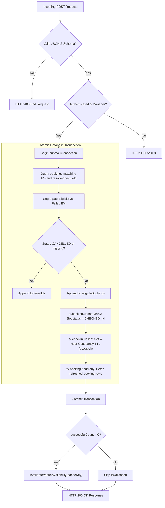

# Venue Manager Bulk Check-In API Guide

Comprehensive API documentation for the WorkSphere venue manager bulk check-in endpoint: `POST /api/venues/{venueId}/check-in/bulk`.

This endpoint allows workspace owners, creators, and authorized managers to batch-process check-ins for up to 50 bookings simultaneously within an atomic database transaction.

---

## 1. Endpoint Overview

- **HTTP Method:** `POST`
- **Route:** `/api/venues/{venueId}/check-in/bulk`
- **Authentication:** Required (Clerk session token or authenticated browser session)
- **Authorization:** Required (Venue owner, creator, or manager/admin role)
- **Content-Type:** `application/json`
- **Rate Limiting:** Governed by project-wide booking and venue route middleware quotas

---

## 2. Authentication & Middleware Architecture

### Clerk Session Authentication

The route handler directly invokes Clerk's `auth()` helper to extract `userId` and `sessionClaims`:

```typescript
const { userId, sessionClaims } = await auth();
if (!userId) {
  return NextResponse.json({ error: "Unauthorized" }, { status: 401 });
}
```

If the request lacks an authenticated Clerk session, the route handler immediately terminates execution and returns HTTP `401 Unauthorized`:

```json
{
  "error": "Unauthorized"
}
```

### Route Handler vs. Middleware Behavior

| Layer                                                                     | Interception Scope                                                                            | Unauthenticated Behavior                                                                                                              |
| :------------------------------------------------------------------------ | :-------------------------------------------------------------------------------------------- | :------------------------------------------------------------------------------------------------------------------------------------ |
| **Global Middleware** (`src/middleware.ts`)                               | Incoming browser navigation and API traffic where the route is not listed in `isPublicRoute`. | Intercepts unauthenticated browser requests and issues an HTTP `307 Temporary Redirect` to `/sign-in` with an encoded `redirect_url`. |
| **Route Handler** (`src/app/api/venues/[venueId]/check-in/bulk/route.ts`) | Direct HTTP/REST requests reaching the handler without an active user session.                | Returns an HTTP `401 Unauthorized` JSON response (`{"error": "Unauthorized"}`).                                                       |

> [!NOTE]
> Programmatic API consumers and backend services should supply a valid Clerk Bearer JWT (`Authorization: Bearer <token>`) to ensure the request passes middleware and reaches the route handler successfully.

---

## 3. Venue Resolution & Manager Authorization

### Venue Resolution

The route parameter `venueId` is resolved dynamically against the database:

```typescript
const venue = await prisma.venue.findFirst({
  where: { OR: [{ id: venueId }, { placeId: venueId }] },
  select: { id: true, name: true, ownerId: true, creatorId: true },
});
```

- **Dual-Key Lookup:** The endpoint accepts either the internal database venue identifier (`id`) or the external Google Places identifier (`placeId`).
- **Canonical ID Resolution:** The resolved internal venue ID (`venue.id`) is stored and used for all subsequent booking queries, check-in records, and cache invalidation.
- **Empty Venue ID:** If `venueId` is empty or unresolved, the route returns HTTP `400 Bad Request` with `{"error": "Venue ID is required"}`. (In standard Next.js App Router dynamic routing, a missing path segment will typically resolve to HTTP 404 at router level).
- **Missing Venue:** If no venue matches either `id` or `placeId`, the route returns HTTP `404 Not Found`:
  ```json
  {
    "error": "Venue not found"
  }
  ```

### Authorization Rules

Once the venue is resolved, the caller's identity and session metadata are evaluated:

```typescript
const role = (
  (sessionClaims?.metadata as Record<string, any>)?.role ||
  (sessionClaims as Record<string, any>)?.role ||
  (sessionClaims as Record<string, any>)?.org_role
)?.toLowerCase();

const isVenueManager =
  venue.ownerId === userId ||
  venue.creatorId === userId ||
  role === "manager" ||
  role === "venue_manager" ||
  role === "admin" ||
  role === "super_admin";
```

The caller is authorized if **at least one** of the following conditions is met:

1. **Venue Ownership:** `venue.ownerId === userId` (authenticated user owns the venue).
2. **Venue Creator:** `venue.creatorId === userId` (authenticated user created the venue record).
3. **Manager / Admin Role:** The user's role from Clerk session claims (extracted case-insensitively from `sessionClaims.metadata.role`, `sessionClaims.role`, or `sessionClaims.org_role`) matches one of:
   - `manager`
   - `venue_manager`
   - `admin`
   - `super_admin`

If none of these conditions are satisfied, the route terminates with HTTP `403 Forbidden`:

```json
{
  "error": "Forbidden: Venue manager access required"
}
```

> [!IMPORTANT]
> The route does not consult external membership tables or custom per-venue manager assignments beyond `ownerId`, `creatorId`, and the four explicit Clerk role strings listed above.

---

## 4. Request Body Validation

The request body is validated using Zod against `BulkCheckInSchema`:

```typescript
export const BulkCheckInSchema = z.object({
  bookingIds: z.array(z.string().cuid()).min(1).max(50),
  checkedInBy: z.string().optional(),
  checkInTimestamp: z.string().datetime().optional(),
});
```

### Parameters Reference

| Field              | Type       | Required | Constraints                                                   | Description                                                                                                                                                                                          |
| :----------------- | :--------- | :------- | :------------------------------------------------------------ | :--------------------------------------------------------------------------------------------------------------------------------------------------------------------------------------------------- |
| `bookingIds`       | `string[]` | **Yes**  | Min 1, Max 50 items. Each string must be a valid CUID format. | An array of booking CUIDs to process for check-in.                                                                                                                                                   |
| `checkedInBy`      | `string`   | No       | Optional string.                                              | Included in the schema for auditing metadata. **Implementation Note:** Destructured by the route handler but not stored or utilized in database operations. It does not override the recorded actor. |
| `checkInTimestamp` | `string`   | No       | ISO 8601 datetime string (`z.string().datetime()`).           | Optional timestamp indicating when physical check-in occurred. Defaults to the current server timestamp (`new Date()`) if omitted.                                                                   |

### Validation Errors

- **Malformed JSON:** If the request body cannot be parsed as JSON, the endpoint returns HTTP `400 Bad Request`:
  ```json
  {
    "error": "Invalid JSON body"
  }
  ```
- **Schema Validation Failure:** If the body fails Zod validation (e.g., non-CUID strings, empty array, or exceeding 50 items), the route returns HTTP `400 Bad Request`:
  ```json
  {
    "error": "Validation failed",
    "errors": [
      {
        "code": "too_big",
        "maximum": 50,
        "type": "array",
        "inclusive": true,
        "exact": false,
        "message": "Array must contain at most 50 element(s)",
        "path": ["bookingIds"]
      }
    ],
    "details": {
      "formErrors": [],
      "fieldErrors": {
        "bookingIds": ["Array must contain at most 50 element(s)"]
      }
    }
  }
  ```

---

## 5. Transactional Processing Lifecycle

The check-in operation runs within an atomic Prisma transaction (`prisma.$transaction`):



### Eligibility & Filtering Rules

Inside the transaction, the route queries all matching bookings restricted to the resolved venue:

```typescript
const matchingBookings = await tx.booking.findMany({
  where: {
    id: { in: bookingIds },
    venueId: venue.id,
  },
});
```

Each requested booking ID is evaluated against the following rules:

1. **Venue Match:** If no booking record is returned for that ID under `venue.id` (meaning the booking does not exist or belongs to another venue), it is pushed to `failedIds`.
2. **Cancelled Bookings:** If the booking record has status `CANCELLED` or `CANCELLED_BY_OPERATOR`, it is pushed to `failedIds`.
3. **Eligible Bookings:** All other booking records matching the venue are marked eligible.
   - **Note:** The current implementation processes bookings with status `CONFIRMED`, `PENDING`, `COMPLETED`, or even existing `CHECKED_IN` records. It is **not** restricted solely to `CONFIRMED` reservations.

### Booking Status Update

For all eligible bookings:

- The database executes `tx.booking.updateMany` setting `status: "CHECKED_IN"`.
- The refreshed booking rows are queried and returned in `updatedBookings` and `bookings`.

---

## 6. Occupancy Records & 4-Hour TTL Expiration

For each eligible booking, the transaction attempts to upsert a record into the `CheckIn` table:

```typescript
const checkInTime = checkInTimestamp ? new Date(checkInTimestamp) : new Date();
const expiresAt = new Date(checkInTime.getTime() + 4 * 60 * 60 * 1000);

for (const booking of eligibleBookings) {
  try {
    await tx.checkIn.upsert({
      where: {
        userId_venueId: {
          userId: booking.userId,
          venueId: venue.id,
        },
      },
      create: {
        userId: booking.userId,
        venueId: venue.id,
        createdAt: checkInTime,
        expiresAt,
      },
      update: {
        createdAt: checkInTime,
        expiresAt,
      },
    });
  } catch {
    // Ignore CheckIn table constraints if user relation is mocked or absent
  }
}
```

### Occupancy Lease Rules

- **Composite Key:** `userId_venueId` ensures each user has at most one active check-in per venue.
- **Expiration Window:** `expiresAt` is set to exactly 4 hours (`4 * 60 * 60 * 1000` ms) after `checkInTime`.
- **Active Occupancy Feeds:** Queries calculating real-time venue occupancy filter by `expiresAt > now`, ensuring abandoned or completed sessions automatically expire from live headcounts.

> [!CAUTION]
> **Implementation Caveat on Check-In Upserts:**
> The `tx.checkIn.upsert` statement is enclosed in a local `try/catch` block that suppresses errors. If a user record constraint or database error occurs during the `CheckIn` upsert, the exception is caught and ignored, allowing the transaction to commit. Therefore, while booking status updates to `CHECKED_IN` are transactional, the route does not strictly guarantee that a corresponding `CheckIn` table record was persisted.

---

## 7. Venue Availability Cache Invalidation

WorkSphere maintains cached venue availability matrices to accelerate search and floorplan browsing.

When bulk check-in completes:

```typescript
if (result.successfulCount > 0) {
  await invalidateVenueAvailability(venueAvailabilityCacheKey(venue.id));
}
```

- **Scope Key:** Keyed by the resolved internal venue ID: `venue:availability:{venue.id}`.
- **Trigger Condition:** Invalidation executes **only** when `result.successfulCount > 0` after the transaction commits successfully.
- **No-Op on Zero Success:** If all submitted IDs fail eligibility checks (`successfulCount === 0`), or if the database transaction aborts, cache invalidation is skipped.

---

## 8. Partial-Success Contract & Response Schemas

The bulk check-in endpoint implements a **partial-success** model. If some submitted booking IDs are invalid or cancelled while others are valid, the valid bookings are checked in, the failed IDs are isolated, and the endpoint returns HTTP `200 OK`.

### Response Payload Structure

| Field             | Type        | Description                                                       |
| :---------------- | :---------- | :---------------------------------------------------------------- |
| `success`         | `boolean`   | Indicates that the request completed successfully (`true`).       |
| `count`           | `number`    | Total count of eligible bookings updated to `CHECKED_IN`.         |
| `successfulCount` | `number`    | Identical to `count`.                                             |
| `failedIds`       | `string[]`  | Array of booking CUIDs that could not be processed.               |
| `updatedBookings` | `Booking[]` | Array of refreshed Prisma `Booking` records updated by this call. |
| `bookings`        | `Booking[]` | Convenience alias referencing `updatedBookings`.                  |

> [!NOTE]
> `count` and `successfulCount` reflect the number of **eligible bookings updated**, not the total number of IDs submitted in `bookingIds`.

### Response Example: Partial Success

```json
{
  "success": true,
  "count": 2,
  "successfulCount": 2,
  "failedIds": ["c123456789012345678901239", "c123456789012345678901240"],
  "updatedBookings": [
    {
      "id": "c123456789012345678901234",
      "userId": "user_2aBcd3EfGhIjKlMnOpQrStUv",
      "venueId": "clv1234567890123456789012",
      "date": "2026-11-22",
      "time": "09:00",
      "timeZone": "America/New_York",
      "customerEmail": "alex@example.com",
      "customerPhone": "+15551234567",
      "status": "CHECKED_IN",
      "confirmationId": "WS-BK-91823",
      "createdAt": "2026-11-20T14:00:00.000Z",
      "projectBillingCode": "DEPT-402",
      "seatId": "seat_c123456789012345678901",
      "seatNumber": "Desk 4A",
      "duration": 120,
      "amenitiesNeeded": ["wifi", "ergonomic_chair"],
      "recurringGroupId": null,
      "frequency": null,
      "guestCount": 1
    },
    {
      "id": "c123456789012345678901235",
      "userId": "user_3bCde4FgHiJkLmNoPqRsTuVw",
      "venueId": "clv1234567890123456789012",
      "date": "2026-11-22",
      "time": "09:30",
      "timeZone": "America/New_York",
      "customerEmail": "jordan@example.com",
      "customerPhone": null,
      "status": "CHECKED_IN",
      "confirmationId": "WS-BK-91824",
      "createdAt": "2026-11-20T15:30:00.000Z",
      "projectBillingCode": null,
      "seatId": "seat_c123456789012345678902",
      "seatNumber": "Booth 1",
      "duration": 60,
      "amenitiesNeeded": ["power_outlets"],
      "recurringGroupId": null,
      "frequency": null,
      "guestCount": 1
    }
  ],
  "bookings": [
    {
      "id": "c123456789012345678901234",
      "userId": "user_2aBcd3EfGhIjKlMnOpQrStUv",
      "venueId": "clv1234567890123456789012",
      "date": "2026-11-22",
      "time": "09:00",
      "timeZone": "America/New_York",
      "customerEmail": "alex@example.com",
      "customerPhone": "+15551234567",
      "status": "CHECKED_IN",
      "confirmationId": "WS-BK-91823",
      "createdAt": "2026-11-20T14:00:00.000Z",
      "projectBillingCode": "DEPT-402",
      "seatId": "seat_c123456789012345678901",
      "seatNumber": "Desk 4A",
      "duration": 120,
      "amenitiesNeeded": ["wifi", "ergonomic_chair"],
      "recurringGroupId": null,
      "frequency": null,
      "guestCount": 1
    },
    {
      "id": "c123456789012345678901235",
      "userId": "user_3bCde4FgHiJkLmNoPqRsTuVw",
      "venueId": "clv1234567890123456789012",
      "date": "2026-11-22",
      "time": "09:30",
      "timeZone": "America/New_York",
      "customerEmail": "jordan@example.com",
      "customerPhone": null,
      "status": "CHECKED_IN",
      "confirmationId": "WS-BK-91824",
      "createdAt": "2026-11-20T15:30:00.000Z",
      "projectBillingCode": null,
      "seatId": "seat_c123456789012345678902",
      "seatNumber": "Booth 1",
      "duration": 60,
      "amenitiesNeeded": ["power_outlets"],
      "recurringGroupId": null,
      "frequency": null,
      "guestCount": 1
    }
  ]
}
```

---

## 9. Error Responses

| Status Code                 | Error Message                                                       | Trigger Condition                                                                                                          |
| :-------------------------- | :------------------------------------------------------------------ | :------------------------------------------------------------------------------------------------------------------------- |
| `400 Bad Request`           | `{"error": "Venue ID is required"}`                                 | The `venueId` route parameter is empty.                                                                                    |
| `400 Bad Request`           | `{"error": "Invalid JSON body"}`                                    | Request body is not parseable JSON.                                                                                        |
| `400 Bad Request`           | `{"error": "Validation failed", "errors": [...], "details": {...}}` | Request payload fails Zod schema validation (e.g. invalid CUID, empty array, or $> 50$ IDs).                               |
| `401 Unauthorized`          | `{"error": "Unauthorized"}`                                         | The request lacks a valid authenticated Clerk session.                                                                     |
| `403 Forbidden`             | `{"error": "Forbidden: Venue manager access required"}`             | Caller is not the venue owner, creator, or assigned an accepted role (`manager`, `venue_manager`, `admin`, `super_admin`). |
| `404 Not Found`             | `{"error": "Venue not found"}`                                      | No venue exists matching the provided internal `id` or `placeId`.                                                          |
| `500 Internal Server Error` | `{"error": "Internal Server Error", "message": "<reason>"}`         | Unexpected database failure, transaction collision, or unhandled exception during processing.                              |

### Error Response Examples

#### 1. Forbidden (Insufficient Role)

```http
HTTP/1.1 403 Forbidden
Content-Type: application/json

{
  "error": "Forbidden: Venue manager access required"
}
```

#### 2. Venue Not Found

```http
HTTP/1.1 404 Not Found
Content-Type: application/json

{
  "error": "Venue not found"
}
```

#### 3. Internal Server Error

```http
HTTP/1.1 500 Internal Server Error
Content-Type: application/json

{
  "error": "Internal Server Error",
  "message": "Transaction failed due to concurrent modification"
}
```

---

## 10. Sample Requests

### Standard Bulk Check-In Request

```http
POST /api/venues/clv1234567890123456789012/check-in/bulk HTTP/1.1
Host: worksphere.app
Authorization: Bearer <clerk_session_token>
Content-Type: application/json

{
  "bookingIds": [
    "c123456789012345678901234",
    "c123456789012345678901235"
  ],
  "checkedInBy": "staff_member_sarah",
  "checkInTimestamp": "2026-11-22T09:00:00.000Z"
}
```

### Direct `cURL` Command

```bash
curl -X POST "https://worksphere.app/api/venues/clv1234567890123456789012/check-in/bulk" \
  -H "Authorization: Bearer $CLERK_TOKEN" \
  -H "Content-Type: application/json" \
  -d '{
    "bookingIds": [
      "c123456789012345678901234",
      "c123456789012345678901235"
    ],
    "checkInTimestamp": "2026-11-22T09:00:00.000Z"
  }'
```

---

## 11. Implementation & Test References

- **Route Implementation:** [`src/app/api/venues/[venueId]/check-in/bulk/route.ts`](../../src/app/api/venues/[venueId]/check-in/bulk/route.ts)
- **Availability Cache Engine:** [`src/lib/cache/venueAvailabilityCache.ts`](../../src/lib/cache/venueAvailabilityCache.ts)
- **Middleware Boundary:** [`src/middleware.ts`](../../src/middleware.ts)
- **Route Validation Suite:** [`src/__tests__/api/bulkCheckIn.test.ts`](../../src/__tests__/api/bulkCheckIn.test.ts)
- **Cache Invalidation Suite:** [`src/__tests__/api/bulkCheckInAvailabilityCache.test.ts`](../../src/__tests__/api/bulkCheckInAvailabilityCache.test.ts)
- **Check-In Feature Guide:** [Venue Check-In Flow Documentation](../features/venue-checkin-flow.md)
