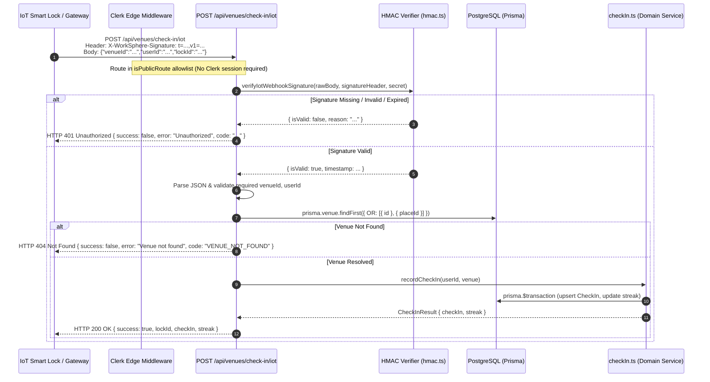

# IoT Smart-Lock Check-In Webhook API Guide

Comprehensive technical documentation for WorkSphere's signed IoT smart-lock check-in webhook endpoint (`POST /api/venues/check-in/iot`). This endpoint enables on-site hardware controllers, smart door locks, turnstiles, and RFID access readers to record physical venue check-ins without requiring an interactive browser session or user authentication tokens.

---

## 1. Overview and Security Model

WorkSphere supports automated physical arrival detection through on-site Internet of Things (IoT) hardware. When an authorized member unlocks a connected smart door lock, scans a physical keycard, or passes through an access gate, the IoT device (or its cloud gateway) dispatches an HTTP `POST` webhook to `/api/venues/check-in/iot`.

Upon receiving the webhook, WorkSphere:

1. Cryptographically verifies request authenticity and freshness using **HMAC-SHA256**.
2. Resolves the target venue by internal identifier or external place identifier.
3. Invokes the check-in service to record active attendance, establish a 4-hour occupancy lease, and update daily streaks.
4. Returns the recorded check-in metadata, streak progress, and milestone status.



### Security Boundary and Middleware Behavior

- **Node.js Runtime**: The route declares `export const runtime = "nodejs"` because signature verification relies on Node.js cryptographic primitives (`node:crypto`).
- **Edge Middleware Exemption**: The route path `/api/venues/check-in/iot` is explicitly listed in `isPublicRoute` within [`src/middleware.ts`](../../src/middleware.ts).
- **No User Session Required**: Clerk session cookies and user JWT bearer tokens are **neither required nor inspected**. Public accessibility at the middleware layer is intentional so automated hardware clients can deliver check-in webhooks.
- **HMAC Security Boundary**: Authentication is enforced entirely through HMAC-SHA256 signature verification over the unparsed raw request body. Requests that fail signature or timestamp checks are rejected immediately with HTTP 401 before any JSON parsing or database queries take place.

---

## 2. Endpoint Specification

- **HTTP Method**: `POST`
- **Path**: `/api/venues/check-in/iot`
- **Runtime**: Node.js (`nodejs`)
- **Required Headers**:
  - `Content-Type: application/json`
  - `X-WorkSphere-Signature: t={timestamp},v1={signature}` (header lookup is case-insensitive: `x-worksphere-signature` or `X-WorkSphere-Signature`)

---

## 3. Signature Header Format

Webhook requests must supply an `X-WorkSphere-Signature` header containing two comma-separated key-value pairs:

```http
X-WorkSphere-Signature: t={timestamp},v1={signature}
```

| Component | Format                          | Description                                                                                     |
| :-------- | :------------------------------ | :---------------------------------------------------------------------------------------------- |
| `t`       | Positive integer string         | Current Unix timestamp in seconds (`Math.floor(Date.now() / 1000)`). Must be greater than zero. |
| `v1`      | 64-character hexadecimal string | HMAC-SHA256 digest computed using the shared secret and signed payload string.                  |

### Header Parsing Rules

The verification utility (`verifyIotWebhookSignature`) parses the header string as follows:

1. Splits the header on comma delimiters (`,`).
2. Trims each component and splits on the first equals sign (`=`) to extract `key` and `value`.
3. Maps `key === "t"` to the timestamp string and `key === "v1"` to the signature hex string.
4. Requires both `t` and `v1` to be present. If either is missing, verification fails with reason `INVALID_SIGNATURE_FORMAT`.
5. Parses `t` using `parseInt(timestampStr, 10)`. If `isNaN(timestamp)` or `timestamp <= 0`, verification fails with reason `INVALID_TIMESTAMP`.

---

## 4. HMAC-SHA256 Signing Specification

To generate a valid signature, the sender computes the HMAC-SHA256 digest over a concatenated string composed of the Unix timestamp and the raw request body:

$$\text{signature} = \text{HMAC-SHA256}(\text{key}, \text{signedPayload})$$

### Signed String Format

$$\text{signedPayload} = \texttt{\$\{timestamp\}.\$\{rawBody\}}$$

The signed string consists of:

1. The exact Unix timestamp string sent in the `t=` parameter of the signature header.
2. A literal ASCII period (`.`).
3. The exact raw HTTP request body string.

The resulting HMAC digest is encoded as lowercase hexadecimal characters.

---

## 5. Raw-Body Signing Requirements

> [!IMPORTANT]
> **Sign the Raw Bytes Transmitted Over the Wire:**
> Signature verification is computed over the literal raw request body string captured via `req.text()`. It is **not** computed over parsed, normalized, or re-serialized JSON.

Any discrepancy between the payload string signed by the IoT device and the byte stream received by the server will cause verification to fail with `SIGNATURE_MISMATCH`:

- Adding or removing trailing newlines or whitespace.
- Re-serializing JSON after signing (which may alter key order or spacing).
- Character encoding mismatches (payloads must be UTF-8 encoded).

The client must serialize the JSON payload once, sign that raw string, and transmit that identical string as the HTTP request body.

---

## 6. Secret Configuration

WorkSphere reads the shared secret from the server environment:

```dotenv
WORKSPHERE_IOT_WEBHOOK_SECRET="whsec_your_iot_smart_lock_webhook_secret"
```

The template placeholder is documented in [`.env.example`](../../.env.example).

### Secret Prefix Handling (`whsec_`)

Both the signing utility (`signIotWebhookPayload`) and the verifier (`verifyIotWebhookSignature`) in [`src/lib/security/hmac.ts`](../../src/lib/security/hmac.ts) inspect the secret string:

```typescript
const cleanSecret = secret.startsWith("whsec_") ? secret.slice(6) : secret;
```

- If the secret begins with `whsec_`, the 6-character prefix is stripped before generating or verifying the HMAC digest.
- The remaining string is used **directly as the HMAC key string**. It is not Base64-decoded.
- Secrets without a `whsec_` prefix are accepted and used directly as-is.

### Fail-Closed Behavior

If `WORKSPHERE_IOT_WEBHOOK_SECRET` is unset, not a string, or contains only whitespace characters:

1. Verification fails immediately with reason `MISSING_SECRET`.
2. The route returns HTTP 401 (`"Unauthorized"`, code `"MISSING_SECRET"`).
3. The server never falls back to an insecure, empty, or default secret.

---

## 7. Timestamp Freshness and Replay Limitations

The route invokes verification with a 300-second tolerance window:

```typescript
verifyIotWebhookSignature(rawBody, signatureHeader, secret, {
  toleranceSeconds: 300,
});
```

### Freshness Rules

- **Allowed Window**: The webhook timestamp `t` must fall within $\pm 300$ seconds (5 minutes) of the server's current clock (`Math.abs(nowSec - timestamp) <= 300`).
- **Boundary Handling**: A timestamp differing by exactly 300 seconds is accepted.
- **Rejection**: If the absolute difference exceeds 300 seconds, the request is rejected with reason `TIMESTAMP_OUT_OF_TOLERANCE` (HTTP 401).
- **Time Synchronization**: IoT devices and sending gateways must keep their system clocks synchronized via Network Time Protocol (NTP) to prevent false rejections.

### Replay Protection Limitations

> [!WARNING]
> **Freshness Validation vs. Nonce Protection:**
> The 300-second tolerance window ensures that expired signatures cannot be accepted. However, WorkSphere **does not maintain an in-memory or database nonce registry** of previously consumed signatures for this endpoint.
>
> If an attacker intercepts a valid signed request, that exact request could theoretically be replayed within the remaining 300-second validity window. The endpoint does **not** guarantee exactly-once processing or complete one-time replay prevention at the network layer.

#### Recommended Integrator Hardening

To harden deployments against replay attacks:

- Enforce strict HTTPS/TLS 1.3 between IoT gateways and WorkSphere.
- Minimize device clock drift so the tolerance window can be tightened if necessary.
- Where upstream devices support it, dispatch check-in events through idempotent message queues or track event IDs at the application level.

---

## 8. Request Payload

### JSON Schema

```json
{
  "venueId": "venue-123",
  "userId": "user-456",
  "lockId": "lock-789"
}
```

### Field Definitions

| Field     | Type     | Required | Description                                                                                                                                                |
| :-------- | :------- | :------: | :--------------------------------------------------------------------------------------------------------------------------------------------------------- |
| `venueId` | `string` | **Yes**  | Identifier of the workspace venue. Accepts either WorkSphere internal venue ID (`id`) or external Google Place ID (`placeId`). Must be a non-empty string. |
| `userId`  | `string` | **Yes**  | Identifier of the WorkSphere user associated with the check-in. Must be a non-empty string.                                                                |
| `lockId`  | `string` |    No    | Optional identifier of the physical smart lock or access reader hardware. Echoed back in the success response.                                             |

### Payload Handling Details

- **Validation**: Both `venueId` and `userId` must be present and must be non-empty strings. If either is missing, non-string, or empty, the route aborts with HTTP 400 (`VALIDATION_ERROR`).
- **`lockId` Semantics**: The `lockId` is optional. The route does not validate `lockId` against a registered lock directory and does not use it to look up venues. If supplied, it is echoed back in the response payload; otherwise, `null` is returned.
- **Additional Properties**: The TypeScript interface defines `[key: string]: unknown` and accepts additional JSON fields, but no additional properties are processed, validated, or persisted.
- **JSON `timestamp` Property vs. Header Timestamp**:
  - The internal `IotCheckInPayload` interface includes an optional `timestamp?: number` property.
  - **The route handler does not consume or evaluate the JSON `timestamp` property.**
  - Security freshness validation is governed solely by the `t=` parameter in the `X-WorkSphere-Signature` HTTP header.
  - Clients must not rely on a JSON body `timestamp` field for freshness validation or replay protection.

---

## 9. Venue Resolution and Processing Flow

Once signature verification and JSON parsing succeed, the route executes the following sequence:

### 1. Payload Validation

```typescript
const { venueId, userId, lockId } = payload;
if (
  !venueId ||
  typeof venueId !== "string" ||
  !userId ||
  typeof userId !== "string"
) {
  return apiError(
    "Missing required fields: venueId and userId are mandatory",
    400,
    "VALIDATION_ERROR",
  );
}
```

### 2. Dual-Identifier Venue Resolution

The route searches for a matching venue record using either WorkSphere's internal CUID or an external Google Place ID:

```typescript
const venue = await prisma.venue.findFirst({
  where: { OR: [{ id: venueId }, { placeId: venueId }] },
  select: { id: true, name: true, latitude: true, longitude: true },
});
```

- If no venue matches either identifier, the route returns HTTP 404 (`"Venue not found"`, code `"VENUE_NOT_FOUND"`).
- The route does not evaluate whether the user is geographically near the venue or verify GPS geofences; physical presence is assumed by virtue of the physical smart-lock unlock event.

### 3. Check-In Service Execution (`recordCheckIn`)

The route delegates attendance persistence to `recordCheckIn(userId, venue)` in [`src/lib/checkIn.ts`](../../src/lib/checkIn.ts):

- **Prisma Transaction**: The check-in and user streak operations run inside an atomic `prisma.$transaction`.
- **Occupancy Lease**: Upserts a record in the `CheckIn` table for `userId_venueId` with a 4-hour lease duration (`CHECK_IN_TTL_MS = 4 * 60 * 60 * 1000`). If a check-in already exists for this user and venue, its `createdAt` and `expiresAt` timestamps are renewed.
- **Streak Calculation**: Evaluates the user's consecutive day streak (`calculateStreak`). If the check-in is on a new consecutive day, increments `currentStreak`, updates `longestStreak`, and identifies newly unlocked milestones (5, 10, or 30 days).
- **Outbound Webhook Dispatch**: Dispatches a `MAP_GEOFENCE_BREACHED` outbound webhook event containing venue details and check-in timestamps.
- **Leaderboard Cache Invalidation**: Calls `invalidateXpLeaderboard()` to clear cached XP ranking data.

If `recordCheckIn` throws an exception, the route catches it, logs the failure, and returns HTTP 500 (`INTERNAL_ERROR`).

---

## 10. Success Response

When verification and check-in processing succeed, the endpoint returns **HTTP 200 OK**:

```http
HTTP/1.1 200 OK
Content-Type: application/json

{
  "success": true,
  "lockId": "lock-789",
  "checkIn": {
    "venueId": "venue-123",
    "createdAt": "2026-11-22T04:00:00.000Z",
    "expiresAt": "2026-11-22T08:00:00.000Z"
  },
  "streak": {
    "currentStreak": 5,
    "longestStreak": 10,
    "incremented": true,
    "newMilestones": [5],
    "unlockedMilestones": [5]
  }
}
```

### Response Properties

- `success` (`boolean`): Always `true` on successful processing.
- `lockId` (`string | null`): The `lockId` passed in the request body, or `null` if omitted.
- `checkIn` (`object`): Persisted attendance record:
  - `venueId` (`string`): Resolved internal venue ID.
  - `createdAt` (`string`): ISO 8601 timestamp when the check-in was registered.
  - `expiresAt` (`string`): ISO 8601 timestamp when the 4-hour occupancy lease expires.
- `streak` (`object`): Gamification streak calculations:
  - `currentStreak` (`number`): Number of consecutive active days.
  - `longestStreak` (`number`): Highest all-time streak achieved by the user.
  - `incremented` (`boolean`): `true` if this check-in advanced the user's daily streak; `false` if the user had already checked in today.
  - `newMilestones` (`number[]`): Array of milestone days (e.g., `5`, `10`, `30`) newly unlocked by this check-in.
  - `unlockedMilestones` (`number[]`): Array of all milestone tiers currently unlocked by the user.

> [!NOTE]
> Response payloads do not emit hypothetical fields such as `eventId`, `signatureId`, `replayStatus`, or `lockStatus`.

---

## 11. Error Responses

Error responses follow the standardized WorkSphere error envelope (`apiError` in [`src/lib/apiResponse.ts`](../../src/lib/apiResponse.ts)):

```json
{
  "success": false,
  "error": "<Human-readable error description>",
  "code": "<Machine-readable error code>"
}
```

### Complete Error Reference

| HTTP Status                     | Message (`error`)                                             | Code (`code`)                | Trigger Condition                                                                            |
| :------------------------------ | :------------------------------------------------------------ | :--------------------------- | :------------------------------------------------------------------------------------------- |
| **`401 Unauthorized`**          | `"Unauthorized"`                                              | `MISSING_SECRET`             | Server environment variable `WORKSPHERE_IOT_WEBHOOK_SECRET` is unset, empty, or whitespace.  |
| **`401 Unauthorized`**          | `"Unauthorized"`                                              | `MISSING_SIGNATURE_HEADER`   | Request is missing the `X-WorkSphere-Signature` header.                                      |
| **`401 Unauthorized`**          | `"Unauthorized"`                                              | `INVALID_SIGNATURE_FORMAT`   | Header cannot be split into valid `t=` and `v1=` components.                                 |
| **`401 Unauthorized`**          | `"Unauthorized"`                                              | `INVALID_TIMESTAMP`          | The `t` component is not a valid positive integer.                                           |
| **`401 Unauthorized`**          | `"Unauthorized"`                                              | `TIMESTAMP_OUT_OF_TOLERANCE` | Webhook timestamp differs from server time by more than 300 seconds.                         |
| **`401 Unauthorized`**          | `"Unauthorized"`                                              | `SIGNATURE_MISMATCH`         | Computed HMAC-SHA256 does not match `v1` (tampered body, forged signature, or wrong secret). |
| **`401 Unauthorized`**          | `"Unauthorized"`                                              | `VERIFICATION_ERROR`         | An unhandled exception occurred during buffer conversion or timing-safe comparison.          |
| **`400 Bad Request`**           | `"Invalid JSON payload"`                                      | `BAD_REQUEST`                | The raw body fails `JSON.parse`.                                                             |
| **`400 Bad Request`**           | `"Missing required fields: venueId and userId are mandatory"` | `VALIDATION_ERROR`           | `venueId` or `userId` is missing, empty, or not a string.                                    |
| **`404 Not Found`**             | `"Venue not found"`                                           | `VENUE_NOT_FOUND`            | No venue record matched either `id === venueId` or `placeId === venueId`.                    |
| **`500 Internal Server Error`** | `"Check-in failed. Please try again."`                        | `INTERNAL_ERROR`             | `recordCheckIn` threw an unexpected runtime or database transaction error.                   |

> [!NOTE]
> **Venue Lookup vs. Check-In Error Scope:**
> The venue lookup query (`prisma.venue.findFirst`) runs prior to the `try/catch` block wrapping `recordCheckIn`. In the event of a database connectivity failure during venue resolution, the error is handled by the framework's default error handling rather than the route's standardized `INTERNAL_ERROR` envelope.

---

## 12. Node.js Signing and Dispatch Example

The following script illustrates how an IoT gateway, controller process, or test client can sign and dispatch a check-in event using standard Node.js APIs (`node:crypto`):

```javascript
import { createHmac } from "node:crypto";

/**
 * Dispatches an authenticated IoT smart-lock check-in webhook to WorkSphere.
 */
async function sendIotCheckIn() {
  const webhookUrl =
    process.env.WORKSPHERE_URL ||
    "http://localhost:3000/api/venues/check-in/iot";
  const secret = process.env.WORKSPHERE_IOT_WEBHOOK_SECRET;

  if (!secret) {
    throw new Error("Missing WORKSPHERE_IOT_WEBHOOK_SECRET in environment");
  }

  // 1. Current Unix timestamp in seconds
  const timestamp = Math.floor(Date.now() / 1000);

  // 2. Prepare payload object and serialize once to string
  const payload = {
    venueId: "venue-123",
    userId: "user-456",
    lockId: "lock-789",
  };
  const rawBody = JSON.stringify(payload);

  // 3. Strip optional whsec_ prefix to obtain HMAC key
  const signingSecret = secret.startsWith("whsec_") ? secret.slice(6) : secret;

  // 4. Compute HMAC-SHA256 signature over `${timestamp}.${rawBody}`
  const signature = createHmac("sha256", signingSecret)
    .update(`${timestamp}.${rawBody}`)
    .digest("hex");

  // 5. Transmit rawBody unchanged with the signature header
  const response = await fetch(webhookUrl, {
    method: "POST",
    headers: {
      "Content-Type": "application/json",
      "X-WorkSphere-Signature": `t=${timestamp},v1=${signature}`,
    },
    body: rawBody,
  });

  const responseData = await response.json();
  console.log(`HTTP ${response.status}:`, responseData);
}

sendIotCheckIn().catch(console.error);
```

---

## 13. Security Recommendations

1. **Secret Management**:
   - Generate cryptographically strong random secrets ($\ge 32$ bytes of entropy).
   - Configure secrets via secure environment variables or vault management systems.
   - Never commit webhook secrets to version control or expose them in browser/frontend code.
2. **Network Transport**:
   - Always route production webhook traffic over HTTPS with TLS 1.3 to prevent eavesdropping and in-transit request modification.
3. **Clock Synchronization**:
   - Ensure hardware controllers and server hosts maintain accurate clocks synchronized with NTP servers to prevent false `TIMESTAMP_OUT_OF_TOLERANCE` rejections.
4. **Idempotency Hardening**:
   - Because timestamp freshness validation allows replay within the 300-second window, integrations with high-volume access points should track event dispatches upstream or incorporate application-level idempotency keys where supported.

---

## 14. Implementation References

- **Webhook Route Handler**: [`src/app/api/venues/check-in/iot/route.ts`](../../src/app/api/venues/check-in/iot/route.ts)
- **HMAC Utilities**: [`src/lib/security/hmac.ts`](../../src/lib/security/hmac.ts)
- **Check-In Domain Service**: [`src/lib/checkIn.ts`](../../src/lib/checkIn.ts)
- **Edge Middleware Routing**: [`src/middleware.ts`](../../src/middleware.ts)
- **Response Helper Utilities**: [`src/lib/apiResponse.ts`](../../src/lib/apiResponse.ts)
- **Unit & Integration Tests**: [`src/__tests__/api/iotSignature.test.ts`](../../src/__tests__/api/iotSignature.test.ts)
- **Environment Configuration**: [`.env.example`](../../.env.example)
