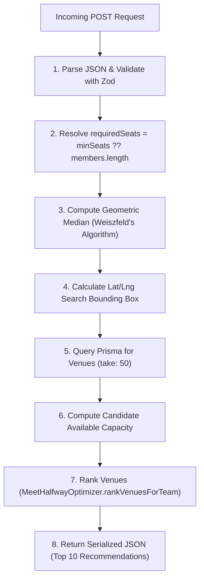

# Meet Halfway Routing API

The Meet Halfway Routing endpoint computes an optimal, fair meeting location for distributed team members. It determines the geometric median centroid of all member coordinates, retrieves nearby candidate workspaces within a bounding box, evaluates commute times and fairness across transportation modes, checks seat capacity eligibility, and returns ranked workspace recommendations.

---

## 1. Endpoint Overview

```http
POST /api/routing/meet-halfway
```

- **Method:** `POST`
- **Path:** `/api/routing/meet-halfway`
- **Content-Type:** `application/json`
- **Implementation:** [`src/app/api/routing/meet-halfway/route.ts`](../../src/app/api/routing/meet-halfway/route.ts)
- **Core Engine:** [`src/core/routing/MeetHalfwayOptimizer.ts`](../../src/core/routing/MeetHalfwayOptimizer.ts)

### Purpose & Optimization Architecture

The endpoint solves the multi-party group rendezvous problem:

1. **Centroid Calculation:** Calculates the geometric median (L1 Fermat-Weber center) across all member coordinates, minimizing aggregate Euclidean travel distance rather than skewing toward geographical outliers.
2. **Spatial Search:** Generates an approximate latitude/longitude search bounding box centered on the geometric median and retrieves up to 50 candidate workspaces from the database.
3. **Capacity Assessment:** Computes available seating capacity from enabled seat records or maximum venue capacity minus current occupancy.
4. **Commute & Fairness Modeling:** Estimates travel times for each member using deterministic speed profiles per transit mode, calculates variance-based commute fairness, and applies quality bonuses (ratings, Wi-Fi speed, power outlets).
5. **Ranking & Fallback:** Ranks candidate workspaces using a composite scoring formula and returns the top 10 recommendations. If the database returns one or more candidate venues within the search bounding box, but none meet the requested team capacity, the endpoint automatically triggers a fallback relaxation mode. If no candidate venues match the spatial query at all, an empty list of recommendations is returned without triggering fallback relaxation.

### Authentication & Middleware Behavior

The endpoint is covered by the application API middleware matcher (`/(api|trpc)(.*)` in [`src/middleware.ts`](../../src/middleware.ts)) and is **not** included in the public-route allowlist (`isPublicRoute`).

- **Authenticated Clerk Session Required:** Callers must have an active, authenticated Clerk session (via session cookies in browser environments).
- **Redirection on Unauthenticated Access:** If an unauthenticated request reaches the middleware, the request is redirected through the Clerk sign-in flow (`/sign-in?redirect_url=...`) rather than receiving an endpoint-defined JSON `401 Unauthorized` response.

### Geometric Centroid vs. Recommended Venue

It is critical to distinguish between the **geometric meeting centroid** and the **recommended venues**:

- The **geometric centroid** is a theoretical coordinate point calculated purely from member locations using Weiszfeld's algorithm. It is used strictly to anchor the spatial search bounding box.
- The **recommended venues** are actual physical workspaces retrieved from the database. Venues are evaluated independently using straight-line Haversine distance with a fixed routing approximation factor, travel fairness, venue ratings, Wi-Fi speed, power outlet availability, and capacity. The top-ranked venue rarely coincides with the exact centroid coordinate.

---

## 2. Request Schema

### Headers

```http
Content-Type: application/json
```

### Request Body Structure

The request body must be a JSON object containing a `members` array and optional search filters.

```json
{
  "members": [
    {
      "id": "mem-1",
      "name": "Alex",
      "latitude": 37.7749,
      "longitude": -122.4194,
      "transitMode": "transit"
    },
    {
      "id": "mem-2",
      "name": "Jordan",
      "latitude": 37.7833,
      "longitude": -122.4167,
      "transitMode": "bicycling"
    }
  ],
  "category": "coworking",
  "minWifiSpeed": 50,
  "minSeats": 4,
  "searchRadiusKm": 15,
  "hasOutlets": true,
  "transitPreference": "balanced"
}
```

### Team Member Parameters (`members[]`)

Each entry in the `members` array represents a participant and must satisfy the following schema:

| Field         | Type     | Required | Validation Rules                                            | Description                                                                                                                                                              |
| :------------ | :------- | :------- | :---------------------------------------------------------- | :----------------------------------------------------------------------------------------------------------------------------------------------------------------------- |
| `id`          | `string` | **Yes**  | Non-empty after trimming (`min(1)`)                         | Identifier for the team member. The API validates that `id` is a non-empty string after trimming, but does not enforce uniqueness across members in the submitted array. |
| `name`        | `string` | **Yes**  | Non-empty after trimming (`min(1)`)                         | Display name of the team member.                                                                                                                                         |
| `latitude`    | `number` | **Yes**  | Finite number between `-90` and `90` inclusive              | Geographic latitude coordinate.                                                                                                                                          |
| `longitude`   | `number` | **Yes**  | Finite number between `-180` and `180` inclusive            | Geographic longitude coordinate.                                                                                                                                         |
| `transitMode` | `string` | No       | One of `"transit"`, `"driving"`, `"bicycling"`, `"walking"` | Individual preferred travel mode. Defaults to `"transit"` during evaluation when omitted or undefined.                                                                   |

### Request Options & Filters

| Field               | Type       | Required | Default Value    | Operational Behavior                                                                                                                                                          |
| :------------------ | :--------- | :------- | :--------------- | :---------------------------------------------------------------------------------------------------------------------------------------------------------------------------- |
| `members`           | `Member[]` | **Yes**  | _(None)_         | Array of team member objects. Must contain at least one member.                                                                                                               |
| `category`          | `string`   | No       | _(None)_         | Workspace category (e.g. `"coworking"`, `"cafe"`, `"library"`). When omitted, undefined, an empty string (`""`), or explicitly set to `"all"`, category filtering is skipped. |
| `minWifiSpeed`      | `number`   | No       | `0`              | Minimum required Wi-Fi speed in Mbps. When greater than `0`, filters venues with `wifiSpeed >= minWifiSpeed`.                                                                 |
| `minSeats`          | `integer`  | No       | `members.length` | Minimum required available seats. Must be a positive integer ($\ge 1$). When omitted, defaults to the total number of members in `members`.                                   |
| `searchRadiusKm`    | `number`   | No       | `25`             | Spatial search bounding box half-dimension in kilometers. Finite, positive number $\le 100\text{ km}$.                                                                        |
| `hasOutlets`        | `boolean`  | No       | _(None)_         | When `true`, filters venues to those with `hasOutlets: true`. When `false` or omitted, no outlet requirement is added.                                                        |
| `transitPreference` | `string`   | No       | `"transit"`      | Global transit policy: `"transit"`, `"walking"`, or `"balanced"`. Controls how individual member transit modes are interpreted.                                               |

### Important Filter Semantics

- **Category Filtering (`category`):** Evaluated as `if (category && category !== "all")`. Consequently, category filtering is skipped when `category` is omitted, undefined, an empty string (`""`), or explicitly set to `"all"`.
- **Outlet Filtering (`hasOutlets`):** Setting `hasOutlets: false` does **not** exclude venues with power outlets. In Prisma, the filter is conditional: `if (hasOutlets) venueWhereClause.hasOutlets = true`. Omitting the field or setting it to `false` simply imposes no outlet restriction.
- **API Defaults vs. UI Defaults:** The API route's defaults are independent of default values shown in the frontend `TeamMeetHalfwayLobby` component:
  - In the API route: `minWifiSpeed` defaults to `0`, `hasOutlets` is unset (optional), `minSeats` defaults to `members.length`, and `searchRadiusKm` defaults to `25`.
  - In the UI lobby: initial form state defaults `minWifiSpeed` to `50`, `hasOutlets` to `true`, and `minSeats` to `3`.

---

## 3. Defaults and Validation Rules

The route validates incoming payloads using Zod schemas (`MeetHalfwayRequestSchema` and `MemberLocationSchema`). All validation occurs before database access:

1. **Root Body Type:**
   - The root body must be a valid JSON object.
   - Malformed JSON returns `400 Bad Request` with `{ "error": "Invalid JSON body" }`.
   - Primitive values, JSON `null`, or arrays at the root return `400 Bad Request` with `{ "error": "Request body must be an object" }`.
2. **Members Array:**
   - Must be an array containing at least one member (`min(1)`). Empty arrays or non-array values fail validation.
   - Each member's `id` and `name` must be strings containing at least one non-whitespace character after trimming. Whitespace-only strings (`"   "`) are rejected.
3. **Geographic Coordinates:**
   - `latitude` must be a finite number in the range `[-90, 90]`.
   - `longitude` must be a finite number in the range `[-180, 180]`.
   - Non-finite numbers (`NaN`, `Infinity`, `-Infinity`) and numeric strings (`"37.77"`) are rejected with `400 Bad Request`.
4. **Member Transit Modes:**
   - If supplied, `transitMode` must strictly equal `"transit"`, `"driving"`, `"bicycling"`, or `"walking"`.
   - Unsupported strings (e.g. `"subway"`, `"car"`, `"fly"`) are rejected.
5. **Search Radius:**
   - `searchRadiusKm` must be a finite number strictly greater than `0` and less than or equal to `100`.
   - The maximum limit (`100` km) corresponds to `MAX_SEARCH_RADIUS_METERS = 100000` defined in [`src/lib/search/spatialVenueSearch.ts`](../../src/lib/search/spatialVenueSearch.ts) and exported as `MAX_SEARCH_RADIUS_KM` in [`src/app/api/routing/meet-halfway/route.ts`](../../src/app/api/routing/meet-halfway/route.ts).
6. **Capacity Requirement:**
   - `minSeats` must be an integer $\ge 1$. Floating-point numbers, zero, or negative numbers fail validation.
7. **Wi-Fi Speed:**
   - `minWifiSpeed` must be a finite number $\ge 0$.
8. **Transit Preference:**
   - `transitPreference` must be one of `"transit"`, `"walking"`, or `"balanced"`.

---

## 4. Optimization Algorithm & Spatial Search

The route executes the following eight-step optimization pipeline:



### 1. Geometric Median (Weiszfeld's Algorithm)

To establish an equitable meeting center, the optimizer calculates the **L1 Geometric Median (Fermat-Weber point)** of all member coordinates using Weiszfeld's algorithm rather than a standard arithmetic mean:

- **Outlier Resistance:** An arithmetic mean can be heavily skewed by a single distant member (e.g. an outlier in another suburb). The geometric median minimizes the sum of Euclidean distances to all members, pulling the center toward the dense cluster of participants.
- **Initial Estimate:** Starts at the center of mass (arithmetic mean of latitudes and longitudes).
- **Iterative Updates:** In each iteration, weights each coordinate inversely proportional to its Euclidean distance:
  $$\text{weight}_i = \frac{1}{\max(\text{distance}(m_i, \text{currentEstimate}), 10^{-8})}$$
- **Convergence:** The algorithm runs for up to `100` iterations (`maxIterations = 100`) with a convergence tolerance of `1e-6` (`tolerance = 1e-6`).
- **Co-Location Shortcut:** If the team is already co-located (all members within 150 meters of `members[0]`), the algorithm bypasses iteration and uses the arithmetic mean directly to avoid numerical division oscillations.

### 2. Spatial Bounding Box Search

After calculating the centroid, the route determines the geographical search bounds:

```typescript
// Approximate lat/lng delta for bounding box (1 deg lat ~= 111km)
const latDelta = searchRadiusKm / 111;
const lngDelta =
  searchRadiusKm / (111 * Math.cos((centroid.latitude * Math.PI) / 180) || 1);
```

The latitude delta assumes approximately $111\text{ km}$ per degree of latitude. The longitude delta scales with the cosine of the centroid's latitude to account for meridian convergence (falling back to a divisor of `1` near polar extremes if the cosine expression evaluates to zero or falsy).

The Prisma query searches within this rectangular bounding box:

```typescript
const venueWhereClause: Prisma.VenueWhereInput = {
  latitude: {
    gte: centroid.latitude - latDelta,
    lte: centroid.latitude + latDelta,
  },
  longitude: {
    gte: centroid.longitude - lngDelta,
    lte: centroid.longitude + lngDelta,
  },
};
```

> [!IMPORTANT]
> **Rectangular Bounding Box vs. Circular Radial Search:**
> The route calculates an approximate rectangular latitude/longitude bounding box in Prisma. It does **not** perform an exact circular-distance filter against `searchRadiusKm` or execute a PostGIS radial `ST_DWithin` query in this route handler. Venues in the rectangular bounding box may have centroid distances exceeding the configured search radius.

### 3. Database Filters and Limits

The database query incorporates the following filters:

- **Category:** Evaluated as `if (category && category !== "all")`. When `category` is provided, non-empty, and not equal to `"all"`, filters by `venueWhereClause.category = category`. Omitted, undefined, empty string (`""`), or `"all"` values skip category filtering.
- **Wi-Fi Speed:** If `minWifiSpeed > 0`, filters by `venueWhereClause.wifiSpeed = { gte: minWifiSpeed }`.
- **Power Outlets:** If `hasOutlets === true`, filters by `venueWhereClause.hasOutlets = true`.
- **Query Limit:** Constrained to at most **50 venues** (`take: 50`).

---

## 5. Available Capacity and Capacity Fallback

### Available Capacity Calculation

For each fetched venue, available capacity is computed dynamically:

1. **Individual Seat Records:** If the venue has enabled seat records in the `seats` relation (`v.seats.length > 0`):
   $$\text{availableCapacity} = \max(0, \text{enabledSeatsCount} - \text{currentOccupancy})$$
2. **Venue Maximum Capacity:** If no individual seat records exist (`v.seats.length === 0`):
   $$\text{availableCapacity} = \max(0, \text{maxCapacity} - \text{currentOccupancy})$$

Results are clamped to a minimum of `0`.

> [!WARNING]
> **No Contiguity Check:**
> The API evaluates aggregate available seat counts. It does **not** verify that available seats are physically adjacent, contiguous, or located at the same table.

### Capacity Eligibility and Fallback Relaxation

The optimizer processes capacity through a two-pass mechanism:

1. **Strict Capacity Filter (Primary Pass):**
   - Filters candidate venues to those where $\text{availableCapacity} \ge \text{requiredSeats}$.
   - If one or more venues satisfy this condition, they are scored and ranked normally.
   - `fallbackApplied` is `false`.
2. **Fallback Relaxation (Secondary Pass):**
   - The fallback relaxation occurs only when the database returned one or more candidate venues (`venues.length > 0`), but **none** satisfy $\text{availableCapacity} \ge \text{requiredSeats}$.
   - In this case, the optimizer relaxes the capacity filter and evaluates all fetched candidate venues regardless of capacity.
   - `fallbackApplied` is set to `true`, and an informational message is returned:
     - Non-co-located: `"No venues met the full group capacity. Showing best nearby alternatives."`
     - Co-located: `"Team members are co-located. Showing nearest workspaces with highest available capacity."`
   - **Operational Note:** Relaxed fallback venues may not be able to seat the entire team together.
3. **Zero Candidates Fetched (No Fallback):**
   - If the database query returns zero matching venues within the bounding box (`venues.length === 0`), no fallback relaxation occurs. The optimizer returns an empty list (`recommendations: []`) and `message: "No candidate venues found within search radius."`.
   - In this case, `fallbackApplied` is `undefined` and is omitted from the serialized JSON response.

---

## 6. Travel-Time Estimation Model

Commute durations are estimated deterministically using straight-line Haversine distance and calibrated travel speed constants.

### Approximate Speed Model

| Transit Mode | Assumed Speed (km/h) |     Assumed Speed (m/min)     | Operational Assumptions                                            |
| :----------- | :------------------: | :---------------------------: | :----------------------------------------------------------------- |
| `driving`    |      35.0 km/h       | $\approx 583.33\text{ m/min}$ | Urban street driving with typical traffic and signal delays.       |
| `transit`    |      25.0 km/h       | $\approx 416.67\text{ m/min}$ | Urban bus/metro transit including wait times and transfer buffers. |
| `bicycling`  |      16.0 km/h       | $\approx 266.67\text{ m/min}$ | Urban bicycle commute speed.                                       |
| `walking`    |       4.8 km/h       |      $80.0\text{ m/min}$      | Average pedestrian walking pace.                                   |

### Commute Duration Formula

Straight-line distance between each member and candidate venue is calculated via the Haversine formula (`calculateHaversineDistanceMeters`). The estimated duration is then computed as:

$$\text{durationMinutes} = \max\left(1, \text{round}\left(\frac{\text{distanceMeters}}{\text{speedMetersPerMinute}} \times 1.2 + 2\right)\right)$$

- **`1.2` Routing Overhead Factor:** Adds a 20% multiplier to account for non-linear street network detours compared to straight-line Euclidean distance.
- **`+ 2` Minute Buffer:** Adds two minutes for origin/destination walking, parking, or platform boarding.
- **Minimum Duration:** Clamped to at least 1 minute.

> [!NOTE]
> **Deterministic Estimates vs. Real-Time Routing:**
> Travel durations are deterministic geometric approximations. They do not incorporate live traffic congestion feeds, transit timetable schedules, or external turn-by-turn routing APIs (e.g. Google Maps or Mapbox directions).

---

## 7. Transit Preference Semantics

The `transitPreference` field dictates how individual member transit modes are evaluated:

| Global Preference       | Effective Member Mode          | Evaluation Semantics                                                                                                                   |
| :---------------------- | :----------------------------- | :------------------------------------------------------------------------------------------------------------------------------------- |
| `"transit"` _(Default)_ | `"transit"`                    | **Overrides all members** to public transit mode, regardless of each member's individual `transitMode`.                                |
| `"walking"`             | `"walking"`                    | **Overrides all members** to walking mode, regardless of each member's individual `transitMode`.                                       |
| `"balanced"`            | Individual mode or `"transit"` | **Preserves each member's individual `transitMode`**. If an individual member's mode is omitted or undefined, defaults to `"transit"`. |

### Key Transit Mode Rules

- An omitted `transitPreference` defaults to `"transit"`.
- Individual member modes (`"driving"`, `"bicycling"`, `"walking"`, `"transit"`) are honored only when `transitPreference` is set to `"balanced"`.
- `"driving"` and `"bicycling"` are valid **individual** member modes, but are **not** valid options for the global `transitPreference` field.
- The resolved mode is returned in each member's estimate as `memberEstimates[].transitMode` and directly influences travel duration, fairness, and ranking.

---

## 8. Recommendation Ranking Formula

Each eligible venue is evaluated and assigned a `compositeRankScore` (higher is better).

### 1. Commute Fairness Score (`fairnessScore`)

Fairness reflects whether all team members share an equitable commute burden:

- **Co-Located or Single Member:** If all members are co-located within 150m or the team consists of only one member, `fairnessScore` is fixed at `100`.
- **Distributed Team:** The optimizer calculates the standard deviation ($\sigma$) of member durations:
  $$\sigma = \sqrt{\frac{\sum_{i=1}^N (\text{duration}_i - \mu)^2}{N}}$$
  $$\text{fairnessScore} = \max(0, \text{round}(100 - \sigma \times 3))$$

Each minute of standard deviation subtracts 3 points from the fairness score.

### 2. Quality and Amenity Bonuses

- **Rating Bonus:**
  $$\text{ratingBonus} = (\text{rating} \;\text{??}\; 3.5) \times 5 \quad (\text{up to } 25\text{ points})$$
- **Wi-Fi Speed Bonus:**
  $$\text{wifiBonus} = \min\left(15, \frac{\text{wifiSpeed} \;\text{??}\; 50}{100} \times 15\right) \quad (\text{up to } 15\text{ points})$$
- **Power Outlet Bonus:**
  $$\text{outletBonus} = \text{hasOutlets} \mathrel{?} 5 : 0 \quad (5\text{ points if outlets exist})$$

### 3. Travel Penalty and Average Duration

The optimizer distinguishes between the internal unrounded arithmetic average used for penalty and variance calculations and the rounded integer returned in the response payload:

- **Internal Unrounded Average Duration (`avgDuration`):**
  $$\text{avgDuration} = \frac{\text{totalDuration}}{\text{memberCount}}$$
- **Travel Penalty Calculation:**
  $$\text{travelPenalty} = \text{avgDuration} \times 1.5$$
- **Response Field (`averageDurationMinutes`):**
  $$\text{averageDurationMinutes} = \text{round}(\text{avgDuration})$$

> [!IMPORTANT]
> The composite rank score uses the internal unrounded floating-point `avgDuration` to compute `travelPenalty` rather than the rounded integer `averageDurationMinutes` present in the response object.

### 4. Composite Score Calculation

$$\text{compositeRankScore} = \max(0, \text{round}(100 - \text{travelPenalty} + \text{fairnessScore} \times 0.4 + \text{ratingBonus} + \text{wifiBonus} + \text{outletBonus}))$$

Recommendations are sorted descending by `compositeRankScore`. The API returns the top **10 recommendations** (`slice(0, 10)`).

> [!NOTE]
> Available capacity is strictly an eligibility and fallback criterion; it does **not** grant bonus points in the `compositeRankScore` formula.

---

## 9. Response Schema & Contract Discrepancy

### HTTP 200 OK Response Contract

| Property                   | Type                          | Description                                                                                             |
| :------------------------- | :---------------------------- | :------------------------------------------------------------------------------------------------------ |
| `success`                  | `boolean`                     | `true` when computation completes successfully.                                                         |
| `centroid`                 | `object`                      | Calculated geometric median `{ latitude: number, longitude: number }`.                                  |
| `totalCandidatesEvaluated` | `number`                      | Number of candidate venues retrieved from Prisma (up to 50) prior to optimizer capacity filtering.      |
| `recommendations`          | `RankedVenueRecommendation[]` | Top ranked venues (maximum 10 items).                                                                   |
| `isCoLocated`              | `boolean`                     | Indicates if all team members are within 150 meters of `members[0]`.                                    |
| `fallbackApplied`          | `boolean` _(optional)_        | `true` if capacity constraints were relaxed due to lack of qualifying venues. Omitted when `undefined`. |
| `message`                  | `string` _(optional)_         | Status or fallback advisory message.                                                                    |
| `teamSummary`              | `object`                      | Summary of optimization parameters: `memberCount`, `requiredSeats`, and `searchRadiusKm`.               |

### Recommendation Object (`recommendations[]`)

| Property                   | Type                     | Description                                                                                                                                                                                                                  |
| :------------------------- | :----------------------- | :--------------------------------------------------------------------------------------------------------------------------------------------------------------------------------------------------------------------------- |
| `venue`                    | `object`                 | Candidate workspace entity details (`id`, `name`, `latitude`, `longitude`, `category`, `address`, `rating`, `wifiSpeed`, `wifiQuality`, `hasOutlets`, `maxCapacity`, `currentOccupancy`, `availableSeatsCount`, `imageUrl`). |
| `centroidDistanceMeters`   | `number`                 | Rounded Haversine distance in meters from the geometric centroid to the venue.                                                                                                                                               |
| `aggregateDurationMinutes` | `number`                 | Sum of all members' estimated travel durations in minutes.                                                                                                                                                                   |
| `averageDurationMinutes`   | `number`                 | Rounded average estimated travel duration in minutes across all members.                                                                                                                                                     |
| `maxDurationMinutes`       | `number`                 | Longest individual travel duration in minutes among all members.                                                                                                                                                             |
| `fairnessScore`            | `number`                 | Variance-based fairness score between `0` and `100`.                                                                                                                                                                         |
| `compositeRankScore`       | `number`                 | Final ranking score used for sorting recommendations.                                                                                                                                                                        |
| `memberEstimates`          | `MemberTravelEstimate[]` | Per-member commute breakdown.                                                                                                                                                                                                |
| `availableCapacity`        | `number`                 | Effective available seating capacity at this venue.                                                                                                                                                                          |

### Member Travel Estimate Object (`memberEstimates[]`)

| Property          | Type     | Description                                            |
| :---------------- | :------- | :----------------------------------------------------- |
| `memberId`        | `string` | Identifier matching the input member's `id`.           |
| `memberName`      | `string` | Name matching the input member's `name`.               |
| `distanceMeters`  | `number` | Straight-line distance from member to venue in meters. |
| `durationMinutes` | `number` | Estimated travel duration in minutes ($\ge 1$).        |
| `transitMode`     | `string` | Effective transit mode used for the calculation.       |

### Team Summary Object (`teamSummary`)

| Property         | Type     | Description                                                              |
| :--------------- | :------- | :----------------------------------------------------------------------- |
| `memberCount`    | `number` | Total number of members evaluated.                                       |
| `requiredSeats`  | `number` | Number of seats required for eligibility (`minSeats ?? members.length`). |
| `searchRadiusKm` | `number` | Search radius in kilometers used to construct the search bounding box.   |

---

### Critical Response-Contract Discrepancy Note

> [!WARNING]
> **Internal `searchRadiusMeters` vs. HTTP Response Contract:**
> The optimizer's internal TypeScript interface (`OptimizationResult` in `src/core/routing/MeetHalfwayOptimizer.ts`) includes a property named `searchRadiusMeters`.
>
> However, the route handler (`src/app/api/routing/meet-halfway/route.ts`) **does not serialize or expose** `searchRadiusMeters` in its `NextResponse.json()` response.
>
> API consumers must reference `teamSummary.searchRadiusKm` for the configured search radius. Applications should not expect or depend on `searchRadiusMeters` in the HTTP response body.

---

## 10. Client Integration Example

### Browser Fetch Example (TypeScript)

The following example demonstrates invoking the endpoint from an authenticated client application:

```typescript
interface TeamMember {
  id: string;
  name: string;
  latitude: number;
  longitude: number;
  transitMode?: "transit" | "driving" | "bicycling" | "walking";
}

interface CandidateVenue {
  id: string;
  name: string;
  latitude: number;
  longitude: number;
  category: string;
  address: string | null;
  rating: number | null;
  wifiSpeed: number | null;
  wifiQuality: number | null;
  hasOutlets: boolean;
  maxCapacity: number;
  currentOccupancy: number;
  availableSeatsCount: number;
  imageUrl: string | null;
}

interface MemberTravelEstimate {
  memberId: string;
  memberName: string;
  distanceMeters: number;
  durationMinutes: number;
  transitMode: string;
}

interface RankedVenueRecommendation {
  venue: CandidateVenue;
  centroidDistanceMeters: number;
  aggregateDurationMinutes: number;
  averageDurationMinutes: number;
  maxDurationMinutes: number;
  fairnessScore: number;
  compositeRankScore: number;
  memberEstimates: MemberTravelEstimate[];
  availableCapacity: number;
}

interface MeetHalfwayResponse {
  success: boolean;
  centroid: { latitude: number; longitude: number };
  totalCandidatesEvaluated: number;
  recommendations: RankedVenueRecommendation[];
  isCoLocated: boolean;
  fallbackApplied?: boolean;
  message?: string;
  teamSummary: {
    memberCount: number;
    requiredSeats: number;
    searchRadiusKm: number;
  };
}

async function findTeamMeetingSpot(): Promise<MeetHalfwayResponse> {
  const members: TeamMember[] = [
    {
      id: "mem-1",
      name: "Alex",
      latitude: 37.7749,
      longitude: -122.4194,
      transitMode: "transit",
    },
    {
      id: "mem-2",
      name: "Jordan",
      latitude: 37.7833,
      longitude: -122.4167,
      transitMode: "bicycling",
    },
    {
      id: "mem-3",
      name: "Taylor",
      latitude: 37.7608,
      longitude: -122.435,
      transitMode: "walking",
    },
  ];

  const response = await fetch("/api/routing/meet-halfway", {
    method: "POST",
    headers: {
      "Content-Type": "application/json",
    },
    // Credentials/cookies are included automatically by the browser for same-origin Clerk auth
    body: JSON.stringify({
      members,
      category: "all",
      minWifiSpeed: 25,
      minSeats: 3,
      searchRadiusKm: 10,
      hasOutlets: true,
      transitPreference: "balanced",
    }),
  });

  if (!response.ok) {
    const errorBody = await response.json().catch(() => ({}));
    throw new Error(
      errorBody.error ||
        `Meet Halfway request failed with status ${response.status}`,
    );
  }

  const result: MeetHalfwayResponse = await response.json();
  return result;
}
```

### Representative Response JSON (Illustrative)

> [!NOTE]
> The following response is an illustrative example demonstrating response structure and field types. Data values represent sample output. Note that `searchRadiusMeters` is not present in the HTTP response payload.

```json
{
  "success": true,
  "centroid": {
    "latitude": 37.7749,
    "longitude": -122.4194
  },
  "totalCandidatesEvaluated": 12,
  "recommendations": [
    {
      "venue": {
        "id": "ven-civic-hub",
        "name": "Civic Center Workspace Hub",
        "latitude": 37.778,
        "longitude": -122.421,
        "category": "coworking",
        "address": "100 Van Ness Ave, San Francisco, CA",
        "rating": 4.8,
        "wifiSpeed": 150,
        "wifiQuality": 95,
        "hasOutlets": true,
        "maxCapacity": 40,
        "currentOccupancy": 12,
        "availableSeatsCount": 28,
        "imageUrl": "https://images.workplace.io/civic-hub.jpg"
      },
      "centroidDistanceMeters": 372,
      "aggregateDurationMinutes": 44,
      "averageDurationMinutes": 15,
      "maxDurationMinutes": 36,
      "fairnessScore": 55,
      "compositeRankScore": 144,
      "memberEstimates": [
        {
          "memberId": "mem-1",
          "memberName": "Alex",
          "distanceMeters": 372,
          "durationMinutes": 3,
          "transitMode": "transit"
        },
        {
          "memberId": "mem-2",
          "memberName": "Jordan",
          "distanceMeters": 700,
          "durationMinutes": 5,
          "transitMode": "bicycling"
        },
        {
          "memberId": "mem-3",
          "memberName": "Taylor",
          "distanceMeters": 2274,
          "durationMinutes": 36,
          "transitMode": "walking"
        }
      ],
      "availableCapacity": 28
    }
  ],
  "isCoLocated": false,
  "fallbackApplied": false,
  "teamSummary": {
    "memberCount": 3,
    "requiredSeats": 3,
    "searchRadiusKm": 10
  }
}
```

---

## 11. Error Responses

The endpoint returns standard HTTP status codes and structured JSON error objects.

| HTTP Status                     | Trigger Condition                                                                         | Error Response Payload                                                                                                                                                |
| :------------------------------ | :---------------------------------------------------------------------------------------- | :-------------------------------------------------------------------------------------------------------------------------------------------------------------------- |
| **`400 Bad Request`**           | Request payload contains malformed or unparseable JSON.                                   | `json { "error": "Invalid JSON body" } `                                                                                                                              |
| **`400 Bad Request`**           | Root JSON payload is an array, primitive, or `null`.                                      | `json { "error": "Request body must be an object" } `                                                                                                                 |
| **`400 Bad Request`**           | Input validation failure (e.g. empty members, out-of-range coordinates, negative radius). | `json { "error": "Invalid request parameters", "details": { "fieldErrors": { "members": ["At least one team member coordinate is required"] }, "formErrors": [] } } ` |
| **`500 Internal Server Error`** | Unhandled server exception or database query failure during optimization.                 | `json { "error": "Failed to compute meet-halfway optimization", "details": "Error message description" } `                                                            |

### Validation Error Execution Order

Validation occurs synchronously before performing any database queries:

1. `rawBody` is parsed from `req.json()`.
2. Root object validation (`typeof rawBody === "object"`).
3. Schema parsing via `MeetHalfwayRequestSchema.safeParse(rawBody)`.
4. Only when all validations succeed does the endpoint calculate the centroid and query the database (`prisma.venue.findMany`).

---

## 12. Related Implementation & Documentation

- [`src/app/api/routing/meet-halfway/route.ts`](../../src/app/api/routing/meet-halfway/route.ts) - API route implementation and validation schemas.
- [`src/core/routing/MeetHalfwayOptimizer.ts`](../../src/core/routing/MeetHalfwayOptimizer.ts) - Geometric median computation, commute estimation, and ranking logic.
- [`src/components/social/TeamMeetHalfwayLobby.tsx`](../../src/components/social/TeamMeetHalfwayLobby.tsx) - Frontend collaborative team lobby component.
- [`src/lib/search/spatialVenueSearch.ts`](../../src/lib/search/spatialVenueSearch.ts) - Spatial constants and search bounds.
- [`src/__tests__/api/routing/meetHalfway.test.ts`](../../src/__tests__/api/routing/meetHalfway.test.ts) - Route regression and validation test suite.
- [`docs/api/README.md`](./README.md) - API guides directory.
- [`docs/API_REFERENCE.md`](../API_REFERENCE.md) - High-level REST API reference.
