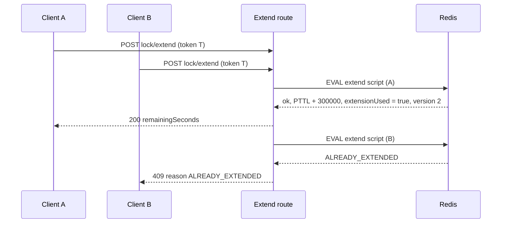

# Seat Hold Lease Extension API

## Overview

The Seat Hold Lease Extension endpoint allows an authenticated user to extend an existing seat reservation lock before it expires.

The endpoint validates both the lock owner and its fencing token. A lock can be extended only once, and the extension adds a fixed **300 seconds (5 minutes)** to its existing expiration time.

The implementation is located in:

- `src/app/api/venues/[venueId]/seats/[seatId]/lock/extend/route.ts`
- `src/lib/locks/seatHoldLock.ts`

## Endpoint

```http
POST /api/venues/{venueId}/seats/{seatId}/lock/extend
```

### Path Parameters

| Parameter | Type   | Required | Description                                           |
| --------- | ------ | -------- | ----------------------------------------------------- |
| `venueId` | string | Yes      | Identifier of the venue containing the seat.          |
| `seatId`  | string | Yes      | Identifier of the seat whose lock should be extended. |

## Authentication

The endpoint requires an authenticated Clerk session.

Authentication is performed server-side using Clerk's `auth()` function. Requests without an authenticated user receive `401 Unauthorized`.

The endpoint does not implement a separate Bearer-token parsing mechanism. The client must make the request with its authenticated Clerk session context.

## Request

### Headers

```http
Content-Type: application/json
```

Include the authenticated session context when making the request.

### Request Body

```json
{
  "token": "your-seat-hold-fencing-token"
}
```

| Field   | Type   | Required | Description                                               |
| ------- | ------ | -------- | --------------------------------------------------------- |
| `token` | string | Yes      | The fencing token associated with the existing seat lock. |

The route trims the supplied token and rejects missing, non-string, or empty values.

**Important:** The request field is named `token`, not `fencingToken`. The endpoint does not accept client-supplied extension durations or client IDs.

## Redis Key and TTL

When Redis is available, each hold is one JSON string under this key:

```text
seat:hold:{venueId}:{seatId}
```

The key's TTL is the lease. A new hold starts at 300 seconds. The extension script reads `PTTL`, adds 300,000 ms and writes the value back with `SET ... PX`, so the key TTL and the stored `expiresAt` move together. When the key expires, the hold is gone and the next extension returns `NOT_FOUND`.

The route does not rely on a client clock. `remainingSeconds` is computed on the server.

## Lease Extension Rules

The implementation enforces the following rules:

| Rule                         | Behavior                                                         |
| ---------------------------- | ---------------------------------------------------------------- |
| Extension duration           | Fixed at 300 seconds (5 minutes).                                |
| Minimum remaining lease time | More than 60 seconds must remain before expiration.              |
| Extension count              | Only one extension is allowed per lock.                          |
| Ownership validation         | The authenticated user must own the lock.                        |
| Fencing-token validation     | The supplied token must match the lock's existing fencing token. |
| Expired lock                 | An expired or missing lock cannot be extended.                   |

The extension adds 300,000 milliseconds to the existing `expiresAt` value. It does not replace the existing fencing token.

A successful extension also marks the lock as extended and increments its version.

## Successful Response

**HTTP 200 OK**

Example:

```json
{
  "success": true,
  "lock": {
    "userId": "user_123",
    "fencingToken": "12345",
    "expiresAt": 1790000000000,
    "extensionUsed": true,
    "version": 2
  },
  "remainingSeconds": 300
}
```

The lock object above is illustrative. Actual fields and values depend on the lock returned by the implementation.

| Field              | Description                                                                     |
| ------------------ | ------------------------------------------------------------------------------- |
| `success`          | Indicates that the extension succeeded.                                         |
| `lock`             | Updated seat-lock data, including its expiration and fencing-token information. |
| `remainingSeconds` | Remaining lease duration after the extension, rounded up to seconds.            |

## Error Responses

The endpoint uses the following HTTP status mappings.

### 400 Bad Request — Missing or Invalid Token

Returned when the request body does not contain a non-empty string `token`.

```json
{
  "success": false,
  "error": "A seat-hold fencing token is required.",
  "code": "INVALID_INPUT"
}
```

### 401 Unauthorized — Authentication Required

Returned when Clerk authentication does not provide a valid user ID.

```json
{
  "success": false,
  "error": "Unauthorized",
  "code": "UNAUTHORIZED"
}
```

### 403 Forbidden — Lock Ownership or Token Mismatch

Returned when the authenticated user does not own the lock or the supplied fencing token does not match.

```json
{
  "success": false,
  "error": "SEAT_HOLD_EXTENSION_REJECTED",
  "code": "FORBIDDEN",
  "reason": "UNAUTHORIZED"
}
```

### 404 Not Found — Lock Does Not Exist or Has Expired

Returned when the requested lock is missing or has already expired.

```json
{
  "success": false,
  "error": "SEAT_HOLD_EXTENSION_REJECTED",
  "code": "CONFLICT",
  "reason": "NOT_FOUND"
}
```

### 409 Conflict — Extension Rejected

Returned when the lock cannot be extended because of its current state.

Possible reasons include:

| Reason                | Description                                        |
| --------------------- | -------------------------------------------------- |
| `ALREADY_EXTENDED`    | The lock has already used its permitted extension. |
| `TOO_CLOSE_TO_EXPIRY` | The remaining lease time is 60 seconds or less.    |
| `INVALID_LOCK`        | The stored lock data could not be validated.       |

Example:

```json
{
  "success": false,
  "error": "SEAT_HOLD_EXTENSION_REJECTED",
  "code": "CONFLICT",
  "reason": "ALREADY_EXTENDED"
}
```

When available, the response may also include `remainingSeconds`.

### 500 Internal Server Error — Extension Failure

Returned when the lock-extension operation encounters an internal error, such as a Redis operation failure.

```json
{
  "success": false,
  "error": "SEAT_HOLD_EXTENSION_REJECTED",
  "code": "CONFLICT",
  "reason": "ERROR"
}
```

### Where the issue's error list differs from the code

| Issue says | Code does |
| --- | --- |
| 404 seat not held | Matches. The body has `code: "CONFLICT"`, not `NOT_FOUND`. |
| 409 lock expired or held by another peer | Expired is a 404. A different owner or wrong token is a 403. 409 covers `ALREADY_EXTENDED`, `TOO_CLOSE_TO_EXPIRY` and `INVALID_LOCK`. |
| 429 extension limit reached | The limit is one extension, and reaching it returns 409 `ALREADY_EXTENDED`. |
| Max 3 extensions | One extension per lock. |

**429 Too Many Requests:** The endpoint does not currently implement an endpoint-specific `429` response or rate-limit handling.

## Client Examples

### JavaScript Fetch

```javascript
async function extendSeatHold(venueId, seatId, fencingToken) {
  const response = await fetch(
    `/api/venues/${venueId}/seats/${seatId}/lock/extend`,
    {
      method: "POST",
      headers: {
        "Content-Type": "application/json",
      },
      body: JSON.stringify({
        token: fencingToken,
      }),
    },
  );

  const result = await response.json();

  if (!response.ok) {
    throw new Error(
      `Seat hold extension failed (${response.status}): ${
        result.reason || result.error
      }`,
    );
  }

  return result;
}
```

This example assumes the request is made in the application's authenticated Clerk session context.

### TypeScript

```typescript
type SeatHoldLock = {
  venueId: string;
  seatId: string;
  userId: string;
  heldAt: number;
  expiresAt: number;
  version: number;
  fencingToken?: string;
  extensionUsed?: boolean;
};

type ExtendResult =
  | { success: true; lock: SeatHoldLock; remainingSeconds: number }
  | {
      success: false;
      error: string;
      code?: string;
      reason?:
        | "NOT_FOUND"
        | "UNAUTHORIZED"
        | "ALREADY_EXTENDED"
        | "TOO_CLOSE_TO_EXPIRY"
        | "INVALID_LOCK"
        | "ERROR";
      remainingSeconds?: number;
    };

export async function extendSeatHold(
  venueId: string,
  seatId: string,
  token: string,
): Promise<ExtendResult> {
  const res = await fetch(
    `/api/venues/${encodeURIComponent(venueId)}/seats/${encodeURIComponent(seatId)}/lock/extend`,
    {
      method: "POST",
      headers: { "Content-Type": "application/json" },
      body: JSON.stringify({ token }),
    },
  );
  return (await res.json()) as ExtendResult;
}

// Usage: stop offering the button once the single extension is spent.
const result = await extendSeatHold("venue_123", "seat_456", token);
if (!result.success && result.reason === "ALREADY_EXTENDED") {
  // Show the final countdown, do not retry.
}
```

Do not retry `ALREADY_EXTENDED`, `UNAUTHORIZED` or `NOT_FOUND`. They will not succeed on a second try.

### cURL

```bash
curl -X POST \
  "http://localhost:3000/api/venues/venue_123/seats/seat_456/lock/extend" \
  -H "Content-Type: application/json" \
  -b "your-authenticated-session-cookies" \
  -d '{
    "token": "your-seat-hold-fencing-token"
  }'
```

Replace the example identifiers and session cookies with valid values from your application environment.

## Concurrency Sequence

Two tabs of the same user send an extension at nearly the same time. The Lua script runs atomically in Redis, so only one request can see `extensionUsed` as false.



A stale or foreign holder is rejected the same way, with a 403, because the script compares both `userId` and `fencingToken` before touching the key.

## Fencing Tokens and Lock Safety

A fencing token identifies the generation of a lock and helps prevent stale lock holders from performing operations after ownership has changed.

The seat-lock implementation obtains fencing tokens through its quorum fencing-token mechanism during lock acquisition.

During lease extension:

1. The authenticated user is identified.
2. The existing lock is retrieved.
3. The supplied token is compared with the token stored in that lock.
4. The extension is rejected if ownership or token validation fails.
5. On success, the expiration is increased by 300 seconds while the existing fencing token is retained.

**An extension does not generate a new fencing token.** It validates and preserves the token associated with the existing lock.

For additional background on Redlock, quorum-based token generation, monotonic fencing tokens, atomic Redis operations, and storage-layer enforcement, see:

[`docs/architecture/distributed-locks-and-fencing.md`](../architecture/distributed-locks-and-fencing.md).

## Storage and Atomicity

The extension implementation supports two storage paths:

### Redis-backed Lock Storage

When Redis is available, the extension uses the `SEAT_LOCK_EXTEND_LUA` Lua script to perform the lock validation and update atomically.

The operation checks the existing lock state and validates the owner, fencing token, extension eligibility, and remaining lease time before updating the expiration.

If the Redis operation throws an error, the extension returns an internal failure. It does not silently retry the operation using the in-memory store.

### In-Memory Lock Storage

When a Redis client is unavailable, the implementation uses its in-memory lock store.

The in-memory path performs the same essential ownership, fencing-token, expiration, and one-extension checks before updating the lock.

This fallback is process-local and should not be treated as shared distributed storage across multiple application instances.

## Implementation References

| File                                                               | Responsibility                                                                  |
| ------------------------------------------------------------------ | ------------------------------------------------------------------------------- |
| `src/app/api/venues/[venueId]/seats/[seatId]/lock/extend/route.ts` | HTTP endpoint, authentication, request validation, and response mapping.        |
| `src/lib/locks/seatHoldLock.ts`                                    | Lock validation, fencing-token checks, lease extension, and storage operations. |
| `src/lib/apiResponse.ts`                                           | Standardized API error response construction.                                   |
| `src/__tests__/lib/seatHoldLeaseExtension.test.ts`                 | Seat-hold lease extension tests.                                                |
| `docs/architecture/distributed-locks-and-fencing.md`               | Distributed locking and fencing-token architecture.                             |
