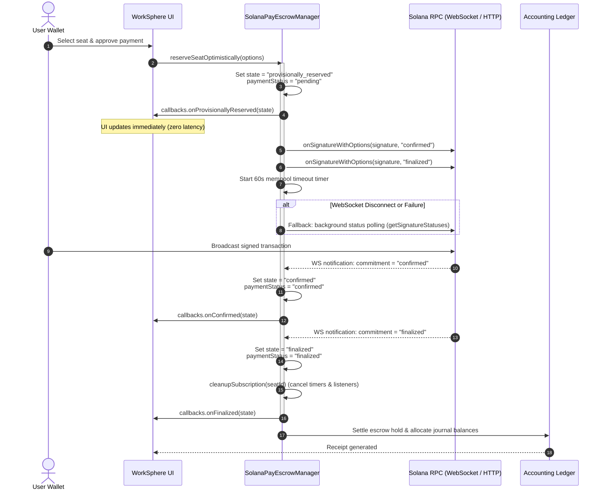
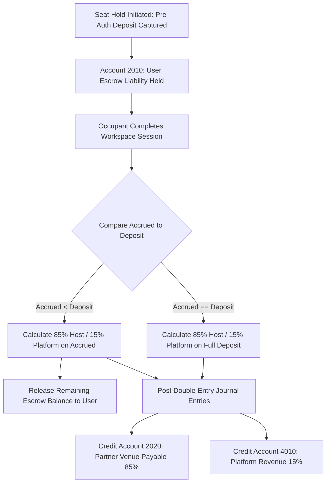
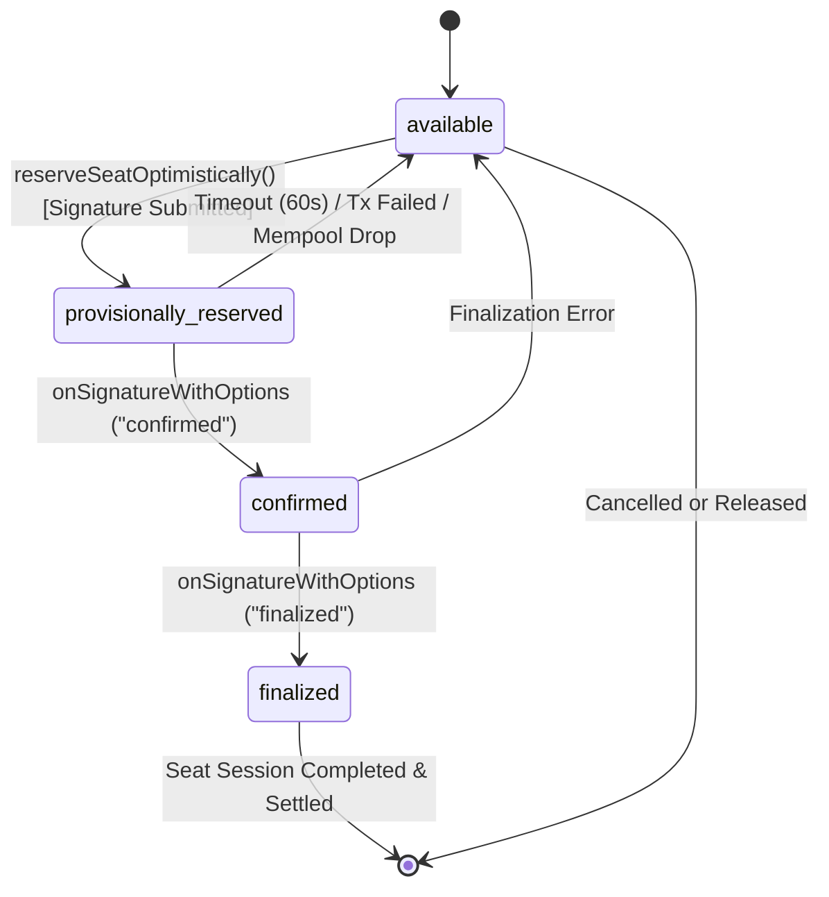

# Solana Pay Micro-Transaction Escrow Settlement Flow

## 1. Overview and Architecture

WorkSphere incorporates **Solana Pay** to enable real-time, low-fee, high-throughput micro-transactions for workspace reservations, quiet phone booths, and seat-hold deposits. In traditional booking systems, credit card pre-authorizations incur significant percentage interchange fees and fixed processing charges on small balances (such as a $\$3.00$ or $\$10.00$ seat hold). With Solana Pay and SPL-Token (primarily USDC), transaction processing costs fall below $\$0.0005$, and confirmation finality completes in under a second.

The escrow settlement architecture bridges:
1. **Solana Pay Protocol:** Encodes recipient public keys, transfer amounts, token mints, and unique reference public keys into standardized URIs and QR codes (`solana:<recipient>?...`).
2. **Optimistic Escrow State Machine:** Tracks seat reservations through optimistic lock acquisition (`provisionally_reserved`) upon transaction signature submission, followed by cluster confirmation (`confirmed`) and BFT finality (`finalized`), with automatic rollback (`available`) on timeout or failure.
3. **Multi-Rail Settlement Accounting:** Integrates with WorkSphere's double-entry general ledger to record user escrow deposits, distribute partner venue host payouts ($85\%$), credit platform micro-billing revenue ($15\%$), and release refundable deposit holds.

### 1.1 Architecture & Component Boundaries

```mermaid
flowchart TD
    subgraph ClientLayer ["Client Layer"]
        User["Student / Nomad User"]
        Wallet["Solana Mobile Wallet (Phantom / Solflare / Backpack)"]
        UI["WorkSphere Web App (MultiCurrencyDeskCheckout / SolanaPayModal)"]
    end

    subgraph ServiceLayer ["WorkSphere Application Services"]
        EscrowMgr["SolanaPayEscrowManager (src/lib/solana/solanaPayEscrow.ts)"]
        SolanaPayLib["Solana Pay Engine (src/lib/payments/solanaPay.ts)"]
        RpcPool["SolanaRpcConnectionPool (Failover & Jittered Backoff)"]
        StatusApi["Polling Status API (/api/payments/solana/status)"]
        Ledger["Double-Entry Micro-Payment Engine (microPaymentEngine.ts)"]
    end

    subgraph BlockchainLayer ["Solana Network Layer"]
        RpcNode["Solana RPC Cluster (WebSocket + HTTP)"]
        Mempool["Validator Gossip / Mempool"]
        LedgerChain["On-Chain Ledger & SPL-Token State"]
    end

    subgraph PartnerLayer ["Settlement & Distribution"]
        HostTreasury["Partner Venue Host Wallet (85%)"]
        PlatformTreasury["WorkSphere Platform Treasury (15%)"]
    end

    User -->|Selects Desk & Solana Pay| UI
    UI -->|Generates Reference & URI| SolanaPayLib
    UI -->|Displays QR / Deeplink| User
    User -->|Scans QR & Signs Tx| Wallet
    Wallet -->|Broadcasts Signed Tx| Mempool
    Mempool --> RpcNode

    UI -->|reserveSeatOptimistically()| EscrowMgr
    EscrowMgr -->|1. Optimistic Lock: provisionally_reserved| UI
    EscrowMgr -->|2. onSignatureWithOptions WS Sub| RpcNode
    EscrowMgr -.->|Fallback Polling (if WS fails)| RpcPool
    RpcPool -->|getSignatureStatuses| RpcNode

    RpcNode -->|Slot Commit: confirmed| EscrowMgr
    EscrowMgr -->|Transition: confirmed| UI
    RpcNode -->|Cluster Finality: finalized| EscrowMgr
    EscrowMgr -->|Transition: finalized & Cleanup| UI

    EscrowMgr -->|Trigger Final Settlement| Ledger
    Ledger -->|Post Journal Entries| HostTreasury
    Ledger -->|Post Journal Entries| PlatformTreasury
```

### 1.2 Actors and Responsibilities

| Actor | Layer | Responsibilities |
| :--- | :--- | :--- |
| **User (Customer / Student)** | Client | Selects workspace amenity, initiates hold, scans QR code, and approves transaction signature. |
| **Solana Wallet** | Client | Parses standard `solana:` URI, attaches reference public key as an extra uncredited signer/read-only account, signs and broadcasts transaction. |
| **WorkSphere Web Client** | Frontend | Renders QR payload, displays optimistic provisional reservation, handles live callback transitions. |
| **`SolanaPayEscrowManager`** | Backend/Core | In-memory singleton managing reservation state transitions, WebSocket subscriptions, fallback polling loops, timeout sweeps, and rollbacks. |
| **`SolanaRpcConnectionPool`** | Infrastructure | Manages multi-endpoint RPC failover, exponential backoff with random jitter, and retryable HTTP status classification. |
| **Solana RPC Cluster** | Network | Validates transaction, includes transaction in blocks, dispatches WebSocket commitment notifications (`confirmed`, `finalized`). |
| **Partner Venue Host** | Settlement | Receives host share ($85\%$) upon successful seat session completion. |
| **WorkSphere Platform** | Settlement | Collects platform take-rate fee ($15\%$) and reconciles nightly audit journals. |

---

## 2. Solana Pay Reference and QR Code Generation

### 2.1 Standard Merchant URI Scheme

Solana Pay requests follow the official specification implemented in [`src/lib/payments/solanaPay.ts`](file:///C:/Users/Saransh%20Kashyap/WorkSphere-9343-worktree/src/lib/payments/solanaPay.ts).

The URI syntax is formatted as:
```text
solana:<recipient>?amount=<amount>&spl-token=<splToken>&reference=<reference>&label=<label>&message=<message>&memo=<memo>
```

#### Field Specifications:

| Parameter | Type | Required | Default Value in Implementation | Purpose |
| :--- | :--- | :--- | :--- | :--- |
| `recipient` | Base58 String | **Yes** | `WorkSpHere5oLanaPayUSDC111111111111111111111` | Treasury or merchant destination public key receiving funds. |
| `amount` | Decimal String | **Yes** | N/A | Total transfer formatted to 2 decimal places (e.g. `10.00`). |
| `spl-token` | Base58 String | **Yes** | `EPjFWdd5AufqSSqeM2qN1xzybapC8G4wEGGkZwyTDt1v` | SPL-Token mint address for mainnet USDC. |
| `reference` | Base58 / Identifier | Optional | `tx_sol_<timestamp>_<random>` | Unique tracking key indexed in transaction account keys. |
| `label` | String (Encoded) | Optional | `WorkSphere Desk Booking` | Merchant identity displayed in wallet UI. |
| `message` | String (Encoded) | Optional | `Desk Booking at <VenueName>` | Itemized description shown on user approval screen. |
| `memo` | String (Encoded) | Optional | `booking_<id>` | On-chain memo instruction logged to the transaction history. |

### 2.2 Reference Key Uniqueness and Account Association

To match incoming blockchain transactions to a specific seat hold without querying user wallet addresses in advance:
1. A unique reference string or ephemeral public key is created via `generateSolanaPaymentReference()`:
   $$\text{reference} = \text{"tx\_sol\_"} + \text{Date.now()} + \text{"\_"} + \text{Math.random().toString(36).substring(2, 9)}$$
2. In on-chain Solana Pay transactions, the reference public key is added as a non-signing, non-writable account key.
3. This allows backend nodes and indexers to locate the exact transaction using `getSignaturesForAddress(referencePublicKey)` or `getSignatureStatuses([signature])`.

### 2.3 QR Code Rendering

The client encodes the URI string output of `createSolanaPayUrl(params)` directly into an SVG/canvas QR code. When scanned by Phantom or Solflare, the wallet resolves the SPL-Token mint, validates the recipient, appends the reference account, and prompts for biometric or passcode authorization.

---

## 3. End-to-End Deposit Verification Flow



### 3.1 Verification Steps in Code

When `reserveSeatOptimistically(options)` is invoked:
1. **Input Validation:** Enforces non-empty strings for `seatId`, `venueId`, `signature`, and `payerWallet`.
2. **Anti-Spam Proof-of-Work (PoW):** If `powSubmission` is passed, it is evaluated via `ProofOfWorkValidator.validate(submission)`. If invalid, an error is thrown immediately.
3. **Collision Detection:** Checks if `seatId` is already held in `provisionally_reserved`, `confirmed`, or `finalized` states. If held with a different signature, it rejects the request:
   $$\text{Error: Seat } X \text{ is already } S \text{. Cannot override with new reservation.}$$
4. **Optimistic Transition:** Emits `provisionally_reserved` and dispatches `onProvisionallyReserved` and `onStateChange` callbacks.
5. **Subscription Initialization:** Binds WebSocket listeners for `confirmed` and `finalized` events, starting a 60-second mempool expiry timer.
6. **Error / Drop Handling:** If on-chain execution reports an error (`notification.err`), or if the timer expires without cluster confirmation, `rollback(seatId, reason, status)` restores the seat to `available`.

---

## 4. WebSocket Confirmation, Polling Fallbacks, and Commitment Levels

### 4.1 Solana Commitment Levels

Solana transactions progress through three commitment stages:

| Commitment Level | Cluster Confirmation | Finality Guarantee | WorkSphere State |
| :--- | :--- | :--- | :--- |
| `processed` | Single leader node has processed the transaction. | **Low:** Slot may be skipped or re-organized. | *Ignored by Escrow Manager.* |
| `confirmed` | Voted on by a supermajority ($> 66.6\%$) of cluster stake. | **High:** Rollback risk is minimal, suitable for user UI feedback. | `confirmed` / `paymentStatus: "confirmed"` |
| `finalized` | Rooted in the blockchain with 31+ confirmed blocks built on top. | **Absolute:** Irreversible; safe for physical turnstile unlocks and financial settlement. | `finalized` / `paymentStatus: "finalized"` |

### 4.2 Dual-Listener Lifecycle & Degradation Handling

`SolanaPayEscrowManager` implements robust WebSocket tracking with an automatic failover to background HTTP polling:

1. **Dual Registration:** Registers two concurrent listeners via `connection.onSignatureWithOptions`:
   - One for `{ commitment: "confirmed" }`.
   - One for `{ commitment: "finalized" }`.
2. **Disconnection Listeners:** Attaches listeners to `_onSubscriptionStateChange` and connection socket events (`close`, `error`, `disconnect`).
3. **Degraded RPC Fallback:** If either subscription errors out, drops to `pending`, or fails to register initially, `triggerFallbackPolling()` starts background HTTP polling via `scheduleNextPoll()`.
4. **Polling Implementation:** Queries `connection.getSignatureStatuses([signature], { searchTransactionHistory: true })` every `DEFAULT_POLL_INTERVAL_MS` (2,000 ms).
5. **RPC Connection Pool Failover:** When using `verifySolanaPayment()`, network requests rotate across `SolanaRpcConnectionPool`, utilizing exponential backoff ($250\text{ ms} \times 2^{\text{attempt}}$ with 20% jitter) and failing over to secondary RPC endpoints on HTTP 429/502/503/504 errors.

---

## 5. Multi-Rail Settlement Split

Upon seat-hold completion or checkout, accrued micro-billing balances are settled against partner venues and platform revenue in accordance with WorkSphere's double-entry accounting specifications ([`docs/architecture/micro-payments-multi-rail-settlement.md`](file:///C:/Users/Saransh%20Kashyap/WorkSphere-9343-worktree/docs/architecture/micro-payments-multi-rail-settlement.md)).

### 5.1 Fee Breakdown Table

| Component | Share | Formula / Amount | Eligible Release Trigger |
| :--- | :--- | :--- | :--- |
| **Partner Venue Host Payout** | **$85\%$** | $\text{HostShare} = \text{SessionTotal} \times 0.85$ | Released to venue accounts payable upon checkout or session end. |
| **WorkSphere Platform Fee** | **$15\%$** | $\text{PlatformFee} = \text{SessionTotal} \times 0.15$ | Recognized as platform micro-billing revenue upon checkout. |
| **Refundable Seat-Hold Deposit** | **$100\%$ of unused** | $\text{Refund} = \text{DepositHold} - \text{SessionTotal}$ | Unlocked or credited back if session cost is less than pre-auth hold. |
| **Network Transaction Fee** | Fixed gas | $\approx \$0.00025$ ($\approx 5,000\text{ lamports}$) | Debited to Network Gas Expense upon on-chain transfer. |

### 5.2 Settlement Flowchart



---

## 6. Dispute Timeouts and Automated Expiration Sweeps

### 6.1 Mempool Confirmation Timeout (60 Seconds)

In [`solanaPayEscrow.ts`](file:///C:/Users/Saransh%20Kashyap/WorkSphere-9343-worktree/src/lib/solana/solanaPayEscrow.ts), the default timeout for transaction confirmation is:
$$\text{DEFAULT\_CONFIRMATION\_TIMEOUT\_MS} = 60,000\text{ ms (60 seconds)}$$

- **Condition:** If the transaction signature does not reach `confirmed` or `finalized` within 60 seconds (or is dropped from validator memory pools during congestion), the timer triggers.
- **Rollback Action:** Invokes `rollback(seatId, reason, "timeout")`.
- **State Result:**
  - `state` resets to `"available"`.
  - `paymentStatus` sets to `"timeout"`.
  - Active WebSocket listeners, timeout timers, and polling loops are cleaned up via `cleanupSubscription(seatId)`.
  - User callbacks `onError`, `onRollback`, and `onStateChange` receive the failure notification.

### 6.2 Seat-Hold Lease Expiration (5 Minutes)

In [`solanaPay.ts`](file:///C:/Users/Saransh%20Kashyap/WorkSphere-9343-worktree/src/lib/payments/solanaPay.ts), the transaction reference and blockhash validity window is defined as:
$$\text{SOLANA\_PAY\_DEFAULT\_TIMEOUT\_MS} = 300,000\text{ ms (5 minutes)}$$

- Evaluated via `isSolanaPaymentExpired(createdAt, timeoutMs, now)`.
- Client polling calls (`pollPaymentStatus`) return status `"EXPIRED"` with `"Transaction expired. Please generate a new QR code."` once this TTL is exceeded.

### 6.3 State Lifecycle Transition Matrix



---

## 7. Error Codes and Edge Cases

The following table documents all runtime error conditions, triggers, system behaviors, and safety guarantees present in `solanaPayEscrow.ts` and `solanaPay.ts`:

| Error Condition / Trigger | Triggering Code Location | System Behavior | Recovery & Safety |
| :--- | :--- | :--- | :--- |
| **Missing Required Field** (`seatId`, `venueId`, `signature`, `payerWallet`) | `reserveSeatOptimistically()` | Throws `Error("<field> is required")` synchronously. | Safe: No reservation state created; seat remains in previous state. |
| **Anti-Spam PoW Failure** | `validatePoW(powSubmission)` | Throws `"Invalid Proof-of-Work: anti-spam challenge validation failed"`. | Safe: Rejects spam reservation attempts before allocating state. |
| **Seat Already Reserved** | `this.reservations.get(seatId)` | Throws `"Seat <id> is already <state>. Cannot override..."`. | Safe: Prevents race-condition double-booking across competing users. |
| **On-Chain Execution Error** (`notification.err`) | WebSocket callback / status poll | Invokes `rollback(seatId, reason, "failed")`. | Safe: Reverts seat to `available`; notifies client UI with on-chain error message. |
| **Mempool Timeout (60s)** | `subRecord.timeoutTimer` | Invokes `rollback(seatId, reason, "timeout")`. | Safe: Reverts seat to `available`; cleans up all active listeners. |
| **WebSocket Connection Drop** | `_onSubscriptionStateChange` or socket `close` / `error` | Triggers `scheduleNextPoll()` fallback. | Safe: Reservation remains active; tracking transparently continues over HTTP RPC. |
| **RPC Pool Failure** (`SolanaRpcFailoverError`) | `pool.execute()` | Retries with backoff across all configured RPC endpoints; throws if all fail. | Safe: Payment remains in `pending`; avoids incorrectly marking valid payment as failed. |
| **Malformed Signature** | `verifySolanaPayment()` | Returns `{ status: "FAILED", error: "Invalid transaction signature" }`. | Safe: Rejects malformed Base58 strings before executing RPC queries. |
| **Relayer Fee Exceeded** | `validateRelayFeeLamports()` | Throws `RangeError("Transaction fee exceeds the relayer limit")`. | Safe: Prevents relayer wallet depletion during priority-fee spikes. |
| **Payment TTL Expired (5m)** | `pollPaymentStatus()` | Returns `{ status: "EXPIRED", message: "Transaction expired..." }`. | Safe: Instructs client to generate fresh blockhash and QR code. |

---

## 8. Security and Operational Considerations

1. **Transaction Reference Uniqueness:** Each seat reservation creates a distinct, time-bound reference key. Wallets attach this key as a non-signing read-only account, making transaction lookups collision-free.
2. **Commitment Enforcements:** WorkSphere clearly differentiates between `confirmed` (used for optimistic UI display) and `finalized` (required before turning on hardware turnstiles, unlocking physical desks, or executing irreversible ledger splits).
3. **Double-Spend & Replay Protection:** Once a seat enters `provisionally_reserved`, duplicate calls for the same seat with different signatures are blocked.
4. **Idempotent Settlement:** Ledger journal entries for multi-rail micro-payments use deterministic idempotency keys (`ik_settle_<sessionId>_<hash>`) stored in Redis with distributed mutex locks.
5. **No Secret Key Exposure:** The escrow manager and Solana Pay helpers operate entirely via public keys, signatures, and client-submitted transactions; private keys are never handled by the frontend or API servers.

---

## 9. Developer Integration Examples

### 9.1 Creating a Seat-Hold Payment Request

```typescript
import { createSolanaPayUrl, generateSolanaPaymentReference } from "@/lib/payments/solanaPay";

// Generate unique payment reference and Solana Pay URI
const reference = generateSolanaPaymentReference();
const solanaPayUri = createSolanaPayUrl({
  recipient: "WorkSpHere5oLanaPayUSDC111111111111111111111",
  amount: 10.00, // $10.00 USDC deposit hold
  reference,
  label: "WorkSphere Desk Hold",
  message: "Desk Reservation - SoMa Focus Hub",
  memo: "seat_hold_desk_12b",
});

// Render solanaPayUri as a QR code or mobile deeplink
console.log("Solana Pay URI:", solanaPayUri);
```

### 9.2 Optimistically Reserving a Seat with Live Tracking

```typescript
import { Connection } from "@solana/web3.js";
import {
  reserveSeatOptimistically,
  type SeatReservationState,
} from "@/lib/solana/solanaPayEscrow";

const connection = new Connection("https://api.mainnet-beta.solana.com", "confirmed");

const reservation = await reserveSeatOptimistically({
  connection,
  seatId: "seat_sf_desk_12b",
  venueId: "venue_soma_hub",
  signature: "5K2xMockTxSignatureGeneratedByWallet111111111111111",
  payerWallet: "7xKXtg2CW87d97TXJSDpbD5jBkheTqA83TZRuJosgAsU",
  amount: 10.00,
  currency: "USDC",
  timeoutMs: 60_000,
  confirmationMode: "websocket", // Automatically falls back to polling if RPC drops WS
  callbacks: {
    onProvisionallyReserved: (state: SeatReservationState) => {
      console.log("Seat optimistically held:", state.seatId);
    },
    onConfirmed: (state: SeatReservationState) => {
      console.log("Transaction confirmed in slot:", state.slot);
    },
    onFinalized: (state: SeatReservationState) => {
      console.log("Transaction finalized! Unlock turnstile for:", state.seatId);
    },
    onError: (error: Error, state: SeatReservationState) => {
      console.error("Reservation failed:", error.message);
    },
    onRollback: (reason: string, state: SeatReservationState) => {
      console.warn("Reservation rolled back to available:", reason);
    },
  },
});
```

### 9.3 Manual Rollback Handling

```typescript
import { rollbackSeatReservation } from "@/lib/solana/solanaPayEscrow";

// Manually cancel and roll back reservation on user exit
rollbackSeatReservation(
  "seat_sf_desk_12b",
  "User abandoned checkout",
  "failed"
);
```
