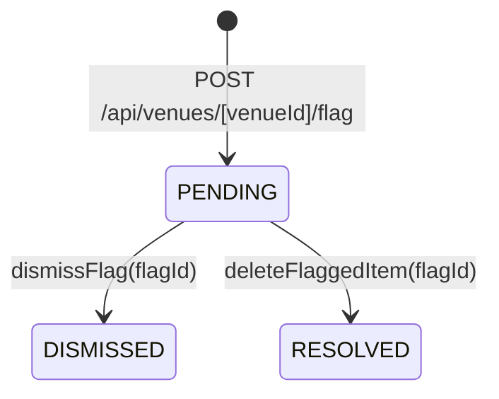

# Venue Flagging API

## Endpoint

`POST /api/venues/{venueId}/flag`

This endpoint submits a venue issue report. Requests require authentication.

## Request body

```json
{
  "reason": "permanently_closed"
}
```

The `reason` field must be a string containing between **10 and 500 characters**,
inclusive.

Valid reasons remain limited to the established venue flagging reason contract:

- `permanently_closed`
- `wrong_hours`
- `no_wifi`
- `wrong_address`
- `duplicate`
- `other`

## Reason length validation

Before a venue flag is created, the API validates the character length of
`reason`.

- Reasons shorter than 10 characters are rejected.
- Reasons longer than 500 characters are rejected.
- The endpoint returns HTTP `400` for either length violation.
- Valid values are at least 10 characters and no more than 500 characters.

The validation occurs before venue lookup and flag persistence, so an
invalid-length reason does not create a `FlaggedItem` record.

## HTTP 400 validation response

Validation failures use the standard API error structure:

```json
{
  "success": false,
  "error": "Reason must be at least 10 characters",
  "code": "VALIDATION_FAILED",
  "details": {
    "reason": ["Reason must be at least 10 characters"]
  }
}
```

For a reason that exceeds the maximum, `error` and the `reason` detail entry
describe the 500-character maximum instead.

## Invalid reason length example

The following request contains fewer than 10 characters:

```bash
curl -X POST "https://<host>/api/venues/venue-123/flag" \
  -H "Authorization: Bearer <access-token>" \
  -H "Content-Type: application/json" \
  -d '{
    "reason": "Too short"
  }'
```

`Too short` is 9 characters, so the API responds with HTTP `400`:
The selected reason must contain at least five non-whitespace characters
before it can be accepted as a known reason. Because the server validates the
reason against the enum as well, arbitrary free-form reasons are rejected.
The optional details field is trimmed before persistence.

### Example

```bash
curl -X POST "https://<host>/api/venues/<venueId>/flag" \
  -H "Content-Type: application/json" \
  -H "Cookie: <authenticated-session-cookie>" \
  --data '{"reason":"wrong_hours","details":"The posted closing time is incorrect."}'
```

A successful request returns:

```json
{
  "message": "Report submitted. Thank you for your feedback!"
}
```

The response is HTTP 200. If the same authenticated user has already
submitted a pending flag for the same venue and reason, the request is
idempotently acknowledged with HTTP 200:

```json
{
  "message": "You have already reported this issue."
}
```

## Rate limiting

The current implementation enforces **5 reports per authenticated user per
hour** using the key `venue-flag:{userId}` and a 3,600,000 ms window. A
request over the limit receives HTTP 429:

```json
{
  "success": false,
  "error": "Too many reports. Please try again later.",
  "code": "RATE_LIMITED"
}
```

This is the implemented limit in
`src/app/api/venues/[venueId]/flag/route.ts`. Do not substitute a different
limit in client copy or external API documentation without changing the
server policy and its tests together.

## Response codes

| HTTP | Code | Meaning |
| ---: | --- | --- |
| 200 | — | Flag accepted, or an existing pending flag was found. |
| 400 | `VALIDATION_FAILED` | Invalid JSON or invalid/missing reason. |
| 401 | `UNAUTHORIZED` | No authenticated session. |
| 404 | `VENUE_NOT_FOUND` | No venue matches the supplied ID. |
| 429 | `RATE_LIMITED` | The user's hourly flagging quota is exhausted. |
| 500 | `INTERNAL_ERROR` | Unexpected route or persistence failure. |

Errors use the shared `apiError` format:

```json
{
  "success": false,
  "error": "Reason must be at least 10 characters",
  "code": "VALIDATION_FAILED",
  "details": {
    "reason": ["Reason must be at least 10 characters"]
  }
}
```
  "error": "Unauthorized",
  "code": "UNAUTHORIZED"
}
```

For validation failures, the middleware may also include a `details` object
containing field-level messages.

## Prisma persistence schema

Venue and review flags are persisted in PostgreSQL via the `FlaggedItem` model in
[`prisma/schema.prisma`](../../prisma/schema.prisma):

```prisma
enum FlagType {
  VENUE
  REVIEW
}

enum FlagStatus {
  PENDING
  DISMISSED
  RESOLVED
}

model FlaggedItem {
  id           String     @id @default(cuid())
  type         FlagType
  itemId       String
  reason       String
  details      String?
  status       FlagStatus @default(PENDING)
  reportedById String
  reportedBy   User       @relation(fields: [reportedById], references: [id], onDelete: Cascade)
  createdAt    DateTime   @default(now())
  updatedAt    DateTime   @updatedAt

  @@index([status])
  @@index([itemId])
}
```

### Schema & indexing notes

- **Polymorphic target (`type`, `itemId`)**: Prisma does not enforce a foreign-key relation on `itemId` because `FlaggedItem` references either `Venue.id` (`type: "VENUE"`) or `VenueRating.id` (`type: "REVIEW"`). `POST /api/venues/{venueId}/flag` always verifies that `prisma.venue.findUnique({ where: { id: venueId } })` exists before inserting, and writes `type: "VENUE"`.
- **Reporter cascade (`reportedBy`, `reportedById`)**: Linked to `User.id` with `onDelete: Cascade`, cleaning up flags if a reporter account is deleted.
- **Deduplication lookup**: Before inserting, the route checks `prisma.flaggedItem.findFirst({ where: { itemId: venueId, reportedById: userId, reason, status: "PENDING" } })`. Filtering on `status: "PENDING"` prevents duplicate active tickets for the same `(venueId, userId, reason)` tuple while still allowing a user to submit a fresh report if a previous ticket was already `DISMISSED` or `RESOLVED`.
- **Indexes**: `@@index([status])` accelerates the admin moderation queue (`where: { status: "PENDING" }`), and `@@index([itemId])` supports per-venue/per-review lookups.
- **Cache invalidation**: After persisting a new `FlaggedItem`, the handler calls `invalidateVenueReviewsCache(venueId)`.

## Moderation status transitions

Moderation state changes are performed by authenticated administrators (`User.isAdmin === true`, verified via `verifyAdmin()`) in [`src/app/admin/actions.ts`](../../src/app/admin/actions.ts):



| Transition | Trigger / Server Action | Database & Side Effects | Audit Log (`AdminAuditLog`) |
| :--- | :--- | :--- | :--- |
| `[*] -> PENDING` | `POST /api/venues/[venueId]/flag` | Creates `FlaggedItem` with `status: PENDING` (default), `type: "VENUE"`, trimmed `reason`, optional trimmed `details`; calls `invalidateVenueReviewsCache(venueId)`. | — |
| `PENDING -> DISMISSED` | `dismissFlag(flagId)` | Updates `FlaggedItem.status` to `"DISMISSED"`; revalidates `/admin/feedback`. Leaves the target venue or review intact. | `action: "DISMISS_FLAG"`, `entityType: "FlaggedItem"`, `entityId: flagId` |
| `PENDING -> RESOLVED` | `deleteFlaggedItem(flagId)` | Runs inside `prisma.$transaction`: fetches `FlaggedItem`, deletes the target `Venue` (`type === "VENUE"`) or `VenueRating` (`type === "REVIEW"`), updates `FlaggedItem.status` to `"RESOLVED"`, and revalidates `/admin/feedback`. | `action: "DELETE_VENUE"` or `"DELETE_REVIEW"`, `entityType: "FlaggedItem"`, `entityId: flagId`, `details: {"itemIdDeleted": "..."}` |

### Admin queue hydration (`getPendingFlags`)

`getPendingFlags()` queries `prisma.flaggedItem.findMany({ where: { status: "PENDING" }, orderBy: { createdAt: "desc" } })` along with reporter metadata (`firstName`, `lastName`, `email`), then resolves `itemDetails` manually via `prisma.venue.findUnique` (`VENUE`) or `prisma.venueRating.findUnique` (`REVIEW`) because `itemId` is polymorphic.

## Moderation notifications

**No moderator webhook is dispatched by this route today.** There is therefore
no truthful outbound webhook payload schema to document yet. A webhook
contract should be added alongside an actual delivery mechanism (including
retry/idempotency behavior) before clients or moderators rely on it.

## Implementation references

- `src/app/api/venues/[venueId]/flag/route.ts`
- `src/app/admin/actions.ts`
- `prisma/schema.prisma`
- `src/lib/apiHandler.ts`
- `src/lib/apiResponse.ts`
- `src/lib/rateLimit.ts`
- `src/__tests__/api/venueFlag.test.ts`
