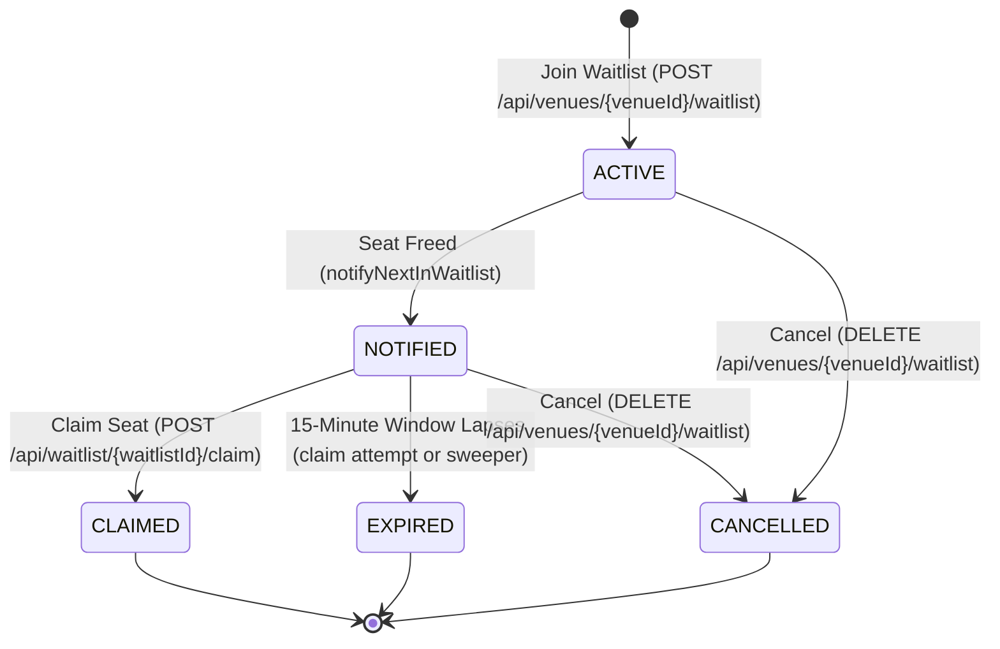

# Venue Waitlist and Seat Claim API Guide

Comprehensive technical API documentation for WorkSphere's venue seat waitlist and seat-claim endpoints. When popular workspace venues reach capacity, authenticated users can join a digital waitlist queue. When reservations are cancelled or desks are freed early, WorkSphere's automated waitlist promotion engine evaluates waiters in First-In-First-Out (FIFO) order, locks available seats, dispatches exclusive 15-minute claim offers, and atomically converts claimed offers into confirmed bookings.

---

## 1. Overview and Core Capabilities

The waitlist system is implemented across two Next.js App Router route handlers and a domain service:

- [`src/app/api/venues/[venueId]/waitlist/route.ts`](../../src/app/api/venues/[venueId]/waitlist/route.ts): Handles waitlist retrieval (`GET`), joining (`POST`), and cancellation (`DELETE`).
- [`src/app/api/waitlist/[waitlistId]/claim/route.ts`](../../src/app/api/waitlist/[waitlistId]/claim/route.ts): Handles atomic seat-claim conversion (`POST`).
- [`src/lib/waitlist/waitlistService.ts`](../../src/lib/waitlist/waitlistService.ts): Core domain logic, FIFO position calculation, preference matching, and serializable claim transactions.

### Key Capabilities

- **FIFO Queue Ordering**: Waitlist entries are ordered strictly by creation timestamp (`createdAt ASC`), ensuring fairness.
- **Dynamic Queue Positions**: Evaluates the user's exact 1-based position in line (`queuePosition`) and total active waiters (`totalInQueue`) for the target slot.
- **Timezone Normalization**: Validates dates (`YYYY-MM-DD`), normalizes 12-hour or 24-hour time strings (`HH:MM`), and resolves IANA timezones (falling back to `UTC`).
- **Seat Preference Filtering**: Supports optional preferences for desk types (`HOT_DESK`, `FIXED_DESK`, `MEETING_ROOM`, `PHONE_BOOTH`), specific seat IDs, quiet zones, and power outlets.
- **Idempotent Join Requests**: Submitting a waitlist request for a slot where the user already has an `ACTIVE` or `NOTIFIED` entry returns the existing record rather than creating a duplicate.
- **15-Minute Exclusive Claim Window**: When a seat opens, the leading candidate's entry transitions to `NOTIFIED` with a 15-minute expiration deadline (`claimExpiresAt`).
- **Serializable Claim Transactions**: Claims run under `Serializable` transaction isolation with row-level locks (`FOR UPDATE`) to eliminate double-booking race conditions.

---

## 2. Waitlist Status Lifecycle

Waitlist entries transition through five distinct states defined by the Prisma `WaitlistStatus` enum and TypeScript types ([`src/lib/waitlist/types.ts`](../../src/lib/waitlist/types.ts)):

| Status      |     Type     | Description                                                                                              |
| :---------- | :----------: | :------------------------------------------------------------------------------------------------------- |
| `ACTIVE`    |   Initial    | User is waiting in the FIFO queue for an available seat.                                                 |
| `NOTIFIED`  | Transitional | A seat has opened; an exclusive 15-minute claim offer window (`claimExpiresAt`) is active.               |
| `CLAIMED`   |   Terminal   | User successfully claimed the offer, atomically creating a `CONFIRMED` booking.                          |
| `EXPIRED`   |   Terminal   | The 15-minute claim window elapsed without being claimed; seat is handed off to the next waiter in line. |
| `CANCELLED` |   Terminal   | The user cancelled their waitlist entry via `DELETE`.                                                    |

### Lifecycle State Machine



---

## 3. Authentication and Common Error Envelope

All waitlist endpoints require an active user session authenticated via Clerk:

- If the request lacks an authenticated session (`!userId`), the route returns **HTTP 401 Unauthorized**.
- Standardized JSON error responses use the `apiError` envelope from [`src/lib/apiResponse.ts`](../../src/lib/apiResponse.ts):

```json
{
  "success": false,
  "error": "Error description message",
  "code": "ERROR_CODE"
}
```

---

## 4. Endpoint Reference

### A. GET `/api/venues/{venueId}/waitlist`

Retrieves the authenticated user's active waitlist entries for a specified venue.

#### Request Parameters

- **Path Parameters**:
  - `venueId` (`string`, required): Unique identifier (CUID) of the venue.

#### Behavior and Filtering

- Returns only entries where `status` is either `ACTIVE` or `NOTIFIED`.
- Results are ordered by `createdAt` in descending order (newest first).
- For each entry, the route dynamically computes:
  - `queuePosition`: The user's 1-based FIFO position among active waiters for that specific venue, date, and time.
  - `totalInQueue`: Total count of active/notified waiters for that slot.

#### Response (`200 OK`)

```json
{
  "success": true,
  "entries": [
    {
      "id": "cuid_waitlist_entry_1",
      "userId": "user_2abc",
      "venueId": "venue_123",
      "venueName": "Downtown Innovation Hub",
      "seatId": "seat_456",
      "seatNumber": "D-04",
      "seatType": "HOT_DESK",
      "date": "2026-11-25",
      "time": "09:00",
      "duration": 60,
      "timeZone": "America/New_York",
      "requiresQuiet": false,
      "requiresOutlets": true,
      "status": "ACTIVE",
      "queuePosition": 1,
      "totalInQueue": 3,
      "notifiedAt": null,
      "claimExpiresAt": null,
      "claimedAt": null,
      "createdAt": "2026-11-22T08:00:00.000Z",
      "updatedAt": "2026-11-22T08:00:00.000Z"
    }
  ]
}
```

#### `WaitlistEntry` Field Schema

| Field             | Type                 | Nullable / Optional | Description                                                                    |
| :---------------- | :------------------- | :-----------------: | :----------------------------------------------------------------------------- |
| `id`              | `string`             |         No          | Unique waitlist record identifier (CUID).                                      |
| `userId`          | `string`             |         No          | Clerk user ID of the waiter.                                                   |
| `venueId`         | `string`             |         No          | ID of the target workspace venue.                                              |
| `venueName`       | `string`             |      Optional       | Display name of the venue.                                                     |
| `seatId`          | `string`             | Nullable / Optional | Specific requested seat ID, if specified.                                      |
| `seatNumber`      | `string`             | Nullable / Optional | Assigned seat designation (e.g. `"A-01"`), if resolved.                        |
| `seatType`        | `SeatTypePreference` | Nullable / Optional | Preferred desk type (`HOT_DESK`, `FIXED_DESK`, `MEETING_ROOM`, `PHONE_BOOTH`). |
| `date`            | `string`             |         No          | Target reservation date in `YYYY-MM-DD` format.                                |
| `time`            | `string`             |         No          | Target start time in normalized `HH:mm` format.                                |
| `duration`        | `number`             |         No          | Reservation duration in minutes.                                               |
| `timeZone`        | `string`             |         No          | IANA timezone identifier (e.g., `"America/New_York"`).                         |
| `requiresQuiet`   | `boolean`            |         No          | Indicates whether a quiet zone seat is required.                               |
| `requiresOutlets` | `boolean`            |         No          | Indicates whether power outlet access is required.                             |
| `status`          | `WaitlistStatus`     |         No          | Entry status (`ACTIVE`, `NOTIFIED`, `CLAIMED`, `EXPIRED`, `CANCELLED`).        |
| `queuePosition`   | `number`             |         No          | 1-based FIFO position in line for the slot.                                    |
| `totalInQueue`    | `number`             |         No          | Total active/notified waiters for the slot.                                    |
| `notifiedAt`      | `string`             | Nullable / Optional | ISO 8601 timestamp when seat offer was dispatched.                             |
| `claimExpiresAt`  | `string`             | Nullable / Optional | ISO 8601 timestamp when the 15-minute offer window lapses.                     |
| `claimedAt`       | `string`             | Nullable / Optional | ISO 8601 timestamp when the offer was claimed.                                 |
| `createdAt`       | `string`             |         No          | ISO 8601 creation timestamp.                                                   |
| `updatedAt`       | `string`             |         No          | ISO 8601 last update timestamp.                                                |

#### Error Responses

| HTTP Status                 | Error Message (`error`)              | Code (`code`)    | Trigger Condition                      |
| :-------------------------- | :----------------------------------- | :--------------- | :------------------------------------- |
| `401 Unauthorized`          | `"Unauthorized"`                     | `UNAUTHORIZED`   | Request missing active Clerk session.  |
| `500 Internal Server Error` | `"Failed to fetch waitlist entries"` | `INTERNAL_ERROR` | Uncaught database or server exception. |

---

### B. POST `/api/venues/{venueId}/waitlist`

Joins the waitlist queue for a specific venue, calendar date, and time slot.

#### Request Parameters

- **Path Parameters**:
  - `venueId` (`string`, required): Venue ID extracted from the URL path. (The handler does not read `venueId` from the JSON body).
- **Headers**:
  - `Content-Type: application/json`

#### Request Body Fields

| Field             | Type             | Required | Default | Description & Validation Rules                                                                                                                |
| :---------------- | :--------------- | :------: | :-----: | :-------------------------------------------------------------------------------------------------------------------------------------------- |
| `date`            | `string`         | **Yes**  |    —    | Target reservation date. Must be a valid calendar date in `YYYY-MM-DD` format.                                                                |
| `time`            | `string`         | **Yes**  |    —    | Target start time. Accepts 24-hour (`"09:00"`, `"14:30"`) or 12-hour (`"9:00 AM"`, `"2:30 PM"`) strings. Stored in normalized `HH:mm` format. |
| `duration`        | `number`         |    No    |  `60`   | Booking duration in minutes. Must be $> 0$ and $\le 480$ (maximum 8 hours).                                                                   |
| `timeZone`        | `string`         |    No    | `"UTC"` | Valid IANA timezone string. Validated via `Intl.DateTimeFormat`; invalid or missing timezones fall back to `"UTC"`.                           |
| `seatId`          | `string \| null` |    No    | `null`  | Optional ID of a specific seat requested by the user.                                                                                         |
| `seatType`        | `string \| null` |    No    | `null`  | Preferred seat classification. Must match the Prisma `SeatType` enum: `"HOT_DESK"`, `"FIXED_DESK"`, `"MEETING_ROOM"`, or `"PHONE_BOOTH"`.     |
| `requiresQuiet`   | `boolean`        |    No    | `false` | When `true`, waiter only matches seats designated as quiet zones (`isQuietZone === true`).                                                    |
| `requiresOutlets` | `boolean`        |    No    | `false` | When `true`, waiter only matches seats featuring power outlets.                                                                               |

#### Processing Behavior

1. **Parameter Validation**: Validates `isValidBookingDate(date)`, `normalizeBookingTime(time)`, and `duration > 0 && duration <= 480`.
2. **Venue Verification**: Confirms the venue exists via `prisma.venue.findUnique`. If the venue does not exist, an error is thrown.
3. **Idempotency & Duplicate Check**: Checks if the user already has an `ACTIVE` or `NOTIFIED` entry for the same `userId`, `venueId`, `date`, and `time`:
   - If an existing entry is found, the route does not create a duplicate; it returns the existing entry with message `"You are already on the waitlist for this time slot."`.
4. **Queue Insertion**: If no active entry exists, a new record is created with `status: "ACTIVE"`.
5. **Position Calculation**: Computes `queuePosition` and `totalInQueue` and returns the entry.

#### Success Responses (`200 OK`)

**New Waitlist Entry:**

```json
{
  "success": true,
  "data": {
    "id": "cuid_waitlist_entry_2",
    "userId": "user_2abc",
    "venueId": "venue_123",
    "venueName": "Downtown Innovation Hub",
    "seatId": null,
    "seatNumber": null,
    "seatType": "HOT_DESK",
    "date": "2026-11-25",
    "time": "10:00",
    "duration": 120,
    "timeZone": "America/New_York",
    "requiresQuiet": true,
    "requiresOutlets": true,
    "status": "ACTIVE",
    "queuePosition": 1,
    "totalInQueue": 1,
    "notifiedAt": null,
    "claimExpiresAt": null,
    "claimedAt": null,
    "createdAt": "2026-11-22T08:15:00.000Z",
    "updatedAt": "2026-11-22T08:15:00.000Z"
  },
  "message": "Successfully joined waitlist! You are #1 in line."
}
```

**Existing Active Entry (Duplicate Slot):**

```json
{
  "success": true,
  "data": {
    "id": "cuid_waitlist_entry_2",
    "userId": "user_2abc",
    "venueId": "venue_123",
    "venueName": "Downtown Innovation Hub",
    "seatId": null,
    "seatNumber": null,
    "seatType": "HOT_DESK",
    "date": "2026-11-25",
    "time": "10:00",
    "duration": 120,
    "timeZone": "America/New_York",
    "requiresQuiet": true,
    "requiresOutlets": true,
    "status": "ACTIVE",
    "queuePosition": 1,
    "totalInQueue": 1,
    "notifiedAt": null,
    "claimExpiresAt": null,
    "claimedAt": null,
    "createdAt": "2026-11-22T08:15:00.000Z",
    "updatedAt": "2026-11-22T08:15:00.000Z"
  },
  "message": "You are already on the waitlist for this time slot."
}
```

#### Error Responses

| HTTP Status        | Error Message (`error`)                         | Code (`code`)  | Trigger Condition                                                                   |
| :----------------- | :---------------------------------------------- | :------------- | :---------------------------------------------------------------------------------- |
| `401 Unauthorized` | `"Unauthorized"`                                | `UNAUTHORIZED` | Request missing active Clerk session.                                               |
| `400 Bad Request`  | `"Invalid date, time, or duration parameters."` | `BAD_REQUEST`  | Date is not `YYYY-MM-DD`, time cannot be parsed, or duration is $\le 0$ or $> 480$. |
| `400 Bad Request`  | `"Venue not found."`                            | `BAD_REQUEST`  | Venue ID in URL path does not exist in the database.                                |
| `400 Bad Request`  | JSON parsing error message                      | `BAD_REQUEST`  | Request body is malformed or invalid JSON.                                          |

> [!IMPORTANT]
> **Venue Lookup Error Mapping:**
> When a non-existent `venueId` is submitted, `joinVenueWaitlist` throws an Error with message `"Venue not found."`. The route catches all service errors and returns **HTTP 400 Bad Request** (`BAD_REQUEST`). The endpoint does not emit an HTTP 404 response.

---

### C. DELETE `/api/venues/{venueId}/waitlist?waitlistId={id}`

Cancels an authenticated user's waitlist entry.

#### Request Parameters

- **Path Parameters**:
  - `venueId` (`string`, required): Venue ID in the URL path.
- **Query Parameters**:
  - `waitlistId` (`string`, required): CUID of the waitlist entry to cancel.

#### Ownership and Scoping Rules

1. **Authentication**: Verifies that the caller has an active Clerk session.
2. **Missing Parameter**: If `waitlistId` is omitted from query parameters, returns **HTTP 400 Bad Request** (`BAD_REQUEST`).
3. **Ownership and Venue Check**: Looks up the entry matching `id === waitlistId` and `userId === currentUserId`. If found, checks that `entry.venueId === venueId`.
4. **Cancellation**: If checks pass, updates `status: "CANCELLED"`. (The service does not restrict cancellation based on prior status).
5. **Mismatch or Missing Record**: If the entry does not exist, belongs to another user, or belongs to a different venue, `cancelWaitlistEntry` returns `false`.

#### Response Behaviors

**Successful Cancellation (`200 OK`):**

```http
HTTP/1.1 200 OK
Content-Type: application/json

{
  "success": true,
  "message": "Waitlist entry cancelled."
}
```

**Entry Not Found or Ownership/Venue Mismatch (`200 OK`):**

```http
HTTP/1.1 200 OK
Content-Type: application/json

{
  "success": false,
  "message": "Entry not found."
}
```

> [!IMPORTANT]
> **HTTP 200 on Entry Mismatch:**
> When an entry does not exist, belongs to another user, or is scoped to a different venue, the handler returns **HTTP 200 OK** with `{ "success": false, "message": "Entry not found." }`. These conditions are **not** represented as HTTP 403 or HTTP 404.

#### Error Responses

| HTTP Status                 | Error Message (`error`)             | Code (`code`)    | Trigger Condition                             |
| :-------------------------- | :---------------------------------- | :--------------- | :-------------------------------------------- |
| `401 Unauthorized`          | `"Unauthorized"`                    | `UNAUTHORIZED`   | Request missing active Clerk session.         |
| `400 Bad Request`           | `"Missing waitlistId parameter"`    | `BAD_REQUEST`    | The `waitlistId` query parameter was omitted. |
| `500 Internal Server Error` | `"Failed to cancel waitlist entry"` | `INTERNAL_ERROR` | Database or unhandled server error.           |

---

### D. POST `/api/waitlist/{waitlistId}/claim`

Converts an offered waitlist entry in `NOTIFIED` status into a confirmed venue booking.

#### Request Parameters

- **Path Parameters**:
  - `waitlistId` (`string`, required): CUID of the waitlist entry to claim.
- **Request Body**:
  - None required. All reservation parameters are derived from the existing waitlist entry and database state. Any supplied body is ignored.

#### Claim Verification and Execution Sequence

1. **Authentication**: Verifies the request has an active Clerk session.
2. **Path Parameter Check**: Confirms `waitlistId` is provided. If missing, returns **HTTP 400 Bad Request** (`BAD_REQUEST`).
3. **Serializable Transaction**: Invokes `claimWaitlistSeat(waitlistId, userId)` inside a transaction with isolation level `Serializable`:
   - **Row Lock Waitlist Entry**: Executes `SELECT id FROM "VenueSeatWaitlist" ... FOR UPDATE` to serialize concurrent claims.
   - **Status Check**: Verifies `entry.status === "NOTIFIED"`. Entries in `ACTIVE`, `CLAIMED`, `EXPIRED`, or `CANCELLED` status cannot be claimed.
   - **Expiration Check**: An offer is treated as expired when `claimExpiresAt` is present and earlier than the current time (`entry.claimExpiresAt && entry.claimExpiresAt < new Date()`). A missing or null `claimExpiresAt` value does not cause expiration. If expired, throws a domain error and triggers `expireEntryAndOfferToNext` to re-assign the seat to the next waiter in FIFO order.
   - **Seat Preference Re-check**: Finds matching enabled seats honoring `seatId`, `seatType`, `requiresQuiet`, and `requiresOutlets`.
   - **Conflict Re-check**: Locks candidate seats (`SELECT id FROM "VenueSeat" ... FOR UPDATE`) and checks against any overlapping `CONFIRMED` or `PENDING` bookings in the conflict date window.
   - **Seatless Venues**: For legacy venues without a seat map (`enabledSeats === 0`), permits booking creation without an assigned desk.
   - **Compare-and-Set Status Update**: Atomically updates `where: { id: waitlistId, status: "NOTIFIED" }, data: { status: "CLAIMED", claimedAt: new Date() }`.
   - **Booking Creation**: Creates a `CONFIRMED` booking record with a generated confirmation ID (`WS-XXXXXXXX`), setting customer email, date, time, duration, timezone, and seat assignment.
4. **Transient Concurrency Retries**: Retries up to 3 times with randomized exponential backoff if transaction serialization conflicts or deadlocks (`40001`, `40P01`) occur.

#### Success Response (`200 OK`)

```http
HTTP/1.1 200 OK
Content-Type: application/json

{
  "success": true,
  "data": {
    "success": true,
    "waitlistId": "cuid_waitlist_1",
    "bookingId": "cuid_booking_101",
    "confirmationId": "WS-9A2F4B1C",
    "seatId": "cuid_seat_12",
    "seatNumber": "A-01"
  },
  "message": "Seat claimed and booking confirmed successfully!"
}
```

> [!NOTE]
> For legacy venues operating without a seat map, `seatId` and `seatNumber` may be `null` or omitted in `data`.

#### Domain Conflict and Error Responses (`409 Conflict`)

When `claimWaitlistSeat` encounters a domain conflict, it returns `{ success: false, waitlistId, error: message }`, and the route handler responds with **HTTP 409 Conflict**:

```json
{
  "success": false,
  "error": "Your claim window has expired.",
  "code": "CONFLICT"
}
```

| HTTP Status                 | Error Message (`error`)                                      | Code (`code`)    | Trigger Condition                                                                                   |
| :-------------------------- | :----------------------------------------------------------- | :--------------- | :-------------------------------------------------------------------------------------------------- |
| `401 Unauthorized`          | `"Unauthorized"`                                             | `UNAUTHORIZED`   | Request missing active Clerk session.                                                               |
| `400 Bad Request`           | `"Waitlist ID is required"`                                  | `BAD_REQUEST`    | Missing `waitlistId` in URL route context.                                                          |
| `409 Conflict`              | `"Waitlist entry not found."`                                | `CONFLICT`       | Entry does not exist or does not belong to the user.                                                |
| `409 Conflict`              | `"Entry is in ACTIVE status and cannot be claimed."`         | `CONFLICT`       | Entry has not been offered a seat yet.                                                              |
| `409 Conflict`              | `"This waitlist offer has already been claimed."`            | `CONFLICT`       | Offer was already claimed by another concurrent request.                                            |
| `409 Conflict`              | `"Your claim window has expired."`                           | `CONFLICT`       | The 15-minute offer window (`claimExpiresAt`) elapsed. Automatically triggers next waiter hand-off. |
| `409 Conflict`              | `"That seat was just reserved by someone else."`             | `CONFLICT`       | Candidate seat was reserved by another user.                                                        |
| `409 Conflict`              | `"No seat matching your preferences is available any more."` | `CONFLICT`       | No seat matching the stated preferences is free.                                                    |
| `500 Internal Server Error` | `"Failed to claim waitlist seat"`                            | `INTERNAL_ERROR` | Uncaught server or database error.                                                                  |

> [!IMPORTANT]
> **No HTTP 410 for Expired Offers:**
> Lapsed claim offers return **HTTP 409 Conflict** (`CONFLICT`), not HTTP 410 Gone. The service immediately marks the entry as `EXPIRED` and triggers `expireEntryAndOfferToNext` to promote the next candidate.

---

## 5. End-to-End Request Examples

### 1. Joining a Waitlist with Preferences (POST)

```http
POST /api/venues/venue_chi_01/waitlist HTTP/1.1
Host: worksphere.example
Cookie: __session=<clerk-session-token>
Content-Type: application/json

{
  "date": "2026-11-28",
  "time": "09:00",
  "duration": 180,
  "timeZone": "America/Chicago",
  "seatType": "HOT_DESK",
  "requiresQuiet": true,
  "requiresOutlets": true
}
```

### 2. Checking Queue Position (GET)

```http
GET /api/venues/venue_chi_01/waitlist HTTP/1.1
Host: worksphere.example
Cookie: __session=<clerk-session-token>
Accept: application/json
```

### 3. Cancelling a Waitlist Entry (DELETE)

```http
DELETE /api/venues/venue_chi_01/waitlist?waitlistId=cuid_waitlist_101 HTTP/1.1
Host: worksphere.example
Cookie: __session=<clerk-session-token>
Accept: application/json
```

### 4. Claiming a Notified Seat Offer (POST)

```http
POST /api/waitlist/cuid_waitlist_101/claim HTTP/1.1
Host: worksphere.example
Cookie: __session=<clerk-session-token>
Accept: application/json
```

---

## 6. Implementation References

- Route Handlers:
  - Venue waitlist handler: [`src/app/api/venues/[venueId]/waitlist/route.ts`](../../src/app/api/venues/[venueId]/waitlist/route.ts)
  - Seat claim handler: [`src/app/api/waitlist/[waitlistId]/claim/route.ts`](../../src/app/api/waitlist/[waitlistId]/claim/route.ts)
- Service and Types:
  - Waitlist service: [`src/lib/waitlist/waitlistService.ts`](../../src/lib/waitlist/waitlistService.ts)
  - Type definitions: [`src/lib/waitlist/types.ts`](../../src/lib/waitlist/types.ts)
  - DateTime adapter: [`src/lib/booking/dateTimeAdapter.ts`](../../src/lib/booking/dateTimeAdapter.ts)
  - Prisma schema: [`prisma/schema.prisma`](../../prisma/schema.prisma)
- Feature and Architecture Guides:
  - Waitlist Promotion Architecture: [Social Waitlist Promotion & Hand-Off Pipeline](../features/social-waitlist-promotion.md)
  - API Reference: [WorkSphere API Reference](../API_REFERENCE.md)
  - API Index: [API Documentation Index](./README.md)
