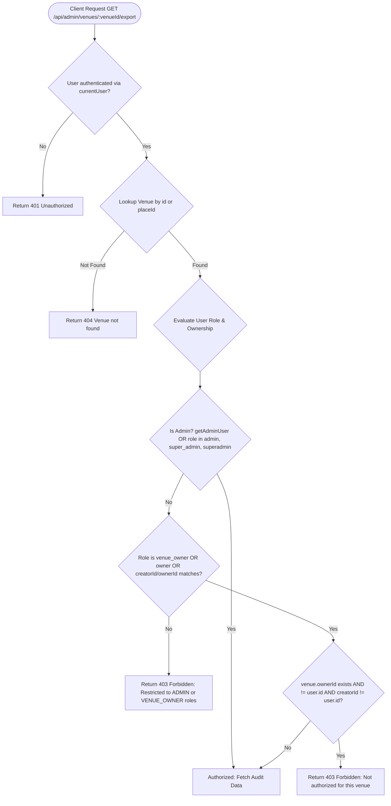
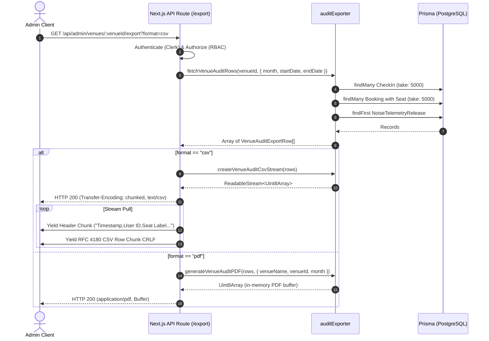

# Administrative Audit Log Streaming Export API Specification

The Administrative Audit Log Export API provides authorized administrators and venue owners with on-demand streaming exports of audit logs, check-in history, desk allocations, and ambient noise telemetry. The endpoint supports RFC 4180-compliant CSV streaming and formatted PDF reports with automated pagination.

---

## 1. Overview

The administrative audit export endpoint allows venue operators and platform administrators to retrieve historical audit records for security auditing, workspace utilization analysis, and compliance reporting.

- **Primary Route:** `GET /api/admin/venues/[venueId]/export`
- **Supported Formats:** RFC 4180 CSV (`text/csv; charset=utf-8`) and PDF (`application/pdf`)
- **Streaming Mechanism:** Web Streams API (`ReadableStream<Uint8Array>`) for CSV output; in-memory buffer generation via `pdf-lib` for PDF reports.
- **Authentication & Authorization:** Authenticated session required via Clerk (`currentUser()`). Access is strictly restricted to platform administrators (`ADMIN`, `SUPER_ADMIN`, or verified admin email lists) and authorized venue owners (`VENUE_OWNER`, `OWNER`, or matching `venue.ownerId` / `venue.creatorId`).

---

## 2. Endpoint Reference

### HTTP Request

`GET /api/admin/venues/[venueId]/export`

### Path Parameters

| Parameter | Type | Required | Description | Example |
| :--- | :--- | :---: | :--- | :--- |
| `venueId` | `string` | **Yes** | The unique database ID (`id`) or Google Place ID (`placeId`) of the venue. | `clx123abc456` or `ChIJN1t_tDeuEmsRUsoyG83frY4` |

### Request Headers

| Header | Type | Required | Description |
| :--- | :--- | :---: | :--- |
| `Cookie` | `string` | Optional* | Clerk authentication session cookies (when invoked from browsers). |
| `Authorization` | `string` | Optional* | Bearer session token (e.g. `Bearer <clerk_session_token>`). |

*\*At least one valid Clerk session authentication mechanism is required.*

### Response Content Types and Headers

#### CSV Export Response Headers

```http
HTTP/1.1 200 OK
Content-Type: text/csv; charset=utf-8
Content-Disposition: attachment; filename="venue-<sanitizedVenueId>-audit-<dateSlug>.csv"
Cache-Control: private, no-store, max-age=0
Transfer-Encoding: chunked
```

#### PDF Export Response Headers

```http
HTTP/1.1 200 OK
Content-Type: application/pdf
Content-Disposition: attachment; filename="venue-<sanitizedVenueId>-audit-<dateSlug>.pdf"
Cache-Control: private, no-store, max-age=0
```

> **Filename Sanitization:** The filename replaces non-alphanumeric characters (excluding `_` and `-`) with an underscore `_`. The `<dateSlug>` defaults to the `month` query parameter if provided; otherwise, it uses the current UTC date in `YYYY-MM-DD` format.

---

## 3. Query Parameter Matrix

The table below documents the query parameters recognized and evaluated by the route handler (`src/app/api/admin/venues/[venueId]/export/route.ts`) and the underlying exporter (`src/lib/export/auditExporter.ts`):

| Parameter | Type | Required | Default | Accepted Values / Format | Description |
| :--- | :--- | :---: | :--- | :--- | :--- |
| `format` | `string` | No | `csv` | `csv`, `pdf` (case-insensitive) | Output format for the audit export. If set to any value other than `csv` or `pdf`, returns HTTP `400 Bad Request`. |
| `month` | `string` | No | `undefined` | `YYYY-MM` or `YYYY-MM-DD` (e.g. `2026-11`) | Filters audit records to the specified UTC calendar month (from 1st of the month 00:00:00 UTC up to the 1st of the next month 00:00:00 UTC). Overridden if `startDate` or `endDate` is provided. |
| `startDate` | `string` | No | `undefined` | ISO 8601 string or valid date string (e.g. `2026-11-01T00:00:00Z` or `2026-11-01`) | Lower bound filter for audit record creation (`createdAt >= startDate`). Takes precedence over `month`. |
| `endDate` | `string` | No | `undefined` | ISO 8601 string or valid date string (e.g. `2026-11-30T23:59:59Z` or `2026-11-30`) | Upper bound filter for audit record creation (`createdAt < endDate`). Takes precedence over `month`. |
| `severity` | `string` | No | *N/A (Ignored)* | *Not supported in route* | **Discrepancy Note:** Audit records in this endpoint track physical check-ins, seat bookings, and noise telemetry rather than system error logs. `severity` is not supported or parsed by the endpoint. |
| `limit` | `number` | No | `5000` *(internal)* | Integer (internal exporter default) | **Discrepancy Note:** The internal `fetchVenueAuditRows` helper accepts `options.limit` (defaulting to `5000` records per table query), but the route handler does not extract `limit` from URL query parameters. |

---

## 4. Authentication and RBAC

The administrative audit export endpoint enforces strict multi-tier role-based access control (RBAC) and cross-tenant ownership boundary checks:



### 1. Authentication Check
The endpoint resolves the authenticated user via Clerk (`await currentUser()`). If no active session exists, the endpoint immediately halts and returns:
```json
{ "error": "Unauthorized" }
```
*(HTTP 401 Unauthorized)*

### 2. Role Resolution
User roles are extracted from Clerk metadata, prioritizing private metadata over public metadata:
```typescript
const publicRole = user.publicMetadata?.role;
const privateRole = user.privateMetadata?.role;
const role = (privateRole || publicRole)?.toLowerCase();
```

Additionally, `getAdminUser()` checks environment-configured administrator email addresses (`ADMIN_EMAILS` or `ADMIN_EMAIL`) against verified Clerk email addresses (`verification.status === "verified"`).

### 3. Permissions Evaluation
Access is granted if any of the following conditions are met:
- **Global Administrator:** `getAdminUser()` returns truthy, or `role` is one of `admin`, `super_admin`, or `superadmin`.
- **Venue Owner Role:** `role` is `venue_owner`, `owner`, or `venue-owner`.
- **Venue Resource Ownership:** The user's ID matches `venue.ownerId` or `venue.creatorId`.

### 4. Cross-Tenant Protection
If a user has a venue owner role but is neither a platform admin nor the registered owner/creator of the specific venue (`venue.ownerId && venue.ownerId !== user.id && venue.creatorId !== user.id`), the request is rejected with:
```json
{ "error": "Forbidden: Not authorized for this venue" }
```
*(HTTP 403 Forbidden)*

---

## 5. Streaming Protocol and Memory Management

### Actual Generation Mechanisms



### Detailed Mechanics

#### CSV Streaming (`createVenueAuditCsvStream`)
- **Web ReadableStream:** The CSV output uses standard Web Streams (`ReadableStream<Uint8Array>`).
- **Chunking Behavior:** The `pull(controller)` function emits an initial chunk containing the CSV header line (`AUDIT_EXPORT_COLUMNS.join(",") + "\r\n"`), followed by incremental row-by-row chunks encoded with `TextEncoder`.
- **Transfer Encoding:** Handled dynamically by the runtime / reverse proxy via HTTP Chunked Transfer Encoding (`Transfer-Encoding: chunked`). The `Content-Length` header is omitted for CSV responses.
- **Cancellation & Backpressure:** The stream constructor implements a `cancel()` hook that invokes `iterator.return()`. Standard Web Stream backpressure is honored through controller queueing.

#### Data Ingestion & Memory Bounds
- **Initial Query Buffering:** Before streaming begins, `fetchVenueAuditRows()` loads up to 5,000 `CheckIn` records, 5,000 `Booking` records, and the latest `NoiseTelemetryRelease` into memory from Prisma. 
- **Memory Footprint:** While `createVenueAuditCsvStream` operates with an $O(1)$ streaming transformation footprint over an iterable, the current route handler resolves the entire database result array before passing it to the stream. Therefore, memory usage is bounded by the Prisma query limits (`5000` records per table query).
- **PDF Generation:** PDF documents are generated synchronously in memory using `pdf-lib` and returned as a single buffered byte array (`Buffer.from(pdfBytes)`). PDF generation is not streamed.

---

## 6. CSV Format Specification

### Ordered Columns

The CSV export strictly outputs 5 columns in the exact order defined by `AUDIT_EXPORT_COLUMNS`:

| Position | Column Header | Data Type | Example Value | Description |
| :---: | :--- | :--- | :--- | :--- |
| 1 | `Timestamp` | ISO 8601 String | `2026-11-24T12:00:00.000Z` | Check-in or booking timestamp. Returns empty string `""` if null/invalid. |
| 2 | `User ID` | String | `user_2s6fEXAMPLE` | Clerk user identifier associated with the activity. |
| 3 | `Seat Label` | String | `Desk 42` | Assigned seat number or zone name. Defaults to `"Hot Desk"` if null, undefined, or empty. |
| 4 | `Check-in Duration` | String | `120 mins` | Duration formatted as rounded minutes plus `" mins"`. Defaults to `"N/A"` if missing, or `"0 mins"` if negative. |
| 5 | `Average Decibels` | String | `48.5` | Ambient sound level formatted to 1 decimal place. Defaults to `"N/A"` if missing or NaN. |

### Formatting and Escaping Rules

- **RFC 4180 Compliance:** Each record line terminates with CRLF (`\r\n`).
- **Delimiter:** Standard comma (`,`).
- **Escaping:** If a cell value contains double quotes (`"`), commas (`,`), newlines (`\n`), or carriage returns (`\r`), the entire field is enclosed in double quotes, and embedded double quotes are doubled (`""`).
- **Spreadsheet Formula Injection Sanitization:** If a field value begins with spreadsheet formula operators (`=`, `+`, `-`, `@`, `\t`, `\r`, or `|`), the exporter automatically prepends a single quote (`'`) to neutralize formula evaluation in applications such as Microsoft Excel or Google Sheets.

### Representative CSV Snippet

```csv
Timestamp,User ID,Seat Label,Check-in Duration,Average Decibels
2026-11-24T18:30:00.000Z,user_2tA10984,Desk 14,120 mins,45.2
2026-11-24T17:15:00.000Z,user_2tB88312,Hot Desk,60 mins,45.2
2026-11-24T16:00:00.000Z,user_2tC99144,"Zone B, Desk ""Corner""",180 mins,45.2
2026-11-24T14:00:00.000Z,'=cmd|' /C calc'!A0,Hot Desk,30 mins,45.2
```

---

## 7. PDF Format Specification

### Layout and Visual Hierarchy

PDF exports are generated via `pdf-lib` using custom grid coordinates:

1. **Document Header:**
   - Title: **WorkSphere Venue Audit Report** (18pt, bold, `#1a1a1a`).
   - Subtitle: `Month: <month>` or `Monthly Report`.
2. **Metadata Summary Block:**
   - Venue Name (e.g., `Venue: Downtown Innovation Hub`).
   - Venue ID (e.g., `Venue ID: clx123abc456`).
   - Generation Metadata: `Exported At: <UTC string> | Records: <count>`.
   - Horizontal decorative separator bar.
3. **Table Structure:**
   - Header row with blue background (`#edf2f9`) and navy text (`#264073`).
   - Column layout and fixed widths:
     - `Timestamp`: 140 pt (formatted as `YYYY-MM-DD HH:mm:ss`).
     - `User ID`: 105 pt (truncated with ellipsis if exceeding column width).
     - `Seat Label`: 90 pt.
     - `Duration`: 90 pt.
     - `Avg Decibels`: 90 pt.
   - Alternating row zebra-striping (`#fafafc`).
4. **Pagination and Page Numbering:**
   - When table rows exceed vertical page bounds, `ensureSpace()` triggers a new page and redraws table headers.
   - Page numbers are injected across all pages in the footer (`Page X of Y`).

### Representative PDF Content Structure *(Illustrative Text Representation)*

```text
+-----------------------------------------------------------------------------------------------+
| WorkSphere Venue Audit Report                                                Month: 2026-11   |
|                                                                                               |
| Venue: Downtown Innovation Hub                                                                |
| Venue ID: clx123abc456                                                                        |
| Exported At: Tue, 24 Nov 2026 22:00:00 GMT | Records: 2                                       |
+-----------------------------------------------------------------------------------------------+
| Timestamp           | User ID          | Seat Label    | Duration      | Avg Decibels         |
+---------------------+------------------+---------------+---------------+----------------------+
| 2026-11-24 18:30:00 | user_2tA10984    | Desk 14       | 120 mins      | 45.2                 |
| 2026-11-24 17:15:00 | user_2tB88312    | Hot Desk      | 60 mins       | 45.2                 |
+-----------------------------------------------------------------------------------------------+
|                                                                                   Page 1 of 1 |
+-----------------------------------------------------------------------------------------------+
```

---

## 8. Usage Examples

### 1. Default CSV Export

```bash
curl -X GET "https://api.worksphere.com/api/admin/venues/VENUE_ID/export" \
  -H "Authorization: Bearer YOUR_TOKEN" \
  --output venue-audit.csv
```

### 2. PDF Export

```bash
curl -X GET "https://api.worksphere.com/api/admin/venues/VENUE_ID/export?format=pdf" \
  -H "Authorization: Bearer YOUR_TOKEN" \
  --output venue-audit.pdf
```

### 3. Date Range Export (`startDate` & `endDate`)

```bash
curl -X GET "https://api.worksphere.com/api/admin/venues/VENUE_ID/export?format=csv&startDate=2026-11-01T00:00:00Z&endDate=2026-11-15T23:59:59Z" \
  -H "Authorization: Bearer YOUR_TOKEN" \
  --output venue-audit-first-half-nov.csv
```

### 4. Monthly Scope Export (`month`)

```bash
curl -X GET "https://api.worksphere.com/api/admin/venues/VENUE_ID/export?format=csv&month=2026-11" \
  -H "Authorization: Bearer YOUR_TOKEN" \
  --output venue-audit-2026-11.csv
```

### 5. PDF Export for a Specific Month

```bash
curl -X GET "https://api.worksphere.com/api/admin/venues/VENUE_ID/export?format=pdf&month=2026-10" \
  -H "Authorization: Bearer YOUR_TOKEN" \
  --output venue-audit-2026-10.pdf
```

---

## 9. Response and Error Reference

### HTTP Status Codes

| Status Code | Description | Content-Type | Cause |
| :---: | :--- | :--- | :--- |
| `200 OK` | Export generated successfully | `text/csv; charset=utf-8` or `application/pdf` | Valid request; body contains stream or binary PDF. |
| `400 Bad Request` | Validation failure | `application/json` | Missing `venueId`, or unsupported `format` parameter. |
| `401 Unauthorized` | Authentication required | `application/json` | Missing or expired Clerk user session. |
| `403 Forbidden` | Access denied | `application/json` | User lacks admin/owner roles or attempted cross-tenant venue access. |
| `404 Not Found` | Venue not found | `application/json` | No venue matching `venueId` (tested against `id` and `placeId`). |
| `500 Internal Server Error` | Server export failure | `application/json` | Unhandled error during database fetch or PDF/stream compilation. |

### Error Response Schemas

All error responses return a standardized JSON object:

#### 1. Missing Venue ID (400)
```json
{
  "error": "Venue ID is required"
}
```

#### 2. Unsupported Format (400)
```json
{
  "error": "Invalid format parameter. Supported formats are 'csv' and 'pdf'."
}
```

#### 3. Unauthenticated Request (401)
```json
{
  "error": "Unauthorized"
}
```

#### 4. Insufficient Role Permissions (403)
```json
{
  "error": "Forbidden: Restricted to ADMIN or VENUE_OWNER roles"
}
```

#### 5. Cross-Tenant Venue Access Violation (403)
```json
{
  "error": "Forbidden: Not authorized for this venue"
}
```

#### 6. Venue Not Found (404)
```json
{
  "error": "Venue not found"
}
```

#### 7. Internal Server Error (500)
```json
{
  "error": "Failed to export venue audit report"
}
```

---

## 10. Limitations and Developer Notes

1. **Parameter Discrepancies vs. Issue Request:**
   - **`severity`:** The issue description requested a `severity` query filter. The underlying domain records for this route are physical desk check-ins (`CheckIn`), room bookings (`Booking`), and ambient sound sensor telemetry (`NoiseTelemetryRelease`), which do not possess a severity level. Consequently, the `severity` parameter is not supported by the route handler.
   - **`limit`:** The internal database fetch method (`fetchVenueAuditRows`) defines an optional `limit` parameter (defaulting to `5000`), but the route handler (`GET`) does not bind URL `limit` query parameters. Each query execution fetches up to 5,000 check-ins and 5,000 bookings.
2. **Streaming Memory Boundaries:**
   - While CSV chunk transmission uses `ReadableStream` with $O(1)$ stream chunk transformation, the database query executes before the stream begins and loads all matching rows into memory. For venues with more than 10,000 check-in/booking records, records beyond the internal query ceiling (`5000` per table) are truncated.
3. **PDF Generation Memory:**
   - PDF exports are not streamed incrementally; the document is assembled and formatted in server memory before being returned as a single response payload. Generating reports for thousands of rows may introduce latency and higher heap consumption.
4. **Noise Telemetry Resolution:**
   - Average decibels are resolved at the venue level from `prisma.noiseTelemetryRelease.findFirst` rather than per-seat micro-sensors. If no telemetry release exists for the venue, `"Average Decibels"` outputs `"N/A"`.
