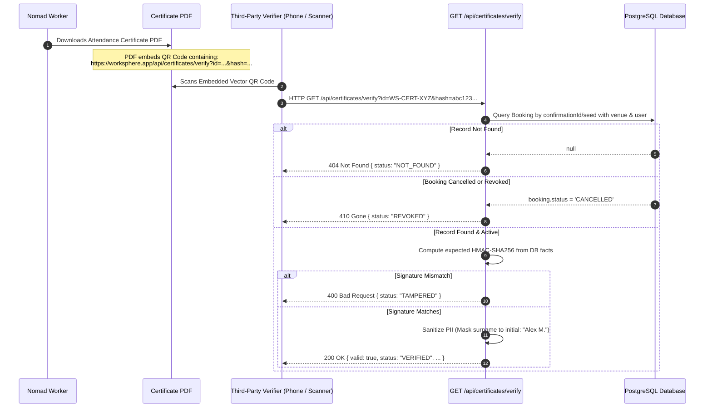

# Nomad Attendance & Co-Working Certificate Verification REST API Reference

## 1. Overview

WorkSphere Nomad Attendance Certificates serve as cryptographically verified proof of physical attendance and coworking stay completion across partner spaces in the WorkSphere network. Issued as tamper-evident PDF documents with embedded ISO/IEC 18004 QR codes, each certificate links directly to the public REST verification endpoint.

This document serves as the canonical developer and API consumer reference for the public verification endpoint:
`GET /api/certificates/verify`

---

## 2. Endpoint Specification

- **HTTP Method:** `GET`
- **Route:** `/api/certificates/verify`
- **Access Level:** Public (No Bearer token or Clerk session required; intended for third-party verifiers, employers, embassies, and academic sponsors scanning certificate QR codes).
- **Rate Limiting:** Global IP-based rate limiting applies via Redis token bucket.
- **Cache Control:** `force-dynamic` (Dynamic evaluation against the live database; certificates reflect real-time revocation or status updates).

---

## 3. Query Parameters

The endpoint expects two query parameters passed in the request URL:

| Parameter | Type     | Required | Description                                                                                            | Example                            |
| --------- | -------- | -------- | ------------------------------------------------------------------------------------------------------ | ---------------------------------- |
| `id`      | `string` | **Yes**  | The canonical certificate identifier issued on the PDF, formatted with prefix `WS-CERT-<CLEAN_SEED>`.  | `WS-CERT-BK94827104`               |
| `hash`    | `string` | **Yes**  | The cryptographic verification hash or truncated 32-character hexadecimal prefix computed at issuance. | `a4f89d38c1b72e59e38f9024c0817bda` |

Example Request URL:

```http
GET /api/certificates/verify?id=WS-CERT-BK94827104&hash=a4f89d38c1b72e59e38f9024c0817bda HTTP/1.1
Host: worksphere.app
Accept: application/json
```

---

## 4. Cryptographic Proof & Hash Generation

Certificate authenticity and tamper prevention are guaranteed using a keyed **HMAC-SHA256** digest computed over canonical stay facts stored in PostgreSQL.

### 4.1 Canonical Payload Serialization

The payload string is formatted deterministically as:

```text
${certificateId}:${bookingId}:${nomadName}:${venueName}:${checkInIso}:${checkOutIso}
```

Where:

- `certificateId`: The certificate ID (e.g., `WS-CERT-BK94827104`).
- `bookingId`: Internal unique booking UUID.
- `nomadName`: Full nomad name registered with the booking (e.g., `Alex Mercer`).
- `venueName`: Exact venue name in PostgreSQL (e.g., `Indiranagar Collective Hub`).
- `checkInIso`: ISO 8601 UTC timestamp of check-in (`YYYY-MM-DDTHH:mm:ss.sssZ`).
- `checkOutIso`: ISO 8601 UTC timestamp of check-out derived from start time + duration (`YYYY-MM-DDTHH:mm:ss.sssZ`).

### 4.2 Keyed HMAC Computation

In `src/lib/pdf/generateCertificate.ts`:

```typescript
import crypto from "crypto";

export function computeAttendanceCertificateHash(
  payload: {
    certificateId: string;
    bookingId: string;
    nomadName: string;
    venueName: string;
    checkInTime: string | number | Date;
    checkOutTime: string | number | Date;
  },
  secret = process.env.CERTIFICATE_VERIFICATION_SECRET ||
    process.env.RECEIPT_VERIFICATION_SECRET ||
    "worksphere-certificate-tamper-key",
): string {
  const checkInIso = new Date(payload.checkInTime).toISOString();
  const checkOutIso = new Date(payload.checkOutTime).toISOString();
  const raw = `${payload.certificateId}:${payload.bookingId}:${payload.nomadName}:${payload.venueName}:${checkInIso}:${checkOutIso}`;
  return crypto.createHmac("sha256", secret).update(raw).digest("hex");
}
```

### 4.3 Hash Comparison & Prefix Matching

The QR code generator truncates the 64-character hexadecimal digest to the first 32 characters for compact, error-resilient 2D barcode generation. The verification endpoint accepts either:

- The full 64-character hexadecimal HMAC digest, or
- The 32-character hexadecimal prefix.

Verification matches case-insensitively:

```typescript
const hashMatch =
  expectedHash.startsWith(providedHash.toLowerCase()) ||
  providedHash.toLowerCase().startsWith(expectedHash.slice(0, 32));
```

Any modification to certificate text (such as extending duration, altering dates, changing venue, or substituting names) results in a signature mismatch and immediate rejection.

---

## 5. QR Verification Flow



---

## 6. Certificate Statuses & Lifecycle

| Lifecycle Status | HTTP Code          | Meaning                                                                             |
| ---------------- | ------------------ | ----------------------------------------------------------------------------------- |
| `VERIFIED`       | `200 OK`           | The certificate is authentic, matches database records, and signature is intact.    |
| `INVALID`        | `400 Bad Request`  | Missing required query parameters (`id` or `hash`).                                 |
| `TAMPERED`       | `400 Bad Request`  | Record found, but HMAC signature mismatch detected.                                 |
| `NOT_FOUND`      | `404 Not Found`    | No booking or attendance record found matching the supplied certificate identifier. |
| `REVOKED`        | `410 Gone`         | The stay was cancelled or revoked by the venue operator or user.                    |
| `ERROR`          | `500 Server Error` | Unexpected database or internal runtime failure.                                    |

> [!NOTE]
> In accordance with WorkSphere REST design guidelines, cancelled or revoked resources return HTTP `410 Gone` rather than `422 Unprocessable Entity` or `404 Not Found`.

---

## 7. TypeScript Definitions

```typescript
export interface CertificateVerifySuccessResponse {
  valid: true;
  status: "VERIFIED";
  certificateId: string;
  nomadName: string;
  venueName: string;
  stayDate: string;
  durationMinutes: number;
  checkInTime: string;
  checkOutTime: string;
  timeZone: string;
  verifiedAt: string;
}

export interface CertificateVerifyErrorResponse {
  valid: false;
  status: "INVALID" | "NOT_FOUND" | "REVOKED" | "TAMPERED" | "ERROR";
  error: string;
  certificateId?: string;
}

export type CertificateVerifyResponse =
  CertificateVerifySuccessResponse | CertificateVerifyErrorResponse;
```

---

## 8. HTTP Response Examples

### 8.1 Successful Verification (HTTP 200 OK)

```json
{
  "valid": true,
  "status": "VERIFIED",
  "certificateId": "WS-CERT-BK94827104",
  "nomadName": "Alex M.",
  "venueName": "Indiranagar Collective Hub",
  "stayDate": "2026-11-20",
  "durationMinutes": 480,
  "checkInTime": "2026-11-20T09:00:00.000Z",
  "checkOutTime": "2026-11-20T17:00:00.000Z",
  "timeZone": "Asia/Kolkata",
  "verifiedAt": "2026-11-24T18:30:00.000Z"
}
```

### 8.2 Tampered Signature Mismatch (HTTP 400 Bad Request)

```json
{
  "valid": false,
  "status": "TAMPERED",
  "error": "Cryptographic signature mismatch. Certificate may have been tampered with.",
  "certificateId": "WS-CERT-BK94827104"
}
```

### 8.3 Missing Query Parameters (HTTP 400 Bad Request)

```json
{
  "valid": false,
  "status": "INVALID",
  "error": "Missing required verification parameters (id and hash)"
}
```

### 8.4 Certificate Record Not Found (HTTP 404 Not Found)

```json
{
  "valid": false,
  "status": "NOT_FOUND",
  "error": "No attendance record found matching certificate identifier."
}
```

### 8.5 Cancelled or Revoked Stay (HTTP 410 Gone)

```json
{
  "valid": false,
  "status": "REVOKED",
  "error": "This stay certificate has been cancelled or revoked.",
  "certificateId": "WS-CERT-BK94827104"
}
```

---

## 9. Privacy & Data Protection (PII Sanitization)

To comply with international data privacy standards (GDPR / Indian DPDP Act), the public verification endpoint strictly masks personal identifiable information:

- **Nomad Name:** The surname is truncated to its initial (e.g., `Alex Mercer` $\to$ `Alex M.`).
- **Contact Info:** Nomad email addresses, phone numbers, and payment details are **never** returned in the verification payload.
- **Seat Number:** Specific seat identifiers are omitted unless required for safety compliance.

---

## 10. Sample cURL Invocations

### Verify Valid Certificate

```bash
curl -X GET "https://worksphere.app/api/certificates/verify?id=WS-CERT-BK94827104&hash=a4f89d38c1b72e59e38f9024c0817bda" \
  -H "Accept: application/json"
```

### Check Revoked Certificate

```bash
curl -X GET "https://worksphere.app/api/certificates/verify?id=WS-CERT-REVOKED99&hash=b12c34d56e78f901a23b45c67d89e012" \
  -H "Accept: application/json"
```

---

## 11. Troubleshooting & Operational Guidance

| Problem                                             | Root Cause                                                               | Resolution                                                                                              |
| --------------------------------------------------- | ------------------------------------------------------------------------ | ------------------------------------------------------------------------------------------------------- |
| Returns `TAMPERED` for legitimate certificates      | Secret mismatch between PDF generator and API environment.               | Ensure `CERTIFICATE_VERIFICATION_SECRET` is identical across all production instances and worker nodes. |
| QR Code scan opens error 400                        | Truncated query string or URL decoding issue in scanning app.            | Verify scanner passes query parameters without stripping `?id=` or `&hash=`.                            |
| Returns `NOT_FOUND` for newly generated certificate | Database replication lag between write master and read replica.          | Query routing should use primary or verify eventual consistency grace periods.                          |
| Returns `REVOKED` unexpectedly                      | Stay was marked as `CANCELLED` or `CANCELLED_BY_OPERATOR` in PostgreSQL. | Inspect booking status audit logs in operator dashboard.                                                |

---

## 12. Related Documentation

- [Nomad Certificate Verification Flow Guide](file:///d:/Opensource/WorkSphere-Opensource/docs/certificates/NOMAD_CERTIFICATE_VERIFICATION.md)
- [PDF Certificate Generator Implementation](file:///d:/Opensource/WorkSphere-Opensource/src/lib/pdf/generateCertificate.ts)
- [Public Verification Route Handler](file:///d:/Opensource/WorkSphere-Opensource/src/app/api/certificates/verify/route.ts)
