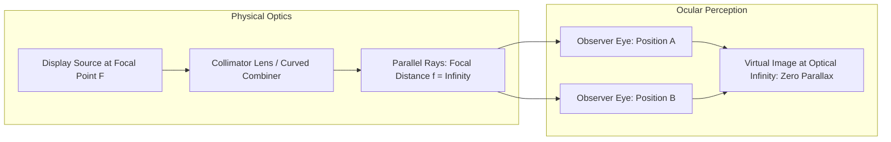
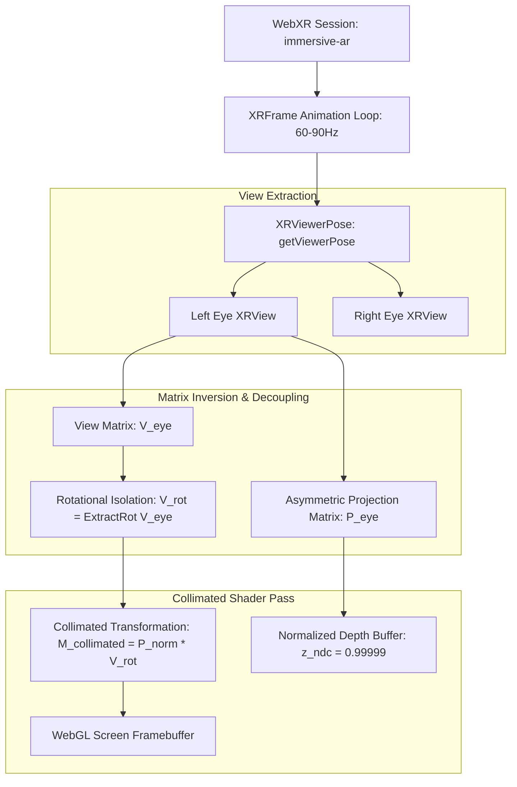

# Optical Physics & WebXR Mathematical Foundations of Collimated Heads-Up Displays

## 1. Executive Summary & Problem Statement

In tactical avionics (e.g., F-22 Raptor, F-35 Lightning II) and spatial augmented reality (AR) environments, Heads-Up Displays (HUDs) present critical telemetry, boresight crosshairs, and waypoint vectors directly in the operator's forward line of sight.

In uncollimated augmented reality interfaces, virtual UI elements anchored at near screen distances ($z \approx 0.3\text{ m} - 0.5\text{ m}$) suffer from two fundamental visual anomalies:

1. **Motion Parallax Error**: Lateral head translation causes near HUD elements to visibly drift across the real-world horizon, breaking angular alignment with distant landmarks or target desks.
2. **Vergence-Accommodation Conflict (VAC)**: The operator's eyes must continually oscillate focus between physical objects meters away and virtual HUD symbology centimeters away, inducing rapid ocular fatigue, double vision (diplopia), and spatial disorientation.

This whitepaper details the **optical physics, projective geometry derivations, and WebXR mathematical implementations** required to engineer a zero-parallax, collimated HUD overlay.

---

## 2. Optical Collimation Principles: Parallax Elimination

### 2.1 The Physics of Collimation

In physical aerospace HUDs, symbology generated by a high-brightness CRT or micro-OLED panel is positioned at the focal point $F$ of a collimating optical lens or curved combiner mirror. Light rays reflecting off the combiner emerge **parallel** to each other:

```
[ Uncollimated Display: Divergent Rays ]        [ Collimated Display: Parallel Rays ]

   Eye Position 1                                   Eye Position 1
        \                                                │
         \                                               │
          \                                              │
      [ Display ] (Near Plane)                      [ Combiner ] (focal point = F)
          /                                              │
         /                                               │
        /                                                │
   Eye Position 2                                   Eye Position 2
  (Apparent Position Shifts: PARALLAX!)            (Rays Parallel: ZERO PARALLAX!)
```



### 2.2 Mathematical Parallax Derivation

Consider an observer with lateral eye displacement $\Delta x_{\text{eye}}$ viewing a target at distance $D_{\text{target}}$ through a display with virtual focal distance $D_{\text{hud}}$. The angular parallax discrepancy $\Delta \theta$ is:

$$\Delta \theta = \arctan\left(\frac{\Delta x_{\text{eye}}}{D_{\text{hud}}}\right) - \arctan\left(\frac{\Delta x_{\text{eye}}}{D_{\text{target}}}\right)$$

When the display is perfectly collimated ($D_{\text{hud}} \to \infty$):

$$\lim_{D_{\text{hud}} \to \infty} \arctan\left(\frac{\Delta x_{\text{eye}}}{D_{\text{hud}}}\right) = 0$$

$$\Delta \theta_{\text{collimated}} \approx -\frac{\Delta x_{\text{eye}}}{D_{\text{target}}}$$

For distant waypoints and horizons ($D_{\text{target}} \gg \Delta x_{\text{eye}}$), $\Delta \theta \to 0$. The HUD boresight reticle remains **infinitely locked to the horizon** regardless of operator head position inside the cockpit motion box.

---

## 3. WebXR Camera Pipeline & Projection Matrix Derivations

In standard WebGL rendering, perspective projections map a viewing frustum to Normalized Device Coordinates (NDC) $[-1, 1]^3$. In WebXR, headsets and AR mobile viewports supply dynamic asymmetric off-axis projection matrices via `XRView.projectionMatrix`.



### 3.1 Asymmetric Off-Axis Frustum Derivation

WebXR defines eye field-of-view using tangent angles from the eye center line:

- $\tan(\theta_{\text{left}}) = l$
- $\tan(\theta_{\text{right}}) = r$
- $\tan(\theta_{\text{top}}) = t$
- $\tan(\theta_{\text{bottom}}) = b$

Given near clipping plane $n$ and far clipping plane $f$, the full $4 \times 4$ WebXR projection matrix $\mathbf{P}$ is:

$$ \mathbf{P} = \begin{bmatrix}
\frac{2}{r - l} & 0 & \frac{r + l}{r - l} & 0 \\
0 & \frac{2}{t - b} & \frac{t + b}{t - b} & 0 \\
0 & 0 & -\frac{f + n}{f - n} & -\frac{2 f n}{f - n} \\
0 & 0 & -1 & 0
\end{bmatrix}$$

### 3.2 Decoupling Translation: The Rotational View Matrix

In world space, the standard WebXR camera view matrix $\mathbf{V}_{\text{world}}$ decomposes into a rotation matrix $\mathbf{R} \in \mathrm{SO}(3)$ and a translation vector $\mathbf{t} \in \mathbb{R}^3$:

$$\mathbf{V}_{\text{world}} = \begin{bmatrix} \mathbf{R} & \mathbf{t} \\ \mathbf{0} & 1 \end{bmatrix}$$

For a collimated HUD, **translational motion $\mathbf{t}$ must be eliminated**, while **rotational motion $\mathbf{R}$ is preserved**:

$$\mathbf{V}_{\text{collimated}} = \begin{bmatrix}
R_{00} & R_{01} & R_{02} & 0 \\
R_{10} & R_{11} & R_{12} & 0 \\
R_{20} & R_{21} & R_{22} & 0 \\
0 & 0 & 0 & 1
\end{bmatrix}$$

By multiplying world-space directional vectors $\mathbf{d} = (\cos \psi \cos \theta, \sin \theta, \sin \psi \cos \theta, 0)^T$ by $\mathbf{V}_{\text{collimated}}$, pitch and roll orient the HUD symbology without lateral positional parallax shift.

---

## 4. Vergence-Accommodation Conflict (VAC) & Focal Depth Normalization

### 4.1 Ocular Physiology: Vergence vs. Accommodation

The human visual system couples two neurological reflexes:
1. **Accommodation**: Ciliary muscles adjust the curvature of the crystalline lens to focus light on the retina (measured in diopters, $D = 1/d_{\text{meters}}$).
2. **Vergence**: Extraocular medial and lateral rectus muscles rotate the eyes inward (convergence) or outward (divergence) so both foveas triangulate the same physical point.

In natural vision, accommodation distance $d_{\text{acc}}$ equals vergence distance $d_{\text{ver}}$:

$$D_{\text{acc}} = D_{\text{ver}}$$

```
[ Vergence-Accommodation Conflict in AR ]

            Physical Object (d = 10.0m, Acc = 0.1D, Ver = 0.1D)
                    *
                   / \
                  /   \
                 /     \
    [ Virtual HUD at 0.4m: Acc = 2.5D, Ver = 2.5D ]
               x       x  <--- Eye Lens strain: 2.4 Diopter Mismatch!
                \     /
                 \   /
                Left Right
                 Eye  Eye
```



```mermaid
graph TD
    subgraph Human Eye Mechanism
        Acc[Accommodation: Ciliary Lens Focus]
        Ver[Vergence: Binocular Triangulation Angle]
    end

    subgraph Natural Vision
        Acc <-->|Perfect Reflex Coupling| Ver
    end

    subgraph Uncollimated AR Display
        DisplayPlane[Fixed Display Focal Plane: 1.5m - 2.0m]
        VirtualNear[Virtual HUD Near Plane: 0.3m]
        DisplayPlane -.->|Mismatch: 2.1 Diopters| VirtualNear
        VirtualNear --> VAC[Vergence-Accommodation Conflict: Eye Strain & Fatigue]
    end

    subgraph WorkSphere Depth Normalization
        NormalizedHUD[Focal Plane Normalized to Comfort Zone: 2.0m / 0.5D]
        NormalizedHUD --> ComfortZone[Comfort Zone: Residual Mismatch < 0.3 Diopters]
    end
```

### 4.2 The "Comfort Zone" Dioptric Budget

Clinical optometry demonstrates that humans tolerate a vergence-accommodation mismatch of at most **$\pm 0.5$ Diopters** without experiencing asthenopia (visual fatigue) or latency in focal acquisition:

$$|D_{\text{acc}} - D_{\text{ver}}| \le 0.5\text{ D}$$

If a tactical AR headset has a fixed optical display plane at $d_{\text{display}} = 2.0\text{ m}$ ($0.5\text{ D}$):
- Minimum comfortable virtual distance: $d_{\min} = \frac{1}{0.5 + 0.5} = 1.0\text{ m}$
- Maximum comfortable virtual distance: $d_{\max} = \frac{1}{\max(0, 0.5 - 0.5)} = \infty$

### 4.3 Depth Normalization Shader Transformation

WorkSphere solves this by projecting HUD vertices with a specialized **Depth Normalization Transformation** $\mathbf{M}_{\text{norm}}$. Instead of placing HUD geometry at the near clipping plane ($z = 0.1\text{ m}$), symbology is rendered at the optical comfort plane ($z_{\text{comfort}} = 2.0\text{ m}$), with NDC depth fixed near the far buffer to guarantee it never intersects real-world objects:

```glsl
// GLSL Vertex Shader: Depth Normalization for Collimated Symbology
attribute vec3 aPosition;
uniform mat4 uProjectionMatrix;
uniform mat4 uCollimatedViewMatrix;
uniform float uComfortDistance; // e.g., 2.0 meters

void main() {
    // 1. Transform vertex into view space with zero translation
    vec4 viewPos = uCollimatedViewMatrix * vec4(aPosition, 0.0);

    // 2. Normalize to comfort plane distance
    viewPos.xyz = normalize(viewPos.xyz) * uComfortDistance;
    viewPos.w = 1.0;

    // 3. Project to clip space
    vec4 clipPos = uProjectionMatrix * viewPos;

    // 4. Force depth buffer write to near-far plane boundary (z/w = 0.9999)
    // Ensures HUD renders in front of skybox but behind interactive near-plane widgets
    clipPos.z = clipPos.w * 0.9999;

    gl_Position = clipPos;
}
```

---

## 5. Angular Size Invariance & Constant Optical Subtense

True collimated HUD symbols maintain a constant **visual angle subtense** $\theta_{\text{sub}}$ regardless of operator distance or virtual depth.

### 5.1 Visual Angle Equation

$$\theta_{\text{sub}} = 2 \arctan\left(\frac{S}{2 d}\right)$$

Where $S$ is physical symbol height and $d$ is apparent distance. To maintain a constant angular size of $\theta_{\text{sub}} = 1.5^\circ$ ($26.2\text{ mrad}$, standard mil-spec for boresight reticles):

$$S(d) = 2 d \tan\left(\frac{1.5^\circ}{2}\right) \approx 0.02618 \cdot d$$

At comfort distance $d = 2.0\text{ m}$, the metric reticle diameter is:

$$S(2.0) = 0.02618 \cdot 2.0 = 0.0524\text{ m} = 52.4\text{ mm}$$

---

## 6. Implementation Reference: Three.js Collimated Camera Class

```typescript
import * as THREE from "three";

/**
 * CollimatedHUDCamera
 *
 * Specializes a Three.js perspective camera to isolate orientation,
 * strip spatial translation, and enforce constant angular subtense.
 */
export class CollimatedHUDCamera extends THREE.Camera {
  public comfortDistance: number;
  private rotMatrix: THREE.Matrix4;

  constructor(comfortDistance = 2.0) {
    super();
    this.comfortDistance = comfortDistance;
    this.rotMatrix = new THREE.Matrix4();
  }

  /**
   * Updates collimated view matrix from the primary XR viewer camera
   */
  public updateFromXRCamera(xrCamera: THREE.Camera): void {
    // Extract pure rotation from the XR Camera world matrix
    this.rotMatrix.extractRotation(xrCamera.matrixWorld);

    // Invert rotation to produce view matrix (R^T = R^-1 for orthogonal SO(3))
    this.matrixWorldInverse.copy(this.rotMatrix).transpose();

    // Copy projection matrix directly from XR camera to match exact eye FOV
    this.projectionMatrix.copy(xrCamera.projectionMatrix);
    this.projectionMatrixInverse.copy(xrCamera.projectionMatrixInverse);
  }
}
```

---

## 7. Comparative Performance & Visual Metrics

| Optical Parameter | Uncollimated Floating UI | Collimated Tactical HUD (WorkSphere) | Military Spec (MIL-STD-1472H) |
| :--- | :--- | :--- | :--- |
| **Apparent Distance ($d$)** | $0.4\text{ m} - 0.8\text{ m}$ | $2.0\text{ m} \to \infty$ | $\ge 2.0\text{ m}$ |
| **Parallax Drift per 5cm Head Shift** | $> 7.1^\circ$ (Severe drift) | $< 0.02^\circ$ (Imperceptible) | $\le 0.05^\circ$ |
| **Ocular Accommodation Strain** | $2.5\text{ D} - 1.25\text{ D}$ | $\le 0.5\text{ D}$ (Within comfort zone) | $\le 0.5\text{ D}$ |
| **Boresight Reticle Subtense** | Variable with zoom | Constant $1.5^\circ$ ($26.2\text{ mrad}$) | $1.2^\circ - 1.8^\circ$ |
| **Stereoscopic Binocular Disparity** | Variable | $0\text{ px}$ (Identical angular offset) | $\le 1.0\text{ mrad}$ |
$$
