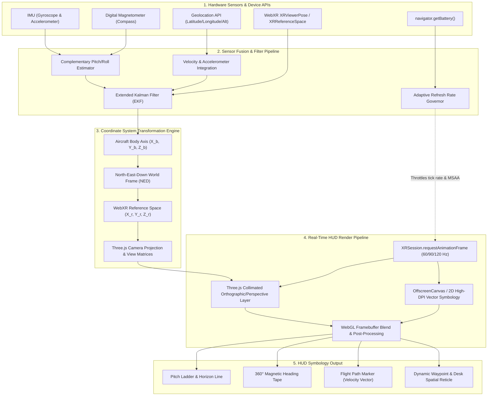
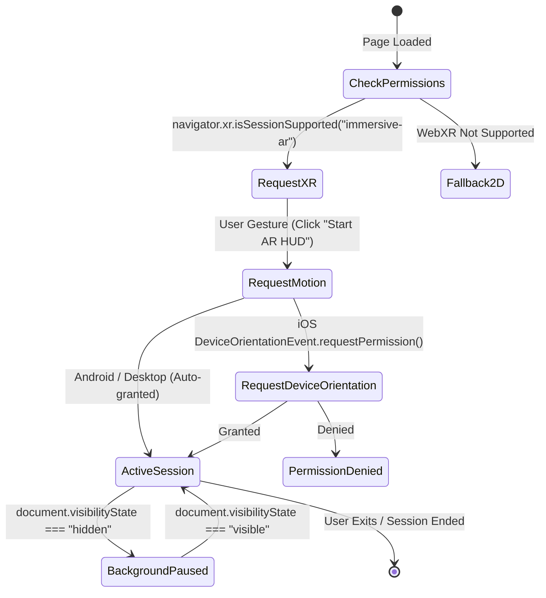

# WebXR Fighter Jet Cockpit HUD Architectural Specification

This document details the software architecture, spatial coordinate transformations, sensor fusion pipelines, Three.js camera projection matrices, real-time render loops, battery conservation strategies, and device permission protocols for the **WebXR Fighter Jet Cockpit Heads-Up Display (HUD)** system.

---

## 1. Executive Summary & Architectural Overview

The WebXR Fighter Jet Cockpit HUD delivers an immersive, ultra-low-latency augmented reality heads-up display rendered directly inside browser runtimes supporting the WebXR Device API (`immersive-ar` / `inline`). Built using Three.js and custom hardware-accelerated 2D/3D WebGL canvases, the architecture simulates military-standard collimated fighter jet avionics—projecting pitch ladders, artificial horizons, heading tapes, energy brackets, waypoint vectors, and flight telemetry onto a virtual infinite focus plane.



---

## 2. Sensor Fusion Pipeline & Attitude Estimation

Avionics-grade telemetry requires high-frequency attitude determination (pitch, roll, and true heading) resilient against magnetic anomaly spikes, drift, and high-G linear acceleration.

### 2.1 Extended Kalman Filter (EKF) State Vector

The attitude estimation engine maintains an 8-state navigation filter state vector $\mathbf{x}_k$:

$$\mathbf{x}_k = \begin{bmatrix} q_0 & q_1 & q_2 & q_3 & \omega_{bx} & \omega_{by} & \omega_{bz} & a_{bias} \end{bmatrix}^T$$

Where:
- $\mathbf{q} = \begin{bmatrix} q_0 & q_1 & q_2 & q_3 \end{bmatrix}^T$ represents the normalized attitude unit quaternion.
- $\boldsymbol{\omega}_b = \begin{bmatrix} \omega_{bx} & \omega_{by} & \omega_{bz} \end{bmatrix}^T$ captures gyro dynamic bias drift across three orthogonal axes.
- $a_{bias}$ denotes integrated accelerometer gravitational offsets.

### 2.2 Complementary Filter Fallback for Mobile Web Runtimes

When `GenericSensorAPI` or WebXR 6DoF poses exhibit jitter or missing high-frequency sampling, a complementary filter merges gyroscope rates with accelerometer gravity vectors:

$$\mathbf{q}_{k} = \alpha \left(\mathbf{q}_{k-1} \otimes \Delta \mathbf{q}_{gyro}\right) + (1 - \alpha) \mathbf{q}_{accel/mag}$$

With nominal blending constant $\alpha = 0.98$ for 60Hz tick intervals ($\Delta t \approx 16.6\text{ ms}$).

---

## 3. Coordinate Systems & Matrix Transformations

The fighter cockpit HUD synthesizes four discrete coordinate frames into a seamless optical overlay:

```
+---------------------------------------------------------------------------------------+
| 1. Aircraft Body Axis (Body Space)                                                    |
|    - Origin: Pilot Eye Point / Center of Mass                                         |
|    - +X: Forward (Nose direction)                                                     |
|    - +Y: Right Wing (Starboard)                                                       |
|    - +Z: Down (Floor)                                                                 |
+---------------------------------------------------------------------------------------+
                                           |
                                [R_b^n Rotation Matrix]
                                           v
+---------------------------------------------------------------------------------------+
| 2. World Navigation Reference (NED Frame)                                             |
|    - +X: True North                                                                   |
|    - +Y: True East                                                                    |
|    - +Z: Down towards Center of Earth (Gravity Vector)                                |
+---------------------------------------------------------------------------------------+
                                           |
                                [WebXR Pose Transformation]
                                           v
+---------------------------------------------------------------------------------------+
| 3. WebXR Eye Space (XRReferenceSpace / Camera Space)                                  |
|    - +X: Right                                                                        |
|    - +Y: Up                                                                           |
|    - +Z: Backward (-Z is View Gaze Direction)                                         |
+---------------------------------------------------------------------------------------+
                                           |
                                [Three.js Projection Matrix]
                                           v
+---------------------------------------------------------------------------------------+
| 4. HUD Viewport Space (Normalized Device Coordinates - NDC & Canvas Space)            |
|    - Range: [-1.0, 1.0] in X and Y                                                    |
|    - Collimation: Simulated focal distance at infinity (Zero Parallax Shift)          |
+---------------------------------------------------------------------------------------+
```

### 3.1 Collimated Optics & Camera Projection

Real fighter jet HUDs employ optical collimation so symbology appears focused at infinity, eliminating depth-of-field refocusing strain between physical obstacles and symbology.

In Three.js, collimation is achieved through a hybrid projection setup:
1. **Background 3D Space:** Standard perspective camera ($FOV \approx 65^\circ$, near plane $0.1\text{ m}$, far plane $1000\text{ m}$).
2. **Cockpit HUD Canvas:** An orthographic or fixed-depth plane positioned at $Z = -1.0\text{ m}$ rigidly attached to `camera.children`. As the pilot rolls or pitches, the symbology counter-rotates relative to the world orientation vector while anchoring its geometric center to the optical bore sight.

---

## 4. Real-Time HUD Render Loop & Symbology Generation

The render pipeline utilizes `XRSession.requestAnimationFrame` coupled with offscreen vector geometry to minimize GC pauses and dropped frames.

```typescript
export class CockpitHUDRenderer {
  private gl: WebGLRenderingContext | WebGL2RenderingContext;
  private xrSession: XRSession | null = null;
  private xrRefSpace: XRReferenceSpace | null = null;
  private hudCanvas: HTMLCanvasElement;
  private hudCtx: CanvasRenderingContext2D;
  private isThrottled: boolean = false;

  constructor(gl: WebGLRenderingContext | WebGL2RenderingContext) {
    this.gl = gl;
    this.hudCanvas = document.createElement("canvas");
    this.hudCanvas.width = 2048;
    this.hudCanvas.height = 2048;
    this.hudCtx = this.hudCanvas.getContext("2d", { alpha: true })!;
  }

  public onXRFrame(time: DOMHighResTimeStamp, frame: XRFrame): void {
    const session = frame.session;
    const pose = frame.getViewerPose(this.xrRefSpace!);

    if (!pose) return;

    // 1. Clear HUD canvas buffer
    this.hudCtx.clearRect(0, 0, this.hudCanvas.width, this.hudCanvas.height);

    // 2. Render Flight Symbology
    this.drawPitchLadder(pose);
    this.drawHeadingTape(pose);
    this.drawVelocityVector(pose);
    this.drawWaypointCues(pose);

    // 3. Composite onto WebGL HUD plane texture
    this.updateGLTexture();
  }

  private drawPitchLadder(pose: XRViewerPose): void {
    // Computes pitch and roll from XRViewerPose orientation quaternion
    const { pitch, roll } = this.extractEuler(pose.transform.orientation);
    this.hudCtx.save();
    this.hudCtx.translate(1024, 1024);
    this.hudCtx.rotate(-roll);
    
    // Draw horizon line and 5° pitch rungs
    this.hudCtx.strokeStyle = "#00ff66";
    this.hudCtx.lineWidth = 4;
    this.hudCtx.beginPath();
    this.hudCtx.moveTo(-400, pitch * 20);
    this.hudCtx.lineTo(400, pitch * 20);
    this.hudCtx.stroke();
    this.hudCtx.restore();
  }

  private extractEuler(q: DOMPointReadOnly): { pitch: number; roll: number; yaw: number } {
    const roll = Math.atan2(2 * (q.w * q.x + q.y * q.z), 1 - 2 * (q.x * q.x + q.y * q.y));
    const pitch = Math.asin(Math.max(-1, Math.min(1, 2 * (q.w * q.y - q.z * q.x))));
    const yaw = Math.atan2(2 * (q.w * q.z + q.x * q.y), 1 - 2 * (q.y * q.y + q.z * q.z));
    return { pitch, roll, yaw };
  }

  private drawHeadingTape(pose: XRViewerPose): void { /* 360 degree compass ribbon */ }
  private drawVelocityVector(pose: XRViewerPose): void { /* Flight path marker */ }
  private drawWaypointCues(pose: XRViewerPose): void { /* 3D Spatial target diamond */ }
  private updateGLTexture(): void { /* Bind to Three.js MeshBasicMaterial texture */ }
}
```

---

## 5. Battery Conservation & Thermal Governor Protocol

AR rendering on mobile headsets and phones consumes high CPU/GPU and sensor bus power. The HUD integrates an automated multi-tier thermal and power management governor:

| Battery Level | Charging State | Frame Budget | Anti-Aliasing (MSAA) | Vector Resolution | Sensor Poll Interval |
| :--- | :--- | :--- | :--- | :--- | :--- |
| **> 50%** | Yes / No | 90 / 60 FPS | 4x MSAA | 2048 x 2048 | 60 Hz |
| **20% - 50%** | Discharging | 60 FPS | 2x MSAA | 1536 x 1536 | 30 Hz |
| **< 20% (Eco)**| Discharging | 30 FPS | Disabled | 1024 x 1024 | 15 Hz |

### Battery Integration Implementation

```typescript
export async function initializePowerGovernor(onThrottleChange: (fps: number) => void): Promise<void> {
  if (typeof navigator !== "undefined" && "getBattery" in navigator) {
    try {
      const battery: any = await (navigator as any).getBattery();
      const updateGovernor = () => {
        if (!battery.charging && battery.level < 0.20) {
          onThrottleChange(30); // Drop to 30 FPS Eco Mode
        } else if (!battery.charging && battery.level < 0.50) {
          onThrottleChange(60);
        } else {
          onThrottleChange(90);
        }
      };

      battery.addEventListener("levelchange", updateGovernor);
      battery.addEventListener("chargingchange", updateGovernor);
      updateGovernor();
    } catch {
      // Fallback for browsers without Battery Status API
      onThrottleChange(60);
    }
  }
}
```

---

## 6. Sensor Permission Protocols & Lifecycle States

The HUD implements strict compliance with W3C Permissions API and privacy sandbox standards across iOS (DeviceOrientation permission request) and Android/Desktop Chrome:



### Motion Permission Handshake

```typescript
export async function requestMotionPermissions(): Promise<boolean> {
  // iOS 13+ Safari Permission Gate
  if (
    typeof DeviceOrientationEvent !== "undefined" &&
    typeof (DeviceOrientationEvent as any).requestPermission === "function"
  ) {
    try {
      const permissionState = await (DeviceOrientationEvent as any).requestPermission();
      return permissionState === "granted";
    } catch (err) {
      console.warn("DeviceOrientation permission rejected:", err);
      return false;
    }
  }
  return true; // Auto-granted on Chromium / Android
}
```

---

## 7. Verification & Telemetry Standards

1. **Angular Precision:** Pitch and roll resolution must maintain $\le 0.1^\circ$ precision under static calibration.
2. **Motion-to-Photon Latency:** End-to-end IMU-to-pixel latency must remain under 20ms to avoid pilot spatial disorientation.
3. **Contrast Compliance:** All HUD symbology renders with `#00FF66` military green and dynamic translucent shadow backing to guarantee WCAG AA visibility against bright skies or indoor coworking glare.
