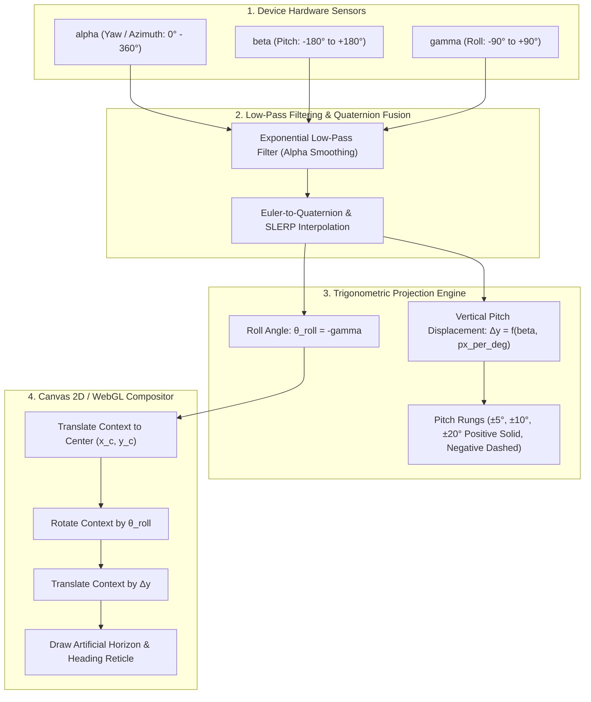

# Jet HUD Horizon Pitch and Roll Mathematics Specification

This document details the mathematical projection equations, coordinate system matrix inversions, trigonometric formulas, and low-pass filtering used to render the **Jet Fighter Artificial Horizon, Pitch Ladder, and Roll Indicator** in `CompassFallback` and WebXR spatial components.

---

## 1. Overview & Coordinate System Conventions

In modern avionics and WebXR heads-up displays, an artificial horizon presents the pilot or user with an unambiguous depiction of the aircraft/device attitude relative to the Earth's horizontal reference plane.



### 1.1 W3C DeviceOrientation Coordinate Frame vs. Avionics Frame

- **W3C Device Frame:**
  - $+X$: To the right across the screen surface.
  - $+Y$: Toward the top of the device.
  - $+Z$: Normal to the screen, pointing outward toward user's face.
- **Euler Angles:**
  - $\alpha$ (Yaw): Rotation around the $Z$-axis ($[0^\circ, 360^\circ)$).
  - $\beta$ (Pitch): Rotation around the $X$-axis ($[-180^\circ, 180^\circ)$).
  - $\gamma$ (Roll): Rotation around the $Y$-axis ($[-90^\circ, 90^\circ)$).

---

## 2. Mathematical Projection Equations

### 2.1 Screen Horizon Rotation (Roll Angle)

The artificial horizon bar must stay parallel with the physical horizon line. When the device rolls clockwise by an angle $\gamma$, the screen horizon must rotate counter-clockwise by $-\gamma$ to maintain an earth-stable reference:

$$\theta_{\text{roll}} = -\gamma \times \frac{\pi}{180} \text{ radians}$$

### 2.2 Vertical Pitch Ladder Displacement

The vertical displacement $\Delta y$ of the horizon line and pitch rungs from the screen optical center $(x_c, y_c)$ is directly proportional to the pitch angle $\beta$ and the display's optical scale factor:

$$\Delta y = \beta \cdot k_{\text{pitch}}$$

Where:
- $k_{\text{pitch}}$ is the vertical scaling constant in pixels per degree (typically $k_{\text{pitch}} = \frac{H_{\text{viewport}}}{2 \cdot \text{VFOV}}$).
- For a viewport height of $600\text{ px}$ and an effective vertical field-of-view of $60^\circ$, $k_{\text{pitch}} \approx 10\text{ px/degree}$.

### 2.3 Individual Pitch Ladder Rung Positioning

Pitch ladder rungs are rendered in $5^\circ$ or $10^\circ$ increments above and below the horizon. The vertical coordinate $y_n$ for a pitch rung at target angle $\phi_n \in \{\dots, -20^\circ, -10^\circ, -5^\circ, 0^\circ, +5^\circ, +10^\circ, +20^\circ, \dots\}$ is given by:

$$y_n = y_c + (\beta - \phi_n) \cdot k_{\text{pitch}}$$

- **Climb Rungs ($\phi_n > 0$):** Drawn with solid green lines angled inward toward the aircraft velocity vector ($5^\circ$ downward cant).
- **Dive Rungs ($\phi_n < 0$):** Drawn with dashed green lines angled downward toward the horizon ($5^\circ$ upward cant).
- **Horizon Line ($\phi_n = 0$):** Solid continuous high-visibility green line with central boresight gap.

---

## 3. 2D Canvas Coordinate Transformation Pipeline

To apply the compound pitch and roll transformations cleanly without manual per-vertex trigonometry, the 2D canvas transformation matrix is computed as follows:

```typescript
export function renderJetHUDHorizon(
  ctx: CanvasRenderingContext2D,
  width: number,
  height: number,
  betaDeg: number,
  gammaDeg: number,
  pitchScalePxPerDeg: number = 10
): void {
  const xc = width / 2;
  const yc = height / 2;
  const rollRad = (-gammaDeg * Math.PI) / 180;
  const pitchOffsetPx = betaDeg * pitchScalePxPerDeg;

  ctx.save();

  // 1. Center origin on viewport boresight
  ctx.translate(xc, yc);

  // 2. Counter-rotate by roll angle
  ctx.rotate(rollRad);

  // 3. Displace vertically by pitch offset
  ctx.translate(0, pitchOffsetPx);

  // 4. Render Central Horizon Reference Line
  ctx.strokeStyle = "#00ff66"; // Jet HUD Phosphor Green
  ctx.lineWidth = 2.5;

  ctx.beginPath();
  // Left horizon wing
  ctx.moveTo(-160, 0);
  ctx.lineTo(-40, 0);
  // Right horizon wing
  ctx.moveTo(40, 0);
  ctx.lineTo(160, 0);
  ctx.stroke();

  // 5. Render Pitch Ladder Rungs
  const rungs = [-30, -20, -10, -5, 5, 10, 20, 30];
  rungs.forEach((rungDeg) => {
    const rungY = -rungDeg * pitchScalePxPerDeg;
    const isClimb = rungDeg > 0;
    const rungWidth = 60;

    ctx.save();
    if (!isClimb) {
      ctx.setLineDash([6, 4]); // Dashed lines for dive rungs
    }

    ctx.beginPath();
    // Left rung
    ctx.moveTo(-rungWidth, rungY);
    ctx.lineTo(-20, rungY);
    // Right rung
    ctx.moveTo(20, rungY);
    ctx.lineTo(rungWidth, rungY);
    ctx.stroke();

    // Rung labels
    ctx.font = "10px monospace";
    ctx.fillStyle = "#00ff66";
    ctx.textAlign = "right";
    ctx.fillText(`${Math.abs(rungDeg)}`, -rungWidth - 4, rungY + 3);
    ctx.textAlign = "left";
    ctx.fillText(`${Math.abs(rungDeg)}`, rungWidth + 4, rungY + 3);

    ctx.restore();
  });

  ctx.restore();
}
```

---

## 4. Signal Conditioning & Low-Pass Filter Implementation

Raw gyroscope and accelerometer signals from mobile web browsers exhibit high-frequency sensor noise and quantization jitter. An exponential low-pass filter (LPF) smooths attitude transitions while maintaining dynamic response.

### 4.1 Filter Formulation

$$y_k = \alpha \cdot x_k + (1 - \alpha) \cdot y_{k-1}$$

Where:
- $x_k$ is the raw sensor measurement at sample $k$.
- $y_{k-1}$ is the prior smoothed state.
- $\alpha \in (0, 1]$ is the smoothing factor derived from cutoff frequency $f_c$ and sampling interval $\Delta t$:

$$\alpha = \frac{2\pi f_c \Delta t}{1 + 2\pi f_c \Delta t}$$

### 4.2 TypeScript Low-Pass Filter Implementation

```typescript
export interface AttitudeSample {
  pitch: number;
  roll: number;
  timestamp: number;
}

export class AttitudeLowPassFilter {
  private alpha: number;
  private smoothedPitch: number | null = null;
  private smoothedRoll: number | null = null;
  private lastTimestamp: number = 0;

  /**
   * @param cutoffFreqHz Cutoff frequency in Hz (typically 4.0 - 8.0 Hz for HUD attitude)
   * @param defaultSampleRateHz Expected sample rate (typically 60 Hz)
   */
  constructor(cutoffFreqHz: number = 6.0, defaultSampleRateHz: number = 60.0) {
    const dt = 1.0 / defaultSampleRateHz;
    const rc = 1.0 / (2 * Math.PI * cutoffFreqHz);
    this.alpha = dt / (rc + dt);
  }

  public filter(pitchDeg: number, rollDeg: number, timestamp: number = performance.now()): AttitudeSample {
    if (this.smoothedPitch === null || this.smoothedRoll === null) {
      this.smoothedPitch = pitchDeg;
      this.smoothedRoll = rollDeg;
      this.lastTimestamp = timestamp;
      return { pitch: pitchDeg, roll: rollDeg, timestamp };
    }

    // Dynamic alpha adaptation based on true elapsed delta time
    const dt = Math.max(0.001, (timestamp - this.lastTimestamp) / 1000);
    this.lastTimestamp = timestamp;
    const adaptiveAlpha = Math.min(1.0, Math.max(0.01, dt / (0.026 + dt)));

    this.smoothedPitch = adaptiveAlpha * pitchDeg + (1 - adaptiveAlpha) * this.smoothedPitch;
    this.smoothedRoll = adaptiveAlpha * rollDeg + (1 - adaptiveAlpha) * this.smoothedRoll;

    return {
      pitch: this.smoothedPitch,
      roll: this.smoothedRoll,
      timestamp,
    };
  }

  public reset(): void {
    this.smoothedPitch = null;
    this.smoothedRoll = null;
  }
}
```

---

## 5. Gimbal Lock Mitigation via Quaternion Interpolation

When pitch $\beta \approx \pm 90^\circ$ (device oriented vertically straight up or down), Euler angles experience mathematical gimbal lock, causing the roll angle $\gamma$ to oscillate violently.

To prevent erratic HUD flipping:
1. Raw Euler angles are converted into a unit quaternion $\mathbf{q} = \mathbf{q}_z(\alpha) \otimes \mathbf{q}_x(\beta) \otimes \mathbf{q}_y(\gamma)$.
2. Smooth attitude interpolation is conducted via **Spherical Linear Interpolation (SLERP)**.
3. The true pitch and roll projections are recovered directly from rotation matrix columns:
   - $\text{pitch} = \arcsin(-R_{32})$
   - $\text{roll} = \arctan2(R_{31}, R_{33})$
