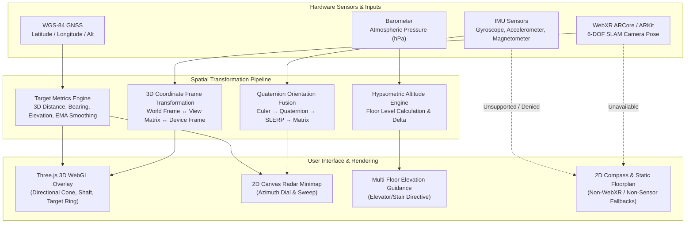
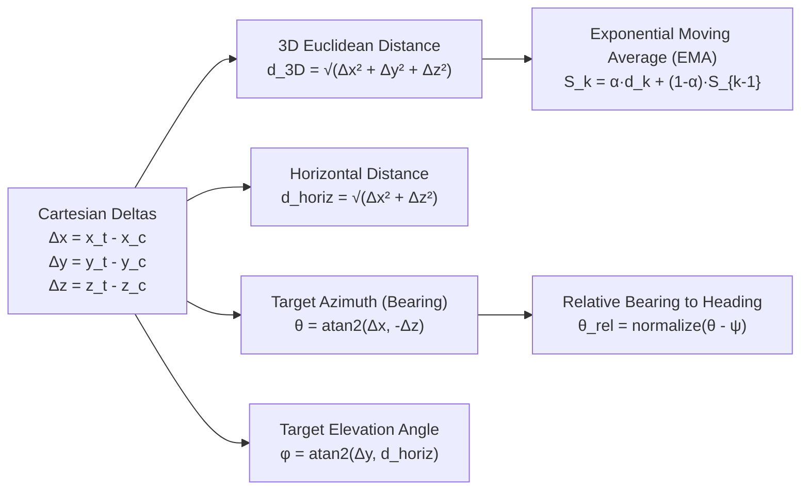

# SeatARPointer 3D Vector Transformations & Sensor Fusion Architecture

This document provides a comprehensive architectural and mathematical reference for the Augmented Reality (AR) seat navigation system in WorkSphere, centered around [`SeatARPointer.tsx`](file:///c:/Users/hr720/Desktop/WorkSphere/src/components/ar/SeatARPointer.tsx), [`CompassFallback.tsx`](file:///c:/Users/hr720/Desktop/WorkSphere/src/components/ar/CompassFallback.tsx), [`quaternionOrientation.ts`](file:///c:/Users/hr720/Desktop/WorkSphere/src/lib/spatial/quaternionOrientation.ts), and [`useDeviceOrientation.ts`](file:///c:/Users/hr720/Desktop/WorkSphere/src/hooks/useDeviceOrientation.ts).

---

## 1. System Overview & Coordinate Frames

The `SeatARPointer` component projects 3D navigational markers (directional arrow, floor locator ring, distance HUD, and 2D radar overlay) into a user's mobile display to guide them to an assigned desk or pod within a multi-floor coworking facility.



### 1.1 The Four Coordinate Spaces

Navigation in mobile AR requires rigorous transformations across four distinct spatial frames:

| Coordinate Frame                                    | Origin                                                        | Axes Orientation                                                                               | Description                                                                       |
| :-------------------------------------------------- | :------------------------------------------------------------ | :--------------------------------------------------------------------------------------------- | :-------------------------------------------------------------------------------- |
| **World Frame ($\mathcal{W}$)**                     | Venue floorplan anchor or WebXR `local-floor` reference space | Right-handed: $+X$ East, $+Y$ Up (Gravity anti-parallel), $+Z$ South (or local grid alignment) | Metric space $(x, y, z)$ in meters where desks and architectural walls are fixed. |
| **Device Frame ($\mathcal{D}$)**                    | Device geometric center                                       | $+X$ to device right, $+Y$ to top edge, $+Z$ perpendicular out of screen towards user          | W3C DeviceOrientationEvent sensor frame.                                          |
| **Camera / View Frame ($\mathcal{C}$)**             | Center of camera projection center                            | $+X$ to camera right, $+Y$ to camera top, $-Z$ pointing along optical forward axis             | Coordinate frame used by Three.js `PerspectiveCamera` and WebXR `XRViewerPose`.   |
| **Normalized Device Coordinates ($\mathcal{NDC}$)** | Center of viewport screen                                     | $[-1, 1]$ on $X$ (left/right) and $Y$ (bottom/top), $[0, 1]$ or $[-1, 1]$ on $Z$               | Screen projection for 2D radar overlay, target HUD badges, and UI indicators.     |

---

## 2. View Matrix & 3D Spatial Vector Transformations

### 2.1 World-to-Camera Transformation Matrix

In 3D graphics and WebXR, an object at world position $\mathbf{p}_w = [x_w, y_w, z_w, 1]^T$ is converted to camera space $\mathbf{p}_c = [x_c, y_c, z_c, 1]^T$ via the **View Matrix** $V$:

$$\mathbf{p}_c = V \cdot \mathbf{p}_w$$

The View Matrix is the inverse of the Camera World Matrix $M_{cam}$:

$$M_{cam} = \begin{bmatrix} R_{cam} & \mathbf{t}_{cam} \\ \mathbf{0}^T & 1 \end{bmatrix} \implies V = M_{cam}^{-1} = \begin{bmatrix} R_{cam}^T & -R_{cam}^T \mathbf{t}_{cam} \\ \mathbf{0}^T & 1 \end{bmatrix}$$

Where:

- $\mathbf{t}_{cam} = [x_{cam}, y_{cam}, z_{cam}]^T$ is the camera's translation in world coordinates.
- $R_{cam} = [\mathbf{r}_x, \mathbf{r}_y, \mathbf{r}_z]$ is the orthonormal $3 \times 3$ rotation matrix of the camera.

Expanding into row vectors $\mathbf{r}_1^T, \mathbf{r}_2^T, \mathbf{r}_3^T$ of $R_{cam}^T$:

$$V = \begin{bmatrix} r_{11} & r_{12} & r_{13} & -\mathbf{r}_1 \cdot \mathbf{t}_{cam} \\ r_{21} & r_{22} & r_{23} & -\mathbf{r}_2 \cdot \mathbf{t}_{cam} \\ r_{31} & r_{32} & r_{33} & -\mathbf{r}_3 \cdot \mathbf{t}_{cam} \\ 0 & 0 & 0 & 1 \end{bmatrix}$$

### 2.2 Seat Pointer Placement & Orientation in Camera Space

In [`SeatARPointer.tsx`](file:///c:/Users/hr720/Desktop/WorkSphere/src/components/ar/SeatARPointer.tsx#L251-L300), the 3D directional arrow is attached to a floating position directly in front of the camera, continuously oriented to face the target seat anchor:

```typescript
// 1. Vector from camera eye level to target anchor
const dirToTarget = new THREE.Vector3().subVectors(
  targetVector,
  currentCameraPos,
);

// 2. Position arrow group in front of user with vertical bobbing
arrowGroup.position.set(0, 0.8, -1.2);

// 3. Orient arrow toward world target position
arrowGroup.lookAt(targetVector.x, arrowGroup.position.y, targetVector.z);

// 4. Tilt arrow downward toward target ground plane
arrowGroup.rotateX(Math.PI / 6);
```

#### Harmonic Bobbing Function

To provide depth perception and prevent static visual occlusions, a smooth vertical bobbing offset $y_{bob}(t)$ is applied to the arrow mesh:

$$y_{bob}(t) = y_{base} + A \cdot \sin(\omega t) = 1.0 + 0.08 \cdot \sin(2.5 t)$$

---

## 3. Spherical Coordinate Conversions & Target Metrics



### 3.1 3D Distance & Metric Extraction

Given user camera position $\mathbf{p}_c = (x_c, y_c, z_c)$ and target desk anchor $\mathbf{p}_t = (x_t, y_t, z_t)$ in metric space:

$$\Delta x = x_t - x_c, \quad \Delta y = y_t - y_c, \quad \Delta z = z_t - z_c$$

#### 1. 3D Euclidean Distance

$$d_{3D} = \|\mathbf{p}_t - \mathbf{p}_c\|_2 = \sqrt{\Delta x^2 + \Delta y^2 + \Delta z^2}$$

#### 2. Horizontal Ground Plane Distance

$$d_{horiz} = \sqrt{\Delta x^2 + \Delta z^2}$$

#### 3. Vertical Elevation Delta

$$\Delta h = \Delta y = y_t - y_c$$

### 3.2 Target Bearing (Azimuth) Formula

Because Three.js uses a right-handed system where $+X$ is Right and $-Z$ is Forward (North):

$$\theta_{rad} = \operatorname{atan2}(\Delta x, -\Delta z)$$

Converting radians to normalized degrees $[0^\circ, 360^\circ)$:

$$\theta_{deg} = \left(\left(\frac{\theta_{rad} \cdot 180}{\pi}\right) \pmod{360} + 360\right) \pmod{360}$$

### 3.3 Target Elevation Angle (Pitch)

The vertical angle between the horizontal line of sight and the target seat is:

$$\phi_{elevation} = \arctan\left(\frac{\Delta h}{d_{horiz}}\right) = \arcsin\left(\frac{\Delta h}{d_{3D}}\right)$$

Where:

- $\phi > 0$: Target seat is elevated above the current camera level (e.g. upstairs floor or raised mezzanine).
- $\phi = 0$: Target seat is coplanar with current camera level.
- $\phi < 0$: Target seat is below current eye level.

### 3.4 Relative Bearing & Shortest-Arc Rotation

The relative angle $\theta_{rel}$ required to turn the device toward the target given the device's current heading $\psi_{heading}$ is:

$$\theta_{rel} = \operatorname{normalizeAngle}(\theta_{target} - \psi_{heading})$$

The shortest rotational delta $\delta \in [-180^\circ, 180^\circ]$ (positive for clockwise, negative for counter-clockwise) is computed by:

$$\delta = ((\theta_{target} - \psi_{heading} + 180) \pmod{360}) - 180$$

### 3.5 Exponential Moving Average (EMA) Distance Smoothing

To prevent rapid visual oscillation due to sensor jitter or SLAM feature drift:

$$S_k = \alpha \cdot d_k + (1 - \alpha) \cdot S_{k-1}, \quad \alpha \in [0.01, 1.0]$$

In WorkSphere, $\alpha = 0.2$ provides a 5-frame effective smoothing window with zero noticeable lag.

### 3.6 Barometric Hypsometric Multi-Floor Elevation

When navigating multi-story coworking buildings, vertical floor changes are detected using atmospheric pressure readings ($P$ in hPa) via the hypsometric barometric equation:

$$h_{baro} = 44330 \cdot \left(1 - \left(\frac{P}{P_0}\right)^{\frac{1}{5.255}}\right)$$

Where $P_0$ is baseline ground-level pressure (default $1013.25\text{ hPa}$).

The estimated floor level is calculated as:

$$\text{Floor} = \text{baseFloor} + \operatorname{round}\left(\frac{h_{baro}}{h_{floor}}\right)$$

Where $h_{floor} = 3.5\text{ m}$ (standard commercial ceiling height).

---

## 4. Euler Angle Gimbal Lock Mitigation via Quaternions

### 4.1 The Gimbal Lock Singularity Problem

W3C `DeviceOrientationEvent` emits intrinsic Tait-Bryan Euler angles:

- $\alpha \in [0^\circ, 360^\circ)$: Yaw rotation around device $Z$-axis.
- $\beta \in [-180^\circ, 180^\circ)$: Pitch rotation around device $X'$-axis.
- $\gamma \in [-90^\circ, 90^\circ)$: Roll rotation around device $Y''$-axis.

#### The Singularity:

When a user holds their smartphone upright in AR camera mode, the device pitch $\beta \to \pm 90^\circ$. At this orientation:

1. The device $Z$-axis aligns parallel with the Earth coordinate $Z$-axis (gravity).
2. The first rotation ($\alpha$) and third rotation ($\gamma$) operate around the **exact same spatial axis**.
3. The rotational transformation matrix loses a degree of freedom ($\operatorname{rank} < 3$).
4. Minute noise in sensor readings causes $\alpha$ and $\gamma$ to rapidly cancel or swing by $180^\circ$, causing violent needle spin flips in the UI.

### 4.2 Euler to Unit Quaternion Conversion

To eliminate gimbal lock, [`quaternionOrientation.ts`](file:///c:/Users/hr720/Desktop/WorkSphere/src/lib/spatial/quaternionOrientation.ts) converts Euler angles directly into a unit quaternion $\mathbf{q} = [w, x, y, z]^T$:

Given half-angles $\frac{\alpha}{2}, \frac{\beta}{2}, \frac{\gamma}{2}$:

$$ \begin{aligned}
w &= \cos\left(\frac{\alpha}{2}\right)\cos\left(\frac{\beta}{2}\right)\cos\left(\frac{\gamma}{2}\right) - \sin\left(\frac{\alpha}{2}\right)\sin\left(\frac{\beta}{2}\right)\sin\left(\frac{\gamma}{2}\right) \\
x &= \cos\left(\frac{\alpha}{2}\right)\sin\left(\frac{\beta}{2}\right)\cos\left(\frac{\gamma}{2}\right) - \sin\left(\frac{\alpha}{2}\right)\cos\left(\frac{\beta}{2}\right)\sin\left(\frac{\gamma}{2}\right) \\
y &= \sin\left(\frac{\alpha}{2}\right)\sin\left(\frac{\beta}{2}\right)\cos\left(\frac{\gamma}{2}\right) + \cos\left(\frac{\alpha}{2}\right)\cos\left(\frac{\beta}{2}\right)\sin\left(\frac{\gamma}{2}\right) \\
z &= \sin\left(\frac{\alpha}{2}\right)\cos\left(\frac{\beta}{2}\right)\cos\left(\frac{\gamma}{2}\right) + \cos\left(\frac{\alpha}{2}\right)\sin\left(\frac{\beta}{2}\right)\sin\left(\frac{\gamma}{2}\right)
\end{aligned}$$

Ensuring unit length $\|\mathbf{q}\| = 1$:

$$\hat{\mathbf{q}} = \frac{\mathbf{q}}{\sqrt{w^2 + x^2 + y^2 + z^2}}$$

### 4.3 Orthonormal 3D Rotation Matrix

From unit quaternion $\hat{\mathbf{q}}$, the $3 \times 3$ transformation matrix $R(\hat{\mathbf{q}})$ is:

$$R = \begin{bmatrix}
1 - 2(y^2 + z^2) & 2(xy - wz) & 2(xz + wy) \\
2(xy + wz) & 1 - 2(x^2 + z^2) & 2(yz - wx) \\
2(xz - wy) & 2(yz + wx) & 1 - 2(x^2 + y^2)
\end{bmatrix}$$

### 4.4 Gimbal-Lock-Free Heading Extraction

To determine horizontal True North azimuth regardless of pitch:
- Device Top ($+Y$) vector in Earth frame: $\mathbf{v}_{top} = [R_{01}, R_{11}, R_{21}]^T$
- Device Rear Camera ($-Z$) vector in Earth frame: $\mathbf{v}_{cam} = [-R_{02}, -R_{12}, -R_{22}]^T$

When upright ($\mathbf{v}_{top} \cdot \hat{\mathbf{z}}_{up} \ge 0$), we blend the top and rear vectors:

$$E = R_{01} - R_{02}, \quad N = R_{11} - R_{12}$$

When pointing down ($\mathbf{v}_{top} \cdot \hat{\mathbf{z}}_{up} < 0$):

$$E = R_{01} + R_{02}, \quad N = R_{11} + R_{12}$$

Heading azimuth is extracted smoothly via:

$$\psi = \left(\left(\frac{\operatorname{atan2}(E, N) \cdot 180}{\pi}\right) \pmod{360} + 360\right) \pmod{360}$$

### 4.5 Spherical Linear Interpolation (SLERP)

To filter high-frequency IMU sensor jitter without angular distortion, SLERP interpolates along the great-circle arc on the 4D unit hypersphere $S^3$:

$$\mathbf{q}_{interp}(t) = \operatorname{SLERP}(\mathbf{q}_1, \mathbf{q}_2, t) = \frac{\sin((1 - t)\theta)}{\sin\theta} \mathbf{q}_1 + \frac{\sin(t\theta)}{\sin\theta} \mathbf{q}_2$$

Where $\cos\theta = \mathbf{q}_1 \cdot \mathbf{q}_2$.

#### Antipodal Path Optimization:
Because $\mathbf{q}$ and $-\mathbf{q}$ represent identical 3D rotations, if $\mathbf{q}_1 \cdot \mathbf{q}_2 < 0$, we invert $\mathbf{q}_2 \to -\mathbf{q}_2$ and negate the dot product to guarantee the **shortest arc path** ($< 180^\circ$).

---

## 5. Mobile Compass Calibration & Sensor Fusion

### 5.1 Magnetometer Distortions

Mobile magnetometers are subject to two primary indoor electromagnetic distortions:

$$\mathbf{B}_{measured} = M_{soft} \cdot \mathbf{B}_{earth} + \mathbf{b}_{hard} + \mathbf{n}_{noise}$$

1. **Hard-Iron Distortion ($\mathbf{b}_{hard}$):** Permanent magnets within the phone (speakers, vibration motors, camera OIS magnets) produce a constant offset vector, shifting the measurement sphere away from the origin $(0, 0, 0)$.
2. **Soft-Iron Distortion ($M_{soft}$):** Ferromagnetic structural elements in coworking buildings (steel rebar, metal desk frames, elevator shafts) bend the magnetic field, warping the sphere into an ellipsoid.

```
       Ideal Sphere               Hard-Iron Shift           Soft-Iron Ellipsoid
         (Centered)                  (Offset)                    (Deformed)
          .-"""-.                     .-"""-.                      .---.
        .'       '.                 .'       '.                  .'     '.
       /     +     \               /     +     \                /    +    \
      |   (0,0,0)   |             |     (b)     |              (    (b)    )
       \           /               \           /                \         /
        '.       .'                 '.       .'                  '.     .'
          '-...-'                     '-...-'                      '---'
```

### 5.2 Device Calibration Motion

To calibrate the magnetometer, the operating system requires rotating the device in a three-dimensional **Figure-8 gesture**. This allows the sensor DSP to sample points across all axes, solve for the bounding ellipsoid, and compute the offset vector $\mathbf{b}_{hard}$ and deformation matrix $M_{soft}^{-1}$.

### 5.3 Circular 1D Kalman Filtering

Because compass angles wrap around $0^\circ / 360^\circ$, linear Kalman filters fail at the North boundary. WorkSphere utilizes a **Circular Kalman Filter** ([`CompassKalmanFilter`](file:///c:/Users/hr720/Desktop/WorkSphere/src/lib/spatial/compassFilter.ts)):

$$\tilde{y}_k = (z_k - \hat{x}_{k|k-1} + 180) \pmod{360} - 180$$

$$\hat{x}_{k|k} = (\hat{x}_{k|k-1} + K_k \tilde{y}_k + 360) \pmod{360}$$

---

## 6. Permissions & Multi-Tier Fallback Cascade

### 6.1 Capability Detection Flow

```mermaid
flowchart TD
    Init["SeatARPointer Initialization"] --> XRCheck{"navigator.xr &&<br/>isSessionSupported('immersive-ar')"}

    XRCheck -->|Supported| ReqXR["Request WebXR Session<br/>('local-floor' space)"]
    ReqXR -->|Granted| ARMode["Tier 1: WebXR Immersive 3D AR<br/>Three.js Camera & Directional Pointer"]
    ReqXR -->|Denied / Failed| FallbackTier

    XRCheck -->|Unsupported| FallbackTier["Enter Fallback Cascade"]

    FallbackTier --> OrientCheck{"DeviceOrientationEvent<br/>Available in Browser?"}

    OrientCheck -->|Yes| IOSCheck{"iOS 13+ DeviceOrientationEvent.<br/>requestPermission?"}

    IOSCheck -->|Yes| PromptUser["Show 'Allow Sensor Access' Prompt<br/>(Requires User Click Gesture)"]
    PromptUser --> UserClick["User Taps Allow"]
    UserClick --> ReqPerm{"requestPermission()"}
    ReqPerm -->|Granted| CompassMode["Tier 2: CompassFallback<br/>Quaternion SLERP + 2D Dial Overlay"]
    ReqPerm -->|Denied| StaticMode["Tier 3: 2D Static Floorplan Map<br/>Distance & Elevation Badges Only"]

    IOSCheck -->|No (Android / Chrome)| AutoAttach["Attach 'deviceorientationabsolute'<br/>or 'deviceorientation'"]
    AutoAttach --> CompassMode

    OrientCheck -->|No (Desktop / Laptop)| StaticMode
```

### 6.2 Browser & Device Fallback Matrix

| Environment | Primary Technology | Fallback Level | Behavior |
| :--- | :--- | :--- | :--- |
| **Android Chrome (ARCore)** | WebXR `immersive-ar` | Tier 1 (Full AR) | Real-world camera pass-through, 6-DOF tracking, 3D floating arrow, 2D radar overlay. |
| **iOS Safari 13+** | WebXR unsupported | Tier 2 (Compass) | Requires user interaction to call `requestPermission()`. Uses `webkitCompassHeading`, Quaternion SLERP, and rotating 2D compass dial. |
| **Desktop / Laptop** | No gyroscope/magnetometer | Tier 3 (Static) | Renders `FallbackMap.tsx` with static venue layout, desk coordinates, distance badge, and manual floor switcher. |
| **Sensor Permission Denied** | User blocked motion access | Tier 3 (Static) | Displays diagnostic warning: `"Orientation permission denied. Enable Motion & Orientation Access in Settings."` |

---

## 7. Reference Implementations

### 7.1 TypeScript Reference Implementation

```typescript
import * as THREE from "three";

export interface SpatialAnchor {
  x: number;
  y: number;
  z: number;
}

export interface NavigationMetrics {
  distance3D: number;
  horizontalDistance: number;
  elevationDelta: number;
  targetBearingDeg: number;
  elevationAngleDeg: number;
}

/**
 * Computes spatial navigational metrics between camera pose and desk anchor.
 */
export function calculateNavMetrics(
  cameraPos: SpatialAnchor,
  targetAnchor: SpatialAnchor,
): NavigationMetrics {
  const dx = targetAnchor.x - cameraPos.x;
  const dy = targetAnchor.y - cameraPos.y;
  const dz = targetAnchor.z - cameraPos.z;

  const distance3D = Math.sqrt(dx * dx + dy * dy + dz * dz);
  const horizontalDistance = Math.sqrt(dx * dx + dz * dz);
  const elevationDelta = dy;

  // Bearing: atan2(dx, -dz) aligned with Three.js coordinate system (-Z = forward)
  const bearingRad = Math.atan2(dx, -dz);
  const targetBearingDeg = ((bearingRad * (180 / Math.PI)) % 360 + 360) % 360;

  // Elevation angle: pitch angle to target
  const elevationAngleRad = Math.atan2(dy, horizontalDistance);
  const elevationAngleDeg = elevationAngleRad * (180 / Math.PI);

  return {
    distance3D,
    horizontalDistance,
    elevationDelta,
    targetBearingDeg,
    elevationAngleDeg,
  };
}

/**
 * Normalizes Euler angles to a unit quaternion avoiding gimbal lock.
 */
export function eulerToQuaternion(alphaDeg: number, betaDeg: number, gammaDeg: number) {
  const a = (alphaDeg * Math.PI) / 360;
  const b = (betaDeg * Math.PI) / 360;
  const g = (gammaDeg * Math.PI) / 360;

  const ca = Math.cos(a), sa = Math.sin(a);
  const cb = Math.cos(b), sb = Math.sin(b);
  const cg = Math.cos(g), sg = Math.sin(g);

  // Intrinsic Z-X'-Y'' rotation sequence
  return new THREE.Quaternion(
    ca * sb * cg - sa * cb * sg, // x
    sa * sb * cg + ca * cb * sg, // y
    sa * cb * cg + ca * sb * sg, // z
    ca * cb * cg - sa * sb * sg  // w
  ).normalize();
}
```

### 7.2 Python Reference Implementation

```python
"""
Seat AR Pointer Navigation Engine Reference Implementation
"""
import math
import numpy as np

def calculate_navigation_metrics(camera_pos, target_pos):
    """
    Computes 3D distance, ground distance, azimuth bearing, and pitch elevation.

    :param camera_pos: Tuple (x, y, z) in meters
    :param target_pos: Tuple (x, y, z) in meters
    :return: dict with spatial metrics
    """
    dx = target_pos[0] - camera_pos[0]
    dy = target_pos[1] - camera_pos[1]
    dz = target_pos[2] - camera_pos[2]

    dist_3d = math.sqrt(dx**2 + dy**2 + dz**2)
    dist_horiz = math.sqrt(dx**2 + dz**2)

    # Bearing in degrees [0, 360) where -Z is 0° (North), +X is 90° (East)
    bearing_rad = math.atan2(dx, -dz)
    bearing_deg = (math.degrees(bearing_rad) % 360 + 360) % 360

    # Elevation pitch in degrees
    elev_rad = math.atan2(dy, dist_horiz) if dist_horiz > 1e-6 else 0.0
    elev_deg = math.degrees(elev_rad)

    return {
        "distance_3d_meters": round(dist_3d, 2),
        "horizontal_distance_meters": round(dist_horiz, 2),
        "elevation_delta_meters": round(dy, 2),
        "target_bearing_degrees": round(bearing_deg, 1),
        "elevation_angle_degrees": round(elev_deg, 1),
    }

def euler_to_quaternion(alpha_deg, beta_deg, gamma_deg):
    """
    Converts W3C DeviceOrientation Euler angles to normalized unit quaternion.
    Rotation order: Z(alpha) -> X'(beta) -> Y''(gamma)
    """
    a = math.radians(alpha_deg) / 2.0
    b = math.radians(beta_deg) / 2.0
    g = math.radians(gamma_deg) / 2.0

    ca, sa = math.cos(a), math.sin(a)
    cb, sb = math.cos(b), math.sin(b)
    cg, sg = math.cos(g), math.sin(g)

    w = ca * cb * cg - sa * sb * sg
    x = ca * sb * cg - sa * cb * sg
    y = sa * sb * cg + ca * cb * sg
    z = sa * cb * cg + ca * sb * sg

    norm = math.sqrt(w*w + x*x + y*y + z*z)
    return np.array([x / norm, y / norm, z / norm, w / norm])

def quaternion_to_heading(q):
    """
    Extracts True North compass heading from quaternion without gimbal lock flips.
    q = [x, y, z, w]
    """
    x, y, z, w = q
    # Rotation matrix elements
    r01 = 2 * (x * y - w * z)
    r11 = 1 - 2 * (x * x + z * z)
    r02 = 2 * (x * z + w * y)
    r12 = 2 * (y * z - w * x)

    # Blended horizontal vector
    east = r01 - r02
    north = r11 - r12

    heading_rad = math.atan2(east, north)
    return (math.degrees(heading_rad) % 360 + 360) % 360

if __name__ == "__main__":
    cam = (0.0, 1.2, 0.0)      # User eye level (1.2m) at origin
    desk = (2.5, 0.8, -4.0)    # Desk 2.5m East, 4m Forward, 0.8m height

    metrics = calculate_navigation_metrics(cam, desk)
    print("Navigation Metrics:", metrics)

    # Simulate phone held vertically in AR mode (pitch beta = 85 deg)
    q = euler_to_quaternion(45.0, 85.0, 0.0)
    heading = quaternion_to_heading(q)
    print(f"Extracted Compass Heading (Beta=85°): {heading:.1f}°")
```

---

## 8. Summary Checklist for Developers

When implementing or modifying AR pointer features in WorkSphere:

1. **Coordinate Verification:** Confirm whether inputs are in world local-floor meters, WGS-84 GNSS coordinates, or camera view space before applying translations.
2. **Singularity Protection:** Always route orientation inputs through [`QuaternionOrientationFilter`](file:///c:/Users/hr720/Desktop/WorkSphere/src/lib/spatial/quaternionOrientation.ts) rather than directly inspecting Euler angles $\alpha$ and $\beta$.
3. **Distance Filtering:** Apply `applyDistanceSmoothing` with $\alpha \le 0.3$ to suppress SLAM visual jitter.
4. **Sensor Permissions:** Ensure iOS Safari users are presented with a direct button tap gesture to invoke `requestPermission()`.
5. **Multi-Floor Awareness:** Check `isWrongLevel` before displaying on-level arrows; guide the user to stairs or elevators when $|\Delta h| > 1.5\text{ m}$.
$$
