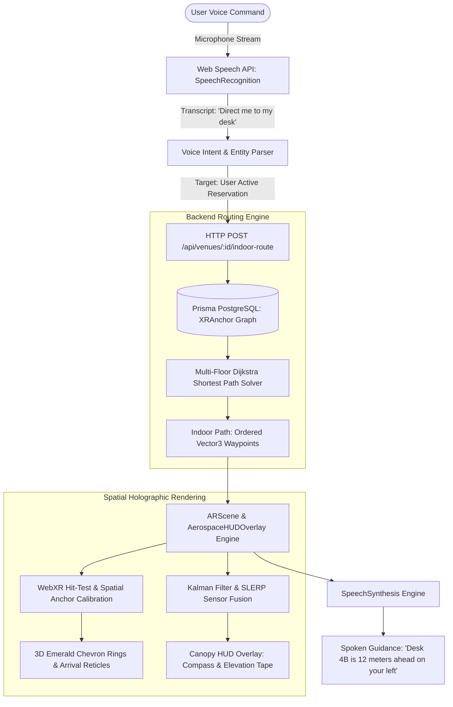
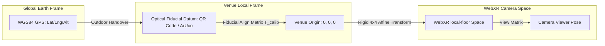
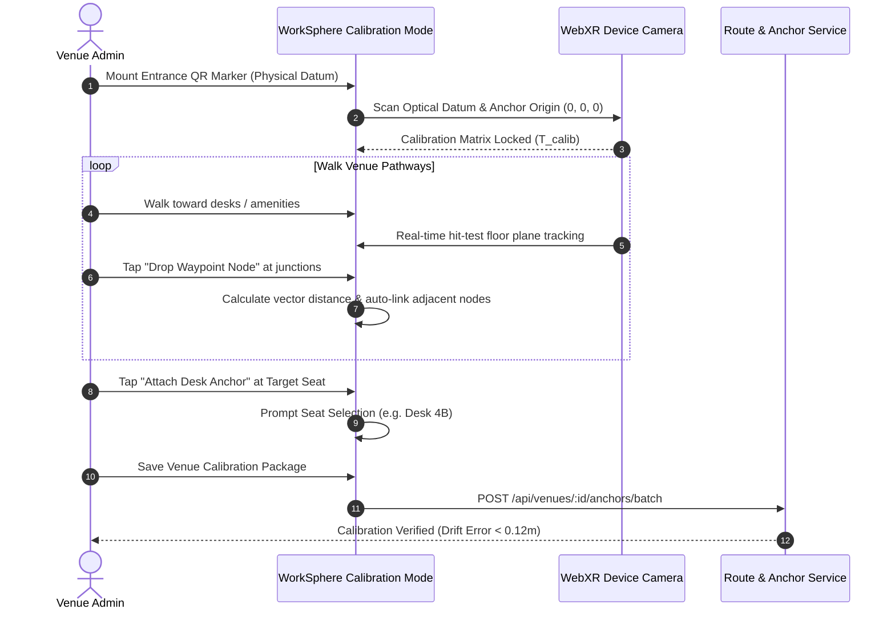

# Voice-Guided WebXR Spatial Desk Navigation & Real-Time HUD Waypoint Guidance

## 1. Executive Summary & Problem Statement

WorkSphere provides 2D Leaflet road routing and an experimental AR camera overlay (`AerospaceHUDOverlay.tsx`). However, when nomadic workers arrive inside expansive, multi-story coworking venues or flexible office campuses, 2D outdoor GPS signals degrade due to structural attenuation. Users carrying laptops, backpacks, and luggage cannot easily navigate hands-free to their specific reserved desks, phone booths, or conference rooms while continually glancing down at mobile touchscreens.

This specification details the architecture for **Voice-Guided WebXR Spatial Desk Navigation**, connecting outdoor arrival detection to indoor micro-location anchors. Workers can issue natural voice queries inside an active WebXR session (e.g., _"Direct me to my desk"_ or _"Where is the quiet zone?"_), while the system projects 3D holographic waypoint chevron beacons onto camera space and announces contextual spatial audio prompts.

---

## 2. High-Level System Architecture & Data Flow



---

## 3. Frontend Voice & Spatial Navigation Engine

The frontend spatial engine extends `AerospaceHUDOverlay.tsx` and `ARScene.tsx` by introducing:

1. **Hands-free speech recognition** via standard `window.SpeechRecognition` / `webkitSpeechRecognition`.
2. **Contextual speech synthesis** using `window.speechSynthesis`.
3. **3D holographic directional chevron rings** projected in WebXR camera space.

### 3.1 Speech Recognition Grammar & Intent Mapping

The speech recognition engine runs in continuous listening mode when an AR session is active:

```typescript
export interface VoiceNavigationIntent {
  action: "NAVIGATE" | "CANCEL" | "STATUS" | "QUERY_AMENITY";
  targetType?: "DESK" | "BOOTH" | "PRINTER" | "RESTROOM" | "EXIT" | "COFFEE";
  targetIdentifier?: string; // e.g. "D-14", "Quiet Zone"
}

export function parseVoiceNavigationCommand(
  transcript: string,
): VoiceNavigationIntent | null {
  const normalized = transcript.trim().toLowerCase();

  if (
    normalized.includes("stop") ||
    normalized.includes("cancel") ||
    normalized.includes("exit navigation")
  ) {
    return { action: "CANCEL" };
  }

  if (
    normalized.includes("where am i") ||
    normalized.includes("status") ||
    normalized.includes("distance")
  ) {
    return { action: "STATUS" };
  }

  if (
    normalized.includes("my desk") ||
    normalized.includes("reserved desk") ||
    normalized.includes("booked seat")
  ) {
    return { action: "NAVIGATE", targetType: "DESK" };
  }

  if (normalized.includes("phone booth") || normalized.includes("call booth")) {
    return { action: "NAVIGATE", targetType: "BOOTH" };
  }

  if (normalized.includes("printer") || normalized.includes("scanner")) {
    return { action: "NAVIGATE", targetType: "PRINTER" };
  }

  if (
    normalized.includes("restroom") ||
    normalized.includes("bathroom") ||
    normalized.includes("toilet")
  ) {
    return { action: "NAVIGATE", targetType: "RESTROOM" };
  }

  return null;
}
```

### 3.2 Contextual Spatial Speech Synthesis

Distance announcements calculate the relative clock-face angle between the user's heading vector and the vector to the next waypoint:

$$\theta_{\text{rel}} = \text{atan2}(V_{\text{target}.x} - V_{\text{cam}.x}, V_{\text{target}.z} - V_{\text{cam}.z}) - \psi_{\text{heading}}$$

Based on $\theta_{\text{rel}}$, the speech synthesis announces:

- **$-30^\circ$ to $+30^\circ$**: _"Straight ahead"_
- **$+30^\circ$ to $+90^\circ$**: _"Slightly on your right"_
- **$+90^\circ$ to $+150^\circ$**: _"Sharp right"_
- **$-30^\circ$ to $-90^\circ$**: _"Slightly on your left"_
- **$-90^\circ$ to $-150^\circ$**: _"Sharp left"_

Audio cues trigger at key distance milestones:

- Initial route start: _"Navigating to Desk 4B on Floor 2. 24 meters total."_
- Floor transition: _"Take the elevator to Floor 2."_
- Proximity warning: _"Desk 4B is 4 meters ahead on your left."_
- Arrival: _"You have arrived at your reserved desk."_

---

## 4. Backend Route API & Graph Traversal

### 4.1 Endpoint Specification

```http
POST /api/venues/:id/indoor-route
Content-Type: application/json
```

#### Request Payload

```json
{
  "startAnchorId": "anchor-entrance-fl1",
  "startCoordinates": { "x": 0.0, "y": 0.0, "z": 0.0, "floorLevel": 1 },
  "targetType": "DESK",
  "targetId": "seat-desk-4b",
  "accessibleOnly": false
}
```

#### Response Payload

```json
{
  "routeId": "rte-indoor-849102",
  "totalDistanceMeters": 18.4,
  "estimatedWalkingSeconds": 22,
  "floorTransitions": [
    {
      "fromFloor": 1,
      "toFloor": 2,
      "transitionType": "STAIRS",
      "atAnchorId": "anchor-stairs-fl1"
    }
  ],
  "waypoints": [
    {
      "id": "anchor-entrance-fl1",
      "x": 0.0,
      "y": 0.0,
      "z": 0.0,
      "floorLevel": 1,
      "instruction": "Proceed forward toward main atrium"
    },
    {
      "id": "anchor-stairs-fl1",
      "x": 8.5,
      "y": 0.0,
      "z": -12.0,
      "floorLevel": 1,
      "instruction": "Ascend stairs to Floor 2"
    },
    {
      "id": "anchor-hallway-fl2",
      "x": 8.5,
      "y": 3.8,
      "z": -12.0,
      "floorLevel": 2,
      "instruction": "Turn left down Corridor B"
    },
    {
      "id": "anchor-desk-4b",
      "x": 2.2,
      "y": 3.8,
      "z": -18.4,
      "floorLevel": 2,
      "instruction": "Desk 4B is on your left"
    }
  ]
}
```

### 4.2 Multi-Floor Dijkstra Graph Solver

Indoor topological networks are represented as an adjacency matrix with Euclidean edge weights:

$$w(u, v) = \sqrt{(x_v - x_u)^2 + (z_v - z_u)^2} + \lambda_{\text{transition}} \cdot |y_v - y_u|$$

Where:

- $\lambda_{\text{transition}}$ penalizes vertical floor movements (elevators/stairs) to favor contiguous horizontal walking paths when feasible.
- Edge weights for stairs are set to $\infty$ when `accessibleOnly: true`, forcing routing through ramp and elevator nodes.

---

## 5. Database Schema: Enhanced `XRAnchor` Model

The Prisma schema incorporates spatial navigation nodes and connectivity adjacency vectors:

```prisma
enum XRNodeType {
  ENTRANCE
  WAYPOINT
  DESK
  PHONE_BOOTH
  MEETING_ROOM
  PRINTER
  RESTROOM
  STAIRS
  ELEVATOR
  EMERGENCY_EXIT
}

model XRAnchor {
  id                 String     @id @default(cuid())
  venueId            String
  venue              Venue      @relation(fields: [venueId], references: [id], onDelete: Cascade)

  nodeType           XRNodeType @default(WAYPOINT)
  name               String
  description        String?
  floorLevel         Int        @default(1)

  // 3D Spatial coordinates relative to venue primary datum anchor (meters)
  x                  Float
  y                  Float
  z                  Float

  // Orientation quaternion of target (desk facing direction)
  qx                 Float      @default(0.0)
  qy                 Float      @default(0.0)
  qz                 Float      @default(0.0)
  qw                 Float      @default(1.0)

  // Graph connectivity: adjacency IDs
  adjacentAnchorIds  String[]   @default([])

  // Linked entity references
  linkedSeatId       String?
  linkedAmenityId    String?

  isAccessible       Boolean    @default(true)
  isActive           Boolean    @default(true)
  createdAt          DateTime   @default(now())
  updatedAt          DateTime   @updatedAt

  @@index([venueId, floorLevel])
  @@index([venueId, nodeType])
}
```

---

## 6. WebXR Coordinate Transformations & Spatial Math



### 6.1 Calibration Transform Matrix

When the user scans an optical QR datum at the venue entrance, WebXR establishes the rigid body transformation matrix $\mathbf{T}_{\text{calib}}$ mapping the venue coordinate frame to WebXR's `local-floor` reference space:

$$\mathbf{P}_{\text{WebXR}} = \mathbf{T}_{\text{calib}} \cdot \mathbf{P}_{\text{Venue}} = \begin{bmatrix} \mathbf{R}_{3 \times 3} & \mathbf{t}_{3 \times 1} \\ \mathbf{0}_{1 \times 3} & 1 \end{bmatrix} \begin{bmatrix} x \\ y \\ z \\ 1 \end{bmatrix}$$

Where:

- $\mathbf{R}_{3 \times 3}$ is the 3D rotation matrix aligning the entrance fiducial normal with venue True North.
- $\mathbf{t}_{3 \times 1}$ is the translation offset from the physical datum marker.

### 6.2 Drift Mitigation & Quaternion SLERP

Device inertial measurement units (IMUs) exhibit drift over extended walking distances. WorkSphere mitigates tracking divergence through two mechanisms:

1. **Periodic Hit-Test Plane Re-centering**: Tabletop planes detected via `XRSession.requestHitTestSource` dynamically snap vertical $Y$ coordinates to physical floor and desk planes.
2. **Spherical Linear Interpolation (SLERP)**: Compass orientations are filtered using unit quaternions via `quaternionSlerp` with a factor $\alpha = 0.25$, preventing sudden 180° gimbal lock needle flips at steep pitch angles ($\pm 90^\circ$).

---

## 7. Venue Spatial Anchor Calibration Workflow

Venue administrators calibrate indoor floorplans via the following standard operating procedure:



### Calibration Accuracy Criteria

- **Maximum Tolerable Datum Drift**: $\le 0.15\text{ m}$ across 30 meters of walking.
- **Node Spacing**: Spaced at maximum intervals of $5.0\text{ meters}$ along open corridors and at every $90^\circ$ turn or branch point.
- **Floor Datum Offset**: Each floor level must possess at least one primary reference datum near elevator/stairwells.

---

## 8. Fallback 2D Step-by-Step Guidance

On legacy hardware, desktop browsers, or mobile devices lacking WebXR (`navigator.xr`) or Web Speech API support, the navigation interface falls back seamlessly to a high-contrast 2D tactical card overlay:

1. **Top Directional Banner**: Displays next turn icon (turn left, straight, stairs) and remaining distance to turn.
2. **Accessible Route Switch**: Toggle switch enforcing step-free ramp/elevator routing.
3. **Interactive Step-by-Step List**:
   - Step 1: _Walk straight from Main Entrance (12m)_
   - Step 2: _Turn left at Atrium Stairs and take elevator to Floor 2_
   - Step 3: _Proceed down Corridor B (6m)_
   - Step 4: _Arrive at Desk 4B on your left_
4. **Manual Voice Input Fallback**: Quick-tap action chips (`"Desk 4B"`, `"Quiet Booth"`, `"Restroom"`) allowing one-touch route initialization without voice permissions.

---

## 9. Security, Privacy & Performance Specifications

### 9.1 Microphone Audio Privacy

- Speech recognition is gated strictly behind explicit user interaction (microphone toggle button in HUD).
- Audio streams are processed locally using on-device browser speech engines whenever supported by the client OS.
- Raw audio waveforms are never persisted to disk or transmitted to remote cloud transcription services.

### 9.2 Rendering & Battery Optimization

- **Shader Level of Detail (LOD)**: Waypoint chevron ring meshes beyond 15 meters render with reduced vertex counts and disabled glow shaders.
- **Animation Loop Throttling**: When the device is stationary ($v < 0.05\text{ m/s}$ for $> 3\text{ seconds}$), hit-test raycasting frequency drops from $60\text{ Hz}$ to $10\text{ Hz}$ to conserve battery and reduce thermal throttling.
- **Audio Concurrency Throttling**: Voice announcements are debounced by a minimum cooldown of $4.0\text{ seconds}$ to prevent overlapping speech synthesizer interruptions.
