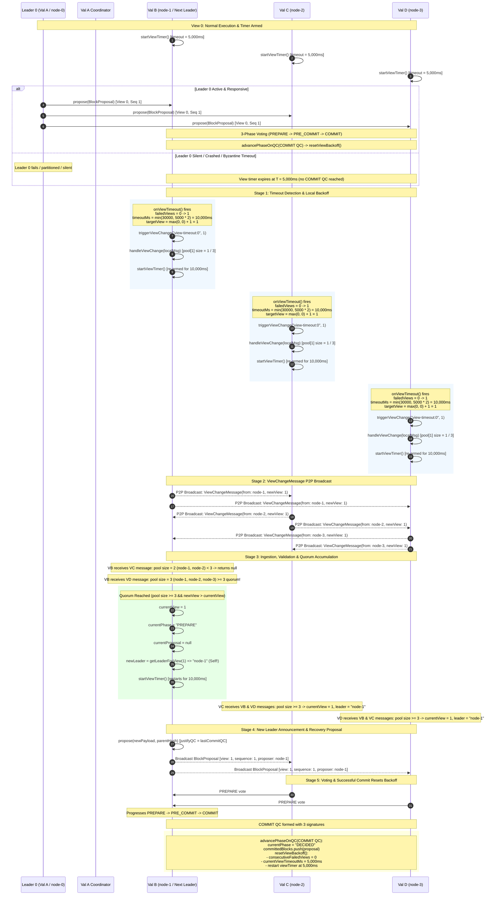

# BFT Consensus View-Change and Leader Failover Architecture

**Location:** `src/core/consensus/BFTConsensusCoordinator.ts`  
**Related Specs:**

- [`BFT_CONSENSUS_COORDINATOR.md`](../consensus/BFT_CONSENSUS_COORDINATOR.md) — Protocol quorums, phases, and operations
- [`BFT_COORDINATOR_THREAT_MODEL.md`](../consensus/BFT_COORDINATOR_THREAT_MODEL.md) — Byzantine adversary model and threat analysis
- [`VerifiableBFTQuorumCertificateProver.ts`](../../src/core/zkp/VerifiableBFTQuorumCertificateProver.ts) — ZKP circuit proofs for aggregate QC signatures

---

## 1. Overview

The `BFTConsensusCoordinator` implements an in-memory, deterministic Byzantine Fault Tolerant (BFT) consensus engine inspired by PBFT and HotStuff. In distributed state machine replication, consensus guarantees that a cluster of distributed nodes agrees on an identical, append-only linear sequence of committed blocks despite arbitrary hardware crashes, message delays, network partitions, or active Byzantine (adversarial) behavior from up to $f$ participating validators.

Consensus execution is structured into sequential epochs called **views** (tracked via `currentView: number`). In every view, a single validator serves as the designated **leader** (or proposer), responsible for packaging transactions into a `BlockProposal<T>` and driving the multi-phase voting pipeline (`PREPARE` $\to$ `PRE_COMMIT` $\to$ `COMMIT` $\to$ `DECIDED`).

However, distributed systems operating over partially synchronous or asynchronous networks face two primary failure modes:

1. **Crash / Omission Faults:** The current leader crashes, becomes partitioned, or stops transmitting proposals.
2. **Byzantine Faults:** A malicious leader equivocates (proposes conflicting blocks to different subsets of validators), deliberately stalls the round, or broadcasts invalid blocks.

Without an automated view-change and leader failover mechanism, an unresponsive leader causes **liveness failure**, halting consensus progress indefinitely. The view-change subsystem ensures system liveness by providing a deterministic, timeout-governed leader rotation mechanism with exponential backoff that enables non-faulty validators to abandon unresponsive leaders and converge on a new operational view without sacrificing safety.

### Safety vs. Liveness

| Property                                           | Definition                                                                                   | How `BFTConsensusCoordinator` Enforces It                                                                                                                                                                                                                                                                                                                                                                                 |
| :------------------------------------------------- | :------------------------------------------------------------------------------------------- | :------------------------------------------------------------------------------------------------------------------------------------------------------------------------------------------------------------------------------------------------------------------------------------------------------------------------------------------------------------------------------------------------------------------------ |
| **Safety** ("Nothing bad happens")                 | Honest nodes never commit conflicting blocks at the same sequence height.                    | - Requires supermajority ($2f + 1$) quorum votes for any phase transition.<br>- Detects and slashes validator equivocation (double-signing).<br>- Only the designated deterministic leader (`validators[view % N]`) may propose for a view.<br>- Blocks require three sequential QCs before committing to `committedBlocks`.                                                                                              |
| **Liveness** ("Something good eventually happens") | Valid transactions are eventually committed, and the system never remains permanently stuck. | - Configurable view timers (`startViewTimer()`) detect stalled leaders.<br>- Timeout broadcast mechanism (`onViewChangeBroadcast`) disseminates `ViewChangeMessage` declarations.<br>- Deterministic round-robin leader succession ensures faulty leaders are eventually bypassed.<br>- Exponential timeout backoff prevents cascading failovers under transient network delays, resetting immediately upon block commit. |

### Validator Roles in the Failover Lifecycle

- **Current Leader (`validators[currentView % N]`):** Expected to propose blocks and drive voting rounds within the configured view-change timeout window.
- **Participating Validators (`validators`):** Arm view timers (`startViewTimer()`). If no commit QC arrives before expiration, each validator independently triggers a view change, broadcasts a signed `ViewChangeMessage`, and buffers peer declarations in its in-memory pool.
- **New Leader (`validators[newView % N]`):** Selected deterministically upon collection of a $2f+1$ view-change quorum. Upon local view advancement to `newView`, it generates a new proposal referencing the highest committed `justifyQC`.

---

## 2. Core Terminology

- **View (`currentView: number`):** A monotonically increasing consensus epoch. Every view has a single deterministic leader. View transitions occur when a view change is triggered and achieves quorum.
- **Current Leader:** The designated proposer for the current view, evaluated via `getLeaderForView(view)` as `validators[view % validators.length]`.
- **Pacemaker / View-Change Timer (`viewTimer`):** An internal timeout mechanism configured via `viewChangeTimeoutMs` (default: 5,000 ms) and `maxViewChangeTimeoutMs` (default: 30,000 ms). It guards against unresponsive leaders by triggering failover upon expiration.
- **ViewChangeMessage:** An in-memory wire declaration emitted by a validator requesting transition to a higher view:
  ```ts
  export interface ViewChangeMessage {
    fromNodeId: string;
    newView: number;
    lastCommitQC?: QuorumCertificate;
    signature: string;
    timestamp: number;
  }
  ```
- **Validator:** An authorized participant identified by a unique `nodeId` in `config.validators`. The validator list is sorted upon coordinator construction.
- **Byzantine Fault ($f$):** A failure mode where a node may crash, delay messages, drop packets, or arbitrarily deviate from protocol rules (e.g., equivocation, spoofing).
- **Fault Tolerance Parameter $f$:** The maximum number of Byzantine nodes tolerated by the cluster. In WorkSphere, $f = \lfloor(N - 1) / 3\rfloor$, where $N$ is the total validator count.
- **Quorum Size ($2f + 1$):** The minimum number of distinct validator votes or view-change messages required to achieve consensus or advance views:
  $$\text{quorumSize} = 2f + 1 \quad (\text{with fallback to } \lfloor 2N/3 \rfloor + 1 \text{ if } 2f + 1 \le 0)$$
- **Quorum Certificate (QC):** An aggregated artifact containing $2f + 1$ cryptographic signatures from distinct authorized validators endorsing a specific block hash, view, sequence, and phase (`PREPARE`, `PRE_COMMIT`, or `COMMIT`).
- **View-Change Quorum Evidence:** A collection of at least $2f + 1$ distinct validator `ViewChangeMessage` declarations for a specific `newView` buffered in `viewChangePool`.
- **Exponential Backoff:** A mechanism where `currentViewTimeoutMs` doubles on each consecutive uncommitted view timeout (`min(maxViewChangeTimeoutMs, currentViewTimeoutMs * 2)`), preventing premature failover during network latency spikes.

---

## 3. Architectural Sequence Diagram

The following sequence diagram details the complete view-change and leader failover lifecycle for an $N = 4$ validator cluster ($f = 1$, $\text{quorumSize} = 3$), where **Validator A** (`node-0`, Leader 0) crashes or becomes unresponsive, triggering failover to **Validator B** (`node-1`, Leader 1).



---

## 4. View-Change Lifecycle

The view-change lifecycle is executed across distinct sequential stages governed by state variables and methods in `BFTConsensusCoordinator`:

```
+--------------------------------------------------------------------------------------------------+
|                                    VIEW-CHANGE LIFECYCLE                                         |
+--------------------------------------------------------------------------------------------------+
|                                                                                                  |
|  [ 1. Timer Armed ]                                                                              |
|         | startViewTimer() -> setTimeout(onViewTimeout, currentViewTimeoutMs)                    |
|         v                                                                                        |
|  [ 2. Timeout Fired ]                                                                            |
|         | onViewTimeout(): targetView = max(currentView, highestRequestedView) + 1               |
|         | consecutiveFailedViews++, currentViewTimeoutMs = min(maxTimeout, currentTimeout * 2)   |
|         v                                                                                        |
|  [ 3. Local Trigger ]                                                                            |
|         | triggerViewChange(reason, targetView): creates ViewChangeMessage with SHA-256 signature|
|         | Ingests own message locally via handleViewChange(msg)                                  |
|         v                                                                                        |
|  [ 4. Network Broadcast ]                                                                        |
|         | Dispatches msg via onViewChangeBroadcastCallback(msg)                                  |
|         v                                                                                        |
|  [ 5. Message Ingestion & Filtering ]                                                            |
|         | handleViewChange(msg): verifies fromNodeId in validators                               |
|         | Buffers in viewChangePool.get(newView).set(fromNodeId, msg) [deduplication]            |
|         v                                                                                        |
|  [ 6. Quorum Evaluation ]                                                                        |
|         | If pool.size >= quorumSize (2f + 1) AND newView > currentView:                         |
|         v                                                                                        |
|  [ 7. View Advancement & Leader Rotation ]                                                       |
|         | currentView = newView, currentPhase = "PREPARE", currentProposal = null                |
|         | newLeader = getLeaderForView(currentView) = validators[currentView % N]                |
|         | if (viewTimerActive) startViewTimer() [re-arm with backed-off interval]                |
|         v                                                                                        |
|  [ 8. New Proposal & Recovery ]                                                                  |
|         | newLeader calls propose(payload) with justifyQC = lastCommitQC                         |
|         | Normal 3-phase consensus voting resumes                                                |
|         v                                                                                        |
|  [ 9. Backoff Reset ]                                                                            |
|         | advancePhaseOnQC(COMMIT QC): resetViewBackoff()                                        |
|         | consecutiveFailedViews = 0, currentViewTimeoutMs = viewChangeTimeoutMs                 |
+--------------------------------------------------------------------------------------------------+
```

### Stage 1: Timer Armed & Pacemaker Monitoring

- **Method:** `startViewTimer()`
- **State Fields:** `viewTimerActive = true`, `viewTimer: ReturnType<typeof setTimeout> | null`
- **Behavior:** Clears any existing timer handle via `clearViewTimerHandle()`. Instantiates a new timer scheduled for `currentViewTimeoutMs`. Timers are unreferenced via `unref?.()` to avoid keeping Node.js processes alive in CLI or test contexts.

### Stage 2: Timeout Detection

- **Method:** `onViewTimeout()`
- **State Fields:** `highestRequestedView`, `consecutiveFailedViews`, `currentViewTimeoutMs`
- **Behavior:** Fires when no `COMMIT` QC is processed before `currentViewTimeoutMs` elapses. Calculates the next view target:
  ```ts
  const targetView = Math.max(this.currentView, this.highestRequestedView) + 1;
  this.highestRequestedView = targetView;
  ```
  Increments `consecutiveFailedViews` and doubles `currentViewTimeoutMs` up to `maxViewChangeTimeoutMs`.

### Stage 3: View-Change Initiation

- **Method:** `triggerViewChange(reason: string, requestedView?: number): ViewChangeMessage`
- **State Fields:** `nodeId`, `currentView`, `lastCommitQC`
- **Behavior:** Constructs a `ViewChangeMessage` targeting `requestedView ?? this.currentView + 1`. Generates a deterministic SHA-256 signature over `${nodeId}:NEW_VIEW:${targetView}:${reason}` and attaches `lastCommitQC`. Calls `this.handleViewChange(msg)` locally so the sender's own declaration is immediately added to its view-change pool.

### Stage 4: Message Broadcast

- **Callback:** `onViewChangeBroadcastCallback?: (msg: ViewChangeMessage) => void`
- **Behavior:** Invoked in `onViewTimeout()` immediately following `triggerViewChange()`. The host application forwards this payload to peer validators over the network transport (e.g., WebRTC mesh, WebSocket, GossipSub).

### Stage 5: Inbound Message Ingestion & Validation

- **Method:** `handleViewChange(msg: ViewChangeMessage): { newLeader: string; view: number } | null`
- **State Fields:** `validators`, `viewChangePool: Map<number, Map<string, ViewChangeMessage>>`
- **Validation Rules:**
  1. **Membership Verification:** `if (!this.validators.includes(msg.fromNodeId)) return null;`
  2. **Deduplication:** Stored in `viewChangePool.get(msg.newView)!.set(msg.fromNodeId, msg)`. Multiple messages from the same validator for the same view overwrite earlier entries; each validator contributes at most one vote per target view.

### Stage 6: Quorum Evaluation & Evidence Accumulation

- **Condition:** `if (pool.size >= this.quorumSize && msg.newView > this.currentView)`
- **Behavior:** Checks whether the pool contains at least `quorumSize` ($2f + 1$) distinct validator messages and verifies that `newView` strictly exceeds `currentView`. If true, the transition proceeds; otherwise, returns `null`.

### Stage 7: View Advancement & Leader Rotation

- **Method:** `handleViewChange()`
- **State Fields:** `currentView = msg.newView`, `currentPhase = "PREPARE"`, `currentProposal = null`
- **Behavior:** Advances `currentView` to `msg.newView`. Resets `currentPhase` to `"PREPARE"` and clears pending proposals. Computes `newLeader = this.getLeaderForView(this.currentView)`. If `viewTimerActive` is true, invokes `startViewTimer()` to monitor the new leader under the backed-off timer interval.

### Stage 8: Recovery & Normal Operation

- **Method:** `propose(payload: T, parentHash?: string)`
- **Behavior:** The newly elected leader checks `if (this.nodeId !== leader)`. It packages the proposal, attaching `justifyQC: this.lastCommitQC ?? undefined`. Follower validators validate the proposal via `handleProposal()` and return `PREPARE` votes.

### Stage 9: Backoff Reset

- **Method:** `resetViewBackoff()`
- **Trigger:** In `advancePhaseOnQC(qc)` when `qc.phase === "COMMIT"`
- **Behavior:** Resets `consecutiveFailedViews = 0` and restores `currentViewTimeoutMs = this.viewChangeTimeoutMs`. Restarts `viewTimer` at the baseline timeout if `viewTimerActive` is true.

---

## 5. Quorum Certificate vs. View-Change Evidence

In classical BFT literature, "Quorum Certificate" (QC) and "View-Change Quorum" are related but structurally distinct primitives. In `BFTConsensusCoordinator`, they serve different consensus functions:

| Dimension                      | Consensus Quorum Certificate (`QuorumCertificate`)                                                                                                                          | View-Change Quorum Evidence (`viewChangePool`)                                                                                                                                                   |
| :----------------------------- | :-------------------------------------------------------------------------------------------------------------------------------------------------------------------------- | :----------------------------------------------------------------------------------------------------------------------------------------------------------------------------------------------- |
| **Object Type**                | Explicit TypeScript interface `QuorumCertificate`                                                                                                                           | In-memory map: `Map<number, Map<string, ViewChangeMessage>>`                                                                                                                                     |
| **Payload**                    | View, sequence, blockHash, phase, aggregated `signatures: Record<string, string>`, timestamp                                                                                | In-memory map of `ViewChangeMessage` keyed by `fromNodeId`                                                                                                                                       |
| **Quorum Threshold**           | $\ge \text{quorumSize}$ ($2f + 1$ signatures)                                                                                                                               | $\ge \text{quorumSize}$ ($2f + 1$ distinct sender declarations)                                                                                                                                  |
| **Cryptographic Verification** | Strictly verified via `verifyQuorumCertificate(qc)` checking `verifyNodeSignature` for each signature against `BFT_SIG:${nodeId}:${phase}:${view}:${sequence}:${blockHash}` | **Unverified in implementation.** Signatures are generated during `triggerViewChange()` but `handleViewChange()` only checks `validators.includes(fromNodeId)` without checking `msg.signature`. |
| **State Machine Impact**       | Advances voting phases (`PREPARE` $\to$ `PRE_COMMIT` $\to$ `COMMIT` $\to$ `DECIDED`) and finalizes blocks                                                                   | Advances `currentView`, rotates leader, resets phase to `PREPARE`, and clears pending proposal                                                                                                   |
| **Exportability**              | Portable object attached as `justifyQC` in new proposals                                                                                                                    | In-memory coordinator state; no standalone certificate object is emitted                                                                                                                         |

### Byzantine Fault Parameter Calculation

The fault parameter $f$ and quorum size are computed deterministically in the constructor:

```ts
const n = this.validators.length;
this.f = Math.floor((n - 1) / 3);
this.quorumSize =
  2 * this.f + 1 > 0 ? 2 * this.f + 1 : Math.floor((n * 2) / 3) + 1;
```

#### Quorum Sizing Table

| Validator Count ($N$) | Byzantine Faults Tolerated ($f$) | Quorum Size ($2f + 1$) | Overlap Between Any Two Quorums | Notes                                                                                  |
| :-------------------: | :------------------------------: | :--------------------: | :-----------------------------: | :------------------------------------------------------------------------------------- |
|           1           |                0                 |           1            |                1                | Test/Dev cluster only; no Byzantine fault tolerance.                                   |
|           2           |                0                 |           1            |                1                | Fallback formula not hit because $2(0)+1 > 0$.                                         |
|           3           |                0                 |           1            |                1                | Fallback formula not hit; single node forms quorum.                                    |
|         **4**         |              **1**               |         **3**          |              **2**              | Canonical minimum production BFT cluster ($3f + 1$).                                   |
|           5           |                1                 |           3            |                1                | Tolerates 1 fault; identical $f$ to $N = 4$.                                           |
|           6           |                1                 |           3            |                0                | Tolerates 1 fault; $2f+1=3$ does not guarantee intersection. Recommended $N = 3f + 1$. |
|         **7**         |              **2**               |         **5**          |              **3**              | Two Byzantine faults tolerated ($3(2) + 1$).                                           |
|        **10**         |              **3**               |         **7**          |              **4**              | Three Byzantine faults tolerated ($3(3) + 1$).                                         |

### Leader Selection Logic

Leader selection is strictly deterministic and round-robin across sorted validator IDs:

```ts
public getLeaderForView(view: number): string {
  const leaderIndex = view % this.validators.length;
  return this.validators[leaderIndex];
}
```

- **Invariance:** Because `this.validators` is sorted lexicographically upon initialization (`[...config.validators].sort()`), every node with identical configuration maps `view` to the identical leader ID without negotiation.
- **Failover Succession:** When a view change advances from view $v$ to $v + 1$, the leader shifts from index $v \pmod N$ to $(v + 1) \pmod N$. If validator $k$ fails, consecutive view-change timeouts advance the view to $v + 2, v + 3, \dots$ until an honest, responsive leader is reached.

---

## 6. Exponential Backoff Specification

When network degradation, packet loss, or high latency causes proposals or votes to be delayed, fixed-duration view timers trigger false failovers, causing the cluster to thrash through leaders indefinitely. The exponential backoff algorithm dynamically extends the view duration to restore synchrony.

### Backoff Parameters

| Parameter         | Configuration Property         | Default Value | Description                                                           |
| :---------------- | :----------------------------- | :-----------: | :-------------------------------------------------------------------- |
| Base Timeout      | `viewChangeTimeoutMs`          |  `5,000` ms   | Initial wait before an idle view times out. Clamped to $\ge 1$ ms.    |
| Ceiling Timeout   | `maxViewChangeTimeoutMs`       |  `30,000` ms  | Maximum timeout ceiling. Clamped to $\ge \text{viewChangeTimeoutMs}$. |
| Growth Multiplier | Hardcoded in `onViewTimeout()` |     `2.0`     | Multiplicative factor applied on each consecutive failure.            |
| Jitter            | None                           |     `0%`      | Backoff is fully deterministic; no randomized jitter is applied.      |

### Mathematical Formula

For consecutive failed view $k$ (where $k = \text{consecutiveFailedViews} \in \{0, 1, 2, \dots\}$), the timeout applied to the _subsequent_ view timer is:

$$T_{k+1} = \min\left(T_{\max},\; T_k \times 2\right) = \min\left(T_{\max},\; T_{\text{base}} \times 2^{k+1}\right)$$

In code (`src/core/consensus/BFTConsensusCoordinator.ts` lines 557–562):

```ts
const failed = this.consecutiveFailedViews;
this.consecutiveFailedViews++;
this.currentViewTimeoutMs = Math.min(
  this.maxViewChangeTimeoutMs,
  this.currentViewTimeoutMs * 2,
);
```

### Timeout Progression Table

Assuming default settings ($T_{\text{base}} = 5,000\text{ ms}$, $T_{\max} = 30,000\text{ ms}$):

| Consecutive Failed Views ($k$) | Active Timer Duration ($T_k$) | View Change Reason Emitted | Next Backed-off Timeout ($T_{k+1}$) |       Cumulative Elapsed Time       |
| :----------------------------: | :---------------------------: | :------------------------: | :---------------------------------: | :---------------------------------: |
|          0 (Initial)           |           5,000 ms            |             —              |              10,000 ms              |                0 ms                 |
|               1                |           10,000 ms           |      `view-timeout:0`      |              20,000 ms              |              5,000 ms               |
|               2                |           20,000 ms           |      `view-timeout:1`      |         30,000 ms (capped)          |              15,000 ms              |
|               3                |           30,000 ms           |      `view-timeout:2`      |         30,000 ms (capped)          |              35,000 ms              |
|               4                |           30,000 ms           |      `view-timeout:3`      |         30,000 ms (capped)          |              65,000 ms              |
|           $k \ge 5$            |           30,000 ms           |      `view-timeout:k`      |         30,000 ms (capped)          | $65,000 + (k - 4) \times 30,000$ ms |

### Reset Conditions & Retry Bounds

- **Reset Condition:** The backoff is reset exclusively inside `resetViewBackoff()`, which is triggered when a valid `COMMIT` Quorum Certificate is verified by `advancePhaseOnQC(qc)`:
  ```ts
  private resetViewBackoff(): void {
    this.consecutiveFailedViews = 0;
    this.currentViewTimeoutMs = this.viewChangeTimeoutMs;
    if (this.viewTimerActive) this.startViewTimer();
  }
  ```
- **Retry Exhaustion:** There is **no maximum retry limit**. The coordinator will continue firing view timeouts indefinitely at $T_{\max}$ (default 30,000 ms), broadcasting successive `ViewChangeMessage` declarations until quorum is reached or `stopViewTimer()` / `dispose()` is explicitly called.

---

## 7. Failure Edge Cases

### Edge Case A: Network Partition

#### Trigger

A network split partitions the 4-validator cluster into two isolated subnets: Partition 1 containing $\{ \text{node-0}, \text{node-1} \}$ and Partition 2 containing $\{ \text{node-2}, \text{node-3} \}$.

#### Expected Protocol Behavior

Consensus requires $2f + 1 = 3$ votes. Neither partition contains 3 validators; therefore, neither partition should commit blocks or achieve view-change quorum. The system trades liveness for safety and pauses progress. Once connectivity is restored, partitions merge, exchange buffered messages, and advance.

#### Actual Implementation Behavior

- Both partitions experience view timeouts after 5,000 ms.
- Nodes in Partition 1 broadcast `ViewChangeMessage(newView: 1)`. Their local `viewChangePool.get(1)` accumulates only 2 entries (`node-0`, `node-1`).
- Since $\text{pool.size} = 2 < 3$, `handleViewChange` returns `null`. Both nodes remain in View 0, double their timeouts to 10,000 ms, and fire `view-timeout:1` for View 2.
- Nodes in Partition 2 similarly accumulate 2 entries and stall.
- **Safety Maintained:** Neither partition advances views or commits blocks.
- **Limitation:** The coordinator does not implement an automated state synchronization protocol (such as anti-entropy or ledger catch-up) to synchronize divergent block heights once the partition heals.

#### Operational Diagnosis

- `consecutiveFailedViews` climbs toward ceiling ($T = 30,000$ ms).
- Metrics reflect active `viewTimer` triggers without corresponding `onCommit` callbacks.
- Check peer mesh connectivity and gossip subrouter status.

---

### Edge Case B: Byzantine or Unresponsive Leader

#### Trigger

The leader for View 0 (`node-0`) crashes, disconnects, or sends conflicting block proposals to different validators (equivocation).

#### Expected Protocol Behavior

Honest validators detect the stall or equivocation. Validators discard conflicting proposals, slash the offender, trigger view changes, elect the next deterministic leader (`node-1`), and continue consensus.

#### Actual Implementation Behavior

- **Equivocation Detection:** If the Byzantine leader attempts double-signing votes, `detectEquivocation()` or `handleVote()` detects conflicting hashes for the same `(view, sequence, phase)`, invokes `onSlash(nodeId, reason)`, and drops the conflicting vote.
- **Silent Leader:** Validators receive no proposal. After `currentViewTimeoutMs` (5,000 ms), `onViewTimeout()` fires on all honest nodes.
- Each validator constructs a `ViewChangeMessage` targeting View 1 and dispatches it via `onViewChangeBroadcast`.
- When `node-1`, `node-2`, and `node-3` exchange messages, each accumulates 3 messages in `viewChangePool.get(1)`.
- `pool.size >= 3` triggers view advancement to View 1 with `newLeader = "node-1"`.
- `node-1` calls `propose()`, driving consensus forward.

#### Safety Implications

Safety is preserved because a Byzantine leader cannot forge a $2f + 1$ commit QC without corrupting at least $f + 1$ honest validators.

---

### Edge Case C: Delayed, Reordered, or Stale Messages

#### Trigger

Network congestion causes `ViewChangeMessage` declarations from earlier views (e.g., View 1) to arrive after the cluster has already advanced to View 3.

#### Expected Protocol Behavior

Stale view-change messages must not regress the coordinator's current view or disrupt active voting phases.

#### Actual Implementation Behavior

- In `handleViewChange(msg)`:
  ```ts
  if (pool.size >= this.quorumSize && msg.newView > this.currentView) {
    this.currentView = msg.newView;
    // ...
    return { newLeader, view: this.currentView };
  }
  return null;
  ```
- If `msg.newView <= this.currentView`, the message is inserted into `viewChangePool.get(msg.newView)`, but the transition condition `msg.newView > this.currentView` evaluates to `false`. The method returns `null`.
- **Deduplication:** Messages from the same node for the same `newView` overwrite earlier map entries (`pool.set(msg.fromNodeId, msg)`), ensuring that duplicate packet deliveries never inflate the quorum count.

---

### Edge Case D: Simultaneous View Changes & View Skew

#### Trigger

Due to slight timing skews, Validator B times out and broadcasts `newView = 1`, while Validator C encounters two consecutive timeouts and broadcasts `newView = 2`.

#### Expected Protocol Behavior

The cluster should converge on the highest valid view number supported by a $2f + 1$ quorum.

#### Actual Implementation Behavior

- In `onViewTimeout()`:
  ```ts
  const targetView = Math.max(this.currentView, this.highestRequestedView) + 1;
  this.highestRequestedView = targetView;
  ```
- Each node tracks `highestRequestedView`, preventing backward target views.
- Because `viewChangePool` is keyed by view number (`Map<number, Map<string, ViewChangeMessage>>`), votes for View 1 and View 2 accumulate in separate pools.
- A view transition to View $V$ occurs **only when pool $V$ independently accumulates $2f + 1$ distinct validator declarations**.
- If votes are split (e.g., 2 nodes request View 1 and 2 nodes request View 2), neither reaches quorum of 3. Both nodes subsequently time out, back off, advance their `highestRequestedView` to View 3, and achieve quorum on View 3.

---

### Edge Case E: Quorum Never Reached

#### Trigger

More than $f$ validators are permanently offline (e.g., 2 nodes down in a 4-node cluster), making a $2f + 1 = 3$ quorum impossible.

#### Expected Protocol Behavior

The coordinator must not advance views or finalize state. It should retry with bounded backoff and log diagnostics.

#### Actual Implementation Behavior

- Every `currentViewTimeoutMs`, `onViewTimeout()` executes.
- `consecutiveFailedViews` increments, and `currentViewTimeoutMs` doubles until capped at `maxViewChangeTimeoutMs` (30,000 ms).
- `triggerViewChange()` broadcasts a message for the next view.
- The coordinator stays in `currentView = 0`. It never advances or elects a leader.
- The cycle repeats indefinitely every 30 seconds without crashing or throwing unhandled errors.

---

## 8. Safety and Liveness Guarantees

```
+--------------------------------------------------------------------------------------------------+
|                                  SAFETY & LIVENESS COMPARISON                                    |
+--------------------------------------------------------------------------------------------------+
| Formal BFT Invariant         | Implemented Guarantee in WorkSphere        | Verification Status |
+------------------------------+--------------------------------------------+---------------------+
| Quorum Intersection          | quorumSize = 2f + 1 guarantees honest      | ENFORCED            |
|                              | overlap across quorums when N = 3f + 1     | (Math.floor bounds) |
+------------------------------+--------------------------------------------+---------------------+
| Single Leader Invariance     | getLeaderForView = validators[view % N]    | ENFORCED            |
|                              | strictly deterministic round-robin         | (Pure function)     |
+------------------------------+--------------------------------------------+---------------------+
| Equivocation Proofs          | Conflicting votes slashed via onSlash()    | ENFORCED            |
|                              | and dropped from votePool                  | (castVotes check)   |
+------------------------------+--------------------------------------------+---------------------+
| Pacemaker Liveness           | Timer-driven view failover with doubling   | ENFORCED            |
|                              | backoff capped at maxViewChangeTimeoutMs   | (Unit test proven)  |
+------------------------------+--------------------------------------------+---------------------+
| View-Change Authentication   | ViewChangeMessage signatures verified      | NOT ENFORCED        |
|                              | prior to pool insertion                    | (Limitation)        |
+------------------------------+--------------------------------------------+---------------------+
| Ledger History Continuity    | justifyQC checked against parent chain     | NOT ENFORCED        |
|                              | during handleProposal                      | (Limitation)        |
+--------------------------------------------------------------------------------------------------+
```

### Safety Analysis

1. **No Conflicting Commits:** Two conflicting blocks cannot both reach a `COMMIT` QC in the same view and sequence because each vote pool is keyed by block hash and requires $2f + 1$ votes. Out of $3f + 1$ validators, any two quorums of $2f + 1$ intersect at least at $f + 1$ nodes, guaranteeing at least one honest validator is shared. Honest validators vote once per `(view, sequence, phase)`.
2. **Deterministic Leader Progression:** No two validators can legitimately believe different leaders exist for the same view because `getLeaderForView()` is a deterministic function over the immutable, sorted `validators` array.

### Liveness Analysis

1. **Network Synchrony Assumption:** BFT protocols require partial synchrony for liveness. During periods of unbounded message delays, no leader can complete voting before the view timer expires.
2. **Backoff Restores Synchrony:** By doubling the timeout up to 30,000 ms, the system provides an expanding temporal window that eventually accommodates high network latency, allowing the new leader to propose and finalize a block, which then triggers `resetViewBackoff()`.

---

## 9. Operational Diagnostics & Monitoring

### Inspection Accessors

The coordinator exposes public accessors to monitor consensus health:

```ts
const leader = coordinator.getCurrentLeader(); // string (node ID)
const view = coordinator.getCurrentView(); // number
const seq = coordinator.getCurrentSequence(); // number
const timeout = coordinator.getCurrentViewTimeoutMs(); // number (milliseconds)
const failedViews = coordinator.getConsecutiveFailedViews(); // number
const blocks = coordinator.getCommittedBlocks(); // BlockProposal[]
const lastQC = coordinator.getLastCommitQC(); // QuorumCertificate | null
```

### Diagnostic Log Reference

The coordinator emits structured console warnings for protocol anomalies:

| Log Message Pattern                                                        | Method / Location                    | Root Cause                                                                                             |
| :------------------------------------------------------------------------- | :----------------------------------- | :----------------------------------------------------------------------------------------------------- |
| `Proposal rejected: proposer ${proposerId} is not leader for view ${view}` | `handleProposal()`                   | Proposer ID does not match `getLeaderForView(view)`. Potential Byzantine proposer or out-of-sync peer. |
| `Proposal rejected: stale view ${view} < current ${currentView}`           | `handleProposal()`                   | Received delayed proposal from an expired view.                                                        |
| `Proposal rejected: hash mismatch (${computed} !== ${expected})`           | `handleProposal()`                   | Block payload or header was corrupted or tampered with in transit.                                     |
| `Vote rejected: node ${nodeId} is not an authorized validator`             | `handleVote()` / `handleVoteAsync()` | Incoming vote from an ID not present in `this.validators`.                                             |
| `Vote rejected: invalid cryptographic signature from ${nodeId}`            | `handleVote()`                       | Vote signature mismatch detected via `verifyVoteSignature()`.                                          |
| `Signature verification timed out after ${timeoutMs}ms`                    | `verifyNodeSignatureAsync()`         | Cryptographic worker thread failed to verify signature within timeout window.                          |

### Diagnostic Recovery Runbook

```
                  +-----------------------------------+
                  | Consensus Health Alert: View Stalled|
                  +-----------------------------------+
                                    |
                                    v
                     [ Query getConsecutiveFailedViews() ]
                                    |
               +--------------------+--------------------+
               | (failedViews == 0)                      | (failedViews > 0)
               v                                         v
   Check block ingestion pipeline.           Check getCurrentViewTimeoutMs().
   Confirm propose() is being invoked        If at ceiling (30,000ms), inspect
   by getCurrentLeader().                    network mesh for partition.
                                                         |
                                                         v
                                              [ Check viewChangePool ]
                                              Are peers reaching 2f + 1?
                                                         |
                                       +-----------------+-----------------+
                                       | No                              | Yes
                                       v                                 v
                         Inspect offline validators.     Verify that peers have
                         Ensure >= 3f + 1 active.        received proposals from
                                                         the new leader.
```

---

## 10. Limitations & Future Improvements

Inspection of `BFTConsensusCoordinator.ts` reveals several architectural limitations that distinguish this implementation from production BFT protocols (e.g., Tendermint, HotStuff, AptosBFT):

1. **Unauthenticated ViewChangeMessage Signatures:**
   - **Current Code:** `triggerViewChange()` computes a SHA-256 signature, but `handleViewChange(msg)` only checks `this.validators.includes(msg.fromNodeId)` and never verifies `msg.signature`.
   - **Risk:** Any compromised transport peer can spoof a `ViewChangeMessage` claiming to originate from an honest validator.
   - **Recommendation:** Implement cryptographic verification (e.g., Ed25519) of `ViewChangeMessage.signature` inside `handleViewChange()` prior to pool insertion.

2. **Unvalidated `lastCommitQC` and Chain Forking Risk:**
   - **Current Code:** When advancing views via `handleViewChange()`, the coordinator ignores `msg.lastCommitQC`. The new leader proposes from its local state without certifying that it extends the highest QC observed across the $2f + 1$ view-change quorum.
   - **Recommendation:** Adopt HotStuff-style highest-QC selection: validators attach their highest locked QC to `ViewChangeMessage`, and the new leader is required to extend the block with the highest view number.

3. **In-Memory Volatility (No Write-Ahead Log):**
   - **Current Code:** Coordinator state (`currentView`, `viewChangePool`, `committedBlocks`, `castVotes`) resides entirely in memory.
   - **Risk:** If a node restarts, it reinitializes at View 0, Sequence 0 with an empty pool, leading to state divergence or accidental equivocation.
   - **Recommendation:** Integrate a persistent Write-Ahead Log (WAL) or RocksDB/IndexedDB persistence engine for view numbers and committed QCs.

4. **Public Hash vs. Secret Key Signatures:**
   - **Current Code:** `generateSignature()` computes `sha256("BFT_SIG:" + ...)` without an asymmetric private key.
   - **Recommendation:** Bind signatures to real Ed25519 or ECDSA cryptographic keypairs managed by the validator node.

5. **Fixed Membership:**
   - **Current Code:** Validator membership is static and fixed at construction. Dynamic re-configuration of the validator set via governance or staking transitions is not supported.
