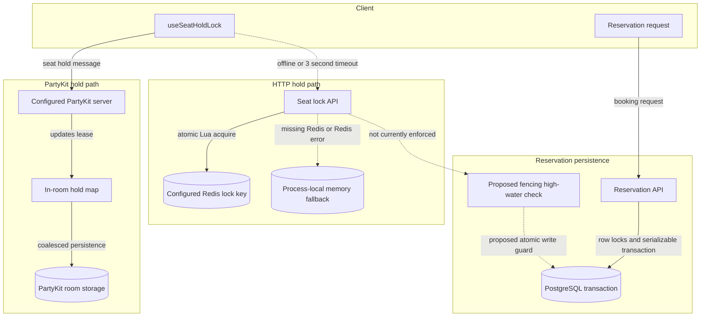

# Unified Distributed Locking and Fencing Token State Machine

> **Implementation status:** This document normalizes the repository's related
> lock paths into one state model; it does not describe one currently unified
> lock service. Current behavior is identified as **Implemented**. Safety
> requirements not enforced by the inspected application paths are identified
> as **Proposed** or **Required invariant**.

## 1. Purpose and scope

Seat holds and reservations have different concurrency boundaries. A short-lived
seat hold helps clients coordinate while a user is choosing a seat. A confirmed
reservation is persisted separately and must remain correct even if a process
continues after its lease has expired.

The repository currently has multiple related mechanisms:

- The configured PartyKit entry point handles WebSocket seat-hold messages with
  an in-room map and persists hold snapshots through PartyKit room storage.
- The seat-lock HTTP API uses a Redis Lua script when the configured Upstash
  client is available, with a process-local memory fallback on Redis errors or
  when Redis is not configured.
- The reservation API independently uses PostgreSQL transactions and row locks.
- Other Redlock, fencing-token, and browser Web Locks helpers exist, but are not
  wired into the main reservation endpoint as one end-to-end protocol.

The states below are a **proposed unified model** for acquisition, lease
renewal, expiration, release, and protected writes. They make explicit which
guarantees require the lock authority and the protected data store to cooperate.
They do not claim that a Redis lease or PartyKit hold alone prevents a stale
process from writing to PostgreSQL.

## 2. System architecture

`partykit.json` selects `party/server.ts` as the PartyKit entry point. The
WebSocket hold path uses that server's room map; it does not call the Redis
acquisition function. The client can fall back to the HTTP lock API after a
WebSocket timeout or when disconnected. That HTTP path is a separate authority.
The reservation API writes through its own PostgreSQL transaction and does not
consume the returned seat-lock fencing token.

<!-- mermaid-checked: no \n, no em-dash/en-dash, no {} in labels, subgraphs are id["label"], arrows are -->|"label"|, all subgraphs closed by end, ids unique -->



Solid arrows show current message or persistence paths. Dotted arrows show a
fallback or a proposed connection. In particular, the diagram does not imply
that PartyKit, Redis, and PostgreSQL share one lease or fencing authority.

The PartyKit and HTTP seat-hold defaults are both five minutes. PartyKit accepts
`ttlMs` and clamps it to 10,000-600,000 ms; the HTTP helper accepts
`ttlSeconds` and clamps it to 10-600 seconds. The HTTP extension endpoint adds
five minutes once per lease and rejects extension when 60 seconds or less
remain. The client hook's regular renewal uses a new hold request, not that
extension endpoint.

### Current component responsibilities

| Component                                    | Current responsibility                                                                                                                         | Fencing status                                                                                    |
| -------------------------------------------- | ---------------------------------------------------------------------------------------------------------------------------------------------- | ------------------------------------------------------------------------------------------------- |
| `useSeatHoldLock`                            | Requests and renews PartyKit holds; requests a snapshot on connection; falls back to HTTP after 3 seconds or when offline.                     | Does not retain or forward the HTTP fencing token.                                                |
| `party/server.ts`                            | Handles seat-hold messages with a room-local map, owner and connection identifiers, expiry timestamps, and a per-hold version.                 | No fencing token or database check.                                                               |
| `party/holdHydration.ts`                     | Queues hold operations while room storage is loaded on startup or wake.                                                                        | Hydration failure logs and opens the gate with an empty map.                                      |
| Seat-lock HTTP API                           | Authenticates POST/DELETE and delegates to `seatHoldLock.ts`; GET exposes lock state without a route-level authentication check.               | POST returns a lock payload that may contain a token; DELETE does not require one.                |
| `seatHoldLock.ts`                            | Uses a Redis key and Lua scripts when `getRedis()` returns a client; falls back to a process-local map on missing Redis or acquisition errors. | Token allocation is separate from the lock mutation in this path; no active database enforcement. |
| Reservation API                              | Uses a serializable PostgreSQL transaction, `FOR UPDATE NOWAIT` on selected seat rows, conflict checks, and booking inserts.                   | Does not compare a seat-lock token or update a fencing high-water mark.                           |
| `RedlockManager` and `distributedRedlock.ts` | Separate reusable Redlock implementations.                                                                                                     | Not used by the current `/api/reservations/book` route.                                           |
| `withSeatWebLock`                            | Browser Web Locks helper scoped to the current browser origin.                                                                                 | Not a server-side or cross-device authority; no active seat-hold call site was found.             |

The seat-hold path and booking path should therefore be treated as separate
coordination mechanisms, not as one transaction. The current reservation API
uses database concurrency controls independently of the temporary seat hold.

## 3. Formal lock states

These are logical states for a single resource and a single lease generation.
They are a **proposed normalized model**; the repository does not persist one
shared state enum across PartyKit, Redis, and PostgreSQL.

| State       | Meaning and ownership                                                                                                                                                        | Entry conditions                                                                           | Permitted operations                                                                                                                    | Exit conditions and failure behavior                                                                                                                                                                                                     |
| ----------- | ---------------------------------------------------------------------------------------------------------------------------------------------------------------------------- | ------------------------------------------------------------------------------------------ | --------------------------------------------------------------------------------------------------------------------------------------- | ---------------------------------------------------------------------------------------------------------------------------------------------------------------------------------------------------------------------------------------- |
| `UNLOCKED`  | The selected authority has no unexpired lease for the resource. No caller owns a lease.                                                                                      | Initial state, confirmed expiration, or confirmed release.                                 | Begin an acquisition. Read state.                                                                                                       | A request moves to `ACQUIRING`. If an authority cannot be read, do not infer `UNLOCKED`; treat it as uncertain and fail closed for protected writes.                                                                                     |
| `ACQUIRING` | An acquisition is in progress. No holder may perform protected writes yet.                                                                                                   | A caller submits an acquisition request.                                                   | Await an authoritative result; reconcile a timeout; clean up a confirmed partial acquisition.                                           | On an authoritative grant, move to `HELD`. On a conflict, return to `UNLOCKED` for the requester while preserving the other holder. On an uncertain result, remain logically unresolved and perform no protected write until reconciled. |
| `HELD`      | An authority has confirmed an owner and an unexpired lease. Ownership is bounded by the lease deadline and any safety margin.                                                | Successful acquisition or successful renewal.                                              | Perform only operations allowed by the resource; request renewal before the safety deadline; release using the current ownership proof. | Renewal starts `EXTENDING`. Expiry moves to `EXPIRED`. Confirmed release moves to `RELEASED`. Lost authority or an unverified lease makes the holder ineligible for protected writes.                                                    |
| `EXTENDING` | A renewal attempt is in progress; the prior lease is usable only until its previously confirmed safe deadline.                                                               | An authorized holder requests extension.                                                   | Await a successful ownership-checked renewal. Do not assume the deadline moved merely because a request was sent.                       | On confirmed success, return to `HELD` with the returned deadline. On failure, return to `HELD` only if the old lease is reverified and still safe; otherwise move to `EXPIRED` or remain uncertain and fail closed.                     |
| `EXPIRED`   | The lease deadline has passed. The former owner is no longer authorized, whether or not a cleanup sweep has removed the stored record.                                       | TTL elapsed, renewal missed its safety deadline, or recovery determines the lease expired. | Cleanup, notify clients, or request a fresh acquisition. No protected write using the expired lease is permitted.                       | A fresh acquisition can begin after the authority confirms availability. Cleanup may record `RELEASED` as an event, but cannot revive the old lease.                                                                                     |
| `RELEASED`  | A particular lease generation was explicitly relinquished and its owner proof was accepted. This is an outcome for that lease, not necessarily the resource's current state. | An ownership-checked explicit release succeeds.                                            | Return the release result; publish an availability event; allow a new acquisition only after the authority confirms removal.            | The resource becomes `UNLOCKED` when the authoritative removal is confirmed. An ambiguous release must not be reported as a confirmed unlock.                                                                                            |

`RELEASED` and `UNLOCKED` are distinct. `RELEASED` describes what happened to a
specific lease; `UNLOCKED` describes the resource's current availability.
Expiration can lead to `UNLOCKED` without an explicit release, while a release
request can fail or have an uncertain result without proving that the resource
is unlocked.

## 4. State transition table

| Current state | Event or guard                                      | Next state                                                               | Required action                                                                                                                  | Failure outcome and repository behavior                                                                                                                                                                    |
| ------------- | --------------------------------------------------- | ------------------------------------------------------------------------ | -------------------------------------------------------------------------------------------------------------------------------- | ---------------------------------------------------------------------------------------------------------------------------------------------------------------------------------------------------------- |
| `UNLOCKED`    | Caller begins acquisition                           | `ACQUIRING`                                                              | Request the authoritative lock and any required fencing token.                                                                   | The current HTTP helper allocates its token before attempting the lock. A conflict can therefore consume a token.                                                                                          |
| `ACQUIRING`   | Authority confirms acquisition                      | `HELD`                                                                   | Record the owner, lease deadline, and fencing token, if supported.                                                               | PartyKit mutates its room map. HTTP acquisition runs the Redis Lua script or uses memory fallback. These are not a shared grant.                                                                           |
| `ACQUIRING`   | Authority reports another active owner              | `UNLOCKED` for requester                                                 | Return a conflict and leave the existing holder untouched.                                                                       | PartyKit and Redis paths return their own conflict results.                                                                                                                                                |
| `ACQUIRING`   | Timeout or lost response                            | `ACQUIRING` until reconciled                                             | Query the same authority or wait for a safe expiry; do not write while grant status is unknown.                                  | The client currently starts HTTP fallback after 3 seconds without cancelling the outstanding PartyKit request. The two paths can both grant independent holds.                                             |
| `HELD`        | Authorized renewal begins before safety deadline    | `EXTENDING`                                                              | Prove ownership against the current lease and request extension.                                                                 | The Redis extension endpoint checks user and fencing token; PartyKit renewal reuses the seat-hold request.                                                                                                 |
| `EXTENDING`   | Renewal is confirmed                                | `HELD`                                                                   | Store the confirmed new deadline and continue with the same lease generation unless the authority explicitly issues a new token. | Redis extension retains the fencing token, increments version, and extends once by five minutes; PartyKit renewal increments version and resets its TTL.                                                   |
| `EXTENDING`   | Renewal fails or times out                          | `HELD` only if old lease is reverified; otherwise `EXPIRED` or uncertain | Stop protected writes unless the old deadline is still confirmed safe.                                                           | The standalone heartbeat helper stops on failure; the UI hook's interval continues. Redis extension errors return failure. The separate Redlock manager marks its handle lost after failed quorum renewal. |
| `HELD`        | TTL elapses                                         | `EXPIRED`                                                                | Reject further operations from the old lease; clean up and notify.                                                               | Redis applies key expiry. PartyKit sweeps every 2 seconds and discards expired leases during hydration.                                                                                                    |
| `HELD`        | Owner explicitly releases                           | `RELEASED`                                                               | Perform an ownership-checked compare-and-delete or equivalent state transition.                                                  | The active Redis release compares `userId`, not fencing token or nonce. PartyKit permits release by matching user or connection. The separate Redlock utility uses a random nonce.                         |
| `RELEASED`    | Authoritative deletion confirmed                    | `UNLOCKED`                                                               | Publish availability only after confirmation.                                                                                    | A successful HTTP DELETE returns its result; a Redis error can fall back to deleting only the local memory entry, leaving Redis state uncertain.                                                           |
| `HELD`        | Client disconnects or process crashes               | `RELEASED` for a handled PartyKit close, otherwise `HELD` until expiry   | Let the authority perform connection cleanup or expire the lease; never assume a client-side `finally` ran.                      | PartyKit `onClose` releases holds tracked by that connection. A server crash relies on the persisted deadline and recovery. The HTTP Redis key relies on TTL.                                              |
| `HELD`        | Redis failure, partition, or uncertain lease status | Uncertain; do not permit protected writes                                | Fail closed and reconcile with the same authority.                                                                               | HTTP acquisition may switch to process memory on Redis errors. This is not a safe distributed failover.                                                                                                    |
| Any state     | Room wake or restart                                | Hydrated state or `UNLOCKED` only after successful recovery              | Load persisted, unexpired holds before processing requests.                                                                      | The main PartyKit server gates requests on hydration, but hydration errors are logged and the gate opens with an empty map.                                                                                |
| `HELD`        | PostgreSQL is unavailable during a protected write  | `HELD` until explicit release or expiry                                  | Abort the database transaction; retry only with an idempotency policy and a still-valid lease.                                   | The booking API retries selected contention/serialization failures. It releases seat holds after successful booking, not as a fencing-aware transaction.                                                   |

## 5. ASCII state-machine diagram

```text
[UNLOCKED] --request--> [ACQUIRING] --grant--> [HELD]
[ACQUIRING] --conflict--> [UNLOCKED]
[ACQUIRING] --timeout/error--> [ACQUIRING: reconcile; no writes]
[HELD] --renew--> [EXTENDING] --success--> [HELD]
[EXTENDING] --failure/uncertain--> [EXPIRED]
[HELD] --TTL or unsafe deadline--> [EXPIRED]
[HELD] --confirmed release--> [RELEASED] --confirmed removal--> [UNLOCKED]
[EXPIRED] --cleanup/recovery--> [UNLOCKED]
```

The unresolved branch is a **required fail-closed behavior**, not a guarantee of
the current HTTP fallback or PartyKit hydration error path.

## 6. Fencing token specification

### Intended model

**Proposed:** A fencing token is a strictly increasing positive unsigned
64-bit integer assigned to each new lease generation for a resource:

- Range: `1` through `18,446,744,073,709,551,615` (`2^64 - 1`).
- Token allocation orders lease generations; it does not prove that the caller
  still owns the lease.
- The lease's ownership proof (for example a random nonce) and its fencing
  token are separate values and must be checked for their separate purposes.
- The allocator must be atomic and have a failure model that preserves
  monotonicity across every failover the system claims to tolerate.
- A token must not be reused after release, expiration, ownership change, or
  allocator recovery.
- If Redis is the authoritative allocator, allocation and the associated lease
  grant need one atomic operation at that authority. A quorum of independent
  counters followed by `max()` is not, by itself, proof of global monotonicity.
- Native Redis `INCR` is a signed 64-bit counter, not the full unsigned range.
  A full unsigned-64 implementation needs an exact representation and
  overflow-checked allocator; JavaScript `number` is not exact over this range.
- **Overflow policy:** do not wrap, reset, or reuse. Refuse new fenced leases
  for the exhausted resource and require a controlled migration to a wider,
  generation-aware token format. The migration must prevent old-generation
  writers from being accepted; simply resetting the counter is unsafe.

### What the inspected code does

The active HTTP seat-lock path calls `acquireQuorumFencingToken` before the
Redis lock Lua script. In the repository, no production bootstrap calls
`configureRedlockNodes`; without explicit nodes the helper uses a process-local
`BigInt` sequence and returns a one-node fallback result. The Redis lock grant
and token allocation are separate operations. Redis acquisition errors can
then fall back to a process-local lock map. The returned token is serialized
into the HTTP lock payload, but the client helper only checks `response.ok` and
does not retain or send the token to the booking API.

Other implementations must not be conflated with that path:

- `RedlockManager` can atomically run `SET NX PX` and `INCR` on each configured
  Redis node in a Lua script. It aggregates the maximum returned value and
  represents it as a JavaScript `number`. Per-node counters can diverge after
  partial grants, node loss, or reset; the maximum is not a durable global
  sequence.
- `acquireQuorumFencingToken` has optional quorum-node handling, timeouts,
  backoff, and counter repair, but its increments are separate per-node
  operations and its local sequence is process-scoped. It is not configured by
  an in-repository production call site.
- `SeatHoldLockManager` contains PostgreSQL counter and conditional-update SQL,
  but it has no corresponding Prisma schema model or migration found in the
  inspected repository, and its application call sites are tests.
- `verifyAndAdvanceDbFencingToken` is a helper, not an active booking-path
  enforcement point. Its read and save are separate calls; the function itself
  does not open a database transaction or make those calls atomic.

Consequently, a strict, persistent, unsigned-64 fencing sequence is **not
implemented end to end**.

## 7. Stale-writer and split-brain defense

### Required resource-side rule

**Required invariant:** The protected data store must maintain a high-water
fencing token per resource. In the same database transaction as the protected
mutation:

1. Read or lock the resource's fencing state.
2. Reject a token lower than the stored high-water token.
3. If the token is higher, advance the high-water token.
4. Apply the protected mutation atomically with that advancement.
5. Commit both effects together; on any failure, commit neither.

A lease alone cannot stop a paused or partitioned process from resuming after
its lease has expired. If a newer holder has already presented a higher token
to the resource, the high-water rule rejects the old holder's lower token.
Fencing does not retroactively undo a stale write committed before the resource
accepted the newer token.

### Equal-token operations

One lease can legitimately issue multiple operations with the same fencing
token. Do not accept an equal token solely because the numeric comparison is
equal. A recommended resource record includes the lease-generation identity
(such as the ownership nonce) and an operation idempotency key:

- A higher token establishes the new high-water token and lease generation.
- An equal token is acceptable only for the same lease generation and a
  previously unseen operation key.
- Replaying an already committed operation key returns its recorded result
  without applying the mutation again.
- A lower token, or an equal token from a different lease generation, is
  rejected.

This is **proposed**. The current booking schema and booking API do not store or
compare a fencing high-water mark. `Booking` creation is protected by database
transaction and seat-row concurrency checks, not by the seat-hold token.

## 8. Lease timing and clock drift

### Required validity bound

The usable lease window must be shorter than its configured TTL:

```text
validity = TTL - (clock_drift + network_delay)
```

For a client-side remaining-validity calculation, acquisition time must also
be deducted:

```text
remaining validity = TTL - acquisition_elapsed - clock_drift - network_delay
```

Here, TTL is the requested lease duration in the authority's units, and the
elapsed duration should be measured with a monotonic local clock. The drift and
network allowances must be conservative and based on the stated deployment
failure model. Do not assume synchronized wall clocks without evidence. If the
result is zero or negative, acquisition or renewal must fail closed. Renewal
must complete before the prior safe deadline, not merely before the nominal
TTL.

**Illustrative example, not a production measurement:** For a 5,000 ms TTL, a
100 ms drift allowance, and a 150 ms network allowance, the nominal usable
window is 4,750 ms. If acquisition itself took 200 ms, the remaining window is
4,550 ms.

### Current code behavior

- The PartyKit path stores `Date.now()`-based `expiresAt` values and removes
  expired holds with a 2-second sweep. It does not subtract an explicit drift
  or network margin.
- The HTTP seat-lock path sets Redis expiry in seconds and calculates a
  `driftAllowanceMs` value. `assertLockLeaseValid` has a monotonic elapsed-time
  path, but no production call site was found that uses it to authorize a
  protected write. The calculation does not separately measure network delay.
- `RedlockManager` uses `performance.now()`, subtracts acquisition elapsed time
  and `round(TTL * driftFactor) + 2 ms`, and bounds per-node requests by the
  remaining validity. This is a separate utility, not the current reservation
  API's lock path.

These implementations do not establish a shared timing guarantee across
PartyKit, the HTTP lock route, Redis, and PostgreSQL.

## 9. Failure and recovery protocols

| Scenario                                          | Implemented behavior observed                                                                                                                                                                                                                                                                                                                                                                            | Safe response and status                                                                                                                                                                                                                                  |
| ------------------------------------------------- | -------------------------------------------------------------------------------------------------------------------------------------------------------------------------------------------------------------------------------------------------------------------------------------------------------------------------------------------------------------------------------------------------------- | --------------------------------------------------------------------------------------------------------------------------------------------------------------------------------------------------------------------------------------------------------- |
| Client crash while holding                        | PartyKit `onClose` removes holds tracked by that connection. A room/process crash cannot rely on that callback. Redis and PartyKit holds carry deadlines; the HTTP Redis key has a TTL.                                                                                                                                                                                                                  | **Required:** Treat disconnect cleanup as an optimization; rely on authoritative expiry and reject writes after the safe deadline.                                                                                                                        |
| Lease expires during an operation                 | PartyKit expiry is swept and Redis expires its key. The active booking endpoint independently uses a database transaction. No seat-hold fencing token is checked at the booking write boundary.                                                                                                                                                                                                          | **Proposed:** Check fencing in the database transaction. Abort or reject if the deadline is lost before the protected write; do not rely only on a client heartbeat.                                                                                      |
| Redis primary or service failure                  | `getRedis()` returns the configured Upstash client or `null`. The active acquisition path falls back to a process-local map when Redis is absent or the Redis operation throws. That fallback is not shared across processes.                                                                                                                                                                            | **Required:** A Redis error must not silently change lock authority. Fail closed for distributed holds, or use a separately specified and verified quorum authority.                                                                                      |
| Network partition or uncertain acquisition result | The PartyKit client starts HTTP fallback after a 3-second WebSocket timeout without cancelling the pending WebSocket request. Those paths can grant independently.                                                                                                                                                                                                                                       | **Proposed:** Use one authority and an idempotency/request identifier; reconcile uncertain results against that authority before allowing protected writes.                                                                                               |
| Renewal failure                                   | The standalone `startSeatLockRenewalHeartbeat` helper stops its timer and invokes its failure callback on a failed renewal. The `useSeatHoldLock` effect continues its interval; its offline HTTP renewal catches and ignores request errors. The HTTP extension endpoint checks the authenticated user and fencing token. PartyKit renewal is another `seat_hold_request` and carries no fencing token. | **Required:** Stop protected writes immediately when renewal is not confirmed. Continue only if the prior lease is independently verified safe.                                                                                                           |
| PartyKit hibernation or wake                      | `party/server.ts` persists coalesced hold snapshots in room storage and waits for hydration before processing messages. Expired holds are discarded. `HydrationGate` catches load errors, logs, then opens with an empty map; persistence errors are logged asynchronously.                                                                                                                              | **Implemented with gaps:** Hydration and persistence exist, but storage failure can make the room process requests as if empty. **Proposed:** Fail closed on failed hydration and do not acknowledge a safety-critical grant before persistence succeeds. |
| Reconnection and duplicate hold requests          | The client requests a hold snapshot on WebSocket open. The room supports generic deduplication for messages carrying `messageId`, but `useSeatHoldLock` does not include one in its hold requests. A repeat from the same user can renew/replace the hold and connection owner.                                                                                                                          | **Proposed:** Include and deduplicate a request id for hold retries, and bind renewal/release to an exact lease generation. The HTTP booking route's idempotency wrapper does not deduplicate the separate seat-hold messages.                            |
| PostgreSQL unavailable during booking             | The booking API executes a serializable transaction and retries selected lock/serialization failures. It releases temporary holds after successful booking; failures can leave a hold until explicit release or expiry.                                                                                                                                                                                  | **Implemented for booking consistency, not fencing:** Return an error/conflict without a successful booking write. Retry only with idempotency and a confirmed valid lease if a future design couples the two.                                            |
| Redis quorum helper loses nodes                   | The optional `acquireQuorumFencingToken` helper times out nodes, applies backoff, can invoke a reconnect hook, and rejects if fewer than a majority respond. No production node configuration was found.                                                                                                                                                                                                 | **Implemented as a helper, not as the active lock authority.** Its per-node counters and repair do not establish the proposed global token invariant.                                                                                                     |

`party/venueRoom.ts` contains another room implementation with hold persistence
and hydration, but `partykit.json` names `party/server.ts` as the configured
entry point. The two implementations should not be assumed to share runtime
state.

The separate `RedlockManager` retries failed acquisition attempts (three
retries by default, with delay and jitter); `distributedRedlock.ts` defaults to
no retries. The optional fencing-quorum helper uses a 1-second per-node
timeout and exponential node backoff from 250 ms up to 5 seconds. These retry
policies apply only when those helpers are invoked and configured; they do not
change the active seat-lock API's process-memory fallback.

## 10. Safety invariants and reasoning

The following arguments are conditional requirements, not mathematical proofs
of the current deployment. They require a single authoritative lease service
per resource, atomic compare-and-set behavior at that service, a persistent
monotonic token allocator, and atomic enforcement at the protected data store.

| Invariant                                                                               | Required assumptions and reasoning                                                                                                                                                                                                                                                                                     | Current status                                                                                                                                                                                                           |
| --------------------------------------------------------------------------------------- | ---------------------------------------------------------------------------------------------------------------------------------------------------------------------------------------------------------------------------------------------------------------------------------------------------------------------- | ------------------------------------------------------------------------------------------------------------------------------------------------------------------------------------------------------------------------ |
| 1. A resource has at most one authoritative current lease.                              | All contenders use the same authority and key; acquisition is atomic there; lease expiry and release are interpreted consistently. Under those assumptions, an atomic `SET NX`/Lua operation on one Redis authority, or serialized mutation of one PartyKit room map, can choose one current owner for that authority. | **Conditional only.** PartyKit and HTTP fallback are separate authorities. Redis errors can switch to process memory. No end-to-end single-authority guarantee.                                                          |
| 2. A successful protected write carries an acceptable fencing token.                    | The protected resource must validate the token and lease generation in the same transaction as the mutation.                                                                                                                                                                                                           | **Not currently enforced.** The booking API does not receive or compare the seat-hold token.                                                                                                                             |
| 3. The accepted fencing-token high-water mark never decreases.                          | The resource-side update must be atomic and durable. The allocator must remain monotonic across its declared failover and restore model.                                                                                                                                                                               | **Not implemented in the active schema/path.** The helper's process-local state can reset; Redlock per-node counters can diverge.                                                                                        |
| 4. An expired or superseded holder cannot write after a higher token has been accepted. | Each protected write is checked atomically against the current high-water token. A stale lower token is rejected after the higher token is committed.                                                                                                                                                                  | **Not currently enforced.** Redis/PartyKit lease ownership is not checked by the PostgreSQL booking mutation.                                                                                                            |
| 5. Release and renewal cannot affect a successor's lease.                               | Both operations must compare a unique lease-generation owner proof, not only a reusable user identity.                                                                                                                                                                                                                 | **Partial.** Redis extension checks user plus fencing token; the active Redis release checks only user. PartyKit release accepts matching user or connection. The separate Redlock utility compares its random nonce.    |
| 6. Uncertain acquisition or renewal fails closed for protected writes.                  | A timeout, storage-read error, or ambiguous response cannot be interpreted as a grant or an unlocked resource. Reconciliation uses the same authority.                                                                                                                                                                 | **Not currently enforced.** The HTTP path may switch to memory on Redis error; hydration errors open the PartyKit gate with an empty map; the client may issue an HTTP fallback while a WebSocket request is unresolved. |

Redlock quorum and TTL checks can reduce contention and limit the lease window;
they do not prove end-to-end stale-writer exclusion without resource-side
fencing enforcement. The separate PostgreSQL transaction locks in the booking
route are an independent consistency mechanism, not proof that the seat-hold
fencing token is enforced.

## 11. Operational guidance

The following are **recommended observability events**, not claims about
existing metrics:

- Acquisition attempts, success/conflict/failure outcome, authority used, and
  elapsed time.
- Renewal attempts, remaining validity at start, success/failure, and lease
  loss.
- Expiration, explicit release, release mismatch, and cleanup reason.
- Token allocation, allocator source, high-water advancement, overflow, and
  stale-token rejection.
- Redis timeouts, failover/reconnect events, degraded-node duration, and
  quorum recovery.
- PartyKit hydration, persistence success/failure, hibernation wake, snapshot
  recovery, and duplicate request detection.
- Database lock contention, serialization retry, and stale-writer rejection
  counts.

Log resource identifiers only as needed for diagnosis. Do not log Redis
credentials, lock nonces, authentication tokens, or other sensitive lock
material. Avoid using a fencing token alone as proof of owner identity.

## 12. Implementation gap analysis

| Desired guarantee                        | Evidence in source                                                                                                                                                    | Current status                                                     | Missing enforcement                                                                                  | Recommended next step                                                                            |
| ---------------------------------------- | --------------------------------------------------------------------------------------------------------------------------------------------------------------------- | ------------------------------------------------------------------ | ---------------------------------------------------------------------------------------------------- | ------------------------------------------------------------------------------------------------ |
| One lease authority per resource         | PartyKit room map and separate HTTP Redis/memory lock path; client fallback can call both.                                                                            | **Not unified**                                                    | Shared authority and request reconciliation.                                                         | Select one authority; make all clients and server paths use it.                                  |
| Durable acquisition result               | PartyKit room storage snapshot; Redis key TTL; asynchronous persistence; process memory fallback.                                                                     | **Partial**                                                        | Persistence failure can be treated as empty/unlocked; memory is process-local.                       | Fail closed on unavailable authority and define durable acknowledgment requirements.             |
| Owner-checked release                    | Redis release Lua checks `userId`; PartyKit checks user or connection; separate Redlock release checks a nonce.                                                       | **Partial**                                                        | Exact lease-generation proof is absent from active seat release.                                     | Require a unique lease nonce or generation on release and compare atomically.                    |
| Ownership-checked renewal                | Redis extension script requires user and fencing token; ordinary reacquisition renews by user; PartyKit renews by user/connection context.                            | **Partial**                                                        | One consistent renewal protocol and deadline safety margin.                                          | Bind renewal to the current lease generation and fail closed on uncertainty.                     |
| Monotonic unsigned 64-bit token          | Process `BigInt`, per-node Redis `INCR`, `number`-based Redlock counter, and a legacy PostgreSQL counter helper all differ.                                           | **Not implemented end to end**                                     | Single durable exact allocator, unsigned bound, overflow handling, and failover proof.               | Choose one linearizable exact allocator; reject overflow without wrap or reuse.                  |
| Atomic token allocation with lease grant | Token allocation precedes the active Redis Lua lock grant; RedlockManager's script allocates per-node tokens but is a separate path.                                  | **Not unified**                                                    | One authority must bind a grant to its token or persist an equivalent grant record.                  | Specify the allocator and lease authority together; define rollback on token-allocation failure. |
| Database high-water mark                 | `verifyAndAdvanceDbFencingToken` exists but is not called by the booking API; `SeatHoldLockManager` SQL is not represented in the inspected Prisma schema.            | **Not active**                                                     | No durable high-water field/table in the active booking path.                                        | Add schema and transactional conditional advancement with the protected mutation.                |
| Atomic stale-write rejection             | Booking API uses serializable transactions, row locks, overlap checks, and an active-slot unique index for identical slots; it does not compare the seat-hold token.  | **Independent DB concurrency protection exists; fencing does not** | Token must be checked at the resource boundary.                                                      | Apply a high-water check and data mutation in one transaction.                                   |
| Fail-closed uncertain outcomes           | Redis exceptions can fall back to local memory; hydration errors open the gate empty; WebSocket timeout starts another authority.                                     | **Not satisfied**                                                  | A common result/idempotency protocol and unavailable state.                                          | Reconcile against one authority and reject protected writes until certainty returns.             |
| Safe timing bound                        | RedlockManager uses monotonic time and drift allowance; PartyKit uses wall-clock deadlines; active seat-lock validity helper has no production write-boundary caller. | **Partial and path-specific**                                      | One lease deadline policy, explicit network margin, and enforcement before writes.                   | Define conservative margins and test pause, delay, expiry, and renewal races.                    |
| Hibernation and reconnection recovery    | Main PartyKit server persists holds, gates traffic during hydration, drops expired leases, and sends snapshots.                                                       | **Implemented with failure gaps**                                  | Failed storage reads/writes may not fail closed; event history/sequence is not persisted with holds. | Make storage failures visible to callers and require recovery before grants.                     |

## 13. References

- [Redlock and fencing runbook](./REDLOCK_DISTRIBUTED_FENCING.md)
- [Redlock fencing-token protocol](./REDLOCK_FENCING_TOKENS.md)
- [Seat-hold lock implementation](../../src/lib/locks/seatHoldLock.ts)
- [Seat-lock HTTP route](../../src/app/api/venues/%5BvenueId%5D/seats/%5BseatId%5D/lock/route.ts)
- [Seat-lock extension route](../../src/app/api/venues/%5BvenueId%5D/seats/%5BseatId%5D/lock/extend/route.ts)
- [Seat-hold client hook](../../src/hooks/useSeatHoldLock.ts)
- [Configured PartyKit entry point](../../partykit.json)
- [PartyKit server](../../party/server.ts)
- [PartyKit hold hydration gate](../../party/holdHydration.ts)
- [Alternate venue room implementation](../../party/venueRoom.ts)
- [Reservation API](../../src/app/api/reservations/book/route.ts)
- [Active booking-slot unique index migration](../../prisma/migrations/20261112090000_booking_active_seat_unique/migration.sql)
- [Prisma schema](../../prisma/schema.prisma)
- [Redlock manager](../../src/lib/redis/RedlockManager.ts)
- [Separate distributed Redlock helper](../../src/lib/locks/distributedRedlock.ts)
- [Booking engine helper](../../src/lib/reservations/bookingEngine.ts)
- [Browser Web Locks helper](../../src/lib/webLock.ts)
