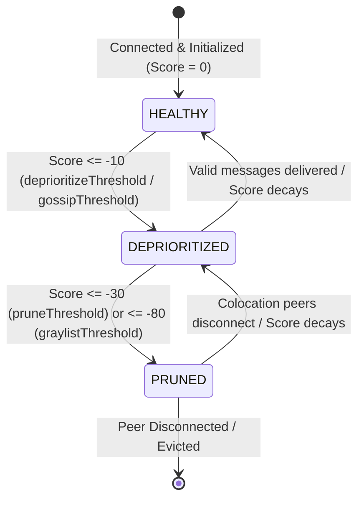
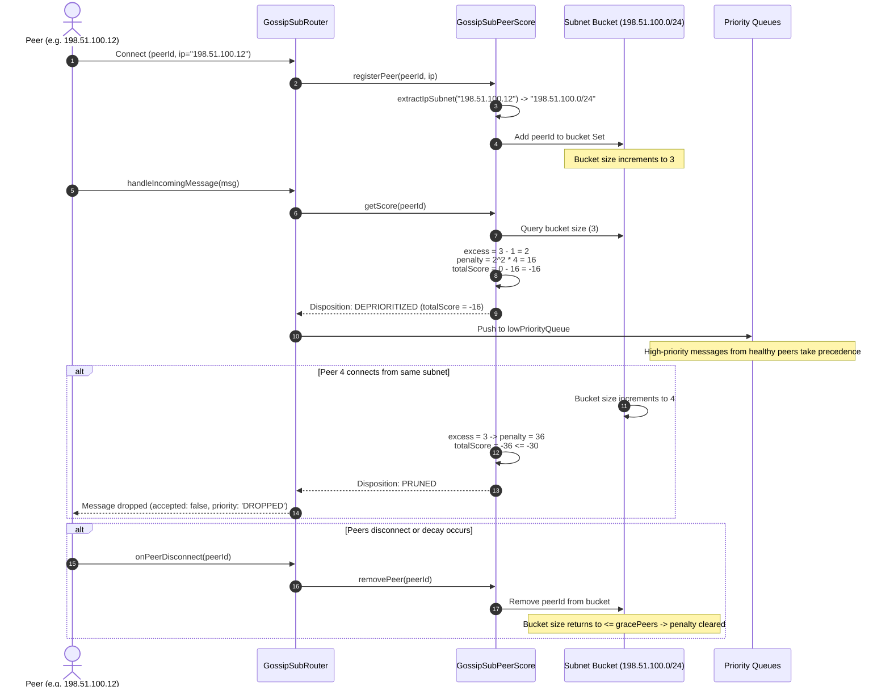

# GossipSub IP Colocation Scoring and Sybil Attack Mitigation

## 1. Overview and Threat Model

In decentralized WebRTC and peer-to-peer (P2P) mesh networks, such as WorkSphere's offline emergency messaging and collaborative session fabrics, participant nodes organize into overlay meshes using epidemic pub/sub dissemination (GossipSub). Because peers in permissionless or hybrid P2P networks can connect without centralized identity gating or costly hardware investments, they are vulnerable to **Sybil attacks**.

### 1.1 The Sybil Threat in Mesh Topologies
In a Sybil attack, a single adversary spins up multiple virtual peer instances (phantom nodes) from a concentrated network infrastructure (e.g., a single server, virtual private server (VPS), container cluster, or residential broadband connection). The adversary attempts to:
- **Eclipse Honest Nodes (Eclipse Attacks):** Saturate honest nodes' mesh degree limits ($D$, $D_{low}$, $D_{high}$) with attacker-controlled peers, partitioning honest nodes from legitimate message flows.
- **Influence Message Propagation:** Gain disproportionate influence over message relaying, selectively dropping packets (censorship or black-hole attacks).
- **Traffic Amplification & Spam:** Broadcast invalid, spam, or resource-draining messages through multiple paths simultaneously to exhaust bandwidth and CPU.

```mermaid
flowchart TD
    subgraph AttackerInfrastructure ["Attacker Infrastructure (Single /24 Subnet: 198.51.100.0/24)"]
        Attacker["Adversary Node Runner"]
        P1["Phantom Peer 1<br/>198.51.100.10"]
        P2["Phantom Peer 2<br/>198.51.100.11"]
        P3["Phantom Peer 3<br/>198.51.100.12"]
        P4["Phantom Peer 4<br/>198.51.100.13"]
        Attacker --> P1
        Attacker --> P2
        Attacker --> P3
        Attacker --> P4
    end

    subgraph MeshRoom ["GossipSub Mesh Overlay (WorkSphere P2P)"]
        Scorer["GossipSubPeerScore / GossipSubPeerScorer<br/>(Subnet IP Colocation Tracking)"]
        LegitNode["Honest Peer<br/>192.168.1.50"]
    end

    P1 -.->|Connects| Scorer
    P2 -.->|Connects| Scorer
    P3 -.->|Connects| Scorer
    P4 -.->|Connects| Scorer
    LegitNode <--> Scorer

    Scorer -->|Bucket Size: 4 (Excess = 3)| Penalty["Apply Quadratic Colocation Penalty<br/>(Excess^2 * Weight)"]
    Penalty -->|Score <= -30| PruneAction["Disposition: PRUNED / Graylisted<br/>Drop Messages & Evict from Mesh"]
```

### 1.2 Relationship to GossipSub Peer Scoring and Mesh Membership
WorkSphere implements peer scoring inspired by the libp2p GossipSub v1.1 specification across two complementary scoring engines:
1. **`GossipSubPeerScore` (`src/core/p2p/GossipSubPeerScore.ts`)**: Evaluates behavioral message rewards and penalties alongside subnet-based IP colocation (`extractIpSubnet`), categorizing peers into `HEALTHY`, `DEPRIORITIZED`, or `PRUNED` dispositions for routing in `GossipSubRouter`.
2. **`GossipSubPeerScorer` (`src/core/p2p/GossipSubPeerScorer.ts`)**: Implements multi-parameter topic scoring ($P_1$ time-in-mesh, $P_2$ first message deliveries, $P_3$ delivery deficit, $P_{3b}$ failures, $P_4$ invalid messages) combined with exact-IP colocation penalties ($P_6$), gating behavior via `shouldGossip`, `shouldPublish`, and `isGraylisted`.

### 1.3 Limitations of IP-Based Identity
IP colocation scoring is a defensive heuristic, **not a complete Sybil prevention mechanism**:
- **Shared NAT & Campus Networks:** Multiple legitimate students or coworkers in a university library, coffee shop, or corporate office legitimately share a single IPv4 public address or small subnet.
- **Botnets & Distributed Cloud Proxies:** Sophisticated adversaries can acquire cheap, geographically distributed IPv4/IPv6 addresses across multiple distinct autonomous systems (ASNs), bypassing colocation clustering.
- **Spoofing & Relaying:** WebRTC signaling servers or TURN relays may obscure original client IPs if connection handshakes are proxied without proper client IP header propagation.
- **Defense-in-Depth:** IP colocation must be paired with message validation (Ed25519 cryptographic signatures), proof-of-work (PoW) challenges, Zero-Knowledge student proofs, and behavioral delivery tracking.

---

## 2. Subnet Colocation Detection and Peer Caps

WorkSphere's subnet extraction and grouping logic is implemented in [`src/core/p2p/GossipSubPeerScore.ts`](file:///C:/Users/Saransh%20Kashyap/WorkSphere-9345-worktree/src/core/p2p/GossipSubPeerScore.ts):

### 2.1 IPv4 `/24` and IPv6 `/48` Normalization Logic

The helper function `extractIpSubnet(ip?: string): string | undefined` normalizes IP addresses as follows:

```typescript
export function extractIpSubnet(ip?: string): string | undefined {
  if (!ip) return undefined;
  const trimmed = ip.trim();
  if (!trimmed) return undefined;

  // 1. Normalize IPv4-mapped IPv6 addresses (e.g., "::ffff:192.0.2.1")
  const mappedIpv4Match = trimmed.match(/::ffff:(\d+\.\d+\.\d+\.\d+)$/i);
  const candidate = mappedIpv4Match ? mappedIpv4Match[1] : trimmed;

  // 2. IPv4 /24 Subnet Extraction (first 3 octets)
  const ipv4Parts = candidate.split('.');
  if (ipv4Parts.length === 4 && ipv4Parts.every((p) => /^\d{1,3}$/.test(p))) {
    const octets = ipv4Parts.map(Number);
    if (octets.every((n) => n >= 0 && n <= 255)) {
      return `${octets[0]}.${octets[1]}.${octets[2]}.0/24`;
    }
  }

  // 3. IPv6 /48 Subnet Extraction (first 3 hextets)
  if (candidate.includes(':')) {
    const hextets = candidate.split(':').filter(Boolean);
    if (hextets.length >= 3) {
      return `${hextets.slice(0, 3).join(':')}::/48`;
    }
  }

  return undefined;
}
```

### 2.2 Maximum Permitted Peers per Subnet
- In `GossipSubPeerScore`, the threshold of tolerated peers before penalties apply is governed by:
  $$\text{subnetGracePeers} = 1 \quad (\text{default})$$
- In `GossipSubPeerScorer`, the colocation parameter is:
  $$\text{ipColocationThreshold} = 2 \quad (\text{default})$$

When the number of concurrent peers in a single subnet or IP bucket exceeds this threshold, excess peers trigger a quadratic penalty that escalates with each additional node.

---

## 3. Scoring Model and Mathematical Formulas

### 3.1 `GossipSubPeerScore` Formulation

In `src/core/p2p/GossipSubPeerScore.ts`:

$$\text{TotalScore}(p) = \text{BehaviorScore}(p) - \text{ColocationPenalty}(p)$$

#### A. Colocation Penalty Calculation
For a peer $p$ belonging to subnet $S$:
$$\text{count}(S) = |\{ \text{peers in } S \}|$$
$$\text{excess} = \max(0, \text{count}(S) - \text{subnetGracePeers})$$
$$\text{ColocationPenalty}(p) = \text{excess}^2 \times \text{subnetPenaltyWeight}$$

With default parameters ($\text{subnetGracePeers} = 1, \text{subnetPenaltyWeight} = 4$):
- **1 peer in subnet:** $\text{excess} = 0 \implies \text{Penalty} = 0$
- **2 peers in subnet:** $\text{excess} = 1 \implies \text{Penalty} = 1^2 \times 4 = 4$
- **3 peers in subnet:** $\text{excess} = 2 \implies \text{Penalty} = 2^2 \times 4 = 16$
- **4 peers in subnet:** $\text{excess} = 3 \implies \text{Penalty} = 3^2 \times 4 = 36$
- **5 peers in subnet:** $\text{excess} = 4 \implies \text{Penalty} = 4^2 \times 4 = 64$

#### B. Behavioral Components
- **Valid message:** $\text{BehaviorScore} \mathrel{+}= \text{validMessageReward} \quad (\text{default } +1)$
- **Invalid message:** $\text{BehaviorScore} \mathrel{-}= \text{invalidMessagePenalty} \quad (\text{default } -10)$

### 3.2 `GossipSubPeerScorer` Formulation (Full GossipSub v1.1 Spec)

In `src/core/p2p/GossipSubPeerScorer.ts`:

$$\text{Score}(p) = \text{clamp}\left( \sum_{t \in \text{topics}} w_t \cdot \text{TopicScore}_t(p) + P_6(p) + w_{\text{app}} \cdot \text{Score}_{\text{app}}(p), -1000, 100 \right)$$

Where the IP colocation factor ($P_6$) is:
$$P_6(p) = \text{excess}^2 \times \text{ipColocationWeight}$$
Where:
$$\text{excess} = \max(0, |\{ \text{peers sharing exact IP} \}| - \text{ipColocationThreshold})$$
$$\text{ipColocationWeight} = -5.0 \quad (\text{default}), \quad \text{ipColocationThreshold} = 2 \quad (\text{default})$$

---

## 4. Score Decay Model

Both scoring engines implement geometric/exponential decay to allow rehabilitated peers to recover over time and prevent historic penalties or rewards from dominating indefinite future routing.

### 4.1 Implemented Discrete Decay Model

In `GossipSubPeerScore.decayScores()`:
$$\text{BehaviorScore}_{k+1} = \text{BehaviorScore}_k \times \text{decayFactor}$$
$$\text{decayFactor} = 0.90 \quad (\text{default})$$
If $|\text{BehaviorScore}| < 0.01$, the score snaps to $0$.

In `GossipSubPeerScorer.decayScores(timeStepMs)`:
Runs on an active interval timer (`decayIntervalMs = 1000\text{ ms}` by default):
- $P_2$ first message deliveries decay by factor $0.90$.
- $P_3$ mesh deliveries decay by factor $0.90$.
- $P_{3b}$ mesh failures decay by factor $0.85$.
- $P_4$ invalid message penalties decay by factor $0.80$.

### 4.2 Relationship to Continuous Exponential Decay: $P(t) = P(0) \times e^{-\lambda t}$

While the code performs discrete per-interval multiplication ($\text{score} \times \alpha$), this relates to the continuous exponential decay formula:
$$P(t) = P(0) \cdot e^{-\lambda t}$$

Where the decay constant $\lambda$ and half-life $t_{1/2}$ for decay factor $\alpha = 0.9$ at interval $\Delta t = 1\text{ s}$ are:
$$\lambda = -\frac{\ln(\alpha)}{\Delta t} = -\frac{\ln(0.90)}{1\text{ s}} \approx 0.10536\text{ s}^{-1}$$
$$t_{1/2} = \frac{\ln(2)}{\lambda} \approx \frac{0.69315}{0.10536} \approx 6.58\text{ seconds}$$

> [!NOTE]
> **Implementation Note on 60-Second Decay:**
> The issue description references a 60-second decay interval. In the actual codebase:
> - `GossipSubPeerScorer` defaults to a `decayIntervalMs` of `1000` (1 second) with multiplicative factors between `0.80` and `0.90`.
> - In `GossipSubPeerScore`, `decayScores()` is called on demand by the caller (or tests) using `decayFactor = 0.90`.
> - Configuring a 60-second half-life requires adjusting the decay factor: $\alpha_{60s} = \exp(-\frac{\ln(2)}{60} \times 1\text{s}) \approx 0.9885$.

---

## 5. Mesh Pruning, Graylisting, and Routing Policies

Peers are gated based on score thresholds into operational dispositions:



### 5.1 Gating Thresholds and Action Matrix

| Engine | Method / Field | Threshold (Default) | Action Taken by Router / System |
| :--- | :--- | :--- | :--- |
| `GossipSubPeerScore` | `disposition == 'HEALTHY'` | $\text{Score} > -10$ | Messages enqueued into `highPriorityQueue` and relayed immediately. |
| `GossipSubPeerScore` | `disposition == 'DEPRIORITIZED'` | $-30 < \text{Score} \le -10$ | Messages routed to `lowPriorityQueue`; processed only when high-priority queue is empty. |
| `GossipSubPeerScore` | `disposition == 'PRUNED'` | $\text{Score} \le -30$ | Inbound messages **dropped immediately** (`accepted: false, priority: 'DROPPED'`). |
| `GossipSubPeerScorer` | `shouldGossip(peerId)` | $\text{Score} \ge -10$ | Permitted to exchange metadata gossip (IHAVE / IWANT control messages). |
| `GossipSubPeerScorer` | `shouldPublish(peerId)` | $\text{Score} \ge -40$ | Permitted to publish new messages into topics. |
| `GossipSubPeerScorer` | `isGraylisted(peerId)` | $\text{Score} < -80$ | All inbound packets and RPCs from this peer are rejected. |
| `GossipSubPeerScorer` | `prunePeer(peerId)` | Explicit call | Deletes peer stats and releases its IP slot from the IP map. |

---

## 6. Configuration Parameters and Thresholds

| Parameter | Default Value | Description | Source File |
| :--- | :--- | :--- | :--- |
| **IPv4 Subnet Prefix** | `/24` | Groups IPv4 addresses by first 3 octets (`A.B.C.0/24`). | `GossipSubPeerScore.ts:53` |
| **IPv6 Subnet Prefix** | `/48` | Groups IPv6 addresses by first 3 hextets (`h1:h2:h3::/48`). | `GossipSubPeerScore.ts:59` |
| **`subnetGracePeers`** | `1` | Number of peers permitted in a subnet before penalties apply. | `GossipSubPeerScore.ts:33` |
| **`subnetPenaltyWeight`** | `4.0` | Multiplier for quadratic colocation penalty ($\text{excess}^2 \times 4$). | `GossipSubPeerScore.ts:34` |
| **`deprioritizeThreshold`** | `-10` | Score at which peer is moved to low-priority message queue. | `GossipSubPeerScore.ts:31` |
| **`pruneThreshold`** | `-30` | Score at which peer messages are dropped entirely. | `GossipSubPeerScore.ts:32` |
| **`validMessageReward`** | `1` | Behavioral score increment for valid relay. | `GossipSubPeerScore.ts:35` |
| **`invalidMessagePenalty`** | `10` | Behavioral score deduction for malformed/invalid relay. | `GossipSubPeerScore.ts:36` |
| **`decayFactor`** | `0.9` | Per-step geometric decay multiplier for behavior score. | `GossipSubPeerScore.ts:37` |
| **`ipColocationThreshold`** | `2` | Number of peers sharing an exact IP before $P_6$ penalty. | `GossipSubPeerScorer.ts:150` |
| **`ipColocationWeight`** | `-5.0` | Weight for exact IP colocation in full GossipSub scorer. | `GossipSubPeerScorer.ts:149` |
| **`gossipThreshold`** | `-10` | Threshold below which gossip exchange is halted. | `GossipSubPeerScorer.ts:80` |
| **`publishThreshold`** | `-40` | Threshold below which message publishing is halted. | `GossipSubPeerScorer.ts:81` |
| **`graylistThreshold`** | `-80` | Threshold below which peer is ignored completely. | `GossipSubPeerScorer.ts:82` |
| **`MIN_PEER_SCORE`** | `-1000` | Minimum clamp value (fail-closed boundary). | `GossipSubPeerScorer.ts:87` |
| **`MAX_PEER_SCORE`** | `+100` | Maximum clamp value. | `GossipSubPeerScorer.ts:88` |
| **`decayIntervalMs`** | `1000` | Interval in ms between active topic metric decay ticks. | `GossipSubPeerScorer.ts:153` |

---

## 7. Telemetry, Prometheus Metrics, and Admin Dashboard

### 7.1 Existing Admin Dashboard Visibility
WorkSphere provides a live UI component for inspecting peer score breakdowns and colocation penalties:
- **Component:** `P2PMeshDashboard` in [`src/components/p2p/P2PMeshDashboard.tsx`](file:///C:/Users/Saransh%20Kashyap/WorkSphere-9345-worktree/src/components/p2p/P2PMeshDashboard.tsx)
- **Helper:** `buildMeshSnapshot` and `PeerHealthBadge` in [`src/core/p2p/peerHealth.ts`](file:///C:/Users/Saransh%20Kashyap/WorkSphere-9345-worktree/src/core/p2p/peerHealth.ts)
- **Visualized Metrics:**
  - Connected peers count (`connected`)
  - Active mesh members (`meshMembers`)
  - Sybil penalized peer count (`sybilPenalized`)
  - Blacklisted peer count (`score < graylistThreshold`)
  - Tooltip breakdown displaying exact $P_1, P_2, P_3, P_4$, and **Sybil (IP colocation)** values.

### 7.2 WebRTC Telemetry & Prometheus API
WorkSphere exposes WebRTC metrics in Prometheus format via [`src/app/api/admin/telemetry/webrtc/route.ts`](file:///C:/Users/Saransh%20Kashyap/WorkSphere-9345-worktree/src/app/api/admin/telemetry/webrtc/route.ts) powered by `WebRtcTelemetryCollector`:
- `webrtc_connected_peers` (Gauge): Current connected peer count.
- `webrtc_dropped_connections_total` (Counter): Cumulative count of dropped or failed connections.
- `webrtc_rtt_seconds` (Gauge): Round-trip time per peer.
- `webrtc_bytes_sent_total` / `webrtc_bytes_received_total` (Counter).

### 7.3 Recommended Future Colocation Telemetry Metrics
*(Not yet exported by default in Prometheus text feed)*:
```text
# HELP p2p_gossipsub_subnet_peers Current peer count per /24 or /48 subnet
# TYPE p2p_gossipsub_subnet_peers gauge
p2p_gossipsub_subnet_peers{subnet="198.51.100.0/24"} 4

# HELP p2p_gossipsub_colocation_penalized_total Cumulative count of peers penalized for colocation
# TYPE p2p_gossipsub_colocation_penalized_total counter
p2p_gossipsub_colocation_penalized_total{subnet="198.51.100.0/24"} 3
```

---

## 8. Operational Lifecycle



---

## 9. Security Considerations & Best Practices

1. **IPv4-Mapped IPv6 Normalization:** Always extract the embedded IPv4 address when handling dual-stack sockets (`::ffff:192.0.2.1` $\rightarrow$ `192.0.2.0/24`). Without this, IPv4 peers connecting over IPv6 sockets would escape `/24` grouping.
2. **Subnet Mask Alignment:**
   - `/24` for IPv4 covers 256 addresses, standard for broadband ISP blocks and cloud VPS subnets.
   - `/48` for IPv6 covers $2^{80}$ addresses, matching standard customer ISP allocations.
3. **Graceful Degradation via Priority Queues:** Instead of immediately disconnecting or banning collocated peers (which could break legitimate users sharing a venue Wi-Fi), `GossipSubRouter` first **deprioritizes** messages into `lowPriorityQueue`. This preserves honest communication while starving spam attacks.
4. **Memory Hygiene on Disconnect:** Both `GossipSubPeerScore.removePeer()` and `GossipSubPeerScorer.prunePeer()` actively prune empty buckets in their IP maps to prevent unbounded memory growth.

---

## 10. Concrete Examples

### Example 1: 4 Peers Connecting from One IPv4 `/24` Subnet (`10.0.1.0/24`)
Parameters: `subnetGracePeers = 1`, `subnetPenaltyWeight = 4`, `pruneThreshold = -30`.
1. **Peer 1 (`10.0.1.10`) connects:** Subnet count = 1. $\text{excess} = 0 \implies \text{Penalty} = 0$. $\text{TotalScore} = 0 \implies$ `HEALTHY`.
2. **Peer 2 (`10.0.1.11`) connects:** Subnet count = 2. $\text{excess} = 1 \implies \text{Penalty} = 1^2 \times 4 = 4$. $\text{TotalScore} = -4 \implies$ `HEALTHY`.
3. **Peer 3 (`10.0.1.12`) connects:** Subnet count = 3. $\text{excess} = 2 \implies \text{Penalty} = 2^2 \times 4 = 16$. $\text{TotalScore} = -16 \implies$ `DEPRIORITIZED` (score $\le -10$).
4. **Peer 4 (`10.0.1.13`) connects:** Subnet count = 4. $\text{excess} = 3 \implies \text{Penalty} = 3^2 \times 4 = 36$. $\text{TotalScore} = -36 \implies$ `PRUNED` (score $\le -30$). Messages from Peer 4 are dropped.

### Example 2: Peers from IPv6 `/48` Subnet (`2001:db8:abcd::/48`)
- Peer A (`2001:db8:abcd:0001::1`) and Peer B (`2001:db8:abcd:0002::2`) resolve to the same subnet: `2001:db8:abcd::/48`.
- If an adversary scripts 5 IPv6 interfaces inside that `/48` block, the subnet count reaches 5 ($\text{excess} = 4$).
- Colocation penalty = $4^2 \times 4 = 64$, immediately pruning all 5 interfaces.

---

## 11. Implementation Gaps & Discrepancies with Issue #9345

In strict accordance with the repository source code:
1. **Two Co-existing Scoring Classes:**
   - `GossipSubPeerScore` (`src/core/p2p/GossipSubPeerScore.ts`) implements subnet-based `/24` and `/48` grouping with `subnetGracePeers = 1` and `subnetPenaltyWeight = 4`.
   - `GossipSubPeerScorer` (`src/core/p2p/GossipSubPeerScorer.ts`) implements full GossipSub v1.1 topic scoring but groups by exact IP string (`ipMap`) with `ipColocationThreshold = 2` and `ipColocationWeight = -5.0`.
2. **Decay Interval:** The issue requests a 60-second decay interval. In code, `GossipSubPeerScorer` runs an active timer at `1000 ms` (1 second), while `GossipSubPeerScore` decays on demand when `decayScores()` is invoked by the host application.
3. **Prometheus Subnet Expositions:** While general WebRTC telemetry (`webrtc_connected_peers`, `webrtc_dropped_connections_total`) is exposed via Prometheus at `/api/admin/telemetry/webrtc?format=prometheus`, per-subnet colocation counters are currently only aggregated in React component memory via `buildMeshSnapshot` (`P2PMeshDashboard.tsx`).

---

## 12. Source Code References

- [`src/core/p2p/GossipSubPeerScore.ts`](file:///C:/Users/Saransh%20Kashyap/WorkSphere-9345-worktree/src/core/p2p/GossipSubPeerScore.ts): Subnet normalization (`extractIpSubnet`), quadratic colocation penalties, and disposition thresholds.
- [`src/core/p2p/GossipSubPeerScorer.ts`](file:///C:/Users/Saransh%20Kashyap/WorkSphere-9345-worktree/src/core/p2p/GossipSubPeerScorer.ts): Full GossipSub v1.1 scoring, $P_1$–$P_6$ parameter calculations, active decay timers, and behavioral policy gating.
- [`src/core/p2p/GossipSubRouter.ts`](file:///C:/Users/Saransh%20Kashyap/WorkSphere-9345-worktree/src/core/p2p/GossipSubRouter.ts): High- and low-priority queue management and message dropping for pruned peers.
- [`src/core/p2p/peerHealth.ts`](file:///C:/Users/Saransh%20Kashyap/WorkSphere-9345-worktree/src/core/p2p/peerHealth.ts): Real-time snapshot generation and peer health classifications.
- [`src/components/p2p/P2PMeshDashboard.tsx`](file:///C:/Users/Saransh%20Kashyap/WorkSphere-9345-worktree/src/components/p2p/P2PMeshDashboard.tsx): Admin UI dashboard displaying colocation metrics and health badges.
- [`docs/p2p/GOSSIPSUB_PEER_SCORING.md`](file:///C:/Users/Saransh%20Kashyap/WorkSphere-9345-worktree/docs/p2p/GOSSIPSUB_PEER_SCORING.md): Detailed parameter tuning guide for GossipSub v1.1.
