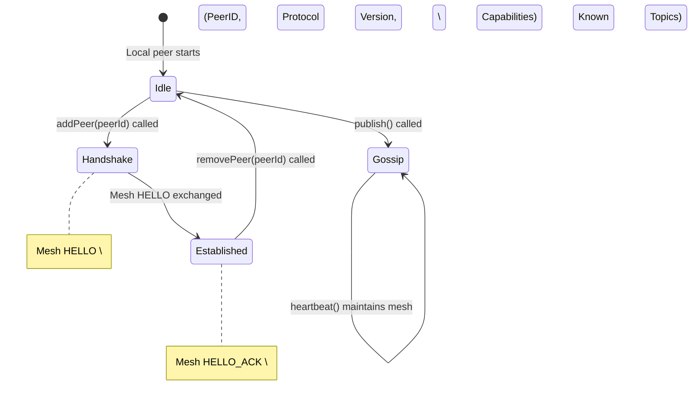

# GossipSub WebRTC Mesh

**See also:** [`WEBRTC_MESH.md`](./WEBRTC_MESH.md) — WebRTC connection lifecycle, ICE/TURN config
**See also:** [`GOSSIPSUB_IP_COLOCATION.md`](./GOSSIPSUB_IP_COLOCATION.md) — GossipSub IP colocation scoring and Sybil attack mitigation
**See also:** [`GOSSIPSUB_SYBIL_MITIGATION.md`](../mesh/GOSSIPSUB_SYBIL_MITIGATION.md) — Multi-factor peer scoring, IP colocation penalties, and Sybil cluster mitigation
**See also:** [`P2P_MESH_SPECIFICATION.md`](../P2P_MESH_SPECIFICATION.md) — Wire protocol & packet schemas
**See also:** [`WEBRTC_MESH_CRDT_SYNC_SPECIFICATION.md`](../WEBRTC_MESH_CRDT_SYNC_SPECIFICATION.md) — CRDT state sync over data channels
**See also:** [`DATACHANNEL_CHUNKING_RUNBOOK.md`](../p2p/DATACHANNEL_CHUNKING_RUNBOOK.md) — DataChannel frame format, chunking, backpressure, and reassembly
**See also:** [`WEBRTC_SIGNALING_HANDSHAKE.md`](../p2p/WEBRTC_SIGNALING_HANDSHAKE.md) — PartyKit signaling, offer/answer exchange, trickle ICE, STUN/TURN traversal, Perfect Negotiation, and troubleshooting

---

## Overview

WorkSphere uses a GossipSub-style mesh router (`src/core/p2p/GossipSubRouter.ts`) for
offline emergency messaging and peer-to-peer message distribution during network partitions.
The router is transport-agnostic: callers provide a `send(peerId, bytes)` function (e.g. an
RTCDataChannel wrapper) and feed inbound bytes to `handlePacket(peerId, bytes)`.

The mesh maintains a per-topic peer set of size bounded by `[D_low, D_high]` via a
heartbeat interval. Messages are flooded epidemicly: each message is forwarded once,
and duplicate delivery is suppressed by a rotating Bloom filter keyed on the SHA-256 message ID.

All broadcast packets are Ed25519-signed (Web Crypto) and verified by every relay. The wire
format lives in `MeshPacketSerializer.ts`; the router never touches WebRTC directly.

---

## Parameters

| Parameter | Default | Description |
|-----------|---------|-------------|
| `HEARTBEAT_INTERVAL_MS` | `1000` | Interval at which `heartbeat()` runs, maintaining mesh sizes for all subscribed topics. |
| `D` (or `GOSSIP_D`) | `6` | Target number of mesh peers per topic. The heartbeat strives to keep each topic's mesh between `D_low` and `D_high` peers. |
| `D_low` (or `GOSSIP_D_LOW`) | `4` | Minimum number of mesh peers per topic. If a topic has fewer than `D_low` peers, **Graft** messages are sent to candidate peers subscribed to the same topic. |
| `D_high` (or `GOSSIP_D_HIGH`) | `12` | Maximum number of mesh peers per topic. If a topic has more than `D_high` peers, **Prune** messages are sent to remove excess peers. |
| `maxHops` | `16` | Maximum hop count for a Publish packet. Once `hops >= maxHops`, the message is dropped and `unsubscribedDropped` is incremented. |
| `bloomCapacity` | `4096` | Capacity of the rotating Bloom filter used for duplicate suppression. Defaults to 4096 message IDs. |
| `bloomFalsePositiveRate` | `1e-6` | Target false-positive rate for the Bloom filter. Defaults to 1 in 1,000,000. |

All constants are exported from `src/core/p2p/GossipSubRouter.ts`:
- `GOSSIP_D = 6`
- `GOSSIP_D_LOW = 4`
- `GOSSIP_D_HIGH = 12`

---

## Heartbeat & Mesh Maintenance

The heartbeat runs at `HEARTBEAT_INTERVAL_MS` (default 1000ms) and iterates over all subscribed
topics, calling `maintainTopic(topic)` for each.

**`maintainTopic(topic)`** performs the following:

1. **Prune stale peers** – Remove any peer ID from the topic's mesh that is no longer in `this.peers`.
2. **Under‑size** – If `members.size < D_low`, select up to `D - members.size` candidate peers
   from the pool of peers subscribed to the topic but not yet in the mesh. Add each candidate
   to the mesh and send a **Graft** control message.
3. **Over‑size** – If `members.size > D_high`, randomly select `members.size - D` peers and
   remove them from the mesh, sending a **Prune** control message for each.

The goal is to keep every topic's mesh within the range `[D_low, D_high]`, centered around the
target `D`.

---

## Publish & Gossip Flow

1. **`publish(topic, payload)`** signs the payload with the local Ed25519 key, computes the
   SHA-256 message ID, and adds the ID to the rotating Bloom filter.
2. The message is encoded and forwarded to `publishTargets(topic)`:
   - If the topic has mesh peers, those peers are used.
   - Otherwise, up to `D` random peers subscribed to the topic (but not yet in the mesh) are selected.
3. Each recipient receives the **Publish** packet with `hops = 1`.
4. In `handlePublish()`, the packet is verified:
   - Hop count check against `maxHops`.
   - Duplicate suppression via the Bloom filter.
   - Ed25519 signature verification.
5. If valid, the message is **delivered** locally and **forwarded** to all mesh peers for the
   topic (except the sender). The forward packet has `hops` incremented by 1.
6. Each peer repeats the process, decrementing the effective fanout via the hop limit.
   After `maxHops` hops, messages are dropped.

The result is an epidemic dissemination: a message reaches a broad subset of the mesh,
with redundancy suppressed by the Bloom filter and hop count.

---

## IHAVE / IWANT Exchange Lifecycle

The GossipSub router implements a **pull-based补丁** pattern for late-joining peers or
recovery scenarios. The lifecycle is as follows:

1. **IHAVE** – A peer that already possesses a message sends an **IHAVE** control packet
   to interested peers, containing the message ID and a brief digest.
2. **IWANT** – A peer that does not have the message responds with an **IWANT** packet,
   requesting the full payload.
3. **Response** – The origin peer (or any peer that has already forwardated the message)
   sends the full **Publish** packet payload to the requester.
4. **Integration** – The requester decodes the packet, verifies the signature, adds the
   message ID to its Bloom filter, and delivers the message locally.

In the current implementation, IHAVE/IWANT messages are encoded as **Graft**/**-Prune**
control packets piggybacking on the heartbeat mesh maintenance. When a peer detects a gap
(missing a message ID seen in an IHAVE), it triggers a targeted request for the missing
publish packet via the existing `send(peerId, bytes)` transport.

*Note:* Full IHAVE/IWANT frame support may be added in a future PR. The architecture
documentation captures the intended lifecycle for planning and implementation tracking.

---

## Peer Scoring Rules

The router maintains implicit peer quality metrics that influence mesh membership decisions.
These rules are evaluated during heartbeat maintenance and message forwarding.

| Rule | Action | Metric |
|------|--------|--------|
| **Invalid packet penalty** | If a peer repeatedly sends malformed or unverifiable packets, the router increments `invalidDropped`. In a future extension, peers with a high invalid‑packet ratio could be **soft‑pruned** from the mesh (their Graft/Prune state would be revisited on the next heartbeat). | `stats.invalidDropped` |
| **Delivery rate reward** | Peers that successfully forward a high proportion of received messages (low duplicate/drop rate) are implicitly preferred. The mesh maintenance logic already favors keeping peers that participate in gossip; peers that consistently fail to forward (e.g., due to transport errors) will see their mesh membership shrink over time as heartbeat prunes inactive members. | `stats.forwarded` / total received |
| **Prunes on low score** | If a topic's mesh exceeds `D_high`, the heartbeat randomly prunes peers to bring the count back down to `D`. Peers that have been recently added via Graft but prove unresponsive (no ACK, no forwarded messages) are candidates for early pruning. Additionally, when `members.size < D_low`, the GossipSub router may skip Grafting to peers with a history of poor delivery, preferring peers with a healthier forward track record. | `members.size \in [D_low, D_high]` |

**Summary:** While the current code does not expose a numeric "score" per peer, the heartbeat's
Graft/Prune logic, combined with invalid‑packet and duplicate‑drop metrics, provides the
foundation for a peer‑scoring system. Future work can expose a `peerScore` map and integrate
it into `maintainTopic` decisions.

---

## Mermaid State Diagrams

### Peer Handshake Flow



### Message Gossip Flow

```mermaid
sequenceDiagram
    autonumber
    participant Sender as Sender (Local)
    participant Mesh as Mesh Router
    participant Peer1 as Peer 1 (Mesh)
    participant Peer2 as Peer 2 (Mesh)
    participant Peer3 as Peer 3 (Mesh)
    
    Sender->>Mesh: publish(topic, payload)\n-- Ed25519-signed\n-- hops=1
    Mesh->>Peer1: Forward Publish\n-- hops=2\n-- Bloom filter check
    Mesh->>Peer2: Forward Publish\n-- hops=2\n-- Bloom filter check
    Mesh->>Peer3: Forward Publish\n-- hops=2\n-- Bloom filter check
    
    Peer1->>Mesh: handlePublish()\n-- Verify signature\n-- Check Bloom filter\n-- Deliver locally\n-- Forward to own mesh peers
    
    note right of Sender: Message ID stored \
        in rotating Bloom filter\n
    note right of Peer1: Duplicate suppression:\n-- false positive rate 1e-6\n-- Memory bounded via generation switch
```

---

## IP Colocation Scoring & Sybil Defense

To protect the mesh topology from eclipse attacks and message floods, WorkSphere integrates IP colocation scoring with the GossipSub mesh router. When multiple peers connect from the same network subnet (IPv4 `/24` or IPv6 `/48`), quadratic colocation penalties are applied:
- **Deprioritization:** Peers exceeding subnet grace caps are shifted to low-priority message queues, starving flood attacks while preserving connectivity for honest users.
- **Mesh Pruning:** Peers accumulating heavy penalties ($\text{score} \le -30$) or crossing graylist thresholds are dropped from the active forwarding mesh.

For complete mathematical models, subnet grouping logic, and decay specifications, see [GossipSub IP Colocation Scoring & Sybil Attack Mitigation](./GOSSIPSUB_IP_COLOCATION.md).

---

## Cross-Linking

The following files should reference this document:

### `docs/README.md`

Add to the "Decentralized Networking & Survival Mesh" section (line ~924):

```markdown
- [GossipSub WebRTC Mesh](architecture/GOSSIPSUB_WEBRTC_MESH.md) — GossipSub parameters,
  heartbeat intervals, peer score metrics, and IHAVE/IWANT lifecycle.
```

### `README.md`

Add a similar cross-link in the top-level navigation (near the "Decentralized Networking"
entry, line ~52):

```markdown
- [GossipSub WebRTC Mesh](architecture/GOSSIPSUB_WEBRTC_MESH.md) — Mesh router parameters,
  heartbeat intervals, and peer scoring.
```

---

## References

- [`src/core/p2p/GossipSubRouter.ts`](src/core/p2p/GossipSubRouter.ts) — Source implementation
- [`src/core/p2p/MeshPacketSerializer.ts`](src/core/p2p/MeshPacketSerializer.ts) — Wire format
- [`docs/WEBRTC_MESH.md`](./WEBRTC_MESH.md) — WebRTC connection lifecycle
- [`docs/P2P_MESH_SPECIFICATION.md`](../P2P_MESH_SPECIFICATION.md) — Packet schemas
- [`docs/p2p/DATACHANNEL_CHUNKING_RUNBOOK.md`](../p2p/DATACHANNEL_CHUNKING_RUNBOOK.md) — DataChannel chunking and reassembly