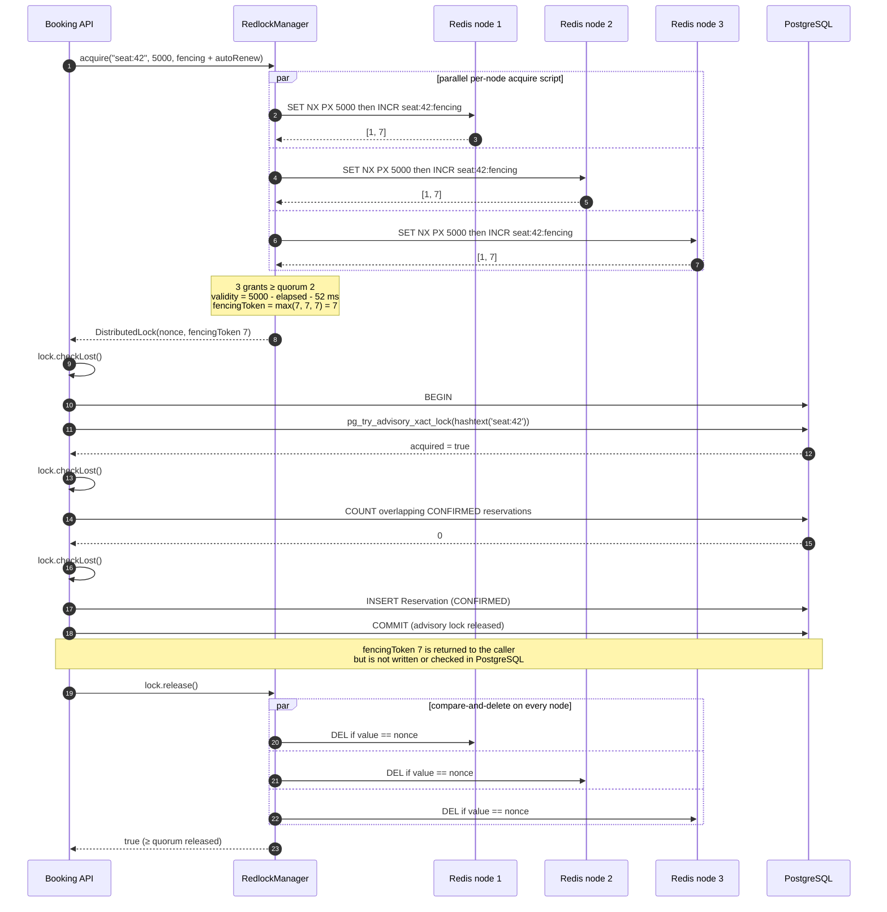
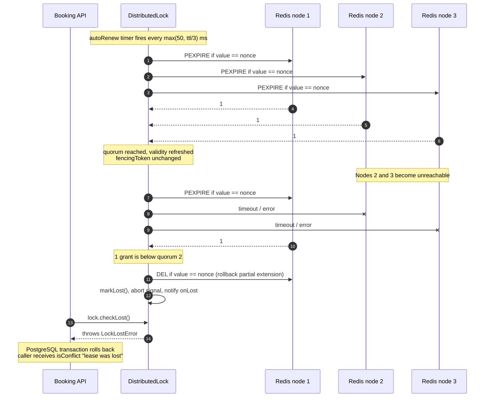
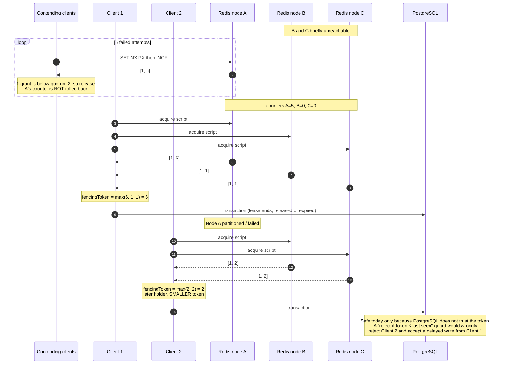

# Redlock Lease Fencing Token Protocol

> **Scope.** This document specifies how WorkSphere generates, carries, renews and releases the fencing token attached to a Redlock lease, and how the token interacts with the PostgreSQL transaction that writes a desk reservation. It describes the code as it exists in
> [`src/lib/redis/RedlockManager.ts`](../../src/lib/redis/RedlockManager.ts) and
> [`src/lib/reservations/bookingEngine.ts`](../../src/lib/reservations/bookingEngine.ts).
> Where behaviour is a proposal rather than current behaviour, it is marked **Proposed**.

---

## Contents

1. [Summary of guarantees](#1-summary-of-guarantees)
2. [Components and where they live](#2-components-and-where-they-live)
3. [Configuration and keyspace](#3-configuration-and-keyspace)
4. [Token lifecycle](#4-token-lifecycle)
5. [Sequence diagrams](#5-sequence-diagrams)
6. [Monotonicity: what holds and what does not](#6-monotonicity-what-holds-and-what-does-not)
7. [Edge cases](#7-edge-cases)
8. [Proposed hardening](#8-proposed-hardening)
9. [Test coverage](#9-test-coverage)
10. [Related documents and references](#10-related-documents-and-references)

---

## 1. Summary of guarantees

| Property                                                                                                          | Status today                                                                | Enforced by                                                                   |
| ----------------------------------------------------------------------------------------------------------------- | --------------------------------------------------------------------------- | ----------------------------------------------------------------------------- |
| At most one holder of a Redis lease per key, while a majority of nodes are healthy and clocks drift within budget | Holds                                                                       | Redlock quorum, `SET NX PX`, validity budget                                  |
| A client can only release or extend its **own** lease                                                             | Holds                                                                       | Compare-and-delete / compare-and-extend Lua scripts keyed on a random nonce   |
| Each node's fencing counter strictly increases while that node keeps its data                                     | Holds                                                                       | `INCR` inside the acquire Lua script                                          |
| Fencing tokens increase across successive holders on a **healthy, stable** cluster                                | Holds                                                                       | Same set of nodes grant every lease                                           |
| Fencing tokens increase across successive holders **after a node fails, partitions or restarts**                  | **Does not hold** (see [§6](#6-monotonicity-what-holds-and-what-does-not))  | —                                                                             |
| Writes carrying a stale fencing token are rejected by storage                                                     | **Not implemented**. The token is returned to the caller but never compared | —                                                                             |
| No two `CONFIRMED` reservations overlap for the same seat                                                         | Holds                                                                       | PostgreSQL `pg_try_advisory_xact_lock` + overlap check inside one transaction |

**Read this as:** today the fencing token is an _observability value_, not a safety mechanism. Double-booking protection comes from the PostgreSQL transaction (§4.6). The Redis lease reduces contention before it reaches the database.

---

## 2. Components and where they live

| Module                                                               | Role                                                                                                                                                                         | Fencing tokens?                                                                                                                          |
| -------------------------------------------------------------------- | ---------------------------------------------------------------------------------------------------------------------------------------------------------------------------- | ---------------------------------------------------------------------------------------------------------------------------------------- |
| [`RedlockManager.ts`](../../src/lib/redis/RedlockManager.ts)         | Production Redlock: `RedlockManager`, `DistributedLock` handle, auto-renewal, `LockLostError`, `getRedlockManager()` env factory                                             | **Yes**, opt-in via `withFencingToken`                                                                                                   |
| [`bookingEngine.ts`](../../src/lib/reservations/bookingEngine.ts)    | `bookSeatWithAdvisoryLock()`: wraps the PostgreSQL reservation transaction in a Redlock lease. Re-exported by `src/lib/reservations/index.ts` and `src/lib/booking/index.ts` | Requests them by default (`withFencingToken ?? true`)                                                                                    |
| [`distributedRedlock.ts`](../../src/lib/locks/distributedRedlock.ts) | Separate functional Redlock (`acquireDistributedLock` / `releaseDistributedLock`) with an in-memory fallback below 3 nodes. Currently referenced only by its tests           | **No**                                                                                                                                   |
| [`seatHoldLock.ts`](../../src/lib/locks/seatHoldLock.ts)             | Single-Redis 5-minute checkout seat hold                                                                                                                                     | **No**. Its `version` field counts renewals of one hold and restarts at `1` on every fresh acquire, so it cannot order different holders |

The rest of this document is about `RedlockManager` and its use in `bookingEngine`.

---

## 3. Configuration and keyspace

### 3.1 Node discovery (`getRedlockManager`)

[`getRedlockManager()`](../../src/lib/redis/RedlockManager.ts#L599-L664) builds a singleton from environment variables, in this order:

1. `REDLOCK_REDIS_URLS` (or `REDIS_CLUSTER_NODES`) as a comma-separated URL list, with `REDLOCK_REDIS_TOKENS` as matching comma-separated tokens.
2. Otherwise, if `UPSTASH_REDIS_REST_URL` is set **and** `REDLOCK_ADDITIONAL_URLS` is non-empty, the primary Upstash URL plus the additional URLs, with `UPSTASH_REDIS_REST_TOKEN` plus `REDLOCK_ADDITIONAL_TOKENS`.

| Nodes resolved | Result                                                                                   |
| -------------- | ---------------------------------------------------------------------------------------- |
| 0              | Returns `null`. `bookSeatWithAdvisoryLock` skips Redis and uses the PostgreSQL-only path |
| 1 or 2         | **Throws.** Single-node fallback is deliberately disallowed                              |
| ≥ 3            | `RedlockManager` with quorum `floor(N / 2) + 1` (N=3 → 2, N=5 → 3)                       |

The nodes must be **independent masters**: no shared persistence and no asynchronous replication between them. Replica promotion can hand a lease to a second client (see the Redlock safety notes in the file header).

### 3.2 Defaults

| Setting                          | `RedlockManager` default  | Booking engine override                      |
| -------------------------------- | ------------------------- | -------------------------------------------- |
| `driftFactor`                    | `0.01`                    | —                                            |
| `defaultTtlMs`                   | `5000`                    | `lockTtlMs ?? 5000`                          |
| `retryCount`                     | `3`                       | `retryCount ?? 1`                            |
| `retryDelayMs` / `retryJitterMs` | `200` / `100`             | `retryDelayMs ?? 100` / default jitter `100` |
| `autoRenew`                      | off                       | **on**                                       |
| Renew interval                   | `max(50, floor(ttl / 3))` | 1666 ms for a 5000 ms lease                  |
| `withFencingToken`               | off                       | **on**                                       |

### 3.3 Keys

| Key                                                                            | Value                                                | TTL                               | Written by                          |
| ------------------------------------------------------------------------------ | ---------------------------------------------------- | --------------------------------- | ----------------------------------- |
| `seat:<seatId>` (default) or `seat:<seatId>:<YYYY-MM-DD>` (`useSlotLevelLock`) | Lease nonce: `randomUUID()` + 16 random bytes in hex | Lease TTL (`PX`)                  | Acquire script; refreshed by extend |
| `<lockKey>:fencing`                                                            | Integer counter                                      | **None** (persists after release) | `INCR` in the acquire script        |

The date in the slot-level key is the **UTC** date from `startTime.toISOString()`.

Both keys are touched by one Lua script, so on a sharded Redis Cluster deployment they would need a shared hash tag (for example `{seat:<id>}`) to avoid a `CROSSSLOT` error. The current key format has no hash tag. It assumes each node is a single-shard instance.

---

## 4. Token lifecycle

### 4.1 Nonce vs. fencing token

A lease carries two different values:

- **Nonce** (`lock.token`): random and unique per acquisition attempt. It proves ownership to the release and extend scripts. It has no ordering.
- **Fencing token** (`lock.fencingToken`): an integer meant to order holders. It is produced only when `withFencingToken: true`.

### 4.2 Generation: per-node, inside the acquire script

For each node in parallel, `acquire()` runs [`REDLOCK_ACQUIRE_FENCING_LUA`](../../src/lib/redis/RedlockManager.ts#L127-L134):

```lua
if redis.call("set", KEYS[1], ARGV[1], "NX", "PX", tonumber(ARGV[2])) then
  local fence = redis.call("incr", KEYS[2])
  return {1, fence}
else
  return {0, 0}
end
```

`SET NX PX` and `INCR` run atomically **on that node**. A node increments its counter only when it grants the lease. There is no cross-node coordination of counters, so each node's counter is independent.

### 4.3 Aggregation: quorum, validity, and `max`

After all nodes answer ([`acquire()`](../../src/lib/redis/RedlockManager.ts#L427-L504)):

```
elapsedMs           = performance.now() - startTime     // monotonic clock
driftMs             = round(ttl * driftFactor) + 2
remainingValidityMs = ttl - elapsedMs - driftMs
granted             = successCount >= quorum && remainingValidityMs > 0
fencingToken        = max(token returned by each granting node)
```

The lease's `fencingToken` is the **maximum** of the per-node values from the nodes that granted it.

### 4.4 Failed attempts

If quorum or validity fails, every node runs the compare-and-delete script for this attempt's nonce, and the client retries after `retryDelayMs + random(0, retryJitterMs)`.

The **`INCR` is not rolled back**. Every partial grant permanently advances that node's counter. Counters on different nodes therefore drift apart over time, and that drift is the root cause of the regression in §6.

### 4.5 Renewal: the token does not change

[`extend()`](../../src/lib/redis/RedlockManager.ts#L513-L555) runs compare-and-extend (`PEXPIRE` only if the nonce matches) on every node. It succeeds only with quorum and positive remaining validity. A successful extension updates `validity` and `expiresAt`. **The fencing token is not reissued.** One lease keeps one token for its whole life.

If an extension fails:

1. The client releases the lease on **all** nodes, to avoid half-extended leftovers.
2. The auto-renew loop calls `markLost()`. That sets `isLost`, stops renewal, aborts `lock.signal` with a `LockLostError`, and notifies the `onLost` listeners.
3. The next `lock.checkLost()` in the critical section throws.

### 4.6 Validation at the transaction boundary (current behaviour)

`bookSeatWithAdvisoryLock()` protects the write with these checks, in order:

| Step | Check                                                                                             | Code                                                               |
| ---- | ------------------------------------------------------------------------------------------------- | ------------------------------------------------------------------ |
| 1    | Acquire Redlock lease (fencing on, auto-renew on). On failure, return conflict                    | [L56-L69](../../src/lib/reservations/bookingEngine.ts#L56-L69)     |
| 2    | `lock.checkLost()` before and at the start of `prisma.$transaction`                               | [L71-L73](../../src/lib/reservations/bookingEngine.ts#L71-L73)     |
| 3    | `pg_try_advisory_xact_lock(hashtext('seat:<seatId>'))`, non-blocking. On failure, return conflict | [L75-L86](../../src/lib/reservations/bookingEngine.ts#L75-L86)     |
| 4    | `lock.checkLost()`, then count overlapping `CONFIRMED` reservations                               | [L89-L105](../../src/lib/reservations/bookingEngine.ts#L89-L105)   |
| 5    | `lock.checkLost()`, then `INSERT ... 'CONFIRMED'`                                                 | [L108-L113](../../src/lib/reservations/bookingEngine.ts#L108-L113) |
| 6    | Return `{ success, reservation, fencingToken }`                                                   | [L115-L119](../../src/lib/reservations/bookingEngine.ts#L115-L119) |
| 7    | `lock.release()` in `finally`. A `LockLostError` becomes a conflict result                        | [L121-L132](../../src/lib/reservations/bookingEngine.ts#L121-L132) |

**The fencing token is never compared against anything.** No `Reservation` or seat column stores it (the Prisma schema has no fencing column), and no query filters on it. Step 6 only returns it to the caller.

Steps 3–5 are what make the write safe. The advisory lock serialises writers per seat, and the overlap check runs inside the same transaction as the insert. This holds even if two clients both believe they hold the Redis lease.

### 4.7 Release

[`release()`](../../src/lib/redis/RedlockManager.ts#L560-L565) runs compare-and-delete on every node. It returns `true` only if at least `quorum` nodes deleted the key. If fewer did, the remaining keys expire through their TTL. The `:fencing` counter is never deleted.

---

## 5. Sequence diagrams

### 5.1 Acquisition, transaction-boundary checks, and release (healthy cluster)



### 5.2 Lease renewal and the renewal-failure edge case



### 5.3 Cluster failover: fencing-token regression

This is the reproducible sequence behind the "does not hold" row in §1. Counter values match the reproduction in §6.2.



---

## 6. Monotonicity: what holds and what does not

### 6.1 Why quorum intersection is not enough

Any two quorums share at least one node. On that shared node, the later lease's `INCR` result is strictly larger than the earlier one's. But the token is the **maximum over all granting nodes**. The earlier lease's maximum can come from a node that is _not_ in the later lease's quorum, and that node's counter may be far ahead because of drift (§4.4). Nothing forces the later maximum to exceed the earlier one.

A node that restarts without its dataset resets its counter to 0, which has the same effect. Redlock already needs durable state or a delayed restart for mutual exclusion. Without them, fencing ordering breaks too.

### 6.2 Reproduction

These figures come from running the unmodified `RedlockManager` class against three in-memory nodes that emulate the acquire and release scripts. The emulation is the same approach used in `src/__tests__/lib/redlockManager.test.ts`.

| Scenario                         | Steps                                                                                                 | Counters after | Holder 1 token | Holder 2 token         |
| -------------------------------- | ----------------------------------------------------------------------------------------------------- | -------------- | -------------- | ---------------------- |
| Healthy, stable quorum           | 4 sequential acquire/release cycles                                                                   | A=4 B=4 C=4    | —              | tokens `1, 2, 3, 4` ✅ |
| Partial-grant drift + node loss  | 5 attempts granted only by A. Holder 1 on {A,B,C}. A fails. Holder 2 on {B,C}                         | A=6 B=2 C=2    | **6**          | **2** ❌               |
| Node restart without persistence | C down. 3 leases on {A,B}. Holder 1 on {A,B}. B restarts empty. A fails, C returns. Holder 2 on {B,C} | A=4 B=1 C=1    | **4**          | **1** ❌               |

### 6.3 Consequence

You cannot add a storage-side "reject if token ≤ last seen" guard on top of the current token as-is. Under failover it would reject legitimate writes, and it could accept a delayed write from an expired holder that carries a larger, stale token. A token must be generated monotonically before it is used as a fence (§8).

---

## 7. Edge cases

| Edge case                                                                | What happens                                                                                                                                                                                                                                                                               | Guarded by                                                                                             |
| ------------------------------------------------------------------------ | ------------------------------------------------------------------------------------------------------------------------------------------------------------------------------------------------------------------------------------------------------------------------------------------ | ------------------------------------------------------------------------------------------------------ |
| **Partial acquisition** (fewer than quorum nodes grant)                  | All nodes released for that nonce. Retry with jitter. Counters on granting nodes stay incremented                                                                                                                                                                                          | Quorum check. Drift is a known effect (§4.4)                                                           |
| **Slow node / high RTT**                                                 | `RedlockManager` sets **no per-node timeout**, so `acquire` waits for the slowest node (bounded only by the HTTP client). `elapsedMs` grows and the lease is rejected if validity ≤ 0. `distributedRedlock.ts`, by contrast, uses a per-node timeout of `clamp(ttl/20, 5, 50)` ms          | Validity budget                                                                                        |
| **Clock drift between nodes**                                            | `driftMs = round(ttl × 0.01) + 2` is subtracted from the validity window (52 ms for 5000 ms)                                                                                                                                                                                               | Drift budget                                                                                           |
| **Wall-clock jumps on the client**                                       | Elapsed time uses `performance.now()` (monotonic), so NTP steps do not affect validity                                                                                                                                                                                                     | Monotonic clock                                                                                        |
| **Renewal fails** (quorum lost)                                          | Partial extensions rolled back, lease marked lost, next `checkLost()` throws                                                                                                                                                                                                               | §4.5, §5.2                                                                                             |
| **Process pause** (GC, event-loop stall) longer than the remaining lease | The renewal timer cannot fire during the pause, so `isLost` stays `false`. `checkLost()` checks only that flag and does **not** compare `performance.now()` with `lock.expiresAt`, so the client continues after resuming. Another client may hold the lease by then                       | **PostgreSQL only** (advisory lock + overlap check). This is exactly the case fencing tokens exist for |
| **Release reaches fewer than quorum nodes**                              | `release()` returns `false`. Remaining keys expire through their TTL. The seat is unavailable to Redlock until then                                                                                                                                                                        | TTL                                                                                                    |
| **Slot-level Redis key, seat-level PostgreSQL key**                      | With `useSlotLevelLock`, two bookings for the same seat on different dates both get Redis leases. The PostgreSQL advisory key is still `seat:<seatId>`, so the second concurrent transaction fails `pg_try_advisory_xact_lock` and returns a conflict even though the dates do not overlap | Correct, but may cause spurious conflicts under contention                                             |
| **Fewer than 3 nodes configured**                                        | `getRedlockManager()` throws for 1–2 nodes and returns `null` for 0. The `null` case uses the PostgreSQL-only path                                                                                                                                                                         | Explicit configuration error                                                                           |
| **Fencing counter key never expires**                                    | One `<lockKey>:fencing` key per seat (or per seat-day with slot-level locks) stays on every node forever                                                                                                                                                                                   | Not guarded. Grows with the number of distinct lock keys                                               |

---

## 8. Proposed hardening

> **Proposed.** None of this is implemented. These are options for follow-up issues, listed roughly by value.

1. **Generate the token from one linearizable source.** For example, increment a `fencingVersion` column on the seat row (or use a PostgreSQL sequence) inside the reservation transaction. This gives strict ordering independent of Redis node health. Redis then only reduces contention, and the database stays the authority.
2. **If the Redis token is kept, do not take an unsynchronised `max`.** One option is to write the chosen token back to all granting nodes before returning (`SET counter max(counter, token)`) so counters converge. This reduces drift but still does not survive a node restart without persistence. Document the persistence requirement (`appendfsync always`, or a delayed restart longer than the max TTL).
3. **Validate at the transaction boundary.** Once the token is monotonic, store the last accepted token for each seat and reject writes where `incoming ≤ stored` in the same statement as the insert. Do not add this guard before step 1 or 2 (see §6.3).
4. **Make `checkLost()` time-aware.** Also throw when `performance.now() >= lock.expiresAt`, so a client that resumes from a pause longer than its lease aborts before its next write.
5. **Add a per-node timeout to `RedlockManager`**, matching `distributedRedlock.ts`, so one slow node cannot use up the validity budget.
6. **Add hash tags** (`{seat:<id>}` and `{seat:<id>}:fencing`) if any node may be a sharded Redis Cluster.
7. **Regression test.** Add the drift and restart scenarios from §6.2 to `src/__tests__/lib/redlockManager.test.ts`. Write them to expect the current behaviour, or as `it.failing` until item 1 or 2 lands, so the guarantee is checked by tests.

---

## 9. Test coverage

| Behaviour                                                        | Test (`src/__tests__/lib/redlockManager.test.ts`)                       |
| ---------------------------------------------------------------- | ----------------------------------------------------------------------- |
| Fewer than 3 nodes rejected, quorum formula                      | _Quorum Configuration Validation_                                       |
| Majority acquisition, partial-acquisition cleanup                | _Lock Acquisition_                                                      |
| Release only by matching nonce, node failure during release      | _Lock Release Safety_                                                   |
| Compare-and-extend, lease loss notifies listeners                | _Automatic Renewal and Lease-Loss Handling_                             |
| Booking aborts on lease loss, conflict on acquire failure        | _Booking Engine Critical Section Integration_                           |
| Tokens increase across two acquisitions on a **healthy** cluster | `generates monotonically increasing fencing tokens across acquisitions` |
| Fencing token propagated through slot-level booking              | `supports granular slot-aware booking and propagates fencing tokens`    |
| Token ordering under node loss or restart                        | **Not covered** (see §8, item 7)                                        |
| Process pause longer than the lease                              | **Not covered**                                                         |

Run with:

```bash
npx jest src/__tests__/lib/redlockManager.test.ts src/__tests__/locks/distributedRedlock.test.ts
```

---

## 10. Related documents and references

**In this repository**

- [Distributed locks and fencing](./distributed-locks-and-fencing.md): broader design discussion. It describes a storage-side `lastFencingToken` guard and `seatHoldLock`-based versioning, neither of which is present in the current schema or code. Where the two documents differ, this one reflects the code.
- [Seat hold Redlock architecture](./seat-hold-lock-redlock-architecture.md)
- [Seat hold lock architecture](./seat-hold-lock-architecture.md)
- [Reservation concurrency](../RESERVATION_CONCURRENCY.md)

**External**

- Martin Kleppmann, [_How to do distributed locking_](https://martin.kleppmann.com/2016/02/08/how-to-do-distributed-locking.html) (2016). Explains why lease-based locks need fencing tokens generated by a linearizable source.
- Salvatore Sanfilippo, [_Is Redlock safe?_](http://antirez.com/news/101) (2016). The Redlock author's response, including the persistence and delayed-restart requirements.
- Redis documentation, [_Distributed Locks with Redis_](https://redis.io/docs/latest/develop/clients/patterns/distributed-locks/).
- PostgreSQL documentation, [_Advisory Lock Functions_](https://www.postgresql.org/docs/current/functions-admin.html#FUNCTIONS-ADVISORY-LOCKS).
