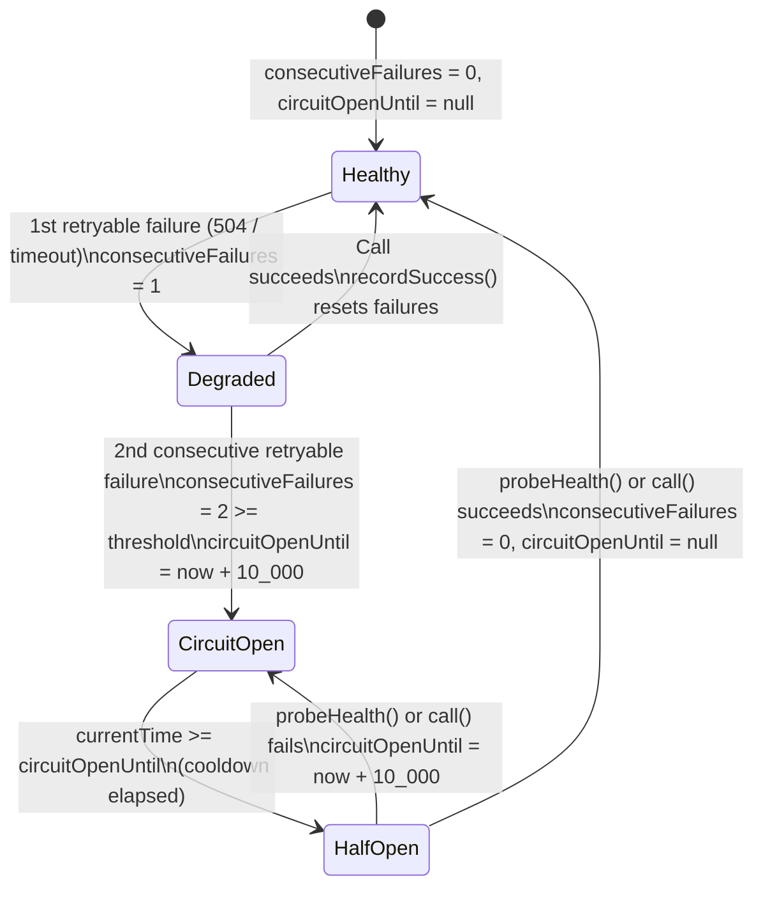

# Solana Cluster RPC Pool Failover, Health Scoring & Cooldown Windows

This specification documents the endpoint health tracking, consecutive failure thresholds, circuit-breaker cooldown recovery windows, and `Promise.allSettled` failover routing implemented in [`src/lib/solana/clusterRpcPool.ts`](../../src/lib/solana/clusterRpcPool.ts).

---

## 1. Configuration Options & Defaults (`ClusterRpcPoolConfig`)

| Option | Type | Default | Description |
| :--- | :--- | :--- | :--- |
| `endpoints` | `string[]` | *Required* | Candidate Solana RPC URLs. Trimmed and deduplicated; throws if empty. |
| `transport` | `RpcTransport` | *Required* | Async transport `(endpoint, method, params, signal) => Promise<TResult>`. |
| `requestTimeoutMs` | `number` | `4_000` (`DEFAULT_TIMEOUT_MS`) | Per-endpoint attempt abort timeout in milliseconds. |
| `failureThreshold` | `number` | `2` (`DEFAULT_FAILURE_THRESHOLD`) | Consecutive retryable failures required to open an endpoint's circuit. |
| `cooldownMs` | `number` | `15_000` (`DEFAULT_COOLDOWN_MS`) | Milliseconds an open-circuit endpoint stays deprioritized before half-open probing. |
| `now` | `() => number` | `() => Date.now()` | Clock provider for deterministic circuit timing and tests. |

---

## 2. Endpoint Health Snapshots & Retryable Failure Classification

Each endpoint maintains an `EndpointHealthSnapshot` exposed via `pool.getHealthSnapshot()`:

- `consecutiveFailures`: Number of consecutive retryable failures since the last success.
- `circuitOpenUntil`: Epoch timestamp (ms) until which the circuit is open, or `null` when closed.
- `lastError`: Formatted message from the most recent error.
- `lastSuccessAt`: Epoch timestamp (ms) of the last successful RPC call or health probe.
- `totalRequests` / `totalFailures`: Cumulative counters across the pool's lifetime.

### Retryable Failure Classification (`isRetryableFailure`)

| Failure Input | Retryable? | Effect on Circuit State |
| :--- | :--- | :--- |
| `AbortError` (including `requestTimeoutMs` timeout) | Yes | Increments `consecutiveFailures`; opens circuit at `failureThreshold`. |
| HTTP `429` or `5xx` (`status` / `statusCode`) | Yes | Increments `consecutiveFailures`; opens circuit at `failureThreshold`. |
| Network `code` in `ETIMEDOUT`, `ECONNRESET`, `ECONNREFUSED`, `EAI_AGAIN`, `UND_ERR_CONNECT_TIMEOUT` | Yes | Increments `consecutiveFailures`; opens circuit at `failureThreshold`. |
| Other `Error` objects or non-object thrown values | Yes | Increments `consecutiveFailures`; opens circuit at `failureThreshold`. |
| HTTP `4xx` other than `429` (e.g., `400`, `404`) | No | Increments `totalFailures` and updates `lastError`, but does **not** increment `consecutiveFailures` or trip the circuit. |

---

## 3. Priority Wave Routing & Cooldown Recovery Windows

On each `pool.call(method, params)` invocation:

1. **Cursor Rotation**: `getOrderedEndpoints(currentTime)` advances the round-robin `cursor` across `this.states`.
2. **Tier Partitioning**:
   - **Healthy**: `!isCircuitOpen(s, currentTime) && s.consecutiveFailures === 0`
   - **Degraded / Half-Open**: `!isCircuitOpen(s, currentTime) && s.consecutiveFailures > 0` (either below `failureThreshold` or cooldown elapsed: `currentTime >= circuitOpenUntil`)
   - **Open**: `isCircuitOpen(s, currentTime)` (`circuitOpenUntil !== null && currentTime < circuitOpenUntil`)
3. **Wave Execution (`executeWave`)**:
   - **Wave 1 (`healthyOrProbing`)**: Healthy and half-open/degraded endpoints execute concurrently with per-attempt `AbortController` timeouts (`requestTimeoutMs`).
   - **Wave 2 (`openCircuitFallback`)**: Executed only if Wave 1 yields no winner, allowing recovery even when all circuits are temporarily open.
   - Every attempt promise immediately attaches `.catch(() => undefined)` and settles via `Promise.allSettled` so late rejections or hangs on sibling endpoints never leak unhandled promise rejections.
   - If all waves fail, `call()` throws `AllEndpointsFailedError(method, collectedErrors)`.
4. **Proactive Recovery (`probeHealth(force = false)`)**:
   - Selects endpoints whose cooldown has elapsed (`circuitOpenUntil !== null && currentTime >= circuitOpenUntil`), or all endpoints when `force === true`.
   - Invokes `"getHealth"` on each candidate: success calls `recordSuccess()` (clearing `consecutiveFailures` and `circuitOpenUntil`); failure calls `recordFailure()` (extending `circuitOpenUntil` to `now + cooldownMs`).

---

## 4. Failover State Transition Example

Assume a two-endpoint pool (`primary`, `secondary`) configured with `failureThreshold: 2`, `cooldownMs: 10_000`, and `now = 1_000_000`:

1. **Initial state (`t = 1_000_000`)**: Both `primary` and `secondary` are `Healthy` (`consecutiveFailures: 0`, `circuitOpenUntil: null`).
2. **First failure (`t = 1_000_000`)**: `primary` returns `504` (`consecutiveFailures: 1`, `circuitOpenUntil: null` — still `Degraded`, below `failureThreshold = 2`); `secondary` serves the request.
3. **Second consecutive failure (`t = 1_000_000`)**: `primary` returns `504` again (`consecutiveFailures: 2 >= 2`). `recordFailure()` sets `circuitOpenUntil = 1_010_000` (`CircuitOpen`).
4. **During cooldown (`1_000_000 <= t < 1_010_000`)**: `isCircuitOpen(primary, t)` is `true`, so `primary` is placed in the `openCircuitFallback` wave behind `secondary`; Wave 1 succeeds on `secondary` without hitting `primary`.
5. **Cooldown expiry & recovery (`t = 1_010_000`)**: `currentTime >= circuitOpenUntil` makes `isCircuitOpen(primary, t)` return `false` (`HalfOpen`). Calling `probeHealth()` runs `getHealth` against `primary`; on `"ok"`, `recordSuccess()` resets `consecutiveFailures = 0` and `circuitOpenUntil = null`, restoring `primary` to `Healthy`.

---

## 5. Verification

Unit tests in [`src/__tests__/lib/solana/clusterRpcPool.test.ts`](../../src/__tests__/lib/solana/clusterRpcPool.test.ts) verify:
- Deterministic failover across `429` and `5xx` endpoint responses.
- `AbortError` timeout handling without hanging the pool or leaking unhandled rejections.
- Circuit opening at `failureThreshold`, deprioritization during `cooldownMs`, and recovery via `probeHealth()`.
- `AllEndpointsFailedError` aggregation when every endpoint fails.
