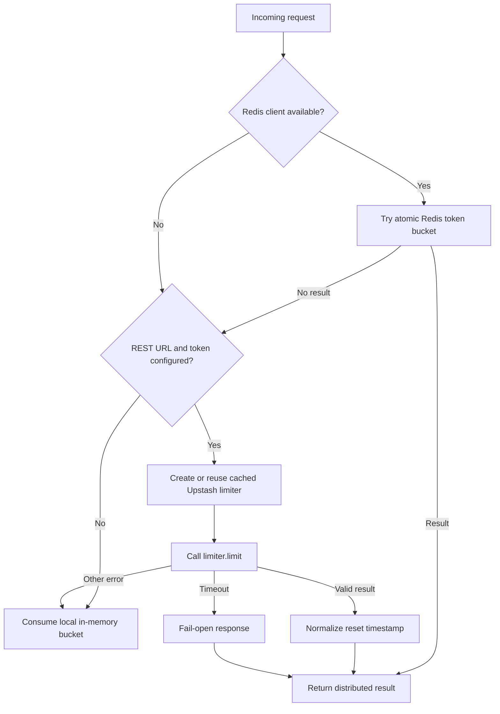

# Token-Bucket Redis TTL Fallback and Recovery

## Scope

WorkSphere's `TokenBucketLimiter` uses a distributed Upstash-backed limiter when its Redis configuration is available and falls back to the local in-memory token bucket when the distributed limiter cannot provide a result. This guide documents the behavior implemented in `src/lib/rateLimit/limiters/tokenBucketLimiter.ts`.

## High-level flow

The code first attempts the configured atomic Redis path. If it does not return a result, it may use the Upstash REST limiter. If that path is unavailable or fails with a non-timeout error, the request is handled by the local memory store.

## Redis reset values

`normalizeRedisResetAt(resetValue, nowMs, fallbackWindowMs)` expects an absolute reset timestamp in epoch milliseconds.

| Input | Redis meaning / condition | WorkSphere behavior |
|---|---|---|
| Positive finite future number | Valid absolute reset instant | Use the supplied timestamp |
| Numeric string representing a future epoch-ms value | String-form timestamp | Convert to number and use it |
| `-1` | Redis key exists without an expiry (PTTL sentinel) | Reject as a reset instant; use fallback window |
| `-2` | Redis key does not exist (PTTL sentinel) | Reject as a reset instant; use fallback window |
| `null`, `undefined`, empty or non-numeric string | Missing / malformed value | Use fallback window |
| `NaN`, positive/negative infinity | Non-finite value | Use fallback window |
| Timestamp at or before `nowMs` | Already expired | Use fallback window |

The fallback window is the limiter's configured `windowMs` when it is finite and positive; otherwise the normalizer uses 60,000 ms. Do not pass a Redis PTTL duration directly as though it were an absolute epoch timestamp.

## Fallback behavior and response fields

The Upstash path normalizes `result.reset`, clamps `remaining` to the range from zero through the configured limit, and calculates `retryAfter` from the normalized reset time for rejected requests.

- Successful distributed result: preserve `success`, return bounded remaining tokens, and set `retryAfter = 0`.
- Rejected distributed result: compute `retryAfter` as at least one second, rounded up from the reset instant.
- Timeout exception: current code fails open for that request, returning success with the full configured allowance, a reset one window from now, and zero retry delay.
- Other Redis/Upstash errors: return `null` from the distributed path so `consume()` uses the local in-memory token bucket.

The timeout fail-open behavior is an availability choice. It can permit additional requests during a Redis outage; deployments that require strict distributed enforcement should review that policy against their abuse and availability requirements.

## In-memory fallback

The memory bucket stores token count, last-refill time, window duration, and capacity. Tokens refill proportionally to elapsed milliseconds, capped at the configured limit. A backward wall-clock jump resets the stored refill baseline to the current time to avoid negative elapsed time. When the bucket is depleted, the limiter calculates the wait for the next token and returns a positive `retryAfter`.

The fallback is process-local. It is not a globally shared quota across multiple server instances, and state can be lost when a process restarts.

## Circuit-breaker status

The current `TokenBucketLimiter` implementation does not contain a persistent circuit-breaker state machine, a five-consecutive-timeout threshold, a 30-second cooldown, or half-open probes. Those values must not be presented as active runtime guarantees. If a circuit breaker is introduced, it should be implemented and tested as a separate change before being documented as production behavior.

## Production configuration and operations

1. Configure `UPSTASH_REDIS_REST_URL` and `UPSTASH_REDIS_REST_TOKEN` in the server environment; never expose the token to browser code.
2. Keep the configured token-bucket `limit` and `windowMs` positive and finite.
3. Monitor distributed-store errors and fallback frequency without logging Redis credentials or user payloads.
4. Understand that the in-memory fallback is per process and does not preserve a cluster-wide quota.
5. Decide explicitly whether timeouts should fail open or fail closed for each route's risk profile.
6. Test Redis success, missing credentials, invalid reset values, timeout exceptions, non-timeout errors, and memory fallback refill/rejection behavior.
7. Treat `Retry-After` as seconds and avoid unbounded immediate retries.

## Implementation and tests

- `src/lib/rateLimit/limiters/tokenBucketLimiter.ts`
- `src/__tests__/lib/redisTtlFallback.test.ts`
- `docs/api/RATE_LIMITING.md`
