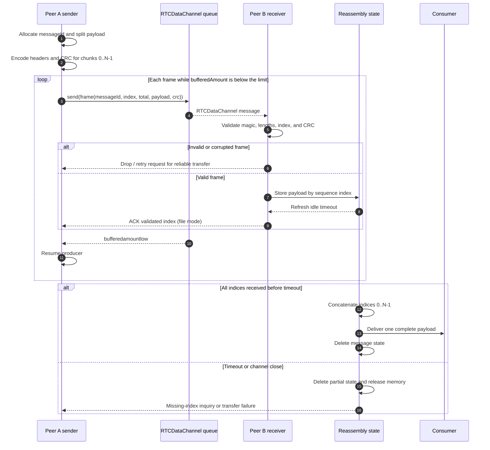

# WebRTC DataChannel Packet Framing and Reassembly

This specification describes the binary framing contract used for large
peer-to-peer payloads over WorkSphere `RTCDataChannel` links. It covers CRDT
updates, file fragments, and tunnel payloads that must be split before being
submitted to `RTCDataChannel.send()`.

The relevant implementations are:

- [`docs/crdt/CRDT_DATACHANNEL_FRAMING.md`](../crdt/CRDT_DATACHANNEL_FRAMING.md):
  the 16-byte CRDT wire-header definition.
- [`src/core/network/BandwidthMultiplexer.ts`](../../src/core/network/BandwidthMultiplexer.ts):
  fragment distribution, checksums, and logical reassembly.
- [`src/core/network/ChunkedFileTransfer.ts`](../../src/core/network/ChunkedFileTransfer.ts):
  file chunk validation, acknowledgements, persistence, pause, and resume.
- [`src/core/network/WebRTCTunnelManager.ts`](../../src/core/network/WebRTCTunnelManager.ts):
  raw binary tunnel sending and the 1 MiB backpressure guard.
- [`src/lib/realtime/webrtc/peerManager.ts`](../../src/lib/realtime/webrtc/peerManager.ts):
  peer data-channel setup and a 64 KiB low-buffer threshold.

## 1. Transport assumptions

`RTCDataChannel` provides message boundaries, not an application-level message
protocol. A large application payload must therefore be divided into complete
application frames before calling `send()`.

The interoperable ceiling is 64 KiB per SCTP user message:

| Parameter | Value |
| --- | ---: |
| Maximum complete frame | 65,536 bytes |
| Fixed header | 16 bytes |
| Maximum payload slice | 65,520 bytes |
| Maximum encoded chunk count | 65,535 |
| Practical soft cap | 256 chunks / 16 MiB per message |
| CRDT channel mode | Ordered and reliable |

Senders should use the peer's negotiated `RTCSctpTransport.maxMessageSize` when
available, but must clamp to the lower interoperable limit. A DataChannel
message that is too large can fail with `OperationError`, reset the channel,
or be dropped by a heterogeneous peer.

The tunnel manager uses an unordered, partially retransmitted channel for
latency-sensitive tunnel traffic. It therefore cannot assume that chunks arrive
in order or that a missing chunk will be retransmitted.

## 2. Canonical binary frame

Every binary frame contains a fixed 16-byte big-endian header followed by one
payload slice. The `DataView` equivalent of the header is:

| Offset | Size | Field | Encoding |
| ---: | ---: | --- | --- |
| 0 | 2 | Magic | `uint16`, `0x5753` (`"WS"`) |
| 2 | 1 | Version | `uint8`, currently `1` |
| 3 | 1 | Flags | `uint8`, message type/control flags |
| 4 | 4 | Message ID | `uint32`, sender-scoped transfer identifier |
| 8 | 2 | Sequence index | `uint16`, zero-based chunk index |
| 10 | 2 | Total chunk count | `uint16`, same for every chunk |
| 12 | 2 | Payload length | `uint16`, number of bytes after the header |
| 14 | 2 | CRC-16/CCITT | `uint16`, calculated over the payload slice |
| 16 | N | Payload | `Uint8Array` byte slice |

```text
  0                   1                   2                   3
  0 1 2 3 4 5 6 7 8 9 0 1 2 3 4 5 6 7 8 9 0 1 2 3 4 5 6 7 8 9 0 1
 +-+-+-+-+-+-+-+-+-+-+-+-+-+-+-+-+-+-+-+-+-+-+-+-+-+-+-+-+-+-+-+-+
 |          Magic (0x5753)       | Version       |    Flags      |
 +-+-+-+-+-+-+-+-+-+-+-+-+-+-+-+-+-+-+-+-+-+-+-+-+-+-+-+-+-+-+-+-+
 |                         Message ID                            |
 +-+-+-+-+-+-+-+-+-+-+-+-+-+-+-+-+-+-+-+-+-+-+-+-+-+-+-+-+-+-+-+-+
 |       Sequence index          |       Total chunk count        |
 +-+-+-+-+-+-+-+-+-+-+-+-+-+-+-+-+-+-+-+-+-+-+-+-+-+-+-+-+-+-+-+-+
 |       Payload length          |          CRC-16/CCITT          |
 +-+-+-+-+-+-+-+-+-+-+-+-+-+-+-+-+-+-+-+-+-+-+-+-+-+-+-+-+-+-+-+-+
 |                                                               |
 |                    Payload byte slice                         |
 |                                                               |
 +-+-+-+-+-+-+-+-+-+-+-+-+-+-+-+-+-+-+-+-+-+-+-+-+-+-+-+-+-+-+-+-+
```

### 2.1 Encoding rules

1. Integers are encoded in network byte order (big-endian).
2. `0 <= sequenceIndex < totalChunkCount`.
3. `payloadLength` equals `frame.byteLength - 16`; trailing bytes are invalid.
4. `totalChunkCount` is stable for the entire message.
5. A zero-length application message is represented by one frame with
   `sequenceIndex = 0`, `totalChunkCount = 1`, and `payloadLength = 0`.
6. A receiver must not deliver a message until every index in
   `[0, totalChunkCount)` has passed validation.
7. Message IDs are scoped to a sender/channel. Reusing an ID before cleanup is
   invalid and must be treated as a protocol error.

`BandwidthMultiplexer` represents the same logical fields as `streamId`,
`sequenceNumber`, `totalFragments`, `payload`, and `checksum`. Its checksum is
an additive modulo-65535 checksum rather than CRC-16; it must not be described
as wire-compatible with the canonical CRC frame without an adapter.

`ChunkedFileTransfer` currently transports a `FileChunk` object containing
`fileId`, `chunkIndex`, `sequenceNumber`, `totalChunks`, and `data`. A transport
adapter is responsible for serializing that object into the binary frame above.

## 3. Sender lifecycle

### 3.1 Chunking

The sender:

1. Allocates a message ID.
2. Chooses a payload size no larger than the negotiated safe maximum.
3. Computes `totalChunkCount = ceil(payloadBytes / payloadSliceSize)`.
4. Copies each byte slice into a new frame.
5. Writes the common message ID and total count into every header.
6. Computes the checksum over the payload only.
7. Queues frames in sequence order unless the channel is explicitly
   unordered.

The sender must not mutate a payload buffer after `send()`. Browsers may read
the buffer asynchronously.

### 3.2 Backpressure

`RTCDataChannel.bufferedAmount` is the number of bytes queued by the browser but
not yet transmitted. The sender applies two protections:

- Peer data channels set `bufferedAmountLowThreshold` to 64 KiB so producers can
  resume on `bufferedamountlow`.
- Tunnel sending rejects new data once `bufferedAmount` exceeds 1 MiB.

The general send loop is:

```ts
async function sendWithBackpressure(
  channel: RTCDataChannel,
  frame: ArrayBuffer,
): Promise<void> {
  while (channel.readyState === "open" && channel.bufferedAmount > 1_048_576) {
    await waitForBufferedAmountLow(channel);
  }
  if (channel.readyState !== "open") {
    throw new Error("DataChannel closed before frame transmission");
  }
  channel.send(frame);
}
```

`waitForBufferedAmountLow` should resolve from `bufferedamountlow`, reject on
`close`/`error`, and include a bounded watchdog timeout. A producer must pause
chunk generation while the queue is full; repeatedly calling `send()` and
building an unbounded in-memory queue defeats the protection.

For file transfers, the existing 10 ms inter-chunk delay and pause/resume
session state provide additional pacing. ACKs must represent receiver
validation, not merely the sender's successful `send()` call.

## 4. Receiver validation and reassembly

### 4.1 Frame validation order

On `message`, the receiver:

1. Converts the event data to an `ArrayBuffer` without accepting an unrelated
   string/control message as a binary frame.
2. Rejects frames shorter than 16 bytes.
3. Verifies magic and supported version.
4. Validates flags, message ID, sequence index, and total count.
5. Verifies that `payloadLength` exactly matches the received byte length.
6. Computes CRC-16/CCITT over the payload and compares it with the header.
7. Drops a failed frame without inserting its payload into reassembly state.
8. Inserts a valid payload only if that sequence index is not already present.

For `BandwidthMultiplexer`, a checksum mismatch is logged and returns `null`;
the fragment is not counted. For `ChunkedFileTransfer`, out-of-bounds indices
are discarded, duplicate chunks are re-acknowledged without double-counting,
and valid chunks update the persisted transfer session.

### 4.2 Reassembly state

State is keyed by `(peer/channel, messageId)` and contains:

```text
totalChunkCount
received: Map<sequenceIndex, payloadBytes>
receivedBytes
firstReceivedAt
lastReceivedAt
expiryTimer
```

The first valid frame creates the state. Later frames must agree with the
stored total count. A conflicting count, duplicate message ID with incompatible
metadata, or invalid sequence index is dropped as a protocol error.

When `received.size === totalChunkCount`, the receiver concatenates payloads in
strict sequence-index order, verifies the resulting length when a total length
is available, delivers exactly one complete message, and deletes the state.
Partial data must never be exposed to CRDT or file consumers.

### 4.3 Timeouts and cleanup

Recommended reassembly bounds are:

- **Idle timeout:** 30 seconds since the last valid frame.
- **Absolute timeout:** 60 seconds from the first valid frame.
- **Memory cap:** 16 MiB per message and a bounded total per peer.

On either timeout, the receiver deletes all partial fragments and emits a
transfer-timeout event. Reliable file transfers may send an inquiry or
application-level retry request listing missing indices. Unordered tunnel
traffic may discard the message and select another path. A timeout must not
leave a message ID reserved indefinitely.

The values are application-level limits, not SCTP retransmission timers. They
must be shortened or extended only with an explicit latency and memory review.

## 5. Corruption, loss, and duplicate handling

WebRTC's DTLS/SCTP transport authenticates and integrity-protects transport
messages, but application framing still needs validation for malformed,
truncated, stale, or incorrectly serialized input.

| Condition | Receiver action |
| --- | --- |
| Bad magic/version | Drop frame and increment protocol-error metric. |
| Header shorter than 16 bytes | Drop frame; do not read fields out of bounds. |
| Payload length mismatch | Drop frame and discard the message fragment. |
| CRC/checksum mismatch | Drop fragment; request retry only for reliable transfer modes. |
| Index outside total count | Drop frame; do not allocate state from it. |
| Conflicting total count | Drop frame and abort that message ID. |
| Duplicate valid index | Ignore payload; optionally re-acknowledge it. |
| Missing index at timeout | Discard partial state or request missing indices. |
| Channel close/error | Abort all state for that peer and release memory. |

Never assemble by arrival order. Ordered channels usually deliver in sequence,
but reassembly must still use the explicit sequence index because the same
protocol is used on unordered or multi-tunnel paths.

## 6. Peer-to-peer sequence



## 7. Operational checks

When diagnosing a transfer:

1. Log message ID, sequence index, total count, payload length, and channel
   label without logging sensitive payload bytes.
2. Compare `bufferedAmount` against the configured 64 KiB resume threshold and
   1 MiB hard guard.
3. Track invalid-frame, checksum-failure, duplicate, timeout, and reassembly
   completion counters separately.
4. Confirm that a closed channel clears every `(peer, messageId)` state.
5. Confirm that a resumed file transfer requests only missing chunk indices.

Do not increase frame size, remove backpressure, or accept a checksum mismatch
as a workaround for a failing peer. Those changes trade a visible transfer
failure for memory exhaustion, silent corruption, or channel instability.

