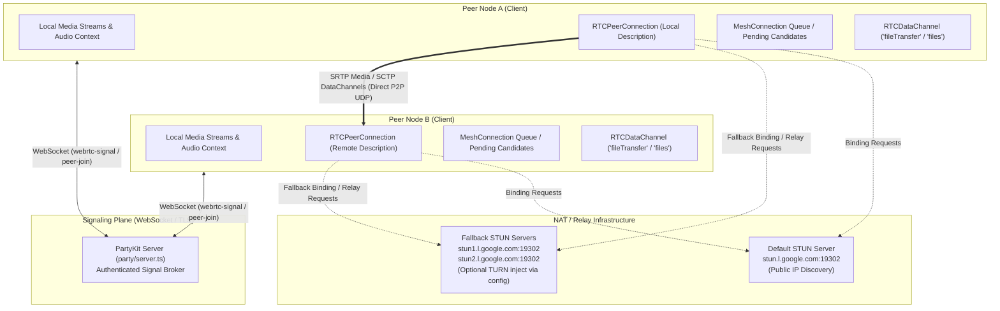
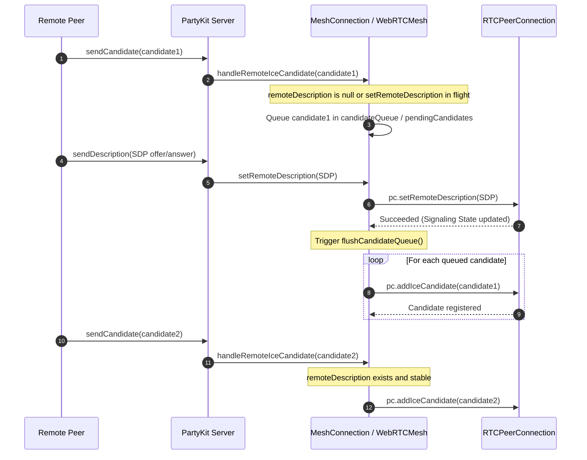
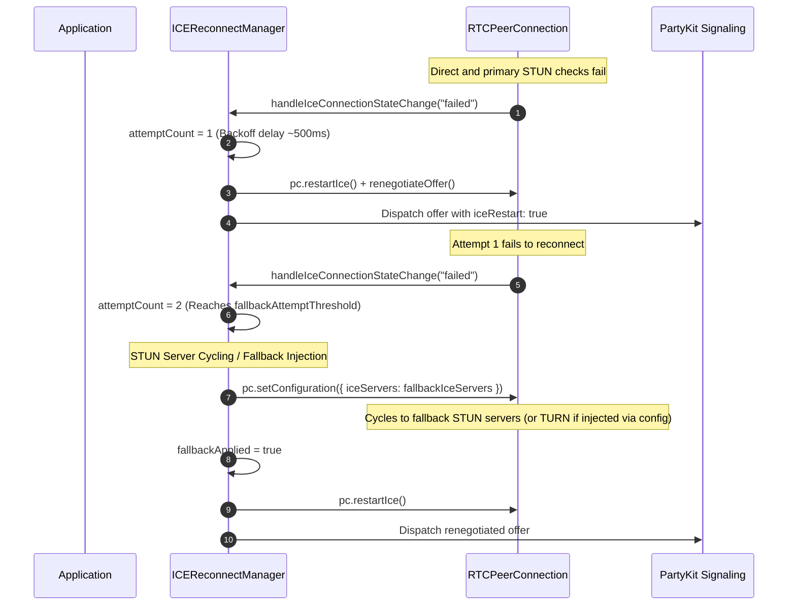
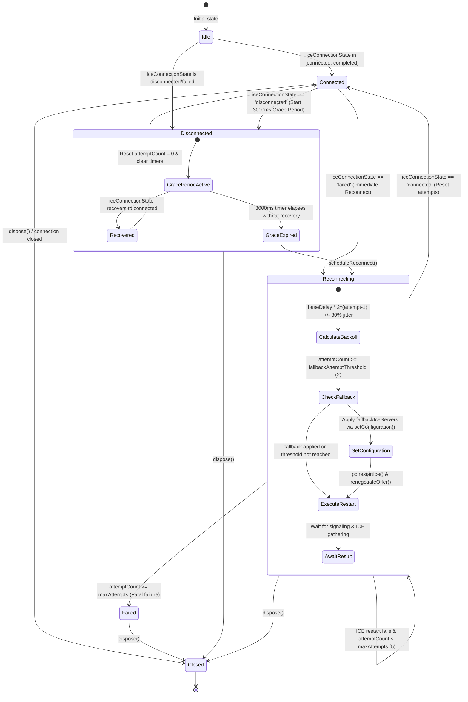
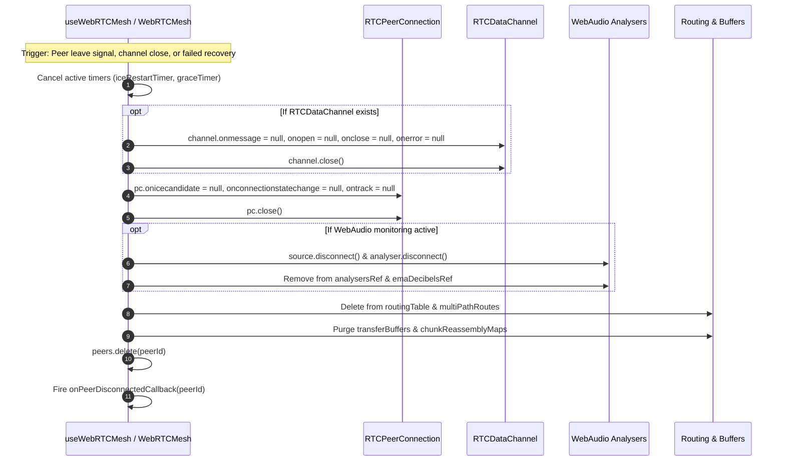

# WebRTC Mesh Signaling and STUN/TURN Fallback Architecture

This architecture specification details WorkSphere's distributed WebRTC mesh signaling, independent perfect negotiation offer/answer implementations, trickle ICE candidate gathering with queued playback, STUN server cycling and TURN fallback capabilities, connection health telemetry, and teardown lifecycles.

The primary implementations in the codebase are:
- [`src/lib/webrtc/meshConnection.ts`](../../src/lib/webrtc/meshConnection.ts): Concurrency-safe ICE candidate queueing and synchronized remote description flushing.
- [`src/lib/webrtc/iceReconnectManager.ts`](../../src/lib/webrtc/iceReconnectManager.ts): Resilient ICE state evaluation, exponential backoff with bounded ±30% randomized jitter, disconnect grace periods, automated `restartIce()`, and dynamic fallback ICE server cycling.
- [`src/core/network/WebRTCMesh.ts`](../../src/core/network/WebRTCMesh.ts): Full-mesh P2P DataChannel mesh layer implementing W3C Perfect Negotiation (RFC 8829 §3.5) with deterministic tie-breaking based on lexicographical peer ID comparison, multi-path routing, and backoff-based ICE restarts.
- [`src/hooks/useWebRTCMesh.ts`](../../src/hooks/useWebRTCMesh.ts): React hook managing multi-peer audio/video/screen-sharing mesh rooms over PartyKit WebSocket signaling with an independent Perfect Negotiation implementation where the join receiver acts as polite initiator.
- [`src/lib/realtime/webrtc/peerManager.ts`](../../src/lib/realtime/webrtc/peerManager.ts): P2P WebRTC data mesh with end-to-end encrypted packet chunking, periodic link telemetry sampling (`RTCStatsReport`), telemetry pings, and dynamic multi-hop routing.
- [`src/lib/realtime/webrtc/qualityMonitor.ts`](../../src/lib/realtime/webrtc/qualityMonitor.ts): ITU-T G.107 E-Model MOS estimation from WebRTC statistics (`rttMs`, `jitterMs`, `lossRatio`).
- [`party/server.ts`](../../party/server.ts): Centralized PartyKit edge WebSocket signaling hub facilitating room membership and authenticated signal routing.

---

## 1. Architecture Overview

WorkSphere employs a decentralized peer-to-peer (P2P) full mesh network for interactive collaboration, including real-time audio/video calls, screen sharing, multi-hop file distribution, and collaborative workspace updates.

In contrast to client-server architectures utilizing a Selective Forwarding Unit (SFU) or Multipoint Control Unit (MCU), each node in WorkSphere's full mesh maintains direct, peer-to-peer `RTCPeerConnection` and `RTCDataChannel` links with concurrent room participants:

1. **Separation of Signaling and Media/Data Planes:**
   - **Signaling Transport Path:** Centralized WebSocket connections powered by Cloudflare Workers / PartyKit (`party/server.ts` and `partyHost()`). Signaling messages carry lightweight SDP offers, SDP answers, and trickle ICE candidates. WebSocket transport is secured using TLS (`wss://`) and gated by Clerk JWT authentication. The signaling server never touches media streams or decrypts application payloads.
   - **Media & Data Transport Path:** Direct peer-to-peer UDP/DTLS/SRTP sessions. Audio and video streams flow over SRTP, while collaborative data, chunked file transfers, and telemetry traverse SCTP-encapsulated `RTCDataChannel` connections encrypted via DTLS.
2. **Room Size & Scaling Boundaries:**
   - Client mesh audio/video topologies (`useWebRTCMesh.ts`) enforce a soft ceiling of 5 remote peers (6 total participants per room) to prevent CPU and uplink saturation caused by $(N - 1)$ video encodings and upstream streams.
   - Data mesh networks (`WebRTCMesh.ts` and `WebRTCPeerManager.ts`) handle multi-hop forwarding and opportunistic multi-path routing across ad-hoc mesh topographies.



---

## 2. Component Responsibilities

The implementation divides signaling, connection state maintenance, buffering, telemetry, and teardown across modular subsystems:

| Component / File | Primary Responsibility | Key Methods / Events | Related Signaling & Connection Behavior |
| :--- | :--- | :--- | :--- |
| `MeshConnection`<br>([`src/lib/webrtc/meshConnection.ts`](../../src/lib/webrtc/meshConnection.ts)) | Concurrency-safe ICE candidate buffer | `setRemoteDescription()`, `addIceCandidate()`, `flushCandidateQueue()` | Prevents `InvalidStateError` by holding trickle ICE candidates in a queue until `setRemoteDescription()` completes. |
| `ICEReconnectManager`<br>([`src/lib/webrtc/iceReconnectManager.ts`](../../src/lib/webrtc/iceReconnectManager.ts)) | Reconnection state machine & failover | `attach()`, `handleIceConnectionStateChange()`, `executeReconnectCycle()`, `applyFallbackIceServers()` | Manages 3000ms disconnect grace period, exponential backoff (500ms base, 8000ms cap, ±30% jitter), fallback server cycling on attempt 2, and `restartIce()`. |
| `WebRTCMesh`<br>([`src/core/network/WebRTCMesh.ts`](../../src/core/network/WebRTCMesh.ts)) | DataChannel mesh networking engine | `createPeerConnection()`, `negotiate()`, `handleRemoteDescription()`, `flushPendingCandidates()`, `onPeerDisconnect()` | Lexicographical ID comparison tie-breaker (`localPeerId < remotePeerId`), SDP offer collision rollback, automated ICE restart backoff (`1000ms * 2^(count-1)` up to 8000ms, max 3 restarts). |
| `useWebRTCMesh`<br>([`src/hooks/useWebRTCMesh.ts`](../../src/hooks/useWebRTCMesh.ts)) | React hook for A/V/Screen mesh rooms | `ensurePeer()`, `handleSignal()`, `sendSignal()`, `adaptVideoBitrate()`, `cleanupPeer()` | Connects to PartyKit room, handles `peer-join`, `offer`, `answer`, `ice`, `peer-leave`, assigns polite role to peer-join receiver, manages 2000ms ping loop. |
| `WebRTCPeerManager`<br>([`src/lib/realtime/webrtc/peerManager.ts`](../../src/lib/realtime/webrtc/peerManager.ts)) | Encrypted P2P data mesh manager | `connectToSignaling()`, `handleSignalingMessage()`, `samplePeerTelemetry()`, `sendTelemetryPings()`, `cleanupPeer()` | Exchanges ECDH public keys over DataChannel, samples `RTCStatsReport` every 250ms, broadcasts topology every 1000ms, routes packets up to 5 hops. |
| `WebRtcMosQualityMonitor`<br>([`src/lib/realtime/webrtc/qualityMonitor.ts`](../../src/lib/realtime/webrtc/qualityMonitor.ts)) | ITU-T G.107 E-Model MOS estimation | `calculateRFactor()`, `calculateMosFromRFactor()`, `extractNetworkMetricsFromStats()` | Extracts RTT, jitter, and packet loss from browser RTC stats and classifies into 5 quality tiers. |
| `PartyKit Server`<br>([`party/server.ts`](../../party/server.ts)) | Authenticated signaling router | `onMessage()`, `room.broadcast()` | Verifies Clerk JWT token on connect; broadcasts `webrtc-signal` messages to room peers excluding sender. |

---

## 3. P2P Offer/Answer Negotiation & Perfect Negotiation Discrepancy

WorkSphere incorporates the W3C **Perfect Negotiation** pattern (RFC 8829 §3.5) to prevent offer collision deadlocks ("glare"). However, the codebase contains **two independent, distinct implementations** with differing polite-peer role assignment models. They are not unified and should not be confused.

### Implementation A: `WebRTCMesh.ts` (Deterministic Lexicographical Tie-Breaker)

In `src/core/network/WebRTCMesh.ts`, the polite role is strictly determined by a static, symmetric string comparison:
```typescript
export function isPolitePeer(localPeerId: string, remotePeerId: string): boolean {
    return localPeerId < remotePeerId;
}
```
- **Rule:** For any pair of peers A and B, exactly one node has `localPeerId < remotePeerId`. Both peers compute the identical condition independently without exchanging role negotiation tokens.
- **Glare Resolution:**
  - If a collision occurs (`description.type === 'offer'` while `makingOffer || pc.signalingState !== 'stable'`):
    - The **polite** peer (where `isPolitePeer` is `true`) rolls back its pending local offer by awaiting `pc.setLocalDescription({ type: 'rollback' })`, sets the incoming remote offer via `await pc.setRemoteDescription(description)`, generates an answer, and returns it.
    - The **impolite** peer (where `isPolitePeer` is `false`) sets `peer.ignoreOffer = true` and discards the colliding offer, maintaining its own local offer.

### Implementation B: `useWebRTCMesh.ts` (Join-Order Initiator Tie-Breaker)

In `src/hooks/useWebRTCMesh.ts`, the polite role is coupled to dynamic room join order:
```typescript
const polite = isInitiator;
```
- **Rule:** When Peer 2 enters an existing room, it broadcasts `{ kind: "peer-join" }`. Peer 1 (the existing room occupant) receives `peer-join` and calls `ensurePeer(peerId, true)`. Thus, **Peer 1 (the existing member) becomes the polite initiator**, and Peer 2 (the newly joined member) receives `ensurePeer(peerId, false)` and becomes the **impolite receiver**.
- **Glare Resolution:**
  - On offer collision:
    - The initiator (Peer 1, `polite = true`) executes `await pc.setLocalDescription({ type: "rollback" })` and accepts the incoming description.
    - The receiver (Peer 2, `polite = false`) drops the collision (`state.ignoreOffer = true`).

```mermaid
sequenceDiagram
    autonumber
    participant PeerA as Peer A (Polite Node)
    participant Signaling as PartyKit WebSocket Server
    participant PeerB as Peer B (Impolite Node)

    Note over PeerA, PeerB: Tie-Breaker: WebRTCMesh uses 'localId < remoteId'; useWebRTCMesh uses 'isInitiator'

    par Concurrent Offer Generation (Glare Collision)
        PeerA->>PeerA: pc.createOffer() & pc.setLocalDescription(offerA)
        PeerA->>Signaling: webrtc-signal / description { type: "offer", sdp: offerA }
    and
        PeerB->>PeerB: pc.createOffer() & pc.setLocalDescription(offerB)
        PeerB->>Signaling: webrtc-signal / description { type: "offer", sdp: offerB }
    end

    Signaling->>PeerB: Forward offerA
    Signaling->>PeerA: Forward offerB

    Note over PeerB: Impolite Peer B detects collision:<br/>makingOffer || signalingState != 'stable'<br/>Action: Drops offerA (ignoreOffer = true)

    Note over PeerA: Polite Peer A detects collision:<br/>makingOffer || signalingState != 'stable'<br/>Action: Yields and rolls back local offer

    PeerA->>PeerA: pc.setLocalDescription({ type: "rollback" })
    PeerA->>PeerA: pc.setRemoteDescription(offerB)
    PeerA->>PeerA: pc.createAnswer() & pc.setLocalDescription(answerA)
    PeerA->>Signaling: webrtc-signal / description { type: "answer", sdp: answerA }

    Signaling->>PeerB: Forward answerA
    PeerB->>PeerB: pc.setRemoteDescription(answerA)
    Note over PeerA, PeerB: Signaling State reaches 'stable' on both peers
```

---

## 4. Trickle ICE Candidate Gathering and Buffered Playback

WorkSphere uses **Trickle ICE** (RFC 8838) to incrementally exchange network candidates without waiting for complete candidate gathering.

### Candidate Buffering Mechanism

WebRTC requires an `RTCPeerConnection` to have a non-null `remoteDescription` before invoking `addIceCandidate()`. When candidates arrive out-of-order over WebSocket before the initial SDP offer/answer has been processed, invoking `addIceCandidate()` directly triggers an `InvalidStateError`.

To eliminate this race condition, WorkSphere implements explicit candidate queueing:

1. **In `src/lib/webrtc/meshConnection.ts`:**
   - Maintains `candidateQueue: RTCIceCandidateInit[]`.
   - `addIceCandidate(candidate)` checks `!this.peerConnection.remoteDescription || this.isSettingRemoteDescription`.
   - If true, candidates are placed in `candidateQueue`.
   - During `setRemoteDescription()`, `isSettingRemoteDescription` is flagged `true`. Once the promise settles, `flushCandidateQueue()` drains the queue sequentially in FIFO order. Any candidate error is caught and logged as a warning (`"Skipped queued ICE candidate addition error"`).
2. **In `src/core/network/WebRTCMesh.ts`:**
   - Maintains `peer.pendingCandidates: RTCIceCandidateInit[]`.
   - If `!pc.remoteDescription || pc.signalingState === 'closed'`, candidates are pushed into `peer.pendingCandidates`.
   - Candidates are flushed via `flushPendingCandidates(peerId)` upon settling `handleRemoteDescription()` or whenever `pc.onsignalingstatechange` fires.
   - If `peer.ignoreOffer` is active during a glare collision, candidate addition errors from the discarded offer are silently suppressed.



---

## 5. STUN Server Cycling, TURN Capabilities, and Fallback Limitations

### Actual ICE Server Configuration

Across the WorkSphere codebase, the configured default ICE servers are:

1. **Primary STUN Configuration (`WebRTCMesh.ts`, `useWebRTCMesh.ts`):**
   ```typescript
   iceServers: [{ urls: 'stun:stun.l.google.com:19302' }]
   ```
2. **Peer Manager STUN Configuration (`WebRTCPeerManager.ts`):**
   ```typescript
   iceServers: [
     { urls: 'stun:stun.l.google.com:19302' },
     { urls: 'stun:stun1.l.google.com:19302' }
   ]
   ```
3. **Default Fallback Configuration in `ICEReconnectManager.ts`:**
   ```typescript
   fallbackIceServers: [
     { urls: 'stun:stun1.l.google.com:19302' },
     { urls: 'stun:stun2.l.google.com:19302' }
   ]
   ```

### Critical Distinction: STUN Server Cycling vs. TURN Relay Failover

- **Actual Default Behavior:**
  - What `ICEReconnectManager` performs by default upon reaching `fallbackAttemptThreshold = 2` is **STUN server cycling**, switching from `stun:stun.l.google.com:19302` to `stun1.l.google.com:19302` and `stun2.l.google.com:19302`.
  - It **does not** automatically switch to a TURN relay by default because no TURN URLs or credentials exist in the default array.
- **Dynamic TURN Capability:**
  - `ICEReconnectConfig` exposes `fallbackIceServers?: RTCIceServer[]`. If an application initializes `ICEReconnectManager` with TURN entries (e.g., `{ urls: 'turn:relay.example.com:3478', username: '...', credential: '...' }`), `applyFallbackIceServers()` applies those entries via `peerConnection.setConfiguration({ ...currentConfig, iceServers: fallbackIceServers })`.
  - No `turn:` or `turns:` server URLs, usernames, or credentials are hardcoded anywhere in the WorkSphere repository.
- **Relay Candidates & ICE Transport Policy:**
  - The implementation **never** sets `iceTransportPolicy: 'relay'`.
  - Relay candidates (if configured via custom fallback options) are simply made available to the browser's ICE agent alongside host and srflx candidates. The browser selects relay candidates according to RFC 5245/8445 candidate pair priority if direct and STUN srflx pairs fail connectivity checks.
- **No Symmetric NAT Classification:**
  - The codebase contains no STUN diagnostic engine or NAT classifier. Failures are detected strictly when `RTCIceConnectionState` transitions to `"failed"`, or when `RTCIceConnectionState === "disconnected"` persists beyond the 3000ms grace period. In either case, the reconnect cycle schedules retry attempts, and reaching attempt count $\ge 2$ triggers the fallback ICE server configuration.



---

## 6. Multi-Candidate ICE State Machine

WorkSphere tracks both browser-level WebRTC states and application-level session states:

### Monitored States

1. **`RTCIceGatheringState`:** `"new"` $\rightarrow$ `"gathering"` $\rightarrow$ `"complete"`.
2. **`RTCIceConnectionState`:** `"new"` $\rightarrow$ `"checking"` $\rightarrow$ `"connected"` $\rightarrow$ `"completed"` (with transient `"disconnected"` and terminal `"failed"` / `"closed"`).
3. **`RTCPeerConnectionState`:** `"new"` $\rightarrow$ `"connecting"` $\rightarrow$ `"connected"` $\rightarrow$ `"disconnected"` $\rightarrow$ `"failed"` $\rightarrow$ `"closed"`.
4. **`ReconnectState` (`ICEReconnectManager`):**
   - `'idle'`: Connection inactive or unattached.
   - `'connected'`: Active connection established (`iceConnectionState` is `"connected"` or `"completed"`).
   - `'disconnected'`: Connection experiencing transient disruption (grace period timer running).
   - `'reconnecting'`: Backoff timer active or ICE restart negotiation in flight.
   - `'failed'`: Reconnect attempts exceeded `maxAttempts` (default: 5).
   - `'closed'`: Manager or peer connection disposed.
5. **`ConnectionLifecycleState` (`peerManager.ts` / `connectionState.ts`):**
   - `NEW` $\rightarrow$ `CONNECTING` $\rightarrow$ `CONNECTED` $\rightarrow$ `DEGRADED` $\rightarrow$ `RECONNECTING` $\rightarrow$ `DISCONNECTED` $\rightarrow$ `FAILED`.



---

## 7. Heartbeat, Telemetry, and Interval Classification

To avoid conflating telemetry polling with liveness heartbeats, the following table explicitly distinguishes each timer, its owning component, its classification, and its exact controlled event:

| Parameter / Constant | Exact Property / Value | Owning Component | Timer Classification | Controlled Event |
| :--- | :--- | :--- | :--- | :--- |
| **Ping Timer** | `2000ms`<br>`setInterval(..., 2000)` | `useWebRTCMesh.ts`<br>(`startPingLoop`) | Client RTT Ping | Dispatches `{ type: "ping", timestamp }` over WebSocket to measure signaling RTT EMA. |
| **Heartbeat Sweep Interval** | `15000ms`<br>`setInterval(..., 15000)` | `party/server.ts`<br>(`constructor`) | Server Connection Sweep | Iterates active WebSocket connections to identify dead sockets. |
| **Server Inactivity Ping Threshold** | `10000ms`<br>`now - state.lastPong >= 10000` | `party/server.ts`<br>(`heartbeatInterval`) | Server Inactivity Heartbeat | Sends `{ type: "ping" }` from server to client if no pong received within 10 seconds. |
| **Disconnect Grace Period** | `3000ms`<br>`disconnectGracePeriodMs: 3000` | `iceReconnectManager.ts`<br>(`config`) | Transient State Grace Window | Delays reconnection trigger to verify if `RTCIceConnectionState === "disconnected"` is temporary. |
| **Transient Disconnect Timeout** | `5000ms`<br>`setTimeout(..., 5000)` | `useWebRTCMesh.ts`<br>(`oniceconnectionstatechange`) | Teardown Delay Timeout | Waits 5000ms before calling `cleanupPeer()` if connection stays `"disconnected"`. |
| **Telemetry Sampling Rate** | `250ms`<br>`TELEMETRY_INTERVAL_MS = 250` | `peerManager.ts`<br>(`startMeshMonitoring`) | Telemetry Metrics Polling | Calls `pc.getStats()` every 250ms to sample RTT, jitter, and packet counters. **(Not a heartbeat)** |
| **Topology Broadcast Interval** | `1000ms`<br>`TOPOLOGY_INTERVAL_MS = 1000` | `peerManager.ts`<br>(`startMeshMonitoring`) | Routing Adjacency Advertisement | Broadcasts open DataChannel neighbors to adjacent peers for multi-hop route discovery. |
| **Regional Mesh Heartbeat** | `5000ms`<br>`defaultIntervalMs = 5000` | `HeartbeatMonitor.ts`<br>(`constructor`) | Server-to-Server Node Heartbeat | Emits periodic ping between backend regional server nodes. |
| **Regional Mesh Timeout** | `10000ms`<br>`timeoutThresholdMs = 10000` | `HeartbeatMonitor.ts`<br>(`constructor`) | Server-to-Server Liveness Timeout | Marks a remote regional server node as offline (`dead`). |

---

## 8. Packet Loss, Quality Telemetry, and Reconnection Policy

### WebRTC Metrics Sampling and RTT Calculations

1. **Signaling RTT EMA Calculation (`useWebRTCMesh.ts`):**
   - Samples WebSocket ping/pong round-trip time every 2000ms:
     $$\text{RTT}_{\text{new}} = \text{Date.now()} - \text{data.timestamp}$$
   - Smoothed via Exponential Moving Average (EMA):
     $$\text{EMA}_{\text{RTT}} = (\text{EMA}_{\text{prev}} \times 0.7) + (\text{RTT}_{\text{new}} \times 0.3)$$
   - Quality Tier Classification:
     - $\text{EMA}_{\text{RTT}} \le 100\text{ ms} \implies \text{"good"}$ (audio sample rate restored to 48 kHz).
     - $100\text{ ms} < \text{EMA}_{\text{RTT}} \le 300\text{ ms} \implies \text{"fair"}$.
     - $\text{EMA}_{\text{RTT}} > 300\text{ ms} \implies \text{"poor"}$ (audio track dynamically downsampled to 16 kHz).
2. **Data Mesh Link Telemetry (`peerManager.ts`):**
   - Telemetry sampled every 250ms from `getStats()`.
   - Computes delta packet loss ratio between polling intervals:
     $$\text{lostDelta} = \max(0, \text{packetsLost} - \text{previous.lost})$$
     $$\text{receivedDelta} = \max(0, \text{packetsReceived} - \text{previous.received})$$
     $$\text{lossRatio} = \frac{\text{lostDelta}}{\text{lostDelta} + \text{receivedDelta}}$$
   - Telemetry pings timeout if no pong arrives within 750ms (`now - pendingAt >= 750`), artificially clamping packet loss to at least $0.10$ ($10\%$) and jitter to $100\text{ ms}$.
3. **ITU-T G.107 E-Model MOS Estimation (`qualityMonitor.ts`):**
   - Transmission rating factor: $R = 94.2 - I_d - I_e$
   - Delay impairment:
     $$I_d = \begin{cases} 0.024 d & d \le 177.3\text{ ms} \\ 0.024 d + 0.11(d - 177.3) & d > 177.3\text{ ms} \end{cases}$$
     $$\text{where } d = \frac{\text{RTT}}{2} + 2 \times \text{jitter}$$
   - Equipment impairment:
     $$I_e = \frac{95 \times (\text{lossRatio} \times 100)}{(\text{lossRatio} \times 100) + 10}$$
   - MOS formula:
     $$\text{MOS} = 1 + 0.035 R + R(R - 60)(100 - R) \times 7 \times 10^{-6}$$

### Reconnection Policy: Packet Loss vs. Connection State

> [!IMPORTANT]
> **No numerical packet-loss threshold triggers reconnection or ICE restart.**
> In WorkSphere:
> - High packet loss, elevated jitter, or degraded MOS scores trigger **adaptive bitrate scaling, layer dropping, and audio downsampling** via `SimulcastAdaptiveController` and `WebRtcMosQualityMonitor`.
> - Reconnection and ICE restart are triggered **strictly by ICE connection state transitions** (`RTCIceConnectionState` transitioning to `"failed"` or `"disconnected"`).
> - This deliberate design prevents destructive renegotiation storms and glare collisions during temporary congestion spikes.

---

## 9. Connection Teardown Lifecycle

Clean teardown is essential to prevent ghost audio, orphaned WebAudio nodes, memory leaks, and routing table stale references.

### Teardown Responsibilities by Component

1. **`WebRTCMesh.ts` (`onPeerDisconnect`):**
   - Sets peer status to `'disconnected'`.
   - Clears pending `iceRestartTimer`.
   - Unregisters all `RTCDataChannel` listeners (`onmessage = null`, `onopen = null`, `onclose = null`, `onerror = null`) and calls `dataChannel.close()`.
   - Unregisters `RTCPeerConnection` listeners (`onicecandidate = null`, `onconnectionstatechange = null`, `ondatachannel = null`, `onnegotiationneeded = null`, `onsignalingstatechange = null`, `ontrack = null`) and calls `connection.close()`.
   - Prunes single-hop `routingTable` entries where target was destination or next hop.
   - Prunes `multiPathRoutes` candidate sets.
   - Clears intermediate chunk forwarding `transferBuffers` and reassembly maps.
   - Removes peer from `peers` map and triggers `onPeerDisconnectedCallback`.
2. **`useWebRTCMesh.ts` (`cleanupPeer`):**
   - Closes `RTCPeerConnection`.
   - Cleans up WebAudio API nodes (`source.disconnect()`, `analyser.disconnect()`) and deletes from `analysersRef`.
   - Destroys active `SimulcastAdaptiveController`.
   - Removes remote media streams from React component state (`setRemoteStreams`, `setAudioLevels`).
3. **`ICEReconnectManager.ts` (`dispose`):**
   - Cancels `graceTimer` and `reconnectTimer`.
   - Clears all event subscriber sets (`stateChangeListeners`, `attemptListeners`, `iceRestartListeners`, `fallbackListeners`, `fatalFailureListeners`).
   - Detaches from `RTCPeerConnection` reference.



---

## 10. Failure Scenarios and Recovery Matrix

| Failure Scenario | Detection Mechanism | System Response | Recovery / Fallback Behavior | Unimplemented / Limitations |
| :--- | :--- | :--- | :--- | :--- |
| **Signaling WebSocket Disconnect** | `socket.onclose` / `onerror` | PartyKit client attempts automatic WebSocket reconnect. | Cleans up peers on `onOpen` resync; broadcasts new `peer-join`. | In-flight SDP signals sent during outage are dropped without durable retry queues. |
| **Simultaneous Offer Collision (Glare)** | `description.type === 'offer'` while `makingOffer \|\| signalingState !== 'stable'` | Polite peer executes rollback (`setLocalDescription({ type: 'rollback' })`); impolite peer sets `ignoreOffer = true`. | Polite peer sets remote offer and replies with answer; impolite peer awaits answer to its original offer. | Handled via Perfect Negotiation (with distinct tie-breaker logic in `WebRTCMesh` vs `useWebRTCMesh`). |
| **Early ICE Candidate Arrival** | Candidate arrives when `remoteDescription === null` | Candidate intercepted and queued in `candidateQueue` or `peer.pendingCandidates`. | Automatically flushed in FIFO order upon resolution of `setRemoteDescription()`. | Handled cleanly in `MeshConnection` and `WebRTCMesh`. |
| **Transient Network Glitch** | `RTCIceConnectionState === 'disconnected'` | `ICEReconnectManager` starts 3000ms grace timer; `useWebRTCMesh` starts 5000ms timeout. | If state recovers to `connected` before timer elapses, timers are cleared and attempt counts reset to 0. | If network remains disconnected past grace period, reconnection is scheduled. |
| **Terminal ICE Connection Failure** | `RTCIceConnectionState === 'failed'` | `ICEReconnectManager` clears grace timer and schedules immediate backoff retry. | Automated `restartIce()` with exponential backoff: $T = \min(8000, 500 \times 2^{\text{attempt}-1}) \pm 30\% \text{ jitter}$. | Max 5 attempts; exhausts to fatal failure state if unresolved. |
| **Strict NAT / Traversal Failure** | Successive reconnect attempts reach threshold ($\ge 2$) from persistent failure or unrecovered disconnect | `ICEReconnectManager` activates `applyFallbackIceServers()`. | Injects `fallbackIceServers` via `pc.setConfiguration()` and restarts ICE. | Default fallback entries are Google STUN servers; TURN servers must be injected via external config. |
| **Peer Departure** | Signaling receives `{ kind: 'peer-leave' }` or `DataChannel.onclose` | Component invokes `cleanupPeer(peerId)` or `onPeerDisconnect(peerId)`. | Complete teardown of peer connection, channels, audio nodes, and routing tables. | No automatic session migration to alternate peers. |
| **Uplink Congestion / High Latency** | Signaling RTT EMA $> 300\text{ ms}$ or MOS score drops | `useWebRTCMesh` downsamples audio; `qualityMonitor` downgrades tier. | Audio constraint clamped to 16 kHz sample rate; video bitrate and resolution scaled down. | Does not trigger ICE restart or network switching. |

---

## 11. Signaling Message Reference

All signaling messages exchanged over the PartyKit WebSocket connection conform to verified schemas:

### A. Media Mesh Signaling Messages (`useWebRTCMesh.ts` $\leftrightarrow$ `party/server.ts`)

Encapsulated within wrapper `{ type: "webrtc-signal", from: string, ... }`:

| Message Kind | Direction | Key Payload Fields | Description | Handler / Source Reference |
| :--- | :--- | :--- | :--- | :--- |
| `peer-join` | Client $\rightarrow$ Server $\rightarrow$ Peers | `{ type: "webrtc-signal", kind: "peer-join", from: string }` | Broadcast when a peer joins the room or reconnects signaling. Prompts existing peers to initiate connections. | [`useWebRTCMesh.ts`](../../src/hooks/useWebRTCMesh.ts#L568) |
| `offer` | Peer A $\rightarrow$ Server $\rightarrow$ Peer B | `{ type: "webrtc-signal", kind: "offer", from: string, to: string, sdp: RTCSessionDescriptionInit }` | Delivers local SDP offer created during negotiation or ICE restart. | [`useWebRTCMesh.ts`](../../src/hooks/useWebRTCMesh.ts#L579) |
| `answer` | Peer B $\rightarrow$ Server $\rightarrow$ Peer A | `{ type: "webrtc-signal", kind: "answer", from: string, to: string, sdp: RTCSessionDescriptionInit }` | Delivers local SDP answer replying to an accepted offer. | [`useWebRTCMesh.ts`](../../src/hooks/useWebRTCMesh.ts#L579) |
| `ice` | Peer A $\leftrightarrow$ Server $\leftrightarrow$ Peer B | `{ type: "webrtc-signal", kind: "ice", from: string, to: string, candidate: RTCIceCandidateInit \| null }` | Serialized trickle ICE candidate discovered by the local peer. | [`useWebRTCMesh.ts`](../../src/hooks/useWebRTCMesh.ts#L616) |
| `peer-leave` | Client $\rightarrow$ Server $\rightarrow$ Peers | `{ type: "webrtc-signal", kind: "peer-leave", from: string }` | Notifies room peers of intentional departure, triggering teardown. | [`useWebRTCMesh.ts`](../../src/hooks/useWebRTCMesh.ts#L574) |
| `ping` | Client $\rightarrow$ Server | `{ type: "ping", timestamp: number }` | Telemetry probe dispatched every 2000ms. | [`useWebRTCMesh.ts`](../../src/hooks/useWebRTCMesh.ts#L558) |
| `pong` | Server $\rightarrow$ Client | `{ type: "pong", timestamp: number }` | Echo reply used to compute RTT EMA. | [`party/server.ts`](../../party/server.ts) |

### B. Data Mesh Signaling Messages (`WebRTCPeerManager.ts`)

| Message Type | Direction | Key Payload Fields | Description | Handler / Source Reference |
| :--- | :--- | :--- | :--- | :--- |
| `peer-join` | Peer $\rightarrow$ Server $\rightarrow$ Peers | `{ type: "peer-join", peerId: string }` | Announces node availability in the data mesh room. | [`peerManager.ts`](../../src/lib/realtime/webrtc/peerManager.ts#L802) |
| `offer` | Peer A $\rightarrow$ Server $\rightarrow$ Peer B | `{ type: "offer", peerId: string, targetPeerId: string, offer: RTCSessionDescriptionInit }` | Delivers initial DataChannel SDP offer. | [`peerManager.ts`](../../src/lib/realtime/webrtc/peerManager.ts#L773) |
| `answer` | Peer B $\rightarrow$ Server $\rightarrow$ Peer A | `{ type: "answer", peerId: string, targetPeerId: string, answer: RTCSessionDescriptionInit }` | Delivers DataChannel SDP answer. | [`peerManager.ts`](../../src/lib/realtime/webrtc/peerManager.ts#L782) |
| `ice-candidate` | Peer A $\leftrightarrow$ Server $\leftrightarrow$ Peer B | `{ type: "ice-candidate", peerId: string, targetPeerId: string, candidate: RTCIceCandidateInit }` | Delivers ICE candidate to target peer. | [`peerManager.ts`](../../src/lib/realtime/webrtc/peerManager.ts#L791) |

---

## 12. Security and Operational Considerations

1. **Signaling Authentication and Authorization:**
   - PartyKit WebSocket connections require a Clerk JWT authentication token (`usePartySocket({ query: token ? { token } : undefined })`).
   - `party/server.ts` validates the token via `@clerk/backend` `verifyToken()`.
   - Signaling spoofing protection: The server enforces that for any message of `type: "webrtc-signal"`, `parsed.from` **must strictly match** the verified Clerk `userId` associated with the WebSocket connection. Messages with mismatched sender IDs are dropped immediately.
2. **End-to-End Encryption:**
   - **Media:** Encrypted using DTLS-SRTP as mandated by WebRTC specifications. PartyKit only handles SDP fingerprints and never possesses media decryption keys.
   - **DataChannel Application Payloads (`WebRTCPeerManager.ts`):** In addition to native DTLS transport encryption, multi-hop mesh payloads are encrypted end-to-end using AES-GCM-256 (`encryptChunk()` / `decryptChunk()`) with shared keys derived via ECDH (`deriveSharedKey()`). Intermediate relay nodes can inspect routing envelopes but cannot read packet ciphertext.
3. **TURN Credential Protection:**
   - STUN/TURN server URLs and credentials must be injected dynamically via runtime configuration or secure environment variables (`process.env`). Credentials must never be committed to repository files or exposed through client logs.
4. **Diagnostic Logging:**
   - Candidate addition warnings and duplicate candidate drops are logged using `console.warn` without dumping user credentials or sensitive token data.

---

## 13. Source References

- **Mesh Candidate Queue:** [`src/lib/webrtc/meshConnection.ts`](../../src/lib/webrtc/meshConnection.ts)
- **ICE Failover & Reconnect:** [`src/lib/webrtc/iceReconnectManager.ts`](../../src/lib/webrtc/iceReconnectManager.ts)
- **Perfect Negotiation & Mesh Routing:** [`src/core/network/WebRTCMesh.ts`](../../src/core/network/WebRTCMesh.ts)
- **React Client A/V Hook:** [`src/hooks/useWebRTCMesh.ts`](../../src/hooks/useWebRTCMesh.ts)
- **P2P Data Mesh & Telemetry:** [`src/lib/realtime/webrtc/peerManager.ts`](../../src/lib/realtime/webrtc/peerManager.ts)
- **MOS Quality Engine:** [`src/lib/realtime/webrtc/qualityMonitor.ts`](../../src/lib/realtime/webrtc/qualityMonitor.ts)
- **PartyKit Signaling Server:** [`party/server.ts`](../../party/server.ts)
- **Candidate Buffer Test Suite:** [`src/__tests__/lib/webrtc/iceCandidateBuffer.test.ts`](../../src/__tests__/lib/webrtc/iceCandidateBuffer.test.ts)
- **ICE Reconnect Test Suite:** [`src/__tests__/lib/webrtc/iceReconnectManager.test.ts`](../../src/__tests__/lib/webrtc/iceReconnectManager.test.ts)
- **Negotiation Glare Test Suite:** [`src/__tests__/network/WebRTCNegotiation.test.ts`](../../src/__tests__/network/WebRTCNegotiation.test.ts)
- **Mesh Lifecycle Test Suite:** [`src/__tests__/core/network/WebRTCMeshLifecycle.test.ts`](../../src/__tests__/core/network/WebRTCMeshLifecycle.test.ts)
