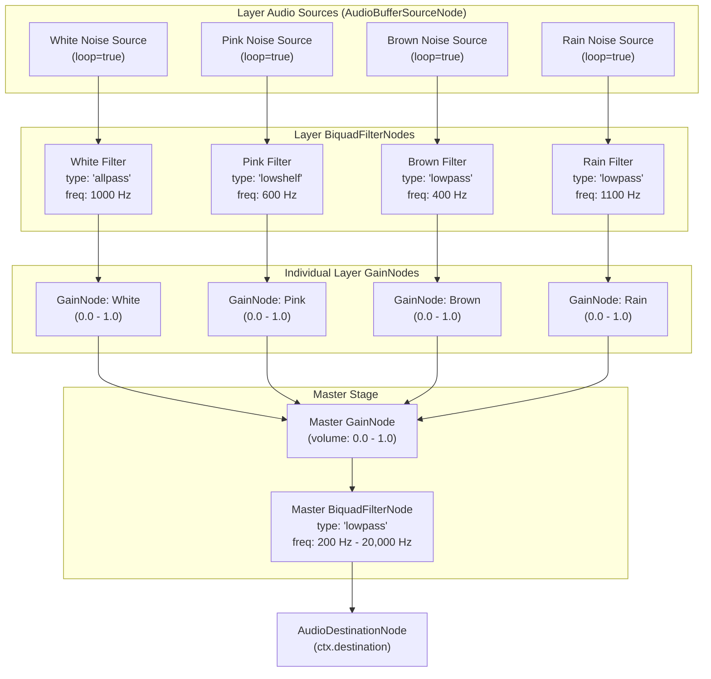

# Multi-Layer Web Audio Soundscape Mixer Architecture

## A. Overview

The multi-layer ambient soundscape mixer provides continuous, customizable background audio to help users focus, reduce environmental distractions, and mask acoustic interruptions in flexible work environments. It runs entirely on the client within the browser using the Web Audio API, accompanied by optional off-main-thread Web Worker procedural synthesis.

The system manages multiple concurrent sound layers (White Noise, Pink Noise, Brown/Deep Noise, and Gentle Rain Texture), enabling independent per-layer gain adjustment, global master volume scaling, a master cutoff filter, and mute states.

### Main Implementation Files

- **`src/components/audio/AmbientSoundGenerator.tsx`**: Primary user-facing React UI component for the focus soundscape mixer. Provides play/pause controls, master mute/unmute toggle, master volume/cutoff sliders, individual layer sliders, and preset persistence in `localStorage`.
- **`src/lib/audio/noiseSynthesizer.ts`**: Core audio engine module defining `NoiseSynthesizer` (and legacy `NoiseSoundscapeEngine` / `rampGainSmoothly`), procedural noise generators (`generateNoiseSamples`, `createNoiseSampleBuffer`), AudioContext abstractions, and parameter interpolation logic.
- **`src/workers/audioSynthesizerWorker.ts`**: Multi-threaded Web Worker generating 32-bit floating-point audio buffers off the main UI thread with zero-copy transferable `ArrayBuffer` messaging.
- **`src/core/audio/AmbientMixerEngine.ts`**: Companion procedural multi-layer ambient soundscape audio engine supporting stereo binaural synthesis (`rain`, `coffee_shop`, `pink_noise`), equal-power boundary crossfades (`applySeamlessLoopCrossfade`), and smooth AudioParam volume transitions.
- **`src/components/wellness/AmbientSoundscapeGenerator.tsx`**: Alternate/companion wellness UI component consuming `AmbientMixerEngine` with individual layer toggles and sliders.

---

## B. Audio Graph Architecture

### Audio Node Topology

The audio graph processes multiple parallel procedural noise sources, shapes them via dedicated per-layer biquad filters, scales each layer's volume through individual gain nodes, sums them into a master gain stage, passes through a master lowpass cutoff filter, and outputs to the hardware destination.



### Node Roles and Signal Flow

1. **`AudioBufferSourceNode` (`source`)**:
   - One node instantiated per layer (`white`, `pink`, `brown`, `rain`).
   - Configured with `loop = true` and holds an in-memory `AudioBuffer` containing procedurally synthesized noise samples.
   - Started immediately via `source.start()` when the mixer graph is constructed.

2. **Per-Layer `BiquadFilterNode` (`filter`)**:
   - Shapes the raw spectral energy before gain attenuation:
     - **White Noise**: `allpass` at 1000 Hz (passes all frequencies with phase adjustment).
     - **Pink Noise**: `lowshelf` at 600 Hz (accentuates warm lower frequencies).
     - **Brown Noise**: `lowpass` at 400 Hz (steep attenuation of higher frequencies for deep low rumble).
     - **Rain Texture**: `lowpass` at 1100 Hz (retains gentle droplet highs while subduing harsh hiss).

3. **Per-Layer `GainNode` (`gain`)**:
   - Scales the amplitude of the individual sound layer between `0.0` and `1.0`.
   - Modulated when the user adjusts individual layer sliders or switches presets.

4. **Master `GainNode` (`masterGain`)**:
   - Sums all active layer gain outputs.
   - Applies the global master volume (`0.0` to `1.0`) and drops to `0.0` when muted.

5. **Master `BiquadFilterNode` (`masterCutoffFilter`)**:
   - `lowpass` filter placed directly after `masterGain`.
   - Modulated by the master Cutoff slider (range: 200 Hz to 20,000 Hz, default: 12,000 Hz).
   - Allows users to darken or brighten the cumulative soundscape.

6. **`AudioDestinationNode` (`ctx.destination`)**:
   - Routes the filtered master audio stream to the operating system's default audio output hardware.

---

## C. Layer Management and Crossfading

### Enabling, Disabling, and Mixing Layers

In the primary mixer implementation (`NoiseSynthesizer` in `src/lib/audio/noiseSynthesizer.ts`), all four sound layers (`white`, `pink`, `brown`, `rain`) are created and continuously loop in the audio graph once playback starts. A layer is effectively "disabled" by setting its corresponding `GainNode.gain` target to `0.0`.

When selecting a preset via `setSoundType(nextType)`:
- The selected sound type receives an active boost (minimum `0.7` level).
- Inactive types are set to `0.0` level:
  ```ts
  this.layerLevels = {
    white: nextType === 'white' ? Math.max(0.7, this.layerLevels.white) : 0,
    pink: nextType === 'pink' ? Math.max(0.7, this.layerLevels.pink) : 0,
    brown: nextType === 'brown' ? Math.max(0.7, this.layerLevels.brown) : 0,
    rain: nextType === 'rain' ? Math.max(0.7, this.layerLevels.rain) : 0,
  };
  ```

### Gain Transition Mechanism

The application does **not** perform equal-power crossfading between layer tracks in `NoiseSynthesizer`. Instead, it uses **smooth AudioParam target scheduling**:

- **Target Smoothing (`setTargetAtTime`)**:
  When adjusting gains (`applyGains()`) or master volume, the engine calls `setParamSmooth()`:
  ```ts
  private setParamSmooth(param: AudioParamLike | undefined, value: number): void {
    if (!param) return;
    const now = this.ctx?.currentTime ?? 0;
    if (typeof param.setTargetAtTime === 'function') {
      param.setTargetAtTime(value, now, 0.03); // timeConstant = 30ms
    } else {
      param.value = value;
    }
  }
  ```
  `setTargetAtTime` creates an exponential approach curve toward the target value $V(t) = V_{\text{target}} + (V_0 - V_{\text{target}}) e^{-(t - t_0) / \tau}$ with a time constant $\tau = 30\text{ms}$. This eliminates zipper noise, audible clicks, and discontinuities without manual buffer crossfading.

- **Helper Ramping (`rampGainSmoothly`)**:
  Used by `NoiseSoundscapeEngine`:
  ```ts
  if (typeof param.setTargetAtTime === 'function') {
    param.setTargetAtTime(safeTarget, safeTime, safeRamp / 3);
  } else if (typeof param.linearRampToValueAtTime === 'function') {
    param.linearRampToValueAtTime(safeTarget, safeTime + safeRamp);
  } else {
    param.value = safeTarget;
  }
  ```

### Equal-Power Crossfade Formula in Buffer Seaming

While runtime layer volume transitions use exponential `AudioParam` smoothing rather than crossfading, the WorkSphere codebase **does implement an exact equal-power crossfade** within `applySeamlessLoopCrossfade` in `src/core/audio/AmbientMixerEngine.ts`.

It applies equal-power crossfading at buffer boundaries (over a 100ms–150ms window) so that procedural looping buffers have seamless start/end boundaries without acoustic clicks:

$$\text{gainA}(t) = \cos\left(t \times \frac{\pi}{2}\right)$$
$$\text{gainB}(t) = \sin\left(t \times \frac{\pi}{2}\right)$$

where $t$ represents normalized progress ($i / \text{crossfadeFrames}$) from $0$ to $1$:

```ts
const progress = i / crossfadeFrames;
const gainIn = Math.sin((progress * Math.PI) / 2);
const gainOut = Math.cos((progress * Math.PI) / 2);
const endIdx = totalFrames - crossfadeFrames + i;
const mixed = data[i] * gainIn + data[endIdx] * gainOut;
data[i] = mixed;
data[endIdx] = mixed;
```

> [!NOTE]
> Constant acoustic power is maintained across the seam because $\cos^2(\theta) + \sin^2(\theta) = 1$, avoiding the perceptible volume dip caused by linear crossfading.

### Clipping Prevention Note

Neither `NoiseSynthesizer` nor `AmbientMixerEngine` incorporates a dynamic range compressor or limiter (`DynamicsCompressorNode`) at the master stage. Because layer gains can sum up to $4.0$ ($4 \times 1.0$), clipping can occur if multiple layers and the master volume are set to maximum simultaneously. Individual samples within the synthesized buffers are clamped to $[-1.0, 1.0]$, but cumulative clipping prevention is not enforced in the audio graph.

---

## D. Audio Buffer Lifecycle

### Loading vs. Procedural Generation

WorkSphere does not download or decode compressed audio files (`.mp3`, `.wav`) over HTTP for its ambient noise engine. Instead, audio buffers are **procedurally generated on demand in memory**:

1. **Web Worker Synthesis (Primary Path)**:
   - `NoiseSynthesizer` spawns or reuses a Web Worker (`src/workers/audioSynthesizerWorker.ts`).
   - The main thread posts a `SYNTHESIZE` message specifying noise type, sample rate, channels (2 for stereo), buffer frame size, and cutoff frequency.
   - The worker synthesizes the noise using deterministic PRNGs or Kellet filter approximations, returning stereo `ArrayBuffer` instances as transferable objects (`Transferable`) with zero copy overhead.
   - The main thread copies these into a newly created `AudioBuffer` via `buffer.copyToChannel()` or `buffer.getChannelData()`.

2. **Main-Thread Procedural Fallback**:
   - If Web Workers are disabled (`useWorker: false`), fail, or time out after 3000ms, `NoiseSynthesizer.createLayerBuffer()` generates samples synchronously on the main thread using `generateNoiseSamples()`:
     - **White Noise**: Uniform pseudo-random float generation in $[-1, 1]$.
     - **Pink Noise**: Paul Kellet's 7-pole filter approximation ($1/f$, $-3\text{dB}/\text{octave}$).
     - **Brown Noise**: Integrated Brownian walk (leaky integrator with $3.5\times$ scaling and soft clipping).
     - **Rain Texture**: Leaky brown lowpass wash combined with probabilistic micro-droplet impulses.

### Buffer Caching and Reuse

- **Buffer Duration**: Default duration is 3 seconds (`bufferDurationSeconds = 3`, or 2 to 4 seconds in companion engines). At 44.1 kHz stereo, this creates $2 \times 132,300 \times 4 \approx 1\text{ MB}$ of memory per layer.
- **Caching**:
  - In `NoiseSynthesizer`, buffers are generated fresh during `buildMixerGraph()`.
  - In `AmbientMixerEngine`, generated buffers are cached in a `Map<AmbientLayerId, AudioBuffer>` instance (`this.bufferCache`) and reused whenever an individual layer is re-enabled.

### Source Node Lifecycle

In the Web Audio API, an `AudioBufferSourceNode` is single-use: once stopped, it cannot be restarted.
- When playback starts (`start()`):
  - A new `AudioBufferSourceNode` is created via `ctx.createBufferSource()` for each layer.
  - `source.buffer = buffer` is assigned and `source.loop = true` is set.
  - `source.start()` begins infinite looped playback.
- When playback is paused or stopped (`stopLayersOnly()` / `dispose()`):
  - `source.stop()` is invoked inside a `try/catch` block.
  - `source.disconnect()` disconnects the node from its downstream filter.
  - Old `AudioBufferSourceNode` references are deleted and garbage-collected.
  - Restarting playback constructs brand new `AudioBufferSourceNode` instances.

---

## E. Browser Autoplay Policy and Audio Unlocking

Modern browsers block audio playback until user interaction occurs (click, touch, or keydown).

### AudioContext Initialization State

- `AudioContext` is instantiated on the first user interaction or when the component mounts in the browser.
- In modern browsers, a freshly created `AudioContext` starts in the `'suspended'` state.

### Unlock and Resume Mechanism

Playback is initiated through the explicit user interaction button (`Play` / `Pause`):

```ts
const togglePlayback = async () => {
  const engine = engineRef.current;
  if (!engine) return;

  if (isPlaying) {
    await engine.pause();
    setIsPlaying(false);
  } else {
    const ctx = audioContextRef.current;
    if (ctx && typeof ctx.resume === 'function' && ctx.state === 'suspended') {
      try {
        await ctx.resume();
      } catch {
        // Autoplay policy or user gesture required
      }
    }
    const started = await engine.start();
    setIsPlaying(started);
  }
};
```

### Page Visibility and Background Tab Throttling

To prevent background tabs from consuming battery and audio resources while meeting mobile browser autoplay restrictions, `NoiseSynthesizer` and `AmbientSoundGenerator` hook into `document.visibilitychange`:

```ts
const onVisibility = () => {
  if (typeof document === 'undefined') return;
  if (document.hidden) {
    void engineRef.current?.handleVisibilityChange(true);
    setIsPlaying(false);
  } else {
    void engineRef.current?.handleVisibilityChange(false);
  }
};
```

When the page is hidden, `handleVisibilityChange(true)` pauses audio via `AudioContext.suspend()`.

---

## F. Cleanup and Memory Lifecycle

### Component Unmount and Engine Disposal

When `AmbientSoundGenerator` unmounts or `NoiseSynthesizer.dispose()` is called:

1. **Stopping Audio Sources**:
   - `stopLayersOnly()` iterates across all layer graphs:
     ```ts
     try {
       layer.source.stop();
     } catch {}
     try {
       layer.source.disconnect();
       layer.filter.disconnect();
       layer.gain.disconnect();
     } catch {}
     delete this.layers[type];
     ```
2. **Master Stage Disconnection**:
   - `masterCutoffFilter.disconnect()` is called.
   - `masterGain.disconnect()` is called.
   - Node references are assigned to `null`.
3. **Web Worker Termination**:
   - `this.worker?.terminate()` is executed, terminating the background synthesis thread and aborting any inflight chunk generation.
   - Worker reference is cleared (`this.worker = null`).
4. **Lifecycle Event Removal**:
   - Document and window listeners for `visibilitychange` are detached.
5. **AudioContext Teardown**:
   - `await this.ctx.close()` is called, transitioning the context to `'closed'` and freeing underlying OS audio hardware resources.
   - Reference `this.ctx = null` releases the context for browser garbage collection.

### Identified Cleanup Limitations

- **Source Node Disconnect Timing in Faded Stops**:
  In `AmbientMixerEngine.stopLayer()`, stopping a layer applies an exponential fade-out ramp followed by a `setTimeout(..., fadeDuration + 30ms)` before calling `currentSource.disconnect()`. If the component unmounts quickly during this window, pending timeouts may fire after disposal unless explicitly tracked and cancelled.
- **Buffer Retention**:
  In `AmbientMixerEngine`, audio buffers in `this.bufferCache` remain allocated for the lifetime of the engine instance until `dispose()` clears the map.

---

## G. Developer Notes and Limitations

### Implementation Discrepancies and Code Gaps

1. **Merge Conflict / Duplicate Declaration in `AmbientSoundGenerator.tsx`**:
   The current working tree for `AmbientSoundGenerator.tsx` exhibits duplicate declarations from overlapping merges (e.g., duplicated `isPlaying`, `isMuted`, `handleLayerChange`, and mixed references between `synthRef` / `engineRef`). Developers modifying this component must harmonize whether the UI consumes `NoiseSynthesizer` or `NoiseSoundscapeEngine`.
2. **Dynamic Range / Limiter Absence**:
   The audio graph directly wires `MasterGain -> CutoffFilter -> ctx.destination`. Without an intermediate `DynamicsCompressorNode`, full slider volumes across all 4 noise layers can sum above 0 dBFS, causing digital clipping distortion on certain sound cards. Adding a soft limiter before destination is recommended.
3. **Worker Path Resolution in Bundlers**:
   `getDefaultWorkerFactory()` references `new URL('../../workers/audioSynthesizerWorker.ts', import.meta.url)`. In certain Next.js / webpack SSR environments, worker loading requires proper worker loader support; the engine provides synchronous main-thread fallback when worker creation fails.
4. **Autoplay Retry Loop**:
   There is no automatic retry listener (e.g. listening for the next window `pointerdown` or `keydown`) if `ctx.resume()` is rejected by an aggressive browser autoplay policy. Playback fails gracefully and requires the user to click the Play button again.
