# Amenity Consensus and Deterministic Vote Settlement

> **Status:** Proposed architecture. Sections describing the current system are
> marked **Implemented**; all new scoring, quorum, dispute, settlement, and
> audit behavior is **Proposed** unless explicitly stated otherwise. The
> proposal is not an implemented API contract.

## 1. Overview

### Problem statement

WorkSphere currently collects binary community votes about venue amenities and
shows aggregate counts. It does not record a voting round, snapshot contributor
reputation, resolve disputes, or produce an immutable consensus result. This
document specifies a future model that can produce a bounded,
reputation-weighted amenity decision and settle it deterministically.

### Goals

- Define reproducible eligibility, reputation, vote-weight, quorum, and outcome
  rules.
- Limit the influence of one contributor and reduce the impact of detected
  coordinated or duplicate voting.
- Preserve the evidence and algorithm version used to reach each result.
- Make retries and concurrent settlement attempts converge on one result.
- Keep current behavior distinct from future requirements.

### Non-goals

- This proposal does not assert that identity verification, anti-Sybil
  detection, dispute review, or immutable audit storage exists today.
- It does not define a universal source of ground truth for venue amenities.
- It does not make an on-chain, cryptographic-identity, or absolute-finality
  guarantee.
- It does not replace venue reviews, ratings, moderation, or amenity data
  provenance.

### Scope

The proposed unit of consensus is one amenity assertion for one venue in one
voting round. A result may be used by product features only after the outcome
and its provenance are available to those features. Existing vote counts and
pet-related venue fields are not automatically equivalent to a settled result.

### Terminology

| Term | Definition |
|---|---|
| Amenity assertion | A venue-specific statement, such as “this venue has Wi-Fi.” |
| Ballot | A contributor's current choice in a voting round: support, oppose, or abstain. |
| Eligible contributor | An authenticated, non-restricted account meeting the round's published eligibility policy. |
| Reputation, `R` | A bounded score derived from qualifying historical evidence; it is not an identity guarantee. |
| Weight, `w` | The bounded influence assigned to one eligible contributor's ballot. |
| Quorum | The minimum raw and weighted participation required before a directional outcome can be declared. |
| Cutoff | The exclusive UTC instant after which votes cannot enter that round's settlement snapshot. |
| Settlement | A deterministic computation over a frozen, versioned input snapshot. |
| Finalized result | A result whose appeal window and any accepted disputes have been resolved. It may still be corrected by a recorded administrative action. |

### Design principles

1. **Evidence before influence:** reputation is based only on reviewed,
   attributable evidence; account age alone does not establish correctness.
2. **Bounded influence:** every identity has a small maximum weight, regardless
   of its history.
3. **Determinism:** settlement uses frozen inputs, fixed-point integers,
   canonical ordering, and a versioned policy.
4. **Reversibility with history:** corrections create a superseding record;
   they do not erase prior votes or results.
5. **Least privilege and privacy:** identity and abuse signals are access
   controlled and retained only as long as needed.
6. **Fail closed:** missing evidence, failed audit persistence, and ambiguous
   deadlines do not produce success-shaped final results.

## 2. Existing System Architecture

### Current amenity voting workflow — Implemented

The principal UI hook, [`useVenueAmenityVotes`](<../../src/components/chat/venue-dialog/useVenueAmenityVotes.ts>),
loads venue metrics and a leaderboard, then submits votes to
`POST /api/venues/amenity-vote`. A second route,
[`POST /api/venues/[venueId]/amenity-votes`](<../../src/app/api/venues/[venueId]/amenity-votes/route.ts>),
accepts the venue in the URL. Both routes use the same validation and vote
tables.

1. A POST obtains a Clerk `userId`; missing identity is rejected with HTTP 401.
2. The handler validates a venue identifier, a non-empty trimmed amenity
   string, and a Boolean `isUpvote`, then verifies the venue exists.
3. It upserts one `AmenityValidation` for `(venueId, amenity)`.
4. It looks up a vote for `(userId, validationId)`. Repeating the same value
   returns the current aggregate; changing the value updates the existing vote.
   Otherwise it inserts a vote.
5. The handler separately increments/decrements the aggregate counters and
   returns `upvotes`, `downvotes`, an integer confidence percentage, and a
   `hidden` flag. `hidden` is true when there are at least five total votes
   and rounded upvote confidence is below 60%; otherwise it is false.
6. The body-scoped route also sets `dogFriendly`, `catsAllowed`, or
   `petsAllowedIndoors` to whether the corresponding upvote count is at least
   five after a new or changed vote. The venue-scoped route does not update
   these fields.
7. That same route credits matching upvotes toward `accurateVotes` when there
   are at least five total votes and rounded upvote confidence is at least 80%.
   It uses a per-validation `accurate_<validationId>` badge to avoid crediting
   a user twice for that validation and awards `verified_explorer` at ten
   accurate votes. The current condition identifies only upvotes as matching
   consensus; opposing votes are not credited. This is a simple
   community-agreement heuristic, not a reputation score or an adjudicated
   truth label. The venue-scoped POST route does not run this crediting logic.

The GET metrics route returns counters and, when the caller is authenticated,
that caller's recorded vote. The leaderboard aggregates vote rows, reports
voter IDs and display names, and includes `accurateVotes`; neither read route
requires authentication in its handler. These reads use both stored counters
and vote records, so partial failures could make them disagree.

The two POST handlers only check that a venue exists. They do not check venue
ownership, workspace membership, a workspace role, or an administrative
permission. The repository middleware adds trace headers but does not impose
these voting authorization rules. No workspace-membership model or amenity
vote-specific administrative override was found in the inspected path.

### Relevant endpoints and services — Implemented

| Endpoint / module | Current responsibility |
|---|---|
| `POST /api/venues/amenity-vote` | Authenticated body-scoped vote submit/update; also performs the `accurateVotes` heuristic and pet-field update. |
| `GET, POST /api/venues/[venueId]/amenity-votes` | Public metrics read and authenticated vote submit/update. |
| `GET /api/venues/[venueId]/amenity-votes/leaderboard` | Public voter leaderboard and amenity aggregates. |
| `src/lib/amenityVoteInput.ts` | Trims a required string and rejects non-string/empty values. |
| `src/lib/offlineSync.ts` | Queues client vote requests in IndexedDB and replays them FIFO. Replay headers and client timestamps are sent, but the vote route does not consume them as idempotency or authoritative-time data. |

The route files export no DELETE operation. The OpenAPI document
[`amenity-votes.openapi.yaml`](<../api/amenity-votes.openapi.yaml>) describes
DELETE operations and constrained amenity enums, but the inspected handlers
do not implement those DELETE operations or enforce those enum lists. The
handlers accept any non-empty amenity string after trimming.

The repository also has a separate real-time amenity incident feature:
[`amenityIncidentService.ts`](<../../src/lib/venues/amenityIncidentService.ts>)
and `GET, POST, PATCH /api/venues/[venueId]/incidents`. It tracks temporary
operational reports in a process-local `Map`, supports community confirmations,
and expires unresolved reports after a TTL. It is not connected to
`AmenityVote`, does not persist to Prisma, and is not a voting dispute or
durable audit system. The incident PATCH route permits a `resolve` action
without an authentication or role check; do not treat it as an administrative
override mechanism for consensus.

### Data models and persistence — Implemented

- `Venue` has a one-to-many relationship to `AmenityValidation`.
- `AmenityValidation` stores a free-text `amenity`, integer `upvotes` and
  `downvotes` (both default to zero), and a unique `(venueId, amenity)` pair.
- `AmenityVote` stores `validationId`, `userId`, Boolean `isUpvote`, and
  database-default `createdAt`. A unique `(userId, validationId)` index limits
  a user to one vote row per assertion. It has no `User` relation in the
  inspected Prisma model and no vote-update timestamp or event history.
- `User.accurateVotes` defaults to zero; `UserBadge` stores badge types with a
  unique `(userId, badgeType)` constraint.
- There is no amenity-round, reputation ledger, dispute, settlement, or
  amenity-specific audit model in the inspected schema.

The vote row and aggregate counters are written in separate Prisma operations,
not within a database transaction in either POST handler. The read-before-
create sequence can race; the unique constraint prevents duplicate rows but
does not make the vote insertion and counter update atomic. A failed operation
between writes can leave counters inconsistent with vote rows. The handlers do
not persist edits as separate events. The offline client uses IndexedDB but
does not create server-side idempotency records.

### Authorization, tests, and current limitations — Implemented

Clerk identity is required for both vote POST handlers. The metrics GET and
leaderboard GET are public. There is no workspace-membership check, vote
confidentiality boundary, vote withdrawal endpoint in the handler files,
quorum, dispute process, settlement lock, or admin correction path.

The API tests cover authentication, validation, creating a vote, identical
resubmission, flipping a vote, aggregate responses, leaderboard sorting, and
the pet-field threshold. They are route-level mocked tests; they do not verify
database concurrency, transaction rollback, audit durability, or settlement.

## 3. Contributor Reputation Scoring

Everything in this section is **Proposed**. `User.accurateVotes`, badges,
account `createdAt`, and check-in-related records exist in the repository, but
there is no implemented reputation calculator and none of these fields is
currently read to set amenity vote weight. In particular, `accurateVotes` is
not sufficiently expressive to reconstruct independent evidence or a
confidence-calibrated score.

The separate [`TrustGraph`](<../../src/core/zkp/TrustGraph.ts>) and
[`ReputationCircuit`](<../../src/core/zkp/ReputationCircuit.ts>) concern
vouch-based trust paths and circuit inputs; the inspected amenity vote routes
do not use them. The reputation WASM loader is a mock prover interface, not an
amenity contribution-quality service.

### Inputs and evidence

For contributor `i`, at the fixed round cutoff instant `t=cutoffAtUs`, define:

- `n_i`: number of distinct, eligible prior amenity rounds with a finalized
  directional outcome in which the contributor cast a valid directional vote.
- `c_i`: number of those votes agreeing with the finalized outcome. Require
  `0 <= c_i <= n_i`; count at most one observation per contributor and prior
  round.
- `k_i`: number of independently verified participation events, each linked
  to a distinct venue-month and supported by evidence such as a future
  verified check-in or reviewed contribution. Do not count self-asserted or
  duplicate events.
- `d_i`: whole elapsed UTC days since the most recent qualifying evidence
  event, computed as
  `floor((t - lastEvidenceAtUs) / 86_400_000_000)`. Evidence after `t` is
  excluded. If there is no qualifying event, reputation is zero.

Current code supports none of these as a joined, reviewed evidence history.
The repository does have account creation time, `accurateVotes`, badges, and
check-in models, but does not establish that they are independent, verified
amenity evidence. A future implementation must define the evidence source,
retention, correction, and review policy before using it.
`User.isVerifiedStudent` is also present, but student status is not evidence
of venue participation or amenity-vote quality.

### Proposed score

Use exact rational arithmetic and round half up only where specified:

1. Smooth observed agreement toward a neutral prior:

   `Q_i = (c_i + 4) / (n_i + 8)`, where `Q_i` is in `[0, 1]`.

   With no observations, `Q_i = 1/2`. This avoids treating one matching
   outcome as conclusive.
2. Bound the evidence contribution:

   `B_i = 600 * max(0, 2*Q_i - 1) + 20 * min(k_i, 20)`.

   The agreement term is at most 600 points and verified participation at
   most 400 points.
3. Apply bounded, linear decay using the fixed cutoff instant. Let

   `D_i = max(0, 10000 - floor(5000*d_i/365))` basis points.

   This retains half the score after 365 days and reaches zero at 730 days.
4. Calculate the integer reputation:

   `R_i = clamp(0, 1000, round_half_up(B_i * D_i / 10000))`.

   No evidence means `R_i = 0`. The score cannot be negative or exceed 1000.
   `round_half_up(x)` means `floor(x + 1/2)` for non-negative `x`; implement
   the displayed rational expressions with integer numerator/denominator
   arithmetic, not binary floating point.

The decay interval and coefficients are initial policy proposals and must be
versioned and reviewed. A correction to historical evidence creates a new
reputation snapshot; it must not silently rewrite an already-settled round.

### Eligibility, initialization, and updates

Proposed baseline ballot eligibility: authenticated account, account not
restricted under the moderation policy, account created at least 72 hours
before the round cutoff, and one ballot per contributor per assertion-round.
The account-age gate is a proposed anti-abuse policy, not current behavior;
the current `User.createdAt` could supply an age input, but no account
restriction field or voting gate was found in the inspected model. Product
and security review must approve the gate and define how account status is
obtained. Age alone never increases reputation.

New contributors initialize at `R=0` and therefore receive baseline weight.
Their history contributes to the score only after qualifying evidence exists.
A reputation snapshot is calculated before settlement from finalized,
non-overturned evidence through a fixed evidence watermark. A disputed or
reopened prior round is excluded until its replacement outcome is finalized.
Recalculate after evidence changes, but store the exact integer score and
evidence watermark used by each vote round.

### Explainability and anti-inflation

Persist `n`, `c`, `k`, `d`, evidence references, formula version, computed
`Q`, decay factor, and final `R` in a restricted reputation ledger. Expose a
human-readable explanation (for example, “verified participation” and
“agreement across finalized rounds”), not private evidence or another
contributor's identity. Count one resolved outcome per participant per round;
do not allow self-awarded badges, repeated ballot toggles, raw vote volume, or
unreviewed claims to inflate `c` or `k`. Provide an appeal/correction process
for bad evidence and preserve old snapshots for audit.

## 4. Anti-Sybil Weighting Caps

### Threats and limits

Multiple accounts, automated registrations, coordinated groups, new-account
manipulation, reputation farming, duplicate submissions, and collusion can
all distort a vote. Reputation weighting alone does not establish that
accounts map to unique people and may amplify coordinated accounts if evidence
is farmed. No reliable one-account-per-human mechanism or amenity-specific
Sybil detector was found in the repository.

### Proposed controls

- **Per-contributor cap:** the weight formula below caps an individual at
  3,000 milliweight units (3.000 baseline votes). Repeated ballots in the same
  round never add weight.
- **Eligibility:** apply the proposed account-age and moderation eligibility
  gate in Section 3. Age and account creation are not proof of distinct
  identity. No equivalent gate is implemented today.
- **New-account treatment:** eligible new accounts have baseline weight; they
  cannot obtain reputation-enhanced weight without independent, finalized
  evidence. Apply risk-based delays only through a published, reviewable
  policy.
- **Coordinated-group concentration cap:** reviewers may confirm coordination
  clusters; merge overlapping clusters into disjoint groups, then pool all
  contributors in confirmed groups into a single flagged set `C`. Let `W_C` be
  its raw milliweight and `W_O` the raw milliweight of eligible contributors
  in no confirmed cluster. Set the flagged allocation limit to
  `cap=min(W_C, floor(W_O/4))`, so the rule never increases flagged weight and
  its allocated weight is at most 20% of total allocated weight when
  `W_O > 0`. Distribute the cap proportionally:
  `a_i=floor(w_i*cap/W_C)`, then assign leftover milliunits by descending
  remainder and ascending UTF-8 contributor ID when `W_C > 0`; if `W_C=0`,
  there are no flagged weights to allocate. If `W_O=0`, the flagged set
  receives zero effective weight and cannot itself satisfy quorum. This may
  force a no-quorum result and requires explicit product approval.
- **Detection:** future detection may flag burst timing, repeated device or
  network signals, unusual account-creation patterns, or reciprocal activity
  for restricted human review. Shared networks and devices are weak signals;
  they must not automatically identify a person or establish collusion.
  Detection inputs, retention, access, and appeal rights require privacy and
  security review.
- **Reputation farming and collusion:** count only evidence events that meet
  the reviewed definition; cap verified participation at 20 distinct
  venue-months; exclude overturned rounds; and require independent review
  before a cluster cap or sanction changes a result.
- **Duplicates:** enforce a database uniqueness key for one current ballot per
  contributor and round; use request idempotency keys to make retries safe.
  These are future settlement-schema requirements; the current unique key is
  `(userId, validationId)` and does not provide event history or idempotency.

Identity and device signals are probabilistic. A cluster cap mitigates
concentration; it does not prove common control or prevent determined
multi-account abuse. Decisions should be explainable, access-controlled, and
appealable.

## 5. Reputation-Weighted Consensus Algorithm

The complete ballot, eligibility, reputation weight, cluster adjustment,
quorum, support, and tie behavior in this section is **Proposed**.

### Vote representation and eligibility

Each accepted ballot has one value: `SUPPORT`, `OPPOSE`, or `ABSTAIN`.
`ABSTAIN` explicitly records participation without expressing direction; it
does not count toward the support-ratio denominator. Current records only
represent `isUpvote: true|false`, so abstention requires a schema/API change.

A vote is eligible only if it is authenticated, refers to the correct
venue/assertion/round, passed the published eligibility policy at server
receipt time, and was accepted before the exclusive cutoff. Invalid votes
are rejected and excluded. Multiple accepted vote events for one contributor
are reduced to that contributor's latest ballot before cutoff; only that
ballot counts. An exact same-value retry is a no-op. A repeated idempotency
key with a different payload is rejected.

### Weight and aggregate

Convert reputation to an individual weight in milliunits:

`w_i = 1000 + 2*R_i`, with `0 <= R_i <= 1000`.

Therefore `1000 <= w_i <= 3000` (1.000 to 3.000 baseline vote units).
Apply any approved cluster allocation cap from Section 4 to get effective
weight `a_i`, an integer number of milliunits. An eligible, uncapped
contributor has `a_i=w_i`.

For the final eligible ballot per contributor, define:

- `Y = sum(a_i)` for `SUPPORT` ballots.
- `N = sum(a_i)` for `OPPOSE` ballots.
- `A = sum(a_i)` for `ABSTAIN` ballots.
- `W_d = Y + N` directional weight.
- `W_p = Y + N + A` total participating weight.
- `n_p` = number of distinct contributors with a valid ballot and positive
  effective weight, including abstentions; `n_d` = number of those contributors
  with a directional ballot.

Invalid, late, ineligible, and superseded ballots contribute zero. Abstentions
count toward turnout only, never toward support or opposition. All sums use
integer milliunits. A ballot assigned zero weight by an approved cluster cap
remains in the audit history but does not count toward `n_p`, `n_d`, quorum, or
the result.

### Decision and rounding

When quorum is met, support ratio is the exact rational `Y/W_d`, and
opposition ratio is `N/W_d`. A directional result is `SUPPORTED` iff
`3*Y >= 2*W_d` (support at least two-thirds); otherwise it is `NOT_SUPPORTED`.
The policy requires support threshold `p` strictly greater than 1/2 and at
most 1; the initial proposed threshold is 2/3. Equality at the threshold
passes. An exact tie (`Y=N`) cannot pass. If `W_d=0`, there is no directional
result. Do not use rounded percentages to decide the result.

For display only, report support basis points as
`floor((10000*Y + floor(W_d/2))/W_d)` when `W_d>0`; this is nearest-integer
rounding with ties upward. The exact numerator and denominator remain the
authoritative value.

### Worked example

Assume the proposed quorum in Section 6 and five eligible ballots:

| Ballot | Reputation `R` | Weight in milliunits | Contribution |
|---|---:|---:|---|
| Support | 1000 | 3000 | `Y` |
| Support | 500 | 2000 | `Y` |
| Oppose | 0 | 1000 | `N` |
| Abstain | 250 | 1500 | `A` |
| Abstain | 0 | 1000 | `A` |

Then `n_p=5`, `n_d=3`, `Y=5000`, `N=1000`, `A=2500`,
`W_d=6000`, and `W_p=8500`. All raw and weighted quorum conditions are met.
Support is `5000/6000 = 5/6` (approximately 83.33% for display), and
`3*5000=15000 >= 2*6000=12000`; the provisional direction is
`SUPPORTED`. The two abstentions increase turnout, not the directional ratio.

## 6. Quorum Thresholds

The following are initial **Proposed** defaults for an assertion-round:

| Condition | Proposed threshold |
|---|---:|
| Distinct valid participants, `n_p` | at least 5 |
| Distinct directional participants, `n_d` | at least 3 |
| Total participating weight, `W_p` | at least 8,000 milliunits |
| Directional weight, `W_d` | at least 3,000 milliunits |
| Required support ratio | at least 2/3 |

Quorum is satisfied iff all four participation conditions hold:
`n_p >= 5`, `n_d >= 3`, `W_p >= 8000`, and `W_d >= 3000`. Threshold
values and the formula version are frozen in a round's policy snapshot and
cannot be changed after voting opens.

Raw voter-count quorum prevents a small number of high-reputation accounts
from deciding alone. Weighted quorum prevents a nominal headcount of
near-zero effective participation from being mistaken for meaningful
turnout. Directional headcount/weight ensure abstentions cannot create a
consensus on their own. If any condition fails, outcome is `NO_QUORUM`, not
`NOT_SUPPORTED`; these mean different things.

Thresholds are configurable only within reviewed bounds: raw thresholds are
positive integers, `W_p` and `W_d` are positive integer milliunits, and
support threshold is an exact rational in `(1/2, 1]`. A threshold change
creates a new policy version and applies only to rounds opened under it.
Threshold calibration, minimum turnout, treatment of abstentions, and
venue-specific policies remain open product decisions.

## 7. Dispute Resolution Windows

Disputes and reviews are **Proposed**; no amenity dispute endpoint or dispute
model was found.

### Windows and participants

- Each round stores immutable UTC `openedAt`, `cutoffAt`,
  `disputeDeadlineAt`, and `reviewDeadlineAt`. Initial policy defaults:
  voting for 7 days, disputes for 48 hours after cutoff, and review due within
  7 days after a dispute is accepted. These durations are policy proposals,
  not existing guarantees.
- A vote is accepted when server `receivedAt < cutoffAt`; at exactly the
  cutoff it is late, and it must be received at or after `openedAt`. A dispute
  is accepted when
  `cutoffAt <= receivedAt < disputeDeadlineAt`; at the deadline it is late.
  Client-provided timestamps do not determine eligibility.
- A disputant must be an eligible participant with a valid directional ballot
  in that round. The submission must identify a permitted ground, explain the
  alleged procedural/data error, and attach evidence references. Do not
  publish private evidence in the public result.
- Only an authorized, conflict-screened reviewer may resolve a dispute.
  Proposed review uses two reviewers; disagreement escalates to a designated
  moderator. Reviewer identities, reasons, evidence references, and decision
  are audited. This is a policy requiring product/security approval.

### Outcomes and state transitions

Accepted disputes move the round to `DISPUTED`, then `UNDER_REVIEW`. A dispute
may uphold the input, exclude specifically invalid ballots with documented
reasons, or find a material process/data defect requiring a new round. A
non-material dispute cannot silently change weights or thresholds. If a
review is not completed by its deadline, the result remains non-final and is
escalated; timeout does not imply the dispute was rejected.

After review, recompute using a new immutable input snapshot and settlement
version. If the result stands, it can be finalized after the dispute window
closes and all accepted disputes resolve. If a material defect is found,
mark the prior result superseded and open a new round with a new round number,
cutoff, and audit history. Do not edit the old ballots in place.

Abuse controls include rate limits, one dispute per participant per round
unless new evidence is accepted, evidence-size limits, conflict checks, and
audited sanctions. These controls are proposed and must not suppress a
good-faith appeal.

## 8. Deterministic Vote Settlement

This algorithm is **Proposed** and defines the future contract between
independent implementations.

### Frozen input and canonical ordering

The canonical settlement input contains:

1. Assertion ID, venue ID, round ID, algorithm version, policy version, and
   reputation formula version.
2. UTC open/cutoff/dispute deadlines and the frozen policy thresholds.
3. The accepted vote event snapshot through the exclusive cutoff, including
   event ID, contributor ID, ballot, server receipt time, and per-round
   sequence.
4. The reputation integer and evidence watermark used for every eligible
   contributor, plus confirmed cluster assignments and their review
   dispositions.
5. Accepted dispute events, evidence references, and review decisions that
   affect this settlement.

Use UTC Unix microseconds for canonical event and deadline times. Store the
server-assigned per-round sequence as a monotonically increasing integer.
Sort events by `(receivedAtUs, sequence, eventId)`; IDs are compared as
case-sensitive UTF-8 byte strings. Sort contributor snapshots by contributor
ID and all other set-like collections by their documented stable ID. Timestamps
from clients are evidence at most; they never replace server receipt time.

For each contributor, select the greatest accepted event by
`(receivedAtUs, sequence, eventId)` with `receivedAtUs < cutoffAtUs`.
Collapse same-idempotency-key retries to one event before this selection.
Reject a duplicate key with a different payload. If two events otherwise tie,
the sequence and then event ID provide deterministic ordering.

### Precision, versioning, and serialization

Use integer reputation in `[0,1000]`, integer milliweights, integer counts,
integer UTC microseconds, and exact rational comparisons. Do not use floating
point for eligibility, quorum, score, or outcome. The only rounding is the
specified half-up reputation/display rule. The settlement stores exact `Y`,
`N`, `A`, and ratios as integer numerator/denominator pairs.

Canonical input serialization is UTF-8 JSON with lexicographically sorted
object keys using the JSON Canonicalization Scheme (RFC 8785), no insignificant
whitespace, arrays in the ordering above, integer JSON numbers only, and
timestamps represented as decimal integer microseconds. Preserve identifier
strings exactly as stored; do not normalize or case-fold them during
settlement. Integer values must be exactly representable as JSON numbers
(absolute value at most `2^53-1`); larger values require decimal-string fields
in a new result schema version. The canonical bytes are hashed with SHA-256. Include
`algorithmVersion` and `policyVersion`; a behavior change requires a new
version and does not alter prior settlements.

The deterministic decision serialization contains at least
`resultSchemaVersion`, `algorithmVersion`, `policyVersion`, `inputDigest`,
`assertionId`, `roundId`, `cutoffAtUs`, sorted eligible-voter references and
their choices/effective weights, `n_p`, `n_d`, `Y`, `N`, `A`, `W_p`, `W_d`,
quorum status, exact support ratio, outcome, and dispute state. It contains no
wall-clock settlement timestamp. A separate storage envelope may record
`settlementRecordedAtUs`; that metadata is excluded from canonical decision
bytes and the decision digest. Repeated settlement returns the original
decision and its original recorded timestamp rather than substituting a new
one.

### Language-independent pseudocode

```text
settle(input):
    require input.algorithmVersion is supported
    require input.policy is valid and immutable for input.roundId
    require input.cutoffAtUs is an integer UTC instant
    require trustedSettlementRequestTimeUs >= input.cutoffAtUs

    canonicalEvents = validateAndCanonicalize(input.voteEvents)
    require every accepted event has server receipt time and round sequence

    byContributor = group canonicalEvents by contributorId
    ballots = empty map
    for contributorId in sortUtf8Ascending(keys(byContributor)):
        events = byContributor[contributorId]
        reject conflicting payloads for a repeated idempotency key
        eligibleEvents = events where input.openedAtUs <= event.receivedAtUs
                          and event.receivedAtUs < input.cutoffAtUs
                          and event passes the frozen eligibility policy
        if eligibleEvents is empty:
            continue
        ballot = max(eligibleEvents, key=(receivedAtUs, sequence, eventId))
        if ballot is invalid or superseded by an accepted review decision:
            continue
        R = frozenReputationSnapshot(contributorId, input.evidenceWatermark)
        require 0 <= R <= 1000
        rawWeightMilli = 1000 + 2 * R
        ballots[contributorId] = (ballot.choice, rawWeightMilli,
                                  ballot.clusterDisposition)

    effectiveWeights = applyVersionedClusterCaps(ballots, input.policy)
    Y = sum(weight for choice SUPPORT)
    N = sum(weight for choice OPPOSE)
    A = sum(weight for choice ABSTAIN)
    counted = contributors whose effective weight is greater than zero
    n_p = number of contributors in counted
    n_d = number of contributors in counted whose choice is SUPPORT or OPPOSE
    W_d = Y + N
    W_p = W_d + A

    quorum = (n_p >= input.policy.minParticipants)
             and (n_d >= input.policy.minDirectionalParticipants)
             and (W_p >= input.policy.minParticipationMilli)
             and (W_d >= input.policy.minDirectionalMilli)

    if not quorum:
        outcome = NO_QUORUM
    else if W_d == 0:
        outcome = NO_QUORUM
    else if input.policy.supportNumerator * Y
            >= input.policy.supportDenominator * W_d:
        outcome = SUPPORTED
    else:
        outcome = NOT_SUPPORTED

    disputeState = evaluateAcceptedDisputes(input.disputes,
                                            input.reviewDecisions)
    finality = PROVISIONAL  # finalization is a separate later transition

    payload = serializeResultInCanonicalFieldOrder(
        input, ballots, effectiveWeights, Y, N, A, n_p, n_d,
        W_p, W_d, quorum, outcome, disputeState, finality)
    return (sha256(canonicalize(input)), payload)
```

Finalization is a separate idempotent transition, allowed only after the
dispute deadline and resolution of every accepted dispute. It records the
final result and does not recompute against mutable live tables.

### Idempotency and concurrent settlement

For each `(assertionId, roundId, algorithmVersion, inputDigest)`, persist at
most one settlement row under a database unique constraint. In one database
transaction, acquire a lock for the assertion-round, freeze the eligible
snapshot and evidence watermark, compute and insert settlement, and append
its audit events. A retry with the same digest returns the stored result. A
different digest for an already-finalized round is rejected; it requires a
dispute correction or a new round, not an overwrite.

The vote submission transaction must also lock or conditionally update the
round so a vote whose server receipt is at or after cutoff cannot enter the
snapshot. Database locking, unique constraints, and a stable snapshot are
required; application-only read/modify/write logic is insufficient.

## 9. Finality Guarantees

No finality guarantee exists in the current amenity vote implementation.
Under this proposal:

- Before cutoff, live aggregates (if displayed) are provisional and may
  change as ballots change.
- At cutoff, a versioned settlement may be calculated and displayed as
  `PROVISIONAL`; a dispute window remains open.
- It becomes `FINALIZED` only after the dispute deadline passes, every
  accepted dispute is resolved, and the final snapshot and audit events
  commit atomically.
- A finalized result is immutable as a record. It can be challenged only
  through the published correction/appeal policy. A successful challenge
  appends a superseding correction or opens a new round; it never erases the
  original record or changes its digest.
- Administrative correction requires explicit authorization, a reason,
  evidence references, and an append-only override event. It is not a
  guarantee that an administrator is infallible; the action remains visible
  and reviewable.
- Retries return the same stored result. Concurrent settlement attempts
  serialize on the assertion-round lock and unique key. A transient database
  failure yields no final result and is safe to retry.

These are application/database guarantees conditional on transaction and
storage durability. They are not absolute finality against database
administrators, backups being rewritten, or compromised credentials.

## 10. Audit Trail Persistence

An amenity-specific audit trail is **Proposed**. Existing `AdminAuditLog` is a
general administrative model and was not found to record amenity votes,
reputation, disputes, or settlements.

### Event structure and ordering

Each event should include:

| Field | Purpose |
|---|---|
| `eventId` | Stable unique event identifier. |
| `assertionId`, `roundId` | Scope of the event. |
| `sequence` | Monotonic per-round sequence allocated while holding the round lock. |
| `eventType`, `schemaVersion` | Typed event and payload version. |
| `actorRef`, `actorType` | Authenticated contributor, reviewer, service, or administrator reference. |
| `recordedAtUs` | Database/server-assigned UTC Unix microseconds; never client-authoritative. |
| `causationId`, `correlationId`, `idempotencyKey` | Links cause, request, and retry where applicable. |
| `payload` | Minimal immutable event-specific data and reason/evidence references. |
| `previousHash`, `eventHash` | Optional tamper-evidence chain over canonical event bytes. |

Record vote creation, vote change, vote withdrawal, reputation snapshot/change,
dispute creation, evidence reference, dispute resolution, settlement attempt,
settlement, finalization, and administrative override. A vote change is an
additional event; it does not overwrite the historical event. Withdrawals
supersede the current ballot but do not delete the original.

Within one round, order by allocated sequence; timestamps are diagnostic and
do not replace causal order. Timestamps use UTC and database-authoritative
time. Where ordering across rounds matters, use an explicit causal reference
and event IDs; wall-clock order alone is insufficient.

### Append-only and verification requirements

Write the business state and audit event in the same transaction. If the
required audit event cannot be persisted, fail the business operation rather
than silently accepting an unaudited vote or finalization. Enforce append-only
permissions at the database/service boundary; correction is a new event.
Protect audit reads with role-based access and redact personal data from
general-purpose logs.

For verification, recompute each event hash from canonical bytes, verify
`previousHash` links and sequence continuity, then recompute the settlement
input digest from the referenced snapshot. Periodically export signed
checkpoints to separately controlled storage. A hash chain detects some
alterations but cannot by itself prevent a privileged operator from rewriting
the full chain; independent checkpoints and access controls are also needed.

## 11. Threat Model

Mitigations marked **Current** are directly supported by the inspected
implementation; proposed controls are not claims about current behavior.

| Threat | Attack strategy | Impact | Mitigation |
|---|---|---|---|
| Sybil attack | Multiple identities controlled by one actor | Artificial consensus and inflated participation | **Proposed:** bounded contributor weight, eligibility, reviewed cluster concentration cap, and appealable detection. No Sybil control was found in the current voting path. |
| Vote stuffing | Excessive duplicate votes or repeated requests | Distorted counters or attempted influence | **Current:** unique `(userId, validationId)` vote constraint and same-choice retry check. **Proposed:** transactional upsert, idempotency key, per-round uniqueness, rate limits, and reconciliation. |
| Collusion | Coordinated contributors vote as a bloc | Manufactured outcome or quorum | **Proposed:** concentration cap for confirmed clusters, anomaly review, independent evidence, disputes. Reputation alone is not protection. |
| Reputation farming | Artificially create consensus history or participation | Excessive influence | **Proposed:** only finalized independent evidence, one observation per round, capped verified participation, overturn handling, score bounds and decay. Current `accurateVotes` is a simpler consensus-match counter, not this model. |
| Replay attack | Reuse submissions or settlement request | Duplicate effects or conflicting result | Offline client sends an idempotency header, but current route ignores it. **Proposed:** persist unique idempotency keys and settlement digest keys; same key/different payload rejects. |
| Race condition | Concurrent vote change/settlement or create requests | Counter drift, duplicate error, inconsistent snapshot | **Current:** database unique key helps prevent duplicate vote rows. The route writes vote and count separately without a transaction. **Proposed:** transactional locking, immutable snapshot, atomic audit and unique settlement key. |
| Insider manipulation | Privileged actor changes votes, weights, or outcome | Unfair result and lost trust | No amenity override path was found. **Proposed:** least privilege, reviewer separation, reasoned append-only overrides, dual review, independent checkpoints. |
| Timestamp manipulation | Submit a backdated client time to enter after cutoff | Ineligible votes alter result | Current route ignores the offline client's `clientTimestamp`; vote `createdAt` uses database default. **Proposed:** server-authoritative UTC receipt time, exclusive cutoff, and immutable sequence. |
| Counter desynchronization | Cause failure between vote write and counter update | Metrics differ from persisted votes | **Current limitation:** separate writes and reads from different representations. **Proposed:** one transaction, derived/reconciled aggregates, consistency monitoring. |
| Public voter disclosure | Enumerate public leaderboard IDs and names | Profiling, harassment, or linkage | **Current:** leaderboard handler is public and returns user IDs and names. **Proposed:** privacy review, aggregate-only default, access-controlled identity details, opt-out/retention policy. |
| Amenity-string abuse | Submit arbitrary or variant free-text identifiers | Duplicate assertions, confusing display, or unexpected field handling | **Current:** input is trimmed but not enum-restricted by the handlers. **Proposed:** server-side canonical allowlist, length limits, and database constraints. |
| Partial reputation credit | Trigger an error after vote/count update during badge credit | Incomplete badge/reputation updates | **Current limitation:** crediting follows separate database operations. **Proposed:** transactional outbox or a single transaction with idempotent ledger entries and reconciliation. |
| Dispute abuse | Repeated or fabricated evidence blocks finality | Review load and delayed outcomes | **Proposed:** eligible disputants, evidence limits, one dispute per round by default, deadlines, conflict checks, abuse review, and auditable escalation. |
| Incident/consensus conflation | Treat temporary operational incident confirmations or resolution as an amenity vote or formal dispute decision | Incorrectly claim durable verification or privileged review | **Current:** the incident service is a separate process-local TTL feature; its resolve PATCH action has no authentication/role check. **Proposed:** keep it separate unless it is redesigned with durable storage, explicit authorization, and auditable review. |
| Unauthorized venue access | Vote against a venue without workspace/venue rights | Data manipulation or unauthorized participation | **Current:** authenticated identity and venue existence are checked; venue ownership/workspace membership is not. **Proposed:** decide whether public participation is intended; enforce explicit scoped authorization if not. |
| Audit tampering | Modify/delete historical events or settlement evidence | Loss of accountability | No amenity audit exists. **Proposed:** append-only database permissions, event hash chain, signed external checkpoints, and restricted audit access. |
| Database compromise | Alter votes, weights, or records directly | Any application-level guarantee may be bypassed | **Proposed:** backups, least-privilege DB accounts, independent signed checkpoints, incident response, and transparent correction records; no design can make a compromised authority absolutely trustworthy. |

## 12. Security and Privacy

- **Authentication:** retain Clerk authentication for ballot submission.
  Authentication establishes an account, not a unique human. Reject missing
  or invalid identities.
- **Authorization:** define whether amenity votes are intentionally open to
  any authenticated user. If voting is workspace- or venue-scoped, check the
  relevant membership/role at server-side write and dispute endpoints. Do not
  infer authorization from a venue ID or client UI.
- **Workspace isolation:** scope every read/write and uniqueness key to the
  canonical venue/assertion/round. No workspace-membership authorization was
  found in the current amenity routes.
- **Vote confidentiality:** current vote rows are user-linked, and the public
  leaderboard returns user IDs and names. Product must decide whether named
  voting is intentional. Prefer aggregate public results and role-restricted
  identity-level details; do not claim ballot secrecy while data remains
  attributable.
- **Data minimization:** collect only evidence needed for reputation and
  review. Avoid storing raw device/IP signals in the reputation ledger;
  restrict any short-lived abuse signal, document retention, and provide
  deletion/legal-hold behavior.
- **Audit access:** separate audit read privileges from vote submission and
  moderation. Audit payloads should reference protected evidence rather than
  duplicate sensitive content.
- **Abuse monitoring:** rate-limit submission and dispute endpoints, alert on
  duplicate conflicts, unusual vote bursts, settlement retries, quorum
  anomalies, and counter/snapshot mismatches.
- **Administrative operations:** least privilege, reviewer conflict checks,
  step-up authentication where supported, reason/evidence requirements, and
  immutable override events. These controls need to be implemented before
  offering administrative correction.

## 13. State Machine

The diagram is a **proposed** round lifecycle. `Quorum reached` is a
reversible status while voting remains open; it is not a claim that the
current application has a state machine.

```mermaid
stateDiagram-v2
    state "Quorum reached" as QuorumReached
    state "Under review" as UnderReview
    [*] --> Draft
    Draft --> Open: policy frozen and openedAt recorded
    Open --> QuorumReached: live snapshot meets quorum
    QuorumReached --> Open: later valid ballot change drops quorum
    Open --> Provisional: cutoff reached; snapshot settled
    QuorumReached --> Provisional: cutoff reached; snapshot settled
    Provisional --> Disputed: eligible dispute before disputeDeadline
    Provisional --> Settled: dispute window closed with no disputes
    Disputed --> UnderReview: evidence accepted
    UnderReview --> Settled: dispute resolved; result upheld or corrected
    UnderReview --> Reopened: material defect requires a new round
    Settled --> Finalized: all accepted disputes resolved and deadline passed
    Finalized --> Reopened: authorized correction starts a new round
    Reopened --> Open: new round ID and deadlines recorded
    Settled --> Reopened: later authorized correction
```



`Draft -> Open` freezes the policy and sets UTC deadlines. `Open` and
`QuorumReached` accept valid ballots only before cutoff. `Provisional` records
the deterministic cutoff result but permits eligible disputes. `Settled` means
the dispute window is closed and accepted reviews have resolved; it is still
not final until the explicit finalization transaction. `Reopened` never
reopens the old round's ballot table: it creates a new round and links the old
result as superseded. Timeout leaves the round provisional/under review and
requires escalation rather than silently finalizing it.

## 14. Failure Handling and Recovery

| Failure | Proposed behavior |
|---|---|
| Duplicate request | Same idempotency key and payload returns the original result; different payload with the same key is rejected. |
| Concurrent submissions | Serialize changes per contributor/round or use a conditional version update. The database uniqueness constraint remains the final duplicate guard. |
| Concurrent settlement | Acquire assertion-round transaction lock; unique settlement key makes retries converge on the first committed result. |
| Database failure | Roll back vote, counters/snapshot, and required audit event together. Return an explicit retryable failure; do not return a final-looking success. |
| Incomplete voting data | Refuse final settlement if snapshot, reputation, policy, or evidence watermark is incomplete. Reconcile from immutable vote events, not aggregate counters alone. |
| Dispute timeout | Leave outcome non-final, page/escalate to authorized review; timeout does not imply rejection or acceptance. |
| Settlement retry | Reuse the same frozen input digest and return the stored result. A changed input requires a correction/new version/new round. |
| Audit persistence failure | Fail and roll back the mutation/finalization. Emit an operational alert through an independent channel. |
| Invalid reputation input | Reject malformed/out-of-range snapshots; never silently default a missing reputation to an enhanced weight. If no qualifying evidence exists, explicitly use `R=0`. |
| Counter mismatch | Mark the current aggregate as suspect, recompute from authoritative vote events transactionally, and preserve a reconciliation audit event. |
| Unsupported algorithm version | Reject settlement and alert; do not substitute the newest algorithm silently. |

Recovery jobs must be idempotent and bounded. Manual repairs must emit a
reasoned correction event and preserve the original records.

## 15. Scalability and Observability

These are implementation considerations for the proposal, not current
operational guarantees.

- **Vote aggregation:** aggregate only the frozen round snapshot. With an
  index on `(assertionId, roundId, receivedAtUs, sequence)`, selection and
  aggregation are linear in the round's accepted events; avoid loading all
  venue history into application memory.
- **Reputation calculation:** precompute versioned contributor snapshots
  from finalized evidence, indexed by `(contributorId, evidenceWatermark)`.
  Settlement then reads one bounded snapshot per participant instead of
  scanning all historical votes.
- **Database indexing:** add unique keys for `(assertionId, roundId,
  contributorId)` current ballot and `(assertionId, roundId,
  algorithmVersion, inputDigest)` settlement; index event round/sequence,
  contributor evidence, and dispute state/deadline. Use foreign keys where
  lifecycle semantics allow.
- **Settlement latency:** measure snapshot size, lock wait, computation time,
  transaction duration, and retries. Set an operational SLO only after
  workload measurements.
- **Audit growth:** define retention, partitioning/archival, legal holds,
  checkpoint cadence, and deletion/anonymization policy before launch. Avoid
  storing duplicate personal evidence in every event.
- **Metrics and alerts:** track accepted/rejected/late ballots, duplicate
  idempotency requests, counter mismatches, quorum rates, weighted/raw turnout,
  dispute rate and age, review deadline breaches, settlement latency/failures,
  lock conflicts, audit write failures, and reputation distribution/cap hits.
- **Privacy-safe observability:** aggregate metrics by policy/venue category
  where possible. Do not place vote content, identity evidence, or raw
  reputation inputs in application logs.

## 16. Implementation Status and Open Questions

### Existing implementation

- `AmenityValidation` and `AmenityVote` persist a venue/amenity aggregate and
  one current binary vote per user and assertion.
- Two authenticated POST routes allow vote creation and switching; GET routes
  return metrics and a public leaderboard.
- The body-scoped route awards a community-agreement-based `accurateVotes`
  counter/badge and toggles three pet-related venue flags at five upvotes.
- Duplicate identical submissions are treated as no-ops in the normal
  read-then-write path; the database unique index is a second guard.
- Existing API tests cover selected route behavior. There is no
  reputation-weighted ballot, abstention, quorum, dispute, settlement
  finality, transactional audit, or amenity-specific moderation workflow.

### Proposed algorithm

Bounded reputation uses the smoothed agreement and verified-participation
formula in Section 3, clamps `R` to `[0,1000]`, decays deterministically, and
maps to a per-contributor weight of `1000 + 2R` milliunits. Settlement selects
the latest eligible ballot before an exclusive UTC cutoff, applies fixed
cluster caps if approved, requires both raw and weighted quorum, and accepts
support at an exact ratio of at least two-thirds under the initial policy.
Abstentions count toward turnout only. Versioned immutable snapshots,
canonical serialization, unique settlement keys, and transactional locking
provide reproducible and idempotent settlement if implemented as specified.

### Required schema and API work

1. Add assertion-round lifecycle, frozen policy, UTC deadlines, and round
   sequence/locking support.
2. Add immutable vote events/current ballot projection, request idempotency,
   server receipt timestamps, abstention support, and explicit withdrawal.
3. Add reputation evidence and versioned snapshots with bounded integer scores
   and provenance.
4. Add dispute/evidence/review records and moderator authorization.
5. Add immutable settlement input/output records, digests, algorithm versions,
   and supersession/correction links.
6. Add append-only amenity audit events committed atomically with the business
   write.
7. Define whether voting is public or requires venue/workspace membership;
   enforce that policy in every endpoint. Reconcile the OpenAPI definition
   with actual route behavior.
8. Replace separate aggregate-counter updates with transactionally derived or
   reconciled counts and decide how existing pet fields are updated or
   withdrawn.

### Open questions and required review

- Should amenity voting be open to every authenticated user, venue visitors,
  venue owners, or workspace members? What is the actual authorization scope?
- Are 7-day voting, a 48-hour dispute window, a 7-day review target, a
  five-person quorum, 8,000 milliweight turnout, 3,000 directional milliweight,
  and a two-thirds threshold appropriate for all venues?
- Which events qualify as verified participation, and what process establishes
  whether a historical vote was correct?
- Should consensus affect public venue attributes, search visibility, or only
  display a confidence signal? How should a changed/withdrawn vote affect
  existing pet flags?
- Is a named leaderboard intended? What consent, minimization, retention, and
  deletion rules apply to voter identities and reputation evidence?
- Which abuse signals are lawful and proportionate, who reviews them, and how
  can a contributor appeal a cluster classification?
- Who may adjudicate disputes and administrative corrections, and is
  independent or dual review required?
- How should account deletion, Clerk identity changes, venue deletion, and
  legal retention affect immutable references?
- What audit retention and independent checkpoint storage meet operational
  and regulatory needs?
- Should formula and policy changes apply only to new rounds (recommended) or
  trigger an explicitly versioned recalculation?

Ship no reputation-weighted outcome until these policy, privacy, moderation,
and security decisions are approved and the required transactional and audit
controls are implemented.
