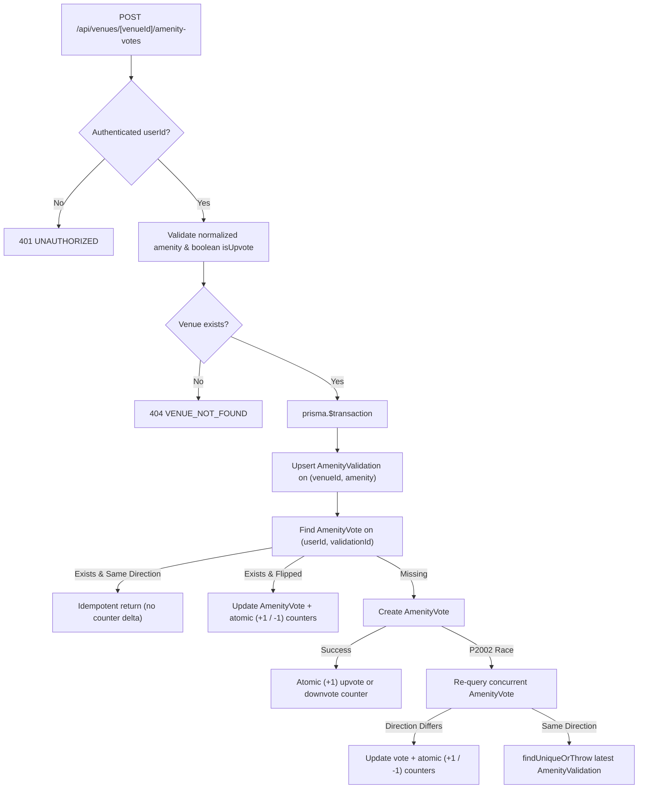

# Atomic Amenity Vote Aggregate Settlement Architecture Specification

## 1. Overview

WorkSphere settles community amenity and governance votes across two complementary layers to guarantee **atomicity under concurrent HTTP writes** and **bitwise determinism during weighted aggregate evaluation**:

1. **Deterministic Fixed-Point Settlement (`src/lib/governance/voteSettlement.ts`)**: Converts floating-point reputation weights into `BigInt` basis points (`BPS_SCALE = 10_000`), canonically orders ballots, and accumulates directional totals with zero IEEE-754 floating-point drift.
2. **Transactional Prisma Aggregate Settlement (`src/app/api/venues/[venueId]/amenity-votes/route.ts`)**: Wraps `AmenityValidation` upserts, `AmenityVote` mutations, `P2002` unique-constraint race recovery, and counter updates inside `prisma.$transaction`.

---

## 2. Deterministic Fixed-Point Settlement Engine

Implemented in [`src/lib/governance/voteSettlement.ts`](../../src/lib/governance/voteSettlement.ts).

### 2.1 Data Contracts

```typescript
export type VoteDirection = "for" | "against" | "abstain";

export interface ReputationVote {
  voterId: string;
  direction: VoteDirection;
  weight: number;
  weightBps?: number;
}

export interface SettledVoteTotals {
  forBps: bigint;
  againstBps: bigint;
  abstainBps: bigint;
  totalBps: bigint;
  forWeight: number;
  againstWeight: number;
  abstainWeight: number;
  totalWeight: number;
  winner: VoteDirection | "tie";
  voteCount: number;
}
```

### 2.2 Fixed-Point Basis-Point Conversion (`BPS_SCALE = 10_000`)

Floating-point addition (`0.1 + 0.2 !== 0.3`) is non-associative across different summation orders, which can flip razor-thin ties depending on database scan or network arrival order. `voteSettlement.ts` eliminates this class of nondeterminism:

- **`toBasisPoints(vote)`**:
  1. If `vote.weightBps` is a finite non-negative number, returns `BigInt(Math.round(vote.weightBps))`.
  2. Otherwise, if `vote.weight` is a finite non-negative number, scales by `BPS_SCALE = 10_000` (`BigInt(Math.round(vote.weight * 10_000))`).
  3. Non-finite (`NaN`, `Infinity`) or negative inputs sanitize safely to `0n`.
- **`fromBasisPoints(bps)`**: Converts settled `bigint` totals back to decimal weights via `Number(bps) / 10_000`.

### 2.3 Canonical Ordering & Outcome Resolution

`settleReputationVotes(votes)` copies the input array and sorts ballots deterministically before accumulation:

1. Primary key: `a.voterId.localeCompare(b.voterId)`
2. Secondary key: `a.direction.localeCompare(b.direction)`
3. Tertiary key: `toBasisPoints(a)` vs `toBasisPoints(b)`

After accumulating `forBps`, `againstBps`, and `abstainBps`:

- `totalBps = forBps + againstBps + abstainBps`
- `winner`:
  - `"for"` if `forBps > againstBps`
  - `"against"` if `againstBps > forBps`
  - `"tie"` if `forBps === againstBps`

`abstain` ballots contribute to `abstainBps`, `totalBps`, and `voteCount`, but do not tilt the directional majority comparison between `forBps` and `againstBps`.

---

## 3. Atomic Transactional Aggregate Settlement (`POST /api/venues/[venueId]/amenity-votes`)

Implemented in [`src/app/api/venues/[venueId]/amenity-votes/route.ts`](../../src/app/api/venues/[venueId]/amenity-votes/route.ts).



### 3.1 Concurrency & Idempotency Guarantees

1. **Single-Transaction Boundary**: `AmenityValidation` creation/lookup, `AmenityVote` upsert/insert, and counter updates execute inside `prisma.$transaction` so vote rows and aggregate counters never diverge on partial failures.
2. **Idempotent Repeat Submissions**: Re-submitting the same `isUpvote` value for `(userId, validationId)` returns the existing `AmenityValidation` without modifying counters.
3. **Atomic Direction Flip**: Switching an existing vote updates `AmenityVote.isUpvote` and atomically applies `{ upvotes: { increment: 1 }, downvotes: { decrement: 1 } }` (or the inverse), avoiding read-modify-write lost updates.
4. **`P2002` Concurrent Insert Recovery**: If two parallel requests from the same user race past `findUnique` and one triggers Prisma unique-constraint violation `P2002` on `(userId, validationId)`, the handler catches `P2002` inside the transaction, reads the winning `concurrentVote`, applies a directional flip if the concurrent vote had the opposite polarity, or returns the committed validation state.

### 3.2 Confidence Score & Auto-Hide Threshold

Both `GET` and `POST` compute:

- `totalVotes = upvotes + downvotes`
- `confidenceScore = totalVotes > 0 ? Math.round((upvotes / totalVotes) * 100) : 100`
- `hidden = totalVotes >= 5 && confidenceScore < 60` (`MIN_VOTES_TO_HIDE = 5`, `HIDE_THRESHOLD = 60`)

---

## 4. Weighted Consensus & Snapshot Digest Integration

[`src/lib/amenityVotes/consensusEngine.ts`](../../src/lib/amenityVotes/consensusEngine.ts) complements transactional raw aggregates with:

- **Wilson-Score Lower Bound (`computeWilsonScoreInterval`)**: Penalizes small sample sizes (`z = 1.96`) before advancing an amenity validation from `PROVISIONAL` to `ELIGIBLE_FOR_SETTLEMENT` / `SETTLED`.
- **Canonical Snapshot Digests (`computeVoteSetSnapshotDigest`)**: Sorts ballots by `userId` and hashes `${validationId}|${serialized}|${CONSENSUS_RULE_VERSION}` (`2.0.0-reputation-bayes`) so identical vote sets produce reproducible snapshot digests.

---

## 5. Verification & References

- **Unit Tests**: [`src/__tests__/lib/governance/voteSettlement.test.ts`](../../src/__tests__/lib/governance/voteSettlement.test.ts) verifies basis-point settlement order invariance and exact tie outcomes across seeded shuffles.
- **Core Settlement Module**: [`src/lib/governance/voteSettlement.ts`](../../src/lib/governance/voteSettlement.ts)
- **Transactional API Handler**: [`src/app/api/venues/[venueId]/amenity-votes/route.ts`](../../src/app/api/venues/[venueId]/amenity-votes/route.ts)
- **Consensus Engine**: [`src/lib/amenityVotes/consensusEngine.ts`](../../src/lib/amenityVotes/consensusEngine.ts)
