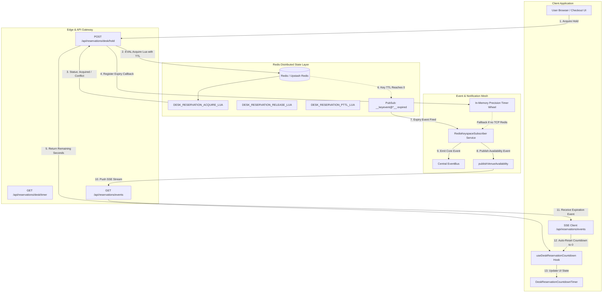

# Atomic Desk Reservation Countdown Timer with Redis Keyspace Notifications

## 1. Executive Summary & Problem Formulation

High-concurrency workspace booking platforms face a fundamental synchronization dilemma: when users select and hold desks during checkout, the temporary reservation must expire automatically if checkout is abandoned, while immediately alerting all participating browser sessions without expensive continuous database polling.

### Key Concurrency Vulnerabilities in Traditional Reservation Systems
1. **Double-Booking Collisions (Lost Updates)**: Two users attempting to hold the same desk simultaneously when checking database state independently.
2. **Ghost Holds & Abandonment Leaks**: Users initiating checkout and closing tabs without confirming or explicitly releasing holds, locking venue capacity indefinitely.
3. **Timer Drift & Polling Inefficiencies**: Client-side countdown stopwatches drifting out of sync with backend expiration epochs, causing premature or delayed release notifications.
4. **Stale Delete Overwrites**: A slow user releasing their expired hold just as a new user acquires it, inadvertently deleting the new owner's lock.

To eliminate these race conditions, WorkSphere implements an **Atomic Desk Reservation Countdown Engine** powered by **Redis Keyspace Notifications (`notify-keyspace-events Ex`)**, distributed Lua scripts, sub-second TTL countdown tracking, Server-Sent Events (SSE), and a reactive timer wheel fallback.

---

## 2. High-Level Architecture & Event Pipeline



---

## 3. Atomic Redis Primitives & Lua Script Mechanics

All reservation state transitions are executed atomically in Redis via Lua scripts, ensuring strict single-threaded serialization without multi-roundtrip check-then-act vulnerabilities.

### 3.1 Lock Key Namespace
Desk reservation holds are namespaced in Redis as:
```text
desk:reservation:{venueId}:{deskId}
```

Stored JSON payload (`DeskReservationHold`):
```json
{
  "venueId": "venue_sf_downtown",
  "deskId": "hotdesk-204",
  "userId": "user_2NNE90vM8d4Lkp2",
  "userName": "Jordan Lee",
  "heldAt": 1728384000000,
  "expiresAt": 1728384300000,
  "ttlSeconds": 300,
  "version": 1
}
```

### 3.2 Atomic Acquire & Re-entrant Renewal (`DESK_RESERVATION_ACQUIRE_LUA`)
```lua
local current = redis.call('GET', KEYS[1])
if not current then
  redis.call('SET', KEYS[1], ARGV[2], 'EX', tonumber(ARGV[3]))
  return { 1, ARGV[2] }
end
local ok, decoded = pcall(cjson.decode, current)
if ok and type(decoded) == 'table' and decoded.userId == ARGV[1] then
  local renewed = cjson.decode(ARGV[2])
  renewed.version = (tonumber(decoded.version) or 1) + 1
  if decoded.heldAt then renewed.heldAt = decoded.heldAt end
  local encoded = cjson.encode(renewed)
  redis.call('SET', KEYS[1], encoded, 'EX', tonumber(ARGV[3]))
  return { 1, encoded }
end
return { 0, current }
```

### 3.3 Compare-and-Delete Release (`DESK_RESERVATION_RELEASE_LUA`)
Prevents third-party hold destructions when late cancellations occur:
```lua
local current = redis.call('GET', KEYS[1])
if not current then return 0 end
local ok, decoded = pcall(cjson.decode, current)
if ok and type(decoded) == 'table' and decoded.userId == ARGV[1] then
  redis.call('DEL', KEYS[1])
  return 1
end
return 0
```

### 3.4 Sub-Second Precision TTL Inspection (`DESK_RESERVATION_PTTL_LUA`)
Atomically returns current millisecond-accurate TTL and metadata:
```lua
local pttl = redis.call('PTTL', KEYS[1])
if pttl < 0 then
  return { -1, nil }
end
local current = redis.call('GET', KEYS[1])
return { pttl, current }
```

---

## 4. Redis Keyspace Notifications (`notify-keyspace-events Ex`)

### 4.1 Configuration & Channels
When Redis keyspace notifications are enabled with `Ex` (Expired Events on Keyevents):
- Redis automatically publishes to `__keyevent@<db>__:expired` whenever a key with an active TTL reaches expiration.
- The message payload contains the exact key string: `desk:reservation:<venueId>:<deskId>`.

### 4.2 Pattern Subscription
The `RedisKeyspaceSubscriber` service subscribes to:
```text
PSUBSCRIBE __keyevent@*__:expired __keyevent@*__:del
```

When a message is received:
1. The service regex-matches `^(?:desk:reservation|seat:hold|desk:hold):([^:]+):([^:]+)$`.
2. Extracted `venueId` and `deskId` are passed to `notifyExpiration(venueId, deskId)`.
3. An SSE availability update (`desk_reservation_expired`) is dispatched to all connected clients.
4. Client countdown timers immediately lock/unlock without waiting for next scheduled polling cycles.

### 4.3 Fallback Timer Wheel Engine
To support environments where external Redis TCP connections or Pub/Sub sockets are restricted (e.g. edge runtimes, serverless functions, or Upstash REST mode), `RedisKeyspaceSubscriber` maintains an in-memory precision timer wheel. When `acquireDeskReservation()` succeeds, a fallback timeout is scheduled for `expiresAt`. If external Pub/Sub does not fire, the fallback wheel guarantees that expiration events trigger with exact millisecond precision.

---

## 5. React Hook & UI Component Specification

### 5.1 `useDeskReservationCountdown` Hook
Provides complete lifecycle management:
- **High-Precision Clock**: Ticks every second based on `targetExpiresAt - Date.now()`, preventing background tab throttle drift.
- **SSE Real-Time Sync**: Listens to `/api/reservations/events` for instant `desk_reservation_expired` and `desk_reservation_released` events.
- **Tab Visibility Reconnection**: On `visibilitychange === 'visible'`, queries `/api/reservations/desk/hold` to ensure local timer state matches backend Redis TTL.
- **Auto-Release on Unload**: Attaches `beforeunload` and `pagehide` listeners to fire `keepalive: true` fetch requests when the user abandons the tab.

### 5.2 `DeskReservationCountdownTimer` Component
Accessible, high-visibility UI timer:
- **Color Progression**: Emerald (> 60s) $\to$ Amber ($\le$ 60s) $\to$ Rose Urgent Pulse ($\le$ 15s).
- **Smooth Visual Progress Bar**: Decrements from 100% to 0% in sync with remaining seconds.
- **Monospace Readout**: Formatted `MM:SS` display with ARIA live region (`aria-live="polite"`).
- **Interactive Controls**: One-click "Extend Hold (+5m)" renewal and "Release" buttons.

---

## 6. Verification & Invariant Checklist

| Invariant | Implementation Mechanism | Validation Rule |
| :--- | :--- | :--- |
| **Mutual Exclusivity** | `DESK_RESERVATION_ACQUIRE_LUA` with Redis single-threaded execution | Only one user can hold a desk at any millisecond |
| **Re-entrant Extension** | Owner check `decoded.userId == ARGV[1]` in Acquire Lua | Owner can renew TTL repeatedly; version counter increments |
| **Safe CAD Release** | `DESK_RESERVATION_RELEASE_LUA` | User cannot release lock owned by someone else |
| **Instant Expiration** | Redis Keyspace Notifications + Timer Wheel Fallback | Expiration broadcast fires immediately upon TTL exhaustion |
| **Tab Drift Resilience** | Epoch delta calculation + Visibility change listener | Timer reflects correct time even after laptop lid closes |
