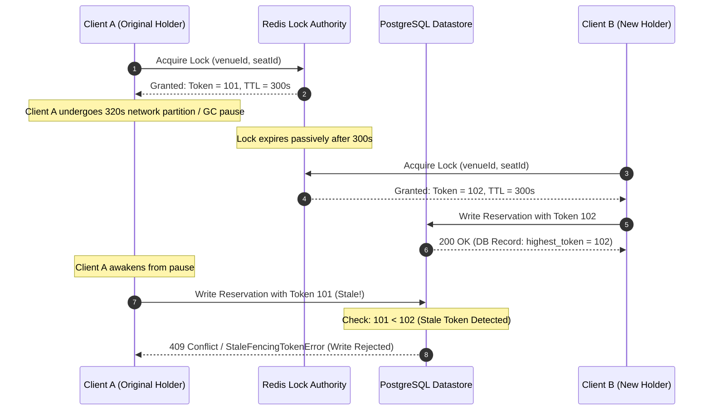
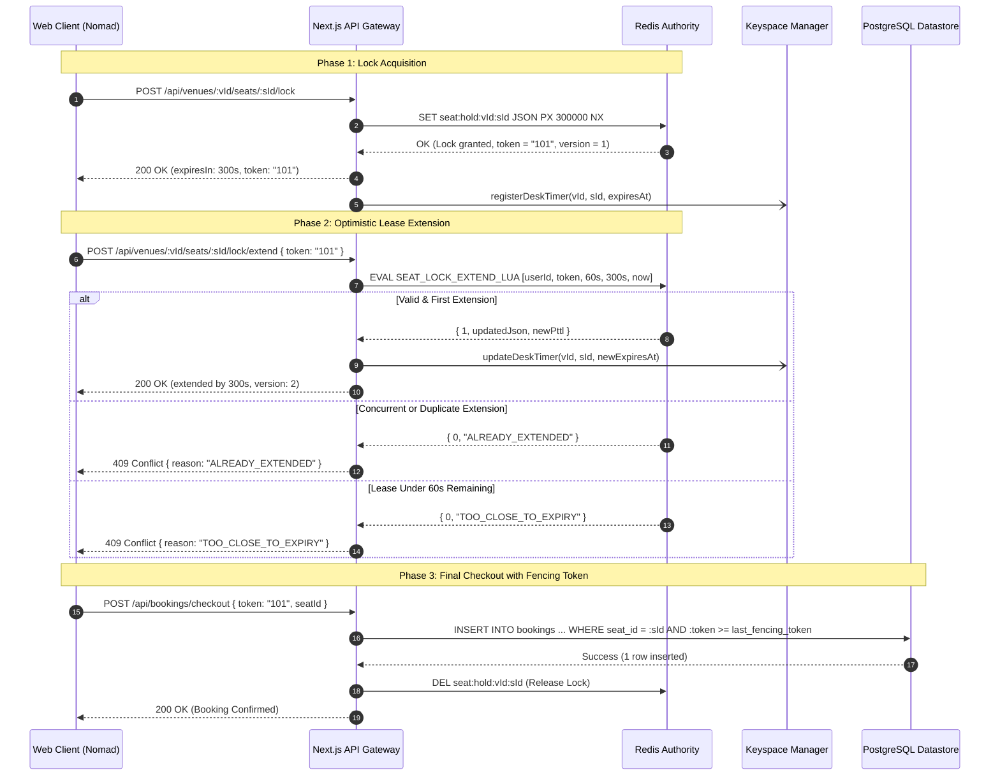

# Optimistic Redlock Seat Reservation Concurrency Control & Lease Protocol

## 1. Overview & Problem Scope

In WorkSphere, high-density hot desk and meeting room reservations experience intense concurrency spikes—especially during morning check-ins (08:30–09:30 AM) and flash booking windows. When multiple nomadic professionals attempt to reserve the same physical seat simultaneously, the application layer must enforce strict mutual exclusion, prevent double bookings, guarantee race-free lease extensions, and reject stale operations.

This document serves as the canonical technical guide and protocol specification for seat-hold concurrency control, detailing:

- The optimistic lease extension protocol
- Monotonically increasing fencing tokens
- TTL lifecycle and clock-drift bounds
- The exact atomic operations executed in Redis and memory fallbacks
- Failure modes, partition handling, and downstream database validation

---

## 2. Architecture: Implemented Reality vs Theoretical Redlock

### 2.1 Theoretical Redlock Algorithm vs Production Implementation

WorkSphere architectural specifications reference Martin Kleppmann's critique and Salvatore Sanfilippo's original Redlock specification across $N$ independent Redis masters (quorum $Q = \lfloor N/2 \rfloor + 1$).

To ensure transparency across our engineering and ops teams, we explicitly distinguish between theoretical designs and the deployed implementation:

| Architectural Dimension   | Theoretical Redlock Quorum                                                                                               | WorkSphere Production Implementation (`seatHoldLock.ts`)                                                                                                         |
| ------------------------- | ------------------------------------------------------------------------------------------------------------------------ | ---------------------------------------------------------------------------------------------------------------------------------------------------------------- |
| **Storage Topology**      | Multi-node independent Redis masters ($N \ge 3$)                                                                         | Single primary Redis instance with replica failover (via `ioredis` / Upstash Redis), with an in-memory `Map` fallback (`memoryLocks`) when Redis is unavailable. |
| **Quorum Acquisition**    | Parallel `SET resource token NX PX` across $N$ nodes; lock granted if $\ge Q$ nodes succeed within lock validity window. | Single atomic Redis Lua evaluation or transactional memory write; multi-node helper functions (`acquireQuorumFencingLock`) exist for multi-cluster environments. |
| **Lease Extension**       | Multi-node re-acquisition or distributed consensus renewal.                                                              | Single-call atomic Lua script (`SEAT_LOCK_EXTEND_LUA`) ensuring check-and-update atomicity.                                                                      |
| **Split-Brain Guarantee** | Majority quorum prevents split brain under minority partitions.                                                          | Rely on Redis primary-replica election or single authority; database-tier fencing token validation acts as the ultimate safeguard against stale writes.          |
| **Fallback Mechanism**    | None (cluster must maintain quorum).                                                                                     | In-process TTL-tracked `memoryLocks` Map with automatic timer pruning for single-instance / local development fallback.                                          |

### 2.2 Dual-Layer Architecture

1. **Client Tier (Browser Web Locks API):** Local browser tabs coordinate via `navigator.locks.request('seat-hold:venueId:seatId')` to eliminate redundant network requests across tabs.
2. **Server Tier (Distributed Seat Lock & Fencing):** Handled by `src/lib/locks/seatHoldLock.ts` and Next.js route handlers (`src/app/api/venues/[venueId]/seats/[seatId]/lock/extend/route.ts`).
3. **Storage Tier (Relational Guard):** PostgreSQL schema incorporates the lock's `fencing_token` in reservation transactions (`WHERE fencing_token >= last_seen_token`) to prevent out-of-order writes.

---

## 3. Monotonically Increasing Fencing Tokens

A distributed lock without fencing cannot prevent storage corruption when a client experiences an asynchronous suspension (e.g., long garbage collection pause, network stall, or client sleep). If Client A's lease expires while Client A is paused, Client B acquires the lock. When Client A awakens, it writes to the database, overwriting Client B's valid reservation.



### 3.1 Token Generation & Semantics

In `src/lib/locks/seatHoldLock.ts`:

- **Sequence Generation:** Fencing tokens are 64-bit monotonically advancing values generated using `getMonotonicNowNs()` (backed by `process.hrtime.bigint()` or high-resolution wall-clock fallback) combined with an atomic in-memory sequence `monotonicFencingSeq` or Redis atomic increment (`INCR redlock:fencing_seq`).
- **Token Invariance:** Fencing tokens are monotonic and strictly ordered ($T_{n+1} > T_n$).
- **Version vs Fencing Token:**
  - `fencingToken`: Generated during lock acquisition. Identifies the reservation epoch. Required for all mutation requests (release, extension, checkout).
  - `version`: Represents the state revision of the lock payload itself. Incremented on lease extension (`version = (tonumber(decoded.version) or 1) + 1`).

---

## 4. TTL Expiration & Clock Drift Assumptions

### 4.1 Default TTL Parameters

- **Default Lease Duration:** 300 seconds (5 minutes) (`DEFAULT_LOCK_TTL_SECONDS = 300`).
- **Extension Duration:** 300 seconds (5 minutes) (`300000 ms`).
- **Extension Safety Threshold:** 60 seconds (`60000 ms`). Extensions requested when $\le 60\text{s}$ remain are rejected with `TOO_CLOSE_TO_EXPIRY` to prevent race conditions with background keyspace expiration.

### 4.2 Clock Drift & Validity Bounds

Redis key TTLs rely on monotonic millisecond timers (`PTTL`). The maximum clock drift between the application server cluster and Redis instances is bounded using:

$$\text{Drift} = (\text{TTL} \times \text{BASE\_DRIFT\_FACTOR}) + \text{CLOCK\_SKEW\_SAFETY\_MARGIN}$$

Where:

- $\text{BASE\_DRIFT\_FACTOR} = 0.01$ (1% drift allowance, per `seatHoldLock.ts`)
- $\text{CLOCK\_SKEW\_SAFETY\_MARGIN} = 2000\text{ ms}$ (network round-trip tolerance)

If the validity time remaining after deducting network latency and clock drift is less than or equal to zero, the client considers the lock expired before making downstream database calls (`LockValidityError`).

---

## 5. Optimistic Lease Extension Protocol

When a nomad is actively proceeding through checkout, WorkSphere permits a single 5-minute lease renewal to allow payment entry without forcing a seat re-selection.

### 5.1 Endpoint Specification

- **Method:** `POST`
- **Route:** `/api/venues/:venueId/seats/:seatId/lock/extend`
- **Authentication:** Clerk session required (`auth()`).
- **Request Headers:** `Content-Type: application/json`
- **Request Body:**
  ```json
  {
    "token": "101"
  }
  ```

### 5.2 Atomic Lua Execution (`SEAT_LOCK_EXTEND_LUA`)

To prevent multi-step read-modify-write races, renewal is evaluated atomically inside Redis:

```lua
local current = redis.call('GET', KEYS[1])
if not current then return { 0, 'NOT_FOUND' } end

local ok, decoded = pcall(cjson.decode, current)
if not (ok and type(decoded) == 'table') then
  return { 0, 'INVALID_LOCK' }
end

if decoded.userId ~= ARGV[1] or decoded.fencingToken ~= ARGV[2] then
  return { 0, 'UNAUTHORIZED' }
end
if decoded.extensionUsed == true then
  return { 0, 'ALREADY_EXTENDED' }
end

local currentPttl = redis.call('PTTL', KEYS[1])
if currentPttl <= 0 then
  return { 0, 'NOT_FOUND' }
end
if currentPttl <= tonumber(ARGV[3]) then
  return { 0, 'TOO_CLOSE_TO_EXPIRY' }
end

local extensionMs = tonumber(ARGV[4])
local newPttl = currentPttl + extensionMs
decoded.expiresAt = tonumber(ARGV[5]) + newPttl
decoded.extensionUsed = true
decoded.version = (tonumber(decoded.version) or 1) + 1

local encoded = cjson.encode(decoded)
redis.call('SET', KEYS[1], encoded, 'PX', newPttl)
return { 1, encoded, newPttl }
```

### 5.3 Extension Response Schema

#### Success (HTTP 200 OK)

```json
{
  "success": true,
  "lock": {
    "venueId": "venue_456",
    "seatId": "seat_789",
    "userId": "user_123",
    "fencingToken": "101",
    "expiresAt": 1795604100000,
    "extensionUsed": true,
    "version": 2
  },
  "remainingSeconds": 480
}
```

#### Rejection Responses

| HTTP Status        | Reason Code           | Error Code      | Condition                                                                     |
| ------------------ | --------------------- | --------------- | ----------------------------------------------------------------------------- |
| `400 Bad Request`  | `INVALID_INPUT`       | `INVALID_INPUT` | Fencing token was omitted or empty in request body.                           |
| `401 Unauthorized` | `UNAUTHORIZED`        | `UNAUTHORIZED`  | Caller has no valid Clerk authentication session.                             |
| `403 Forbidden`    | `UNAUTHORIZED`        | `FORBIDDEN`     | Caller is not the lock owner (`userId` mismatch) or provided wrong token.     |
| `404 Not Found`    | `NOT_FOUND`           | `CONFLICT`      | Lock does not exist or has already expired.                                   |
| `409 Conflict`     | `ALREADY_EXTENDED`    | `CONFLICT`      | Lease has already been extended once (`extensionUsed === true`).              |
| `409 Conflict`     | `TOO_CLOSE_TO_EXPIRY` | `CONFLICT`      | Remaining PTTL is $\le 60\text{s}$; extension denied to prevent expiry races. |
| `500 Server Error` | `ERROR`               | `CONFLICT`      | Redis connection error or internal failure.                                   |

---

## 6. End-to-End Protocol Sequence Diagram



---

## 7. Distributed Failure-Mode Edge-Case Checklist

| Edge Case Scenario                         | Expected Behavior                                                                                                        | Implementation Verification Mechanism                                                                                |
| ------------------------------------------ | ------------------------------------------------------------------------------------------------------------------------ | -------------------------------------------------------------------------------------------------------------------- |
| **Simultaneous Lock Acquisition**          | Only first claimant wins lock (`SET NX`); second receives 409 Conflict.                                                  | Tested via atomic Redis `NX` or memory locks reservation mutex.                                                      |
| **Concurrent Duplicate Lease Extensions**  | Only the first request succeeds; concurrent requests receive 409 `ALREADY_EXTENDED`.                                     | Evaluated atomically in `SEAT_LOCK_EXTEND_LUA` script; neither request can observe an intermediate unextended state. |
| **Expired Lease Extension**                | Request returns 404 `NOT_FOUND`.                                                                                         | Lua script checks `currentPttl <= 0` or missing key.                                                                 |
| **Stale Fencing Token**                    | Request returns 403 `UNAUTHORIZED`.                                                                                      | Lua script and memory map verify `decoded.fencingToken == submittedToken`.                                           |
| **Wrong Lock Holder**                      | Request returns 403 `UNAUTHORIZED`.                                                                                      | Authenticated `userId` must match `decoded.userId`.                                                                  |
| **Redis Unavailability**                   | Gracefully degrades to in-process `memoryLocks` map or returns 500 error without corrupting state.                       | `getRedis()` fallback paths in `seatHoldLock.ts`.                                                                    |
| **Client Disconnection / Abandonment**     | Seat is automatically reclaimed when Redis key expires.                                                                  | Handled passively via Redis `PX` expiration and active keyspace notification cleanup.                                |
| **Release Racing with Extension**          | Extension fails with `NOT_FOUND` if release finishes first; release cleans up extended lock if extension finishes first. | Redis single-threaded command queue processes `EVAL` scripts serially.                                               |
| **STW Garbage Collection / Process Pause** | Fencing token ensures stale writes are rejected by PostgreSQL even if worker pauses.                                     | Relational database atomic check `WHERE fencing_token >= highest_seen_token`.                                        |

---

## 8. Related Architectural References

For deeper design notes and related subsystem guides, refer to:

- [Distributed Locks and Fencing](file:///d:/Opensource/WorkSphere-Opensource/docs/architecture/distributed-locks-and-fencing.md)
- [Seat-Hold Lock Architecture](file:///d:/Opensource/WorkSphere-Opensource/docs/architecture/seat-hold-lock-architecture.md)
- [Seat-Hold Lock Redlock Architecture Reference](file:///d:/Opensource/WorkSphere-Opensource/docs/architecture/seat-hold-lock-redlock-architecture.md)
- [RFC 0012: Redlock Monotonic Fencing Tokens](file:///d:/Opensource/WorkSphere-Opensource/docs/rfcs/0012-redlock-monotonic-fencing-tokens.md)
- [Seat Hold Lease Extension API](file:///d:/Opensource/WorkSphere-Opensource/docs/api/SEAT_HOLD_LEASE_EXTENSION.md)
