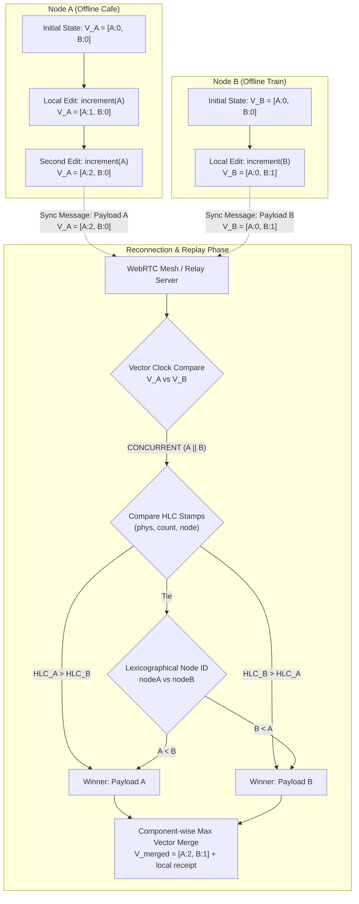

# Distributed Vector Clock & Lamport Timestamp Synchronization Specification

This specification documents the distributed state synchronization architecture used across WorkSphere's offline workspace notes, collaborative canvases, and peer-to-peer data sync engines (`VectorClock.ts`, `LamportTimestampResolver.ts`, and `HybridLogicalClock.ts`).

---

## 1. Overview & Architectural Problem

Digital nomads and remote teams frequently work under unstable or disconnected network conditions (trains, flights, remote cafes). In a decentralized, multi-peer architecture without centralized database locking:

- Nodes must be capable of generating mutations locally and independently while disconnected.
- Mutations must retain causal ordering (which update was based on which previous state).
- When nodes reconnect, concurrent mutations must be resolved deterministically without silent data loss or divergence.

WorkSphere addresses this challenge using a hybrid causal-and-logical ordering hierarchy:

1. **Vector Clocks (`VectorClock.ts`)**: Track partial causal dependencies (`BEFORE`, `AFTER`, `CONCURRENT`, `EQUAL`). Causal ancestry always wins over physical timestamps.
2. **Hybrid Logical Clocks (`HybridLogicalClock.ts`)**: Supply monotonic, physical-time-bounded logical stamps to break ties between concurrent edits.
3. **Lamport Timestamps & Node-ID Arbiters (`LamportTimestampResolver.ts`)**: Form an immutable, deterministic total order for concurrent states.

---

## 2. Distributed Partial Ordering & Causal Relationship Matrix

Let $V_A$ and $V_B$ be vector clocks representing the known event histories of two state snapshots. For all node identifiers $k \in \text{dom}(V_A) \cup \text{dom}(V_B)$, where missing components are implicitly $0$:

$$V_A \le V_B \iff \forall k, V_A[k] \le V_B[k]$$
$$V_A < V_B \iff V_A \le V_B \land \exists k, V_A[k] < V_B[k]$$

### Causal Relationship Matrix

| Condition                                                          | Relationship (`VectorClockRelation`) | Causal Meaning                                    | Conflict Resolution Action                                             |
| :----------------------------------------------------------------- | :----------------------------------: | :------------------------------------------------ | :--------------------------------------------------------------------- |
| $\forall k, V_A[k] == V_B[k]$                                      |             **`EQUAL`**              | Identical causal histories.                       | No-op; payloads represent the same causal state.                       |
| $V_A < V_B$                                                        |             **`BEFORE`**             | $A$ happened strictly before $B$ ($A \to B$).     | State $B$ supersedes state $A$ without conflict.                       |
| $V_A > V_B$                                                        |             **`AFTER`**              | $B$ happened strictly before $A$ ($B \to A$).     | State $A$ supersedes state $B$ without conflict.                       |
| $\exists i, j \text{ s.t. } V_A[i] > V_B[i] \land V_A[j] < V_B[j]$ |           **`CONCURRENT`**           | Simultaneous independent edits ($A \parallel B$). | Invoke deterministic tie-breaking cascade (HLC -> Lamport -> Node ID). |

---

## 3. Causal Event Ordering and Reconciliation Flow



---

## 4. Deterministic Conflict Tie-Breaking Heuristics

When two mutations are determined to be causally concurrent ($V_A \parallel V_B$), WorkSphere executes a deterministic multi-tiered tie-breaking pipeline implemented in `compareMutations()`:

```
[ Mutation A ] vs [ Mutation B ]
              │
              ▼
    [ VectorClock.compareTo() ]
    ├── AFTER   ──> Mutation A Wins (causally newer)
    ├── BEFORE  ──> Mutation B Wins (causally newer)
    └── CONCURRENT / EQUAL
              │
              ▼
       [ HLC Comparison ] (compareHLC)
       ├── HLC_A > HLC_B ──> Mutation A Wins
       ├── HLC_B > HLC_A ──> Mutation B Wins
       └── Equivalent / Missing HLC
              │
              ▼
    [ Legacy Lamport Timestamp ]
    ├── lamportTs_A > lamportTs_B ──> Mutation A Wins
    ├── lamportTs_B > lamportTs_A ──> Mutation B Wins
    └── Equivalent Lamport TS
              │
              ▼
   [ Lexicographical Tie-Breaker ]
   ├── nodeId_A.localeCompare(nodeId_B)
   └── mutationId_A.localeCompare(mutationId_B)
```

1. **Causality First**: No physical or wall-clock timestamp can override causal ancestry. If an edit was aware of another edit, the descendant edit always wins.
2. **Hybrid Logical Clock (HLC)**: When causality cannot decide, HLC combines physical wall time with a monotonically incrementing counter, ensuring that edits reflecting higher physical time win without succumbing to local clock drift.
3. **Stable Node ID Arbitration**: In the astronomically rare scenario of identical HLC timestamps, lexicographical comparison of `nodeId` followed by UUID `id` guarantees that every peer arrives at the exact same winning state.

---

## 5. Invariant Guarantees & Edge Case Handling Rules

| Invariant / Edge Case      | System Guarantee                                           | Handling Mechanism                                                                                    |
| :------------------------- | :--------------------------------------------------------- | :---------------------------------------------------------------------------------------------------- |
| **Strict Monotonicity**    | Logical counters never decrease across events.             | `Math.max(local, incoming)` ensures vector components only grow.                                      |
| **Safe Integer Boundary**  | Counters do not overflow `Number.MAX_SAFE_INTEGER`.        | Validation in `readEntries()` rejects negative or unsafe integer inputs.                              |
| **Node ID Immutability**   | Clocks are strictly scoped to a non-empty string `nodeId`. | Throws `TypeError` on empty or whitespace-only node identifiers.                                      |
| **Missing Node Entries**   | Nodes joining midway or unrepresented in a vector.         | Omitted node keys are mathematically treated as $0$.                                                  |
| **Clock Drift / NTP Skew** | Client physical clocks differ by minutes or hours.         | HLC bounds physical drift to `MAX_DRIFT_MS` (60s) before falling back to logical counter advancement. |
| **Silent Mutation Loss**   | Offline queues replaying out of order.                     | `replayMutations()` re-sorts mutation queues causally and topologically before updating base state.   |

---

## 6. Implementation Reference

### Vector Clock Merge Logic (`src/core/sync/VectorClock.ts`)

```typescript
public merge(incomingClock: VectorClockInput): ClockMap {
  for (const [nodeId, incomingCounter] of readEntries(incomingClock, "Incoming vector clock")) {
    this.clock.set(
      nodeId,
      Math.max(this.clock.get(nodeId) ?? 0, incomingCounter),
    );
  }

  // Advance local component to record receipt and reconciliation of the incoming state
  this.clock.set(this.nodeId, (this.clock.get(this.nodeId) ?? 0) + 1);
  return this.getClock();
}
```

### Conflict Resolution Logic (`src/core/sync/LamportTimestampResolver.ts`)

```typescript
export class LamportTimestampResolver {
  public static resolveConflict<T>(
    mutationA: MutationPayload<T>,
    mutationB: MutationPayload<T>,
  ): MutationPayload<T> {
    return compareMutations(mutationA, mutationB) >= 0 ? mutationA : mutationB;
  }
}
```

---

## 7. Performance & Benchmark Metrics

- **Vector Clock Comparison Overhead**: $\mathcal{O}(N)$ where $N$ is the active peer cluster count (typically $N \le 16$ in collaborative workspaces). Mean comparison duration $< 0.002\text{ ms}$.
- **Memory Footprint**: Average serialized clock size $< 200\text{ bytes}$ for typical 5-node collaborative rooms.
- **Queue Replay Throughput**: Exceeds $100,000\text{ mutations/second}$ during offline queue replay benchmarks.
