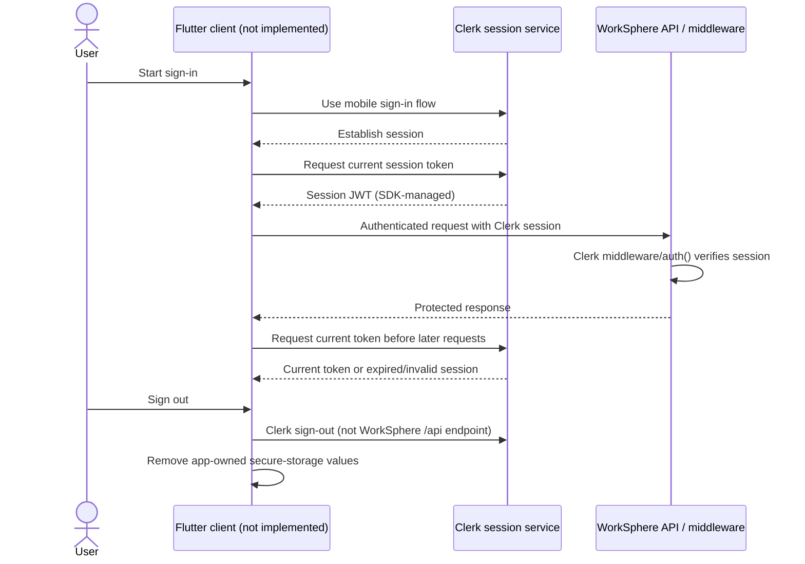

# WorkSphere Flutter Architecture & Toolchain Blueprint

Defines the target Flutter/Dart SDK versions, `apps/flutter/` directory structure, feature-first architecture mirroring `src/`, and package naming conventions.

## 1. Recommended Flutter & Dart Toolchain Versions

* **Flutter SDK:** `3.50.1` (`channel: stable`, constraint `>=3.50.0 <4.0.0`)
* **Dart SDK:** `3.14.0` (constraint `>=3.14.0 <4.0.0`)
* **Platform Targets:** Android (`compileSdk 35`, `minSdk 24`, AGP `9.0+`), iOS/macOS (iOS `15.0+`, Swift Package Manager default), Web (`dart2wasm`).

## 2. Repository Folder Structure (`apps/flutter/`)

* Host the Flutter app under `apps/flutter/` with `lib/app/`, `lib/core/` (mirroring `src/lib/` and `src/hooks/`), `lib/features/` (mirroring `src/components/`), and `test/`.
* Structure each feature module with `data/`, `domain/`, and `presentation/` layers.

## 3. Package & Identifier Naming Conventions

* **Pub Package Name:** `worksphere_app` (lowercase `snake_case`; shared packages use `worksphere_<module>`).
* **Files & Directories:** Lowercase `snake_case.dart` (e.g., `booking_date_picker.dart`, `rpc_cluster_pool.dart`).
* **Platform Bundle IDs:** `com.worksphere.app` (production) and `com.worksphere.app.staging` (pre-release/QA).

## 4. Web-to-Mobile Route Parity

The table below is based on the current Next.js route tree and the implemented
GoRouter configuration in `apps/flutter/lib/app/router.dart`. Flutter uses
GoRouter's `:parameter` syntax; the Next.js `[parameter]` notation is shown in
the web-route column for comparison.

| Next.js web route | Parameter(s) | Web access | Flutter GoRouter path | Flutter access today | Parity status |
| --- | --- | --- | --- | --- |
| `/venues` | Query parameters are supported (for example, `category`) | Public | `/venues` | Redirects to sign-in while signed out | Implemented; query parameters are read from `state.uri.queryParameters` |
| `/venues/[id]` | `id` (venue identifier) | Public | `/venues/:id` | Redirects to sign-in while signed out | Implemented; available as `state.pathParameters['id']` |
| `/reserve/[venueId]` | `venueId` (venue identifier) | Authenticated | `/reserve/:venueId` | Redirects to sign-in while signed out | Route exists; parameter is available as `state.pathParameters['venueId']` |
| `/social` | None | Authenticated | — | No destination | Gap: no Flutter GoRouter route is currently defined |
| `/dashboard` | None | Public at the route layer; page reads the optional Clerk user context | — | No destination | Gap: no Flutter GoRouter route is currently defined |
| `/workspace` | None | Public in the current Next.js page implementation | — | No destination | Gap: no Flutter GoRouter route is currently defined |

The web `/social` and `/reserve/[venueId]` pages explicitly redirect to
`/sign-in` when Clerk does not provide a user. The current `/dashboard` and
`/workspace` page implementations do not contain an explicit server-side
redirect, so this document does not infer a stronger access rule for them.
The Flutter router currently applies its redirect globally, so even the public
venue routes require the Flutter authentication state to be true until the
route guard is narrowed to the intended protected set.

## 5. Deep-Link and Authentication Contract

### URI schemes

Mobile deep links should use the following external-to-internal mapping:

| Link type | URI form | Handling |
| --- | --- | --- |
| Custom scheme | `worksphere://<path>` (for example, `worksphere://venues/123`) | The platform adapter must convert the URI path and query string to a GoRouter location. |
| iOS Universal Links | `https://<associated-domain>/<path>` | Requires an iOS Associated Domains entitlement and a server-hosted `apple-app-site-association` file. |
| Android App Links | `https://<associated-domain>/<path>` | Requires an Android `intent-filter` with auto-verification and a server-hosted `assetlinks.json` file. |

No iOS associated-domain file, Android `assetlinks.json`, or platform
intent-filter is present in the repository at the time of writing. Therefore
the entries above describe the required integration contract, not a claim that
all three link mechanisms are already enabled in a released build.

### Protected routes and login redirects

`createAppRouter` observes the supplied authentication `ValueListenable`. When
the user is signed out, any route other than `/sign-in` is redirected to
`/sign-in?redirect=<original-path-and-query>`. After authentication, the
sanitized `redirect` value is restored. External and protocol-relative targets
are rejected and fall back to `/`, preventing an open redirect.

This means a deep link such as `/reserve/venue-123` can be received before
login, shown as `/sign-in?redirect=%2Freserve%2Fvenue-123`, and resumed after
authentication. Query parameters on public routes, such as
`/venues?category=quiet`, are preserved by the same redirect flow.

Until the missing Flutter routes are implemented, deep links for `/social`,
`/dashboard`, and `/workspace` have no corresponding GoRouter destination and
must not be documented as supported mobile screens.

## 6. Flutter Authentication Integration Status

This section records the boundary between the current Flutter scaffold and the
existing WorkSphere web/backend authentication implementation. It is an
implementation inventory, not a claim that the missing mobile client layer is
complete.

### Current Flutter client

The Flutter package at `apps/flutter/` currently declares only `go_router` and
`http` as relevant application dependencies. It contains the route guard in
`apps/flutter/lib/app/router.dart`, which accepts an external
`ValueListenable<bool>` for authentication state, but it does not currently
contain:

- a Clerk Flutter SDK integration or session object;
- a JWT acquisition or API-authentication service;
- `flutter_secure_storage` (the package is not declared or used);
- OAuth callback/platform deep-link handlers;
- passkey/WebAuthn platform calls; or
- mobile logout, token refresh, or credential-cleanup code.

Consequently, the lifecycle below describes the required integration boundary
and identifies which steps are implemented on the server versus still absent
from Flutter.

### Authentication lifecycle

1. **Sign-in starts.** The mobile UI must invoke Clerk's supported mobile sign-
   in flow. No invocation is present in `apps/flutter/`.
2. **Clerk establishes the session.** Clerk, rather than WorkSphere's retired
   session endpoints, owns session creation, rotation, expiry, and sign-out.
   The Next.js implementation consumes the verified session through Clerk's
   `auth()`/`currentUser()` helpers; there is no equivalent Flutter adapter in
   this repository.
3. **JWT retrieval.** No WorkSphere JWT endpoint is implemented for Flutter.
   In particular, `GET` and `POST /api/auth/session/refresh` return `410
   ENDPOINT_RETIRED` and state that Clerk manages token rotation. A future
   Flutter client must obtain a session token through the Clerk client/session
   API and must not call the retired endpoint as a refresh API.
4. **Secure storage.** No `flutter_secure_storage` usage exists. Until a
   client implementation is added, this repository makes no claim about a
   mobile storage key, token format, or persistence policy. If tokens are
   persisted in a future client, use platform secure storage and never log the
   token.
5. **Authenticated requests.** Backend protected routes are gated by Clerk
   middleware and route-level `auth()` checks. The Flutter HTTP layer is not
   implemented, so there is currently no repository-defined authorization
   header, request interceptor, or retry policy to document.
6. **Expiry and refresh.** Refresh is delegated to the Clerk session. A mobile
   client should ask Clerk for the current session token before a request and
   handle a failed/expired session by returning to sign-in; it must not invent
   a WorkSphere refresh-token exchange. The exact Flutter SDK call remains an
   implementation gap because no Clerk Flutter dependency is present.
7. **Logout and cleanup.** `GET` and `POST /api/auth/session/logout` also
   return `410 ENDPOINT_RETIRED` and state that sign-out belongs to Clerk. A
   future Flutter sign-out flow must call Clerk's client sign-out operation and
   clear any app-owned secure-storage entries it introduced. There are no such
   entries or cleanup calls in the current Flutter source.

The diagram labels the Flutter portion as not implemented because the
repository currently provides only the router-level boolean auth hook.

### Backend session and request behavior

The web implementation uses `clerkMiddleware()` to protect non-public routes,
then uses `auth()` or `currentUser()` from `@clerk/nextjs/server`. The backend
does not expose raw JWT validation or a custom refresh-token format to the
application. An API request without a valid Clerk session is rejected by the
middleware or route handler according to the route's protection policy.

The browser-oriented CSRF contract is separate from the Flutter session token:
`GET /api/auth/csrf-token` issues a signed `csrf_token` cookie and returns the
raw token for the `x-csrf-token` header on browser-style mutating requests.
This document does not claim that a Flutter client can use browser cookies or
that CSRF handling has been integrated into the Flutter HTTP layer.

## 7. OAuth Redirects and Callback Handling

The repository contains a server-side PKCE helper at `POST
/api/auth/sso/pkce`:

- `{"action":"generate"}` creates a verifier/challenge pair and stores both
  in HTTP-only `pkce_verifier` and `pkce_challenge` cookies for 15 minutes.
- `{"action":"validate","verifier":"..."}` validates the supplied
  verifier against the stored challenge and deletes both cookies after a
  successful validation.
- Missing challenge/verifier and invalid actions return the documented `400`
  errors; unexpected failures return `500`.

The repository also exposes `GET /api/auth/sso/metadata?url=...` for resolving
allowed identity-provider metadata, and `POST /api/auth/sso/saml` for the
SAML integration. These are server-side SSO helpers, not a documented Flutter
OAuth callback endpoint.

No mobile custom-scheme callback, Universal Link/App Link callback handler,
registered redirect URI, iOS Associated Domains entitlement, Android
`intent-filter`, or callback screen is present in the Flutter project. The
mobile flow therefore cannot be documented as configured. When implemented,
the callback must be received by the platform layer, passed through the
Clerk-supported mobile flow, and only then used to establish the Clerk session;
the callback must not be treated as a WorkSphere JWT or accepted without
state/PKCE validation. User cancellation and provider errors should return the
user to the sign-in state, but no Flutter error/cancellation handler currently
exists in this repository.

## 8. Passkey and WebAuthn Integration

Passkeys are implemented in the web/backend stack with
`@simplewebauthn/browser` and `@simplewebauthn/server`; no Flutter passkey
implementation is present.

### Registration

For an authenticated Clerk user:

1. `GET /api/auth/passkey/register/options` obtains the Clerk `userId`, loads
   the local user with `ensureUserExists`, generates registration options, and
   stores a challenge with a two-minute expiry.
2. The browser executes the WebAuthn create ceremony and returns a
   `RegistrationResponseJSON`.
3. `POST /api/auth/passkey/register/verify` accepts `registrationResponse` and
   optional `name`/`nickname`. A `cancelled: true` request deletes that user's
   outstanding challenges. A successful verification consumes the challenge,
   stores the credential/public key/counter/device metadata, and records an
   audit event.

### Authentication

1. `GET` or `POST /api/auth/passkey/authenticate/options` returns
   `PublicKeyCredentialRequestOptionsJSON` and stores a two-minute challenge.
   It may populate `allowCredentials` for a signed-in user or leave it empty
   for discoverable credentials.
2. The client executes the WebAuthn get ceremony and sends the resulting
   `authenticationResponse` to `POST
   /api/auth/passkey/authenticate/verify`.
3. The server consumes the exact challenge, checks expiry and user binding,
   verifies origin/RP ID/signature/counter, updates credential usage metadata,
   and returns `verified`, user data, credential data, and (when configured)
   a Clerk `signInUrl` created with a 60-second Clerk sign-in token.

The client must treat `NotAllowedError`/cancellation, missing or expired
challenges, unknown credentials, failed assertions, and rate-limit responses as
recoverable sign-in errors. The existing browser UI and fallback behavior are
documented in [WEBAUTHN_PASSKEYS.md](../WEBAUTHN_PASSKEYS.md); those browser
APIs cannot be assumed to be available in Flutter.

Credential-management endpoints are also server-side and require Clerk auth:
`GET /api/auth/passkey/credentials` lists the current user's credentials, while
the credential, OTP, rotation, and audit routes implement management and
recovery operations. The separate `POST /api/auth/webauthn/verify` endpoint
only validates a WebAuthn client-data challenge/origin and does not establish a
Clerk mobile session.

### Mobile gap and security boundary

The Flutter package has no WebAuthn dependency, platform credential bridge, or
caller for the endpoints above. A future mobile implementation must use a
platform-supported passkey API, preserve the server's challenge/response
shapes, and complete the Clerk sign-in-token/session handoff. It must not claim
that a successful WebAuthn assertion alone is an authenticated WorkSphere
session.

## 9. Security and Platform Notes

- Keep `CLERK_SECRET_KEY` server-only. The Flutter client may use only the
  publishable/client-side Clerk configuration supported by the chosen Clerk
  mobile SDK.
- Do not store Clerk secret keys, passkey private keys, raw authorization
  tokens, or PKCE verifiers in ordinary preferences or logs.
- Treat a Clerk session token as short-lived and obtain it from Clerk when
  needed; do not implement a second refresh-token protocol against the retired
  WorkSphere endpoints.
- Use HTTPS and the platform's secure credential APIs for production mobile
  authentication. The repository currently contains no iOS/Android auth
  association configuration to reference.
- Preserve the router's existing redirect sanitization: only relative paths
  beginning with `/` are accepted, while protocol-relative and external
  targets fall back to `/`.
