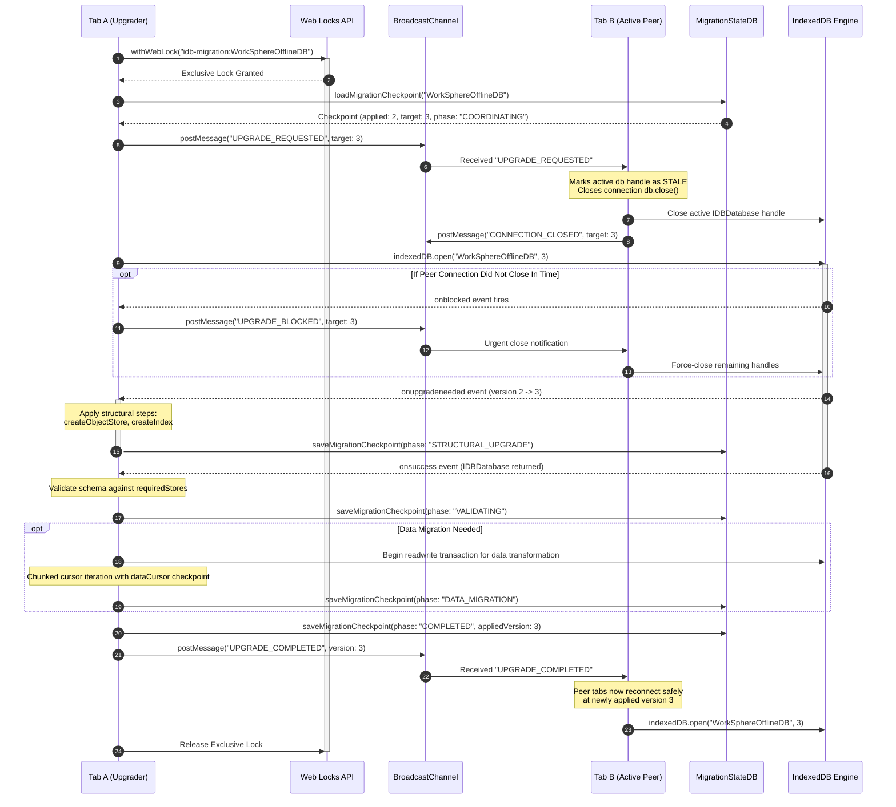

# Crash-Safe IndexedDB Schema Migration Protocol

## 1. Executive Summary & Problem Space

In modern Progressive Web Applications (PWAs) like WorkSphere, users frequently operate across multiple concurrent execution contexts:

- Multiple browser tabs open simultaneously (e.g., viewing venue details, managing workspace bookings, or checking analytics).
- Background **Service Workers** executing periodic cache maintenance and offline background synchronization.
- Dedicated **Web Workers** performing heavy tasks such as audio telemetry processing, CRDT state merges, and cryptographic proof generation.

All of these contexts share a single, origin-partitioned **IndexedDB** instance (`WorkSphereOfflineDB`). In standard IndexedDB specifications, changing the database schema (adding, removing, or altering object stores and indexes) requires opening the database with a higher version number (`indexedDB.open(dbName, newVersion)`), which triggers an `upgradeneeded` event.

However, native IndexedDB version upgrades suffer from critical failure modes in multi-tab applications:

1. **The `blocked` Deadlock**: If Tab A attempts an upgrade to version $N+1$ while Tab B or a background Service Worker holds an active connection to version $N$, the upgrade request fires `onblocked` in Tab A and hangs indefinitely unless Tab B explicitly closes its connection via `onversionchange`.
2. **Tab Crashing Mid-Migration**: If a user closes the browser or an out-of-memory crash occurs halfway through a multi-step data migration, the database is left in a partially migrated, corrupted state.
3. **Safari / WebKit Connection Hangs**: In WebKit-based browsers, race conditions during schema transitions can lock the underlying SQLite engine, causing future `open()` calls to stall permanently.
4. **Stale Transaction Pollution**: Tabs that hold an outdated schema handle may attempt writes with obsolete payload schemas while another tab is actively executing an upgrade.

To resolve these challenges, WorkSphere implements an enterprise-grade, crash-safe migration protocol coordinated by [`src/lib/offline/migrationCoordinator.ts`](../../src/lib/offline/migrationCoordinator.ts), [`src/lib/offline/db.ts`](../../src/lib/offline/db.ts), and the migration registry [`src/lib/offline/migrations/migrationRegistry.ts`](../../src/lib/offline/migrations/migrationRegistry.ts).

---

## 2. Architecture Overview & Core Components

```
+---------------------------------------------------------------------------------------+
|                               Browser Execution Contexts                              |
|   +--------------------+     +--------------------+     +-------------------------+   |
|   |  Browser Tab A     |     |  Browser Tab B     |     |  Service / Web Worker   |   |
|   |  (Initiator)       |     |  (Peer Page)       |     |  (Background Task)      |   |
|   +---------+----------+     +---------+----------+     +------------+------------+   |
|             |                          |                             |                |
|             +--------------------------+-----------------------------+                |
|                                        |                                              |
|                                        v                                              |
|                     +--------------------------------------+                          |
|                     |     W3C Web Locks API Layer          |                          |
|                     |     (withWebLock coordination)       |                          |
|                     +------------------+-------------------+                          |
|                                        |                                              |
|                                        v                                              |
|                     +--------------------------------------+                          |
|                     |     BroadcastChannel Layer           |                          |
|                     |  (worksphere:idb-migration-coord)    |                          |
|                     +------------------+-------------------+                          |
+----------------------------------------|----------------------------------------------+
                                         |
                                         v
+---------------------------------------------------------------------------------------+
|                                   Storage Engines                                     |
|   +-------------------------------------+   +-------------------------------------+   |
|   |       WorkSphereOfflineDB           |   |    WorkSphereMigrationStateDB       |   |
|   |  (Application Data & Stores:        |   |  (Durable Checkpoints:              |   |
|   |   venues, notes, outbox, reviews)   |   |   phase, cursors, applied version)  |   |
|   +-------------------------------------+   +-------------------------------------+   |
+---------------------------------------------------------------------------------------+
```

### 2.1 Core Subsystems

- **Web Locks Coordination (`withWebLock`)**: Employs the W3C Web Locks API (`navigator.locks.request`) to ensure that exactly one execution context initiates an upgrade for a given database at any moment across all tabs and workers.
- **Coordination BroadcastChannel (`MIGRATION_BROADCAST_CHANNEL`)**: A dedicated inter-context channel (`"worksphere:idb-migration-coordination"`) used to signal `UPGRADE_REQUESTED`, `UPGRADE_BLOCKED`, `CONNECTION_CLOSED`, `UPGRADE_COMPLETED`, and `UPGRADE_FAILED`.
- **Durable Checkpoint Database (`MIGRATION_STATE_DB_NAME`)**: An independent meta-database (`WorkSphereMigrationStateDB`) storing phase state, step progress, processed record counts, and pagination cursors in the `migration_checkpoints` store. This enables crash recovery and idempotency.
- **Phased Separation (Structural vs Data)**:
  - **Structural Steps**: Handled synchronously inside `upgradeneeded` via `IDBVersionChangeTransaction`.
  - **Data Steps**: Handled in subsequent discrete `readwrite` transactions with chunked cursor processing, preserving UI responsiveness and avoiding transaction timeout aborts.

---

## 3. Sequence Diagram: Multi-Tab Upgrade Coordination

The following sequence illustrates Tab A upgrading `WorkSphereOfflineDB` from version 2 to version 3 while Tab B holds an open connection at version 2:



---

## 4. Cross-Tab Lock Acquisition and `onversionchange` Protocol

### 4.1 Cooperative Exclusive Locking via Web Locks

Before calling `indexedDB.open()`, the coordinator requests an exclusive lock scoped to the target database name:

```typescript
return withWebLock(
  async () => {
    // 1. Establish coordination channel
    // 2. Load durable checkpoint
    // 3. Broadcast UPGRADE_REQUESTED
    // 4. Open and migrate database
  },
  {
    lockName: `idb-migration:${dbName}`,
    timeoutMs: DEFAULT_MIGRATION_TIMEOUT_MS,
  },
);
```

If another tab is currently migrating `WorkSphereOfflineDB`, peer tabs gracefully await the lock release rather than executing conflicting version upgrades.

### 4.2 Inter-Context Signaling & `onversionchange` Handling

Every connection registered with [`src/lib/offline/migrationCoordinator.ts`](../../src/lib/offline/migrationCoordinator.ts) attaches an `onversionchange` listener upon successful opening:

```typescript
db.onversionchange = () => {
  // 1. Mark this handle as stale so application code cannot start new transactions
  staleConnections.add(db);

  // 2. Safely close the handle to unblock the upgrading context
  try {
    db.close();
  } catch {
    // Ignore close errors on closing handles
  }

  // 3. Notify the local application context
  onVersionChangeCallback?.();

  // 4. Broadcast confirmation to peer tabs
  postCoordinationMessage({
    type: "CONNECTION_CLOSED",
    dbName,
    targetVersion,
  });
};
```

### 4.3 Stale Connection Guards

To prevent race conditions where user interactions in an outdated tab initiate transactions during a migration, the coordinator enforces `assertConnectionUsable`:

```typescript
export function assertConnectionUsable(
  dbName: string,
  db: IDBDatabase | null | undefined,
): asserts db is IDBDatabase {
  if (upgradingDatabases.has(dbName)) {
    throw new MigrationError(
      "STALE_SCHEMA_CONTEXT",
      dbName,
      `Schema upgrade in progress for '${dbName}'; refusing transaction against outdated schema.`,
      { recoverable: true },
    );
  }
  if (!db || staleConnections.has(db)) {
    throw new MigrationError(
      "STALE_SCHEMA_CONTEXT",
      dbName,
      `Connection for '${dbName}' is closed or superseded by a newer schema version.`,
      { recoverable: true },
    );
  }
}
```

---

## 5. Safe Rollback and Retry Semantics

### 5.1 Handling the `onblocked` Event

When an uncooperative tab or delayed garbage collection retains an open connection, `indexedDB.open()` triggers `onblocked`. The coordinator implements a proactive unblocking sequence:

1. **Urgent Notification**: When `onblocked` fires, the coordinator broadcasts an `UPGRADE_BLOCKED` message across `MIGRATION_BROADCAST_CHANNEL`.
2. **Immediate Eviction**: All tabs receiving `UPGRADE_BLOCKED` instantly invoke `closeDatabaseConnections(dbName)` on local handles.
3. **Bounded Timeout**: The upgrading tab waits up to `DEFAULT_BLOCKED_TIMEOUT_MS` (1,500ms). If peer tabs do not yield within this window, the open promise rejects with `MigrationError("UPGRADE_BLOCKED")`.
4. **Exponential Backoff**: High-level openers retry after a jittered backoff delay, preventing thundering-herd reconnect storms.

### 5.2 Durable Checkpoint State Machine

The durable state machine tracked in `WorkSphereMigrationStateDB` follows a strict progression:

| Phase                | Description                                       | Recovery Strategy on Crash                                                     |
| :------------------- | :------------------------------------------------ | :----------------------------------------------------------------------------- |
| `IDLE`               | No active migration.                              | Normal connection opening.                                                     |
| `COORDINATING`       | Acquiring Web Lock, notifying peers.              | Safe to restart from beginning.                                                |
| `STRUCTURAL_UPGRADE` | Executing `upgradeneeded` DDL steps.              | Schema changes committed atomically by IndexedDB engine per version.           |
| `DATA_MIGRATION`     | Executing cursor-based record updates.            | Reads `dataCursor` and resumes processing without duplicating records.         |
| `VALIDATING`         | Verifying stores and indexes match specification. | Checks store existence; rejects if discrepancies are detected.                 |
| `COMPLETED`          | Upgrade finalized and operational.                | Regular database connection returned to caller.                                |
| `FAILED`             | Terminal error encountered.                       | Diagnosed via `subscribeMigrationDiagnostics`; rolls back cursor state safely. |

### 5.3 Downgrade Prevention

IndexedDB aborts opening if `requestedVersion < currentVersion`. To avoid unhandled DOM exceptions, the coordinator performs an explicit pre-flight check using `detectExistingDatabaseVersion`:

```typescript
if (existingVersion !== null && existingVersion > targetVersion) {
  throw new MigrationError(
    "VERSION_DOWNGRADE",
    dbName,
    `Refusing schema downgrade for '${dbName}': existing (${existingVersion}) > requested (${targetVersion}).`,
    { recoverable: false },
  );
}
```

### 5.4 Malformed Record Quarantine

Data migrations can encounter corrupted or malformed payloads stored by previous application versions. Aborting the entire migration locks the user out of the offline application permanently. Instead, WorkSphere employs a resilient quarantine strategy:

1. Validates each record against schema schemas using `isRecordValid`.
2. Sanitizes record keys via `sanitizeRecordKeyForLog`.
3. Records a bounded diagnostic summary in `malformedRecordSummaries` (up to 50 records).
4. Skips or repairs the record according to migration step rules, incrementing `malformedRecordCount` without failing the migration.

---

## 6. Step-by-Step Developer Checklist: Adding a New Store or Index

Follow this checklist whenever modifying the offline storage schema:

- [ ] **1. Increment Version Constant**
      In [`src/lib/offline/db.ts`](../../src/lib/offline/db.ts), increment `OFFLINE_DB_VERSION`:

  ```typescript
  export const OFFLINE_DB_VERSION = 4; // incremented from 3
  ```

- [ ] **2. Define Structural Migration Step**
      In [`src/lib/offline/migrations/migrationRegistry.ts`](../../src/lib/offline/migrations/migrationRegistry.ts), register a new `StructuralMigrationStep`:

  ```typescript
  {
    id: "v4_add_offline_receipts_store",
    fromVersion: 3,
    toVersion: 4,
    description: "Add receipts store with timestamp index",
    up: (db, transaction) => {
      if (!db.objectStoreNames.contains("receipts")) {
        const store = db.createObjectStore("receipts", { keyPath: "id" });
        store.createIndex("by_timestamp", "timestamp", { unique: false });
      }
    },
  }
  ```

- [ ] **3. Guard Against Existing Stores and Indexes**
      Always check `.contains()` before calling `createObjectStore` or `createIndex` to maintain idempotency in case of interrupted or re-attempted upgrades:

  ```typescript
  if (!store.indexNames.contains("by_status")) {
    store.createIndex("by_status", "status", { unique: false });
  }
  ```

- [ ] **4. Define Data Migration Step (If Required)**
      If existing records require format transformation, add a `DataMigrationStep` operating on paginated cursors:

  ```typescript
  {
    id: "v4_backfill_receipt_statuses",
    fromVersion: 3,
    toVersion: 4,
    storeName: "receipts",
    batchSize: 100,
    migrateRecord: (record) => ({
      ...record,
      status: record.status ?? "pending_sync",
    }),
  }
  ```

- [ ] **5. Update Required Stores List**
      Add the new store to `requiredStores` in `DatabaseMigrationDefinition` so that post-upgrade validation verifies its creation.

- [ ] **6. Validate Across Browser Contexts**
      Run automated multi-context test suites to verify that `onversionchange`, `onblocked`, and timeout recovery execute cleanly:
  ```bash
  npx jest src/__tests__/lib/offline/
  ```

---

## 7. Rollback & Troubleshooting Tips

### 7.1 Diagnostic Event Subscriptions

Inspect real-time migration lifecycle transitions during development by subscribing to diagnostic events:

```typescript
import { subscribeMigrationDiagnostics } from "@/lib/offline/migrationCoordinator";

const unsubscribe = subscribeMigrationDiagnostics((event) => {
  console.log(
    `[IDB Migration] ${event.phase} on ${event.dbName}: ${event.message}`,
    {
      errorCode: event.errorCode,
      version: event.version,
      context: event.context,
    },
  );
});
```

### 7.2 Safari Private Browsing Quota Errors

Safari in Private Browsing mode restricts IndexedDB database creation, throwing a `SecurityError` or `QuotaExceededError` with 0-byte quota.

- The coordinator intercepts `QuotaExceededError` and `SecurityError`.
- [`src/lib/offline/db.ts`](../../src/lib/offline/db.ts) alerts the user with an actionable message prompting them to disable Private Browsing for offline capabilities.

### 7.3 Unsticking a Blocked Local Development Environment

If local development was abruptly terminated and an unhandled lock remains in developer tools:

1. Open Chrome DevTools > **Application** > **Storage** > **IndexedDB**.
2. Delete `WorkSphereMigrationStateDB` to clear stale checkpoints.
3. In console, call `navigator.locks.query()` to inspect any dangling lock requests.
4. Refresh all open WorkSphere tabs to restart the coordination protocol from clean state.
