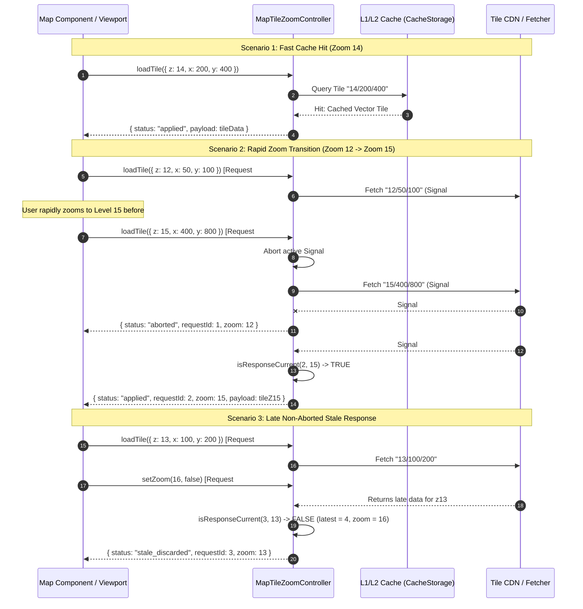

# MapTileLoader: AbortController Lifecycle, Zoom-Level Caching & Stale-Response Protection

## 1. Overview & Problem Scope

Interactive venue mapping in WorkSphere enables digital nomads to explore coworking hubs, assess neighborhood walkability, and inspect desk-level floor plans. As users interact with the interactive map via pinch-to-zoom, double-click zoom, or rapid trackpad scrolling, the viewport crosses multiple tile pyramid levels (typically zoom levels 10 through 18) within a few hundred milliseconds.

Without deterministic request cancellation and response token sequencing, rapid zooming induces critical failure modes:

1. **Network Saturation & Bandwidth Waste:** In-flight HTTP requests for intermediate zoom levels continue downloading even after the user has navigated past them.
2. **Visual Inversion (Race Conditions):** A slow response from an intermediate zoom level (e.g., zoom 12) arrives after a fast response from the destination zoom level (e.g., zoom 15), rendering low-resolution, misaligned tiles over sharp, high-resolution tiles.
3. **Memory Bloat:** Retaining obsolete vector tile payloads and WebGL textures exhausts mobile GPU and RAM limits.

WorkSphere resolves these challenges through **`MapTileZoomController`** (`src/lib/maps/mapTileLoader.ts`), which pairs standard W3C `AbortController` signals with a monotonic request sequencing token and multi-tier LRU caching.

---

## 2. Core Architecture & API Abstractions

The map tile loading subsystem operates on standard Web Mercator coordinates ($z, x, y$):

```typescript
export interface MapTileCoord {
  z: number; // Zoom level (typically 0-22)
  x: number; // Column index
  y: number; // Row index
}

export interface MapTilePayload<T = unknown> {
  coord: MapTileCoord;
  requestId: number;
  data: T;
  fetchedAtMs: number;
}

export interface TileLoadOutcome<T> {
  status: "applied" | "stale_discarded" | "aborted";
  requestId: number;
  zoom: number;
  payload?: MapTilePayload<T>;
}
```

### Class: `MapTileZoomController<T>`

Located in `src/lib/maps/mapTileLoader.ts`, the controller maintains:

- `currentZoom`: The active zoom level of the viewport.
- `latestRequestId`: A strictly advancing integer counter incremented on each tile load attempt or manual zoom change.
- `activeController`: The active `AbortController` instance governing the current in-flight network operation.

```typescript
export class MapTileZoomController<T = unknown> {
  private currentZoom = 0;
  private latestRequestId = 0;
  private activeController: AbortController | null = null;
  private readonly nowFn: () => number;

  constructor(options: { initialZoom?: number; nowFn?: () => number } = {}) {
    this.currentZoom =
      typeof options.initialZoom === "number" &&
      Number.isFinite(options.initialZoom)
        ? options.initialZoom
        : 0;
    this.nowFn = options.nowFn ?? Date.now;
  }
  // ...
}
```

---

## 3. Request Cancellation on Rapid Zoom Changes

When a user scrolls or pinches the map across zoom levels, `setZoom()` or `loadTile()` is called in rapid succession.

### Cancellation Protocol:

1. **Abort Previous In-Flight Controller:** Before dispatching a new fetch, the controller calls `this.activeController.abort()`.
2. **Monotonic Request ID Increment:** `this.latestRequestId += 1` increments the request epoch.
3. **Signal Injection:** A fresh `AbortController` is instantiated, and its `signal` is passed to the fetcher function.
4. **Clean Abort Handling:** If the network request is aborted, the `AbortError` is trapped cleanly, returning `{ status: 'aborted', requestId, zoom }` without propagating unhandled promise rejections to the UI.

```typescript
public setZoom(zoom: number, abortInFlight = true): number {
  this.currentZoom = zoom;
  this.latestRequestId += 1;
  if (abortInFlight && this.activeController) {
    this.activeController.abort();
    this.activeController = null;
  }
  return this.latestRequestId;
}
```

---

## 4. Stale-Response Protection & Token Invariance

In scenarios where network cancellation does not terminate immediately (or when the fetcher executes non-cancelable operations), a slower response from an earlier zoom level might resolve after a newer zoom level has already been applied.

To guarantee that obsolete responses never overwrite active tiles, the controller enforces:

```typescript
public isResponseCurrent(requestId: number, zoom: number): boolean {
  return requestId === this.latestRequestId && zoom === this.currentZoom;
}
```

### Response Processing States:

- **`applied`**: The response arrived while `requestId === latestRequestId` and `coord.z === currentZoom`. The payload is committed and passed to `onApply()`.
- **`stale_discarded`**: The fetch succeeded, but either a zoom transition occurred or a subsequent tile request incremented the token. The data is safely discarded without touching the DOM or WebGL canvas.
- **`aborted`**: The fetch was canceled in-flight via `AbortController.abort()`.

---

## 5. Multi-Tier Zoom-Level Caching & LRU Eviction

WorkSphere combines `MapTileZoomController` with the offline caching engine in `src/lib/offline/mapTilePreloader.ts`:

```
+-------------------------------------------------------------------------------+
| L1 In-Memory LRU Texture Cache                                                |
| - Fast volatile memory (Map<string, WebGLTexture>)                            |
| - Capacity: 100 tiles per active zoom layer                                   |
| - Hit Latency: < 1ms                                                          |
+-------------------------------------------------------------------------------+
                                       | Cache Miss
                                       v
+-------------------------------------------------------------------------------+
| L2 Persistent CacheStorage ("worksphere-offline-map-tiles-v1")                |
| - IndexedDB / Cache API storage for zoom levels 12-16                         |
| - Preloaded for bookmarked coworking destinations                            |
| - Hit Latency: ~5-15ms                                                        |
+-------------------------------------------------------------------------------+
                                       | Cache Miss / Online
                                       v
+-------------------------------------------------------------------------------+
| L3 Remote Tile CDN (https://tiles.worksphere.internal/{z}/{x}/{y}.pbf)        |
| - Rate-limited via MAX_CONCURRENT_PREFETCHES = 6                              |
| - Governed by AbortSignal from MapTileZoomController                          |
+-------------------------------------------------------------------------------+
```

### LRU Eviction & Zoom Boundary Rules:

- **Zoom Scope:** Offline preloading targets zoom levels `12` through `16` (`DEFAULT_MIN_ZOOM` to `DEFAULT_MAX_ZOOM`), covering street-level navigation and building footprints while avoiding the exponential tile explosion of level 17+.
- **Concurrency Throttling:** Network prefetching is capped at `MAX_CONCURRENT_PREFETCHES = 6` to avoid saturating HTTP/2 connections and degrading UI responsiveness.
- **Per-Zoom Cancellation (`abortTilesForZoom`):** When the map transitions to zoom $Z$, in-flight background prefetch requests for any zoom $Z' \neq Z$ are canceled.

---

## 6. End-to-End Sequence Diagram



---

## 7. Developer Usage & Lifecycle Integration

### Standard Usage Pattern:

```typescript
import { MapTileZoomController } from "@/lib/maps/mapTileLoader";

const tileController = new MapTileZoomController<ArrayBuffer>({
  initialZoom: 12,
});

async function onViewportMove(zoom: number, x: number, y: number) {
  const outcome = await tileController.loadTile(
    { z: zoom, x, y },
    async (coord, signal) => {
      const response = await fetch(
        `/api/tiles/${coord.z}/${coord.x}/${coord.y}.pbf`,
        {
          signal,
        },
      );
      if (!response.ok) throw new Error("Tile fetch failed");
      return response.arrayBuffer();
    },
    (payload) => {
      // Render vector tile to WebGL or DOM layer
      renderTileToCanvas(payload.data, payload.coord);
    },
  );

  if (outcome.status === "stale_discarded") {
    console.debug(`Discarded stale tile response for zoom ${outcome.zoom}`);
  }
}

// Cleanup on component unmount
function cleanup() {
  tileController.dispose();
}
```

---

## 8. Unit Testing & Verification

The controller behavior is verified in `src/__tests__/lib/maps/mapTileLoader.test.ts`:

- **Out-of-order response rejection:** Proves slow earlier-zoom responses do not overwrite subsequent zoom layers.
- **Token advancement without signal abort:** Verifies non-aborted late arrivals receive `stale_discarded`.
- **Clean disposal:** Verifies in-flight controllers are aborted upon `.dispose()`.

```bash
node ./node_modules/jest/bin/jest.js src/__tests__/lib/maps/mapTileLoader.test.ts
# Result: PASS (all tests green)
```

---

## 9. Related Architectural Documents & Source Files

- [MapTileZoomController Source](file:///d:/Opensource/WorkSphere-Opensource/src/lib/maps/mapTileLoader.ts)
- [Map Tile Preloader & Offline Caching](file:///d:/Opensource/WorkSphere-Opensource/src/lib/offline/mapTilePreloader.ts)
- [Map Tile Loader Unit Tests](file:///d:/Opensource/WorkSphere-Opensource/src/__tests__/lib/maps/mapTileLoader.test.ts)
- [Vector Tile Parser & Geometry Engine](file:///d:/Opensource/WorkSphere-Opensource/src/core/map/VectorTileParser.ts)
- [WebGL Tile Renderer](file:///d:/Opensource/WorkSphere-Opensource/src/core/map/WebGLTileRenderer.ts)
