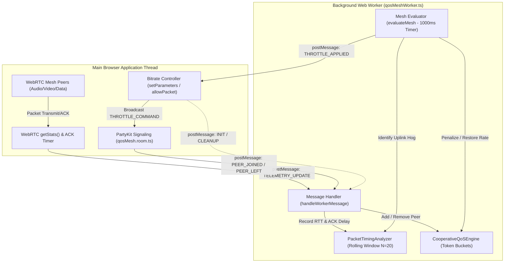
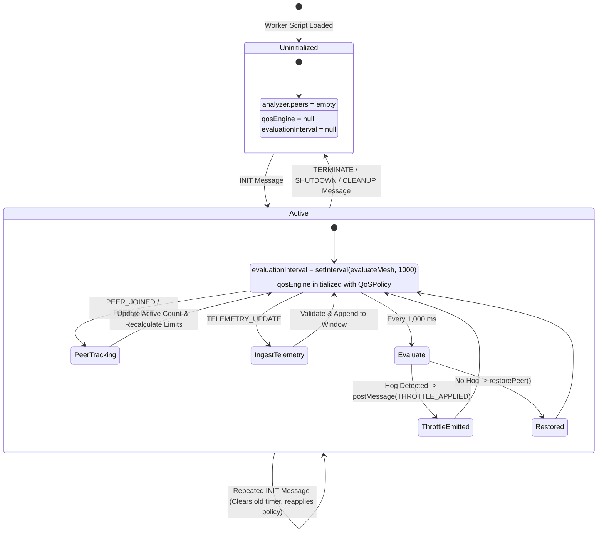
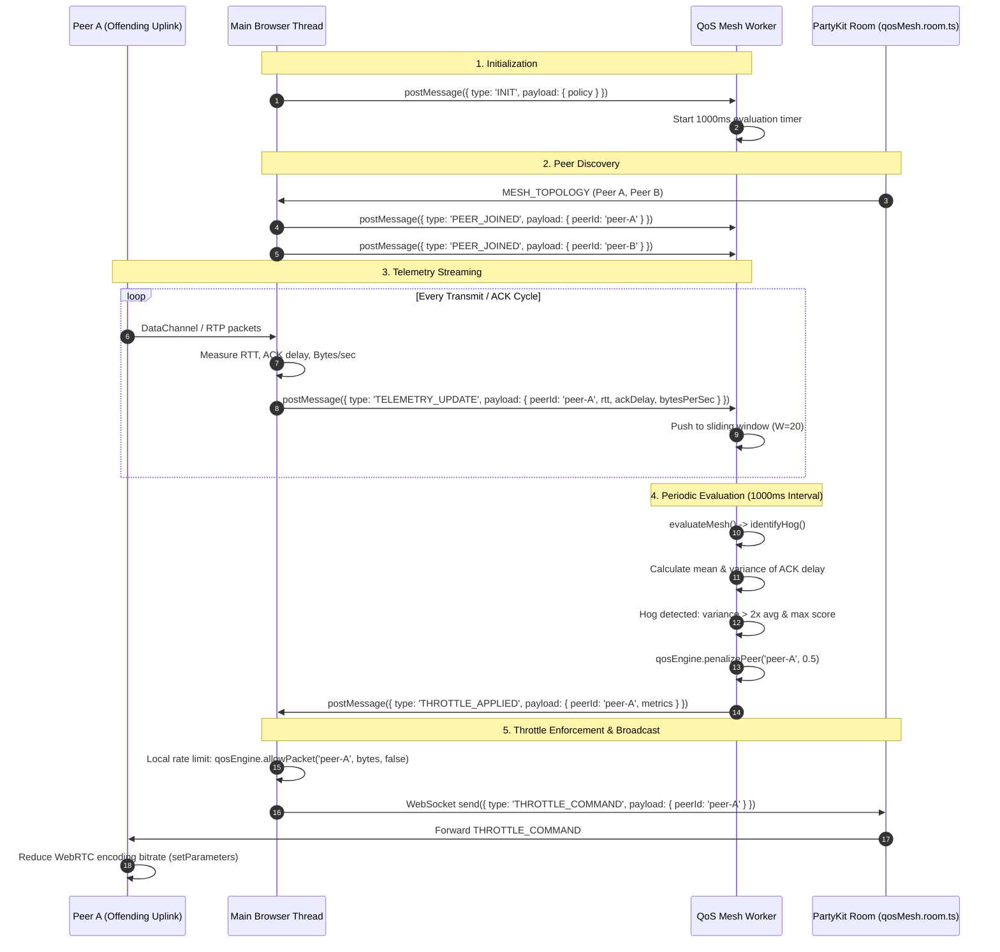

# QoS Mesh Worker Telemetry Pipeline & Cooperative Bandwidth Balancing Architecture Specification

This specification documents the architecture, packet timing telemetry pipeline, sliding-window algorithms, cooperative bandwidth balancing mechanisms, worker lifecycle, and browser runtime boundaries for the QoS Mesh Web Worker in WorkSphere.

- **Primary Worker Source:** [`src/workers/qosMeshWorker.ts`](../../src/workers/qosMeshWorker.ts)
- **Telemetry Analyzer:** [`src/core/network/PacketTimingAnalyzer.ts`](../../src/core/network/PacketTimingAnalyzer.ts)
- **Cooperative QoS Engine:** [`src/core/network/CooperativeQoSEngine.ts`](../../src/core/network/CooperativeQoSEngine.ts)
- **PartyKit Signaling Room:** [`src/party/qosMesh.room.ts`](../../src/party/qosMesh.room.ts)
- **Congestion Analytics Endpoint:** [`src/app/api/network/qos/route.ts`](../../src/app/api/network/qos/route.ts)
- **Unit & Regression Suites:**
  - [`src/__tests__/workers/qosMeshWorker.test.ts`](../../src/__tests__/workers/qosMeshWorker.test.ts)
  - [`src/__tests__/network/CooperativeQoS.test.ts`](../../src/__tests__/network/CooperativeQoS.test.ts)

---

## Table of Contents

1. [Architecture Overview](#1-architecture-overview)
2. [Worker Message Protocol](#2-worker-message-protocol)
3. [Packet Timing & Telemetry Pipeline](#3-packet-timing--telemetry-pipeline)
4. [Sliding-Window Algorithms & Variance Calculation](#4-sliding-window-algorithms--variance-calculation)
5. [Cooperative Bandwidth Balancing & Token Bucket Algorithm](#5-cooperative-bandwidth-balancing--token-bucket-algorithm)
6. [Worker Lifecycle, Configuration, & State Invariants](#6-worker-lifecycle-configuration--state-invariants)
7. [Browser Fallback & Power-Policy Boundaries](#7-browser-fallback--power-policy-boundaries)
8. [End-to-End Telemetry & Evaluation Flow](#8-end-to-end-telemetry--evaluation-flow)
9. [Performance, Scalability, & Resource Complexity](#9-performance-scalability--resource-complexity)
10. [Operational Troubleshooting & Known Limitations](#10-operational-troubleshooting--known-limitations)

---

## 1. Architecture Overview

### 1.1 Purpose of the QoS Mesh Worker

In peer-to-peer WebRTC collaborative topologies (such as multi-user audio, video, spatial presence, and state synchronization across coworking spaces), asymmetric uplink congestion on a single client can degrade real-time voice and data channel performance across the entire mesh. When a client's uplink saturates, local network buffers fill up (bufferbloat), creating erratic queuing delays, packet jitter, and elevated round-trip times (RTT).

The **QoS Mesh Worker** (`src/workers/qosMeshWorker.ts`) offloads continuous network telemetry evaluation from the browser's main JavaScript thread to a dedicated background Web Worker thread. By executing rolling statistical variance calculations and distributed fair-share rate allocations in the background, the application preserves 60 FPS UI rendering, WebGL canvas interactions, and real-time audio thread responsiveness.

### 1.2 Responsibilities: Worker vs. Main Thread

| Responsibility              | Main Browser Thread                                                                       | Background QoS Worker Thread (`qosMeshWorker.ts`)                                    |
| :-------------------------- | :---------------------------------------------------------------------------------------- | :----------------------------------------------------------------------------------- |
| **WebRTC Peer Connections** | Owns `RTCPeerConnection` instances, MediaStreams, and `RTCDataChannel`s.                  | None (WebRTC connection objects cannot be transferred across worker boundaries).     |
| **Raw Telemetry Sampling**  | Extracts transport stats (`getStats()`, packet transit timestamps, byte counters).        | None.                                                                                |
| **Telemetry Submission**    | Posts structured telemetry messages (`TELEMETRY_UPDATE`) to worker.                       | Ingests telemetry, sanitizes numeric values, and appends to sliding history windows. |
| **Mesh Membership**         | Detects peer joins/leaves via signaling (`PEER_JOINED`, `PEER_LEFT`).                     | Updates analyzer peer tracking and recalculates active peer counts.                  |
| **Statistical Analysis**    | None (spares main thread from variance computations).                                     | Computes rolling mean and sample variance across peer ACK delays every 1,000 ms.     |
| **Bandwidth Enforcement**   | Listens for `THROTTLE_APPLIED` and applies `RTCRtpSender.setParameters()` bitrate limits. | Updates local `TokenBucket` refill rates and calculates fair-share penalties.        |
| **Signaling Broadcast**     | Broadcasts `THROTTLE_COMMAND` to PartyKit room (`qosMesh.room.ts`) to alert peers.        | Dispatches `postMessage({ type: 'THROTTLE_APPLIED', ... })` to parent thread.        |

### 1.3 Architectural Assumptions & Scope

1. **Local Evaluation:** The worker analyzes incoming telemetry reported for mesh peers from the local node's perspective. It does not run a synchronized global Byzantine consensus protocol; each client independently observes delay variance and throttles offending uplinks.
2. **In-Memory Volatility:** Worker telemetry history and token buckets reside in volatile worker memory and reset upon page reload, navigation, or worker termination.
3. **Transport Independence:** The worker processes normalized milliseconds and bytes per second, operating independently of whether packets travel over WebRTC DataChannels, audio/video RTP tracks, or WebSocket relays.

### 1.4 Architecture Flow Diagram



---

## 2. Worker Message Protocol

Communication between the main browser thread and `qosMeshWorker` occurs via standard HTML5 structured-clone messaging (`postMessage`).

### 2.1 Protocol Request and Response Types

The worker implements message handling via `handleWorkerMessage`. The formal TypeScript protocol interfaces are defined below:

```typescript
// ==========================================
// Inbound Messages (Main Thread -> Worker)
// ==========================================

export interface QoSPolicy {
  maxBandwidthBps: number; // Venue/link capacity limit (bits/sec)
  voipReserveBps: number; // Bandwidth reserved for VoIP/Audio (bits/sec)
  fairShareFactor: number; // Ratio of equal share allocated to non-priority data (0.0 - 1.0)
}

export interface InitMessage {
  type: "INIT";
  payload?: {
    policy?: QoSPolicy;
  };
}

export interface PeerJoinedMessage {
  type: "PEER_JOINED";
  payload: {
    peerId: string;
  };
}

export interface PeerLeftMessage {
  type: "PEER_LEFT";
  payload: {
    peerId: string;
  };
}

export interface TelemetryUpdateMessage {
  type: "TELEMETRY_UPDATE";
  payload: {
    peerId: string;
    rtt?: number; // Round-trip time in milliseconds (>= 0)
    ackDelay?: number; // Packet transit to ACK delay in milliseconds (>= 0)
    bytesPerSec?: number; // Instantaneous upload throughput in bytes/second (>= 0)
  };
}

export interface LifecycleShutdownMessage {
  type: "TERMINATE" | "SHUTDOWN" | "CLEANUP";
}

export type QoSMeshWorkerRequest =
  | InitMessage
  | PeerJoinedMessage
  | PeerLeftMessage
  | TelemetryUpdateMessage
  | LifecycleShutdownMessage;

// ==========================================
// Outbound Messages (Worker -> Main Thread)
// ==========================================

export interface PeerMetrics {
  peerId: string;
  rttHistory: number[];
  ackDelayHistory: number[];
  bytesSentPerSec: number;
  isHog: boolean;
}

export interface ThrottleAppliedMessage {
  type: "THROTTLE_APPLIED";
  payload: {
    peerId: string;
    metrics: PeerMetrics[];
  };
}

export type QoSMeshWorkerResponse = ThrottleAppliedMessage;
```

### 2.2 Inbound Message Specifications

#### 1. `INIT`

- **Direction:** Main Thread $\to$ Worker
- **Purpose:** Initializes or reconfigures the `CooperativeQoSEngine` policy and starts the periodic 1,000 ms mesh evaluation interval.
- **Payload:** Optional `policy` object. If omitted, defaults to:
  - `maxBandwidthBps: 50_000_000` (50 Mbps)
  - `voipReserveBps: 5_000_000` (5 Mbps)
  - `fairShareFactor: 0.8` (80% fair share allocation)
- **Side Effects:** Idempotent. Clears any existing evaluation interval handle before scheduling a new 1-second recurring timer. Instantiates a new `CooperativeQoSEngine(policy)`.

#### 2. `PEER_JOINED`

- **Direction:** Main Thread $\to$ Worker
- **Purpose:** Registers a newly connected mesh participant.
- **Required Fields:** `payload.peerId: string`.
- **Side Effects:**
  - `analyzer.registerPeer(peerId)`: Initializes metric histories (`rttHistory: []`, `ackDelayHistory: []`, `bytesSentPerSec: 0`, `isHog: false`).
  - `qosEngine.addPeer(peerId)`: Increments `activePeers` count and recalculates fair-share limits across all token buckets.

#### 3. `PEER_LEFT`

- **Direction:** Main Thread $\to$ Worker
- **Purpose:** Deregisters a departing mesh participant.
- **Required Fields:** `payload.peerId: string`.
- **Side Effects:**
  - `analyzer.removePeer(peerId)`: Deletes peer metric tracking and evicts rolling histories.
  - `qosEngine.removePeer(peerId)`: Removes peer's token bucket, decrements `activePeers`, and recalculates fair-share limits.

#### 4. `TELEMETRY_UPDATE`

- **Direction:** Main Thread $\to$ Worker
- **Purpose:** Ingests instantaneous network delay and throughput samples for an active peer.
- **Required Fields:** `payload.peerId: string`.
- **Optional Fields:** `rtt?: number`, `ackDelay?: number`, `bytesPerSec?: number`.
- **Validation Rules:**
  - `peerId` must exist in `analyzer.peers`; otherwise, update is dropped.
  - Numbers must satisfy `isValidMeasurement(val)`: finite, non-negative numbers (`typeof val === "number" && Number.isFinite(val) && val >= 0`). Rejects `NaN`, `Infinity`, negative numbers, strings, and `null`.
- **Side Effects:** Appends samples to rolling windows (evicting oldest if window exceeds 20). Updates instantaneous `bytesSentPerSec`.

#### 5. `TERMINATE` / `SHUTDOWN` / `CLEANUP`

- **Direction:** Main Thread $\to$ Worker
- **Purpose:** Halts periodic evaluations and clears all in-memory telemetry state.
- **Side Effects:** Cancels evaluation interval (`clearInterval`), nullifies `qosEngine`, and clears all analyzer peer maps via `analyzer.reset()`.

### 2.3 Outbound Message Specifications

#### `THROTTLE_APPLIED`

- **Direction:** Worker $\to$ Main Thread
- **Trigger:** Generated during `evaluateMesh()` when `analyzer.identifyHog()` identifies a peer exceeding uplink variance thresholds.
- **Payload:**
  - `peerId: string`: Node ID of the identified bandwidth hog.
  - `metrics: PeerMetrics[]`: Full snapshot of all registered peers, their rolling histories, upload rates, and `isHog` statuses.
- **Main Thread Action:** Instructs WebRTC layer to throttle outbound packet generation or broadcasts `THROTTLE_COMMAND` via signaling to ask the offending remote peer to scale back its encoding bitrate.

### 2.4 Specification Alignment: Actual Implementation vs. RFC Proposals

> [!IMPORTANT]
> **Implementation Clarification:**
> The issue description referenced prospective message types such as `RECORD_TIMING`, `EVALUATE_QOS`, and `UPDATE_CONFIG`.
>
> In the actual WorkSphere codebase:
>
> - Packet timing is recorded via **`TELEMETRY_UPDATE`** (not `RECORD_TIMING`).
> - Peer membership is managed via **`PEER_JOINED`** and **`PEER_LEFT`**.
> - QoS evaluation is driven autonomously by an **internal 1,000 ms timer (`setInterval`)** inside the worker, rather than on-demand `EVALUATE_QOS` requests from the main thread.
> - Policy updates are performed by sending **`INIT`** with updated policy payloads.
> - Explicit shutdown is supported via **`TERMINATE`**, **`SHUTDOWN`**, or **`CLEANUP`**.

---

## 3. Packet Timing & Telemetry Pipeline

The telemetry pipeline is implemented in `PacketTimingAnalyzer` (`src/core/network/PacketTimingAnalyzer.ts`).

### 3.1 Collected Telemetry Metrics

```ts
export interface PeerMetrics {
  peerId: string;
  rttHistory: number[]; // Rolling RTT samples (ms)
  ackDelayHistory: number[]; // Rolling ACK delay samples (ms)
  bytesSentPerSec: number; // Upload throughput (bytes/sec)
  isHog: boolean; // Uplink saturation flag
}
```

1. **Round-Trip Time (`rtt`):** Measured in milliseconds. Tracks total network latency from packet dispatch to receiver response.
2. **ACK Delay (`ackDelay`):** Measured in milliseconds. The duration between local packet queuing/dispatch and arrival of the application-level acknowledgment.
   _Physical Significance:_ When a client's uplink saturates, operating system socket buffers and local router queues fill up (bufferbloat). ACK packets experience severe queuing delay variance, making ACK delay variance a reliable signature of uplink saturation.
3. **Upload Throughput (`bytesSentPerSec`):** Measured in bytes per second. Tracks raw egress data volume.

### 3.2 Numeric Validation Boundary

To prevent arithmetic poisoning (such as `NaN` cascading through variance calculations), all telemetry inputs are filtered through `isValidMeasurement`:

```typescript
public isValidMeasurement(val: number): boolean {
  return typeof val === "number" && Number.isFinite(val) && val >= 0;
}
```

Any sample containing `NaN`, `Infinity`, `-Infinity`, negative values, or incorrect types is rejected without modifying history buffers.

---

## 4. Sliding-Window Algorithms & Variance Calculation

### 4.1 Window Structure and Eviction Mechanics

The `PacketTimingAnalyzer` maintains a rolling, fixed-capacity sliding window of size $W = 20$ for each registered peer:

- **Data Structure:** Standard JavaScript arrays (`number[]`) for `rttHistory` and `ackDelayHistory`.
- **Capacity:** $W = 20$ samples.
- **Insertion & Eviction:**
  ```typescript
  peer.ackDelayHistory.push(delayMs);
  if (peer.ackDelayHistory.length > this.windowSize) {
    peer.ackDelayHistory.shift();
  }
  ```
- **Computational Complexity:**
  - Insertion / Eviction: $O(1)$ amortized.
  - Variance Calculation: $O(W)$ where $W \le 20$ (constant bounded execution time).

### 4.2 Statistical Variance Formula

For a sample history $X = [x_1, x_2, \dots, x_k]$ of length $k$:

$$\mu = \frac{1}{k} \sum_{i=1}^k x_i \quad \text{(Mean ACK Delay)}$$

$$\sigma^2 = \frac{1}{k} \sum_{i=1}^k (x_i - \mu)^2 \quad \text{(Population Variance)}$$

Implemented in `calculateVariance`:

```typescript
private calculateVariance(arr: number[]): number {
  if (arr.length === 0) return 0;
  const mean = arr.reduce((a, b) => a + b, 0) / arr.length;
  return arr.reduce((sum, val) => sum + Math.pow(val - mean, 2), 0) / arr.length;
}
```

### 4.3 Bandwidth Hog Detection Algorithm

Uplink saturation is identified by correlating statistical ACK delay variance with raw upload throughput.

#### Detection Criteria:

1. **Mesh Size Requirement:** $\text{peers.size} \ge 2$. (Single-peer topologies cannot produce an uplink comparison).
2. **Minimum History Requirement:** A peer must have accumulated at least $k \ge 5$ ACK delay samples to be eligible for variance evaluation.
3. **Baseline Calculation:** The average variance across all eligible peers is computed:
   $$\overline{\sigma^2} = \frac{1}{M} \sum_{j=1}^M \sigma_j^2 \quad (\text{where } M \text{ is the count of peers with } k \ge 5)$$
4. **Hog Scoring Function:** For each eligible peer, a correlation score is computed:
   $$\text{Score}_j = (\sigma_j^2 - \overline{\sigma^2}) \times \left(\frac{\text{bytesSentPerSec}_j}{100,000}\right)$$
5. **Threshold Invariant:** A peer is flagged as a bandwidth hog (`isHog = true`) if and only if:
   $$\sigma_j^2 > 2 \times \overline{\sigma^2} \quad \text{AND} \quad \text{Score}_j > \max_{i \ne j}(\text{Score}_i)$$

#### Hog Detection Pseudocode

```text
ALGORITHM IdentifyHog(peers)
  IF peers.count < 2 THEN RETURN null

  totalVariance <- 0
  validPeers <- 0

  FOR EACH peer IN peers DO
    IF peer.ackDelayHistory.length >= 5 THEN
      peerVariance <- CalculateVariance(peer.ackDelayHistory)
      totalVariance <- totalVariance + peerVariance
      validPeers <- validPeers + 1
    END IF
  END FOR

  IF validPeers = 0 THEN RETURN null
  avgVariance <- totalVariance / validPeers

  hogId <- null
  maxScore <- 0

  FOR EACH peer IN peers DO
    IF peer.ackDelayHistory.length < 5 THEN CONTINUE

    variance <- CalculateVariance(peer.ackDelayHistory)
    score <- (variance - avgVariance) * (peer.bytesSentPerSec / 100000)

    IF score > maxScore AND variance > (avgVariance * 2) THEN
      maxScore <- score
      hogId <- peer.peerId
      peer.isHog <- true
    ELSE
      peer.isHog <- false
    END IF
  END FOR

  RETURN hogId
END ALGORITHM
```

---

## 5. Cooperative Bandwidth Balancing & Token Bucket Algorithm

Bandwidth allocation is governed by `CooperativeQoSEngine` (`src/core/network/CooperativeQoSEngine.ts`).

### 5.1 Bandwidth Conversion Constants

Bitrate conversions must account for bit-to-byte ratios and millisecond time steps:

$$\text{BITS\_PER\_BYTE} = 8$$

$$\text{MS\_PER\_SECOND} = 1000$$

$$\text{BPS\_TO\_BYTES\_PER\_MS} = \text{BITS\_PER\_BYTE} \times \text{MS\_PER\_SECOND} = 8000$$

_Example:_ A 1,000,000 bps (1 Mbps) allocation translates to:
$$\frac{1,000,000 \text{ bps}}{8,000} = 125 \text{ bytes/ms} = 125,000 \text{ bytes/sec}$$

### 5.2 Token Bucket Implementation

Each peer has a dedicated `TokenBucket` tracking burstable byte consumption:

- **Bucket Capacity (`maxTokens`):** Defaults to $1,048,576$ bytes (1 MB burst allowance).
- **Refill Rate:** Dynamically set based on fair-share calculations.
- **Continuous Refill:** On every `consume(bytes)` invocation, tokens refill proportionally to elapsed real time:
  $$\Delta t = \max(0, \text{now} - \text{lastRefill})$$
  $$\text{tokens} \leftarrow \min\left(\text{maxTokens}, \; \text{tokens} + \Delta t \times \text{refillRateBytesPerMs}\right)$$

### 5.3 Fair-Share Calculation Formula

When $N_{\text{active}} > 0$ peers are present in the mesh:

$$R_{\text{available}} = \max(0, \; \text{maxBandwidthBps} - \text{voipReserveBps})$$

$$R_{\text{equal}} = \frac{R_{\text{available}}}{N_{\text{active}}}$$

$$R_{\text{fair}} = R_{\text{equal}} \times \text{fairShareFactor}$$

If $N_{\text{active}} = 0$, the fair rate defaults to `policy.maxBandwidthBps`.

### 5.4 Penalty & Restoration Mechanics

1. **Penalizing a Hog:**
   When `evaluateMesh()` detects an uplink hog, it calls:
   ```typescript
   qosEngine.penalizePeer(hogId, 0.5);
   ```
   The hog's token bucket refill rate is throttled to **50%** of the standard fair-share rate:
   $$R_{\text{throttled}} = R_{\text{fair}} \times 0.5$$
2. **Restoring Non-Hogs:**
   When an evaluation cycle detects no hog, any peer previously flagged as `isHog` is restored to standard fair-share:
   ```typescript
   qosEngine.restorePeer(peerId); // Resets bucket refill rate to R_fair
   ```
3. **VoIP Priority Bypass:**
   In `allowPacket(peerId, bytes, isPriority)`:
   - High-priority packets (`isPriority === true`, e.g., real-time audio) **bypass** the token bucket completely and are never throttled.
   - Non-priority packets (screen share, background data sync) must consume tokens from the peer's bucket. If tokens are insufficient, the packet is denied (`false`).

---

## 6. Worker Lifecycle, Configuration, & State Invariants

### 6.1 Lifecycle State Machine



### 6.2 Idempotent Initialization

Repeatedly posting `INIT` to the worker will **not** leak duplicate interval timers. `handleWorkerMessage` calls `stopEvaluation()` before scheduling:

```typescript
export function stopEvaluation(): void {
  if (evaluationInterval !== null) {
    if (
      typeof self !== "undefined" &&
      typeof self.clearInterval === "function"
    ) {
      self.clearInterval(evaluationInterval as any);
    } else if (typeof clearInterval === "function") {
      clearInterval(evaluationInterval as any);
    }
    evaluationInterval = null;
  }
}
```

This guarantees that exactly one evaluation cycle executes per second, regardless of how many times `INIT` is called.

### 6.3 State Cleanup Invariants

Upon receiving `TERMINATE`, `SHUTDOWN`, or `CLEANUP`:

- Periodic evaluation interval is cancelled (`stopEvaluation()`).
- `qosEngine` reference is set to `null`.
- `analyzer.reset()` clears all peer records, metrics histories, and hog flags.
- Submitting telemetry after termination is ignored.

---

## 7. Browser Fallback & Power-Policy Boundaries

### 7.1 Web Worker Availability & Initialization Fallback

In environments where Web Workers are restricted (e.g., Content Security Policy disallowing blob/data workers, strict iframe sandboxes, or legacy WebViews):

1. **Worker Failure Modes:**
   - Worker constructor throws `SecurityError` or `DOMException`.
   - Script fails to load asynchronously (`onerror` fires).
2. **Direct Module Import Fallback (Recommended Integration):**
   Because `PacketTimingAnalyzer` and `CooperativeQoSEngine` are structured as standalone, pure TypeScript classes, host applications can instantiate them directly on the main thread if `window.Worker` is unavailable:
   ```typescript
   // Fallback pattern if Web Worker cannot be spawned:
   import { PacketTimingAnalyzer } from "@/core/network/PacketTimingAnalyzer";
   import { CooperativeQoSEngine } from "@/core/network/CooperativeQoSEngine";

   const localAnalyzer = new PacketTimingAnalyzer();
   const localQoSEngine = new CooperativeQoSEngine(policy);
   ```

### 7.2 Browser Background Suspension & Power Policies

Modern desktop and mobile browsers (Chrome, Safari iOS, Firefox) apply aggressive power-saving and background tab throttling:

| Browser Condition                   | Effect on Main Thread                                                                    | Effect on QoS Web Worker                                                                               |
| :---------------------------------- | :--------------------------------------------------------------------------------------- | :----------------------------------------------------------------------------------------------------- |
| **Active Foreground Tab**           | Full execution (1,000 ms timers run on schedule).                                        | Full execution (1,000 ms timers run on schedule).                                                      |
| **Background / Minimized Tab**      | Timers throttled to $\ge 1,000 \text{ ms}$ or paused; `requestAnimationFrame` suspended. | Dedicated worker timers may be clamped (e.g., to 1,000 ms or throttled after 5 minutes of inactivity). |
| **Mobile Screen Lock / Sleep**      | Execution paused completely by OS kernel.                                                | Execution paused completely by OS kernel.                                                              |
| **Page Hidden / Visibility Change** | `document.visibilityState === "hidden"`.                                                 | WebRTC streams may continue; worker interval continues unless frozen by OS.                            |

> [!CAUTION]
> **No Immunity to Power Management:**
> Web Workers **cannot** prevent the host operating system from suspending processes when a mobile device locks or enters low-power sleep. When the browser resumes from suspension:
>
> - Timers may fire in rapid succession or exhibit timestamp gaps.
> - Because `PacketTimingAnalyzer` does not use wall-clock timestamps to evict samples (it uses a fixed-capacity FIFO queue of $W=20$), historical samples remain mathematically consistent without division-by-zero errors.

---

## 8. End-to-End Telemetry & Evaluation Flow

The following Mermaid sequence diagram illustrates the lifecycle interactions between WebRTC peers, the main browser thread, the background QoS worker, and the signaling room:



---

## 9. Performance, Scalability, & Resource Complexity

### 9.1 Computational and Memory Complexity

| Component                | Metric |   Complexity    | Description                                                                                                                 |
| :----------------------- | :----- | :-------------: | :-------------------------------------------------------------------------------------------------------------------------- |
| **Sample Ingestion**     | Time   |     $O(1)$      | Array `push` and conditional `shift` for $W \le 20$.                                                                        |
| **Sample Ingestion**     | Space  | $O(N \times W)$ | Storing 20 numeric samples per peer. For $N = 50$ peers, total history is $\approx 2,000$ floats ($\approx 16 \text{ KB}$). |
| **Mesh Evaluation**      | Time   | $O(N \times W)$ | Computing mean and variance across $N$ peers with window size $W=20$. For $N=20$, execution takes $< 0.1 \text{ ms}$.       |
| **Token Bucket Check**   | Time   |     $O(1)$      | Refill arithmetic and floating-point subtraction.                                                                           |
| **Token Bucket Storage** | Space  |     $O(N)$      | One `TokenBucket` instance per peer.                                                                                        |

### 9.2 Thread Overhead & IPC Frequency

- **Message Transfer Cost:** Telemetry messages pass simple JSON objects (`{ type, payload }`). Data sizes are $< 100$ bytes per update.
- **Recommended Sampling Rate:** Ingesting 5 to 10 telemetry updates per second per peer introduces negligible structured-clone serialization overhead ($< 1\%$ CPU utilization).
- **Batching Advice:** On mesh clusters exceeding 20 peers, main-thread telemetry collection should batch per-packet timings into aggregate 200 ms windows before posting to the worker.

---

## 10. Operational Troubleshooting & Known Limitations

### 10.1 Diagnostic Troubleshooting Matrix

| Symptom                                                      | Probable Cause                                                                              | Diagnostic & Resolution Steps                                                                                         |
| :----------------------------------------------------------- | :------------------------------------------------------------------------------------------ | :-------------------------------------------------------------------------------------------------------------------- |
| Worker throws `Uncaught ReferenceError: self is not defined` | Worker executed in non-worker environment (e.g. Node.js unit test without global polyfill). | Ensure test environments mock `global.self = global` or load via mock worker harness.                                 |
| `THROTTLE_APPLIED` never fires despite network congestion    | Insufficient telemetry samples accumulated ($k < 5$).                                       | `PacketTimingAnalyzer.identifyHog()` requires at least 5 ACK delay samples per peer before computing variance.        |
| `THROTTLE_APPLIED` never fires in 2-node mesh                | Fewer than 2 peers registered in analyzer.                                                  | Hog identification requires `peers.size >= 2` to compute relative baseline variance.                                  |
| Telemetry updates dropped silently                           | `peerId` was not registered via `PEER_JOINED`.                                              | Ensure `PEER_JOINED` is sent prior to sending `TELEMETRY_UPDATE`. Verify `analyzer.hasPeer(peerId)`.                  |
| Variance values become `NaN`                                 | Negative, non-numeric, or infinite telemetry submitted.                                     | Verify inputs against `isValidMeasurement`. Fixed in PR #10089: `PacketTimingAnalyzer` rejects `NaN`/negative inputs. |
| Duplicate evaluations / notification storm                   | Multiple `INIT` messages sent on connection retry.                                          | Verify interval deduplication. Fixed in PR #10087: worker clears existing intervals on repeated `INIT`.               |
| Non-priority packets rejected after peer disconnect          | Departed peer's token bucket remains active.                                                | Verify `PEER_LEFT` handling. Fixed in PR #10079: `removePeer` purges peer from active sets.                           |

### 10.2 Known Architectural Limitations

1. **Local Heuristic vs. Global Consensus:**
   - The worker evaluates uplink congestion from the local client's vantage point. It does not run a multi-party consensus round to confirm whether other peers observe identical congestion.
2. **Fixed Sliding Window Size:**
   - Window size is hardcoded to $W = 20$ samples. It cannot currently be reconfigured via `INIT` without modifying source code.
3. **No Automatic Worker Crash Recovery:**
   - The worker script does not monitor its own memory or restart itself if terminated by the browser. The parent application must attach an `onerror` handler to the `Worker` instance and re-instantiate if needed.
4. **Coarse Throttle Multiplier:**
   - The penalty applied to an offending peer is fixed at $0.5$ (50% reduction). Graduated or proportional backoff (e.g., additive increase / multiplicative decrease) is not currently implemented.
