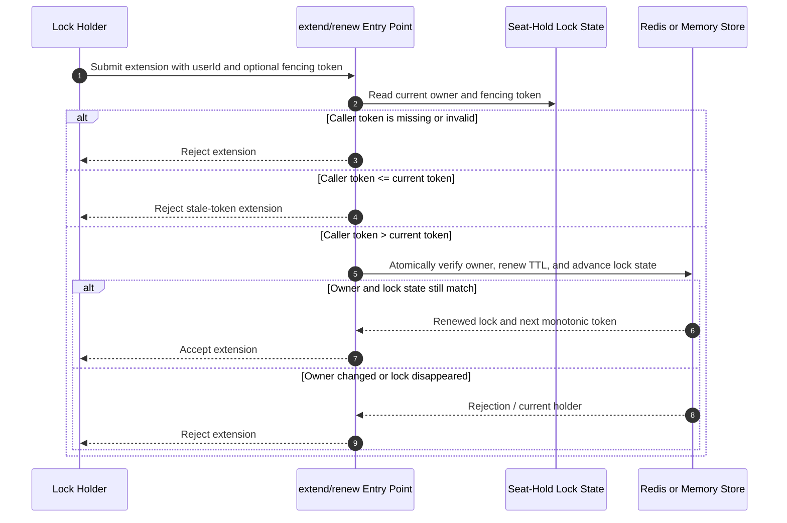

# Seat-Hold Monotonic Fence-Token Validation

This document describes fencing-token validation for seat-hold lock extensions in
[`src/lib/locks/seatHoldLock.ts`](../../src/lib/locks/seatHoldLock.ts).

## Scope

The current seat-hold implementation stores a fencing token in
`SeatLockData.fencingToken` and exposes `renewSeatWebLock` as its lock-extension
operation. The module does not currently export an `extendSeatHold` function,
and `renewSeatWebLock` does not accept a caller-supplied fencing token. It
renewals by acquiring or renewing the Redis lock for the owning `userId`.

This is distinct from the independent Redlock lease extension API in
`src/lib/redis/RedlockManager.ts`. The rules below therefore apply to the
monotonic seat-hold token invariant and to the lock state used by seat-hold
renewals; they must not be read as a claim that an unimplemented
`extendSeatHold(user, token)` API already exists.

## Fencing-token invariant

`nextMonotonicFencingToken(previousToken)` creates a `BigInt` token that is
strictly greater than the supplied token. It also advances an in-process
monotonic sequence so the result is greater than both:

- the process sequence's current value, and
- the previous token associated with the lock.

The token is serialized as a decimal string in `SeatLockData.fencingToken`.
For legacy lock data without this field, `assertLockLeaseValid` falls back to
`BigInt(lock.version || 1)`.

An extension that has the established, current lock token may preserve or
advance the lock while keeping the lock identity tied to the current holder.
For strict monotonic validation, a submitted fencing token is valid only when
it can be parsed as an integer and is greater than the token stored for the
current lock state:

```text
valid(token) = token is present and parseable
               AND token > currentStoredToken
```

## Valid, stale, and invalid tokens

| Input | Required result |
| --- | --- |
| Valid, greater token | The extension may proceed and publish the next monotonic token. |
| Stale token equal to the current token | Reject the extension. Equality is not "greater than," so replaying the current token must not renew the lease. |
| Stale token lower than the current token | Reject the extension. A delayed or replayed request from an older lock holder cannot renew the newer lock state. |
| Missing token | Reject the extension when a token-bearing extension API requires one. The token is also missing; absence must not be treated as zero or as a valid legacy token. |
| Invalid token | Reject the extension. Invalid decimal text or values that cannot be represented and compared as a bigint must not be parsed as a larger token. |

The not-greater rule matters because old lock holders can remain active after
their lease has expired or after another holder has obtained a newer lock.
Accepting a stale token would allow an old holder to update the current lease
or its TTL. Requiring `submittedToken > currentToken` gives the lock state a
total ordering and makes old holder requests identifiable.

## Current `renewSeatWebLock` behavior

`renewSeatWebLock` delegates to `acquireSeatWebLock`. The Redis Lua acquisition
script renews atomically only when the stored lock's `userId` matches the
requesting `userId`; a request from another user reports the existing holder
and does not renew that lock. Memory fallback renewals likewise proceed only
for the existing holder.

On a successful acquisition or renewal, the implementation creates a new
lock payload with an incremented `version` and a strictly monotonic
`fencingToken`:

```text
previous fencing token
    -> nextMonotonicFencingToken(previous)
    -> store decimal string in SeatLockData.fencingToken
```

This owner check prevents a different current user from extending the hold.
It does not currently implement caller-supplied stale-token comparison:
there is no `extendSeatHold` entry point or request parameter against which
to compare an old token.

## Sequence: lock renewal and token validation

The following flow shows the established seat-hold ownership renewal and the
extra validation that a token-bearing `extendSeatHold` implementation must
perform before accepting an extension.



For the implementation as it exists today, step 1 ends at
`renewSeatWebLock`/`acquireSeatWebLock` rather than at a caller-supplied token.
Its owner check and new-token generation provide the available renewal
semantics.

## Why stale holders cannot extend the active hold

A stale holder cannot be allowed to extend a newer hold merely by presenting a
retained lease. A stale token represents an older position in the fencing
order. Rejection when `submittedToken <= currentToken` ensures that:

1. An equal-token replay is not a fresh extension.
2. An older, lower-token request cannot overtake or renew newer lock state.
3. A delayed response from a displaced holder does not grant it another TTL.
4. State consumers can use the monotonically increasing token to disregard
   work or writes associated with older lock generations.
