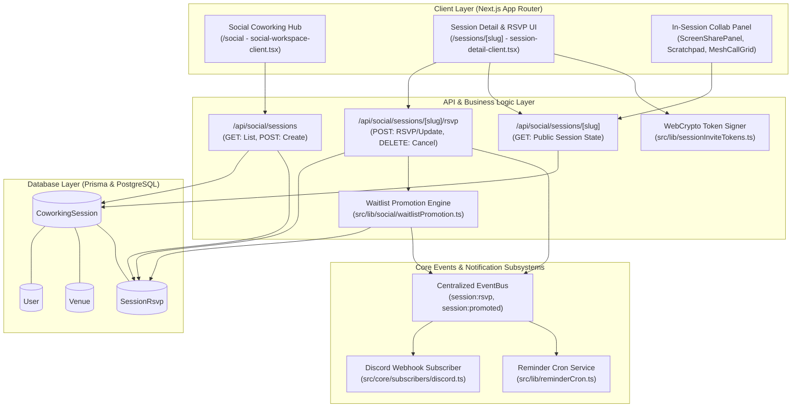
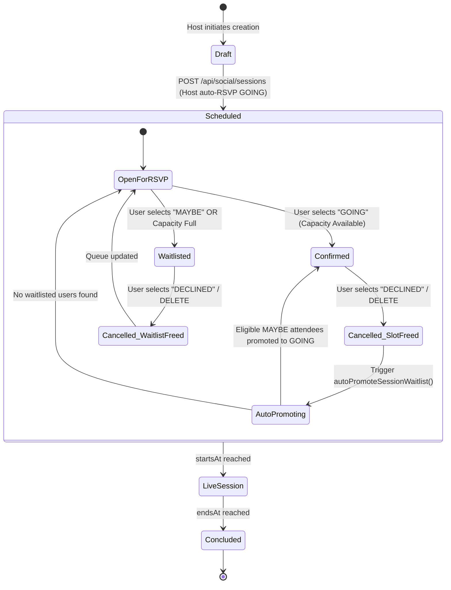
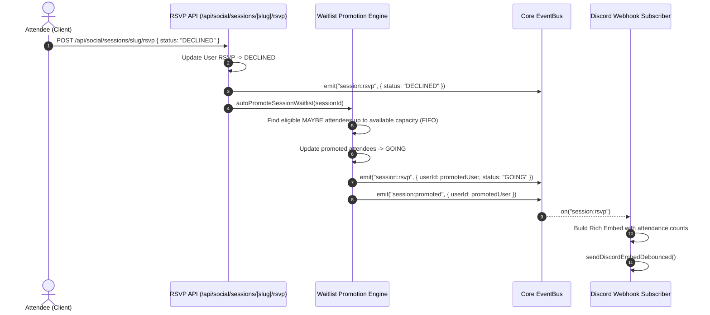

# Social Coworking Session RSVP Lifecycle, Waitlists & Host Moderation Architecture

## 1. Overview & System Goals

The **WorkSphere Social Coworking Sessions** system connects remote professionals and hybrid teams by transforming public and private workspaces into active, scheduled group coworking sessions. It enables members to discover upcoming sessions, RSVP with real-time capacity checks, join automated FIFO waitlists, and collaborate synchronously through WebRTC audio, screen sharing, and shared scratchpads.

### Core Pillars
- **Flexible RSVP Lifecycle:** Real-time state transitions between `GOING`, `MAYBE` (Waitlisted), and `DECLINED` / `CANCELLED`.
- **Automated Waitlist Auto-Promotion:** Instant FIFO promotion of waitlisted attendees when confirmed attendees cancel or when capacity increases.
- **Cryptographic Host Moderation & Invites:** WebCrypto HMAC-SHA256 signed invite tokens enforcing strict expiration, capacity caps, and timing-safe signature verification.
- **Decoupled Event Broadcasting:** EventBus-driven notifications for Discord webhooks, session reminders, and attendee status updates.
- **Synchronous In-Session Collaboration:** Seamless integration with live mesh audio (`MeshCallGrid`), WebRTC screen sharing (`ScreenSharePanel`), and CRDT scratchpads (`Scratchpad`).

---

## 2. High-Level Architecture Diagram



---

## 3. Database Schema & Relational Model

The social coworking subsystem is defined in `prisma/schema.prisma`:

```prisma
model CoworkingSession {
  id          String        @id @default(cuid())
  slug        String        @unique
  hostId      String
  host        User          @relation("SessionHost", fields: [hostId], references: [id], onDelete: Cascade)
  venueId     String
  venue       Venue         @relation(fields: [venueId], references: [id], onDelete: Cascade)
  title       String
  description String?
  startsAt    DateTime
  endsAt      DateTime
  maxGuests   Int?
  createdAt   DateTime      @default(now())
  updatedAt   DateTime      @updatedAt
  rsvps       SessionRsvp[]

  @@index([hostId])
  @@index([venueId])
  @@index([startsAt])
}

model SessionRsvp {
  id        String           @id @default(cuid())
  sessionId String
  session   CoworkingSession @relation(fields: [sessionId], references: [id], onDelete: Cascade)
  userId    String
  user      User             @relation(fields: [userId], references: [id], onDelete: Cascade)
  status    RsvpStatus       @default(GOING)
  createdAt DateTime         @default(now())
  updatedAt DateTime         @updatedAt

  @@unique([sessionId, userId])
  @@index([userId])
}

enum RsvpStatus {
  GOING
  MAYBE
  DECLINED
}
```

---

## 4. Session & RSVP Lifecycle State Machine



---

## 5. Automated Waitlist Auto-Promotion Engine

When an event specifies `maxGuests`, attendees who join after the capacity is reached or who indicate tentative interest receive the `MAYBE` status. The waitlist engine (`src/lib/social/waitlistPromotion.ts`) guarantees fair, deterministic FIFO order.

### 5.1 Promotion Trigger Rules
1. **Attendee RSVP Decline / Cancellation:** A user with status `GOING` updates their status to `DECLINED` or `MAYBE`, or deletes their RSVP via `DELETE /api/social/sessions/[slug]/rsvp`.
2. **Capacity Headroom Check:** Available slots are computed as `maxGuests - count(rsvps where status = GOING)`.
3. **FIFO Queue Selection:** The system queries `SessionRsvp` records where `sessionId = targetId` and `status = "MAYBE"`, ordered by `createdAt ASC` with a `take: availableSlots` limit.
4. **Atomic State Elevation & Event Dispatch:**
   - Updates `status` from `MAYBE` to `GOING`.
   - Dispatches `session:rsvp` to trigger Discord webhook embeds.
   - Dispatches `session:promoted` on `eventBus` for downstream audit logs and user notifications.

### 5.2 Implementation Reference

```typescript
export async function autoPromoteSessionWaitlist(
  sessionId: string,
): Promise<PromotionResult> {
  const session = await prisma.coworkingSession.findUnique({
    where: { id: sessionId },
    include: {
      _count: {
        select: { rsvps: { where: { status: "GOING" } } },
      },
    },
  });

  if (!session || !session.maxGuests) {
    return { promotedCount: 0, promotedRsvps: [] };
  }

  const currentGoing = session._count.rsvps;
  const availableSlots = session.maxGuests - currentGoing;
  if (availableSlots <= 0) return { promotedCount: 0, promotedRsvps: [] };

  const waitlisted = await prisma.sessionRsvp.findMany({
    where: { sessionId, status: "MAYBE" },
    orderBy: { createdAt: "asc" },
    take: availableSlots,
  });

  const promotedRsvps = [];
  for (const attendee of waitlisted) {
    const updated = await prisma.sessionRsvp.update({
      where: { id: attendee.id },
      data: { status: "GOING" },
    });

    promotedRsvps.push(updated);

    await eventBus.emit("session:rsvp", {
      sessionId: session.id,
      rsvpId: updated.id,
      userId: updated.userId,
      status: "GOING",
    });

    await eventBus.emit("session:promoted", {
      sessionId: session.id,
      rsvpId: updated.id,
      userId: updated.userId,
      previousStatus: "MAYBE",
    });
  }

  return { promotedCount: promotedRsvps.length, promotedRsvps };
}
```

---

## 6. Host Moderation & Cryptographic Invite Tokens

Hosts manage attendee access through public session pages or time-limited, tamper-evident private invite tokens implemented in `src/lib/sessionInviteTokens.ts`.

### 6.1 Cryptographic Token Architecture

```text
┌────────────────────────────────────────────────────────────────────────┐
│             WebCrypto HMAC-SHA256 Signed Invite Token                  │
├──────────────────────────────────────┬─────────────────────────────────┤
│ Base64Url(JSON Payload)              │ Base64Url(HMAC-SHA256 Signature)│
├──────────────────────────────────────┼─────────────────────────────────┤
│ {                                    │                                 │
│   "sessionId": "session-slug",       │ 256-bit cryptographically       │
│   "expiresAt": 1789012345678,        │ verified HMAC signature         │
│   "maxParticipants": 15,             │ using server secret             │
│   "nonce": "a1b2c3d4e5f6..."         │                                 │
│ }                                    │                                 │
└──────────────────────────────────────┴─────────────────────────────────┘
```

### 6.2 Validation Safeguards
- **Timing-Safe Verification:** Signature comparison uses constant-time byte-level comparison (`timingSafeEqual`) to prevent side-channel timing attacks.
- **Expiration Enforcement:** Tokens specify lifetime (default 24 hours). Expired tokens are rejected before database queries occur.
- **Capacity Caps:** When `maxParticipants` is encoded in the token, validation verifies current going count before authorizing access.

---

## 7. Decoupled Event Subsystem & Discord Integration

WorkSphere uses an asynchronous in-memory `EventBus` (`src/core/events.ts`) to decouple API operations from external notifications:



---

## 8. API Reference

All social coworking session endpoints are hosted under `/api/social/sessions`.

### 8.1 Authentication & Middleware Enforcement

WorkSphere utilizes Clerk for user authentication across session routes, combining edge-level middleware enforcement with route-level verification:

- **Middleware Boundary (`src/middleware.ts`):**
  All paths matching `/(api|trpc)(.*)` are evaluated by Clerk middleware unless specifically registered in `isPublicRoute`. Because `/api/social/*` is not registered as a public route, unauthenticated requests (those lacking a valid Clerk session token or cookie) are intercepted at the middleware layer before reaching any route handler. The middleware responds with an **HTTP 307 Temporary Redirect** to `/sign-in?redirect_url=<encoded_target_url>`.
- **Route-Level Handlers (`auth()`):**
  Mutation routes (`POST /api/social/sessions`, `POST /api/social/sessions/[slug]/rsvp`, and `DELETE /api/social/sessions/[slug]/rsvp`) explicitly evaluate `const { userId } = await auth();`. If `userId` is absent, the route handler immediately returns an **HTTP 401 Unauthorized** response:
  ```json
  { "error": "Authentication required" }
  ```
- **Read-Only Endpoints:**
  Read routes (`GET /api/social/sessions`, `GET /api/social/sessions/[slug]`, and `GET /api/social/sessions/[slug]/rsvp?download=ics`) rely on the middleware boundary for access enforcement and do not execute an explicit `auth()` check within the handler.

---

### 8.2 List Coworking Sessions (Discovery)

- **Endpoint:** `GET /api/social/sessions`
- **Auth:** Required via Clerk middleware (unauthenticated requests redirect to `/sign-in`)
- **Query Parameters:** None. The endpoint does not support query filtering, bounding-box search, or pagination (`take`/`skip`).
- **Query Behavior & Ordering:**
  - Retrieves sessions from the database ordered chronologically by `startsAt` in ascending order (`startsAt: "asc"`).
  - Includes related models:
    - `venue`: Full venue details.
    - `host`: Host user object selecting `id`, `firstName`, `lastName`, and `imageUrl`.
    - `rsvps`: Array of RSVP records ordered by `createdAt: "asc"`, with each RSVP including the attendee's `user` (`id`, `firstName`, `lastName`, and `imageUrl`).
    - `_count`: Object containing `rsvps` count (`_count: { select: { rsvps: true } }`).
  - **Important Semantics:**
    - The response is a **raw JSON array** (`CoworkingSession[]`), not wrapped in an envelope object (no `data` or `success` property).
    - `_count.rsvps` counts **all** existing RSVP records across every status (`GOING`, `MAYBE`, `DECLINED`), and does not represent only confirmed `GOING` attendees.
    - All recorded sessions are returned; past sessions are not filtered out at the query level.
- **Status Codes:**
  - `200 OK`: Array of coworking session objects.
  - `500 Internal Server Error`: `{"error":"Failed to fetch sessions"}` when a database query or server error occurs.

#### Example Request

```http
GET /api/social/sessions HTTP/1.1
Host: <your-workspace-host>
Cookie: __session=<session-token>
```

#### Example Response (`200 OK`)

_(Note: The list endpoint returns full Venue model records via `include: { venue: true }`. For documentation clarity, the venue object below is abbreviated to show illustrative fields rather than the complete Venue database schema.)_

```json
[
  {
    "id": "session_cuid_123",
    "slug": "fullstack-deep-work-sprint-k8f2a",
    "hostId": "user_clerk_host_101",
    "venueId": "venue_cuid_456",
    "title": "Fullstack Deep Work Sprint",
    "description": "Pair programming and async co-working session.",
    "startsAt": "2026-10-15T09:00:00.000Z",
    "endsAt": "2026-10-15T17:00:00.000Z",
    "maxGuests": 8,
    "createdAt": "2026-10-10T12:00:00.000Z",
    "updatedAt": "2026-10-10T12:00:00.000Z",
    "venue": {
      "id": "venue_cuid_456",
      "name": "Downtown Central Workspace",
      "address": "100 Market St, San Francisco, CA"
    },
    "host": {
      "id": "user_clerk_host_101",
      "firstName": "Alex",
      "lastName": "Rivera",
      "imageUrl": "https://img.clerk.com/host-avatar.png"
    },
    "rsvps": [
      {
        "id": "rsvp_cuid_001",
        "sessionId": "session_cuid_123",
        "userId": "user_clerk_host_101",
        "status": "GOING",
        "createdAt": "2026-10-10T12:00:00.000Z",
        "updatedAt": "2026-10-10T12:00:00.000Z",
        "user": {
          "id": "user_clerk_host_101",
          "firstName": "Alex",
          "lastName": "Rivera",
          "imageUrl": "https://img.clerk.com/host-avatar.png"
        }
      }
    ],
    "_count": {
      "rsvps": 1
    }
  }
]
```

---

### 8.3 Get Coworking Session Detail

- **Endpoint:** `GET /api/social/sessions/{slug}`
- **Auth:** Required via Clerk middleware (unauthenticated requests redirect to `/sign-in`)
- **Path Parameters:**
  - `slug` (string, required): Unique URL slug of the session.
- **Query Behavior & Projections:**
  - Queries a single session using `prisma.coworkingSession.findUnique({ where: { slug } })`.
  - Includes related models:
    - `venue`: Full venue details.
    - `host`: Host user object selecting `id`, `firstName`, and `lastName`. **Note:** Unlike the listing endpoint, the detail endpoint's host projection does **not** select `imageUrl`.
    - `rsvps`: Array of RSVP records ordered by `createdAt: "asc"`, with each attendee's `user` selecting `id`, `firstName`, `lastName`, and `imageUrl`.
  - **Note:** The detail response does **not** include the `_count` aggregation object.
  - Returns the session object directly without an outer data envelope.
- **Status Codes:**
  - `200 OK`: Coworking session object.
  - `404 Not Found`: `{"error":"Session not found"}` when no session matches the provided `slug`.

#### Example Request

```http
GET /api/social/sessions/fullstack-deep-work-sprint-k8f2a HTTP/1.1
Host: <your-workspace-host>
Cookie: __session=<session-token>
```

#### Example Response (`200 OK`)

_(Note: The detail endpoint includes the full Venue model record via `include: { venue: true }`. The venue object below is abbreviated to display illustrative fields.)_

```json
{
  "id": "session_cuid_123",
  "slug": "fullstack-deep-work-sprint-k8f2a",
  "hostId": "user_clerk_host_101",
  "venueId": "venue_cuid_456",
  "title": "Fullstack Deep Work Sprint",
  "description": "Pair programming and async co-working session.",
  "startsAt": "2026-10-15T09:00:00.000Z",
  "endsAt": "2026-10-15T17:00:00.000Z",
  "maxGuests": 8,
  "createdAt": "2026-10-10T12:00:00.000Z",
  "updatedAt": "2026-10-10T12:00:00.000Z",
  "venue": {
    "id": "venue_cuid_456",
    "name": "Downtown Central Workspace",
    "address": "100 Market St, San Francisco, CA"
  },
  "host": {
    "id": "user_clerk_host_101",
    "firstName": "Alex",
    "lastName": "Rivera"
  },
  "rsvps": [
    {
      "id": "rsvp_cuid_001",
      "sessionId": "session_cuid_123",
      "userId": "user_clerk_host_101",
      "status": "GOING",
      "createdAt": "2026-10-10T12:00:00.000Z",
      "updatedAt": "2026-10-10T12:00:00.000Z",
      "user": {
        "id": "user_clerk_host_101",
        "firstName": "Alex",
        "lastName": "Rivera",
        "imageUrl": "https://img.clerk.com/host-avatar.png"
      }
    }
  ]
}
```

---

### 8.4 Export Session Calendar iCalendar Event (`.ics`)

- **Endpoint:** `GET /api/social/sessions/{slug}/rsvp?download=ics`
- **Auth:** Required via Clerk middleware (unauthenticated requests redirect to `/sign-in`)
- **Path Parameters:**
  - `slug` (string, required): Session slug identifier.
- **Query Parameters:**
  - `download` (string, required): Must strictly equal `"ics"`. If this parameter is missing or set to any other value, the handler returns `404 Not Found` (`{"error":"Not found"}`).
- **iCalendar Generation & RFC 5545 Compliance:**
  - Calendar content is generated using `generateSessionIcs` (`src/lib/social/sessionIcs.ts`).
  - **Timestamps:** `DTSTAMP`, `DTSTART`, and `DTEND` are strictly formatted in UTC as `YYYYMMDDTHHmmssZ` (e.g., `20261015T090000Z`). No custom timezone parameter is accepted or supported.
  - **Line Endings:** RFC 5545 mandates CRLF (`\r\n`) line endings between properties.
  - **Text Escaping:** Special characters in `SUMMARY`, `DESCRIPTION`, and `LOCATION` (commas, semicolons, backslashes, and newlines) are escaped once per RFC 5545 (`\,`, `\;`, `\\`, `\n`).
  - **Event UID:** Generated deterministically as `session-${slug}@worksphere.app`.
  - **Location:** Constructed from venue name and address: `[venue.name, venue.address].filter(Boolean).join(", ")`, falling back to `"WorkSphere Coworking Space"`.
  - **Organizer:** If the host has a recorded name, included as `ORGANIZER;CN=<Host Name>:mailto:noreply@worksphere.app`.
- **Response Headers:**
  - `Content-Type: text/calendar; charset=utf-8`
  - `Content-Disposition: attachment; filename="<slug>.ics"`
- **Status Codes:**
  - `200 OK`: Raw iCalendar (`.ics`) file attachment.
  - `404 Not Found`:
    - `{"error":"Not found"}` if `?download=ics` query parameter is missing or invalid.
    - `{"error":"Session not found"}` if the session slug does not exist in the database.

#### Example Request

```http
GET /api/social/sessions/fullstack-deep-work-sprint-k8f2a/rsvp?download=ics HTTP/1.1
Host: <your-workspace-host>
Cookie: __session=<session-token>
```

#### Example Response (`200 OK`)

_(Note: Each line in the returned iCalendar body is delimited by CRLF `\r\n` line breaks per RFC 5545 specifications.)_

```text
HTTP/1.1 200 OK
Content-Type: text/calendar; charset=utf-8
Content-Disposition: attachment; filename="fullstack-deep-work-sprint-k8f2a.ics"

BEGIN:VCALENDAR
VERSION:2.0
PRODID:-//WorkSphere//SocialCoworkingSession//EN
CALSCALE:GREGORIAN
METHOD:PUBLISH
BEGIN:VEVENT
UID:session-fullstack-deep-work-sprint-k8f2a@worksphere.app
DTSTAMP:20261012T143000Z
DTSTART:20261015T090000Z
DTEND:20261015T170000Z
SUMMARY:Fullstack Deep Work Sprint
DESCRIPTION:Pair programming and async co-working session.
LOCATION:Downtown Central Workspace\, 100 Market St\, San Francisco\, CA
STATUS:CONFIRMED
ORGANIZER;CN=Alex Rivera:mailto:noreply@worksphere.app
END:VEVENT
END:VCALENDAR
```

---

### 8.5 Create Coworking Session

- **Endpoint:** `POST /api/social/sessions`
- **Auth:** Required (`await auth()`). Returns `401 Unauthorized` (`{"error":"Authentication required"}`) if unauthenticated.
- **Request Body (JSON):**
  - `title` (string, required): Session title.
  - `description` (string, optional): Session details or goals.
  - `venueId` (string, required): ID of an existing `Venue`.
  - `startsAt` (string, required): ISO-8601 start timestamp.
  - `endsAt` (string, required): ISO-8601 end timestamp.
  - `maxGuests` (number | string, optional): Maximum allowed confirmed attendee capacity (`GOING`).
- **Processing & Side Effects:**
  - Automatically synchronizes the Clerk user with the database via `ensureUserExists(userId)`.
  - Generates a unique URL slug based on the title plus a 5-character random alphanumeric suffix (`${baseSlug}-${randomSuffix}`).
  - Creates the `CoworkingSession` record in the database.
  - Automatically creates a `SessionRsvp` record with status `"GOING"` for the session host.
- **Status Codes:**
  - `200 OK`: Successfully created session object (includes `venue`, `host`, `rsvps`, and `_count.rsvps`).
  - `400 Bad Request`: `{"error":"Missing required fields"}` if `title`, `venueId`, `startsAt`, or `endsAt` is absent.
  - `401 Unauthorized`: `{"error":"Authentication required"}` if not authenticated.
  - `404 Not Found`: `{"error":"Venue not found"}` if `venueId` does not exist.
  - `500 Internal Server Error`: `{"error":"Failed to create session"}` on database creation failure.

#### Example Request

```http
POST /api/social/sessions HTTP/1.1
Host: <your-workspace-host>
Content-Type: application/json
Cookie: __session=<session-token>

{
  "title": "Fullstack Deep Work Sprint",
  "description": "Pair programming and async co-working session.",
  "venueId": "venue_cuid_456",
  "startsAt": "2026-10-15T09:00:00.000Z",
  "endsAt": "2026-10-15T17:00:00.000Z",
  "maxGuests": 8
}
```

#### Example Response (`200 OK`)

_(Note: The created session response includes full Venue model records via `include: { venue: true }`. The venue object below is abbreviated to display illustrative fields.)_

```json
{
  "id": "session_cuid_123",
  "slug": "fullstack-deep-work-sprint-k8f2a",
  "hostId": "user_clerk_host_101",
  "venueId": "venue_cuid_456",
  "title": "Fullstack Deep Work Sprint",
  "description": "Pair programming and async co-working session.",
  "startsAt": "2026-10-15T09:00:00.000Z",
  "endsAt": "2026-10-15T17:00:00.000Z",
  "maxGuests": 8,
  "createdAt": "2026-10-10T12:00:00.000Z",
  "updatedAt": "2026-10-10T12:00:00.000Z",
  "venue": {
    "id": "venue_cuid_456",
    "name": "Downtown Central Workspace",
    "address": "100 Market St, San Francisco, CA"
  },
  "host": {
    "id": "user_clerk_host_101",
    "firstName": "Alex",
    "lastName": "Rivera",
    "imageUrl": "https://img.clerk.com/host-avatar.png"
  },
  "rsvps": [
    {
      "id": "rsvp_cuid_001",
      "sessionId": "session_cuid_123",
      "userId": "user_clerk_host_101",
      "status": "GOING",
      "createdAt": "2026-10-10T12:00:00.000Z",
      "updatedAt": "2026-10-10T12:00:00.000Z",
      "user": {
        "id": "user_clerk_host_101",
        "firstName": "Alex",
        "lastName": "Rivera",
        "imageUrl": "https://img.clerk.com/host-avatar.png"
      }
    }
  ],
  "_count": {
    "rsvps": 1
  }
}
```

---

### 8.6 Submit or Update RSVP

- **Endpoint:** `POST /api/social/sessions/{slug}/rsvp`
- **Auth:** Required (`await auth()`). Returns `401 Unauthorized` (`{"error":"Authentication required"}`) if unauthenticated.
- **Path Parameters:**
  - `slug` (string, required): Session slug identifier.
- **Request Body (JSON):**
  - `status` (string, required): Case-insensitive. Accepted values: `"GOING"`, `"MAYBE"`, `"DECLINED"`, `"CANCELLED"`.
- **Status Normalization & Validation:**
  - Input strings are converted to uppercase.
  - Any status value outside the allowed set returns `400 Bad Request` (`{"error":"Invalid RSVP status"}`).
  - If the client submits `"CANCELLED"`, it is normalized to `"DECLINED"`.
- **Concurrency & Capacity Rules:**
  - Evaluated inside an interactive transaction with `Prisma.TransactionIsolationLevel.Serializable`.
  - **Capacity Condition:** Capacity enforcement activates when `session.maxGuests` evaluates to truthy and the target status is `"GOING"`.
    - The check evaluates current confirmed attendees: `session._count.rsvps` where `status = "GOING"`.
    - If `session._count.rsvps >= session.maxGuests` and the requesting user does not already hold a confirmed `"GOING"` RSVP for this session (`!existing || existing.status !== "GOING"`), the transaction aborts with error `SESSION_FULL`.
    - **Existing-GOING Exception:** An existing RSVP whose status is already `"GOING"` can submit `"GOING"` again without triggering the capacity rejection, even if confirmed attendance has reached or exceeded `session.maxGuests`.
    - Both capacity saturation (`SESSION_FULL`) and Prisma transaction serialization/write conflict errors (`P2034`) are mapped to `409 Conflict`:
      ```json
      { "error": "Session is full" }
      ```
- **Post-Transaction Effects & Calendar Payload:**
  - Emits `session:rsvp` event on `eventBus`.
  - **Waitlist Auto-Promotion:** If the user previously held status `"GOING"` and switched to a non-`GOING` status (`"MAYBE"` or `"DECLINED"`), `autoPromoteSessionWaitlist(sessionId)` is triggered to promote eligible `"MAYBE"` attendees in FIFO order up to available capacity.
  - **Calendar Object:**
    - If `status === "GOING"`: includes an inline `calendar` object:
      ```json
      "calendar": {
        "icsString": "BEGIN:VCALENDAR...",
        "downloadUrl": "/api/social/sessions/{slug}/rsvp?download=ics"
      }
      ```
    - If `status` is `"MAYBE"` or `"DECLINED"`: `calendar` is `null`.
    - **Note:** The calendar data is generated in-memory via `generateSessionIcs`; no external third-party calendar or payment services are contacted.
- **Status Codes:**
  - `200 OK`: RSVP submitted or updated successfully.
  - `400 Bad Request`: `{"error":"Invalid RSVP status"}`.
  - `401 Unauthorized`: `{"error":"Authentication required"}`.
  - `404 Not Found`: `{"error":"Session not found"}`.
  - `409 Conflict`: `{"error":"Session is full"}` (capacity reached or concurrent booking race condition).

#### Example Request

```http
POST /api/social/sessions/fullstack-deep-work-sprint-k8f2a/rsvp HTTP/1.1
Host: <your-workspace-host>
Content-Type: application/json
Cookie: __session=<session-token>

{
  "status": "GOING"
}
```

#### Example Response (`200 OK` - Confirmed Attendee)

```json
{
  "id": "rsvp_cuid_456",
  "sessionId": "session_cuid_123",
  "userId": "user_clerk_789",
  "status": "GOING",
  "createdAt": "2026-10-12T14:30:00.000Z",
  "updatedAt": "2026-10-12T14:30:00.000Z",
  "promotedWaitlist": [],
  "calendar": {
    "icsString": "BEGIN:VCALENDAR\r\nVERSION:2.0\r\nPRODID:-//WorkSphere//SocialCoworkingSession//EN\r\nCALSCALE:GREGORIAN\r\nMETHOD:PUBLISH\r\nBEGIN:VEVENT\r\nUID:session-fullstack-deep-work-sprint-k8f2a@worksphere.app\r\nDTSTAMP:20261012T143000Z\r\nDTSTART:20261015T090000Z\r\nDTEND:20261015T170000Z\r\nSUMMARY:Fullstack Deep Work Sprint\r\nDESCRIPTION:Pair programming and async co-working session.\r\nLOCATION:Downtown Central Workspace\\, 100 Market St\\, San Francisco\\, CA\r\nSTATUS:CONFIRMED\r\nORGANIZER;CN=Alex Rivera:mailto:noreply@worksphere.app\r\nEND:VEVENT\r\nEND:VCALENDAR",
    "downloadUrl": "/api/social/sessions/fullstack-deep-work-sprint-k8f2a/rsvp?download=ics"
  }
}
```

---

### 8.7 Cancel / Delete RSVP

- **Endpoint:** `DELETE /api/social/sessions/{slug}/rsvp`
- **Auth:** Required (`await auth()`). Returns `401 Unauthorized` (`{"error":"Authentication required"}`) if unauthenticated.
- **Path Parameters:**
  - `slug` (string, required): Session slug identifier.
- **Behavior & Deletion Semantics:**
  - Looks up session by `slug`. Returns `404 Not Found` (`{"error":"Session not found"}`) if missing.
  - Looks up the user's existing `SessionRsvp` record by `(sessionId, userId)`. Returns `404 Not Found` (`{"error":"RSVP not found"}`) if no record exists.
  - **Record Deletion:** Permanently deletes the `SessionRsvp` record from PostgreSQL via `prisma.sessionRsvp.delete`. This is a database record deletion, **not** a status update to `DECLINED`.
  - Dispatches `session:rsvp` event on `eventBus` with `status: "DECLINED"`.
  - **Waitlist Promotion Trigger:**
    - If the deleted RSVP previously had status `"GOING"` (`wasGoing === true`), automatically executes `autoPromoteSessionWaitlist(session.id)`. Any eligible `"MAYBE"` attendees promoted to `"GOING"` (up to available capacity) are returned in the `promotedWaitlist` array.
    - If the deleted RSVP had a status other than `"GOING"` (such as `"MAYBE"` or `"DECLINED"`), `autoPromoteSessionWaitlist` is **not** called, and `promotedWaitlist` returns an empty array `[]`.
- **Status Codes:**
  - `200 OK`: RSVP successfully deleted.
  - `401 Unauthorized`: `{"error":"Authentication required"}`.
  - `404 Not Found`:
    - `{"error":"Session not found"}` if the session does not exist.
    - `{"error":"RSVP not found"}` if the user has no RSVP for this session.

#### Example Request

```http
DELETE /api/social/sessions/fullstack-deep-work-sprint-k8f2a/rsvp HTTP/1.1
Host: <your-workspace-host>
Cookie: __session=<session-token>
```

#### Example Response (`200 OK`)

```json
{
  "success": true,
  "message": "RSVP cancelled successfully",
  "promotedWaitlist": [
    {
      "id": "rsvp_cuid_789",
      "userId": "user_promoted_101",
      "sessionId": "session_cuid_123",
      "status": "GOING"
    }
  ]
}
```

---

### 8.8 Waitlist Promotion Mechanics & Concurrency Guarantees

Automated waitlist promotion is implemented in `src/lib/social/waitlistPromotion.ts` via `autoPromoteSessionWaitlist(sessionId)`.

- **Database Queue Model:**
  In `prisma/schema.prisma`, `enum RsvpStatus` defines only `GOING`, `MAYBE`, and `DECLINED`. There is no separate `WAITLISTED` enum in the database. Attendees with status `MAYBE` serve as the FIFO waitlist promotion queue.
- **Serializable Transaction:**
  The promotion process runs inside an interactive transaction with `Prisma.TransactionIsolationLevel.Serializable` and a 10,000 ms timeout to prevent concurrency anomalies when multiple attendees cancel or modify RSVPs simultaneously.
- **Headroom Calculation & Batch Promotion:**
  - The transaction queries `session._count.rsvps` where `status = "GOING"`.
  - If `session.maxGuests` is not configured, promotion is bypassed (`{ promotedCount: 0, promotedRsvps: [] }`).
  - Available capacity is calculated as:
    ```text
    availableSlots = session.maxGuests - currentGoing
    ```
  - If `availableSlots <= 0`, no promotions occur.
  - When `availableSlots > 0`, the transaction queries candidate attendees:
    ```typescript
    const waitlistedAttendees = await tx.sessionRsvp.findMany({
      where: { sessionId, status: "MAYBE" },
      orderBy: { createdAt: "asc" },
      take: availableSlots,
    });
    ```
  - Strict FIFO order is guaranteed by `orderBy: { createdAt: "asc" }`.
  - Multiple eligible attendees can be promoted up to `availableSlots`, not merely a single attendee.
- **Atomic Compare-and-Swap:**
  To guarantee that no attendee is promoted twice or elevated concurrently under race conditions, the engine executes a conditional update:
  ```typescript
  const updateResult = await tx.sessionRsvp.updateMany({
    where: {
      id: attendee.id,
      status: "MAYBE",
      sessionId,
    },
    data: { status: "GOING" },
  });
  ```
  Only records that successfully transition (`updateResult.count > 0`) are appended to `promotedRsvps`.
- **Asynchronous Event Dispatch:**
  After the transaction successfully commits, the engine iterates over all promoted RSVPs and dispatches event bus notifications outside the transaction boundary:
  - `eventBus.emit("session:rsvp", { sessionId, rsvpId, userId, status: "GOING" })`
  - `eventBus.emit("session:promoted", { sessionId, rsvpId, userId, previousStatus: "MAYBE" })`
