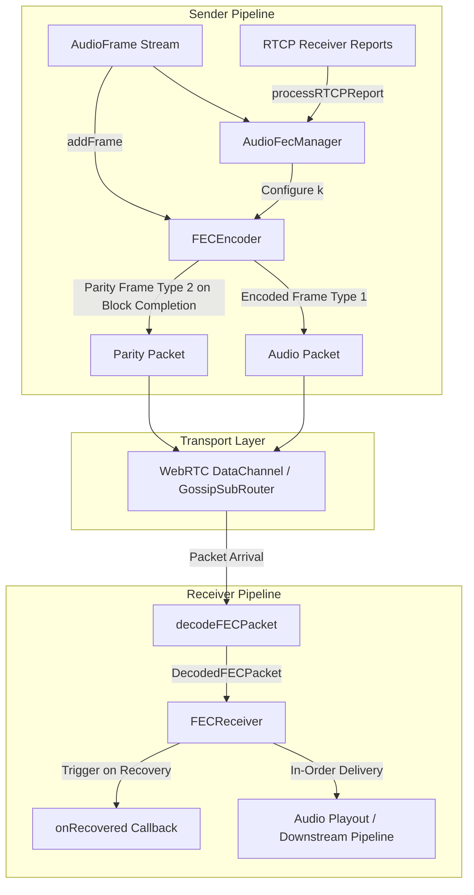
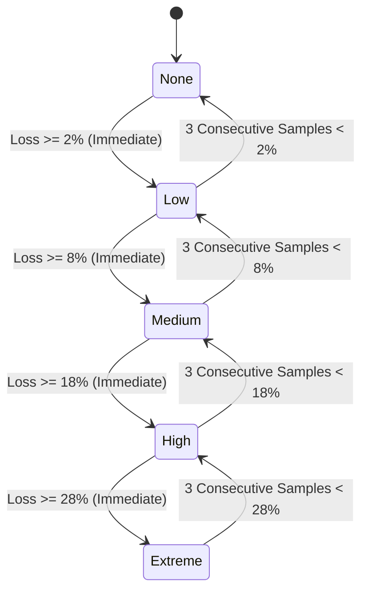
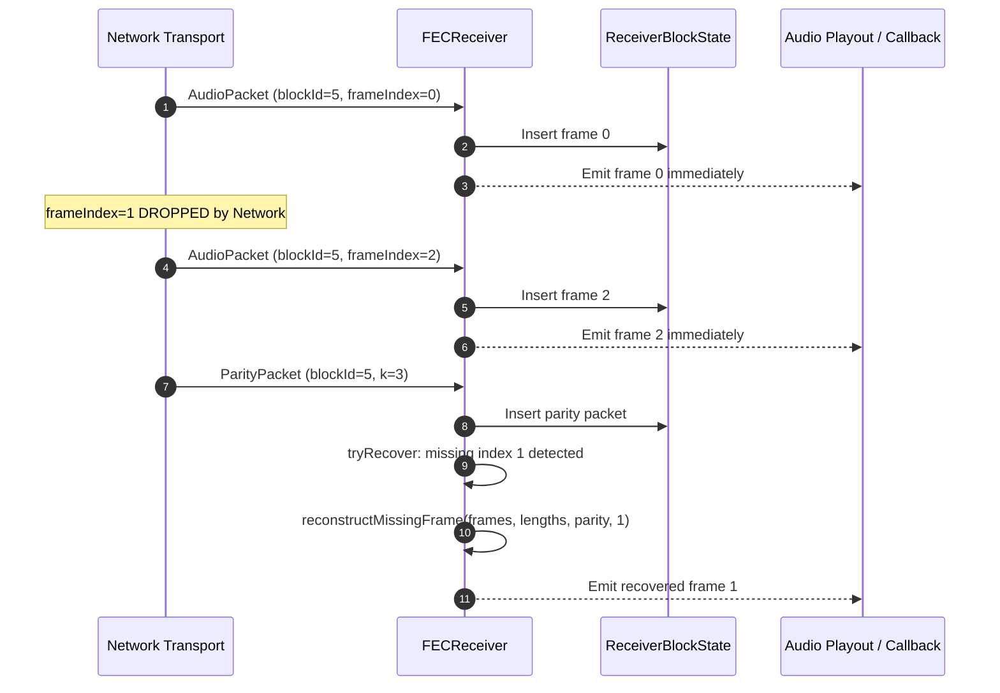
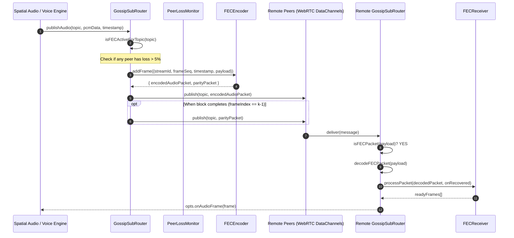

# WorkSphere Audio Forward Error Correction (FEC) Specification

**Document Version:** 1.0.0
**Target Module:** `src/core/audio/AudioFecManager.ts` & `src/core/p2p/AudioFEC.ts`
**Tracking Issues:** #8006, #8019, #7948
**Applicability:** Real-time WebRTC mesh audio streams, GossipSub P2P audio dissemination, lossy channel recovery

---

## 1. Overview and Goals

Real-time interactive voice communication across peer-to-peer (P2P) WebRTC mesh topologies presents unique networking challenges. Heterogeneous wireless links (Wi-Fi, LTE, 5G), network congestion, and transient routing delays frequently induce packet drop bursts. Traditional automatic repeat request (ARQ) retransmission protocols incur round-trip latency ($1 \times \text{RTT}$ to $2 \times \text{RTT}$) that exceeds conversational interactive latency thresholds ($<150\text{ ms}$), causing audible stutter, robotic clipping, and speech unintelligibility.

To achieve robust real-time audio delivery without retransmission delays, WorkSphere implements an **Adaptive Forward Error Correction (FEC)** system composed of:

1. **`src/core/audio/AudioFecManager.ts` (alias to `src/core/p2p/AudioFecManager.ts`)**:
   - Manages adaptive redundancy tiers based on incoming RTCP receiver reports (fraction lost, interarrival jitter, round-trip time).
   - Dynamically reconfigures block sizes and redundancy ratios to match network stress.
   - Provides anti-flapping hysteresis during network recovery to avoid frequent tier thrashing.
   - Embeds a simulation engine for lossy channel evaluation and intelligibility verification.

2. **`src/core/p2p/AudioFEC.ts`**:
   - Provides binary wire encapsulation and serialization for audio and parity packets.
   - Implements Galois Field $\mathrm{GF}(2)$ bitwise XOR parity encoding over blocks of $k$ source frames.
   - Performs exact algebraic payload reconstruction for any single dropped frame within a block.
   - Houses a de-jitter playout receiver buffer with stale block expiration and duplicate suppression.
   - Tracks peer-level WebRTC cumulative packet loss statistics.

### Design Goals

- **Zero Retransmission Latency**: Lost frames within a block are recovered at the receiver upon arrival of the parity packet without sending negative acknowledgments (NACKs).
- **Lightweight Algebraic Encoding**: Employs $\mathrm{GF}(2)$ XOR parity groups requiring no polynomial division or lookup tables, ensuring sub-microsecond CPU overhead on browser main/worker threads.
- **Dynamic Link Adaptation**: Continuously adjusts redundancy overhead from $0\%$ (clean network) up to $50\%$ (heavy loss) according to smoothed RTCP feedback.
- **Variable Length Support**: Correctly protects variable-bitrate (VBR) audio frames (such as Opus) by transmitting explicit length metadata and zero-padding shorter frames during parity generation.

---

## 2. Existing Architecture

The audio FEC subsystem is structured across three core layers:



### Module Responsibilities

| Class / Component | Source File | Responsibility |
|---|---|---|
| `AudioFecManager` | `src/core/p2p/AudioFecManager.ts` | Orchestrates dynamic adaptation, maintains Exponential Moving Averages (EMA) of network metrics, computes tier transitions, and exposes recovery simulation. |
| `ParityMatrixGenerator` | `src/core/p2p/AudioFecManager.ts` | Static utility mapping redundancy tiers to parity generator configurations $(k, m, R)$ and generating parity byte buffers. |
| `FECEncoder` | `src/core/p2p/AudioFEC.ts` | Accumulates audio frames into blocks of size $k$, assigns sequential block IDs and frame indices, serializes Type 1 packets, and emits Type 2 parity packets upon block closure. |
| `FECReceiver` | `src/core/p2p/AudioFEC.ts` | Stream-keyed state machine managing de-jitter and recovery buffers (`ReceiverBlockState`), tracking received/missing frames, executing XOR reconstruction, and pruning expired blocks ($2000\text{ ms}$). |
| `PeerLossMonitor` | `src/core/p2p/AudioFEC.ts` | Inspects raw counters (`packetsLost`, `packetsSent`/`packetsReceived`) from `RTCPeerConnection.getStats()`, calculates sampling interval loss ratios, and toggles binary FEC activation ($>5\%$ activate, $0\%$ deactivate). |
| `GossipSubRouter` | `src/core/p2p/GossipSubRouter.ts` | Integration bridge routing audio across peer meshes, hosting per-peer monitors and receivers, and embedding FEC framing into GossipSub publish/deliver flows. |

---

## 3. Terminology and Packet Model

### 3.1 Terminology

- **Source Frame ($D_i$)**: A raw audio chunk (typically Opus or PCM audio payload) produced by the capture pipeline at a fixed interval (e.g., $20\text{ ms}$).
- **FEC Block**: An ordered set of $k$ source frames protected by $m = 1$ parity packet.
- **Block Size ($k$)**: Number of consecutive source audio frames forming an encoding block ($k \in [2, 10]$ in active tiers, default $k = 4$, max $16$).
- **Parity Packet ($P$)**: A synthetic redundant packet generated by bitwise XOR sum over all $k$ source payloads in the block.
- **Redundancy Ratio ($R$)**: The overhead ratio defined as $R = \frac{m}{k} = \frac{1}{k}$.

### 3.2 Wire Packet Representation

Every FEC-encapsulated packet begins with a deterministic header enabling rapid discrimination from legacy raw Opus/PCM audio buffers without protocol ambiguity.

```
+---------------+---------------+---------------+-------------------+
|  MAGIC (0xFE) |  VERSION (1)  |   TYPE (1B)   | STREAM_ID_LEN(1B) |
+---------------+---------------+---------------+-------------------+
|                     STREAM_ID (UTF-8, 1-255B)                     |
+-------------------------------------------------------------------+
|                      TYPE-SPECIFIC FIELDS                         |
|                              ...                                  |
+-------------------------------------------------------------------+
|                            PAYLOAD                                |
+-------------------------------------------------------------------+
```

#### Protocol Constants
- `FEC_MAGIC_BYTE = 0xFE` ($254$)
- `FEC_PROTOCOL_VERSION = 1`
- `MAX_FEC_BLOCK_SIZE = 16`
- `MAX_FEC_PAYLOAD_BYTES = 65536` ($64\text{ KB}$)
- `FEC_EXPIRATION_TIMEOUT_MS = 2000` ($2\text{ seconds}$)

#### Type 1: Encapsulated Audio Frame (`AudioPacketType.AudioWithFEC = 1`)

Header length: $4 + \text{streamIdLen} + 22$ bytes.

| Offset / Field | Type | Encoding | Description |
|---|---|---|---|
| `0x00` | `uint8` | `0xFE` | Magic prefix byte. |
| `0x01` | `uint8` | `0x01` | Protocol version (`FEC_PROTOCOL_VERSION`). |
| `0x02` | `uint8` | `0x01` | Wire packet type (`AudioWithFEC`). |
| `0x03` | `uint8` | Unsigned 8-bit | Length of `streamId` string in bytes ($1 \le L \le 255$). |
| `0x04 .. 0x04+L-1` | `bytes` | UTF-8 | Unique audio stream identifier. |
| `+0 .. +3` | `uint32` | Big-Endian | Block identifier (`blockId`), monotonic counter. |
| `+4` | `uint8` | Unsigned 8-bit | Block size $k$ ($2 \le k \le 16$). |
| `+5` | `uint8` | Unsigned 8-bit | Frame index within the block ($0 \le \text{frameIndex} < k$). |
| `+6 .. +9` | `uint32` | Big-Endian | Global monotonic frame sequence number (`frameSeq`). |
| `+10 .. +17` | `uint64` | Big-Endian | Millisecond timestamp ($4\text{ bytes high} + 4\text{ bytes low}$). |
| `+18 .. +21` | `uint32` | Big-Endian | Payload byte length ($N$). |
| `+22 .. +22+N-1` | `bytes` | Binary | Raw audio payload (Opus / PCM). |

#### Type 2: Parity Packet (`AudioPacketType.FECParity = 2`)

Header length: $4 + \text{streamIdLen} + 17 + 2 \times k + 4$ bytes.

| Offset / Field | Type | Encoding | Description |
|---|---|---|---|
| `0x00` | `uint8` | `0xFE` | Magic prefix byte. |
| `0x01` | `uint8` | `0x01` | Protocol version (`FEC_PROTOCOL_VERSION`). |
| `0x02` | `uint8` | `0x02` | Wire packet type (`FECParity`). |
| `0x03` | `uint8` | Unsigned 8-bit | Length of `streamId` string in bytes ($1 \le L \le 255$). |
| `0x04 .. 0x04+L-1` | `bytes` | UTF-8 | Audio stream identifier. |
| `+0 .. +3` | `uint32` | Big-Endian | Associated `blockId`. |
| `+4` | `uint8` | Unsigned 8-bit | Block size $k$. |
| `+5 .. +8` | `uint32` | Big-Endian | Base frame sequence number (`baseSeq` = sequence of frame $0$). |
| `+9 .. +16` | `uint64` | Big-Endian | Block timestamp (timestamp of final frame). |
| `+17 .. +17+2k-1` | `uint16[k]` | Big-Endian array | Array of exact payload byte lengths for each frame $0 \dots k-1$. |
| `+offset .. +offset+3` | `uint32` | Big-Endian | Parity payload byte length ($M = \max(\text{lengths})$). |
| `+offset+4 ..` | `bytes` | Binary | Parity payload ($\bigoplus_{i=0}^{k-1} D_i$). |

---

## 4. FEC Encoding Algorithm

The sender utilizes `FECEncoder` to buffer incoming frames until a block reaches capacity $k$:

1. When `addFrame(frame)` is invoked, `frameIndex = currentFrames.length`.
2. The audio frame is serialized immediately with header `[blockId, blockSize, frameIndex, frameSeq, timestamp]` and emitted as `encodedAudioPacket`.
3. The frame is added to `currentFrames`.
4. If `currentFrames.length < blockSize`:
   - `parityPacket` returns `null`.
   - The audio packet is sent over the network immediately, introducing zero sender buffering delay for regular audio frames.
5. If `currentFrames.length === blockSize`:
   - Parity payload is generated using `computeXORParity`:
     \[
     P[j] = \bigoplus_{i=0}^{k-1} D_i[j] \quad \text{for } 0 \le j < \max_i(\text{len}(D_i))
     \]
     where $D_i[j] = 0$ if $j \ge \text{len}(D_i)$.
   - `frameLengths` array $[ \text{len}(D_0), \text{len}(D_1), \dots, \text{len}(D_{k-1}) ]$ is compiled into `FECParityMetadata`.
   - Parity packet is serialized via `encodeFECParityPacket` and returned.
   - The encoder advances `currentBlockId = (currentBlockId + 1) >>> 0` and clears `currentFrames = []`.

---

## 5. Mathematical Matrix Specification

### 5.1 Galois Field Representation

The system operates strictly over the Galois Field $\mathrm{GF}(2)$, whose elements are the bits $\{0, 1\}$. In $\mathrm{GF}(2)$:
- Addition ($+$) and subtraction ($-$) correspond to bitwise exclusive OR ($\oplus$).
- Multiplication ($\cdot$) corresponds to bitwise logical AND ($\land$).

The implementation uses **systematic single-parity check group encoding**. It deliberately does **not** employ a multi-error Reed-Solomon Vandermonde generator matrix over $\mathrm{GF}(2^8)$ or Cauchy distribution matrices. The mathematical properties reflect single-parity block coding.

### 5.2 Systematic Generator Matrix

Let a block consist of $k$ source audio frame vectors:
\[
D = \begin{bmatrix} D_0 \\ D_1 \\ \vdots \\ D_{k-1} \end{bmatrix} \in \mathrm{GF}(2)^{k \times L}
\]
where $L = \max_{0 \le i < k}(\text{len}(D_i) \times 8)$ is the maximum payload width in bits (with implicit zero padding for shorter frames).

The transmitted codeword $C$ contains the $k$ systematic data frames followed by $m = 1$ parity frame:
\[
C = \begin{bmatrix} D \\ P \end{bmatrix} = G \cdot D
\]
where the generator matrix $G \in \mathrm{GF}(2)^{(k + 1) \times k}$ is partitioned into the systematic identity matrix $I_k$ and a row vector parity submatrix $P_{\text{mat}}$:
\[
G = \begin{bmatrix} I_k \\ \hline P_{\text{mat}} \end{bmatrix} = \begin{bmatrix}
1 & 0 & 0 & \dots & 0 \\
0 & 1 & 0 & \dots & 0 \\
0 & 0 & 1 & \dots & 0 \\
\vdots & \vdots & \vdots & \ddots & \vdots \\
0 & 0 & 0 & \dots & 1 \\
\hline
1 & 1 & 1 & \dots & 1
\end{bmatrix}
\]

The parity vector $P \in \mathrm{GF}(2)^{1 \times L}$ is computed as:
\[
P = P_{\text{mat}} \cdot D = \begin{bmatrix} 1 & 1 & \dots & 1 \end{bmatrix} \begin{bmatrix} D_0 \\ D_1 \\ \vdots \\ D_{k-1} \end{bmatrix} = \bigoplus_{i=0}^{k-1} D_i
\]

### 5.3 Concrete Parity Matrix Dimensions by Active Tier

`ParityMatrixGenerator.getMatrixConfig(tier)` configures the block dimensions $(k, m)$ based on the active `FECRedundancyTier`:

| Tier (`FECRedundancyTier`) | $k$ (Source Frames) | $m$ (Parity Frames) | Generator Matrix $G$ Dimension | Parity Matrix $P_{\text{mat}}$ | Redundancy Ratio $R = \frac{m}{k}$ |
|---|---|---|---|---|---|
| `None` | $0$ | $0$ | N/A ($0 \times 0$) | N/A | $0.00\%$ ($0.0$) |
| `Low` | $10$ | $1$ | $11 \times 10$ | $\begin{bmatrix} 1 & 1 & 1 & 1 & 1 & 1 & 1 & 1 & 1 & 1 \end{bmatrix}_{1 \times 10}$ | $10.00\%$ ($0.10$) |
| `Medium` | $5$ | $1$ | $6 \times 5$ | $\begin{bmatrix} 1 & 1 & 1 & 1 & 1 \end{bmatrix}_{1 \times 5}$ | $20.00\%$ ($0.20$) |
| `High` | $3$ | $1$ | $4 \times 3$ | $\begin{bmatrix} 1 & 1 & 1 \end{bmatrix}_{1 \times 3}$ | $33.33\%$ ($0.3333$) |
| `Extreme` | $2$ | $1$ | $3 \times 2$ | $\begin{bmatrix} 1 & 1 \end{bmatrix}_{1 \times 2}$ | $50.00\%$ ($0.50$) |

### 5.4 Parity Check Matrix

The parity check matrix $H \in \mathrm{GF}(2)^{1 \times (k + 1)}$ satisfies $H \cdot C = 0$:
\[
H = \begin{bmatrix} P_{\text{mat}} & I_1 \end{bmatrix} = \begin{bmatrix} 1 & 1 & \dots & 1 & 1 \end{bmatrix}_{1 \times (k + 1)}
\]

For any valid received set of frames:
\[
H \cdot \begin{bmatrix} D_0 \\ D_1 \\ \vdots \\ D_{k-1} \\ P \end{bmatrix} = \left( \bigoplus_{i=0}^{k-1} D_i \right) \oplus P = 0
\]

---

## 6. Recovery Mathematics and Worked Example

### 6.1 Algebraic Single-Packet Reconstruction

Suppose frame $D_e$ is dropped over the network ($e \in \{0, 1, \dots, k-1\}$), while all other $k-1$ data frames and the parity packet $P$ arrive successfully.

Since addition in $\mathrm{GF}(2)$ is its own inverse ($x \oplus x = 0$):
\[
P = D_e \oplus \left( \bigoplus_{i \neq e} D_i \right)
\]
XORing $\bigoplus_{i \neq e} D_i$ to both sides yields:
\[
D_e = P \oplus \left( \bigoplus_{i \neq e} D_i \right)
\]

The reconstructed frame $D_e$ is recovered exactly bit-for-bit without distortion.

### 6.2 Variable-Length Zero-Padding and Truncation

Because compressed audio frames vary in size, the implementation validates zero-padding:

1. Let $\ell_i = \text{frameLengths}[i]$ for $i \in \{0, \dots, k-1\}$.
2. The parity packet has length $L = \max_i(\ell_i)$.
3. For each received frame $i \neq e$, its bytes $D_i[0 \dots \ell_i-1]$ are XORed into a copy of $P[0 \dots L-1]$.
4. The reconstructed buffer $R$ of length $L$ is checked:
   - For all byte indices $j \ge \ell_e$: the algorithm asserts $R[j] == 0$. If any byte is non-zero, an `AudioFECError("Reconstructed payload validation failed (non-zero padding)")` is thrown, catching transmission corruption.
5. The recovered payload is sliced to its exact recorded length: $R[0 \dots \ell_e-1]$.

### 6.3 Worked Example: 3-Frame High Tier ($k=3$)

Assume active tier `High` ($k=3, m=1$).

#### Source Data Frames
- $D_0$: `"alpha"` $\rightarrow [0x61, 0x6C, 0x70, 0x68, 0x61]$ (length 5)
- $D_1$: `"beta"` $\rightarrow [0x62, 0x65, 0x74, 0x61]$ (length 4)
- $D_2$: `"gamma"` $\rightarrow [0x67, 0x61, 0x6D, 0x6D, 0x61]$ (length 5)

Max length $L = 5$. Pad $D_1$ with zero at byte index 4:
- $D_1^*$: $[0x62, 0x65, 0x74, 0x61, 0x00]$

#### Parity Generation
\[
\begin{aligned}
P[0] &= 0x61 \oplus 0x62 \oplus 0x67 = 0x66 \\
P[1] &= 0x6C \oplus 0x65 \oplus 0x61 = 0x68 \\
P[2] &= 0x70 \oplus 0x74 \oplus 0x6D = 0x69 \\
P[3] &= 0x68 \oplus 0x61 \oplus 0x6D = 0x64 \\
P[4] &= 0x61 \oplus 0x00 \oplus 0x61 = 0x00
\end{aligned}
\]
Resulting Parity Payload: $P = [0x66, 0x68, 0x69, 0x64, 0x00]$, metadata `frameLengths = [5, 4, 5]`.

#### Packet Loss Scenario
Frame $D_1$ (`"beta"`) is lost in transit. Receiver holds $D_0$, $D_2$, and $P$.

#### Receiver Reconstruction of Missing Index 1
\[
\begin{aligned}
D_1^*[0] &= P[0] \oplus D_0[0] \oplus D_2[0] = 0x66 \oplus 0x61 \oplus 0x67 = 0x62 \text{ ('b')} \\
D_1^*[1] &= P[1] \oplus D_0[1] \oplus D_2[1] = 0x68 \oplus 0x6C \oplus 0x61 = 0x65 \text{ ('e')} \\
D_1^*[2] &= P[2] \oplus D_0[2] \oplus D_2[2] = 0x69 \oplus 0x70 \oplus 0x6D = 0x74 \text{ ('t')} \\
D_1^*[3] &= P[3] \oplus D_0[3] \oplus D_2[3] = 0x64 \oplus 0x68 \oplus 0x6D = 0x61 \text{ ('a')} \\
D_1^*[4] &= P[4] \oplus D_0[4] \oplus D_2[4] = 0x00 \oplus 0x61 \oplus 0x61 = 0x00 \text{ (padding check passes)}
\end{aligned}
\]
Truncating to $\ell_1 = 4$ yields $[0x62, 0x65, 0x74, 0x61]$ = `"beta"`. Reconstruction is $100\%$ exact.

---

## 7. Adaptive Redundancy Formula and Tier Transitions

Redundancy is dynamically adapted in `AudioFecManager` via feedback received from RTCP receiver reports or simulated network controls.

### 7.1 Loss Normalization

RTCP Receiver Reports (RFC 3550 §6.4.1) report `fractionLost` either as an 8-bit fixed point fraction $[0 \dots 255]$ (where $255 \equiv 100\%$ loss) or a floating-point value $[0.0 \dots 1.0]$. The manager normalizes:
\[
L_{\text{sample}} = \begin{cases}
\min\left(1.0, \frac{\text{fractionLost}}{255}\right) & \text{if } \text{fractionLost} > 1.0 \\
\max(0.0, \min(1.0, \text{fractionLost})) & \text{otherwise}
\end{cases}
\]

### 7.2 Exponential Moving Average (EMA) Smoothing

To prevent sporadic single-packet drops from triggering premature redundancy escalations, metric smoothing is applied:
\[
\bar{L}_t = \alpha \cdot L_{\text{sample}} + (1 - \alpha) \cdot \bar{L}_{t-1}
\]
where:
- $\bar{L}_t$ is the smoothed loss ratio at step $t$ (`smoothedLoss`), initialized to $0.0$.
- $\alpha$ is the smoothing factor (`emaAlpha`), configurable in `AudioFecManagerOptions` (default $\alpha = 0.25$, $0 < \alpha \le 1.0$).

Interarrival jitter and round-trip time are smoothed identically:
\[
\bar{J}_t = \alpha \cdot J_{\text{sample}} + (1 - \alpha) \cdot \bar{J}_{t-1}
\]
\[
\bar{R}_t = \alpha \cdot \text{RTT}_{\text{sample}} + (1 - \alpha) \cdot \bar{R}_{t-1}
\]

### 7.3 Redundancy Tier Mapping

The smoothed loss $\bar{L}_t$ is compared against strict non-overlapping lower bounds:

\[
\text{targetTier}(\bar{L}_t) = \begin{cases}
\text{Extreme} & \text{if } \bar{L}_t \ge 0.28 \quad (R = 50.0\%, \; k = 2) \\
\text{High}    & \text{if } \bar{L}_t \ge 0.18 \quad (R = 33.3\%, \; k = 3) \\
\text{Medium}  & \text{if } \bar{L}_t \ge 0.08 \quad (R = 20.0\%, \; k = 5) \\
\text{Low}     & \text{if } \bar{L}_t \ge 0.02 \quad (R = 10.0\%, \; k = 10) \\
\text{None}    & \text{if } \bar{L}_t < 0.02 \quad (R = 0.0\%, \; k = 0)
\end{cases}
\]

### 7.4 Asymmetric Transitions and Anti-Flapping Hysteresis

Network loss surges degrade speech intelligibility instantaneously, whereas network recovery can be volatile. To resolve this, transitions are asymmetric:



1. **Step-Up (Immediate)**:
   - When $\text{rank}(\text{targetTier}) > \text{rank}(\text{currentTier})$:
     - `currentTier` immediately transitions to `targetTier`.
     - `consecutiveLowLossCount` is reset to $0$.
     - `encoder.setBlockSize(config.blockSize)` is applied immediately to protect oncoming audio.
2. **Step-Down (Hysteresis Hold)**:
   - When $\text{rank}(\text{targetTier}) < \text{rank}(\text{currentTier})$:
     - Redundancy is **not** immediately reduced.
     - `consecutiveLowLossCount` increments by $1$.
     - Only when `consecutiveLowLossCount >= decayHoldSamples` (default $3$ consecutive reports), the manager steps down **one tier at a time**:
       \[
       \text{currentTier} \leftarrow \text{getTierByRank}(\text{currentRank} - 1)
       \]
     - `consecutiveLowLossCount` resets to $0$.

---

## 8. Packet Sequence Tracking and Loss Detection

### 8.1 Monotonic Sequence Identification

Every audio frame generated has two sequence coordinates:
1. **Global Sequence (`frameSeq`)**: A 32-bit unsigned integer monotonically incremented across the stream (`audioFrameSeq++`).
2. **Block Coordinates**: A pair `(blockId, frameIndex)` where `frameIndex` $\in [0, k-1]$.

The parity packet embeds `baseSeq`, which corresponds to `frameSeq` of frame index $0$. The receiver can infer the exact global sequence of any missing frame $i$:
\[
\text{frameSeq}_{\text{missing}} = (\text{baseSeq} + i) \bmod 2^{32}
\]

### 8.2 Missing Frame Detection

In `FECReceiver.tryRecover(state)`:
1. The receiver maintains a hash map `frames: Map<number, AudioFrame>` for each block, mapping `frameIndex` $\rightarrow$ `AudioFrame`.
2. When the parity packet for `blockId` arrives, missing indices are identified by scanning all indices $0 \le i < k$:
   \[
   \mathcal{M} = \{ i \in [0, k-1] \mid \text{state.frames.has}(i) == \text{false} \}
   \]
3. The size of $\mathcal{M}$ dictates recovery feasibility:
   - $|\mathcal{M}| = 0$: All data frames arrived directly; no recovery needed.
   - $|\mathcal{M}| = 1$: Exactly one frame is missing; **recovery proceeds**.
   - $|\mathcal{M}| \ge 2$: Two or more frames are missing; **recovery is mathematically impossible**. The function returns `null`.

---

## 9. Packet Reconstruction and Reassembly

### 9.1 Playout Buffer Pipeline



### 9.2 Duplicate and Late Frame Handling

To prevent duplicate playout and state corruption:
- `state.deliveredIndices`: A set of frame indices that have already been emitted to the playout pipeline.
- `state.recoveredIndices`: A set of frame indices that were recovered via parity.
- When an audio packet arrives:
  ```ts
  if (state.deliveredIndices.has(packet.frameIndex)) {
    return []; // Suppress duplicate
  }
  ```
- If a late packet arrives *after* its missing index was already reconstructed from parity, `state.deliveredIndices.has(frameIndex)` evaluates to `true`, and the late packet is silently discarded.

### 9.3 Playout Ordering Caveat

Notice that in the current implementation:
- Directly received audio frames are returned immediately upon arrival in `processPacket` to preserve minimum playout latency.
- When parity arrives later and recovers a prior missing frame (e.g., frame $1$ reconstructed after frame $2$ was already delivered), the recovered frame is emitted **out-of-sequence** at the moment of parity arrival.
- Downstream playout components requiring strictly sequential delivery must route output through a de-jitter jitter-buffer (such as `SPSCRingBuffer`) to sort by `frameSeq` before feed to Web Audio API worklets.

### 9.4 Memory Bounding and Cleanup

- **`MAX_BUFFERED_BLOCKS_PER_STREAM = 32`**: If more than 32 incomplete blocks accumulate for a stream, the oldest block key is evicted and deleted.
- **`FEC_EXPIRATION_TIMEOUT_MS = 2000` ($2.0\text{ s}$)**: During every call to `processPacket`, `cleanupExpired()` scans buffered blocks. Any block where `Date.now() - state.createdAt > 2000` is pruned from memory.

---

## 10. Burst-Loss Mitigation and Limitations

### 10.1 Mathematical Limits of Single-Parity Protection

Because $m = 1$, each FEC block can recover **at most one** missing frame.

The system's vulnerability to burst loss depends directly on the block size $k$:

| Active Tier | Block Size $k$ | Duration per Block ($20\text{ ms}$ frames) | Max Recoverable Loss per Block | Tolerance to Consecutive Lost Packets |
|---|---|---|---|---|
| `Low` | 10 | $200\text{ ms}$ | $1 \text{ frame } (10\%)$ | $\le 1$ packet |
| `Medium` | 5 | $100\text{ ms}$ | $1 \text{ frame } (20\%)$ | $\le 1$ packet |
| `High` | 3 | $60\text{ ms}$ | $1 \text{ frame } (33.3\%)$ | $\le 1$ packet |
| `Extreme` | 2 | $40\text{ ms}$ | $1 \text{ frame } (50\%)$ | $\le 1$ packet |

### 10.2 Burst Loss vs. Periodic/Random Loss

1. **Periodic Loss ($\le 25\%$)**:
   - As validated in test suites (`AudioFecManager.test.ts`), when $1$ out of every $4$ packets is dropped (e.g., indices $1, 5, 9$), and the tier is `High` ($k=3$) or `Extreme` ($k=2$), drops fall into separate blocks. The system achieves **$100\%$ audio intelligibility**.
2. **Consecutive Burst Loss ($\ge 2$ adjacent packets)**:
   - If two adjacent audio frames within the same block are dropped (e.g., both frame $0$ and frame $1$ in block $B$), $|\mathcal{M}| = 2$.
   - Recovery fails. Both frames are unrecoverable ($P = D_0 \oplus D_1$, an underdetermined equation with one equation and two unknowns).
   - In `Extreme` tier ($k=2$), the vulnerable window is small ($40\text{ ms}$), but any $2$-packet burst loss that strikes within a single block boundary is unrecoverable.

> [!WARNING]
> Single-parity XOR FEC cannot recover consecutive/burst packet losses $\ge 2$ within the same block. Claims of guaranteed multi-packet burst-loss recovery are mathematically false for this implementation.

---

## 11. WebRTC Integration Guide

### 11.1 GossipSub P2P Mesh Architecture (`GossipSubRouter.ts`)

In WorkSphere's decentralized mesh, audio is disseminated over WebRTC DataChannels formatted through GossipSub topics (e.g. `audio/stream-<id>`):



### 11.2 Stats Polling Loop with RTCPeerConnection

To feed real WebRTC metrics into `AudioFecManager` and `PeerLossMonitor`:

```typescript
import { AudioFecManager, RTCPReceiverReport } from "@/core/audio/AudioFecManager";

export function setupWebRtcFecMonitor(
  peerConnection: RTCPeerConnection,
  fecManager: AudioFecManager,
  pollIntervalMs = 1000
): () => void {
  let lastPacketsLost = 0;
  let lastPacketsReceived = 0;

  const intervalId = setInterval(async () => {
    const stats = await peerConnection.getStats();
    stats.forEach((report) => {
      // Inspect inbound audio RTP stream stats
      if (report.type === "inbound-rtp" && report.kind === "audio") {
        const packetsLost = report.packetsLost ?? 0;
        const packetsReceived = report.packetsReceived ?? 0;
        const jitterMs = (report.jitter ?? 0) * 1000; // Convert seconds to ms

        const deltaLost = Math.max(0, packetsLost - lastPacketsLost);
        const deltaReceived = Math.max(0, packetsReceived - lastPacketsReceived);
        const deltaTotal = deltaLost + deltaReceived;

        const fractionLost = deltaTotal > 0 ? deltaLost / deltaTotal : 0.0;

        lastPacketsLost = packetsLost;
        lastPacketsReceived = packetsReceived;

        // Feed RTCP metrics to AudioFecManager
        fecManager.processRTCPReport({
          fractionLost,
          jitterMs,
          rttMs: report.roundTripTime ? report.roundTripTime * 1000 : undefined,
          timestamp: report.timestamp,
        });
      }
    });
  }, pollIntervalMs);

  return () => clearInterval(intervalId);
}
```

### 11.3 UI Integration: Developer Debug Slider

The UI component `src/components/SpatialAudioTest.tsx` provides a live debugging slider that connects to `AudioFecManager.setSimulatedLossRate(rate)`:

```typescript
const handleFecLossChange = useCallback((rate: number) => {
  const clamped = Math.max(0, Math.min(1, rate));
  setFecLossRate(clamped);
  if (fecManagerRef.current) {
    fecManagerRef.current.setSimulatedLossRate(clamped);
    setFecTier(fecManagerRef.current.getCurrentTier());
    setFecRedundancy(fecManagerRef.current.getRedundancyRatio());
  }
}, []);
```

---

## 12. Worked Mathematical Example: Multi-Frame Simulation

Consider an audio test stream transmitting $N = 12$ frames under $25\%$ periodic loss ($1$ out of every $4$ packets lost), with active tier `High` ($k = 3$, redundancy $33.3\%$).

### 1. Frame Partitioning into Blocks
- **Block 0**: Frames $0, 1, 2$ (Parity $P_0$ computed over $D_0 \oplus D_1 \oplus D_2$)
- **Block 1**: Frames $3, 4, 5$ (Parity $P_1$ computed over $D_3 \oplus D_4 \oplus D_5$)
- **Block 2**: Frames $6, 7, 8$ (Parity $P_2$ computed over $D_6 \oplus D_7 \oplus D_8$)
- **Block 3**: Frames $9, 10, 11$ (Parity $P_3$ computed over $D_9 \oplus D_{10} \oplus D_{11}$)

### 2. Loss Injection (Stride = 4, Dropping `index % 4 === 1`)
- Frames dropped: Frame $1$, Frame $5$, Frame $9$.
- Frames received directly: Frames $0, 2, 3, 4, 6, 7, 8, 10, 11$ (Total: 9 frames).
- Parity packets received: $P_0, P_1, P_2, P_3$ (Total: 4 parity packets).

### 3. Receiver Reconstruction
- **Block 0**: Missing $\{1\}$. Recovered: $D_1 = P_0 \oplus D_0 \oplus D_2$.
- **Block 1**: Missing $\{5\}$. Recovered: $D_5 = P_1 \oplus D_3 \oplus D_4$.
- **Block 2**: Missing $\emptyset$. Direct delivery: all $3$ frames arrived.
- **Block 3**: Missing $\{9\}$. Recovered: $D_9 = P_3 \oplus D_{10} \oplus D_{11}$.

### 4. Resulting Statistics
- Total Frames: $12$
- Delivered Directly: $9$
- Recovered via Parity: $3$
- Unrecoverable: $0$
- Intelligibility Score: $\frac{9 + 3}{12} = 1.0$ ($100\%$).

---

## 13. Configuration and Tuning

### 13.1 `AudioFecManagerOptions`

```typescript
export interface AudioFecManagerOptions {
  /** Smoothing factor alpha for exponential moving average (0 < alpha <= 1). Default: 0.25 */
  emaAlpha?: number;
  /** Number of consecutive low-loss samples required before stepping down a tier. Default: 3 */
  decayHoldSamples?: number;
  /** Initial redundancy tier on startup. Default: FECRedundancyTier.None */
  initialTier?: FECRedundancyTier;
}
```

### 13.2 Recommended Tuning Parameters by Network Profile

| Environment | `emaAlpha` | `decayHoldSamples` | Initial Tier | Rationale |
|---|---|---|---|---|
| **Office Ethernet / High-Speed Wi-Fi** | $0.20$ | $4$ | `None` | Minimizes bandwidth overhead; resists transient micro-burst triggers. |
| **Mobile LTE / 5G (Commuter)** | $0.35$ | $3$ | `Low` | Adapts rapidly to handoff drops; retains redundancy during brief clear windows. |
| **Hostile Mesh / Extreme Loss** | $0.50$ | $2$ | `Medium` | Rapid ramp-up to `Extreme` ($k=2$) to maintain emergency voice clarity. |

---

## 14. Error Handling and Edge Cases

The implementation defines explicit failure modes wrapped in `AudioFECError`:

1. **Packet Too Short / Magic Mismatch**:
   - `data.length < 4` or `data[0] !== 0xFE`: Throws `AudioFECError("Not an FEC packet (magic mismatch)")`. In `GossipSubRouter`, caught and safely treated as non-FEC legacy payload.
2. **Unsupported Protocol Version**:
   - `data[1] !== 1`: Throws `AudioFECError("Unsupported FEC version")`.
3. **Truncated Payloads**:
   - Header payload length fields are checked against actual buffer boundaries. Mismatches throw `AudioFECError("...payload length mismatch")`.
4. **Invalid Reconstruction Requests**:
   - Calling `reconstructMissingFrame` with $0$ missing frames or $\ge 2$ missing frames throws `AudioFECError("Cannot reconstruct: expected k-1 frames")`.
5. **Length Inconsistency**:
   - Received frame lengths are validated against `frameLengths[idx]` in parity metadata. Discrepancies throw `AudioFECError("Received frame length mismatch at index ...")`.
6. **Padding Corruption**:
   - Non-zero bits discovered in the trailing zero-padding zone throw `AudioFECError("Reconstructed payload validation failed (non-zero padding)")`.

---

## 15. Testing and Verification

Unit tests covering the entire FEC subsystem reside in:
- `src/__tests__/p2p/AudioFEC.test.ts`
- `src/__tests__/p2p/AudioFecManager.test.ts`

### Test Verification Matrix

| Test Suite | Scenario Tested | Code Assertion |
|---|---|---|
| `AudioFEC.test.ts` §1 | Multi-frame XOR generation | `computeXORParity([f1, f2, f3])` |
| `AudioFEC.test.ts` §2 | Single missing frame reconstruction | Exact equality of variable-length payload string |
| `AudioFEC.test.ts` §3 | Multi-frame drop rejection | Throws `AudioFECError` when $\ge 2$ frames missing |
| `AudioFEC.test.ts` §3 | Corrupted padding detection | Throws `AudioFECError` on non-zero padding |
| `AudioFEC.test.ts` §4 | Duplicate suppression | Duplicate packet returns `[]` from `processPacket` |
| `AudioFEC.test.ts` §4 | Stale block expiration | Inactive blocks discarded after expiration timeout |
| `AudioFEC.test.ts` §5 | PeerLossMonitor hysteresis | Requires $2$ consecutive zero-loss samples to deactivate |
| `AudioFEC.test.ts` §6 | GossipSubRouter end-to-end delivery | End-to-end packet transmission and recovery over mock mesh |
| `AudioFecManager.test.ts` §1 | ParityMatrixGenerator config | Matrix dimensions $(k, m, R)$ across all $5$ tiers |
| `AudioFecManager.test.ts` §2 | RTCP report EMA smoothing | $\bar{L}_t = 0.5 \cdot 0.1 + 0.5 \cdot 0 = 0.05$ |
| `AudioFecManager.test.ts` §3 | Fast ramp up & hold decay down | Immediate step-up; 3-sample delay for step-down |
| `AudioFecManager.test.ts` §4 | $25\%$ periodic loss recovery | Intelligibility score $= 1.0$ at `High` tier |
| `AudioFecManager.test.ts` §5 | Simulated loss rate slider | Direct synchronization of debug slider with active tier |

---

## 16. Performance and Trade-Offs

### 16.1 Latency vs. Overhead Comparison

| Redundancy Tier | Block Size $k$ | Bitrate Overhead | Latency to Parity Arrival ($20\text{ ms}$ frame step) | Recovery Capability |
|---|---|---|---|---|
| `None` | $0$ | $0\%$ | None | None |
| `Low` | $10$ | $+10\%$ | $200\text{ ms}$ | $1$ frame per $200\text{ ms}$ |
| `Medium` | $5$ | $+20\%$ | $100\text{ ms}$ | $1$ frame per $100\text{ ms}$ |
| `High` | $3$ | $+33.3\%$ | $60\text{ ms}$ | $1$ frame per $60\text{ ms}$ |
| `Extreme` | $2$ | $+50\%$ | $40\text{ ms}$ | $1$ frame per $40\text{ ms}$ |

### 16.2 CPU and Memory Footprint

- **Encoding Complexity**: $\mathcal{O}(k \cdot L)$ bitwise XOR operations, executing in under $10\text{ microseconds}$ per block on modern architectures.
- **Decoding Complexity**: $\mathcal{O}(k \cdot L)$ bitwise XOR operations.
- **Memory Consumption**: At most $32$ blocks per stream $\times 16$ frames $\times 1\text{ KB} \approx 512\text{ KB}$ per audio stream, safely isolated from garbage-collector thrashing.

---

## 17. Known Limitations and Future Work

1. **Single-Packet Correction Limit**:
   - The current XOR parity scheme cannot reconstruct $\ge 2$ lost packets within the same block. For heavy burst-loss links, a future enhancement could implement Reed-Solomon $(N, K)$ or Cauchy Reed-Solomon over $\mathrm{GF}(2^8)$ to support $m > 1$ parity packets per block.
2. **Sender Block Accumulation**:
   - While audio frames are emitted immediately without sender buffering delay, parity packets are only emitted at the completion of a block ($k \times 20\text{ ms}$). In `Low` tier ($k = 10$), parity arrives $200\text{ ms}$ after frame $0$, which may exceed real-time jitter buffer deadlines in tight conversational settings.
3. **Out-of-Order Recovery Playout**:
   - `FECReceiver` emits reconstructed frames at the time of parity packet ingestion rather than queuing all frames in an internal sorting jitter buffer. A downstream jitter buffer (such as `SPSCRingBuffer`) must re-order frames before digital-to-analog audio conversion.
4. **Interleaved FEC**:
   - The current implementation encodes sequential contiguous frames. Block interleaving across multiple blocks would spread continuous burst drops across independent blocks, converting burst losses into recoverable single-frame losses.
