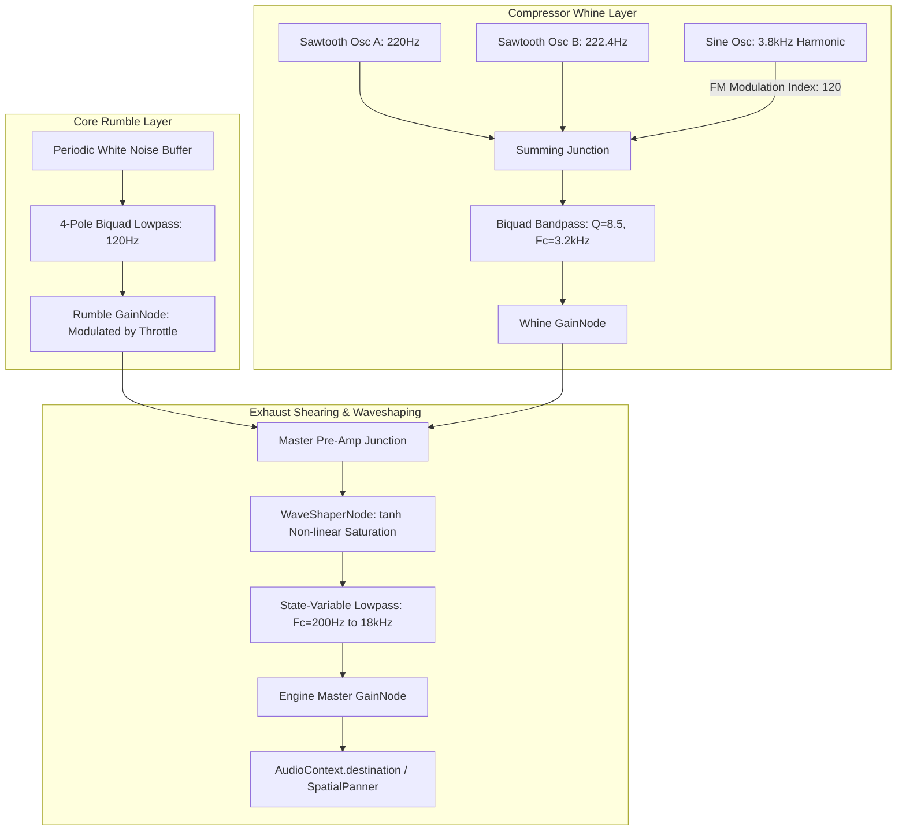
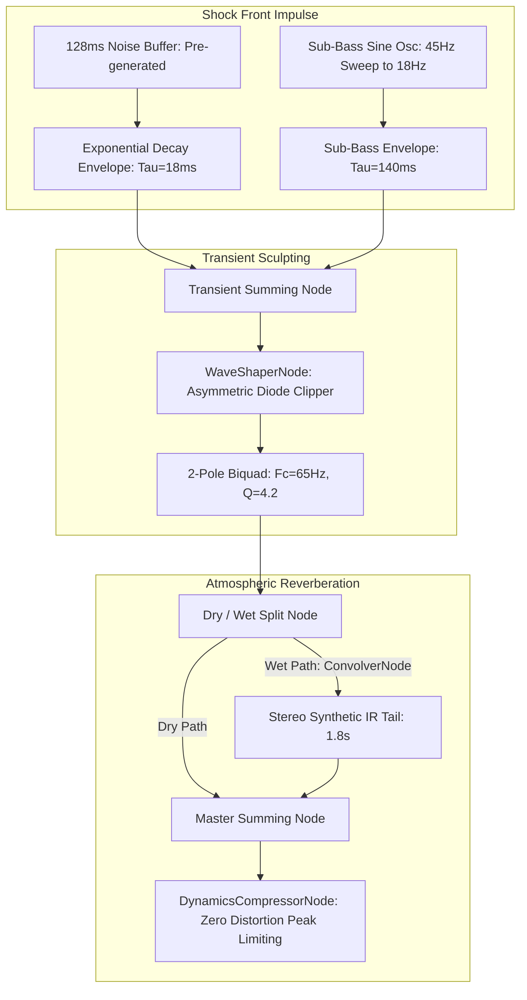
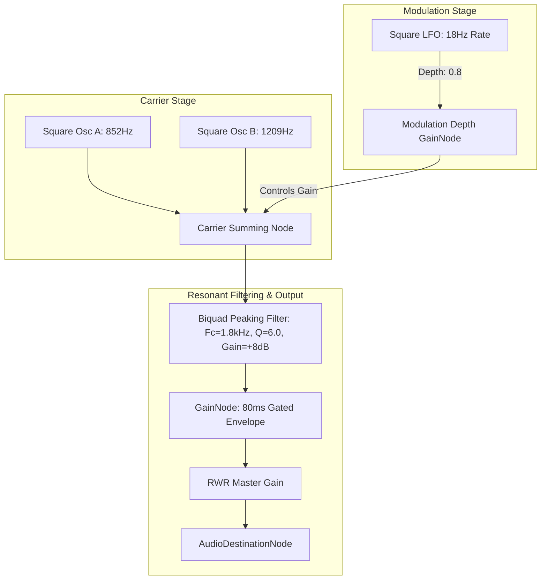

# Procedural Avionics Synthesizer & Web Audio DSP Architecture Specification

## 1. Executive Summary & Architectural Scope

WorkSphere's augmented reality spatial experiences (`AerospaceHUDOverlay.tsx`, `CockpitHUD`, `ARScene.tsx`) incorporate dynamic avionics soundscapes to deliver immersive sensory feedback to mobile and desktop operators. Traditional approaches rely on static, pre-recorded audio sample files (`.mp3` / `.wav`), which incur severe limitations:

1. **Network & Memory Overhead**: High-fidelity looping audio assets consume multi-megabyte payloads, stressing cellular bandwidth and mobile memory caches.
2. **Phase Cancellation & Monotony**: Looped sample playback produces unnatural repeating phase artifacts and repetitive auditory fatigue.
3. **Latency & Inelasticity**: Pre-rendered samples cannot dynamically modulate pitch, thrust, and atmospheric resonance in real time relative to device telemetry.

This specification details a **pure procedural Web Audio DSP synthesis engine**. All sound effects—including jet turbine rumble, sonic boom pressure waves, and Radar Warning Receiver (RWR) tactical chirps—are generated in real time using native `AudioNode` graph trees, custom wavetables, non-linear waveshaping, and zero-allocation memory pooling.

---

## 2. Audio Subsystem Node Graphs & Signal Topologies

### 2.1 Jet Turbine & Afterburner Synthesizer Graph

The jet turbine engine combines three acoustic layers:

- **Low-Frequency Jet Core Rumble**: Pink/Brown noise filtered through a modulated low-pass filter.
- **Compressor Blade Spool Whine**: Twin slightly detuned sawtooth oscillators ($f_0 \approx 180\text{ Hz} - 450\text{ Hz}$) frequency-modulated by a high-pitch blade pass harmonic ($f_{\text{blade}} \approx 2.4\text{ kHz} - 6.8\text{ kHz}$).
- **Turbine Exhaust Shearing**: Hyperbolic tangent waveshaper distortion adding aerodynamic acoustic saturation.



---

### 2.2 Sonic Boom Pressure Wave & Atmospheric Shock Transient

A sonic boom comprises an $N$-wave double pressure transient: a sharp positive pressure shock front followed by rapid rarefaction and a second recompression shock.



---

### 2.3 Tactical Radar Warning Receiver (RWR) & Threat Chirp

The RWR audio alert system models military radar threat annunciators: dual high-frequency carrier square waves modulated by an asynchronous Low-Frequency Oscillator (LFO) to produce unmistakable tactical urgency.



---

## 3. Web Audio DSP Implementation Details

### 3.1 Custom Wavetable Generation (PeriodicWave)

Standard trigonometric oscillators (`sine`, `sawtooth`, `square`) generate harsh or overly simplistic tones. Custom additive wavetables create the complex harmonic signature of turbine compressor blades:

```typescript
export function createTurbinePeriodicWave(context: AudioContext): PeriodicWave {
  // Harmonic coefficients for compressor blade pass frequencies (BPF)
  const n = 32;
  const real = new Float32Array(n);
  const imag = new Float32Array(n);

  // Fundamental (0 Hz DC offset is zero)
  real[0] = 0;
  imag[0] = 0;

  // Additive harmonic series modeling turbine compressor spool
  for (let i = 1; i < n; i++) {
    // Odd harmonics dominant, with high-frequency resonant formant around 8th-12th harmonics
    const formantBoost = Math.exp(-Math.pow(i - 10, 2) / 12.0);
    imag[i] = (1.0 / i) * (0.6 + 1.4 * formantBoost);
    real[i] = (i % 2 === 0 ? 0.05 : 0.2) / i;
  }

  return context.createPeriodicWave(real, imag, {
    disableNormalization: false,
  });
}
```

### 3.2 Non-Linear WaveShaper Distortion Curves

To reproduce acoustic exhaust shearing and aerodynamic turbulence without harsh digital clipping, non-linear hyperbolic tangent saturation curves are pre-computed into `Float32Array` lookup tables:

$$y = \tanh(\alpha \cdot x)$$

```typescript
export function makeTanhDistortionCurve(
  samples = 1024,
  drive = 2.4,
): Float32Array {
  const curve = new Float32Array(samples);
  for (let i = 0; i < samples; ++i) {
    // Map i from [0, samples - 1] to [-1.0, 1.0]
    const x = (i * 2) / (samples - 1) - 1.0;
    curve[i] = Math.tanh(drive * x) / Math.tanh(drive);
  }
  return curve;
}

export function makeAsymmetricShockCurve(samples = 1024): Float32Array {
  const curve = new Float32Array(samples);
  for (let i = 0; i < samples; ++i) {
    const x = (i * 2) / (samples - 1) - 1.0;
    if (x < 0) {
      // Soft parabolic compression on negative rarefaction wave
      curve[i] = Math.tanh(1.5 * x);
    } else {
      // Steep saturation on positive compression shock
      curve[i] = Math.tanh(4.0 * x) * 1.15;
    }
  }
  return curve;
}
```

### 3.3 Noise Generator (Pink & Brownian Filtering)

White noise generated via static circular buffers avoids repetitive sound while eliminating allocations during playback:

```typescript
export function createSharedNoiseBuffer(
  context: AudioContext,
  seconds = 2.0,
): AudioBuffer {
  const bufferSize = context.sampleRate * seconds;
  const buffer = context.createBuffer(1, bufferSize, context.sampleRate);
  const data = buffer.getChannelData(0);

  // Generate uniform white noise with zero DC bias
  for (let i = 0; i < bufferSize; i++) {
    data[i] = Math.random() * 2.0 - 1.0;
  }

  return buffer;
}
```

---

## 4. Zero-Allocation & Garbage Collection (GC) Discipline

Audio synthesis occurs inside real-time threads. Allocating JavaScript objects, arrays, or node instances within animation loops (`requestAnimationFrame`) or pointer move events causes Garbage Collection (GC) pauses that manifest as audible **clicks, pops, and stutter**.

### 4.1 Memory Pooling & Node Pre-Allocation

1. **Pre-instantiated Node Tree**: All oscillators, biquad filters, and gain nodes for the engine soundscape are created once during `initAudioEngine()`.
2. **Gain-Based Muting**: Instead of calling `node.disconnect()` or re-creating nodes, inactive sound effects are muted by clamping gain parameters:
   ```typescript
   gainNode.gain.setTargetAtTime(0.0001, context.currentTime, 0.015);
   ```
3. **Pre-allocated Float32Array Vectors**: Wavetables, distortion curves, and impulse responses are computed at boot and cached in module scope.

### 4.2 Parameter Scheduling Discipline

Never set `AudioParam.value` directly in per-frame tick loops:

- **Incorrect**: `filter.frequency.value = computedFreq;` (causes zipper noise artifacts)
- **Correct**: `filter.frequency.setTargetAtTime(computedFreq, context.currentTime, 0.02);` (smooth exponential smoothing)

---

## 5. Mobile Browser Performance & Budget Guidelines

Mobile devices (iOS Safari, Android Chrome) enforce strict thermal, CPU, and audio thread concurrency constraints:

### 5.1 Resource Budget Specifications

| Performance Metric                 | Mobile Target (iOS / Android) | Desktop Target             | Enforcement Mechanism          |
| :--------------------------------- | :---------------------------- | :------------------------- | :----------------------------- |
| **Max Concurrent AudioNodes**      | $\le 24\text{ nodes}$         | $\le 64\text{ nodes}$      | Hard node-pooling limit        |
| **Audio Thread CPU Load**          | $\le 3.5\%$                   | $\le 1.2\%$                | Simplified filter pole count   |
| **Memory Allocation per Frame**    | $0\text{ bytes}$ (Zero GC)    | $0\text{ bytes}$ (Zero GC) | Static node recycling          |
| **Buffer Memory Footprint**        | $\le 1.2\text{ MB}$           | $\le 4.0\text{ MB}$        | Shared noise & impulse buffers |
| **Startup Initialization Latency** | $\le 45\text{ ms}$            | $\le 20\text{ ms}$         | Deferred AudioContext unlock   |

### 5.2 Mobile AudioContext Lifecycle & Unlocking

Mobile browsers mandate user interaction before playing audio (`AudioContextState === "suspended"`):

```typescript
export async function ensureAudioContextResumed(
  context: AudioContext,
): Promise<void> {
  if (context.state === "suspended") {
    await context.resume();
  }
}
```

All procedural synthesizer activations must attach to primary user tap events (`pointerdown`, `click`, or AR launch buttons) to satisfy mobile autoplay policies.
